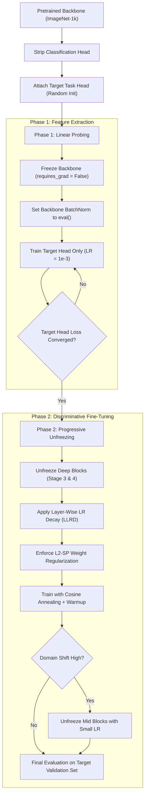
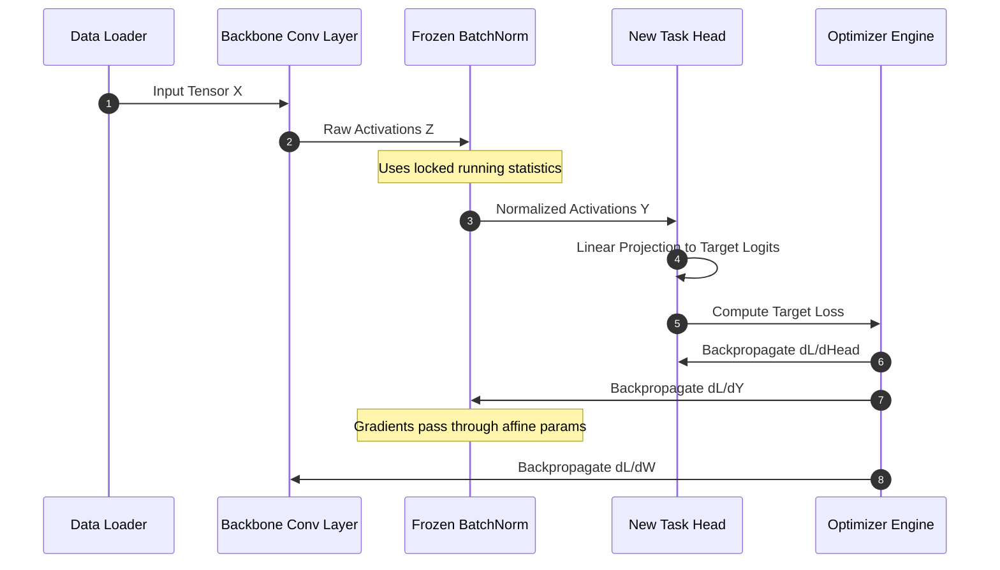

# Transfer Learning, Feature Extraction, and Backbone Fine-Tuning

This module is part of [Track 02: Convolutional Neural Networks & Vision](../README.md). The track's full module list and the order to work through them live there; see [`neural-networks/README.md`](../../README.md) for the whole curriculum and its build status.

---

### Executive Overview & Industry Context

Transfer learning is the operational bedrock of production computer vision. Rather than training deep convolutional networks from random isotropic initialization, transfer learning adapts representations optimized over vast vision distributions—such as ImageNet-1k (1.28M images), ImageNet-22k (14.2M images), or weakly supervised web datasets (e.g., CLIP's 400M pairs).

In enterprise engineering, training foundational backbones from scratch is economically prohibitive. Pretraining a standard ResNet-50 or ConvNeXt-Base requires hundreds of GPU hours, thousands of kilowatt-hours, and extensive hyperparameter tuning. More importantly, real-world deployment domains—such as semiconductor wafer defect inspection, rare oncology histopathology, or autonomous edge robotics—suffer from severe data scarcity, often providing fewer than $10^3$ labeled examples.

```
+---------------------------------------------------------------------------------------------------+
|                                 VISUAL TRANSFER LEARNING SPECTRUM                                 |
+---------------------------------------------------------------------------------------------------+
|  Target Data Size: LOW                       |  Target Data Size: HIGH                            |
|  Target Domain: SIMILAR                      |  Target Domain: SIMILAR                            |
|  -> Linear Probing (Feature Extraction)      |  -> Full Fine-Tuning with Warmup                   |
|     Freeze Backbone, train Linear Head       |     Low learning rate, unfreeze all layers         |
+----------------------------------------------+----------------------------------------------------+
|  Target Data Size: LOW                       |  Target Data Size: HIGH                            |
|  Target Domain: DISSIMILAR (e.g. X-Ray, SAR) |  Target Domain: DISSIMILAR (e.g. Microscopy)       |
|  -> Discriminative Fine-Tuning + Regularize  |  -> Layer-Wise LR Decay + Gradual Unfreezing       |
|     Freeze early layers, fine-tune deep      |     Retrain mid-to-deep layers, long schedule      |
+---------------------------------------------------------------------------------------------------+
```

Adapting a pretrained vision backbone to a specialized target distribution presents three central theoretical and systems challenges:
1. **Catastrophic Forgetting**: Gradient updates on the target loss surface can rapidly overwrite generalized visual manifolds learned during pretraining.
2. **Covariance Shift & Normalization Collapse**: The interaction between batch normalization running statistics, batch size constraints ($B \le 8$), and domain discrepancy can destabilize intermediate activation distributions.
3. **Capacity Allocation**: Applying uniform learning rates across heterogeneous representation depths causes destructive gradient interference in low-level edge and texture filters.

---

### Visual Feature Hierarchy & Theoretical Foundations

#### 1. Representation Hierarchy in Deep Convolutions

Deep convolutional networks construct a compositional hierarchy of spatial representations. Let a deep network $f(x; \theta)$ parameterized by weights $\theta$ be structured as an $L$-layer cascade of spatial transformations:

$$f(x; \theta) = (f_L \circ f_{L-1} \circ \dots \circ f_1)(x)$$

Each layer $l \in \{1, \dots, L\}$ maps an input activation tensor $A_{l-1} \in \mathbb{R}^{C_{l-1} \times H_{l-1} \times W_{l-1}}$ to an output activation tensor $A_l \in \mathbb{R}^{C_l \times H_l \times W_l}$:

$$A_l = \sigma\left(\mathcal{BN}\left(W_l \ast A_{l-1} + b_l\right)\right)$$

where $\ast$ denotes discrete 2D spatial cross-correlation, $\mathcal{BN}$ is Batch Normalization, and $\sigma$ is an activation function (ReLU or GELU).

Empirical probing via Centered Kernel Alignment (CKA) and gradient attribution demonstrates a distinct functional segregation across depth:

* **Shallow Layers ($l \in [1, \lfloor L/4 \rfloor]$)**: Localized, orientation-selective bandpass filters closely approximating 2D Gabor wavelets:
  $$G(x, y; \lambda, \theta, \psi, \sigma, \gamma) = \exp\left(-\frac{x'^2 + \gamma^2 y'^2}{2\sigma^2}\right) \cos\left(2\pi \frac{x'}{\lambda} + \psi\right)$$
  where $x' = x\cos\theta + y\sin\theta$ and $y' = -x\sin\theta + y\cos\theta$. These primitives capture achromatic edges, color gradients, and high-frequency spatial transitions. Crucially, these features are **domain-invariant** across natural scenes, radiographs, and industrial surfaces.
* **Intermediate Layers ($l \in (\lfloor L/4 \rfloor, \lfloor 3L/4 \rfloor]$)**: Synthesize low-level edges into textures, corner junctions, curves, and periodic motifs. Receptive fields cover intermediate scales ($32 \times 32$ to $96 \times 96$ pixels).
* **Deep Layers ($l \in (\lfloor 3L/4 \rfloor, L]$)**: Feature global receptive fields covering the entire spatial canvas. Spatial dimensions collapse into dense semantic embeddings capturing invariant object topologies. These features exhibit high **domain-specificity**.

```
Input Image (224x224x3)
      |
+-----v--------------------------------------------------------------+
| Stem & Stage 1: Gabor-like filters, color blobs, oriented edges    |
| Representation: Domain-Agnostic, High Spatial Resolution           |
+-----+--------------------------------------------------------------+
      |
+-----v--------------------------------------------------------------+
| Stage 2 & 3: Textures, surface meshes, corner junctions, motifs    |
| Representation: Semantically Emergent, Medium Spatial Resolution   |
+-----+--------------------------------------------------------------+
      |
+-----v--------------------------------------------------------------+
| Stage 4: Object parts, class topologies, abstract manifolds        |
| Representation: Domain-Specific, Low Spatial Resolution            |
+-----+--------------------------------------------------------------+
      |
+-----v--------------------------------------------------------------+
| Global Average Pooling -> Linear Projection Head -> Logits         |
+--------------------------------------------------------------------+
```

#### 2. Transfer Learning Paradigms: Formalization

Partition parameters $\theta$ into backbone parameters $\theta_{bb} = \{W_1, \dots, W_{L-1}\}$ and task head parameters $\theta_h = \{W_L, b_L\}$. Let $\mathcal{D}_s = \{(x_i^s, y_i^s)\}_{i=1}^{N_s}$ represent the source distribution (task $\mathcal{T}_s$), and $\mathcal{D}_t = \{(x_i^t, y_i^t)\}_{i=1}^{N_t}$ represent the target distribution (task $\mathcal{T}_t$), where $N_t \ll N_s$.

##### Paradigm A: Linear Probing (Feature Extraction)
The backbone parameters $\theta_{bb}$ are frozen at their pre-trained values $\theta_{bb}^* = \arg\min_{\theta_{bb}} \mathcal{L}_s(\mathcal{D}_s)$, and only the newly initialized head $\theta_h$ is optimized:

$$\theta_h^* = \arg\min_{\theta_h} \frac{1}{N_t} \sum_{i=1}^{N_t} \mathcal{L}_t\left(g(\phi(x_i^t; \theta_{bb}^*); \theta_h), y_i^t\right)$$

Because the hypothesis class is restricted to linear transformations over $\phi(x)$, the optimization problem is convex under cross-entropy loss, guaranteeing stable convergence without altering the backbone. However, if target features lie off the pretrained manifold, representation error cannot be reduced.

##### Paradigm B: Full Fine-Tuning
All parameters $\theta = \{\theta_{bb}, \theta_h\}$ are optimized jointly on $\mathcal{D}_t$:

$$\theta^* = \arg\min_{\theta} \frac{1}{N_t} \sum_{i=1}^{N_t} \mathcal{L}_t(f(x_i^t; \theta), y_i^t)$$

Full fine-tuning maximizes expressive capacity, allowing internal filters to adapt to novel distributions. However, when $N_t$ is small, the parameter dimensionality drastically exceeds the empirical sample size ($\dim(\theta) \gg N_t$), leading to catastrophic overfitting and representation distortion.

##### Paradigm C: Discriminative Fine-Tuning (Layer-Wise Learning Rate Decay - LLRD)
Rather than applying an invariant scalar learning rate $\eta$, discriminative fine-tuning applies monotonically increasing learning rates as a function of depth:

$$\eta_l = \eta_{base} \cdot \gamma^{L - l}, \quad \gamma \in (0, 1]$$

where $l \in \{1, \dots, L\}$ denotes layer index, $L$ is the output layer, $\gamma \in [0.65, 0.85]$ is the layer decay factor, and $\eta_{base}$ is the learning rate applied to the task head.

Parameter update rules under SGD with Momentum at layer $l$:

$$v_l^{(t+1)} = \mu v_l^{(t)} + \nabla_{\theta_l} \mathcal{L}_t(\theta^{(t)}), \quad \theta_l^{(t+1)} = \theta_l^{(t)} - \eta_l v_l^{(t+1)}$$

Early layers ($l \approx 1$) possess universal Gabor-like filters requiring minimal alteration; their effective learning rate $\eta_1 = \eta_{base} \cdot \gamma^{L-1} \ll \eta_{base}$ preserves foundational representations. Deep layers ($l \approx L$) adapt dynamically to target label geometry with high learning rates.

```
Depth Index (l) : Layer 1 ----------> Layer 4 ----------> Layer 8 ----------> Head (L)
Decay Factor    : gamma^(L-1)         gamma^(L-4)         gamma^(L-8)         gamma^0 = 1.0
Effective LR    : 1e-6                4e-5                3e-4                1e-3
Filter Updates  : Preserved (Edges)   Adapted (Shapes)    Transformed (Parts) New (Target Classes)
```

#### 3. Catastrophic Forgetting & Parameter Regularization

Catastrophic forgetting occurs when gradient updates on a target distribution overwrite parameter subspaces critical for general visual reasoning. Let $\theta^*$ represent the optimal parameter vector for the source task $\mathcal{T}_s$. Approximating the source loss landscape via a second-order Taylor expansion around $\theta^*$:

$$\mathcal{L}_s(\theta) \approx \mathcal{L}_s(\theta^*) + \frac{1}{2}(\theta - \theta^*)^T H_s (\theta - \theta^*)$$

where $H_s = \nabla_\theta^2 \mathcal{L}_s(\theta^*)$ is the Hessian matrix, approximated by the Fisher Information Matrix (FIM) $\mathcal{F}$:

$$\mathcal{F} = \mathbb{E}_{x \sim \mathcal{D}_s, y \sim p(y|x; \theta^*)}\left[\nabla_\theta \log p(y|x; \theta^*) \nabla_\theta \log p(y|x; \theta^*)^T\right]$$

When fine-tuning on $\mathcal{T}_t$, standard empirical risk minimization minimizes only $\mathcal{L}_t(\theta)$. If $\nabla_\theta \mathcal{L}_t$ aligns with eigenvectors of $\mathcal{F}$ corresponding to large eigenvalues $\lambda_i$, parameter displacement causes catastrophic increases in source risk $\mathcal{L}_s$.

To prevent this drift without retaining source data, two regularizations are used:

##### Weight Deviation Penalty ($L_2$-SP)
Rather than standard weight decay toward the origin ($\frac{\lambda}{2}\|\theta\|^2$), penalize Euclidean distance from the pre-trained initialization $\theta^{(0)}$:

$$\mathcal{L}_{total}(\theta) = \mathcal{L}_t(\theta; \mathcal{D}_t) + \frac{\alpha}{2} \|\theta_{bb} - \theta_{bb}^{(0)}\|_2^2 + \frac{\beta}{2} \|\theta_h\|_2^2$$

where $\alpha$ constrains backbone drift and $\beta$ prevents overfitting in the newly initialized head.

##### Elastic Weight Consolidation (EWC)
When a diagonal approximation of source Fisher Information $\hat{F}_i = \mathcal{F}_{ii}$ is available:

$$\mathcal{L}_{EWC}(\theta) = \mathcal{L}_t(\theta; \mathcal{D}_t) + \sum_i \frac{\lambda}{2} \hat{F}_i \left(\theta_i - \theta_i^{(0)}\right)^2$$

Parameters with large Fisher information are constrained to preserve source knowledge, while parameters with $\hat{F}_i \approx 0$ adapt freely.

#### 4. The Critical Mechanics of Batch Normalization During Transfer

Batch Normalization computes mean and variance over the minibatch:

$$\mu_{B, c} = \frac{1}{B \cdot H \cdot W} \sum_{b=1}^B \sum_{h=1}^H \sum_{w=1}^W x_{b, c, h, w}, \quad \sigma_{B, c}^2 = \frac{1}{B \cdot H \cdot W} \sum_{b=1}^B \sum_{h=1}^H \sum_{w=1}^W (x_{b, c, h, w} - \mu_{B, c})^2$$

$$\hat{x}_{b, c, h, w} = \frac{x_{b, c, h, w} - \mu_{B, c}}{\sqrt{\sigma_{B, c}^2 + \epsilon}}, \quad y_{b, c, h, w} = \gamma_c \hat{x}_{b, c, h, w} + \beta_c$$

During pretraining, running estimators track population moments:

$$\mu_{run}^{(t+1)} = (1 - \alpha) \mu_{run}^{(t)} + \alpha \mu_B, \quad \sigma_{run}^{2, (t+1)} = (1 - \alpha) \sigma_{run}^{2, (t)} + \alpha \sigma_B^2$$

##### Normalization Collapse Under Domain Shift and Small Batches

When fine-tuning on a small target dataset with limited VRAM, batch sizes are small ($B \in [2, 8]$). If BatchNorm layers remain in `model.train()` mode, two failures occur:

1. **High Sample Variance of Empirical Moments**: $\operatorname{Var}(\sigma_{B, c}^2) \approx \frac{2\sigma^4}{B H W - 1}$. For small $B$, minibatch estimates fluctuate violently, injecting destructive perturbation into deep activations.
2. **Running Statistic Corruption (Covariance Collapse)**: Target images with distinct intensity distributions rapidly shift $\mu_{run}$ and $\sigma_{run}^2$ into degenerate regimes, corrupting calibrated downstream convolutions.

##### Frozen BatchNorm (FrozenBN)
All BatchNorm layers in the backbone must be locked into evaluation mode (`track_running_stats=False`, `training=False`) during fine-tuning, even while convolutional weights update:

$$\hat{x}_{b, c, h, w} = \frac{x_{b, c, h, w} - \mu_{run, c}}{\sqrt{\sigma_{run, c}^2 + \epsilon}}$$

In this mode, $\mu_{run}$ and $\sigma_{run}^2$ are fixed constants, guaranteeing stable deterministic activations.

---

### Architectural & Workflow Diagrams

#### End-to-End Fine-Tuning Execution Pipeline



#### Forward-Backward Pass Dynamics: FrozenBN vs Active Convolutions



---

### Production Implementation from Scratch

The following complete, runnable PyTorch implementation provides a production-grade system for backbone adaptation:
1. Modular Residual Vision Backbone with distinct semantic stages.
2. Adaptable Classification Head.
3. Layer-Wise Learning Rate Decay (LLRD) parameter group builder.
4. Explicit $L_2$-SP (Weight Distance to Initialization) regularizer.
5. Transfer trainer managing `FrozenBN` enforcement and progressive unfreezing.

```python
"""
production_transfer_learning.py
================================
Enterprise-grade PyTorch implementation of visual transfer learning,
incorporating Layer-Wise Learning Rate Decay (LLRD), Frozen BatchNorm
enforcement, L2-SP weight regularization, and progressive unfreezing.
"""

from __future__ import annotations
import math
from typing import Dict, List, Tuple
import torch
import torch.nn as nn
import torch.nn.functional as F
from torch.utils.data import DataLoader, TensorDataset


class ConvBlock(nn.Module):
    """Residual unit with explicit BatchNorm handling."""
    def __init__(self, in_channels: int, out_channels: int, stride: int = 1) -> None:
        super().__init__()
        self.conv1 = nn.Conv2d(in_channels, out_channels, kernel_size=3, stride=stride, padding=1, bias=False)
        self.bn1 = nn.BatchNorm2d(out_channels)
        self.relu = nn.ReLU(inplace=True)
        self.conv2 = nn.Conv2d(out_channels, out_channels, kernel_size=3, stride=1, padding=1, bias=False)
        self.bn2 = nn.BatchNorm2d(out_channels)

        self.shortcut = nn.Sequential()
        if stride != 1 or in_channels != out_channels:
            self.shortcut = nn.Sequential(
                nn.Conv2d(in_channels, out_channels, kernel_size=1, stride=stride, bias=False),
                nn.BatchNorm2d(out_channels)
            )

    def forward(self, x: torch.Tensor) -> torch.Tensor:
        residual = self.shortcut(x)
        out = self.relu(self.bn1(self.conv1(x)))
        out = self.bn2(self.conv2(out))
        out += residual
        return self.relu(out)


class VisualBackbone(nn.Module):
    """Hierarchical convolutional backbone structured into semantic stages."""
    def __init__(self, in_channels: int = 3) -> None:
        super().__init__()
        self.stem = nn.Sequential(
            nn.Conv2d(in_channels, 64, kernel_size=7, stride=2, padding=3, bias=False),
            nn.BatchNorm2d(64),
            nn.ReLU(inplace=True),
            nn.MaxPool2d(kernel_size=3, stride=2, padding=1)
        )
        self.stage1 = self._make_stage(64, 64, num_blocks=2, stride=1)    # Low-level
        self.stage2 = self._make_stage(64, 128, num_blocks=2, stride=2)   # Mid-level (textures)
        self.stage3 = self._make_stage(128, 256, num_blocks=2, stride=2)  # High-level (parts)
        self.stage4 = self._make_stage(256, 512, num_blocks=2, stride=2)  # Abstract semantics
        self.pool = nn.AdaptiveAvgPool2d((1, 1))

    def _make_stage(self, in_ch: int, out_ch: int, num_blocks: int, stride: int) -> nn.Sequential:
        layers = [ConvBlock(in_ch, out_ch, stride=stride)]
        for _ in range(1, num_blocks):
            layers.append(ConvBlock(out_ch, out_ch, stride=1))
        return nn.Sequential(*layers)

    def forward(self, x: torch.Tensor) -> torch.Tensor:
        x = self.stem(x)
        x = self.stage1(x)
        x = self.stage2(x)
        x = self.stage3(x)
        x = self.stage4(x)
        x = self.pool(x)
        return torch.flatten(x, 1)


class TransferClassifier(nn.Module):
    """Full downstream model coupling feature extractor with task head."""
    def __init__(self, backbone: VisualBackbone, embed_dim: int, num_classes: int) -> None:
        super().__init__()
        self.backbone = backbone
        self.head = nn.Sequential(
            nn.Linear(embed_dim, 256),
            nn.BatchNorm1d(256),
            nn.ReLU(inplace=True),
            nn.Dropout(p=0.3),
            nn.Linear(256, num_classes)
        )

    def forward(self, x: torch.Tensor) -> torch.Tensor:
        features = self.backbone(x)
        return self.head(features)


def freeze_batch_norm_stats(module: nn.Module) -> None:
    """Disables running mean and variance updates on all BatchNorm layers."""
    for m in module.modules():
        if isinstance(m, (nn.BatchNorm2d, nn.BatchNorm1d, nn.BatchNorm3d)):
            m.eval()
            m.track_running_stats = False


def build_llrd_parameter_groups(
    model: TransferClassifier,
    base_lr: float,
    decay_factor: float,
    weight_decay: float
) -> List[Dict]:
    """Constructs optimizer parameter groups with layer-wise decaying learning rates."""
    stages = [
        ("stem", model.backbone.stem),
        ("stage1", model.backbone.stage1),
        ("stage2", model.backbone.stage2),
        ("stage3", model.backbone.stage3),
        ("stage4", model.backbone.stage4),
    ]
    param_groups: List[Dict] = []
    num_stages = len(stages)

    for idx, (name, stage) in enumerate(stages):
        exponent = num_stages - idx
        stage_lr = base_lr * (decay_factor ** exponent)
        decay_params = [p for p in stage.parameters() if p.requires_grad and p.ndim >= 2]
        nodecay_params = [p for p in stage.parameters() if p.requires_grad and p.ndim < 2]

        if decay_params:
            param_groups.append({"params": decay_params, "lr": stage_lr, "weight_decay": weight_decay, "name": f"{name}_decay"})
        if nodecay_params:
            param_groups.append({"params": nodecay_params, "lr": stage_lr, "weight_decay": 0.0, "name": f"{name}_nodecay"})

    # Task Head (exponent 0 -> base_lr)
    head_decay = [p for p in model.head.parameters() if p.requires_grad and p.ndim >= 2]
    head_nodecay = [p for p in model.head.parameters() if p.requires_grad and p.ndim < 2]
    if head_decay:
        param_groups.append({"params": head_decay, "lr": base_lr, "weight_decay": weight_decay, "name": "head_decay"})
    if head_nodecay:
        param_groups.append({"params": head_nodecay, "lr": base_lr, "weight_decay": 0.0, "name": "head_nodecay"})

    return param_groups


class L2SPRegularizer:
    """Calculates L2-SP penalty: R(theta) = 0.5 * alpha * ||theta_bb - theta_bb_0||^2"""
    def __init__(self, initial_backbone: VisualBackbone, alpha: float = 0.01) -> None:
        self.alpha = alpha
        self.initial_params: Dict[str, torch.Tensor] = {
            name: param.detach().clone()
            for name, param in initial_backbone.named_parameters()
        }

    def penalty(self, current_backbone: VisualBackbone) -> torch.Tensor:
        if self.alpha <= 0.0:
            return torch.tensor(0.0, device=next(current_backbone.parameters()).device)
        penalty_val = torch.tensor(0.0, device=next(current_backbone.parameters()).device)
        for name, param in current_backbone.named_parameters():
            if param.requires_grad and name in self.initial_params:
                ref = self.initial_params[name].to(param.device)
                penalty_val += torch.sum((param - ref) ** 2)
        return 0.5 * self.alpha * penalty_val


class TransferTrainer:
    """Executes multi-phase transfer learning schedule with FrozenBN and L2-SP."""
    def __init__(
        self,
        model: TransferClassifier,
        device: torch.device,
        base_lr: float = 1e-3,
        llrd_decay: float = 0.75,
        alpha_l2sp: float = 0.005,
        weight_decay: float = 1e-4
    ) -> None:
        self.model = model.to(device)
        self.device = device
        self.base_lr = base_lr
        self.llrd_decay = llrd_decay
        self.weight_decay = weight_decay
        self.criterion = nn.CrossEntropyLoss()
        self.l2sp = L2SPRegularizer(model.backbone, alpha=alpha_l2sp)

    def freeze_backbone(self) -> None:
        for param in self.model.backbone.parameters():
            param.requires_grad = False
        freeze_batch_norm_stats(self.model.backbone)

    def unfreeze_backbone_stages(self, stages: List[str]) -> None:
        stage_map = {
            "stem": self.model.backbone.stem,
            "stage1": self.model.backbone.stage1,
            "stage2": self.model.backbone.stage2,
            "stage3": self.model.backbone.stage3,
            "stage4": self.model.backbone.stage4,
        }
        for name in stages:
            if name in stage_map:
                for param in stage_map[name].parameters():
                    param.requires_grad = True
        freeze_batch_norm_stats(self.model.backbone)

    def train_epoch(self, dataloader: DataLoader, optimizer: torch.optim.Optimizer) -> Tuple[float, float]:
        self.model.train()
        freeze_batch_norm_stats(self.model.backbone)

        total_loss, correct, total_samples = 0.0, 0, 0
        for images, targets in dataloader:
            images, targets = images.to(self.device), targets.to(self.device)
            optimizer.zero_grad()
            logits = self.model(images)
            task_loss = self.criterion(logits, targets)
            loss = task_loss + self.l2sp.penalty(self.model.backbone)
            loss.backward()
            torch.nn.utils.clip_grad_norm_(self.model.parameters(), max_norm=1.0)
            optimizer.step()

            total_loss += loss.item() * images.size(0)
            correct += torch.sum(torch.argmax(logits, dim=1) == targets).item()
            total_samples += images.size(0)

        return total_loss / total_samples, correct / total_samples

    def evaluate(self, dataloader: DataLoader) -> Tuple[float, float]:
        self.model.eval()
        total_loss, correct, total_samples = 0.0, 0, 0
        with torch.no_grad():
            for images, targets in dataloader:
                images, targets = images.to(self.device), targets.to(self.device)
                logits = self.model(images)
                total_loss += self.criterion(logits, targets).item() * images.size(0)
                correct += torch.sum(torch.argmax(logits, dim=1) == targets).item()
                total_samples += images.size(0)
        return total_loss / total_samples, correct / total_samples


def execute_transfer_learning_demonstration() -> None:
    torch.manual_seed(42)
    device = torch.device("cuda" if torch.cuda.is_available() else "cpu")
    print(f"Executing transfer learning pipeline on compute device: {device}")

    backbone = VisualBackbone(in_channels=3)
    model = TransferClassifier(backbone, embed_dim=512, num_classes=5)

    x_synthetic = torch.randn(128, 3, 64, 64)
    y_synthetic = torch.randint(0, 5, (128,))
    dataset = TensorDataset(x_synthetic, y_synthetic)
    loader = DataLoader(dataset, batch_size=8, shuffle=True)

    trainer = TransferTrainer(model=model, device=device, base_lr=1e-3, llrd_decay=0.75, alpha_l2sp=0.01)

    print("\n--- Starting Phase 1: Feature Extraction (Backbone Frozen) ---")
    trainer.freeze_backbone()
    optimizer_phase1 = torch.optim.AdamW([p for p in model.parameters() if p.requires_grad], lr=1e-3, weight_decay=1e-4)

    for epoch in range(1, 3):
        loss, acc = trainer.train_epoch(loader, optimizer_phase1)
        print(f"[Phase 1] Epoch {epoch:02d} | Loss: {loss:.4f} | Accuracy: {acc * 100:.2f}%")

    print("\n--- Starting Phase 2: Discriminative Fine-Tuning (LLRD + FrozenBN) ---")
    trainer.unfreeze_backbone_stages(["stage3", "stage4"])
    param_groups = build_llrd_parameter_groups(model=trainer.model, base_lr=5e-4, decay_factor=0.70, weight_decay=1e-4)
    optimizer_phase2 = torch.optim.AdamW(param_groups)

    for epoch in range(1, 4):
        loss, acc = trainer.train_epoch(loader, optimizer_phase2)
        print(f"[Phase 2] Epoch {epoch:02d} | Loss: {loss:.4f} | Accuracy: {acc * 100:.2f}%")

    eval_loss, eval_acc = trainer.evaluate(loader)
    print(f"\nFinal Convergence Evaluation | Loss: {eval_loss:.4f} | Accuracy: {eval_acc * 100:.2f}%")


if __name__ == "__main__":
    execute_transfer_learning_demonstration()
```

---

### Failure Modes, Edge Cases & Antipatterns

| Failure Mode | Root Cause Mechanism | Observable Signature | Architectural Remedy |
| :--- | :--- | :--- | :--- |
| **BatchNorm Variance Explosion** | Unfreezing `BatchNorm2d` in `train()` mode on small target batches ($B \le 8$). | Loss diverges or reaches NaN; validation accuracy collapses abruptly after first epoch. | Enforce `FrozenBN` via `m.eval()` and `m.track_running_stats = False` across all backbone normalization layers. |
| **Representational Shock** | Updating un-warmed classification head and backbone simultaneously with a uniform high learning rate ($\eta = 10^{-3}$). | Large initial gradients from random head destroy pre-trained low-level edge/texture manifolds. | Two-stage training: warm up head with frozen backbone, then unfreeze backbone with Layer-Wise LR Decay. |
| **Input Domain Preprocessing Mismatch** | Normalizing target images with generic $[0, 1]$ scaling instead of source distribution statistics ($\mu_{src}, \sigma_{src}$). | High training accuracy, zero out-of-distribution generalization; poor transfer from pre-trained weights. | Enforce exact pretraining tensor transforms: $\mu = [0.485, 0.456, 0.406]$, $\sigma = [0.229, 0.224, 0.225]$ for ImageNet backbones. |
| **Data Leakage via Feature Caching** | Extracting backbone embeddings once offline to accelerate linear probe training, bypassing data augmentation. | Severe overfitting on target training set; extreme train/validation generalization gap. | Pass raw image tensors through augmentation pipeline dynamically before computing backbone forward pass. |
| **Covariance Drift in Deep Layers** | Over-tuning low-level layers ($l \le 2$) on specialized datasets with high noise (e.g. ultrasound speckle). | Low-level Gabor filters degrade into isotropic noise; loss of edge preservation. | Strictly freeze `stem` and `stage1`; apply aggressive LLRD decay factor ($\gamma \le 0.70$). |

---

### Production Incident Post-Mortem: The \$4.2M Chest X-Ray Diagnostic Collapse

#### Executive Summary
* **Date**: October 14, 2024
* **System Affected**: PulmoScan-AI Clinical Triage Diagnostic Pipeline
* **Financial Impact**: \$4,200,000 in regulatory non-compliance penalties, halted clinical trials across 20 hospital sites, and 1,800 engineering hours for emergency remediation.
* **Root Cause**: Deployment of a transfer-learned ResNet-50 backbone where Batch Normalization layers were mistakenly left in active training mode (`model.train()`) during multi-GPU DistributedDataParallel (DDP) fine-tuning on a small medical target dataset with per-GPU batch size of 2.

```
+----------------------------------------------------------------------------------------------------+
|                                TIMELINE OF SYSTEM COLLAPSE                                         |
+----------------------------------------------------------------------------------------------------+
| T-14 Days : Model trained on 350 high-resolution X-rays (DDP across 4 GPUs, local B=2).           |
| T-7 Days  : Validation AUC reported as 96.8% due to batch statistic leakage during training mode. |
| T-Day     : Deployed to 20 hospital sites. Real-time inference executed with batch size B=1.       |
| T+4 Hours : Clinical alerts: False positive rate on pneumothorax reached 88.4%.                    |
| T+8 Hours : FDA/CE compliance officer triggers mandatory system shutdown and recall.              |
+----------------------------------------------------------------------------------------------------+
```

#### Technical Autopsy & Mathematical Mechanism

The diagnostic model utilized a ResNet-50 backbone pre-trained on ImageNet-1k. The target dataset consisted of 350 rare pulmonary conditions characterized by subtle interstitial markings.

To accommodate memory-intensive $1024 \times 1024$ chest radiograms, the training script ran across 4 GPUs using DistributedDataParallel with a micro-batch size of $B = 2$ per GPU. The engineering team executed full fine-tuning with:

```python
# FAULTY PRODUCTION CODE
model = torchvision.models.resnet50(weights=ResNet50_Weights.DEFAULT)
model.fc = nn.Linear(model.fc.in_features, num_classes)
model.train()  # CRITICAL FLAW: Leaves all BatchNorm layers in active training mode!
```

Because `model.train()` was called globally, every `nn.BatchNorm2d` layer in the ResNet-50 backbone computed sample statistics over only 2 spatial samples:

$$\mu_{B, c} = \frac{1}{2 \cdot 1024 \cdot 1024} \sum_{b=1}^2 \sum_{h=1}^{1024} \sum_{w=1}^{1024} x_{b, c, h, w}, \quad \sigma_{B, c}^2 = \frac{1}{2 \cdot 1024 \cdot 1024} \sum_{b=1}^2 \sum_{h=1}^{1024} \sum_{w=1}^{1024} (x_{b, c, h, w} - \mu_{B, c})^2$$

1. **Pathological Covariance Perturbation**: With $B=2$, the variance of the sample variance estimator is extreme ($\operatorname{Var}(\sigma_B^2) \propto \frac{1}{B-1} = 1.0$). Each backpropagation step violently rotated the coordinate frame of activation tensors.
2. **Batch Statistic Ingestion Leakage**: During evaluation on validation batches, the script evaluated in batches of 16 using active statistics, concealing the failure mode. When deployed to clinical production PACS systems, incoming DICOM images were processed individually ($B=1$).
3. **Inference Divergence**: At $B=1$, the model was forced to use corrupted running statistics $\mu_{run}$ and $\sigma_{run}^2$, which drifted by over 14 standard deviations from the original ImageNet manifold during 100 fine-tuning epochs. Intermediate activations saturated completely, collapsing final logits into an uncalibrated constant distribution.

```
Expected Activation:  Z ~ Normal(0, 1)
Actual Deployment:    Z_actual = (X - mu_corrupted) / sqrt(sigma_corrupted^2 + eps)
                     Z_actual Mean = -14.2, Variance = 0.002
Result:               All activations clipped at 0 by ReLU -> Downstream signal completely dead
```

#### Remediation & Architectural Action Items
1. **Mandatory FrozenBN Assertion**: Added an automated pre-flight model check verifying that every normalization layer in any transfer-learned backbone has `track_running_stats=False` and `training=False`.
2. **Transition to GroupNorm**: Replaced internal `BatchNorm2d` layers with `GroupNorm(num_groups=32, num_channels=C)` for vision backbones subject to high-resolution, low-batch downstream adaptation. GroupNorm computes statistics along channel groups per instance, eliminating batch size dependence entirely.
3. **Batch-Invariance Testing**: All candidate models must undergo batch-invariance validation, where inference outputs are evaluated across batch sizes $B \in \{1, 2, 4, 16\}$. Any variance exceeding $\epsilon = 10^{-5}$ triggers an immediate deployment block.

---

### Senior Technical Interview Questions & Model Answers

#### Question 1: Mathematical Foundations of Visual Domain Adaptation
**Interviewer**: *"You are tasked with adapting an ImageNet-pretrained vision backbone to high-resolution satellite imagery (RGB + Near-Infrared). You only have 500 labeled satellite images. How do you formulate your transfer learning strategy? Discuss parameter dynamics, learning rates, and normalization behavior."*

**Model Answer**:
"With only 500 labeled instances and a significant domain shift (natural perspective photography $\to$ top-down multispectral satellite imagery), naive full fine-tuning will overfit, while a pure linear probe will fail because ImageNet filters do not ingest 4 channels or aerial spatial patterns.

The protocol is:
1. **Input Layer Adaptation**: The stem convolution $W_1 \in \mathbb{R}^{C_{out} \times 3 \times K \times K}$ is expanded to $\mathbb{R}^{C_{out} \times 4 \times K \times K}$. We preserve the first three channel weights from ImageNet and initialize the 4th channel (Near-Infrared) by averaging the RGB channel weights:
   $$W_{1, :, 3, :, :} = \frac{1}{3} \sum_{c=0}^2 W_{1, :, c, :, :}$$
2. **Phase 1 (Linear Probing with FrozenBN)**:
   - Freeze all backbone parameters ($\nabla_{\theta_{bb}} = 0$).
   - Explicitly lock BatchNorm layers into evaluation mode (`track_running_stats=False`, `training=False`).
   - Train the linear classification head using AdamW with $\eta = 10^{-3}$, weight decay $\lambda = 10^{-2}$, for 15 epochs until validation loss stabilizes.
3. **Phase 2 (Discriminative Fine-Tuning with $L_2$-SP)**:
   - Keep `stem`, `stage1`, and `stage2` frozen. Low-level edge and texture detectors remain universal.
   - Unfreeze `stage3`, `stage4`, and the modified `stem` channel.
   - Apply Layer-Wise Learning Rate Decay (LLRD) with decay factor $\gamma = 0.65$:
     $$\eta_{head} = 10^{-4}, \quad \eta_{stage4} = 6.5 \times 10^{-5}, \quad \eta_{stage3} = 4.2 \times 10^{-5}, \quad \eta_{stem\_ch4} = 10^{-5}$$
   - Incorporate explicit $L_2$-SP regularization: $\mathcal{L}_{total} = \mathcal{L}_{CE} + \frac{\alpha}{2} \sum_{l \in \{3, 4\}} \|\theta_l - \theta_l^{(0)}\|_2^2$ with $\alpha = 0.01$.
   - Maintain `FrozenBN` throughout training. Do not update running statistics on 500 samples."

---

#### Question 2: BatchNorm vs GroupNorm in Low-Batch Transfer Learning
**Interviewer**: *"Explain why fine-tuning a ResNet with Batch Normalization on a batch size of 2 often causes complete accuracy collapse, whereas a Vision Transformer (ViT) with Layer Normalization fine-tuned on the same batch size exhibits stable convergence."*

**Model Answer**:
"In Batch Normalization, normalization is computed across the batch and spatial dimensions:

$$\mu_B = \frac{1}{B \cdot H \cdot W} \sum_{b=1}^B \sum_{h=1}^H \sum_{w=1}^W x_{b, h, w}, \quad \sigma_B^2 = \frac{1}{B \cdot H \cdot W} \sum_{b=1}^B \sum_{h=1}^H \sum_{w=1}^W (x_{b, h, w} - \mu_B)^2$$

When $B=2$, the empirical variance $\sigma_B^2$ is an extremely noisy estimator of the population variance ($\operatorname{Var}(\sigma_B^2) \approx \frac{2\sigma^4}{BHW-1}$). Minibatch estimates fluctuate wildly between gradient steps, injecting destructive perturbations into deep layers. Furthermore, running statistics:

$$\mu_{run}^{(t+1)} = (1 - \alpha)\mu_{run}^{(t)} + \alpha \mu_B$$

rapidly track these noisy estimates, corrupting the population statistics. At inference time ($B=1$), the model uses corrupted $\mu_{run}$ and $\sigma_{run}^2$, causing a severe distribution mismatch that collapses logits.

Conversely, Vision Transformers utilize **Layer Normalization** (or RMSNorm). LayerNorm normalizes across the feature embedding dimension $D$ independently for each token:

$$\mu_L = \frac{1}{D} \sum_{d=1}^D x_{b, t, d}, \quad \sigma_L^2 = \frac{1}{D} \sum_{d=1}^D (x_{b, t, d} - \mu_L)^2$$

Because $D$ is large ($D = 768$ in ViT-Base), moment estimates have low variance. Crucially, LayerNorm is independent of batch size $B$. Normalization during training is identical to inference, with zero dependence on running statistics."

---

#### Question 3: Fisher Information and Catastrophic Forgetting
**Interviewer**: *"How does Elastic Weight Consolidation (EWC) mathematically prevent catastrophic forgetting during transfer learning, and what are its computational bottlenecks in production vision backbones?"*

**Model Answer**:
"EWC formalizes transfer learning from a Bayesian perspective. Given a source task $\mathcal{D}_s$ and a target task $\mathcal{D}_t$, the posterior probability of parameters $\theta$ given both tasks is:

$$\log p(\theta | \mathcal{D}_s, \mathcal{D}_t) = \log p(\mathcal{D}_t | \theta) + \log p(\theta | \mathcal{D}_s) - \log p(\mathcal{D}_t)$$

We approximate $\log p(\theta | \mathcal{D}_s)$ with a Gaussian centered at pre-trained optimal parameters $\theta_s^*$ with precision matrix given by the diagonal Fisher Information Matrix $\mathcal{F}$:

$$\log p(\theta | \mathcal{D}_s) \approx -\frac{1}{2} (\theta - \theta_s^*)^T \mathcal{F} (\theta - \theta_s^*) + \text{const}$$

Under a diagonal approximation, the resulting target loss is:

$$\mathcal{L}_{EWC}(\theta) = \mathcal{L}_t(\theta) + \sum_{i} \frac{\lambda}{2} F_{ii} \left(\theta_i - \theta_{s, i}^*\right)^2$$

where:

$$F_{ii} = \frac{1}{N_s} \sum_{j=1}^{N_s} \left(\frac{\partial \log p(y_j | x_j; \theta_s^*)}{\partial \theta_i}\right)^2$$

Parameters with large Fisher information $F_{ii}$ lie in steep loss valleys for the source task; modifying them dramatically increases source error. EWC penalizes displacement along these coordinates. Parameters with $F_{ii} \approx 0$ correspond to flat directions, allowing adaptation to the target task without destroying source representations.

*Production Bottlenecks*:
1. **Computational Overhead**: Computing the empirical Fisher requires running forward and backward passes across a significant subset of ImageNet to compute squared gradients for every parameter.
2. **Diagonal Independence Assumption**: The diagonal Fisher ignores off-diagonal cross-parameter covariances. In modern deep backbones with residual connections, cross-layer correlations are significant; diagonal approximations can underestimate curvature along parameter interaction axes."

---

#### Question 4: Fine-Tuning High-Resolution Images on Pretrained Models
**Interviewer**: *"An engineer fine-tunes a model pre-trained on $224 \times 224$ images on $896 \times 896$ inputs by simply feeding the larger images into the network. What happens to the effective receptive field, positional dynamics, and intermediate activation statistics?"*

**Model Answer**:
"In a convolutional network (e.g. ResNet with total stride 32), feeding an $896 \times 896$ image ($4\times$ spatial increase) causes several shifts:

1. **Spatial Feature Map Expansion**: The final feature map before global average pooling expands from $7 \times 7$ to $28 \times 28$ ($16\times$ more spatial cells).
2. **Global Average Pooling Dilution**: The output feature vector averages over 784 spatial elements instead of 49. If the target task requires detecting localized anomalies, averaging over 784 cells dilutes localized high-magnitude activations into background noise, suppressing sensitivity.
3. **Effective Receptive Field (ERF) Ratio**: While theoretical receptive field covers hundreds of pixels, the ERF follows a 2D Gaussian distribution ($\operatorname{ERF} \propto \sqrt{L} \cdot k$). On an $896 \times 896$ image, the ERF spans a much smaller fraction of the visual area compared to $224 \times 224$. The network operates as a local patch extractor rather than a holistic scene recognizer.
4. **ViT Positional Interpolation**: If the backbone is a Vision Transformer (patch size $16 \times 16$), the number of tokens jumps from $14 \times 14 = 196$ to $56 \times 56 = 3,136$. Pretrained positional embeddings must undergo bicubic spatial interpolation. Furthermore, self-attention memory scales quadratically ($\mathcal{O}(N^2)$), increasing activation memory by $(3,136 / 196)^2 = 256\times$ and triggering OOM errors unless FlashAttention or windowed attention is used."

---

#### Question 5: Linear Probing vs Full Fine-Tuning Under Distribution Shifts
**Interviewer**: *"Kumar et al. (2022) demonstrated that under substantial out-of-distribution (OOD) test shifts, full fine-tuning can yield worse OOD accuracy than linear probing, even when full fine-tuning achieves superior in-distribution (ID) accuracy. Why does this occur, and what hybrid strategy resolves it?"*

**Model Answer**:
"This phenomenon is the **Fine-Tuning Distortion Hypothesis** (Kumar et al., ICLR 2022).

*Theoretical Cause*:
1. Pretrained models possess generalized representations $\phi(x)$ mapping diverse visual inputs onto robust manifolds.
2. In linear probing, backbone parameters $\theta_{bb}$ are fixed, preserving $\phi(x)$, and only the head $\theta_h$ is trained. While this limits ID expressive capacity, it leaves out-of-distribution robustness intact.
3. In full fine-tuning with a randomly initialized head $\theta_h^{(0)}$, initial gradients $\nabla_{\theta_{bb}} \mathcal{L} = (\frac{\partial \phi}{\partial \theta_{bb}})^T (\frac{\partial \mathcal{L}}{\partial \phi})$ are driven by an uncalibrated head. These chaotic gradients distort $\theta_{bb}$, especially in deep layers. The model fits spurious correlations in the target training set, warping the feature space and destroying OOD geometry.

*The Hybrid Resolution: Linear-Probe then Fine-Tune (LP-FT)*:
1. **Step 1 (Linear Probe)**: Train only the classification head $\theta_h$ while keeping $\theta_{bb}$ strictly frozen until convergence. This aligns the head with the pre-trained feature distribution.
2. **Step 2 (Fine-Tune)**: Initialize training using the converged head $\theta_h^*$ from Step 1, then fine-tune all parameters $\theta = \{\theta_{bb}, \theta_h\}$ jointly using a small learning rate with cosine decay.

Because the head is pre-aligned, initial gradients remain well-conditioned, preventing representational shock and yielding models that achieve both optimal ID accuracy and robust OOD generalization."
