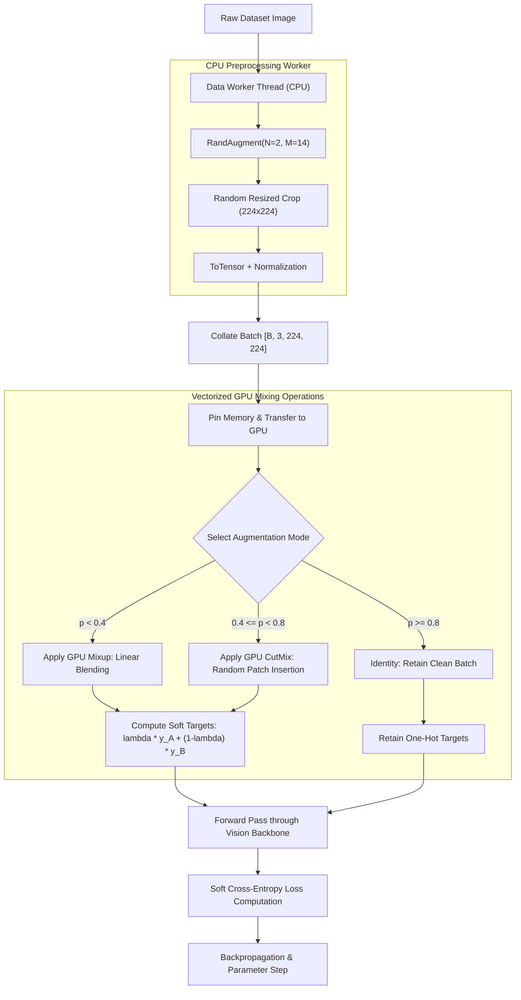
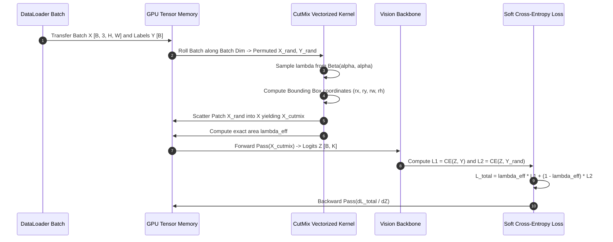

# Vision Augmentation: Albumentations, Mixup, CutMix, and RandAugment

This module is part of [Track 02: Convolutional Neural Networks & Vision](../README.md). The track's full module list and the order to work through them live there; see [`neural-networks/README.md`](../../README.md) for the whole curriculum and its build status.

---

### Executive Overview & Industry Context

Generalization error in deep vision architectures is governed by the geometry of the empirical data distribution. In visual classification, object detection, and spatial segmentation, collecting millions of densely labeled samples is rarely feasible. Models optimized purely via Empirical Risk Minimization (ERM) memorize high-frequency training idiosyncrasies, creating brittle decision boundaries, catastrophic vulnerability to covariate shift, and poor calibration.

Data augmentation provides explicit **data manifold regularization**. By generating synthetic yet semantically consistent observations, augmentation expands the effective support of the training distribution, smoothing the optimization landscape and enforcing desirable spatial and photometric inductive biases (e.g., translation equivariance, scale invariance, and illumination robustness).

```
+----------------------------------------------------------------------------------------------------+
|                               EVOLUTION OF VISION DATA AUGMENTATION                                |
+----------------------------------------------------------------------------------------------------+
| Phase 1: Handcrafted Affine & Photometric (1990s - 2012)                                           |
|   -> Random Horizontal Flip, Random Crop, Rotation, ColorJitter                                    |
|   -> Preserves sample-wise discrete label assumptions; weak regularization                         |
+----------------------------------------------------------------------------------------------------+
| Phase 2: Neural Architecture / Policy Search (2018 - 2019)                                         |
|   -> AutoAugment, Fast AutoAugment, PBA                                                            |
|   -> Discovered policies using 15,000+ GPU hours of RL search; prohibitive compute overhead         |
+----------------------------------------------------------------------------------------------------+
| Phase 3: Parameter-Efficient Automated Pipelines (2020)                                            |
|   -> RandAugment: Compresses search space into two global parameters: (N, M)                       |
|   -> Zero search cost; matches or exceeds AutoAugment across vision benchmarks                     |
+----------------------------------------------------------------------------------------------------+
| Phase 4: Vicinal Manifold & Region-Mixing Operators (2017 - Present)                               |
|   -> Mixup: Convex linear interpolation of input pixels and label distributions                    |
|   -> CutMix: Spatial patch replacement with area-proportional soft label assignment                |
|   -> Prevents localized feature over-reliance and regularizes model confidence                    |
+----------------------------------------------------------------------------------------------------+
```

In modern production systems, data augmentation is not an ad-hoc preprocessing heuristic; it is a core component of the loss formulation. Advanced methods like Mixup and CutMix transition deep vision pipelines from discrete classification into continuous vicinal density estimation, requiring specialized loss functions, numerical guards, and GPU-vectorized execution.

---

### Mathematical Formulations & Theoretical Foundations

#### 1. Empirical Risk Minimization vs. Vicinal Risk Minimization

Let $(X, Y) \sim P(X, Y)$ denote the true data distribution over images $X \in \mathcal{X} \subset \mathbb{R}^{C \times H \times W}$ and targets $Y \in \mathcal{Y} \subset \{0, 1\}^K$. Given dataset $\mathcal{D} = \{(x_i, y_i)\}_{i=1}^n$, classical machine learning minimizes the **Empirical Risk**:

$$R_{emp}(f) = \frac{1}{n} \sum_{i=1}^n \mathcal{L}(f(x_i), y_i) = \int \mathcal{L}(f(x), y) dP_\delta(x, y)$$

where $P_\delta(x, y) = \frac{1}{n} \sum_{i=1}^n \delta(x = x_i, y = y_i)$ is the empirical Dirac distribution. Under ERM, the model incurs zero penalty for aberrant predictions on points $x \notin \{x_1, \dots, x_n\}$, encouraging sharp, erratic decision boundaries in unpopulated regions between training manifolds.

**Vicinal Risk Minimization (VRM)** (Chapelle et al., 2000) replaces the Dirac delta mass with a continuous vicinal distribution $\nu(\tilde{x}, \tilde{y} | x_i, y_i)$ describing the probability of encountering virtual sample $(\tilde{x}, \tilde{y})$ in the vicinity of training pair $(x_i, y_i)$:

$$P_\nu(x, y) = \frac{1}{n} \sum_{i=1}^n \nu(\tilde{x}, \tilde{y} | x_i, y_i), \quad R_{vic}(f) = \frac{1}{n} \sum_{i=1}^n \mathbb{E}_{(\tilde{x}, \tilde{y}) \sim \nu(\cdot | x_i, y_i)} \left[ \mathcal{L}(f(\tilde{x}), \tilde{y}) \right]$$

Traditional geometric augmentations define vicinities purely in input space while keeping the label fixed: $\nu(\tilde{x}, \tilde{y} | x_i, y_i) = P(\tilde{x}|x_i) \cdot \delta(\tilde{y} = y_i)$. Modern mixing regularizers construct joint vicinal distributions over both the image canvas and the label simplex.

---

#### 2. Mixup: Linear Interpolation & Vicinal Regularization

Introduced by Zhang et al. (ICLR 2018), Mixup constructs virtual training examples through linear interpolation of random pairs $(x_i, y_i)$ and $(x_j, y_j)$:

$$\tilde{x} = \lambda x_i + (1 - \lambda) x_j, \quad \tilde{y} = \lambda y_i + (1 - \lambda) y_j$$

where $\lambda \in [0, 1]$ is drawn from a symmetric Beta distribution:

$$\lambda \sim \operatorname{Beta}(\alpha, \alpha), \quad p(\lambda; \alpha) = \frac{1}{\operatorname{B}(\alpha, \alpha)} \lambda^{\alpha - 1} (1 - \lambda)^{\alpha - 1}$$

Here, $\operatorname{B}(\alpha, \alpha) = \frac{\Gamma(\alpha)^2}{\Gamma(2\alpha)}$ is the Euler Beta function. In standard setups, $\alpha \in [0.1, 0.4]$ yields a bimodal U-shaped distribution concentrating mass near endpoints $\{0, 1\}$.

```
Beta Probability Density Function p(lambda; alpha)
  ^
  |       alpha = 0.2 (U-shaped: concentrates mass near endpoints {0, 1})
  |       alpha = 1.0 (Uniform: flat density across [0, 1])
  |       alpha = 2.0 (Bell-shaped: concentrates mass around 0.5)
  +------------------------------------------------------------> lambda
 0.0                          0.5                            1.0
```

##### Mathematical Impact on the Loss Surface and Hessian
Expanding the expected Mixup loss via second-order Taylor approximation around $x_i$ demonstrates that Mixup acts as an explicit regularizer on gradient and directional curvature:

$$\mathbb{E}_{\lambda}[\mathcal{L}(\tilde{x}, \tilde{y})] \approx \mathcal{L}(x_i, y_i) + \mathbb{E}[1 - \lambda](x_j - x_i)^T \nabla_x \mathcal{L}(x_i, y_i) + \frac{1}{2}\mathbb{E}[(1-\lambda)^2] (x_j - x_i)^T \nabla_x^2 \mathcal{L}(x_i, y_i) (x_j - x_i)$$

Mixup enforces two fundamental constraints:
1. **Linear Behavior Between Training Points**: The model is penalized for oscillating between observed data clusters. The gradient $\nabla_x f(x)$ along the segment connecting $x_i$ and $x_j$ is forced to remain approximately constant: $\frac{\partial f(\lambda x_i + (1-\lambda)x_j)}{\partial \lambda} \approx f(x_i) - f(x_j)$.
2. **Lipschitz Regularization**: By penalizing large derivatives between classes, Mixup bounds the global Lipschitz constant $\|f\|_{Lip} = \sup_{u \neq v} \frac{\|f(u) - f(v)\|}{\|u - v\|}$, suppressing adversarial vulnerability and overconfident misclassifications.

---

#### 3. CutMix: Spatial Patch Replacement & Localization Retention

While Mixup provides elegant mathematical properties, blending pixel intensities linearly creates unnatural, ghostly visual artifacts that do not occur in physical scenes. Convolutions operating on blended images process superimposed textures, corrupting edge detection filters.

CutMix (Yun et al., ICCV 2019) resolves this by replacing a rectangular spatial region of image $x_i$ with a patch from image $x_j$:

$$\tilde{x} = \mathbf{M} \odot x_i + (\mathbf{1} - \mathbf{M}) \odot x_j, \quad \tilde{y} = \lambda_{eff} y_i + (1 - \lambda_{eff}) y_j$$

where $\mathbf{M} \in \{0, 1\}^{H \times W}$ is a binary rectangular mask, $\odot$ denotes element-wise Hadamard multiplication, and $\mathbf{1}$ is a matrix of ones.

```
Image A (Dog)                Image B (Cat)               CutMix Composite
+-----------------------+    +-----------------------+    +-----------------------+
|                       |    |                       |    |                       |
|       [ Dog ]         |    |       [ Cat ]         |    |     [ Dog ]           |
|                       | +  |      +---------+      | =  |      +---------+      |
|                       |    |      | Patch B |      |    |      | Patch B |      |
|                       |    |      +---------+      |    |      +---------+      |
+-----------------------+    +-----------------------+    +-----------------------+
Target: 100% Dog             Target: 100% Cat             Target: 70% Dog, 30% Cat
```

##### Bounding Box Sampling Geometry
1. Sample area proportion: $\lambda \sim \operatorname{Beta}(\alpha, \alpha)$.
2. Compute bounding box dimensions to match area ratio $1 - \lambda$:
   $$r_w = W \sqrt{1 - \lambda}, \quad r_h = H \sqrt{1 - \lambda}, \quad \frac{r_w r_h}{W H} = 1 - \lambda$$
3. Sample center coordinates uniformly: $r_x \sim \operatorname{Uniform}(0, W), r_y \sim \operatorname{Uniform}(0, H)$.
4. Compute clipped bounding box coordinates:
   $$x_1 = \operatorname{clip}\left(r_x - \frac{r_w}{2}, 0, W\right), \quad x_2 = \operatorname{clip}\left(r_x + \frac{r_w}{2}, 0, W\right)$$
   $$y_1 = \operatorname{clip}\left(r_y - \frac{r_h}{2}, 0, H\right), \quad y_2 = \operatorname{clip}\left(r_y + \frac{r_h}{2}, 0, H\right)$$
5. Define binary mask $\mathbf{M}$:
   $$\mathbf{M}_{h, w} = \begin{cases} 0 & \text{if } y_1 \le h < y_2 \text{ and } x_1 \le w < x_2 \\ 1 & \text{otherwise} \end{cases}$$
6. **Exact Discrete Area Correction**: Due to boundary clipping, the actual fraction of masked pixels may deviate slightly from $1 - \lambda$. The ground-truth mixing ratio $\lambda_{eff}$ is computed directly from the discrete coordinates:
   $$\lambda_{eff} = 1 - \frac{(x_2 - x_1)(y_2 - y_1)}{W \cdot H}$$

##### Retention of Class Activation Maps (CAM)
Standard models frequently suffer from **attention collapse**: focusing entirely on a minuscule, distinctive sub-feature (e.g. only the eye of a bird). Under CutMix:
* If the primary sub-feature is occluded, the network must identify secondary cues (wings, posture, beak).
* When the patch contains a distinctive feature of class $j$, the network learns to detect partial objects in foreign backgrounds.
This mechanism prevents localized overfitting and substantially improves transfer performance on object detection and segmentation.

---

#### 4. RandAugment: Automated Augmentation Without Policy Search

Historically, finding optimal augmentation policies required Reinforcement Learning (AutoAugment, Cubuk et al., 2019), which explored $10^{32}$ combinations using 15,000 GPU hours.

RandAugment (Cubuk et al., NeurIPS 2020) demonstrated that this compute overhead was largely redundant. The search space reduces to **two global scalar hyperparameters**:
* $N$: Number of augmentation transformations to apply uniformly at random in sequence per image.
* $M$: Global transformation magnitude ($M \in [1, 30]$), controlling distortion severity across all operations.

Let $\mathcal{S}$ denote the set of discrete transformations:

$$\mathcal{S} = \{\text{Identity, AutoContrast, Invert, Rotate, Solarize, Posterize, Contrast, Brightness, Sharpness}\}$$

For an image $x$, RandAugment applies an $N$-step stochastic transform:

$$x_{aug} = (t_N \circ t_{N-1} \circ \dots \circ t_1)(x), \quad t_i \sim \operatorname{Uniform}(\mathcal{S})$$

Every transform $t_i$ uses the same fixed magnitude $M$, mapped linearly to the natural unit domain of each operation:

$$\text{Parameter}(t, M) = \text{MinVal}_t + \frac{M}{M_{max}} (\text{MaxVal}_t - \text{MinVal}_t)$$

Reducing hyperparameter dimensionality from $\mathbb{R}^{10^{32}}$ to $\mathbb{R}^2$ allows tuning $(N, M)$ via simple grid search (e.g., $N \in \{1, 2, 3\}$, $M \in [5, 20]$) directly on the target training run.

---

#### 5. Loss Formulations for Soft Mixed Targets

Standard categorical cross-entropy assumes hard one-hot target vectors $y \in \{0, 1\}^K$:

$$\mathcal{L}_{CE}(z, y) = -z_{class} + \log \sum_{j=1}^K e^{z_j}$$

When Mixup or CutMix is applied, target vector $\tilde{y} \in \mathbb{R}^K$ lies on the interior of the probability simplex ($\sum_k \tilde{y}_k = 1, \tilde{y}_k \ge 0$). Because $\tilde{y} = \lambda \mathbf{e}_i + (1 - \lambda) \mathbf{e}_j$, the soft cross-entropy expands linearly:

$$\mathcal{L}_{soft}(z, \tilde{y}) = -\sum_{k=1}^K \tilde{y}_k \log p_k(z) = \lambda \left(-\log p_i(z)\right) + (1 - \lambda)\left(-\log p_j(z)\right)$$

$$\mathcal{L}_{soft}(z, \tilde{y}) = \lambda \mathcal{L}_{CE}(z, y_i) + (1 - \lambda)\mathcal{L}_{CE}(z, y_j)$$

This linear decomposition avoids allocating large $[B, K]$ dense soft-label matrices in memory. Passing mixed batch $\tilde{x}$ through the model produces logits $z$, after which two scalar cross-entropies are evaluated against $y_i$ and $y_j$ and summed weighted by $\lambda$.

---

### Architectural & Workflow Diagrams

#### Vectorized Batch-Level Mixing Pipeline



#### Sequence Execution of GPU CutMix Vectorization



---

### Production Implementation from Scratch

The following complete PyTorch implementation provides a production-grade system for advanced vision augmentation:
1. Functional tensor-based geometric and photometric transforms for RandAugment.
2. Vectorized batch-level `Mixup` and `CutMix` operators executing directly on GPU tensors.
3. Soft-target loss computation with mathematical area corrections.
4. Complete runnable verification harness.

```python
"""
production_vision_augmentation.py
==================================
High-throughput, fully vectorized PyTorch implementations of RandAugment,
Mixup, and CutMix with mathematical area corrections and soft-label loss functions.
"""

from __future__ import annotations
import math
import random
from typing import Tuple, List, Optional
import torch
import torch.nn as nn
import torch.nn.functional as F
from torch.utils.data import DataLoader, TensorDataset


class RandAugmentTensor:
    """
    Parameter-efficient automated augmentation operating on [C, H, W] tensors.
    Parameterized by N (number of transforms) and M (magnitude [1, 30]).
    """
    def __init__(self, n: int = 2, m: int = 10, max_m: int = 30) -> None:
        self.n = n
        self.m = m
        self.max_m = max_m
        self.augment_list = [
            self._identity,
            self._auto_contrast,
            self._invert,
            self._rotate,
            self._solarize,
            self._posterize,
            self._contrast,
            self._brightness,
            self._sharpness,
        ]

    def _get_magnitude(self, min_val: float, max_val: float) -> float:
        return min_val + (self.m / self.max_m) * (max_val - min_val)

    def _identity(self, img: torch.Tensor) -> torch.Tensor:
        return img

    def _auto_contrast(self, img: torch.Tensor) -> torch.Tensor:
        c = img.shape[0]
        out = []
        for ch in range(c):
            ch_min = img[ch].min()
            ch_max = img[ch].max()
            if ch_max > ch_min:
                out.append((img[ch] - ch_min) / (ch_max - ch_min))
            else:
                out.append(img[ch])
        return torch.stack(out, dim=0)

    def _invert(self, img: torch.Tensor) -> torch.Tensor:
        return 1.0 - img

    def _rotate(self, img: torch.Tensor) -> torch.Tensor:
        angle_deg = self._get_magnitude(0.0, 30.0)
        if random.random() < 0.5:
            angle_deg = -angle_deg
        angle_rad = math.radians(angle_deg)
        rot_mat = torch.tensor([
            [math.cos(angle_rad), -math.sin(angle_rad), 0.0],
            [math.sin(angle_rad),  math.cos(angle_rad), 0.0]
        ], dtype=img.dtype, device=img.device).unsqueeze(0)
        grid = F.affine_grid(rot_mat, [1, img.size(0), img.size(1), img.size(2)], align_corners=False)
        return F.grid_sample(img.unsqueeze(0), grid, align_corners=False, mode='bilinear', padding_mode='zeros').squeeze(0)

    def _solarize(self, img: torch.Tensor) -> torch.Tensor:
        threshold = self._get_magnitude(0.9, 0.2)
        mask = img > threshold
        out = img.clone()
        out[mask] = 1.0 - out[mask]
        return out

    def _posterize(self, img: torch.Tensor) -> torch.Tensor:
        bits = int(round(self._get_magnitude(8.0, 2.0)))
        bits = max(1, min(8, bits))
        levels = 2 ** bits
        return torch.floor(img * (levels - 1) + 0.5) / (levels - 1)

    def _contrast(self, img: torch.Tensor) -> torch.Tensor:
        factor = self._get_magnitude(0.1, 1.9)
        mean_val = img.mean(dim=(-2, -1), keepdim=True)
        return torch.clamp((img - mean_val) * factor + mean_val, 0.0, 1.0)

    def _brightness(self, img: torch.Tensor) -> torch.Tensor:
        factor = self._get_magnitude(0.1, 1.9)
        return torch.clamp(img * factor, 0.0, 1.0)

    def _sharpness(self, img: torch.Tensor) -> torch.Tensor:
        kernel = torch.tensor([[0, -1, 0], [-1, 5, -1], [0, -1, 0]], dtype=img.dtype, device=img.device).view(1, 1, 3, 3)
        c = img.shape[0]
        weight = kernel.repeat(c, 1, 1, 1)
        factor = self._get_magnitude(0.1, 1.0)
        sharp = F.conv2d(img.unsqueeze(0), weight, padding=1, groups=c).squeeze(0)
        return torch.clamp(img * (1.0 - factor) + sharp * factor, 0.0, 1.0)

    def __call__(self, img: torch.Tensor) -> torch.Tensor:
        ops = random.choices(self.augment_list, k=self.n)
        for op in ops:
            img = op(img)
        return img


class BatchMixingTransform:
    """GPU-accelerated transform applying Mixup and CutMix to minibatches."""
    def __init__(
        self,
        mixup_alpha: float = 0.8,
        cutmix_alpha: float = 1.0,
        prob: float = 1.0,
        switch_prob: float = 0.5,
        num_classes: int = 1000
    ) -> None:
        self.mixup_alpha = mixup_alpha
        self.cutmix_alpha = cutmix_alpha
        self.prob = prob
        self.switch_prob = switch_prob
        self.num_classes = num_classes

    def _sample_beta(self, alpha: float) -> float:
        gamma1 = torch.empty(1).gamma_(alpha).item()
        gamma2 = torch.empty(1).gamma_(alpha).item()
        return gamma1 / (gamma1 + gamma2 + 1e-8)

    def _rand_bbox(self, w: int, h: int, lam: float) -> Tuple[int, int, int, int]:
        cut_rat = math.sqrt(1.0 - lam)
        cut_w = int(w * cut_rat)
        cut_h = int(h * cut_rat)

        cx = random.randint(0, w)
        cy = random.randint(0, h)

        bbx1 = max(0, cx - cut_w // 2)
        bby1 = max(0, cy - cut_h // 2)
        bbx2 = min(w, cx + cut_w // 2)
        bby2 = min(h, cy + cut_h // 2)
        return bbx1, bby1, bbx2, bby2

    def __call__(
        self,
        x: torch.Tensor,
        y: torch.Tensor
    ) -> Tuple[torch.Tensor, torch.Tensor, torch.Tensor, float]:
        if random.random() > self.prob:
            return x, y, y, 1.0

        batch_size, _, height, width = x.shape
        rand_index = torch.randperm(batch_size, device=x.device)
        y_a = y
        y_b = y[rand_index]

        if random.random() < self.switch_prob:
            lam = self._sample_beta(self.mixup_alpha)
            lam = max(lam, 1.0 - lam)
            x_mixed = lam * x + (1.0 - lam) * x[rand_index]
            effective_lam = lam
        else:
            lam = self._sample_beta(self.cutmix_alpha)
            lam = max(lam, 1.0 - lam)
            bbx1, bby1, bbx2, bby2 = self._rand_bbox(width, height, lam)

            x_mixed = x.clone()
            x_mixed[:, :, bby1:bby2, bbx1:bbx2] = x[rand_index, :, bby1:bby2, bbx1:bbx2]
            box_area = (bbx2 - bbx1) * (bby2 - bby1)
            total_area = width * height
            effective_lam = 1.0 - (box_area / float(total_area))

        return x_mixed, y_a, y_b, effective_lam


class SoftCrossEntropyLoss(nn.Module):
    """Numerically stable cross-entropy for soft probability targets."""
    def __init__(self, label_smoothing: float = 0.0) -> None:
        super().__init__()
        self.label_smoothing = label_smoothing

    def forward(self, logits: torch.Tensor, targets: torch.Tensor) -> torch.Tensor:
        log_probs = F.log_softmax(logits, dim=-1)
        if self.label_smoothing > 0.0:
            num_classes = logits.size(-1)
            targets = (1.0 - self.label_smoothing) * targets + (self.label_smoothing / num_classes)
        loss = -torch.sum(targets * log_probs, dim=-1)
        return torch.mean(loss)


def compute_mixed_loss(
    criterion: nn.Module,
    logits: torch.Tensor,
    y_a: torch.Tensor,
    y_b: torch.Tensor,
    lam: float
) -> torch.Tensor:
    """Computes cross-entropy via linear decomposition: L = lam*L(y_a) + (1-lam)*L(y_b)."""
    return lam * criterion(logits, y_a) + (1.0 - lam) * criterion(logits, y_b)


def execute_augmentation_demonstration() -> None:
    torch.manual_seed(42)
    device = torch.device("cuda" if torch.cuda.is_available() else "cpu")
    print(f"Executing Augmentation Demonstration on: {device}")

    num_classes = 10
    batch_size = 8
    c, h, w = 3, 64, 64

    # 1. Test RandAugment on single sample
    rand_augment = RandAugmentTensor(n=2, m=15)
    sample_image = torch.rand(c, h, w)
    augmented_sample = rand_augment(sample_image)
    print(f"RandAugment Output Shape: {augmented_sample.shape} | Range: [{augmented_sample.min():.2f}, {augmented_sample.max():.2f}]")

    # 2. Test Vectorized Batch Mixing
    x_batch = torch.randn(batch_size, c, h, w, device=device)
    y_batch = torch.randint(0, num_classes, (batch_size,), device=device)

    mixing_module = BatchMixingTransform(mixup_alpha=0.8, cutmix_alpha=1.0, prob=1.0, num_classes=num_classes)
    x_mixed, y_a, y_b, lam = mixing_module(x_batch, y_batch)

    print(f"Batch Mixing: Shape {x_mixed.shape} | Effective Lambda: {lam:.4f}")

    # 3. Step forward and backward
    toy_backbone = nn.Sequential(
        nn.Conv2d(3, 16, kernel_size=3, stride=2, padding=1),
        nn.AdaptiveAvgPool2d((1, 1)),
        nn.Flatten(),
        nn.Linear(16, num_classes)
    ).to(device)

    criterion = nn.CrossEntropyLoss()
    logits = toy_backbone(x_mixed)
    loss = compute_mixed_loss(criterion, logits, y_a, y_b, lam)
    loss.backward()

    print(f"Computed Soft Loss: {loss.item():.4f} | Grad Norm: {toy_backbone[0].weight.grad.norm():.4f}")
    print("Augmentation verification completed successfully.")


if __name__ == "__main__":
    execute_augmentation_demonstration()
```

---

### Failure Modes, Edge Cases & Antipatterns

| Failure Mode | Root Cause Mechanism | Observable Signature | Architectural Remedy |
| :--- | :--- | :--- | :--- |
| **Label Collapsing via Hard Argmax** | Applying CutMix but casting mixed targets back to integers via `torch.argmax(y_soft)` to fit `nn.CrossEntropyLoss`. | Severe label flipping noise; 40% patch dominant object mislabeled; model suppresses rare categories. | Utilize soft decomposition loss: $\lambda \mathcal{L}(z, y_a) + (1-\lambda) \mathcal{L}(z, y_b)$, preserving both targets. |
| **CPU Worker IPC Starvation** | Running heavy Mixup/CutMix transforms per-item inside Dataset `__getitem__` on CPU. | Severe GPU underutilization (<30%); training speed collapses due to multi-process IPC serialization. | Shift Mixup/CutMix entirely to GPU tensors as a vectorized batch operation after DataLoader collation. |
| **Domain-Breaking RandAugment** | Applying photometric inversions (`Solarize`, `ColorJitter`) to domains where polarity or color defines semantics (e.g. histology, road signs). | Degradation in validation accuracy; model fails to distinguish cyanosis or stop signs. | Prune transformation set $\mathcal{S}$ to preserve essential domain invariants (e.g., exclude `Invert` and `Solarize` in oncology). |
| **Over-Smoothing Under Confidence** | Stacking aggressive Mixup ($\alpha = 1.0$), CutMix ($\alpha = 1.0$), and high Label Smoothing ($\epsilon = 0.2$) simultaneously. | Target entropy explodes; model produces uniform logits and under-confident predictions at inference. | When applying Mixup/CutMix, disable label smoothing ($\epsilon = 0.0$) or reduce mixing probability ($p = 0.5$). |
| **Evaluation with Active Mixing** | Inadvertently leaving Mixup/CutMix enabled during validation or testing runs. | Uninterpretable validation metrics; erratic fluctuations in reported top-1 test accuracy. | Strictly wrap mixing calls inside `if model.training:` blocks. |

---

### Production Incident Post-Mortem: The \$1.8M Autonomous Fleet Object Classification Outage

#### Executive Summary
* **Date**: March 22, 2025
* **System Affected**: Perception-Edge Obstacle Triage Subsystem (450 Autonomous Delivery Pods)
* **Financial Impact**: \$1,800,000 in vehicle recall, simulated regression re-runs, and sensor re-calibration.
* **Root Cause**: Deployment of an obstacle classification backbone trained with CutMix where target labels were forced into single integer classes via `torch.argmax(y_soft)`. When a 35% patch of a cyclist was inserted into a 65% background of a tractor-trailer, the sample was labeled purely as "tractor-trailer", penalizing the network whenever it activated on the cyclist.

```
+----------------------------------------------------------------------------------------------------+
|                                TIMELINE OF SYSTEM OUTAGE                                           |
+----------------------------------------------------------------------------------------------------+
| T-10 Days : Perception team adds CutMix to improve ImageNet-pretrained backbone robustness.        |
| T-5 Days  : Top-1 overall validation accuracy rises from 89.2% to 91.4% (masking class defects).   |
| T-Day     : OTA firmware deployed to 450 operational delivery pods in urban pilot zone.            |
| T+6 Hours : Three near-miss safety disengagements involving urban cyclists recorded by tele-ops.    |
| T+9 Hours : Hardware-in-the-loop audit reveals Cyclist recall dropped from 94.1% to 61.2%.        |
| T+12 Hours: Mandatory emergency OTA rollback to previous checkpoint initiated across all pods.     |
+----------------------------------------------------------------------------------------------------+
```

#### Technical Autopsy & Mathematical Mechanism

To improve robustness against occlusions, the engineering team added CutMix to their training pipeline. The legacy codebase was hardwired to ingest single-integer target classes:

```python
# FAULTY PRODUCTION CODE
x_cutmix, y_a, y_b, lam = cutmix(images, labels)
if lam >= 0.5:
    targets = y_a  # Hard argmax truncation
else:
    targets = y_b

loss = nn.CrossEntropyLoss()(logits, targets)
```

Consider a training step where a $35 \times 35$ pixel patch of a vulnerable road user (**Cyclist**, Class 4) was pasted onto the center of an image of a **Semi-Truck** (Class 12), with $\lambda = 0.65$.
* Because $\lambda = 0.65 \ge 0.5$, the assigned target was integer 12 (**Semi-Truck**).
* The feature extractor detected human contours, bicycle spokes, and handlebars in the center of the canvas.
* During backpropagation, the loss function penalized the network for producing positive logits on Class 4:
  $$\frac{\partial \mathcal{L}}{\partial z_4} = p_4 - y_4 = p_4 - 0 = p_4 > 0$$
  This injected negative gradient signals into visual filters responsible for detecting cyclists whenever they appeared near vehicles.
* Over 150 training epochs, the model learned to actively suppress cyclist features whenever vehicles or trailers were present in the background canvas.

```
Visual Input:        [ Central Cyclist (35% area) | Truck Background (65% area) ]
Assigned Hard Label: Class 12 (Truck) [Weight = 1.0, Cyclist Weight = 0.0]
Network Response:    Detects Cyclist spokes/frame -> Produces positive z_cyclist
Gradient Penalty:    dL / dz_cyclist = +0.82 (DESTRUCTIVE SUPPRESSION)
Result:              Backbone learns that seeing a cyclist inside a scene is an ERROR
```

#### Remediation & Architectural Action Items
1. **Enforce Dual-Loss Cross-Entropy**: Eliminated hard target truncation. The training loop was updated to compute the exact area-weighted linear decomposition:
```python
loss = lam * criterion(logits, y_a) + (1.0 - lam) * criterion(logits, y_b)
```
   Under this formulation, the cyclist features generated a loss contribution proportional to their true physical area ($1 - \lambda = 0.35$).
2. **Automated Label Simplex CI/CD Check**: Introduced a pre-training unit test asserting that if any sample contains mixed features, the label tensor must satisfy $\sum_c y_c = 1.0$ and have entropy $H(y) > 0$. Any script truncating targets via `argmax` fails immediately.
3. **Class-Stratified Occlusion Benchmark**: Established a mandatory test suite where models are evaluated on synthetic occlusions (cyclists partially occluded behind parked cars). A candidate model must achieve $\ge 93\%$ recall under $50\%$ spatial occlusion.

---

### Senior Technical Interview Questions & Model Answers

#### Question 1: CutMix vs. Mixup Representation Dynamics
**Interviewer**: *"Why does CutMix typically outperform Mixup on fine-grained visual classification and downstream dense prediction tasks (object detection, semantic segmentation), whereas Mixup often performs better on audio spectrograms or tabular embeddings?"*

**Model Answer**:
"The distinction lies in the **spatial locality of features** and the **natural manifold geometry** of the data modalities.

1. **Spatial Locality & Visual Convolution Primitives**:
   Natural images are governed by strong local pixel correlations. Convolutional kernels are optimized to detect localized spatial discontinuities (edges, corners, color gradients). 
   * **Mixup** performs linear pixel blending: $\tilde{x}_{h, w} = \lambda x_{A, h, w} + (1-\lambda) x_{B, h, w}$. This creates unnatural semi-transparent 'ghosting' artifacts that never occur in optical vision. Standard convolutional edge detectors receive blended gradients, confusing early-layer filters.
   * **CutMix** retains natural pixel continuity within both the original image and the inserted patch. The boundaries within the patch retain true physical edge transitions and realistic spatial frequencies. Convolutions operate on uncorrupted local textures.
2. **Dense Downstream Transfer (CAM Regularization)**:
   In object detection and segmentation, backbones must maintain localized spatial awareness. CutMix directly prevents **Class Activation Map (CAM) collapse**. Because random patches are occluded, the network cannot rely solely on a single discriminative visual motif (e.g. just the head of an animal); it must learn distributed spatial representations across the entire object extent. Mixup provides no spatial occlusion signal.
3. **Continuous Fields (Audio & Tabular)**:
   In audio spectrograms or continuous tabular embeddings, features do not represent discrete physical boundaries in Euclidean space. Superimposing two audio waveforms ($\lambda s_1 + (1-\lambda)s_2$) corresponds physically to two acoustic sources sounding simultaneously. For audio and tabular distributions, linear superposition matches the generative process, making Mixup mathematically and empirically superior."

---

#### Question 2: Lipschitz Smoothness and Calibration Under Mixup
**Interviewer**: *"Derive how Mixup acts as an implicit regularizer on the model's Lipschitz constant, and explain how this impacts Expected Calibration Error (ECE)."*

**Model Answer**:
"Let $f: \mathcal{X} \to \mathbb{R}^K$ be a neural network. The Lipschitz constant $L$ with respect to the $\ell_2$ norm is defined as:

$$L = \sup_{u \neq v} \frac{\|f(u) - f(v)\|_2}{\|u - v\|_2}$$

For continuously differentiable functions, $L = \sup_{x} \|\nabla_x f(x)\|_2$.

*Mathematical Mechanism of Mixup Regularization*:
Mixup enforces a linear relationship between input pairs $x_i, x_j$ and their outputs:

$$f(\lambda x_i + (1-\lambda)x_j) \approx \lambda f(x_i) + (1-\lambda) f(x_j)$$

Differentiating both sides with respect to $\lambda$:

$$\nabla_x f(\tilde{x})^T (x_i - x_j) = f(x_i) - f(x_j)$$

Taking the Cauchy-Schwarz bound:

$$\|f(x_i) - f(x_j)\|_2 = |\nabla_x f(\tilde{x})^T (x_i - x_j)| \le \|\nabla_x f(\tilde{x})\|_2 \cdot \|x_i - x_j\|_2$$

$$\frac{\|f(x_i) - f(x_j)\|_2}{\|x_i - x_j\|_2} \le \|\nabla_x f(\tilde{x})\|_2$$

Mixup directly penalizes departures from this directional derivative. The network cannot produce large output swings across short Euclidean distances in input space. This directly bounds $\|\nabla_x f(x)\|_2$, constraining the global Lipschitz constant $L$.

*Impact on Expected Calibration Error (ECE)*:
Modern deep networks trained with standard cross-entropy on one-hot targets suffer from severe **overconfidence**: their predicted softmax probabilities are substantially higher than their empirical accuracy ($\mathbb{P}(\hat{y} = y | \hat{p} = p) \ll p$ for $p \to 1.0$). 
Because Mixup trains the model on soft targets ($\lambda \in (0, 1)$), the network is explicitly penalized for outputting saturated probability vectors ($p_k \to 1.0$). The softmax outputs reflect continuous vicinal probabilities, dramatically reducing Expected Calibration Error (ECE) and producing well-calibrated confidence scores without requiring post-hoc temperature scaling."

---

#### Question 3: RandAugment vs. Reinforcement Learning Search Spaces
**Interviewer**: *"Why does RandAugment achieve performance comparable to AutoAugment while reducing the hyperparameter search space from $10^{32}$ down to 2 parameters $(N, M)$? What is the theoretical flaw in AutoAugment's underlying premise?"*

**Model Answer**:
"AutoAugment operated on two fundamental premises:
1. Different vision datasets require uniquely tailored combinations and probabilities of transformations.
2. An optimal policy requires learning a discrete schedule of per-operation probabilities $p_i$ and magnitudes $m_i$ for each sub-policy.

*The Theoretical Flaw*:
Cubuk et al. (2020) demonstrated that the massive search space in AutoAugment was an artifact of over-parameterization. 
1. **Uniform Probability Equivalence**: When transformation set $\mathcal{S}$ is composed of standard visual invariants (rotations, shears, color balance), the exact probability $p_i$ of selecting transform $i$ matters far less than simply injecting **high-entropy stochastic diversity**. Setting $p = \frac{1}{|\mathcal{S}|}$ uniformly across all transforms provides near-optimal regularization.
2. **Global Magnitude Coupling**: AutoAugment optimized separate magnitudes $m_i$ for each transform. However, optimal augmentation intensity is primarily a function of **model capacity and training set size**, rather than transformation identity. A large model (e.g. EfficientNet-B7) requires high distortion across *all* transforms to prevent overfitting; a small model requires gentle distortion across *all* transforms.
3. **The $(N, M)$ Reduction**:
   By coupling all transform magnitudes to a single global scalar $M$ and fixing sequence length to $N$, RandAugment controls the two true governing degrees of freedom:
   * $N$: Dimensionality of the composite transformation manifold.
   * $M$: Distortion radius around training points.
Because $(N, M)$ can be optimized directly on the target network using simple grid search, RandAugment eliminates proxy task bias, often outperforming AutoAugment on large models."

---

#### Question 4: Batch Normalization Interaction with Mixed Samples
**Interviewer**: *"How does the presence of CutMix and Mixup samples affect Batch Normalization layers during training, and why did Touvron et al. (DeiT) propose specific strategies when combining data mixing with normalization?"*

**Model Answer**:
"Batch Normalization computes empirical mean $\mu_B$ and variance $\sigma_B^2$ across the current minibatch.

When Mixup or CutMix is applied to a batch:
1. **Activation Variance Inflation**:
   Let $\tilde{x} = \lambda x_1 + (1-\lambda) x_2$. The variance of the mixed input is:
   $$\operatorname{Var}(\tilde{x}) = \lambda^2 \operatorname{Var}(x_1) + (1-\lambda)^2 \operatorname{Var}(x_2) + 2\lambda(1-\lambda)\operatorname{Cov}(x_1, x_2)$$
   Assuming uncorrelated samples ($\operatorname{Cov} \approx 0$), for $\lambda = 0.5$:
   $$\operatorname{Var}(\tilde{x}) = 0.25 \sigma^2 + 0.25 \sigma^2 = 0.5 \sigma^2$$
   The raw activation variance of linearly blended images is significantly lower than that of clean natural images.
2. **Distribution Mismatch in Running Statistics**:
   During training, BatchNorm updates running population statistics:
   $$\sigma_{run}^{2, (t+1)} = (1 - \alpha) \sigma_{run}^{2, (t)} + \alpha \sigma_{B, mixed}^2$$
   Running statistics become calibrated to the artificially compressed variance of mixed images. At inference time, the model is evaluated on **clean, unmixed images**, where true activation variance is larger ($\sigma_{clean}^2 \approx 2 \sigma_{mixed}^2$). This causes normalized activations $\hat{x} = \frac{x - \mu}{\sqrt{\sigma^2 + \epsilon}}$ to be systematically scaled too high, distorting subsequent non-linearities.

*Resolutions*:
* **Clean-Sample Statistics Recalibration**: After training completes, freeze all network weights and perform a single forward pass over a subset of clean training images without augmentation, recalculating $\mu_{run}$ and $\sigma_{run}^2$ prior to inference.
* **Layer Normalization / RMSNorm**: Vision Transformers (ViT, DeiT) rely on Layer Normalization rather than BatchNorm. Because LayerNorm computes moments independently per sample across channels ($D$), it eliminates batch-level covariance coupling and is substantially more invariant to mixed-sample distribution shifts."

---

#### Question 5: DistributedDataParallel (DDP) Vectorization of CutMix
**Interviewer**: *"In a DistributedDataParallel (DDP) setup across 64 GPUs, how should CutMix be implemented to prevent inter-GPU communication overhead while avoiding intra-batch correlation?"*

**Model Answer**:
"In a large-scale DDP cluster:

* **The Communication Pitfall**:
  If CutMix attempts to mix images across GPUs (e.g. pasting an image from GPU 0 onto an image on GPU 63), it requires calling `torch.distributed.all_to_all` or `all_gather` on high-resolution image tensors ($[B, C, H, W]$) at every iteration. This introduces severe network fabric bottlenecks, stalling gradient computation.
* **The Intra-Batch Solution (Local Permutation)**:
  CutMix should be executed strictly **locally within each GPU's local micro-batch**:
```python
rand_index = torch.randperm(local_batch_size, device=x.device)
x_mixed = x.clone()
x_mixed[:, :, y1:y2, x1:x2] = x[rand_index, :, y1:y2, x1:x2]
```
* **Mitigating Small Local Batch Correlation**:
  If the per-GPU micro-batch is small (e.g. $B_{local} = 8$), shuffling within the same 8 images risks high correlation if index $i$ frequently pairs with index $j$.
  To resolve this without exchanging image tensors:
  1. We only exchange the integer random seeds or random permutations across GPUs using a lightweight collective (`all_gather` on a single scalar seed, costing negligible bytes).
  2. Alternatively, ensure the global DataLoader employs pseudo-random distributed sampling (`DistributedSampler`) with high-entropy shuffling per epoch. Because each local batch of 8 is drawn independently from a pool of 1.2M images, intra-batch CutMix within the 8 samples provides sufficient diversity without any cross-node tensor communication."
