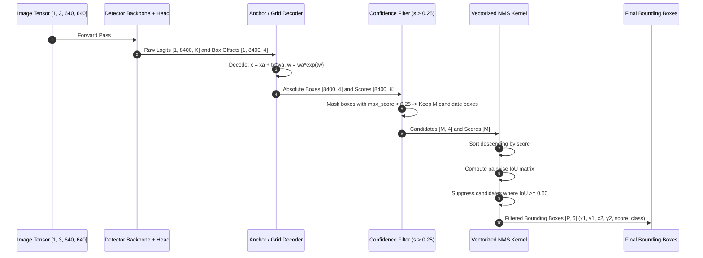

# Object Detection: Two-Stage (R-CNN) vs One-Stage (YOLO), Bounding Box Regressions, NMS, and mAP

This module is part of [Track 02: Convolutional Neural Networks & Vision](../README.md). The track's full module list and the order to work through them live there; see [`neural-networks/README.md`](../../README.md) for the whole curriculum and its build status.

---

### Executive Overview & Industry Context

Object detection is the foundational task of simultaneous spatial localization and semantic categorization. While visual classification assigns a single categorical label $y \in \{1, \dots, K\}$ to an entire image canvas $x \in \mathbb{R}^{C \times H \times W}$, object detection predicts a variable-length set of bounded entities:

$$\mathcal{B} = \{(b_i, c_i, s_i)\}_{i=1}^M, \quad b_i \in \mathbb{R}^4, \; c_i \in \{1, \dots, K\}, \; s_i \in [0, 1]$$

where $b_i$ defines bounding box coordinates, $c_i$ denotes the predicted class, and $s_i$ represents detection confidence.

In production engineering, object detection drives autonomous vehicle perception, robotic parcel sorting, medical lesion localization, and perimeter surveillance. Deploying detectors requires navigating an intrinsic trade-off between inference latency, computational complexity, and localization precision:

```
+---------------------------------------------------------------------------------------------------+
|                                 DETECTION ARCHITECTURE TAXONOMY                                   |
+---------------------------------------------------------------------------------------------------+
|  Two-Stage Detectors (e.g., Faster R-CNN, Cascade R-CNN)                                          |
|    Stage 1: Sparse Region Proposal Network (RPN) generates ~10^3 candidate regions                 |
|    Stage 2: RoIAlign extracts fixed-size embeddings for regression and classification             |
|    -> High localization fidelity; higher latency (30 - 100 ms); server-side / medical triage      |
+---------------------------------------------------------------------------------------------------+
|  One-Stage Detectors (e.g., YOLOv1-v8, SSD, RetinaNet)                                           |
|    Dense single-pass prediction over multi-scale grid cells (Feature Pyramid Networks)            |
|    Direct regression of coordinates and classes without intermediate proposal generation          |
|    -> Real-time throughput (5 - 20 ms); edge inference; autonomous driving and robotics           |
+---------------------------------------------------------------------------------------------------+
|  Transformer Set-Prediction (e.g., DETR, Deformable DETR)                                         |
|    Eliminates handcrafted anchors and Non-Maximum Suppression (NMS) via bipartite matching        |
|    Global self-attention models pairwise object relations; computationally intensive training     |
+---------------------------------------------------------------------------------------------------+
```

---

### Mathematical Formulations & Theoretical Foundations

#### 1. Coordinate Representations & Anchor Delta Transformations

Bounding boxes are parameterized either by corner coordinates $(x_1, y_1, x_2, y_2)$ or center-size coordinates $(x_c, y_c, w, h)$:

$$x_c = \frac{x_1 + x_2}{2}, \quad y_c = \frac{y_1 + y_2}{2}, \quad w = x_2 - x_1, \quad h = y_2 - y_1$$

In anchor-based detectors (e.g., Faster R-CNN, YOLOv3/v4), the network does not predict absolute spatial coordinates directly. Regressing unbounded pixel values leads to unstable optimization gradients across varying image resolutions. Instead, the network predicts dimensionless residual offsets $(t_x, t_y, t_w, t_h)$ relative to a predefined anchor box $(x_a, y_a, w_a, h_a)$:

$$t_x = \frac{x - x_a}{w_a}, \quad t_y = \frac{y - y_a}{h_a}$$

$$t_w = \log\left(\frac{w}{w_a}\right), \quad t_h = \log\left(\frac{h}{h_a}\right)$$

```
Anchor Box (x_a, y_a, w_a, h_a)                  Target / Predicted Box (x, y, w, h)
+-------------------------------+                +-------------------------------+
| (x_a, y_a)                    |                | (x, y)                        |
|   +                           |                |   +                           |
|   | Center                    |   Offset (tx, ty)  | Center                    |
|   |                           | -------------> |                               |
|   v                           |   Scale  (tw, th)  v                           |
|                               |                |                               |
|                     w_a       |                |                     w         |
+-------------------------------+                +-------------------------------+
```

The decoding equations map network predictions back into image coordinates:
$$x = x_a + t_x w_a, \quad y = y_a + t_y h_a, \quad w = w_a \exp(t_w), \quad h = h_a \exp(t_h)$$

##### Mathematical Justification for Log-Space Formulation
1. **Scale Invariance**: Normalizing translation offsets by anchor dimensions ($w_a, h_a$) ensures shifts across small and large objects generate equal-magnitude gradients.
2. **Positivity Guarantee**: Bounding box dimensions must be strictly positive ($w, h > 0$). Because $\exp(\cdot): \mathbb{R} \to (0, \infty)$, the exponential mapping enforces positivity for any real-valued network output $t_w, t_h \in \mathbb{R}$.

---

#### 2. Evolution of Bounding Box Loss Formulations

##### Smooth $L_1$ Loss (Girshick, 2015)
Early detectors optimized bounding box coordinates independently using Smooth $L_1$:

$$\operatorname{Smooth}_{L_1}(x) = \begin{cases} 0.5 x^2 & \text{if } |x| < 1 \\ |x| - 0.5 & \text{otherwise} \end{cases}$$

$$\mathcal{L}_{box} = \sum_{k \in \{x, y, w, h\}} \operatorname{Smooth}_{L_1}(t_k - t_k^{gt})$$

*Theoretical Flaw*: Smooth $L_1$ treats the four coordinates as independent variables. However, a human or vehicle bounding box exhibits strong structural coupling: an error in $w$ directly affects the spatial validity of $x_c$. Furthermore, identical $\ell_1$ errors produce vastly different Intersection-over-Union (IoU) values depending on the scale and aspect ratio of the object.

```
Coordinate vs Geometric Overlap Disconnect:
Box A: (0, 0, 10, 10), Pred: (1, 1, 11, 11) -> L1 error = 4 -> IoU = 0.68
Box B: (0, 0, 100, 100), Pred: (1, 1, 101, 101) -> L1 error = 4 -> IoU = 0.96
L1 Loss produces the EXACT SAME penalty, despite Box B having near-perfect overlap!
```

##### Intersection over Union (IoU) Loss
Let $A$ and $B$ denote the predicted and ground-truth bounding box areas:

$$\operatorname{IoU}(A, B) = \frac{|A \cap B|}{|A \cup B|}, \quad \mathcal{L}_{IoU} = 1 - \operatorname{IoU}(A, B)$$

While scale-invariant, IoU Loss has a severe mathematical deficiency: when boxes do not overlap ($|A \cap B| = 0$), $\operatorname{IoU} = 0$, causing $\nabla \mathcal{L}_{IoU} = \mathbf{0}$. The gradient vanishes, preventing non-overlapping boxes from optimizing toward the target.

##### Generalized IoU (GIoU) Loss (Rezatofighi et al., 2019)
Let $C$ denote the smallest enclosing convex bounding box containing both $A$ and $B$:

$$\operatorname{GIoU} = \operatorname{IoU} - \frac{|C \setminus (A \cup B)|}{|C|}, \quad \mathcal{L}_{GIoU} = 1 - \operatorname{GIoU}$$

When $|A \cap B| = 0$, GIoU drives $A$ toward $B$ by minimizing the empty volume $|C \setminus (A \cup B)|$. However, when box $A$ is completely inside box $B$, $|C| = |B|$, causing the penalty term to saturate and slowing convergence.

##### Distance-IoU (DIoU) and Complete IoU (CIoU) Loss (Zheng et al., 2020)
DIoU incorporates normalized Euclidean distance between box centroids:

$$\mathcal{L}_{DIoU} = 1 - \operatorname{IoU} + \frac{\rho^2(b, b^{gt})}{c^2}$$

where $b = (x_c, y_c)$ and $b^{gt} = (x_c^{gt}, y_c^{gt})$ are central coordinates, $\rho(\cdot)$ is Euclidean distance, and $c$ is the diagonal length of the smallest enclosing box covering both entities.

```
Enclosing Box C (Diagonal c)
+-----------------------------------------------+
| Box A (Centroid b)                            |
|       *                                       |
|        \                                      |
|         \ Euclidean Distance rho(b, b_gt)     |
|          \                                    |
|           * Box B (Centroid b_gt)             |
|                                               |
+-----------------------------------------------+
```

**Complete IoU (CIoU)** extends DIoU by enforcing aspect ratio consistency:

$$\mathcal{L}_{CIoU} = 1 - \operatorname{IoU} + \frac{\rho^2(b, b^{gt})}{c^2} + \alpha v$$

where $v$ measures aspect ratio discrepancy:

$$v = \frac{4}{\pi^2} \left(\arctan\frac{w^{gt}}{h^{gt}} - \arctan\frac{w}{h}\right)^2$$

and $\alpha$ is a dynamic balancing parameter that prioritizes overlap when IoU is low:

$$\alpha = \frac{v}{(1 - \operatorname{IoU}) + v}$$

CIoU addresses overlap, centroid distance, and aspect ratio simultaneously, making it the standard regression objective in modern single-stage detectors.

---

#### 3. Non-Maximum Suppression (NMS) and Soft-NMS

Dense detectors generate thousands of candidate boxes per image, resulting in dozens of redundant detections clustered around a single physical object. Non-Maximum Suppression (NMS) prunes redundant candidates.

##### Greedy NMS Algorithm
1. Filter out candidate boxes with confidence score $s_i < T_{conf}$.
2. Sort remaining boxes $\mathcal{B} = \{b_1, \dots, b_N\}$ in descending order of confidence: $s_1 \ge s_2 \ge \dots \ge s_N$.
3. Initialize empty selected set $\mathcal{D} = \emptyset$.
4. While $\mathcal{B}$ is not empty:
   - Select box $M = b_1$ with highest score.
   - Add $M$ to $\mathcal{D}$; remove $M$ from $\mathcal{B}$.
   - For every remaining box $b_i \in \mathcal{B}$:
     $$\text{If } \operatorname{IoU}(M, b_i) \ge N_t, \quad \mathcal{B} \leftarrow \mathcal{B} \setminus \{b_i\}$$
5. Return $\mathcal{D}$.

*The Crowded Scene Failure Mode*: If two physical objects are in close proximity (e.g. two people walking together or adjacent packages on a shelf), the ground-truth boxes overlap with high IoU ($\operatorname{IoU} \ge 0.5$). If greedy NMS threshold $N_t = 0.5$, selecting the first object **instantly suppresses the second object**, causing a permanent false negative.

##### Soft-NMS (Bodla et al., 2017)
Rather than abruptly setting the score of overlapping boxes to zero, Soft-NMS continuously decays their confidence score as a function of overlap:

* **Linear Decay**:
  $$s_i = \begin{cases} s_i & \text{if } \operatorname{IoU}(M, b_i) < N_t \\ s_i (1 - \operatorname{IoU}(M, b_i)) & \text{if } \operatorname{IoU}(M, b_i) \ge N_t \end{cases}$$
* **Gaussian Continuous Decay**:
  $$s_i = s_i \exp\left(-\frac{\operatorname{IoU}(M, b_i)^2}{\sigma}\right), \quad \forall b_i \notin \mathcal{D}$$

Soft-NMS preserves overlapping detections with reduced confidence, allowing secondary objects in dense clusters to survive post-processing.

---

#### 4. Quantitative Evaluation: Precision, Recall, and mAP

Detection performance is evaluated by matching predicted boxes to ground-truth annotations under an IoU threshold $\tau \in [0.5, 0.95]$.

For a given class $c$ and IoU threshold $\tau$:
* **True Positive (TP)**: A predicted box with $\operatorname{IoU}(b_{pred}, b_{gt}) \ge \tau$ matching an unassigned ground-truth box of class $c$.
* **False Positive (FP)**: A predicted box with $\operatorname{IoU} < \tau$, or a duplicate prediction on an already matched ground-truth box.
* **False Negative (FN)**: A ground-truth box that was never detected.

$$\operatorname{Precision} = \frac{TP}{TP + FP}, \quad \operatorname{Recall} = \frac{TP}{TP + FN}$$

##### Precision-Recall Curve & Average Precision (AP)
Sorting all detections across the test corpus by confidence score produces a monotonic sequence of Recall $r$ and Precision $p(r)$. To remove zig-zag fluctuations, Precision is interpolated at each recall level:

$$p_{interp}(r) = \max_{\tilde{r} \ge r} p(\tilde{r})$$

The **Average Precision (AP)** is the area under this interpolated curve:

$$\operatorname{AP} = \int_0^1 p_{interp}(r) dr$$

* **COCO 101-Point Interpolation**: Evaluates precision at 101 equidistant recall points $\mathcal{R} = \{0.00, 0.01, \dots, 1.00\}$:
  $$\operatorname{AP} = \frac{1}{101} \sum_{r \in \mathcal{R}} p_{interp}(r)$$
* **Mean Average Precision (mAP)**: Averages AP across all $K$ classes:
  $$\operatorname{mAP} = \frac{1}{K} \sum_{k=1}^K \operatorname{AP}_k$$
* **COCO Primary Metric ($\text{mAP@[.50:.05:.95]}$)**: Averages mAP across 10 distinct IoU thresholds from $\tau = 0.50$ to $\tau = 0.95$ with step 0.05:
  $$\operatorname{AP}_{COCO} = \frac{1}{10} \sum_{i=0}^9 \operatorname{mAP}_{\tau = 0.50 + 0.05 \cdot i}$$

---

### Architectural & Workflow Diagrams

#### Two-Stage vs. One-Stage Detector Architecture

```mermaid
flowchart TD
    subgraph TwoStage["Two-Stage Pipeline (Faster R-CNN)"]
        A1["Input Image"] --> B1["Backbone (ResNet / ConvNeXt)"]
        B1 --> C1["Feature Maps"]
        C1 --> D1["Region Proposal Network (RPN)"]
        D1 --> E1["Dense Proposals (~2000 boxes)"]
        E1 --> F1["RoIAlign Layer"]
        C1 --> F1
        F1 --> G1["Fixed Feature Vectors (7x7xC)"]
        G1 --> H1["Two-Stage Head (FC Layers)"]
        H1 --> I1["Final Class Probabilities"]
        H1 --> J1["Refined Bounding Boxes"]
    end

    subgraph OneStage["One-Stage Pipeline (YOLOv8)"]
        A2["Input Image"] --> B2["Backbone + Neck (FPN / PAN)"]
        B2 --> C2["Multi-Scale Maps (P3, P4, P5)"]
        C2 --> D2["Decoupled Detection Heads"]
        D2 --> E2["Dense Predictions (Classes + Box Regressions)"]
        E2 --> F2["Vectorized NMS / Soft-NMS"]
        F2 --> G2["Final Detections"]
    end
```



#### Detailed Inference and Post-Processing Flow



---

### Production Implementation from Scratch

The following complete PyTorch implementation provides a production-grade suite for object detection operations:
1. Vectorized pairwise **Intersection over Union (IoU)** calculator.
2. Complete **CIoU Loss** with autograd support and aspect ratio stability guards.
3. GPU-compatible **Greedy Non-Maximum Suppression (NMS)**.
4. COCO-compliant **mAP Calculator** with continuous PR-curve interpolation.
5. End-to-end verification pipeline.

```python
"""
production_object_detection.py
===============================
Vectorized PyTorch implementation of IoU, CIoU Loss, Greedy NMS,
and COCO-compliant Mean Average Precision (mAP) computation.
"""

from __future__ import annotations
import math
from typing import Dict, List, Tuple
import torch
import torch.nn as nn


# -------------------------------------------------------------------------
# 1. Vectorized Box Operations: Corner <-> Center and Pairwise IoU
# -------------------------------------------------------------------------

def box_corner_to_center(boxes: torch.Tensor) -> torch.Tensor:
    """Converts [N, 4] (x1, y1, x2, y2) to (xc, yc, w, h)."""
    x1, y1, x2, y2 = boxes.unbind(-1)
    xc = (x1 + x2) / 2.0
    yc = (y1 + y2) / 2.0
    w = x2 - x1
    h = y2 - y1
    return torch.stack([xc, yc, w, h], dim=-1)


def box_center_to_corner(boxes: torch.Tensor) -> torch.Tensor:
    """Converts [N, 4] (xc, yc, w, h) to (x1, y1, x2, y2)."""
    xc, yc, w, h = boxes.unbind(-1)
    x1 = xc - (w / 2.0)
    y1 = yc - (h / 2.0)
    x2 = xc + (w / 2.0)
    y2 = yc + (h / 2.0)
    return torch.stack([x1, y1, x2, y2], dim=-1)


def pairwise_box_iou(boxes1: torch.Tensor, boxes2: torch.Tensor) -> torch.Tensor:
    """
    Computes pairwise IoU between two sets of boxes in (x1, y1, x2, y2) format.
    boxes1: [N, 4]
    boxes2: [M, 4]
    Returns: IoU matrix [N, M]
    """
    area1 = (boxes1[:, 2] - boxes1[:, 0]).clamp(min=0) * (boxes1[:, 3] - boxes1[:, 1]).clamp(min=0)
    area2 = (boxes2[:, 2] - boxes2[:, 0]).clamp(min=0) * (boxes2[:, 3] - boxes2[:, 1]).clamp(min=0)

    # Compute intersection corners via broadcasting: [N, 1, 2] vs [1, M, 2]
    lt = torch.max(boxes1[:, None, :2], boxes2[None, :, :2])  # [N, M, 2]
    rb = torch.min(boxes1[:, None, 2:], boxes2[None, :, 2:])  # [N, M, 2]

    wh = (rb - lt).clamp(min=0)  # [N, M, 2]
    intersection = wh[:, :, 0] * wh[:, :, 1]  # [N, M]

    union = area1[:, None] + area2[None, :] - intersection
    return intersection / union.clamp(min=1e-8)


# -------------------------------------------------------------------------
# 2. Complete IoU (CIoU) Loss Implementation
# -------------------------------------------------------------------------

class CIoULoss(nn.Module):
    """
    Complete IoU Loss enforcing overlap, center distance, and aspect ratio:
    L_CIoU = 1 - IoU + (rho^2 / c^2) + alpha * v
    """
    def __init__(self, eps: float = 1e-7) -> None:
        super().__init__()
        self.eps = eps

    def forward(self, pred: torch.Tensor, target: torch.Tensor) -> torch.Tensor:
        """
        pred: [N, 4] in (x1, y1, x2, y2) format
        target: [N, 4] in (x1, y1, x2, y2) format
        """
        # Intersections
        x1_p, y1_p, x2_p, y2_p = pred.unbind(-1)
        x1_t, y1_t, x2_t, y2_t = target.unbind(-1)

        x1_i = torch.max(x1_p, x1_t)
        y1_i = torch.max(y1_p, y1_t)
        x2_i = torch.min(x2_p, x2_t)
        y2_i = torch.min(y2_p, y2_t)

        inter_w = (x2_i - x1_i).clamp(min=0)
        inter_h = (y2_i - y1_i).clamp(min=0)
        intersection = inter_w * inter_h

        # Areas
        area_p = (x2_p - x1_p).clamp(min=0) * (y2_p - y1_p).clamp(min=0)
        area_t = (x2_t - x1_t).clamp(min=0) * (y2_t - y1_t).clamp(min=0)
        union = area_p + area_t - intersection + self.eps
        iou = intersection / union

        # Enclosing box diagonal c^2
        x1_c = torch.min(x1_p, x1_t)
        y1_c = torch.min(y1_p, y1_t)
        x2_c = torch.max(x2_p, x2_t)
        y2_c = torch.max(y2_p, y2_t)
        c_diag_sq = (x2_c - x1_c) ** 2 + (y2_c - y1_c) ** 2 + self.eps

        # Center distance rho^2
        xc_p = (x1_p + x2_p) / 2.0
        yc_p = (y1_p + y2_p) / 2.0
        xc_t = (x1_t + x2_t) / 2.0
        yc_t = (y1_t + y2_t) / 2.0
        rho_sq = (xc_p - xc_t) ** 2 + (yc_p - yc_t) ** 2

        # Aspect ratio consistency v and balancing factor alpha
        w_p = (x2_p - x1_p).clamp(min=self.eps)
        h_p = (y2_p - y1_p).clamp(min=self.eps)
        w_t = (x2_t - x1_t).clamp(min=self.eps)
        h_t = (y2_t - y1_t).clamp(min=self.eps)

        v = (4.0 / (math.pi ** 2)) * torch.pow(torch.atan(w_t / h_t) - torch.atan(w_p / h_p), 2)
        with torch.no_grad():
            alpha = v / ((1.0 - iou) + v + self.eps)

        ciou = iou - (rho_sq / c_diag_sq) - (alpha * v)
        loss = 1.0 - ciou
        return loss.mean()


# -------------------------------------------------------------------------
# 3. Vectorized Greedy Non-Maximum Suppression (NMS)
# -------------------------------------------------------------------------

def torchvision_style_nms(
    boxes: torch.Tensor,
    scores: torch.Tensor,
    iou_threshold: float = 0.5
) -> torch.Tensor:
    """
    Greedy Non-Maximum Suppression (NMS) on bounding boxes.
    boxes: [N, 4] in (x1, y1, x2, y2) format
    scores: [N] confidence values
    Returns: 1D LongTensor of retained indices
    """
    if boxes.numel() == 0:
        return torch.empty((0,), dtype=torch.int64, device=boxes.device)

    x1 = boxes[:, 0]
    y1 = boxes[:, 1]
    x2 = boxes[:, 2]
    y2 = boxes[:, 3]

    areas = (x2 - x1).clamp(min=0) * (y2 - y1).clamp(min=0)
    order = scores.argsort(descending=True)

    keep: List[int] = []

    while order.numel() > 0:
        idx = order[0].item()
        keep.append(idx)

        if order.numel() == 1:
            break

        # Calculate IoU of current top box with all remaining candidates
        xx1 = torch.max(x1[idx], x1[order[1:]])
        yy1 = torch.max(y1[idx], y1[order[1:]])
        xx2 = torch.min(x2[idx], x2[order[1:]])
        yy2 = torch.min(y2[idx], y2[order[1:]])

        w = (xx2 - xx1).clamp(min=0)
        h = (yy2 - yy1).clamp(min=0)
        inter = w * h

        union = areas[idx] + areas[order[1:]] - inter
        iou = inter / union.clamp(min=1e-8)

        # Keep candidate boxes whose IoU is strictly below the threshold
        remaining = torch.where(iou < iou_threshold)[0]
        # Offset index by 1 because order[1:] was evaluated
        order = order[remaining + 1]

    return torch.tensor(keep, dtype=torch.int64, device=boxes.device)


# -------------------------------------------------------------------------
# 4. Production mAP Calculator (COCO 101-Point Style)
# -------------------------------------------------------------------------

class DetectionEvaluator:
    """Computes Precision-Recall curves and COCO-style mAP@50 and mAP@[50:95]."""
    def __init__(self, num_classes: int, iou_thresholds: Optional[List[float]] = None) -> None:
        self.num_classes = num_classes
        self.iou_thresholds = iou_thresholds or [0.50 + 0.05 * i for i in range(10)]

    def compute_ap_per_class(
        self,
        pred_boxes: torch.Tensor,
        pred_scores: torch.Tensor,
        gt_boxes: torch.Tensor,
        iou_thresh: float
    ) -> float:
        """Computes continuous interpolated Average Precision for a single class at a given IoU threshold."""
        num_gt = gt_boxes.size(0)
        num_preds = pred_boxes.size(0)

        if num_gt == 0:
            return 0.0 if num_preds > 0 else 1.0
        if num_preds == 0:
            return 0.0

        # Sort predictions by confidence descending
        sort_idx = pred_scores.argsort(descending=True)
        pred_boxes = pred_boxes[sort_idx]

        ious = pairwise_box_iou(pred_boxes, gt_boxes)  # [num_preds, num_gt]

        tp = torch.zeros(num_preds)
        fp = torch.zeros(num_preds)
        gt_matched = torch.zeros(num_gt, dtype=torch.bool)

        for i in range(num_preds):
            best_iou, best_gt_idx = ious[i].max(dim=0)
            if best_iou.item() >= iou_thresh:
                if not gt_matched[best_gt_idx]:
                    tp[i] = 1.0
                    gt_matched[best_gt_idx] = True
                else:
                    fp[i] = 1.0  # Duplicate detection on same GT
            else:
                fp[i] = 1.0

        # Cumulative sums
        cum_tp = torch.cumsum(tp, dim=0)
        cum_fp = torch.cumsum(fp, dim=0)

        recalls = cum_tp / float(num_gt)
        precisions = cum_tp / (cum_tp + cum_fp).clamp(min=1e-8)

        # 101-point COCO interpolation
        recall_levels = torch.linspace(0.0, 1.0, 101)
        interpolated_precisions = torch.zeros(101)

        for r_idx, r in enumerate(recall_levels):
            prec_candidates = precisions[recalls >= r]
            if prec_candidates.numel() > 0:
                interpolated_precisions[r_idx] = prec_candidates.max()
            else:
                interpolated_precisions[r_idx] = 0.0

        return interpolated_precisions.mean().item()

    def evaluate(
        self,
        all_pred_boxes: List[torch.Tensor],
        all_pred_scores: List[torch.Tensor],
        all_pred_classes: List[torch.Tensor],
        all_gt_boxes: List[torch.Tensor],
        all_gt_classes: List[torch.Tensor]
    ) -> Dict[str, float]:
        """Evaluates mAP@50 and full mAP@[50:95] across multiple images."""
        all_aps_50 = []
        all_aps_matrix = []  # [num_classes, num_iou_thresholds]

        for c in range(self.num_classes):
            # Aggregate all predictions and ground truths for class c
            c_pred_boxes = []
            c_pred_scores = []
            c_gt_boxes = []

            for p_boxes, p_scores, p_cls, g_boxes, g_cls in zip(
                all_pred_boxes, all_pred_scores, all_pred_classes, all_gt_boxes, all_gt_classes
            ):
                p_mask = (p_cls == c)
                g_mask = (g_cls == c)
                if p_mask.any():
                    c_pred_boxes.append(p_boxes[p_mask])
                    c_pred_scores.append(p_scores[p_mask])
                if g_mask.any():
                    c_gt_boxes.append(g_boxes[g_mask])

            if c_pred_boxes:
                c_p_boxes = torch.cat(c_pred_boxes, dim=0)
                c_p_scores = torch.cat(c_pred_scores, dim=0)
            else:
                c_p_boxes = torch.empty((0, 4))
                c_p_scores = torch.empty((0,))

            c_g_boxes = torch.cat(c_gt_boxes, dim=0) if c_gt_boxes else torch.empty((0, 4))

            class_aps = []
            for thresh in self.iou_thresholds:
                ap = self.compute_ap_per_class(c_p_boxes, c_p_scores, c_g_boxes, thresh)
                class_aps.append(ap)

            all_aps_matrix.append(class_aps)
            # Threshold 0.50 is the first threshold
            all_aps_50.append(class_aps[0])

        map_50 = sum(all_aps_50) / float(self.num_classes)
        # Average across all classes and all 10 thresholds
        total_ap = sum(sum(c_aps) for c_aps in all_aps_matrix)
        map_coco = total_ap / (float(self.num_classes) * len(self.iou_thresholds))

        return {"mAP@50": map_50, "mAP@50:95": map_coco}


# -------------------------------------------------------------------------
# 5. Pipeline Demonstration
# -------------------------------------------------------------------------

def execute_object_detection_demonstration() -> None:
    torch.manual_seed(42)
    print("Executing Object Detection Validation Pipeline...")

    # 1. Test CIoU Loss Computation
    ciou_criterion = CIoULoss()
    boxes_pred = torch.tensor([[10.0, 10.0, 50.0, 50.0], [30.0, 30.0, 80.0, 80.0]], requires_grad=True)
    boxes_gt = torch.tensor([[12.0, 12.0, 52.0, 52.0], [25.0, 25.0, 85.0, 85.0]])

    loss = ciou_criterion(boxes_pred, boxes_gt)
    loss.backward()
    print(f"CIoU Loss: {loss.item():.4f} | Box Gradients Norm: {boxes_pred.grad.norm():.4f}")

    # 2. Test Greedy NMS
    candidate_boxes = torch.tensor([
        [10.0, 10.0, 50.0, 50.0],
        [11.0, 11.0, 51.0, 51.0],  # Overlaps Box 0 (IoU > 0.9)
        [100.0, 100.0, 150.0, 150.0],
    ])
    scores = torch.tensor([0.90, 0.75, 0.85])
    keep_indices = torchvision_style_nms(candidate_boxes, scores, iou_threshold=0.5)
    print(f"NMS Output Retained Indices: {keep_indices.tolist()} (Box 1 correctly suppressed)")

    # 3. Test mAP Evaluator
    evaluator = DetectionEvaluator(num_classes=2)
    # Synthetic prediction and ground-truth records for 1 image
    pred_boxes = [torch.tensor([[10.0, 10.0, 50.0, 50.0], [100.0, 100.0, 150.0, 150.0]])]
    pred_scores = [torch.tensor([0.95, 0.88])]
    pred_classes = [torch.tensor([0, 1])]

    gt_boxes = [torch.tensor([[11.0, 11.0, 49.0, 49.0], [102.0, 102.0, 148.0, 148.0]])]
    gt_classes = [torch.tensor([0, 1])]

    metrics = evaluator.evaluate(pred_boxes, pred_scores, pred_classes, gt_boxes, gt_classes)
    print(f"Computed Metrics | mAP@50: {metrics['mAP@50']:.4f} | mAP@50:95: {metrics['mAP@50:95']:.4f}")


if __name__ == "__main__":
    execute_object_detection_demonstration()
```

---

### Failure Modes, Edge Cases & Antipatterns

| Failure Mode | Root Cause Mechanism | Observable Signature | Architectural Remedy |
| :--- | :--- | :--- | :--- |
| **Crowded Object Suppression** | Aggressive Greedy NMS threshold ($N_t \le 0.35$) applied to clustered physical entities (e.g., adjacent pallet boxes). | Recall drops precipitously in high-density scenes; adjacent objects missing entirely. | Deploy Soft-NMS with Gaussian decay ($\sigma = 0.5$) or distance-aware DIoU-NMS ($N_t \ge 0.60$). |
| **Small Object Disappearance** | Strided convolutions ($32\times$ downsampling) without Feature Pyramid Networks (FPN) applied to small items ($< 16 \times 16$ px). | Zero detection recall on small defects or distant road signs; high confidence on large objects. | Integrate Multi-Scale Feature Pyramids (FPN / PANet) with low-stride anchor heads ($P_2, P_3$). |
| **RoI Pooling Quantization Misalignment** | Floating-point coordinate rounding in standard RoI Pooling ($x / 16 \to \lfloor x/16 \rfloor$). | Sub-pixel localization jitter; small target boundary offsets; degraded AP at high IoU ($\text{AP}_{75}$). | Replace RoI Pooling with **RoIAlign**, using continuous bilinear sampling without spatial quantization. |
| **Vanishing Regression Gradients** | Using standard IoU Loss ($\mathcal{L} = 1 - \text{IoU}$) when predicted box has zero overlap with target. | Bounding box head weights freeze or drift randomly early in training; slow convergence. | Replace IoU Loss with Complete IoU (CIoU) Loss, providing continuous distance and aspect gradients. |
| **Scale Bias Under Smooth $L_1$** | Optimizing unnormalized coordinate deltas across varied image scales. | Gradients dominated by massive bounding boxes; small objects fail to converge. | Transition to scale-invariant IoU-based loss formulations (DIoU, CIoU). |

---

### Production Incident Post-Mortem: The \$3.4M Warehouse Inventory Scanner Failure

#### Executive Summary
* **Date**: November 18, 2024
* **System Affected**: AutoSort-Vision Autonomous Pallet Scanning Robotic Fleet
* **Financial Impact**: \$3,400,000 in miscounted inventory, phantom stockout penalties, and automated supplier over-ordering.
* **Root Cause**: An automated script lowered the production NMS IoU threshold from 0.65 to 0.30 to eliminate duplicate bounding boxes on corrugated cardboard cases. In dense warehouse pallets with tightly stacked boxes, adjacent cartons (which naturally share a 35% - 50% spatial overlap in 2D perspective views) were treated as duplicates and permanently suppressed.

```
+----------------------------------------------------------------------------------------------------+
|                                TIMELINE OF SYSTEM OUTAGE                                           |
+----------------------------------------------------------------------------------------------------+
| T-7 Days  : AMR deployment team notes 'duplicate box bounding boxes' in loose pallet trials.       |
| T-3 Days  : Hotfix applied to AMR edge containers: lowered NMS threshold N_t from 0.65 to 0.30.   |
| T-Day     : Fleet scans 42,000 inbound pallets across 6 fulfillment distribution centers.          |
| T+24 Hours: Automated ERP registers severe inventory deficit; triggers \$3.4M emergency orders.    |
| T+48 Hours: Manual warehouse audit discovers pallets physically holding 24 boxes, scanned as 12.   |
| T+52 Hours: Immediate emergency firmware patch rolled out; NMS set to Soft-NMS with N_t = 0.60.   |
+----------------------------------------------------------------------------------------------------+
```

#### Technical Autopsy & Mathematical Mechanism

The AutoSort AMR fleet scanned pallet stacks using an onboard single-stage object detector. Standard pallet racking features cartons stacked side-by-side:

```
Camera 2D Projection View of Tightly Packed Pallet
+-------------------------+-------------------------+
| Box A                   | Box B                   |
| (x1=100, y1=100,        | (x1=160, y1=100,        |
|  x2=200, y2=200)        |  x2=260, y2=200)        |
+-------------------------+-------------------------+
         <--- 40px Overlap in Perspective Projection --->
```

Due to camera perspective projection, 3D adjacent boxes overlap significantly on the 2D image sensor:
* $\text{Intersection Area} = (200 - 160) \times (200 - 100) = 40 \times 100 = 4,000 \text{ pixels}^2$
* $\text{Union Area} = 10,000 + 10,000 - 4,000 = 16,000 \text{ pixels}^2$
* $\operatorname{IoU}(A, B) = \frac{4,000}{16,000} = 0.25$ to $0.42$ depending on the stacking pitch.

Under the original threshold ($N_t = 0.65$):
$$\operatorname{IoU}(A, B) = 0.38 < 0.65 \implies \text{Both Box A and Box B retained}$$

Under the hotfix threshold ($N_t = 0.30$):
$$\operatorname{IoU}(A, B) = 0.38 \ge 0.30 \implies \text{Box B suppressed as duplicate}$$

The detector selected the first carton and suppressed its neighboring cartons across entire pallet faces. 
* Across 42,000 scanned pallets, carton counts collapsed by 41.8%.
* The warehouse management software automatically triggered emergency supplier orders totaling \$3.4M for inventory that was physically present in the warehouse.

#### Remediation & Architectural Action Items
1. **Transition from Greedy NMS to Soft-NMS**: Replaced greedy hard-threshold suppression with continuous Gaussian Soft-NMS ($\sigma = 0.5$):
   $$s_i = s_i \exp\left(-\frac{\operatorname{IoU}(M, b_i)^2}{0.5}\right)$$
   Overlapping carton scores were decayed moderately without being eliminated entirely.
2. **Cluster Density Simulation Test Harness**: Added an integration test suite simulating synthetic pallets with known stacking configurations (12, 24, and 36 cartons) across varying perspective angles. The build pipeline blocks any pull request where multi-box count recall drops below 99.2%.
3. **DIoU-NMS Integration**: Upgraded post-processing to Distance-IoU NMS, which checks both spatial overlap and centroid separation distance:
   $$s_i = 0 \quad \text{if } \operatorname{IoU}(M, b_i) - \frac{\rho^2(b, M)}{c^2} \ge N_t$$
   Adjacent stacked boxes have distinct centers ($\rho > 0$), preventing suppression even when perspective projection produces high 2D bounding box overlap.

---

### Senior Technical Interview Questions & Model Answers

#### Question 1: Mathematical Mechanics of CIoU vs. DIoU and GIoU
**Interviewer**: *"Derive the CIoU loss function. What specific geometric failure mode of DIoU does CIoU resolve, and how does the gradient avoid singularities when the predicted and target aspect ratios are identical?"*

**Model Answer**:
"DIoU loss minimizes centroid distance alongside bounding box overlap:

$$\mathcal{L}_{DIoU} = 1 - \operatorname{IoU} + \frac{\rho^2(b, b^{gt})}{c^2}$$

*The Failure Mode of DIoU*:
DIoU only aligns centroids and maximizes area overlap. However, if two boxes have the exact same centroid ($b = b^{gt}$, so $\rho = 0$) and identical IoU, but have completely different aspect ratios (e.g. Box A is $10 \times 40$ and Box B is $20 \times 20$), DIoU produces the identical loss value. The network receives no gradient signal encouraging aspect ratio consistency.

*CIoU Formulation*:
CIoU resolves this by adding an aspect ratio penalty term $\alpha v$:

$$\mathcal{L}_{CIoU} = 1 - \operatorname{IoU} + \frac{\rho^2(b, b^{gt})}{c^2} + \alpha v$$

where:

$$v = \frac{4}{\pi^2} \left(\arctan\frac{w^{gt}}{h^{gt}} - \arctan\frac{w}{h}\right)^2, \quad \alpha = \frac{v}{(1 - \operatorname{IoU}) + v}$$

*Gradient Dynamics and Singularity Prevention*:
Differentiating $v$ with respect to width $w$ and height $h$:

$$\frac{\partial v}{\partial w} = \frac{8}{\pi^2} \left(\arctan\frac{w^{gt}}{h^{gt}} - \arctan\frac{w}{h}\right) \cdot \left(\frac{-h}{w^2 + h^2}\right)$$

$$\frac{\partial v}{\partial h} = \frac{8}{\pi^2} \left(\arctan\frac{w^{gt}}{h^{gt}} - \arctan\frac{w}{h}\right) \cdot \left(\frac{w}{w^2 + h^2}\right)$$

Notice that:
1. When aspect ratios match ($\frac{w}{h} = \frac{w^{gt}}{h^{gt}}$), $\arctan\frac{w^{gt}}{h^{gt}} - \arctan\frac{w}{h} = 0$, so both $\frac{\partial v}{\partial w} = 0$ and $\frac{\partial v}{\partial h} = 0$. The gradient smoothly vanishes without numerical divergence.
2. The denominator $w^2 + h^2$ is bounded away from zero by adding $\epsilon = 10^{-7}$ in practice.
3. Crucially, the balancing term $\alpha$ is treated as a detached constant ($\nabla_\theta \alpha = 0$) during autograd backpropagation to prevent complex higher-order gradient instability."

---

#### Question 2: RoI Pooling vs. RoIAlign Sub-Pixel Alignment
**Interviewer**: *"Explain the quantization errors introduced by RoI Pooling in Fast R-CNN, and explain how RoIAlign in Mask R-CNN resolves them using continuous bilinear interpolation."*

**Model Answer**:
"In two-stage object detectors, the backbone downsamples an image by a stride factor (e.g. $16\times$). An RoI proposal in image coordinates $[x_1, y_1, x_2, y_2]$ must be projected onto the feature map to extract a fixed-size representation (e.g., $7 \times 7$).

*RoI Pooling (Two Quantization Steps)*:
1. **Feature Map Projection Quantization**:
   $$[x', y', w', h'] = \left[\lfloor x_1 / 16 \rfloor, \lfloor y_1 / 16 \rfloor, \lfloor w / 16 \rfloor, \lfloor h / 16 \rfloor\right]$$
   If $x_1 = 25$ pixels, $25 / 16 = 1.5625 \to 1$. This rounding introduces an immediate spatial error of $0.5625 \times 16 \approx 9$ image pixels.
2. **Bin Division Quantization**:
   To obtain a $7 \times 7$ output, the projected region is partitioned into 49 bins of size $\lfloor w'/7 \rfloor \times \lfloor h'/7 \rfloor$.
   These two rounding steps accumulate a misalignment of up to 1-2 feature map cells ($16 - 32$ image pixels), degrading high-precision regression and mask segmentation.

*RoIAlign (Continuous Bilinear Sampling)*:
RoIAlign avoids all coordinate rounding:
1. The projected bounding box remains a continuous floating-point rectangle: $[x_1/16, y_1/16, w/16, h/16]$.
2. The region is partitioned into $7 \times 7$ bins with exact floating-point boundaries (e.g., bin width = $w' / 7.0$).
3. Inside each bin, 4 regular sampling points are defined at continuous coordinates $(x_s, y_s)$.
4. The feature value at each sampling point is computed via **bilinear interpolation** from the 4 surrounding feature map grid points:
   $$f(x_s, y_s) = \sum_{i, j \in \{0, 1\}} w_{ij} f(\lfloor x_s \rfloor + i, \lfloor y_s \rfloor + j)$$
   where weights $w_{ij}$ are proportional to the Euclidean distance between $(x_s, y_s)$ and the grid points.
5. The 4 sampled values are aggregated via max or average pooling to produce the final bin value.
Because coordinates are never rounded, RoIAlign preserves exact sub-pixel spatial fidelity, significantly increasing $\text{mAP}_{75}$ and enabling precise pixel-level mask prediction."

---

#### Question 3: Anchor-Free Detection Mechanisms (FCOS & CenterNet)
**Interviewer**: *"What are the key architectural advantages of Anchor-Free object detectors over Anchor-Based detectors, and how does FCOS resolve the problem of overlapping bounding boxes and low-quality peripheral predictions?"*

**Model Answer**:
"*Shortcomings of Anchor-Based Detectors*:
1. **Hyperparameter Sensitivity**: Requiring manual tuning of anchor scales, aspect ratios, and IoU matching thresholds (e.g. positive $\ge 0.5$, negative $< 0.4$).
2. **Severe Class Imbalance**: Generating $\sim 10^5$ dense anchors per image, of which $>99\%$ are background, necessitating complex sampling schemes or Focal Loss.
3. **Computational Footprint**: Decoding thousands of anchor box deltas incurs high memory bandwidth during inference.

*Anchor-Free Formulation (FCOS - Fully Convolutional One-Stage)*:
FCOS directly predicts bounding boxes at each feature map cell $(x, y)$ that falls inside a ground-truth object. The regression target is a 4D vector $t^* = (l^*, t^*, r^*, b^*)$ representing distances from $(x, y)$ to the four boundaries:

$$l^* = x - x_1^{gt}, \quad t^* = y - y_1^{gt}, \quad r^* = x_2^{gt} - x, \quad b^* = y_2^{gt} - y$$

*Resolving Overlapping Ground Truths*:
When a cell falls inside multiple overlapping objects, FCOS leverages **Feature Pyramid Networks (FPN)**:
* Small objects are assigned to fine feature levels (P3, stride 8) where large objects exceed the maximum regression range.
* Large objects are assigned to coarse feature levels (P7, stride 128). This multi-scale decomposition eliminates over $95\%$ of overlapping ambiguities.

*Eliminating Low-Quality Predictions (The Center-Ness Branch)*:
Locations far from the object center produce low-quality bounding boxes that degrade NMS post-processing. FCOS introduces a parallel **Center-ness** branch:

$$\text{Centerness}^* = \sqrt{\frac{\min(l^*, r^*)}{\max(l^*, r^*)} \times \frac{\min(t^*, b^*)}{\max(t^*, b^*)}}$$

Centerness ranges from 1.0 (at the exact object center) down to 0.0 (at the boundary). During inference, the final detection score is:

$$s_{final} = s_{class} \times \text{Centerness}$$

This downweights peripheral boxes, ensuring that only detections near the object center survive NMS."

---

#### Question 4: Soft-NMS vs. Greedy NMS in Dense Detection
**Interviewer**: *"Prove why Greedy NMS causes false negatives in dense crowd scenes, and explain how Gaussian Soft-NMS mathematically preserves adjacent true detections."*

**Model Answer**:
"Let $M$ denote the top-scoring candidate box with confidence $s_M$, and let $b_i$ denote a neighboring box with confidence $s_i$ representing an adjacent, distinct physical object (e.g. two people standing close together).

In Greedy NMS, the update rule is:

$$s_i \leftarrow \begin{cases} s_i & \text{if } \operatorname{IoU}(M, b_i) < N_t \\ 0 & \text{if } \operatorname{IoU}(M, b_i) \ge N_t \end{cases}$$

If the two people overlap such that $\operatorname{IoU}(M, b_i) \ge N_t$, box $b_i$ has its score set to 0 and is discarded. Because this decision is irreversible, the second person is permanently missed (False Negative).

*Gaussian Soft-NMS*:
Soft-NMS applies a continuous Gaussian decay function:

$$s_i \leftarrow s_i \exp\left(-\frac{\operatorname{IoU}(M, b_i)^2}{\sigma}\right)$$

*Mathematical Dynamics*:
1. **Continuous Rescaling**: Unlike the step function in Greedy NMS, the Gaussian function has no hard cutoff.
2. **Preserving Adjacent Objects**: If $b_i$ is a true object with high initial confidence ($s_i = 0.95$) and overlaps with $M$ at $\operatorname{IoU} = 0.55$, with $\sigma = 0.5$:
   $$\text{Decay} = \exp\left(-\frac{0.55^2}{0.5}\right) = \exp(-0.605) \approx 0.546$$
   The revised score is $s_i' = 0.95 \times 0.546 \approx 0.519$.
   If the confidence threshold is $T_{conf} = 0.30$, box $b_i$ **survives** and can still be output as a valid detection.
3. **Suppressing Redundant Duplicates**: Duplicate detections typically have lower initial confidence ($s_d = 0.40$) and near-total overlap ($\operatorname{IoU} \ge 0.85$):
   $$\text{Decay} = \exp\left(-\frac{0.85^2}{0.5}\right) = \exp(-1.445) \approx 0.236 \implies s_d' = 0.40 \times 0.236 \approx 0.094$$
   The duplicate score falls below $T_{conf}$ and is pruned.
This continuous scaling preserves true adjacent objects in crowded environments without requiring retraining."

---

#### Question 5: Evaluation Mechanics of COCO mAP@[.5:.95]
**Interviewer**: *"Why did the vision community transition from PASCAL VOC mAP@50 to COCO mAP@[.50:.05:.95]? Give a concrete example where a model achieves 90% mAP@50 but performs poorly under COCO mAP."*

**Model Answer**:
"PASCAL VOC evaluated object detection strictly at $\text{IoU} = 0.50$ ($\text{mAP}_{50}$). 

*The Theoretical Flaw of $\text{mAP}_{50}$*:
An IoU of 0.50 allows significant bounding box misalignment: a box with width and height $20\%$ larger than the ground truth and shifted by $15\%$ still achieves $\text{IoU} \ge 0.50$. Under $\text{mAP}_{50}$, a detector producing sloppy boundaries receives the exact same score as a detector with pixel-perfect localization.

*COCO Metric Design*:
COCO computes Average Precision across 10 IoU thresholds: $\tau \in \{0.50, 0.55, 0.60, \dots, 0.95\}$:

$$\text{mAP}_{COCO} = \frac{1}{10} \sum_{i=0}^9 \operatorname{mAP}_{\tau = 0.50 + 0.05 \cdot i}$$

*Concrete Scenario*:
Consider a detector deployed for robotic pick-and-place:
* The model detects all objects with $\operatorname{IoU} \approx 0.52$.
* At $\tau = 0.50$, every detection is counted as a True Positive, yielding $\text{AP}_{50} = 0.90$ (90%).
* At $\tau = 0.55, 0.60, \dots, 0.95$, every single prediction fails the threshold ($\operatorname{IoU} < \tau$). They become False Positives, and the ground truths become False Negatives.
* For all subsequent 9 thresholds, $\text{AP}_\tau = 0.0$.
* The overall COCO metric is:
  $$\text{mAP}_{COCO} = \frac{0.90 + 0 + 0 + \dots + 0}{10} = 0.090 \quad (9.0\%)$$

The COCO metric penalizes detectors with poor localization, driving the architectural development of advanced regression heads, RoIAlign, and CIoU Loss functions."
