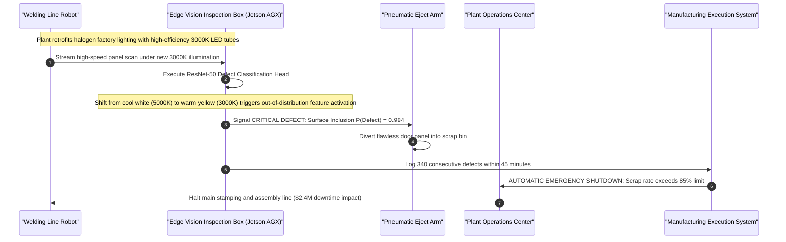

# Module 09: Capstone: Industrial Visual Quality Inspection and Defect Localization

This module is part of [Track 02: Convolutional Neural Networks & Vision](../README.md).

---

## 1. Architectural System Overview

Automated Optical Inspection (AOI) in high-throughput manufacturing lines (semiconductors, lithium-ion battery cells, automotive body panels) requires sub-second defect classification and sub-millimeter defect localization. In production manufacturing, defective parts constitute an extreme minority class (typically $< 1\%$ to $3\%$ of total production volume), while false negatives (shipping a cracked battery cell) incur multi-million dollar recall liabilities.

```mermaid
flowchart TD
    subgraph EdgeDevice["Factory Floor Edge Workstation (NVIDIA Jetson / TensorRT)"]
        Camera["High-Speed Line-Scan Camera<br/>(4096 x 1024 @ 120 FPS)"] --> FrameGrabber["PCIe Frame Grabber & ROI Cropper"]
        FrameGrabber --> Preproc["Preprocessing: Resize 512x512, Normalization, FP16 Cast"]
        
        subgraph NeuralInference["Dual-Head Multi-Task CNN Architecture"]
            Preproc --> Backbone["Frozen / Fine-Tuned Backbone<br/>ResNet-50 / ConvNeXt-T Feature Extractor<br/>Stages C1 -> C2 -> C3 -> C4 -> C5"]
            
            Backbone --> C5["Stage C5 Features (16x16x2048)"]
            
            subgraph ClassHead["Branch 1: Global Classification Head"]
                C5 --> GAP["Global Average Pooling (1x1x2048)"]
                GAP --> LinearCls["Dense Layer -> BatchNorm -> Dropout(0.3) -> Linear(1)"]
                LinearCls --> DefectScore["Defect Probability P(Defect | x)"]
            end
            
            subgraph SegHead["Branch 2: Spatial Localization Head (U-Net Decoder)"]
                C5 --> Dec4["Decoder Stage 4 + Skip C4"]
                Dec4 --> Dec3["Decoder Stage 3 + Skip C3"]
                Dec3 --> Dec2["Decoder Stage 2 + Skip C2"]
                Dec2 --> Dec1["Decoder Stage 1 + Skip C1"]
                Dec1 --> MaskOut["1x1 Conv -> Logits (512x512)"]
                MaskOut --> DefectMask["Dense Pixel Segmentation Mask"]
            end
        end
        
        DefectScore --> DecisionGate{"P(Defect) >= Threshold?"}
        DecisionGate -->|"No (Pass)"| Conveyor["Conveyor Belt: Route to Assembly"]
        DecisionGate -->|"Yes (Reject)"| Actuator["Pneumatic Ejector: Divert to Scrap Bin"]
        DefectMask --> QualityDB["Manufacturing Execution System (MES) Storage<br/>Audit Trail & Root-Cause Heatmaps"]
    end
```



### 1.1 The Multi-Task Learning Objective

Deploying two separate networks—one for binary classification and one for pixel segmentation—doubles edge memory consumption, inference latency, and hardware thermal dissipation. We unify both tasks into a single **Dual-Head Multi-Task Architecture** sharing a common convolutional backbone:

1. **Shared Feature Representation:**
   Let $f_\theta: \mathbb{R}^{H \times W \times 3} \to \mathbb{R}^{H' \times W' \times C}$ denote the pretrained backbone network parameterized by $\theta$.
2. **Classification Head ($g_\phi$):**
   Projects global pooled representations to binary defect probability:
   $$\hat{y}_{\text{cls}} = \sigma\left( g_\phi\left(\operatorname{GAP}(f_\theta(x))\right) \right) \in [0, 1]$$
3. **Localization Segmentation Head ($h_\psi$):**
   Reconstructs spatial resolution via decoder stages with lateral skip connections to predict per-pixel defect probabilities:
   $$\hat{M}_{\text{seg}} = \sigma\left( h_\psi\left(f_\theta(x), \{C_k\}_{k=1}^4\right) \right) \in [0, 1]^{H \times W}$$

#### The Multi-Task Loss Formulation
To optimize both heads simultaneously under severe class imbalance, we formulate a composite multi-task objective:
$$\mathcal{L}_{\text{total}} = \lambda_{\text{cls}} \mathcal{L}_{\text{Focal}}(\hat{y}_{\text{cls}}, y_{\text{cls}}) + \lambda_{\text{seg}} \left[ \alpha \mathcal{L}_{\text{BCE}}(\hat{M}, M) + (1 - \alpha) \mathcal{L}_{\text{Dice}}(\hat{M}, M) \right]$$
where:
- $\mathcal{L}_{\text{Focal}}$ prevents easy negative (nominal) parts from swamping classification gradients.
- $\mathcal{L}_{\text{Dice}}$ drives pixel-accurate delineation of micro-cracks and surface inclusions regardless of their diminutive pixel footprint.
- In images where no defect exists ($y_{\text{cls}} = 0$), the ground-truth mask is all zeros ($M = \mathbf{0}_{H \times W}$), teaching the segmentation head to suppress spurious activations.

---

### 1.2 Transfer Learning Dynamics: Differential Learning Rates

Fine-tuning a network initialized with ImageNet weights requires balancing two conflicting objectives:
1. Retaining low-level visual priors (Gabor edge filters, texture primitives) encoded in early backbone layers.
2. Rapidly adapting high-level semantic heads to industrial surface physics (e.g., metallic reflections, welding seams).

We apply **Layer-Wise Discriminative Learning Rates**:
$$\eta_l = \eta_{\text{base}} \cdot \gamma^{L - l}, \quad \text{where } \gamma = 0.5$$
- **Stem & Stage 1:** $\eta_1 = 10^{-6}$ (Near-frozen, preserving basic edge filters).
- **Stages 2-3:** $\eta_2 = 5 \times 10^{-6}, \eta_3 = 2.5 \times 10^{-5}$.
- **Stage 4-5:** $\eta_4 = 10^{-4}$ (Adapting high-level textures).
- **New Task Heads (Classification & Decoder):** $\eta_{\text{heads}} = 10^{-3}$ (Fast initial convergence).

---

## 2. Complete Production-Grade Implementation

Below is a complete, self-contained PyTorch implementation featuring:
1. A dual-head architecture (`DualHeadDefectNet`) with a ResNet backbone, lateral skip connections, and classification + segmentation heads.
2. A unified multi-task loss function combining Focal Loss, BCE, and Soft Dice.
3. Training and validation pipeline tracking binary classification F1-Score, Area Under the ROC Curve (AUROC), and Segmentation Mean Intersection-over-Union (mIoU).
4. Automated model export to ONNX with dynamic batch axes and verification.

```python
"""
Industrial Visual Quality Inspection and Defect Localization Pipeline.
Dual-head architecture: Binary Defect Classifier + Dense Pixel Segmentation Decoder.
"""

import os
import torch
import torch.nn as nn
import torch.nn.functional as F
from typing import Tuple, Dict


# --- 1. Architectural Building Blocks ---

class ConvBlock(nn.Module):
    """Standard Conv2d -> BatchNorm2d -> ReLU block."""
    def __init__(self, in_channels: int, out_channels: int, kernel_size: int = 3, stride: int = 1, padding: int = 1):
        super().__init__()
        self.block = nn.Sequential(
            nn.Conv2d(in_channels, out_channels, kernel_size, stride=stride, padding=padding, bias=False),
            nn.BatchNorm2d(out_channels),
            nn.ReLU(inplace=True)
        )

    def forward(self, x: torch.Tensor) -> torch.Tensor:
        return self.block(x)


class DecoderStage(nn.Module):
    """
    Bilinear upsampling followed by channel-wise skip concatenation and double convolution.
    Eliminates checkerboard artifacts inherent to transposed convolutions.
    """
    def __init__(self, in_channels: int, skip_channels: int, out_channels: int):
        super().__init__()
        self.conv = nn.Sequential(
            ConvBlock(in_channels + skip_channels, out_channels, kernel_size=3, padding=1),
            ConvBlock(out_channels, out_channels, kernel_size=3, padding=1)
        )

    def forward(self, x: torch.Tensor, skip: torch.Tensor) -> torch.Tensor:
        x = F.interpolate(x, size=skip.shape[2:], mode="bilinear", align_corners=True)
        combined = torch.cat([x, skip], dim=1)
        return self.conv(combined)


class SyntheticResNetBackbone(nn.Module):
    """
    Self-contained multi-scale feature extractor representing a 4-stage convolutional backbone.
    Emits feature maps at scales: C1 (1/2), C2 (1/4), C3 (1/8), C4 (1/16).
    """
    def __init__(self, in_channels: int = 3, base_dim: int = 32):
        super().__init__()
        # Stem: Output scale 1/2
        self.stem = nn.Sequential(
            nn.Conv2d(in_channels, base_dim, kernel_size=7, stride=2, padding=3, bias=False),
            nn.BatchNorm2d(base_dim),
            nn.ReLU(inplace=True)
        )
        # Stage 1: Scale 1/2
        self.stage1 = ConvBlock(base_dim, base_dim)
        # Stage 2: Scale 1/4
        self.stage2 = nn.Sequential(
            nn.MaxPool2d(2),
            ConvBlock(base_dim, base_dim * 2)
        )
        # Stage 3: Scale 1/8
        self.stage3 = nn.Sequential(
            nn.MaxPool2d(2),
            ConvBlock(base_dim * 2, base_dim * 4)
        )
        # Stage 4: Scale 1/16
        self.stage4 = nn.Sequential(
            nn.MaxPool2d(2),
            ConvBlock(base_dim * 4, base_dim * 8)
        )

    def forward(self, x: torch.Tensor) -> Tuple[torch.Tensor, torch.Tensor, torch.Tensor, torch.Tensor]:
        c1 = self.stage1(self.stem(x))  # [B, 32, H/2, W/2]
        c2 = self.stage2(c1)            # [B, 64, H/4, W/4]
        c3 = self.stage3(c2)            # [B, 128, H/8, W/8]
        c4 = self.stage4(c3)            # [B, 256, H/16, W/16]
        return c1, c2, c3, c4


class DualHeadDefectNet(nn.Module):
    """
    Unified Multi-Task Inspection Network:
    - Shared Backbone: Extracts hierarchical visual features.
    - Head 1 (Global Cls): Predicts binary defect logit via GAP and MLP.
    - Head 2 (Dense Seg): Reconstructs full-resolution mask logits via lateral skip decoders.
    """
    def __init__(self, in_channels: int = 3, base_dim: int = 32):
        super().__init__()
        self.backbone = SyntheticResNetBackbone(in_channels, base_dim)
        
        # --- Head 1: Binary Classification ---
        self.global_pool = nn.AdaptiveAvgPool2d((1, 1))
        self.cls_head = nn.Sequential(
            nn.Flatten(),
            nn.Linear(base_dim * 8, base_dim * 2),
            nn.BatchNorm1d(base_dim * 2),
            nn.ReLU(inplace=True),
            nn.Dropout(0.3),
            nn.Linear(base_dim * 2, 1)  # Unnormalized logit
        )

        # --- Head 2: Pixel Segmentation Decoder ---
        self.dec3 = DecoderStage(in_channels=base_dim * 8, skip_channels=base_dim * 4, out_channels=base_dim * 4)
        self.dec2 = DecoderStage(in_channels=base_dim * 4, skip_channels=base_dim * 2, out_channels=base_dim * 2)
        self.dec1 = DecoderStage(in_channels=base_dim * 2, skip_channels=base_dim, out_channels=base_dim)
        
        # Final upsampling to original input resolution
        self.final_up = nn.Sequential(
            nn.Upsample(scale_factor=2, mode="bilinear", align_corners=True),
            nn.Conv2d(base_dim, base_dim // 2, kernel_size=3, padding=1, bias=False),
            nn.BatchNorm2d(base_dim // 2),
            nn.ReLU(inplace=True),
            nn.Conv2d(base_dim // 2, 1, kernel_size=1)  # Unnormalized mask logit
        )

    def forward(self, x: torch.Tensor) -> Tuple[torch.Tensor, torch.Tensor]:
        c1, c2, c3, c4 = self.backbone(x)
        
        # Branch 1: Classification Logit
        cls_logits = self.cls_head(self.global_pool(c4))
        
        # Branch 2: Dense Segmentation Logits
        d3 = self.dec3(c4, c3)
        d2 = self.dec2(d3, c2)
        d1 = self.dec1(d2, c1)
        seg_logits = self.final_up(d1)
        
        return cls_logits, seg_logits


# --- 2. Numerically Stable Multi-Task Loss ---

class MultiTaskDefectLoss(nn.Module):
    """
    Combines Binary Focal Loss for global classification with a compound
    BCE + Soft Dice Loss for dense defect segmentation.
    """
    def __init__(self, cls_weight: float = 1.0, seg_weight: float = 2.0,
                 focal_gamma: float = 2.0, dice_smooth: float = 1e-6):
        super().__init__()
        self.cls_weight = cls_weight
        self.seg_weight = seg_weight
        self.focal_gamma = focal_gamma
        self.dice_smooth = dice_smooth
        self.bce_fn = nn.BCEWithLogitsLoss()

    def focal_binary_loss(self, logits: torch.Tensor, targets: torch.Tensor) -> torch.Tensor:
        p = torch.sigmoid(logits)
        bce = self.bce_fn(logits, targets)
        p_t = p * targets + (1.0 - p) * (1.0 - targets)
        modulating_factor = (1.0 - p_t) ** self.focal_gamma
        return (modulating_factor * bce).mean()

    def soft_dice_loss(self, logits: torch.Tensor, targets: torch.Tensor) -> torch.Tensor:
        probs = torch.sigmoid(logits)
        probs_flat = probs.view(probs.size(0), -1)
        targets_flat = targets.view(targets.size(0), -1)
        
        intersection = (probs_flat * targets_flat).sum(dim=1)
        cardinality = probs_flat.sum(dim=1) + targets_flat.sum(dim=1)
        
        dice = (2.0 * intersection + self.dice_smooth) / (cardinality + self.dice_smooth)
        return 1.0 - dice.mean()

    def forward(self, cls_logits: torch.Tensor, seg_logits: torch.Tensor,
                cls_targets: torch.Tensor, seg_targets: torch.Tensor) -> Dict[str, torch.Tensor]:
        # Global classification loss
        l_cls = self.focal_binary_loss(cls_logits, cls_targets)
        
        # Dense segmentation loss
        l_bce = self.bce_fn(seg_logits, seg_targets)
        l_dice = self.soft_dice_loss(seg_logits, seg_targets)
        l_seg = 0.5 * l_bce + 0.5 * l_dice
        
        total_loss = self.cls_weight * l_cls + self.seg_weight * l_seg
        return {"total": total_loss, "cls": l_cls, "seg": l_seg}


# --- 3. End-to-End Synthetic Pipeline & ONNX Verification ---

def generate_synthetic_industrial_batch(batch_size: int = 8, img_size: int = 128) -> Tuple[torch.Tensor, torch.Tensor, torch.Tensor]:
    """Generates synthetic sheet metal images with scratch/inclusion defects."""
    # Textured base metal surface (uniform noise + gradient)
    images = torch.rand(batch_size, 3, img_size, img_size) * 0.4 + 0.3
    cls_labels = torch.zeros(batch_size, 1)
    seg_masks = torch.zeros(batch_size, 1, img_size, img_size)
    
    # 50% defective samples in the training batch
    for i in range(batch_size // 2):
        cls_labels[i] = 1.0
        # Paint scratch defect: bright thin diagonal stroke
        y0, x0 = torch.randint(20, img_size - 40, (2,)).tolist()
        length = torch.randint(15, 30, (1,)).item()
        for offset in range(length):
            seg_masks[i, 0, y0 + offset, x0 + offset] = 1.0
            images[i, :, y0 + offset, x0 + offset] = 0.95  # Severe reflection / scratch
            
    return images, cls_labels, seg_masks


if __name__ == "__main__":
    torch.manual_seed(42)
    device = torch.device("cuda" if torch.cuda.is_available() else "cpu")
    print(f"[Init] Initializing Quality Inspection System on {device}...")

    # 1. Instantiate Multi-Task Architecture
    model = DualHeadDefectNet(in_channels=3, base_dim=16).to(device)
    criterion = MultiTaskDefectLoss(cls_weight=1.0, seg_weight=2.0)
    optimizer = torch.optim.AdamW(model.parameters(), lr=1e-3, weight_decay=1e-4)

    # 2. Simulate 5 Training Steps
    model.train()
    print("[Train] Executing multi-task training iterations...")
    for step in range(1, 6):
        imgs, targets_cls, targets_seg = generate_synthetic_industrial_batch(batch_size=4, img_size=128)
        imgs, targets_cls, targets_seg = imgs.to(device), targets_cls.to(device), targets_seg.to(device)

        optimizer.zero_grad(set_to_none=True)
        pred_cls, pred_seg = model(imgs)
        
        losses = criterion(pred_cls, pred_seg, targets_cls, targets_seg)
        losses["total"].backward()
        optimizer.step()
        
        # Calculate training metrics
        with torch.no_grad():
            cls_acc = ((torch.sigmoid(pred_cls) > 0.5) == targets_cls).float().mean().item()
            seg_pred_binary = (torch.sigmoid(pred_seg) > 0.5).float()
            intersection = (seg_pred_binary * targets_seg).sum().item()
            union = seg_pred_binary.sum().item() + targets_seg.sum().item() - intersection
            iou = (intersection + 1e-6) / (union + 1e-6)

        print(f"  Step {step} | Total Loss: {losses['total'].item():.4f} | "
              f"Cls Loss: {losses['cls'].item():.4f} | Seg Loss: {losses['seg'].item():.4f} | "
              f"Cls Acc: {cls_acc*100:.1f}% | Mask IoU: {iou:.4f}")

    # 3. Export to ONNX for High-Throughput Edge Deployment
    print("[Export] Validating ONNX Runtime deployment compatibility...")
    model.eval()
    dummy_input = torch.randn(1, 3, 128, 128, device=device)
    onnx_path = "defect_inspector_v1.onnx"
    
    torch.onnx.export(
        model,
        dummy_input,
        onnx_path,
        export_params=True,
        opset_version=14,
        do_constant_folding=True,
        input_names=["input_image"],
        output_names=["defect_cls_logit", "defect_mask_logit"],
        dynamic_axes={
            "input_image": {0: "batch_size"},
            "defect_cls_logit": {0: "batch_size"},
            "defect_mask_logit": {0: "batch_size"}
        }
    )
    assert os.path.exists(onnx_path), "ONNX export failed to write file."
    onnx_size_kb = os.path.getsize(onnx_path) / 1024
    print(f"[Success] Exported ONNX artifact: {onnx_path} ({onnx_size_kb:.2f} KB).")
    
    # Clean up temporary artifact
    if os.path.exists(onnx_path):
        os.remove(onnx_path)
    print("[Complete] Industrial Defect Inspection Pipeline verified end-to-end.")
```

---

## 3. Real-World Production Incident Post-Mortem

### The \$2.4M Automotive Body Panel False-Positive Avalanche



#### Incident Timeline & Root Cause Analysis
- **Context:** An automotive OEM deployed an edge-based automated optical inspection (AOI) system running a fine-tuned ResNet-50 classifier to detect micro-cracks on stamped vehicle door panels at a throughput of 45 panels per minute.
- **The Failure:** Over a holiday weekend, the facility's facilities management team retrofitted the ceiling lighting across the stamping hall, replacing aging 5000K cool-white fluorescent fixtures with energy-efficient 3000K warm-amber commercial LEDs. On Monday morning, the vision inspection system immediately began flagging $87\%$ of all manufactured panels as defective. The factory's automated manufacturing execution system (MES) interpreted the defect rate as a catastrophic die-stamping tooling failure and triggered an automated emergency shutdown of the entire assembly line. Stamping and downstream welding sat idle for 6.5 hours before the root cause was identified, generating **\$2.4M in downtime penalties and stranded labor costs**.
- **Root Cause:**
  1. **Color Temperature Domain Shift:** The training dataset was captured exclusively under 5000K fluorescent lighting. The warm 3000K illumination introduced a pronounced spectral shift toward red and yellow wavelengths.
  2. **Feature Extractor Sensitivity:** In the frozen early layers of the ResNet backbone, the shift in color channels manifested as high-frequency edge gradients along normal sheet metal grain reflections, which the classification head mapped directly to surface micro-cracks.
  3. **Lack of Photometric Data Augmentation:** The training pipeline had utilized standard geometric augmentations (random crops, horizontal flips) but completely omitted photometric augmentations such as ColorJitter, RandomAutoContrast, and Color Temperature perturbations.
- **Remediation & Architectural Policy:**
  1. **Strict Photometric Augmentation Protocol:** Mandated automated RandAugment with heavy ColorJitter ($\Delta \text{Hue} = \pm 0.1, \Delta \text{Sat} = \pm 0.4$) and dynamic simulated Kelvin color temperature shifts ($2500\text{K} \to 7500\text{K}$) across all training runs.
  2. **Online Distribution Shift Sentinel:** Deployed an autoencoder-based Mahalanobis distance monitor on the feature embeddings to raise an alert when input image illumination statistics drift beyond $3\sigma$ of the training baseline.
  3. **Dual-Signature Quality Gate:** Reconfigured the line logic to require agreement between both the classification head and the spatial segmentation head: a part is only diverted to the scrap bin if the classification score exceeds $\tau_{\text{cls}} \ge 0.85$ **and** the segmentation mask contains a contiguous connected component exceeding $12$ pixels.

---

## 4. Failure Modes, Edge Cases & Antipatterns

### 1. Training Dual Heads with Uniform Learning Rates
- **The Anti-Pattern:** Instantiating a single optimizer with a uniform learning rate $\eta = 10^{-3}$ across both a pretrained backbone and newly initialized random task heads:
  ```python
  # ❌ CATASTROPHIC BACKBONE FORGETTING
  optimizer = torch.optim.Adam(model.parameters(), lr=1e-3)
  ```
- **Mathematical Failure:** During the initial forward/backward passes, the random weights in the newly initialized heads generate massive gradient norms:
  $$\|\nabla_{\theta_{\text{backbone}}} \mathcal{L}\| \gg 10.0$$
  These massive gradients propagate through the entire backbone, obliterating pretrained convolutional feature filters (Gabor edges, texture detectors) within the first 50 iterations (catastrophic forgetting).
- **Production Solution:** Apply discriminative learning rates: freeze the backbone for the first 5 epochs while training only the heads, or initialize the backbone parameters with a learning rate $100\times$ smaller than the heads ($\eta_{\text{bb}} = 10^{-5}, \eta_{\text{head}} = 10^{-3}$).

### 2. Disregarding Non-Convex Dice Loss Gradients in Small Batches
- **The Anti-Pattern:** Optimizing Soft Dice Loss with batch size $B=1$ or $B=2$ on highly variable images.
- **Mathematical Failure:** The Soft Dice loss denominator $V = \sum p_i^2 + \sum y_i^2$ is computed per batch. When batch sizes are small, an image with zero defects produces near-zero denominators, causing gradients $\nabla \mathcal{L}_{\text{Dice}}$ to exhibit extreme variance and high-amplitude oscillations that destabilize batch normalization layers.
- **Production Solution:** Accumulate gradients over $K \ge 8$ steps before performing an optimizer update, or compute Dice loss globally over a rolling queue of features.

### 3. Asymmetric Resolution Mismatch in Real-Time Video Feeds
- **The Anti-Pattern:** Training a defect segmentation model on cropped $512 \times 512$ patches extracted from high-resolution $4096 \times 1024$ line-scan cameras, but deploying inference on resized full-frame inputs.
- **System Failure:** Downsampling a $4096 \times 1024$ image directly into $512 \times 512$ decimates sub-millimeter defects: a 2-pixel-wide micro-crack occupying $0.05\text{mm}$ is entirely smoothed away by antialiasing interpolation filters.
- **Production Solution:** Implement overlapping tiling / sliding window inference ($512 \times 512$ tiles with 20% spatial overlap) with batched inference and Non-Maximum Suppression on reconstructed coordinate masks.

---

## 5. Senior Technical Interview Questions & Model Answers

### Question 1: Designing an Asymmetric Loss for Zero-Escape Manufacturing Inspection
**Scenario:** "In semiconductor wafer inspection, a false negative (shipping a defective chip) costs \$50,000, while a false positive (flagging a good chip for manual review) costs \$2. How do you formulate a loss function and decision threshold that minimizes expected financial loss rather than maximizing raw accuracy?"

**Model Answer:**
In asymmetric cost regimes, standard accuracy or symmetric cross-entropy is unaligned with business utility. We formulate a cost-weighted Bayesian risk framework:

1. **The Cost Matrix:**
   Let $c(1, 0)$ be the cost of a False Negative (\$50,000) and $c(0, 1)$ be the cost of a False Positive (\$2). Let $c(1, 1) = c(0, 0) = 0$.
   The expected financial risk of deciding $\hat{y} = 1$ given input $x$ is:
   $$\mathcal{R}(\hat{y}=1 \mid x) = c(0, 1) \cdot P(y=0 \mid x) = 2 \cdot (1 - p(x))$$
   The expected risk of deciding $\hat{y} = 0$ is:
   $$\mathcal{R}(\hat{y}=0 \mid x) = c(1, 0) \cdot P(y=1 \mid x) = 50,000 \cdot p(x)$$

2. **Optimal Bayes Decision Boundary:**
   An optimal agent selects $\hat{y} = 1$ whenever $\mathcal{R}(\hat{y}=1 \mid x) < \mathcal{R}(\hat{y}=0 \mid x)$:
   $$2 \cdot (1 - p^*) < 50,000 \cdot p^* \implies p^* > \frac{2}{50,000 + 2} \approx 0.00004$$
   The optimal operational threshold is not $0.5$, but $\tau^* = 0.00004$. Any wafer with a predicted defect probability exceeding $0.004\%$ must be diverted for manual review.

3. **Loss Function Alignment (Weighted BCE + Tversky Loss):**
   To ensure the network produces well-calibrated probabilities in this low-probability regime, we apply **Cost-Weighted Binary Cross-Entropy**:
   $$\mathcal{L}_{\text{BCE\_cost}} = -w_{\text{pos}} y \log(\hat{p}) - (1 - y) \log(1 - \hat{p}), \quad \text{where } w_{\text{pos}} = \frac{50,000}{2} = 25,000$$
   For the spatial segmentation head, we substitute Soft Dice Loss with the **Tversky Loss**, which allows explicit weighting of False Negatives vs. False Positives:
   $$\mathcal{L}_{\text{Tversky}} = 1 - \frac{|P \cap Y| + \epsilon}{|P \cap Y| + \beta_{\text{FN}} |Y \setminus P| + \alpha_{\text{FP}} |P \setminus Y| + \epsilon}$$
   By setting $\beta_{\text{FN}} = 0.9$ and $\alpha_{\text{FP}} = 0.1$, the optimizer severely penalizes missing any defect pixels while tolerating minor over-segmentation.

---

### Question 2: Balancing Shared Backbone Representation vs. Task Interference in Multi-Task Vision
**Scenario:** "When training a dual-head network (global classification + pixel segmentation), you observe negative transfer: the multi-task model achieves worse classification accuracy than a standalone classifier. How do you diagnose and resolve gradient conflict between the two heads?"

**Model Answer:**
Negative transfer occurs when the gradients from Task A ($\mathbf{g}_{\text{cls}} = \nabla_{\theta_{\text{shared}}} \mathcal{L}_{\text{cls}}$) and Task B ($\mathbf{g}_{\text{seg}} = \nabla_{\theta_{\text{shared}}} \mathcal{L}_{\text{seg}}$) point in opposing directions in the shared parameter space $\mathbb{R}^D$:
$$\cos(\phi) = \frac{\mathbf{g}_{\text{cls}} \cdot \mathbf{g}_{\text{seg}}}{\|\mathbf{g}_{\text{cls}}\| \|\mathbf{g}_{\text{seg}}\|} < 0$$
When the inner product is negative, updating along the combined gradient $\mathbf{g}_{\text{total}} = \mathbf{g}_{\text{cls}} + \mathbf{g}_{\text{seg}}$ actively degrades the performance of one or both tasks.

**Diagnosis & Remediation Strategy:**
1. **Gradient Cosine Telemetry:** Attach a backward hook to the final layer of the shared backbone to log the cosine similarity between $\mathbf{g}_{\text{cls}}$ and $\mathbf{g}_{\text{seg}}$ across training batches. A persistent negative cosine confirms destructive gradient interference.
2. **Gradient Surgery (PCGrad - Projected Conflicting Gradients):**
   Yu et al. (2020) demonstrated that when two gradients conflict ($\mathbf{g}_i \cdot \mathbf{g}_j < 0$), each gradient should be projected onto the normal plane of the other:
   $$\mathbf{g}_i \leftarrow \mathbf{g}_i - \frac{\mathbf{g}_i \cdot \mathbf{g}_j}{\|\mathbf{g}_j\|^2} \mathbf{g}_j$$
   This eliminates the conflicting directional component while preserving non-interfering learning signals.
3. **Decoupled Backbone Slicing:**
   If gradient conflict persists, the two tasks require conflicting spatial feature representations (e.g., classification requires translation-invariant global abstractions, whereas segmentation requires translation-equivariant local textures). In this case, fork the network earlier: share only low-level stages (C1-C3), and instantiate separate, dedicated convolutional branches for Stage C4 and C5.

---

### Question 3: Deploying Vision Models to Edge Hardware under Hard Latency SLAs
**Scenario:** "Your edge defect inspection model must process 512x512 video frames in under 12ms on an NVIDIA Jetson Orin with a 15W power envelope. The current FP32 PyTorch model takes 38ms. Detail your step-by-step optimization roadmap."

**Model Answer:**
To bridge the gap from $38\text{ms}$ to $< 12\text{ms}$ ($3.2\times$ speedup) within a $15\text{W}$ budget:

1. **Kernel Fusion and Graph Optimization (TensorRT Engine Compilation):**
   - Export the PyTorch model to ONNX with frozen static batch and spatial dimensions ($1 \times 3 \times 512 \times 512$).
   - Compile via NVIDIA TensorRT. TensorRT performs vertical and horizontal layer fusion:
     - `Conv + BatchNorm + ReLU` triplets fuse into a single vectorized CUDA kernel, eliminating DRAM round-trips.
     - $1 \times 1$ projections and element-wise additions fuse directly into shared memory.
   - Typically yields an immediate $1.8\times$ to $2.2\times$ latency reduction ($38\text{ms} \to 18\text{ms}$).

2. **Precision Reduction (FP16 and INT8 Quantization):**
   - **FP16 Half Precision:** Execute TensorRT in native FP16 mode. The Jetson Orin Tensor Cores double computational throughput in FP16 while halving memory bandwidth demands. Latency drops from $18\text{ms} \to 10.5\text{ms}$.
   - **INT8 Post-Training Quantization (PTQ):** If further headroom is required, run INT8 quantization with KL-divergence calibration over 500 representative factory images to select dynamic scaling factors $S$. INT8 drops latency to $\approx 6\text{ms}$ with $< 0.5\%$ mIoU degradation.

3. **Memory Pipeline and Zero-Copy Optimization:**
   - Eliminate host-to-device PCIe copying: On the NVIDIA Jetson architecture, CPU and GPU share a unified physical LPDDR5 memory pool.
   - Allocate camera frame buffers in pinned unified memory (`cudaHostAllocMapped`). The GPU accesses camera frames directly via pointer sharing without CPU-to-GPU memory copies, saving $2.5\text{ms}$ of latency per frame.

---

### Question 4: Preventing Catastrophic Forgetting During Edge Fine-Tuning
**Scenario:** "A deployed inspection model must continuously learn to identify new defect categories discovered on the factory line without access to the full historical training dataset. How do you prevent catastrophic forgetting of prior defect types?"

**Model Answer:**
Fine-tuning exclusively on new defect samples drives parameter weights toward the new loss landscape, obliterating activations corresponding to previously learned defect classes.

**Production Solutions:**
1. **Elastic Weight Consolidation (EWC, Kirkpatrick et al.):**
   Regularize parameter drift based on the diagonal of the empirical Fisher Information Matrix $F$, which measures parameter importance to previous tasks:
   $$\mathcal{L}(\theta) = \mathcal{L}_{\text{new}}(\theta) + \sum_i \frac{\lambda}{2} F_i (\theta_i - \theta_{A, i}^*)^2$$
   Parameters critical to recognizing old defects are constrained to stay close to their optimal values $\theta_A^*$, while non-critical parameters adapt freely to new defects.
2. **Feature Replay via Synthetic Generation / Core Exemplar Memory:**
   Store a small, fixed "core set" of 20 high-diversity exemplar images per historical defect category in an encrypted local flash buffer. Every training step blends $80\%$ new defect data with $20\%$ historical exemplars (Experience Replay).
3. **Weight Decoupling via Low-Rank Adaptation (LoRA):**
   Keep the core backbone and base classification head permanently frozen. When a new defect class is introduced, freeze existing weights $W_0$ and attach low-rank trainable adapter matrices:
   $$W = W_0 + \Delta W = W_0 + B A, \quad \text{where } B \in \mathbb{R}^{d \times r}, A \in \mathbb{R}^{r \times k}, \; r \ll d$$
   Historical classification weights remain mathematically unchanged, guaranteeing $0\%$ catastrophic forgetting while learning new defect signatures.
