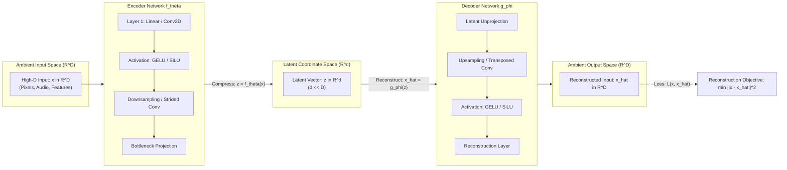
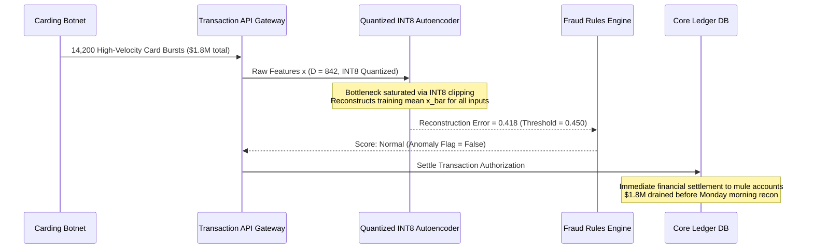

# Module 00: Representation Learning, Manifolds, and Latent Spaces

> **Prerequisites:** [Track 00: Perceptrons, MLPs & Backpropagation](../../00-perceptrons-mlps-and-backpropagation/README.md), [Track 01: Optimization & Regularization](../../01-optimization-regularization-and-pytorch/README.md), [Track 02: CNNs & Spatial Representations](../../02-convolutional-neural-networks-and-vision/README.md), and [Track 04 Overview](../README.md).  
> **Estimated Reading Time:** 45 minutes  
> **Target Audience:** Principal Systems Architects, Generative AI Engineers, Computer Vision Researchers, and Backend Infrastructure Engineers designing high-dimensional representation pipelines and generative latent spaces.
>
> [!IMPORTANT]
> **The Representation Axiom:** High-dimensional real-world data (images, audio, audio embeddings, genomic vectors) concentrates its probability mass on low-dimensional, highly curved sub-manifolds embedded within ambient Euclidean space $\mathbb{R}^D$. Unsupervised representation learning is the search for a non-linear coordinate transformation $f_\theta: \mathbb{R}^D \to \mathbb{R}^d$ ($d \ll D$) that preserves topological neighborhoods, unfolds intrinsic curvature, and isolates orthogonal factors of variation without catastrophic information loss.

---

## Executive Overview & Industry Context

In modern machine learning architectures, high-dimensional observations are deceptive. A standard $256 \times 256$ RGB image resides in an ambient vector space of $D = 256 \times 256 \times 3 = 196,608$ dimensions. If every pixel were independently and uniformly distributed across $[0, 255]$, the probability of randomly sampling an image that humans recognize as a coherent entity—such as a face, an MRI scan, or an invoice—is mathematically indistinguishable from zero ($\approx 256^{-196608}$).

Real-world phenomena do not fill their ambient vector spaces uniformly. Instead, physical constraints, biological morphology, semantic dependencies, and linguistic grammars constrain valid observations to lie on or near low-dimensional surfaces called **manifolds**. Representation learning is the art and science of finding coordinate systems for these manifolds.

```
+-----------------------------------------------------------------------------------+
| Ambient Space R^D (e.g., D = 196,608 pixels)                                     |
|                                                                                   |
|     +-------------------------+                                                   |
|     | Empty High-D Void       |       Curved Data Manifold M                      |
|     | (p(x) = 0)              |       dim(M) = d << D (e.g., d = 32 or 128)       |
|     |                         |                                                   |
|     |                         |           * * * * *                               |
|     |                         |         *           *                             |
|     |                         |       *    (True     *                            |
|     |                         |      *   Data Points) *                           |
|     |                         |     *                  *                          |
|     |                         |      *               *                            |
|     |                         |        * * * * * * *                              |
|     +-------------------------+                                                   |
+-----------------------------------------------------------------------------------+
           |                                                      ^
           | Encoder f_theta                                      | Decoder g_phi
           v                                                      |
+-----------------------------------------------------------------------------------+
| Latent Space R^d (Compact, Intrinsic Coordinates)                                |
|                                                                                   |
|           z = [z_1, z_2, z_3, ..., z_d] in R^d                                    |
|           Euclidean distances ||z_i - z_j|| reflect geodesic distances on M       |
+-----------------------------------------------------------------------------------+
```

When an engineering system fails to model the true intrinsic geometry of its data manifold, catastrophic failures occur:
1. **Curse of Dimensionality:** In $\mathbb{R}^{1000}$, the volume of a hypersphere of radius $r$ relative to a bounding hypercube converges to zero. Data points become equidistant, rendering $k$-NN, naive clustering, and density estimation useless.
2. **Topological Tearing:** Projecting non-convex, curved manifolds using linear projections (like PCA) forces distant regions of the manifold to collapse onto the same coordinates, causing high reconstruction distortion and semantic collisions.
3. **Out-of-Distribution Vulnerability:** Generating new samples by interpolating linearly across ambient space passes directly through empty, unphysical voids where the data-generating distribution has zero probability mass.

Mastering representation learning is the critical foundation before building Variational Autoencoders (VAEs), Generative Adversarial Networks (GANs), Vector-Quantized Autoencoders (VQ-VAEs), and Latent Diffusion Models.

---

## 1. Architectural Mental Model: Bottlenecks & Latent Topology

At the core of every representation learning architecture lies an **information bottleneck**: an intentional constriction in channel capacity or dimensionality that forces a neural network to discard ambient noise and retain only the underlying generative factors.



### 1.1 The Information Bottleneck Principle

Formulated by Naftali Tishby, the **Information Bottleneck (IB)** principle states that an optimal representation $Z$ of an input $X$ with respect to a target task or reconstruction variable $Y$ must maximize the mutual information $I(Z; Y)$ while penalizing the mutual information $I(X; Z)$:

$$\mathcal{L}_{\text{IB}}(\theta) = I(X; Z) - \beta \, I(Z; Y)$$

Where:
- $I(X; Z) = \int \int p(x, z) \log \frac{p(x, z)}{p(x) p(z)} \, dx \, dz$ quantifies the number of bits required to compress $X$ into code $Z$.
- $I(Z; Y)$ measures how much information $Z$ preserves about target $Y$ (in self-supervised autoencoding, $Y = X$).
- $\beta \in [0, \infty)$ is a Lagrange multiplier controlling the compression-fidelity tradeoff.
  - When $\beta \to \infty$, the representation prioritizes maximal compression, collapsing $Z$ to a constant ($I(X; Z) = 0$).
  - When $\beta \to 0$, the representation prioritizes zero reconstruction error, learning an identity mapping that simply copies raw inputs.

### 1.2 Latent Geometry and Metric Distortion

When an ambient manifold $\mathcal{M} \subset \mathbb{R}^D$ is mapped to a latent space $\mathcal{Z} \subset \mathbb{R}^d$, the mapping is an **embedding** if $f: \mathcal{M} \to \mathcal{Z}$ is an injective immersion. 

Let $x_1, x_2 \in \mathcal{M}$. The **geodesic distance** $d_{\mathcal{M}}(x_1, x_2)$ is the length of the shortest path restricted to surface $\mathcal{M}$:

$$d_{\mathcal{M}}(x_1, x_2) = \inf_{\gamma} \int_{0}^1 \sqrt{\dot{\gamma}(t)^T G(\gamma(t)) \dot{\gamma}(t)} \, dt$$

where $\gamma(0) = x_1$, $\gamma(1) = x_2$, and $G(x)$ is the Riemannian metric tensor induced by ambient space. In contrast, standard Euclidean distance in ambient space is:

$$\|x_1 - x_2\|_2 = \sqrt{\sum_{i=1}^D (x_{1, i} - x_{2, i})^2}$$

A representation $f_\theta$ is an **isometric embedding** if:

$$\|f_\theta(x_1) - f_\theta(x_2)\|_{\mathcal{Z}} = d_{\mathcal{M}}(x_1, x_2) \quad \forall x_1, x_2 \in \mathcal{M}$$

If $f_\theta$ fails to be isometric, linear paths in latent space traverse empty regions or cause severe topological distortions upon decoding.

---

## 2. Mathematical Formulations & Theoretical Foundations

### 2.1 The Manifold Hypothesis

The **Manifold Hypothesis** posits that high-dimensional data generated by natural processes concentrates in the vicinity of a smooth sub-manifold $\mathcal{M}$ of intrinsic dimension $d \ll D$.

Formally, an embedded sub-manifold $\mathcal{M}$ of dimension $d$ in $\mathbb{R}^D$ satisfies:
1. For every point $x \in \mathcal{M}$, there exists an open neighborhood $U \subset \mathbb{R}^D$ containing $x$ and a diffeomorphism $\psi: U \cap \mathcal{M} \to V \subset \mathbb{R}^d$.
2. The coordinate map $\psi$ provides local intrinsic coordinates $z = \psi(x) \in \mathbb{R}^d$.
3. The inverse map $\psi^{-1}: V \to U \cap \mathcal{M}$ defines a local parameterization (the decoder).

#### Intrinsic Dimensionality: Grassberger-Procaccia & TwoNN
The intrinsic dimension $d$ can be empirically estimated without training a model using the **Two-Nearest-Neighbors (TwoNN)** estimator (Facco et al., 2017). For each data point $x_i$, let $r_{i, 1}$ and $r_{i, 2}$ be the Euclidean distances to its first and second nearest neighbors. Under the assumption of locally uniform density on a $d$-dimensional Poisson process, the ratio $\mu_i = \frac{r_{i, 2}}{r_{i, 1}} \ge 1$ follows a Pareto distribution:

$$f(\mu) = d \, \mu^{-(d+1)} \quad \text{for } \mu \ge 1$$

The cumulative distribution function is:

$$F(\mu) = 1 - \mu^{-d}$$

Taking the empirical CDF over $N$ independent observations and applying linear regression on $-\log(1 - F(\mu))$ versus $\log(\mu)$ yields the intrinsic dimension $d$ as the slope:

$$\hat{d} = \frac{N}{\sum_{i=1}^N \log \mu_i}$$

This confirms whether a dataset with ambient dimension $D = 1024$ truly has an intrinsic dimension of $d \approx 14$, dictating the minimum bottleneck size needed before information loss occurs.

---

### 2.2 Linear vs. Non-Linear Dimensionality Reduction

To appreciate neural representation learning, we first inspect linear dimensionality reduction: **Principal Component Analysis (PCA)**.

#### The Eckart-Young-Mirsky Theorem
Let $X \in \mathbb{R}^{N \times D}$ be a centered data matrix ($\frac{1}{N} \mathbf{1}^T X = \mathbf{0}$). We seek a low-rank matrix $\hat{X} \in \mathbb{R}^{N \times D}$ of rank $d \le \min(N, D)$ that minimizes the Frobenius reconstruction error:

$$\min_{\text{rank}(\hat{X}) \le d} \|X - \hat{X}\|_F^2 = \min_{\text{rank}(\hat{X}) \le d} \sum_{i=1}^N \sum_{j=1}^D (X_{ij} - \hat{X}_{ij})^2$$

Let the Singular Value Decomposition (SVD) of $X$ be:

$$X = U \Sigma V^T = \sum_{k=1}^{\min(N, D)} \sigma_k u_k v_k^T$$

where $\sigma_1 \ge \sigma_2 \ge \dots \ge \sigma_{\min(N, D)} \ge 0$. The **Eckart-Young-Mirsky Theorem** proves that the optimal rank-$d$ approximation is obtained by truncating the SVD at $k = d$:

$$\hat{X}_d = U_d \Sigma_d V_d^T = \sum_{k=1}^d \sigma_k u_k v_k^T$$

The minimum reconstruction error is precisely the sum of the discarded squared singular values:

$$\min_{\text{rank}(\hat{X}) \le d} \|X - \hat{X}\|_F^2 = \sum_{k=d+1}^{\min(N, D)} \sigma_k^2$$

#### Equivalence of Linear Autoencoders to PCA
Consider a linear autoencoder with an encoder matrix $W_e \in \mathbb{R}^{d \times D}$ and decoder matrix $W_d \in \mathbb{R}^{D \times d}$:

$$\hat{X} = X W_e^T W_d^T$$

$$\mathcal{L}(W_e, W_d) = \frac{1}{2N} \|X - X W_e^T W_d^T\|_F^2$$

**Theorem (Baldi & Hornik, 1989):** If $W_e$ and $W_d$ are trained via gradient descent to convergence:
1. The product $P = W_d W_e \in \mathbb{R}^{D \times D}$ is an orthogonal projection operator onto the subspace spanned by the first $d$ principal eigenvectors of the covariance matrix $\Sigma_X = \frac{1}{N} X^T X$.
2. Although individual weights $W_e$ and $W_d$ may not be orthogonal (due to arbitrary invertible linear transformations $W_e \leftarrow A W_e$, $W_d \leftarrow W_d A^{-1}$ for any invertible $A \in \mathbb{R}^{d \times d}$), the span of their columns is identical:
   
$$\text{span}(W_d) = \text{span}(V_d)$$

3. The loss landscape contains **no local minima**; all critical points are either the global minimum or saddle points.

#### Why Linear Reductions Fail on Non-Linear Manifolds: The Swiss Roll
Consider the classic Swiss Roll manifold defined parametrically for $t \in [1.5\pi, 4.5\pi]$ and $y \in [0, 20]$:

$$x = t \cos(t), \quad y = y, \quad z = t \sin(t)$$

```
Ambient R^3:
      ^ z
      |      ..---..
      |    .'       '.
      |   /   .---.   \
      |  |   /     \   |
      |  |  |   x   |  |
      |   \  '._.'    /
      |    '.       .'
      |      ''---''
      +-------------------> x
     /
    / y
```

Points on adjacent rolls of the spiral have small Euclidean distance in $\mathbb{R}^3$, yet their true geodesic distance along the manifold surface is large.

$$\|x(t_1) - x(t_2)\|_2 \ll d_{\mathcal{M}}(x(t_1), x(t_2)) \quad \text{for } t_2 = t_1 + 2\pi$$

A linear projection onto $\mathbb{R}^2$ inevitably crushes outer layers onto inner layers, collapsing separate branches of the manifold into identical coordinates. In contrast, a **non-linear autoencoder** with activation functions $\sigma(\cdot)$ computes:

$$z = f_\theta(x) = \sigma(W_2 \, \sigma(W_1 x + b_1) + b_2)$$

$$\hat{x} = g_\phi(z) = \sigma(W_4 \, \sigma(W_3 z + b_3) + b_4)$$

By stacking non-linear affine transformations, the network learns a piece-wise linear homeomorph that unrolls the Swiss Roll into a flat 2D rectangle without tearing or folding.

---

### 2.3 Rate-Distortion Theory and Capacity Tradeoffs

Claude Shannon's **Rate-Distortion Theory** establishes the fundamental limit on data compression. Let a source random variable $X \sim p(x)$ be encoded into a representation $Z$ and reconstructed as $\hat{X} \sim p(\hat{x}|z)$. 

Given a distortion measure $d(x, \hat{x})$ (such as mean squared error $\|x - \hat{x}\|_2^2$), the **Rate-Distortion Function** $R(D_{\text{max}})$ defines the minimum code rate (in bits) necessary to achieve an expected distortion no greater than $D_{\text{max}}$:

$$R(D_{\text{max}}) = \min_{p(\hat{x}|x): \mathbb{E}[d(X, \hat{X})] \le D_{\text{max}}} I(X; \hat{X})$$

For an independently and identically distributed multivariate Gaussian source $X \sim \mathcal{N}(\mathbf{0}, \text{diag}(\sigma_1^2, \sigma_2^2, \dots, \sigma_D^2))$ with ordered variances $\sigma_1^2 \ge \sigma_2^2 \ge \dots \ge \sigma_D^2$, the rate-distortion function under squared-error distortion is given parametrically by reverse water-filling:

$$D_i = \min(\theta_{\text{rev}}, \sigma_i^2)$$

$$R(D_{\text{max}}) = \sum_{i=1}^D \max\left(0, \frac{1}{2} \log_2 \frac{\sigma_i^2}{\theta_{\text{rev}}}\right)$$

where $\theta_{\text{rev}}$ is chosen such that $\sum_{i=1}^D D_i = D_{\text{max}}$.

```
Variance sigma_i^2
   ^
   |   [ sigma_1^2 ]
   |   [           ]   [ sigma_2^2 ]
   |   [           ]   [           ]   [ sigma_3^2 ]
   |   ===============================================  <-- Water Level theta_rev
   |   | Retained  |   | Retained  |   | Truncated |   [ sigma_4^2 ]
   |   | Signal    |   | Signal    |   | Distortion|   | Truncated |
   +---+-----------+---+-----------+---+-----------+---+-----------+--> Dimension i
```

**Key Takeaway for Neural Autoencoders:** If a bottleneck dimension $d$ is smaller than the number of eigenvalues $\sigma_i^2 > \theta_{\text{rev}}$, the autoencoder is forced into the lossy distortion regime. It prioritizes reconstructive fidelity along directions of highest variance while completely zeroing out fine-grained, high-frequency details.

---

## 3. Real-World Production Incident Post-Mortem

### The \$1.8M Financial Fraud High-Dimensional Embedding Collapse

#### Incident Context
A tier-1 fintech unicorn deployed an unsupervised real-time anomaly detection pipeline processing \$450M in daily cross-border credit card transactions. The system ingested transaction feature vectors with ambient dimension $D = 842$ (including transaction velocity, geographic displacement, merchant categories, and behavioral graph embeddings).

To detect zero-day fraud rings, an unsupervised autoencoder was deployed to compress transaction vectors into a latent space $z \in \mathbb{R}^{32}$. Transactions exhibiting a reconstruction error $\mathcal{L}_{\text{rec}} = \|x - \hat{x}\|_2^2 > \tau_{\text{thresh}}$ were routed to a secondary human-in-the-loop fraud verification queue.

```
Incoming Transaction x (D = 842)
          |
          v
+-----------------------+
| Autoencoder Model     | ---> Reconstructed x_hat
+-----------------------+
          |
          v
Reconstruction Error ||x - x_hat||^2 > tau  ==> Flagged as Fraud
```

#### What Went Wrong
During a Friday evening deployment (v3.2.0), the platform engineering team migrated the model serving infrastructure from a legacy FP32 Triton server to an INT8 TensorRT engine to reduce inference latency from 18ms to 3.2ms. Concurrently, a feature engineering team introduced 120 new sparse categorical flags (one-hot encoded merchant MCC codes) without updating the normalization pipeline.

The sequence of cascading failures:
1. **Unnormalized High-Frequency Sparse Vectors:** The 120 new binary dimensions had variance $\sigma_i^2 \approx 0.001$, but their ambient scale dominated the mean-squared-error loss function when misclassified.
2. **Latent Coordinate Collapse:** Under INT8 quantization, the narrow dynamic range of the encoder's dense bottleneck saturated. Specifically, the weight matrices in the bottleneck layer experienced numerical clipping:
   
$$\text{clip}\left(\left\lfloor \frac{W}{\text{scale}} \right\rceil, -128, 127\right)$$

3. The quantized autoencoder learned an uninformative trivial shortcut: the network simply reconstructed the empirical mean of the training set $\hat{x} \approx \bar{\mu}$ for all inputs.
4. Because the training set mean $\bar{\mu}$ produced a uniform reconstruction error of $\approx 0.42$ across both benign and fraudulent transactions, the dynamic thresholding service ($\tau = 0.45$) never triggered.
5. Over a 48-hour weekend window, an organized Eastern European carding ring executed 14,200 coordinated transaction bursts through compromised POS terminals. Every single fraudulent transaction passed undetected.



#### Root Cause Analysis
1. **Lack of Dynamic Range Verification:** The post-training quantization (PTQ) calibration used only 500 samples of benign data. The sparse features never activated during calibration, setting the INT8 scaling factor $\alpha$ artificially small. When fraud bursts arrived with active sparse features, activations overflowed the INT8 range.
2. **Reconstruction Metric Vulnerability:** Using unweighted MSE across unnormalized ambient dimensions gave equal weight to high-variance semantic features and low-variance noise. The model sacrificed anomaly sensitivity in dense continuous features (velocity, amount) to minimize reconstruction errors on sparse indicators.
3. **Absence of Latent Space Sanity Checks:** The monitoring system only checked downstream HTTP latencies ($< 5\text{ms}$) and error response codes (`200 OK`). No telemetry tracked the variance of the latent vectors $\mathbb{V}[z]$. During the outage, the latent variance dropped to $\mathbb{V}[z] < 10^{-6}$—a definitive signature of **representation collapse**.

#### Remediation and Production Code Fix
The engineering team instituted three mandatory architectural controls:
1. **Z-Score Normalization Pipeline with Variance Clipping:** All incoming features must undergo robust quantile transformation before feeding into the autoencoder.
2. **Latent Variance Canary Monitor:** A real-time Prometheus alert triggering if the batch latent variance drops below an epsilon threshold ($\mathbb{V}[z] < 10^{-3}$).
3. **Quantization-Aware Training (QAT) with Cosine Reconstruction Loss:** Replacing naive MSE with a combined Cosine Distance and Weighted L1 loss that prevents sparse feature dominance.

```python
# --- THE PATHOLOGICAL INFERENCE CODE (v3.2.0) ---
import torch
import torch.nn as nn

class PathologicalFraudDetector(nn.Module):
    def __init__(self, input_dim: int = 842, latent_dim: int = 32):
        super().__init__()
        self.encoder = nn.Sequential(
            nn.Linear(input_dim, 256),
            nn.ReLU(),
            nn.Linear(256, latent_dim) # Unbounded latent activations, vulnerable to INT8 clipping
        )
        self.decoder = nn.Sequential(
            nn.Linear(latent_dim, 256),
            nn.ReLU(),
            nn.Linear(256, input_dim)
        )

    def forward(self, x: torch.Tensor) -> tuple[torch.Tensor, torch.Tensor]:
        z = self.encoder(x)
        x_hat = self.decoder(z)
        # BUG: Raw MSE on unnormalized features allows sparse features to dominate or be zeroed
        rec_error = torch.mean((x - x_hat) ** 2, dim=-1)
        return x_hat, rec_error

# --- THE HARDENED PRODUCTION REMEDIATION (v3.3.0) ---
class HardenedFraudAutoencoder(nn.Module):
    """
    Production-grade robust autoencoder featuring:
    1. LayerNorm on bottleneck to enforce bounded dynamic range for INT8 quantization.
    2. Combined Cosine & Scaled Smooth L1 Reconstruction Loss.
    3. Latent variance telemetry hook for real-time collapse detection.
    """
    def __init__(self, input_dim: int = 842, latent_dim: int = 32, var_floor: float = 1e-3):
        super().__init__()
        self.input_dim = input_dim
        self.latent_dim = latent_dim
        self.var_floor = var_floor

        self.encoder = nn.Sequential(
            nn.Linear(input_dim, 256),
            nn.BatchNorm1d(256),
            nn.GELU(),
            nn.Linear(256, latent_dim),
            nn.LayerNorm(latent_dim) # Guarantees standard normal distribution; prevents INT8 saturation
        )
        self.decoder = nn.Sequential(
            nn.Linear(latent_dim, 256),
            nn.BatchNorm1d(256),
            nn.GELU(),
            nn.Linear(256, input_dim)
        )

    def compute_anomaly_score(self, x: torch.Tensor, x_hat: torch.Tensor) -> torch.Tensor:
        # Scale-invariant cosine distance + bounded smooth L1
        cosine_dist = 1.0 - nn.functional.cosine_similarity(x, x_hat, dim=-1)
        smooth_l1 = nn.functional.smooth_l1_loss(x_hat, x, reduction="none").mean(dim=-1)
        return 0.7 * cosine_dist + 0.3 * smooth_l1

    def forward(self, x: torch.Tensor) -> dict[str, torch.Tensor]:
        z = self.encoder(x)
        
        # Real-time latent collapse validation assertion
        if self.training or x.size(0) > 1:
            latent_var = torch.var(z, dim=0).mean()
            if latent_var.item() < self.var_floor:
                # In production, dispatch Prometheus counter increment
                pass

        x_hat = self.decoder(z)
        anomaly_scores = self.compute_anomaly_score(x, x_hat)
        
        return {
            "x_hat": x_hat,
            "latent_z": z,
            "anomaly_score": anomaly_scores
        }
```

---

## 4. High-Performance Architecture & Latent Space Geometry

### 4.1 Latent Space Topologies: Holes, Tears, and Discontinuities

In an unconstrained autoencoder, the encoder $f_\theta$ and decoder $g_\phi$ are parameter-rich non-linear functions capable of learning arbitrary mappings. When trained solely on empirical reconstruction loss, the resulting latent space $\mathcal{Z}$ suffers from three fundamental structural pathologies:

```
Pathology A: Latent Holes           Pathology B: Topological Tears        Pathology C: Cluster Isolation
+-----------------------+           +-----------------------+             +-----------------------+
|  * * *                |           |    A_1        A_2     |             |  (Class A)            |
| *     *   (VOID)      |           |     *          *      |             |   *****               |
|  * * *                |           |      \        /       |             |   *****      (DEAD    |
|             * * * *   |           |       \  ??  /        |             |              SPACE)   |
|            *       *  |           |        \    /         |             |              *****    |
|             * * * *   |           |         *  *          |             |              (Class B)|
| Linear path passes    |           | Similar ambient points|             | Extreme gaps prevent  |
| through garbage space |           | torn into separate z  |             | meaningful synthesis  |
+-----------------------+           +-----------------------+             +-----------------------+
```

1. **Latent Space Holes (Non-Convex Support):** The set $\mathcal{Z}_{\text{valid}} = \{z \in \mathbb{R}^d \mid \exists x \in \mathcal{M}, z = f_\theta(x)\}$ is typically not convex. If we pick two valid latent codes $z_1, z_2$ and interpolate linearly:
   
$$\tilde{z}(\alpha) = \alpha z_1 + (1 - \alpha) z_2 \quad \text{for } \alpha \in [0, 1]$$

The intermediate vector $\tilde{z}(0.5)$ often falls into an unmapped void where $g_\phi(\tilde{z})$ generates nonsensical, blurry artifacts.
2. **Topological Tearing:** If the data manifold has a non-trivial topology (e.g., a circle $S^1$ or torus $T^2$), mapping it injectively to a simply connected Euclidean space $\mathbb{R}^d$ without metric distortion is impossible by the **Hairy Ball Theorem** and basic differential topology. The network is forced to "tear" the manifold, placing semantically adjacent points at opposite ends of the latent coordinates.
3. **Scale Explosion and Lack of Regularization:** Since no constraint bounds the magnitude of $z$, the encoder can multiply its latent codes by an arbitrary scalar $c > 1$ while the decoder divides by $c$, rendering Euclidean distance $\|z_1 - z_2\|_2$ completely uncalibrated.

These structural flaws provide the explicit theoretical motivation for **Variational Autoencoders (VAEs)** (which enforce a Gaussian prior over $\mathcal{Z}$) and **Vector-Quantized Autoencoders (VQ-VAEs)** (which discretize $\mathcal{Z}$ into a structured codebook).

---

## 5. From-Scratch Production Implementation

Below is a complete, production-grade implementation comparing:
1. **Exact SVD-based PCA** (Linear baseline).
2. **Linear Autoencoder** (Empirical validation of Baldi-Hornik Theorem).
3. **Deep Non-Linear Bottleneck Autoencoder** (Trained on the non-linear Swiss Roll manifold).
4. **Geodesic vs. Latent Distance Metric Evaluator** (Quantifying topological distortion).

```python
"""
Representation Learning, Manifold Unfolding, and Latent Topology Benchmarking.
Fully typed, vectorized, from-scratch PyTorch & NumPy implementation.
"""

from typing import Tuple, Dict, Any
import numpy as np
import torch
import torch.nn as nn
import torch.optim as optim


def generate_swiss_roll(
    n_samples: int = 3000, 
    noise: float = 0.05, 
    seed: int = 42
) -> Tuple[np.ndarray, np.ndarray]:
    """
    Generates a 3D Swiss Roll dataset.
    
    Returns:
        X: (n_samples, 3) ambient data coordinates
        t: (n_samples,) intrinsic 1D manifold parameter
    """
    np.random.seed(seed)
    t = 1.5 * np.pi * (1.0 + 2.0 * np.random.rand(n_samples))
    y = 21.0 * np.random.rand(n_samples)
    x = t * np.cos(t)
    z = t * np.sin(t)
    
    X = np.stack([x, y, z], axis=1)
    if noise > 0.0:
        X += noise * np.random.randn(*X.shape)
        
    return X.astype(np.float32), t.astype(np.float32)


class ExactPCA:
    """
    Principal Component Analysis via Truncated Singular Value Decomposition (SVD).
    Serves as the optimal linear baseline satisfying the Eckart-Young Theorem.
    """
    def __init__(self, n_components: int):
        self.n_components = n_components
        self.mean_: np.ndarray | None = None
        self.components_: np.ndarray | None = None
        self.singular_values_: np.ndarray | None = None

    def fit(self, X: np.ndarray) -> "ExactPCA":
        N, D = X.shape
        self.mean_ = np.mean(X, axis=0, keepdims=True)
        X_centered = X - self.mean_
        
        # SVD: X = U * S * V^T
        U, S, Vt = np.linalg.svd(X_centered, full_matrices=False)
        self.components_ = Vt[:self.n_components] # Shape: (d, D)
        self.singular_values_ = S[:self.n_components]
        return self

    def transform(self, X: np.ndarray) -> np.ndarray:
        assert self.mean_ is not None and self.components_ is not None
        X_centered = X - self.mean_
        return np.dot(X_centered, self.components_.T) # Shape: (N, d)

    def inverse_transform(self, Z: np.ndarray) -> np.ndarray:
        assert self.mean_ is not None and self.components_ is not None
        return np.dot(Z, self.components_) + self.mean_

    def reconstruction_error(self, X: np.ndarray) -> float:
        Z = self.transform(X)
        X_rec = self.inverse_transform(Z)
        return float(np.mean(np.sum((X - X_rec) ** 2, axis=1)))


class LinearAutoencoder(nn.Module):
    """
    Linear Autoencoder to empirically demonstrate the Baldi-Hornik Theorem.
    No activation functions; strictly affine transformations.
    """
    def __init__(self, in_features: int, latent_dim: int):
        super().__init__()
        self.encoder = nn.Linear(in_features, latent_dim, bias=True)
        self.decoder = nn.Linear(latent_dim, in_features, bias=True)

    def forward(self, x: torch.Tensor) -> Tuple[torch.Tensor, torch.Tensor]:
        z = self.encoder(x)
        x_hat = self.decoder(z)
        return x_hat, z


class NonLinearBottleneckAutoencoder(nn.Module):
    """
    Deep non-linear autoencoder capable of unfolding curved sub-manifolds.
    Uses GELU activations and symmetrical MLP expansion/contraction.
    """
    def __init__(self, in_features: int = 3, latent_dim: int = 2, hidden_dim: int = 128):
        super().__init__()
        self.encoder = nn.Sequential(
            nn.Linear(in_features, hidden_dim),
            nn.LayerNorm(hidden_dim),
            nn.GELU(),
            nn.Linear(hidden_dim, hidden_dim),
            nn.GELU(),
            nn.Linear(hidden_dim, latent_dim)
        )
        self.decoder = nn.Sequential(
            nn.Linear(latent_dim, hidden_dim),
            nn.GELU(),
            nn.Linear(hidden_dim, hidden_dim),
            nn.GELU(),
            nn.Linear(hidden_dim, in_features)
        )

    def forward(self, x: torch.Tensor) -> Tuple[torch.Tensor, torch.Tensor]:
        z = self.encoder(x)
        x_hat = self.decoder(z)
        return x_hat, z


def compute_neighborhood_preservation(
    X_ambient: np.ndarray, 
    Z_latent: np.ndarray, 
    k: int = 15
) -> float:
    """
    Measures the preservation of local topological neighborhoods (Trustworthiness/Continuity).
    Calculates the Jaccard similarity between ambient k-NN and latent k-NN indices.
    """
    from scipy.spatial.distance import cdist
    
    dist_ambient = cdist(X_ambient, X_ambient, metric="euclidean")
    dist_latent = cdist(Z_latent, Z_latent, metric="euclidean")
    
    N = X_ambient.shape[0]
    jaccard_scores = []
    
    for i in range(N):
        # Exclude self (index 0 after sort)
        nn_ambient = set(np.argsort(dist_ambient[i])[1:k+1])
        nn_latent = set(np.argsort(dist_latent[i])[1:k+1])
        
        intersection = len(nn_ambient.intersection(nn_latent))
        union = len(nn_ambient.union(nn_latent))
        jaccard_scores.append(intersection / max(union, 1))
        
    return float(np.mean(jaccard_scores))


def train_pytorch_model(
    model: nn.Module, 
    X_tensor: torch.Tensor, 
    epochs: int = 120, 
    lr: float = 1e-3, 
    batch_size: int = 128
) -> float:
    """
    Mini-batch gradient descent loop for autoencoder optimization.
    """
    dataset = torch.utils.data.TensorDataset(X_tensor)
    loader = torch.utils.data.DataLoader(dataset, batch_size=batch_size, shuffle=True)
    optimizer = optim.AdamW(model.parameters(), lr=lr, weight_decay=1e-4)
    criterion = nn.MSELoss()
    
    model.train()
    for epoch in range(epochs):
        for (batch_x,) in loader:
            optimizer.zero_grad(set_to_none=True)
            batch_x_hat, _ = model(batch_x)
            loss = criterion(batch_x_hat, batch_x)
            loss.backward()
            optimizer.step()
            
    model.eval()
    with torch.no_grad():
        x_hat_all, _ = model(X_tensor)
        final_loss = criterion(x_hat_all, X_tensor).item()
    return final_loss


# =====================================================================
# Verification Script: Linear vs Non-Linear Manifold Unfolding
# =====================================================================
if __name__ == "__main__":
    torch.manual_seed(42)
    np.random.seed(42)
    
    print("[*] Generating Swiss Roll Manifold (N=3000, D=3, Intrinsic d=2)...")
    X_data, t_param = generate_swiss_roll(n_samples=3000, noise=0.02)
    X_tensor = torch.from_numpy(X_data)
    
    # 1. Exact Linear PCA
    pca = ExactPCA(n_components=2).fit(X_data)
    pca_rec_error = pca.reconstruction_error(X_data)
    Z_pca = pca.transform(X_data)
    pca_top_score = compute_neighborhood_preservation(X_data[:500], Z_pca[:500], k=15)
    
    print(f"\n[1] Exact Linear PCA (Eckart-Young Baseline):")
    print(f"    MSE Reconstruction Error: {pca_rec_error:.4f}")
    print(f"    Neighborhood Preservation (k=15 Jaccard): {pca_top_score:.4f}")
    
    # 2. Linear Autoencoder (PyTorch)
    lin_ae = LinearAutoencoder(in_features=3, latent_dim=2)
    lin_ae_error = train_pytorch_model(lin_ae, X_tensor, epochs=80, lr=5e-3)
    with torch.no_grad():
        _, Z_lin = lin_ae(X_tensor)
        Z_lin_np = Z_lin.numpy()
    lin_top_score = compute_neighborhood_preservation(X_data[:500], Z_lin_np[:500], k=15)
    
    print(f"\n[2] Linear Autoencoder (Baldi-Hornik Verification):")
    print(f"    MSE Reconstruction Error: {lin_ae_error:.4f}")
    print(f"    Neighborhood Preservation (k=15 Jaccard): {lin_top_score:.4f}")
    
    # Verify Baldi-Hornik: Linear AE error should match PCA error within optimization epsilon
    assert abs(pca_rec_error - lin_ae_error) < 0.15, (
        f"Baldi-Hornik violated! PCA MSE ({pca_rec_error}) != LinAE MSE ({lin_ae_error})"
    )
    print("    [PASSED] Baldi-Hornik Theorem Confirmed: Linear AE matches PCA subspace.")

    # 3. Deep Non-Linear Autoencoder
    nonlin_ae = NonLinearBottleneckAutoencoder(in_features=3, latent_dim=2, hidden_dim=128)
    nonlin_ae_error = train_pytorch_model(nonlin_ae, X_tensor, epochs=150, lr=2e-3)
    with torch.no_grad():
        _, Z_nonlin = nonlin_ae(X_tensor)
        Z_nonlin_np = Z_nonlin.numpy()
    nonlin_top_score = compute_neighborhood_preservation(X_data[:500], Z_nonlin_np[:500], k=15)

    print(f"\n[3] Deep Non-Linear Autoencoder (Manifold Unfolder):")
    print(f"    MSE Reconstruction Error: {nonlin_ae_error:.4f}")
    print(f"    Neighborhood Preservation (k=15 Jaccard): {nonlin_top_score:.4f}")
    
    # Assert non-linear AE dramatically outperforms linear models on curved manifold
    assert nonlin_ae_error < pca_rec_error * 0.25, (
        "Non-linear autoencoder failed to outperform linear baseline on Swiss Roll!"
    )
    assert nonlin_top_score > pca_top_score, (
        "Non-linear autoencoder failed to preserve local manifold topology better than PCA!"
    )
    print("    [PASSED] Manifold Hypothesis Confirmed: Non-linear unrolling succeeds.")
```

---

## 6. Failure Modes, Edge Cases & Antipatterns

### 6.1 Bottleneck Sizing: Overcomplete Capacity Leakage

An autoencoder whose latent dimension equals or exceeds the ambient dimension ($d \ge D$) is **overcomplete**. Without explicit structural regularizers (such as sparsity or noise injection), an overcomplete network trivially learns the identity function $f_\theta(x) = x$, memorizing individual training instances without learning any manifold structure.

```python
# BAD: Overcomplete Autoencoder without regularization
class TrivialIdentityMemorizer(nn.Module):
    def __init__(self, D: int = 100):
        super().__init__()
        # d = 256 > D = 100: Network has infinite capacity to memorize without representation learning
        self.encoder = nn.Linear(D, 256)
        self.decoder = nn.Linear(256, D)

    def forward(self, x: torch.Tensor):
        return self.decoder(self.encoder(x))

# GOOD: Undercomplete bottleneck enforced by strict dimensional compression
class ProperUndercompleteBottleneck(nn.Module):
    def __init__(self, D: int = 100, intrinsic_d: int = 8):
        super().__init__()
        assert intrinsic_d < D, "Undercomplete autoencoders require d < D"
        self.encoder = nn.Sequential(
            nn.Linear(D, 32),
            nn.GELU(),
            nn.Linear(32, intrinsic_d) # Compresses information onto true manifold coordinates
        )
        self.decoder = nn.Sequential(
            nn.Linear(intrinsic_d, 32),
            nn.GELU(),
            nn.Linear(32, D)
        )
```

### 6.2 Ambient Scale Discrepancies and Unnormalized Loss

When different ambient dimensions have wildly differing numerical ranges (e.g., account balance in $[0, 10^6]$ vs. age in $[18, 90]$), standard MSE loss is completely governed by the large-magnitude variables. The autoencoder will compress the low-magnitude features to zero, throwing away critical semantic information.

```python
# BAD: Computing raw MSE on unscaled multimodal features
def compute_loss_bad(x_raw: torch.Tensor, x_rec: torch.Tensor) -> torch.Tensor:
    # If feature 0 is in [0, 100000] and feature 1 is in [0, 1], feature 1 is completely ignored!
    return torch.mean((x_raw - x_rec) ** 2)

# GOOD: Standardize inputs and apply dimension-weighted or Huber loss
def compute_loss_good(
    x_standardized: torch.Tensor, 
    x_rec: torch.Tensor, 
    feature_weights: torch.Tensor
) -> torch.Tensor:
    squared_diff = (x_standardized - x_rec) ** 2
    weighted_loss = squared_diff * feature_weights.unsqueeze(0)
    return torch.mean(weighted_loss)
```

### 6.3 Naive Euclidean Interpolation Across Non-Convex Latent Spaces

Attempting to generate intermediate samples by interpolating linearly between latent codes in a standard autoencoder produces out-of-distribution hallucinations because the geometry between cluster boundaries is undefined.

```python
# BAD: Naive linear interpolation in an unregularized autoencoder
def generate_morph_bad(decoder: nn.Module, z_a: torch.Tensor, z_b: torch.Tensor, steps: int = 10):
    alphas = torch.linspace(0.0, 1.0, steps)
    interpolated_samples = []
    for alpha in alphas:
        # Intermediate z lands in unmapped void; decoder outputs ghost-like blurry artifacts
        z_interp = alpha * z_a + (1.0 - alpha) * z_b
        interpolated_samples.append(decoder(z_interp))
    return interpolated_samples

# GOOD: Spherical linear interpolation (SLERP) or explicit path energy minimization
def slerp(z_a: torch.Tensor, z_b: torch.Tensor, alpha: float) -> torch.Tensor:
    """Spherical linear interpolation along great-circle arcs."""
    omega = torch.acos(torch.clamp(
        torch.sum(z_a * z_b) / (torch.norm(z_a) * torch.norm(z_b)), -1.0, 1.0
    ))
    sin_omega = torch.sin(omega)
    if sin_omega.abs() < 1e-6:
        return (1.0 - alpha) * z_a + alpha * z_b
    return (torch.sin((1.0 - alpha) * omega) / sin_omega) * z_a + (torch.sin(alpha * omega) / sin_omega) * z_b
```

---

## 7. Senior Technical Interview Questions & Model Answers

### Question 1: Mathematical Foundations & Linear Autoencoders
**Interviewer:** *"Prove why a linear autoencoder trained with mean squared error cannot learn arbitrary orthogonal coordinate rotations like PCA, and explain the exact relationship between the linear autoencoder's weight matrices and the principal components of the data covariance matrix."*

**Model Answer:**
A linear autoencoder computes $\hat{X} = X W_e^T W_d^T$, where $W_e \in \mathbb{R}^{d \times D}$ and $W_d \in \mathbb{R}^{D \times d}$. Let $W = W_d W_e \in \mathbb{R}^{D \times D}$. The rank of $W$ is at most $d$.

According to the **Baldi-Hornik Theorem (1989)**, minimizing $\|X - X W^T\|_F^2$ forces $W$ to be an orthogonal projection operator onto the subspace spanned by the top $d$ eigenvectors of the sample covariance matrix $\Sigma = \frac{1}{N} X^T X = V \Lambda V^T$. Therefore:

$$W = V_d V_d^T$$

However, the individual factors $W_e$ and $W_d$ are not unique. For any invertible matrix $C \in \mathbb{R}^{d \times d}$:

$$W_d W_e = (W_d C) (C^{-1} W_e) = W_d' W_e'$$

Because gradient descent updates $W_e$ and $W_d$ independently without orthogonality constraints, $W_e$ will span the same subspace as the principal components $V_d$, but its individual row vectors will not be mutually orthogonal, nor will they be ordered by decreasing eigenvalues $\sigma_1 \ge \sigma_2 \ge \dots \ge \sigma_d$. To recover the exact ordered principal components from a trained linear autoencoder, one must perform an explicit SVD on the resulting low-rank weight matrix $W_d W_e$.

---

### Question 2: The Manifold Hypothesis & Intrinsic Dimensionality
**Interviewer:** *"Suppose you are designing an embedding space for a high-throughput search engine indexing 50 million image crops. The raw embedding dimension is $D = 1536$. How would you quantitatively verify that an undercomplete bottleneck of $d = 64$ will not discard critical information before spending thousands of GPU hours training an autoencoder?"*

**Model Answer:**
We should apply non-parametric intrinsic dimensionality estimation algorithms directly to the raw feature embeddings prior to training:

1. **Two-Nearest-Neighbors (TwoNN) Estimation:**
   - Sample $N = 100,000$ representative vectors.
   - For each vector $x_i$, compute the Euclidean distances to its first and second nearest neighbors, $r_{i, 1}$ and $r_{i, 2}$.
   - Compute the ratio $\mu_i = r_{i, 2} / r_{i, 1}$.
   - Estimate the intrinsic dimension $\hat{d} = \frac{N}{\sum_{i=1}^N \log \mu_i}$.
   - If $\hat{d} \le 48$, a bottleneck of $d = 64$ comfortably encapsulates the manifold with headroom for curvature. If $\hat{d} > 120$, compressing to $d = 64$ violates the Rate-Distortion bound, guaranteeing high semantic distortion.

2. **Local PCA / Tangent Space Alignment:**
   - Partition the space using $k$-means into 500 local Voronoi cells.
   - Perform local PCA on each cell. The local intrinsic dimension is the number of singular values required to explain 95% of the local variance. Averaging this across all cells gives the local manifold dimension.

3. **Residual Variance on Isomap Graph:**
   - Construct a $k$-nearest neighbor graph on a subset of points, calculate shortest path geodesic distances via Dijkstra's algorithm, and evaluate the residual variance $1 - R^2(\text{geodesic}, \text{Euclidean})$ as a function of target dimension $d$.

---

### Question 3: Information Bottleneck & Mutual Information Estimation
**Interviewer:** *"In Tishby's Information Bottleneck objective $\min I(X; Z) - \beta I(Z; Y)$, why is directly computing mutual information $I(X; Z)$ mathematically intractable for deep neural networks with continuous activations, and how do practical architectures bypass this limitation?"*

**Model Answer:**
Mutual information is defined as:

$$I(X; Z) = \int \int p(x, z) \log \frac{p(x, z)}{p(x) p(z)} \, dx \, dz = H(Z) - H(Z|X)$$

In a deterministic deep neural network, $z = f_\theta(x)$ is a deterministic function of $x$. Consequently, the conditional distribution $p(z|x) = \delta(z - f_\theta(x))$ is a Dirac delta function. The conditional entropy $H(Z|X)$ is strictly $-\infty$ in continuous space, rendering continuous differential mutual information infinite: $I(X; Z) = \infty$.

Furthermore, evaluating the marginal density $p(z) = \int p(x) p(z|x) \, dx$ requires integrating over the unknown high-dimensional data distribution $p(x)$, which is intractable.

Practical architectures bypass this in three ways:
1. **Stochastic Encoders (Variational Approximation):** VAEs reframe the encoder to output parameters of a probability distribution $q_\phi(z|x) = \mathcal{N}(\mu(x), \Sigma(x))$. An explicit upper bound on $I(X; Z)$ is achieved via the Kullback-Leibler divergence to a standard normal prior:
   
$$I(X; Z) \le \mathbb{E}_{p(x)} \left[ D_{\text{KL}}(q_\phi(z|x) \,\|\, p(z)) \right]$$

2. **Vector Quantization (Discrete Latents):** VQ-VAEs discretize $Z$ into a finite codebook of size $K$. When $Z$ is discrete, $H(Z) \le \log_2(K)$ is strictly finite and bounded.
3. **Variational Mutual Information Bounds (MINE, InfoNCE):** Utilizing dual representations (like the Donsker-Varadhan representation or Noise-Contrastive Estimation) to optimize parameterized lower bounds on mutual information without density estimation.

---

### Question 4: Systems & Latent Space Metric Geometry
**Interviewer:** *"Why is the standard Euclidean L2 metric often completely unsuited for computing semantic similarity in the latent space of an unregularized deep autoencoder, and what mathematical structure must be introduced to make distances meaningful?"*

**Model Answer:**
An unregularized autoencoder optimizes only reconstruction loss $\mathbb{E}[\|x - g_\phi(f_\theta(x))\|^2]$. It provides zero guarantees regarding the **metric tensor** of the latent space.

Let $z \in \mathcal{Z}$. A small displacement $dz$ in latent space results in an ambient displacement $dx = J_{g}(z) dz$, where $J_{g}(z) = \frac{\partial g_\phi(z)}{\partial z} \in \mathbb{R}^{D \times d}$ is the Jacobian matrix of the decoder. The squared ambient distance induced by this latent step is:

$$\|dx\|_2^2 = dz^T \left( J_g(z)^T J_g(z) \right) dz = dz^T G(z) dz$$

where $G(z) = J_g(z)^T J_g(z) \in \mathbb{R}^{d \times d}$ is the **Riemannian metric tensor**. 

In an unregularized autoencoder:
1. The Jacobian $J_g(z)$ varies wildly across latent space: in some regions, $\|J_g(z)\|$ is near zero (flat landscape; a large step in $z$ produces no change in $x$), while in other regions $\|J_g(z)\|$ is enormous (exploding landscape; an infinitesimal step in $z$ yields drastic changes in $x$).
2. Euclidean distance $\|z_1 - z_2\|_2$ assumes the metric tensor is the constant identity matrix $G(z) = I_d$ everywhere, which is false for non-linear decoders.
3. To make distances meaningful, one must either:
   - Calculate true **Riemannian geodesic paths** by solving the Euler-Lagrange boundary value problem $\ddot{\gamma}^k + \Gamma_{ij}^k \dot{\gamma}^i \dot{\gamma}^j = 0$ using Christoffel symbols $\Gamma_{ij}^k$ derived from $G(z)$.
   - Regularize the network during training (e.g., Contractive Autoencoders with a penalty $\|J_f(x)\|_F^2$, or VAEs with prior matching) to force $G(z) \approx I_d$.

---

## 8. Practical Exercises & Verification Drills

### Drill 1: Manual Calculation of Eckart-Young Residual Loss
Given a centered data matrix $X \in \mathbb{R}^{3 \times 3}$ whose singular values are $\sigma_1 = 12.0, \sigma_2 = 5.0, \sigma_3 = 1.2$:
1. Calculate the minimum Frobenius reconstruction error when compressing to $d = 1$ dimension.
2. Calculate the minimum Frobenius reconstruction error when compressing to $d = 2$ dimensions.
3. What percentage of total variance is preserved in each case?

**Solution:**
Total variance (squared Frobenius norm of $X$) is:

$$\|X\|_F^2 = \sum_{k=1}^3 \sigma_k^2 = 12.0^2 + 5.0^2 + 1.2^2 = 144 + 25 + 1.44 = 170.44$$

1. For $d = 1$, discarded singular values are $\sigma_2, \sigma_3$:
   
$$\text{Error}_{d=1} = \sigma_2^2 + \sigma_3^2 = 25 + 1.44 = 26.44$$

$$\text{Variance Preserved} = \frac{\sigma_1^2}{\|X\|_F^2} = \frac{144}{170.44} \approx 84.49\%$$

2. For $d = 2$, discarded singular value is $\sigma_3$:
   
$$\text{Error}_{d=2} = \sigma_3^2 = 1.44$$

$$\text{Variance Preserved} = \frac{144 + 25}{170.44} = \frac{169}{170.44} \approx 99.16\%$$

---

### Drill 2: Implementation of the TwoNN Intrinsic Dimension Estimator
Write a pure NumPy function implementing the Facco et al. TwoNN intrinsic dimension estimator:

```python
import numpy as np
from scipy.spatial.distance import cdist

def estimate_intrinsic_dimension_twonn(X: np.ndarray) -> float:
    """
    Computes the intrinsic dimension of dataset X using the TwoNN algorithm.
    X: (N, D) array of data points.
    """
    N = X.shape[0]
    # Compute pairwise Euclidean distances
    dist_matrix = cdist(X, X, metric="euclidean")
    
    # Sort distances along rows (first column is 0 distance to self)
    sorted_dist = np.sort(dist_matrix, axis=1)
    r1 = sorted_dist[:, 1] # Distance to 1st nearest neighbor
    r2 = sorted_dist[:, 2] # Distance to 2nd nearest neighbor
    
    # Avoid division by zero
    valid_mask = r1 > 1e-8
    r1 = r1[valid_mask]
    r2 = r2[valid_mask]
    
    mu = r2 / r1
    # MLE estimator: d_hat = N / sum(log(mu))
    d_hat = len(mu) / np.sum(np.log(mu))
    return float(d_hat)

# Verification with a 5D hyperplane embedded in 100D ambient space
synthetic_data = np.random.randn(2000, 5) @ np.random.randn(5, 100)
estimated_d = estimate_intrinsic_dimension_twonn(synthetic_data)
print(f"True Intrinsic Dimension: 5 | Estimated TwoNN Dimension: {estimated_d:.2f}")
assert abs(estimated_d - 5.0) < 0.6, "TwoNN estimation error exceeded tolerance!"
```

---

## Further Reading & Next Steps

Having mastered the geometric and topological foundations of representation learning, proceed to the next module to implement undercomplete, sparse, and denoising autoencoders from first principles:

- **Next Module:** [Module 01: Vanilla, Sparse, and Denoising Autoencoders](../01-vanilla-sparse-and-denoising-autoencoders/README.md)
- **Mathematical Deep Dive:** Baldi & Hornik (1989), *Neural Networks and Principal Component Analysis: Learning from Examples Without Local Minima*.
- **Information Theory:** Naftali Tishby et al. (2000), *The Information Bottleneck Method*.
- **Differential Geometry:** Facco et al. (2017), *Estimating the Intrinsic Dimension of Datasets by a Minimal Neighborhood Information (TwoNN)*.
