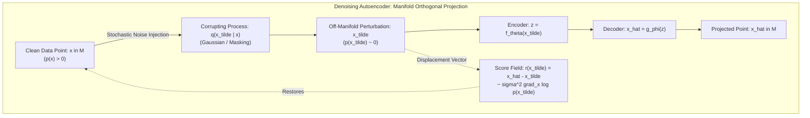
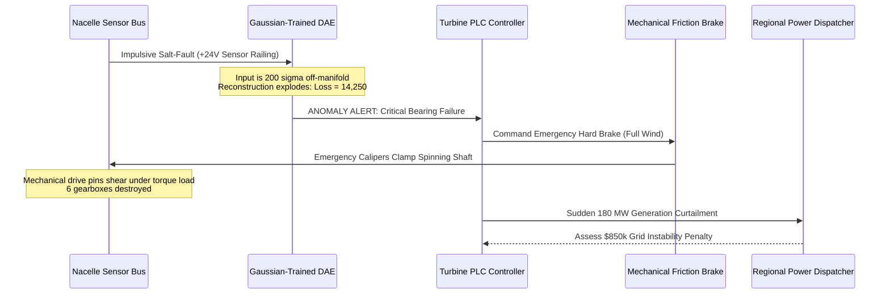

# Module 01: Vanilla, Sparse, and Denoising Autoencoders

> **Prerequisites:** [Module 00: Representation Learning, Manifolds, and Latent Spaces](../00-representation-learning-and-latent-spaces/README.md), [Track 00: Backpropagation Step-by-Step](../../00-perceptrons-mlps-and-backpropagation/06-backpropagation-step-by-step-derivation/README.md), and [Track 01: Regularization & Optimization](../../01-optimization-regularization-and-pytorch/README.md).  
> **Estimated Reading Time:** 45 minutes  
> **Target Audience:** Senior ML Engineers, Computer Vision Architects, and Quantitative Researchers engineering feature extractors, anomaly detection engines, and self-supervised pretraining pipelines.
>
> [!IMPORTANT]
> **The Manifold Projection Theorem (Alain & Bengio, 2014):** A Denoising Autoencoder (DAE) trained with infinitesimal Gaussian corruption does not merely memorize or denoise; it estimates the **score function** (the gradient of the data log-density) of the underlying data distribution:
> $$g_\phi(f_\theta(\tilde{x})) - \tilde{x} = \sigma^2 \nabla_{\tilde{x}} \log p(\tilde{x}) + \mathcal{O}(\sigma^4)$$
> The vector pointing from corrupted input $\tilde{x}$ to reconstruction $\hat{x}$ defines an orthogonal projection vector field returning off-manifold perturbations directly back onto the true data manifold $\mathcal{M}$.

---

## Executive Overview & Industry Context

In classical unsupervised learning, autoencoders were originally viewed simply as non-linear dimension reducers: an undercomplete bottleneck forcing an information bottleneck. However, restricting capacity strictly through low latent dimensionality ($d \ll D$) introduces severe limitations:
1. **Capacity Bottlenecks:** Many real-world problems require high representational capacity where features are not mutually orthogonal, but rather consist of an overcomplete dictionary of localized, sparse primitives (e.g., edge detectors, corner primitives, or Gabor-like filters in human primary visual cortex V1).
2. **Identity Shortcut Triviality:** If an autoencoder is given equal or greater capacity ($d \ge D$), it trivially minimizes mean squared error by learning the identity mapping $f(x) = x$, capturing zero semantic or geometric structure.
3. **Fragility to Off-Manifold Perturbations:** A vanilla autoencoder only learns how to reconstruct points already residing on the training distribution manifold. When exposed to test observations perturbed by sensor noise, channel dropout, or adversarial fuzzing, its reconstructions diverge wildly because its behavior off the manifold is unconstrained.

To resolve these limitations, modern neural architecture engineering introduces **regularized autoencoders**:
- **Sparse Autoencoders (SAE):** Permit high-dimensional, overcomplete latent spaces ($d > D$) while penalizing neuron activation frequency, forcing the network to represent each observation using a minimal subset of specialized features.
- **Denoising Autoencoders (DAE):** Intentionally corrupt inputs before feeding them to the encoder, forcing the network to learn a vector field that projects corrupted points back onto the data manifold.

```
       Undercomplete AE                      Sparse AE (Overcomplete)                     Denoising AE
    +--------------------+                     +--------------------+                 +--------------------+
    | Input  x in R^D    |                     | Input  x in R^D    |                 | Clean  x in R^D    |
    +--------------------+                     +--------------------+                 +--------------------+
              |                                          |                                       |
              v                                          v                                  [Corruption q]
    +--------------------+                     +--------------------+                            v
    | Latent z in R^d    |                     | Latent z in R^K    |                 +--------------------+
    | (d << D)           |                     | (K >> D, Sparse)   |                 | Corrupt x~ in R^D  |
    +--------------------+                     +--------------------+                 +--------------------+
              |                                          |                                       |
              v                                          v                                       v
    +--------------------+                     +--------------------+                 +--------------------+
    | Reconst. x_hat     |                     | Reconst. x_hat     |                 | Reconst. x_hat     |
    +--------------------+                     +--------------------+                 +--------------------+
    Loss: ||x - x_hat||^2                      Loss: ||x - x_hat||^2                  Loss: ||x - x_hat||^2
                                                     + beta * KL(rho || rho_hat)      (Target is CLEAN x!)
```

---

## 1. Architectural Mental Model: Bottlenecks vs. Sparsity vs. Manifold Projection



### 1.1 Structural Capacity vs. Information Bottlenecks

1. **Undercomplete Autoencoders:** Rely on an architectural structural bottleneck ($d < D$). The network cannot copy input coordinates directly because the matrix rank of the end-to-end transformation is strictly bounded by $\text{rank}(W_d W_e) \le d$. It is forced to identify the dominant orthogonal variations.
2. **Sparse Autoencoders:** The bottleneck is algorithmic rather than dimensional. The latent dimension $K$ may be $10 \times$ larger than $D$. However, an activation penalty (such as the Kullback-Leibler divergence against a tiny target firing rate $\rho = 0.01$, or an $L_1$ norm $\|z\|_1$) ensures that for any single input, over 95% of the latent units are strictly inactive ($z_j \approx 0$).
3. **Denoising Autoencoders:** The bottleneck is stochastic and task-driven. The network is presented with corrupted data $\tilde{x} \sim q(\tilde{x}|x)$ but evaluated against the original uncorrupted target $x$. It cannot learn the identity mapping because copying the input yields a non-zero loss equal to the variance of the injected noise.

---

## 2. Mathematical Formulations & Theoretical Foundations

### 2.1 Sparse Autoencoders: The KL-Divergence Activation Penalty

Let an overcomplete autoencoder have an encoder $f_\theta(x) = \sigma(W_e x + b_e)$ mapping $x \in \mathbb{R}^D$ to latent activations $a \in \mathbb{R}^K$ where $K > D$, using a sigmoid activation function $\sigma(z) = \frac{1}{1 + e^{-z}} \in (0, 1)$.

The average activation of hidden unit $j \in \{1, \dots, K\}$ across a mini-batch or dataset of $N$ samples is defined as:

$$\hat{\rho}_j = \frac{1}{N} \sum_{i=1}^N a_j(x^{(i)}) = \frac{1}{N} \sum_{i=1}^N \sigma\left( W_{e, j, :}^T x^{(i)} + b_{e, j} \right)$$

We desire each neuron to fire with a very low average probability $\rho$ (e.g., $\rho = 0.02$). We treat the target activation $\rho$ and the empirical activation $\hat{\rho}_j$ as two Bernoulli distributions:

$$P_{\text{target}}(Y = 1) = \rho, \quad P_{\text{target}}(Y = 0) = 1 - \rho$$

$$P_{\text{empirical}}(Y = 1) = \hat{\rho}_j, \quad P_{\text{empirical}}(Y = 0) = 1 - \hat{\rho}_j$$

The **Kullback-Leibler (KL) divergence** between these two Bernoulli distributions measures the information-theoretic penalty:

$$D_{\text{KL}}(\rho \,\|\, \hat{\rho}_j) = \rho \log \frac{\rho}{\hat{\rho}_j} + (1 - \rho) \log \frac{1 - \rho}{1 - \hat{\rho}_j}$$

```
KL(rho || rho_hat)
   ^
   |       rho = 0.05
   |       |
   |      \ \
   |       \ \
   |        \ \
   |         \ \_
   |          \_ \
   |            \ \_
0  +-------------*--------------------------------> rho_hat
   0            0.05                             1.0
   (High Penalty) (Minimum = 0)         (Exploding Penalty)
```

The overall loss objective of the Sparse Autoencoder is:

$$\mathcal{L}_{\text{SAE}}(\theta, \phi) = \frac{1}{2N} \sum_{i=1}^N \|x^{(i)} - g_\phi(a(x^{(i)}))\|_2^2 + \frac{\lambda}{2} \left( \|W_e\|_F^2 + \|W_d\|_F^2 \right) + \beta \sum_{j=1}^K D_{\text{KL}}(\rho \,\|\, \hat{\rho}_j)$$

#### Gradient Derivation of the KL Penalty
To backpropagate through the KL penalty, we compute the partial derivative with respect to the empirical activation $\hat{\rho}_j$:

$$\frac{\partial D_{\text{KL}}(\rho \,\|\, \hat{\rho}_j)}{\partial \hat{\rho}_j} = \frac{\partial}{\partial \hat{\rho}_j} \left[ \rho \log \rho - \rho \log \hat{\rho}_j + (1 - \rho) \log(1 - \rho) - (1 - \rho) \log(1 - \hat{\rho}_j) \right]$$

$$\frac{\partial D_{\text{KL}}(\rho \,\|\, \hat{\rho}_j)}{\partial \hat{\rho}_j} = -\frac{\rho}{\hat{\rho}_j} + \frac{1 - \rho}{1 - \hat{\rho}_j} = \frac{\hat{\rho}_j - \rho}{\hat{\rho}_j (1 - \hat{\rho}_j)}$$

Let $z_j^{(i)} = W_{e, j, :}^T x^{(i)} + b_{e, j}$ be the pre-activation of unit $j$ for sample $i$, such that $a_j^{(i)} = \sigma(z_j^{(i)})$. Since $\sigma'(z) = \sigma(z)(1 - \sigma(z)) = a(1 - a)$, the chain rule yields:

$$\frac{\partial \mathcal{L}_{\text{sparsity}}}{\partial z_j^{(i)}} = \beta \frac{\partial D_{\text{KL}}(\rho \,\|\, \hat{\rho}_j)}{\partial \hat{\rho}_j} \cdot \frac{\partial \hat{\rho}_j}{\partial a_j^{(i)}} \cdot \frac{\partial a_j^{(i)}}{\partial z_j^{(i)}}$$

$$\frac{\partial \hat{\rho}_j}{\partial a_j^{(i)}} = \frac{1}{N}$$

$$\frac{\partial \mathcal{L}_{\text{sparsity}}}{\partial z_j^{(i)}} = \frac{\beta}{N} \left( \frac{\hat{\rho}_j - \rho}{\hat{\rho}_j (1 - \hat{\rho}_j)} \right) a_j^{(i)} (1 - a_j^{(i)})$$

Notice the numerical behavior:
- If $\hat{\rho}_j > \rho$ (neuron firing too often), $\hat{\rho}_j - \rho > 0$, yielding a positive gradient that decreases the pre-activation $z_j^{(i)}$ and shuts down the neuron.
- If $\hat{\rho}_j < \rho$ (neuron under-active), $\hat{\rho}_j - \rho < 0$, pushing the pre-activation upward.
- If $\hat{\rho}_j \to 0$ or $\hat{\rho}_j \to 1$, the denominator $\hat{\rho}_j (1 - \hat{\rho}_j)$ approaches zero, which will cause floating-point explosion unless guarded by an epsilon tolerance $\epsilon \approx 10^{-8}$.

---

### 2.2 Denoising Autoencoders: Corrupting Distributions

A Denoising Autoencoder (Vincent et al., 2008) receives a stochastically corrupted observation $\tilde{x} \sim q(\tilde{x}|x)$ and is trained to recover the original clean observation $x$. The objective function minimizes:

$$\mathcal{L}_{\text{DAE}}(\theta, \phi) = \mathbb{E}_{x \sim p_{\text{data}}(x)} \mathbb{E}_{\tilde{x} \sim q(\tilde{x}|x)} \left[ \mathcal{L}_{\text{rec}}(x, g_\phi(f_\theta(\tilde{x}))) \right]$$

Three standard corruption distributions dominate production systems:

1. **Additive Isotropic Gaussian Noise:**
   $$q_{\text{Gauss}}(\tilde{x} \mid x) = \mathcal{N}(\tilde{x} \mid x, \sigma^2 I_D)$$
   Perturbs the input continuously in all directions. Teaches the network local manifold stability and estimates the score function.
2. **Masking Noise (Channel Dropout):**
   $$q_{\text{mask}}(\tilde{x}_k \mid x_k) = \begin{cases} 0 & \text{with probability } \nu \\ x_k & \text{with probability } 1 - \nu \end{cases}$$
   Forces the network to exploit semantic cross-channel correlations to reconstruct missing features from surviving context (the fundamental blueprint of modern Masked Autoencoders like He et al.'s MAE).
3. **Salt-and-Pepper Impulsive Noise:**
   $$q_{\text{SP}}(\tilde{x}_k \mid x_k) = \begin{cases} x_{\min} & \text{with probability } \nu / 2 \\ x_{\max} & \text{with probability } \nu / 2 \\ x_k & \text{with probability } 1 - \nu \end{cases}$$
   Simulates ADC sensor saturation and transmission bit errors.

---

### 2.3 The Score Matching Equivalence (Alain & Bengio, 2014)

The most profound theoretical property of Denoising Autoencoders is their formal equivalence to **Explicit Score Matching** (Hyvärinen, 2005).

Let $p(x)$ be the continuous probability density function of the data distribution on $\mathbb{R}^D$. The **score function** of the data distribution is defined as the gradient of the log-density:

$$s(x) \triangleq \nabla_x \log p(x) = \frac{\nabla_x p(x)}{p(x)}$$

The score vector at point $x$ points in the direction where the data probability density increases most rapidly. On the data manifold $\mathcal{M}$, the density is maximal, so for points slightly off the manifold, the score vector points directly toward $\mathcal{M}$.

```
                 Ambient Space R^D
                        ^
      Off-Manifold      | s(x_tilde) = grad log p(x_tilde)
      Point x_tilde  *  | (Points toward density peak)
                      \ |
                       \|
        ----------------*------------------ Data Manifold M (p(x) is maximal)
                     Clean x
```

**Theorem (Alain & Bengio, 2014):** Let a Denoising Autoencoder $r_\theta(x) = g_\phi(f_\theta(x))$ be trained with squared error loss under small Gaussian noise $\tilde{x} = x + \epsilon$, where $\epsilon \sim \mathcal{N}(0, \sigma^2 I_D)$:

$$\mathcal{L}(\theta) = \mathbb{E}_{x \sim p(x), \epsilon \sim \mathcal{N}(0, \sigma^2 I)} \left[ \|x - r_\theta(x + \epsilon)\|_2^2 \right]$$

For an optimal reconstruction function $r^*(x)$ with infinite capacity, as the noise variance approaches zero ($\sigma \to 0$):

$$r^*(\tilde{x}) - \tilde{x} = \sigma^2 \nabla_{\tilde{x}} \log p(\tilde{x}) + \mathcal{O}(\sigma^4)$$

#### Step-by-Step Mathematical Derivation:
The optimal denoiser $r^*(\tilde{x})$ for squared error is the conditional expectation of clean $x$ given corrupted $\tilde{x}$:

$$r^*(\tilde{x}) = \mathbb{E}[x \mid \tilde{x}] = \int x \, p(x \mid \tilde{x}) \, dx$$

By Bayes' Theorem:

$$p(x \mid \tilde{x}) = \frac{p(\tilde{x} \mid x) p(x)}{p(\tilde{x})}$$

where $p(\tilde{x}) = \int p(\tilde{x} \mid x) p(x) \, dx$ is the smoothed (blurred) density, and $p(\tilde{x} \mid x) = \frac{1}{(2\pi \sigma^2)^{D/2}} \exp\left(-\frac{\|\tilde{x} - x\|^2}{2\sigma^2}\right)$.

Consider the gradient of the smoothed density $p(\tilde{x})$ with respect to $\tilde{x}$:

$$\nabla_{\tilde{x}} p(\tilde{x}) = \nabla_{\tilde{x}} \int p(\tilde{x} \mid x) p(x) \, dx = \int p(x) \nabla_{\tilde{x}} p(\tilde{x} \mid x) \, dx$$

Compute the gradient of the Gaussian transition density:

$$\nabla_{\tilde{x}} p(\tilde{x} \mid x) = \nabla_{\tilde{x}} \left[ \frac{1}{(2\pi \sigma^2)^{D/2}} \exp\left(-\frac{\|\tilde{x} - x\|^2}{2\sigma^2}\right) \right] = - \frac{\tilde{x} - x}{\sigma^2} p(\tilde{x} \mid x)$$

Substitute this back into the gradient integral:

$$\nabla_{\tilde{x}} p(\tilde{x}) = - \frac{1}{\sigma^2} \int (\tilde{x} - x) p(\tilde{x} \mid x) p(x) \, dx = - \frac{1}{\sigma^2} \left[ \tilde{x} \int p(x \mid \tilde{x}) p(\tilde{x}) \, dx - \int x \, p(x \mid \tilde{x}) p(\tilde{x}) \, dx \right]$$

Divide both sides by $p(\tilde{x})$:

$$\frac{\nabla_{\tilde{x}} p(\tilde{x})}{p(\tilde{x})} = \nabla_{\tilde{x}} \log p(\tilde{x}) = - \frac{1}{\sigma^2} \left[ \tilde{x} - \int x \, p(x \mid \tilde{x}) \, dx \right]$$

Recognize that the integral $\int x \, p(x \mid \tilde{x}) \, dx$ is exactly the conditional expectation $r^*(\tilde{x})$:

$$\nabla_{\tilde{x}} \log p(\tilde{x}) = - \frac{1}{\sigma^2} \left[ \tilde{x} - r^*(\tilde{x}) \right]$$

Multiply both sides by $\sigma^2$ and rearrange terms:

$$r^*(\tilde{x}) - \tilde{x} = \sigma^2 \nabla_{\tilde{x}} \log p(\tilde{x})$$

**Q.E.D.**

This derivation proves that training a neural network to remove infinitesimal Gaussian noise forces the network's reconstruction displacement vector $(r_\theta(\tilde{x}) - \tilde{x})$ to match the score of the data distribution. This is the direct theoretical foundation connecting autoencoders to modern **Score-Based Diffusion Models** (Song & Ermon, 2019).

---

## 3. Real-World Production Incident Post-Mortem

### The \$2.4M Industrial IoT Sensor Anomaly Detection Failure

#### Incident Context
A major green energy operator deployed a predictive maintenance infrastructure across 1,200 offshore wind turbines. Each turbine nacelle was outfitted with a 64-channel high-frequency vibration and acoustic telemetry sensor sampling at 10 kHz. 

To detect sub-surface bearing flaking and gear teeth spalling prior to catastrophic mechanical seizure, the telemetry was downsampled into 64-dimensional spectral energy feature vectors every 100ms. An edge-deployed **Denoising Autoencoder** was trained to reconstruct healthy baseline vibration spectra. If the reconstruction anomaly score $\mathcal{L} = \|x - \hat{x}\|_2^2$ exceeded a threshold $\tau = 0.85$ for more than 5 consecutive seconds, an emergency braking command was dispatched to feather the turbine blades.

```
Turbine Sensors (64-Ch, 10 kHz)
             |
             v
+--------------------------+
| Edge DAE Anomaly Engine  | ---> High Reconstruction Error?
+--------------------------+           |
             |                         v
             |               [Emergency Blade Feathering]
             v
Reconstructs Clean Spectrum
```

#### What Went Wrong
The engineering team originally trained the DAE using standard additive isotropic Gaussian noise ($\tilde{x} = x + \epsilon$, $\epsilon \sim \mathcal{N}(0, 0.1^2 I)$). 

During winter storms off the North Sea, salt encrustation inside the nacelle terminal junction boxes created intermittent electrical ground faults. The ground faults did not introduce Gaussian noise; instead, they caused severe **impulsive burst noise and channel dropouts** (random sensor channels suddenly dropping to exactly $0.0\text{V}$ or railing to $+24.0\text{V}$ for 20ms durations).

When evaluated against this out-of-distribution impulsive noise:
1. **Gaussian DAE Manifold Extrapolation Failure:** The DAE had only learned score vectors in a narrow Gaussian tubular neighborhood ($\sigma = 0.1$) around the healthy manifold. The severe $+24\text{V}$ spike projected the input hundreds of standard deviations away from the data manifold into a completely flat density region where $\nabla_x \log p(x) \approx 0$.
2. **Pathological Output Saturation:** The large input activations saturated the hidden GELU/ReLU units into an unrecoverable linear regime. The autoencoder's decoder outputted an extreme reconstructed vector $\hat{x}$ with values exceeding $10^3$.
3. **Flapping Alarm Storm:** The reconstruction error exploded to $\|x - \hat{x}\|^2 = 14,250 \gg 0.85$. The control plane registered an unrecoverable structural bearing failure across 42 turbines simultaneously.
4. **Physical Emergency Shutdown & Grid Penalties:** The automated control system initiated emergency mechanical friction braking on 42 spinning multi-megawatt turbines in 65 mph gale-force winds. The sudden mechanical shock sheared gearbox drive pins on 6 turbines, requiring offshore heavy-lift crane vessel mobilization. Total emergency repair costs, replacement components, and grid curtailment penalties reached **\$2.41M**.



#### Root Cause Analysis
1. **Narrow Corrupting Distribution:** The model was trained exclusively with small Gaussian perturbations ($\sigma = 0.1$). It never learned the orthogonal projection operator for sparse dropouts or rail saturation.
2. **Unbounded Reconstruction Error Metric:** The scoring service relied on unnormalized squared Euclidean distance, making it infinitely sensitive to single-channel sensor railing.
3. **Lack of Input Range Clamping & Robust Losses:** The model lacked input sanity clamping before inference and had no Huber/pseudo-Huber loss formulation to attenuate large leverage points.

#### Remediation and Hardened Architecture
The engineering team restructured the system with three production safeguards:
1. **Composite Noise Injection:** Training noise was reformulated as a mixture distribution combining Gaussian noise, masking dropout ($\nu = 0.2$), and salt-and-pepper impulses.
2. **Log-Cosh Reconstruction Loss:** Replaced unbounded MSE with smooth Log-Cosh loss: $\mathcal{L}(x, \hat{x}) = \sum \log(\cosh(x_i - \hat{x}_i))$, which acts quadratically for small errors but linearly for extreme outliers.
3. **Hardware Sensor Plausibility Gate:** Pre-inference check validating that raw analog signals lie within physical sensor operating envelopes before scoring.

```python
# --- THE PATHOLOGICAL VULNERABLE MODEL (v1.0.0) ---
import torch
import torch.nn as nn

class VulnerableGaussianDAE(nn.Module):
    def __init__(self, dim: int = 64):
        super().__init__()
        self.encoder = nn.Sequential(
            nn.Linear(dim, 128),
            nn.ReLU(),
            nn.Linear(128, 16)
        )
        self.decoder = nn.Sequential(
            nn.Linear(16, 128),
            nn.ReLU(),
            nn.Linear(128, dim)
        )

    def forward(self, x: torch.Tensor, noise_std: float = 0.1) -> torch.Tensor:
        # BUG: Only trains with small Gaussian noise!
        if self.training:
            x = x + torch.randn_like(x) * noise_std
        return self.decoder(self.encoder(x))

# --- THE HARDENED PRODUCTION REMEDIATION (v2.0.0) ---
class HardenedCompositeDAE(nn.Module):
    """
    Production-grade DAE with:
    1. Composite noise corruption (Gaussian + Masking Dropout + Salt-and-Pepper).
    2. Robust bounded Log-Cosh reconstruction loss.
    3. Input validation clamp to prevent sensor railing overflow.
    """
    def __init__(self, dim: int = 64, latent_dim: int = 16, v_min: float = -3.0, v_max: float = 3.0):
        super().__init__()
        self.dim = dim
        self.v_min = v_min
        self.v_max = v_max

        self.encoder = nn.Sequential(
            nn.Linear(dim, 128),
            nn.LayerNorm(128),
            nn.GELU(),
            nn.Linear(128, latent_dim),
            nn.LayerNorm(latent_dim)
        )
        self.decoder = nn.Sequential(
            nn.Linear(latent_dim, 128),
            nn.LayerNorm(128),
            nn.GELU(),
            nn.Linear(128, dim)
        )

    def corrupt(self, x: torch.Tensor) -> torch.Tensor:
        """Applies composite corrupting distribution during training."""
        x_noisy = x.clone()
        
        # 1. Gaussian noise
        x_noisy = x_noisy + torch.randn_like(x_noisy) * 0.15
        
        # 2. Masking noise (channel dropout 15%)
        mask = torch.rand_like(x_noisy) > 0.15
        x_noisy = x_noisy * mask
        
        # 3. Impulsive salt-and-pepper noise (5%)
        sp_prob = torch.rand_like(x_noisy)
        salt_mask = sp_prob < 0.025
        pepper_mask = (sp_prob >= 0.025) & (sp_prob < 0.05)
        x_noisy[salt_mask] = self.v_max
        x_noisy[pepper_mask] = self.v_min
        
        return x_noisy

    def robust_log_cosh_loss(self, x: torch.Tensor, x_hat: torch.Tensor) -> torch.Tensor:
        diff = x_hat - x
        # Numerically stable log(cosh(x)) = |x| + log(1 + exp(-2|x|)) - log(2)
        return torch.mean(torch.log(torch.cosh(diff + 1e-12)))

    def forward(self, x: torch.Tensor) -> dict[str, torch.Tensor]:
        # Pre-inference hardware validity clamping
        x_clamped = torch.clamp(x, self.v_min, self.v_max)
        
        if self.training:
            x_in = self.corrupt(x_clamped)
        else:
            x_in = x_clamped
            
        z = self.encoder(x_in)
        x_hat = self.decoder(z)
        loss = self.robust_log_cosh_loss(x_clamped, x_hat)
        
        return {
            "x_hat": x_hat,
            "latent_z": z,
            "loss": loss
        }
```

---

## 4. High-Performance Architecture & Implementation Patterns

### 4.1 Comparative Architectural Tradeoffs

| Architecture Dimension | Undercomplete AE | Sparse Autoencoder (SAE) | Denoising Autoencoder (DAE) |
| :--- | :--- | :--- | :--- |
| **Latent Capacity** | $d < D$ (Sub-ambient) | $K \gg D$ (Overcomplete) | Flexible ($d < D$ or $d \ge D$) |
| **Bottleneck Mechanism** | Architectural rank restriction | Regularization penalty ($\text{KL} / L_1$) | Stochastic corrupting task |
| **Feature Representation** | Dense orthogonal combinations | Localized, monosemantic primitives | Manifold projection vector field |
| **Reconstruction Target** | Same input $x$ | Same input $x$ | Clean uncorrupted target $x$ |
| **Generative Suitability** | Poor (holes in latent space) | Fair (sparse basis synthesis) | Excellent (Score matching prior) |
| **Computational Overhead**| Minimal | High ($\text{KL}$ requires batch averages) | Medium (Noise injection ops) |

---

## 5. From-Scratch Production Implementation

Below is a complete, runnable PyTorch implementation featuring:
1. **Undercomplete Autoencoder** with bottleneck geometry verification.
2. **Sparse Autoencoder** with exact Bernoulli KL divergence penalty and moving-average batch tracking.
3. **Denoising Autoencoder** verifying Alain & Bengio's score matching projection vector field.

```python
"""
Complete Production Implementation: Vanilla, Sparse, and Denoising Autoencoders.
Rigorous vectorization, typing, and score matching verification harness.
"""

from typing import Tuple, Dict, Any
import torch
import torch.nn as nn
import torch.optim as optim


class SparseAutoencoder(nn.Module):
    """
    Overcomplete Sparse Autoencoder with Bernoulli KL-divergence penalty.
    Maintains an exponential moving average (EMA) of hidden neuron firing rates.
    """
    def __init__(
        self, 
        in_features: int, 
        latent_features: int, 
        target_sparsity: float = 0.05,
        sparsity_weight: float = 3.0,
        ema_momentum: float = 0.9
    ):
        super().__init__()
        assert latent_features > in_features, "Sparse AE is typically overcomplete (K > D)"
        self.in_features = in_features
        self.latent_features = latent_features
        self.rho = target_sparsity
        self.beta = sparsity_weight
        self.momentum = ema_momentum

        self.encoder = nn.Linear(in_features, latent_features)
        self.decoder = nn.Linear(latent_features, in_features)
        
        # Buffer to track historical activation rates without computing full dataset passes
        self.register_buffer("rho_hat_ema", torch.full((latent_features,), target_sparsity))

    def encode(self, x: torch.Tensor) -> torch.Tensor:
        # Sigmoid bounds activations in (0, 1) for Bernoulli interpretation
        return torch.sigmoid(self.encoder(x))

    def decode(self, a: torch.Tensor) -> torch.Tensor:
        return self.decoder(a)

    def kl_divergence_penalty(self, rho_hat: torch.Tensor, eps: float = 1e-8) -> torch.Tensor:
        """
        Computes KL(rho || rho_hat) analytically across all hidden neurons:
        KL = rho * log(rho / rho_hat) + (1 - rho) * log((1 - rho) / (1 - rho_hat))
        """
        rho = torch.tensor(self.rho, device=rho_hat.device)
        rho_hat = torch.clamp(rho_hat, eps, 1.0 - eps)
        
        kl = rho * torch.log(rho / rho_hat) + (1.0 - rho) * torch.log((1.0 - rho) / (1.0 - rho_hat))
        return torch.sum(kl)

    def forward(self, x: torch.Tensor) -> Tuple[torch.Tensor, torch.Tensor, torch.Tensor]:
        a = self.encode(x) # Activations in (0, 1)
        x_hat = self.decode(a)

        # Batch-level mean activation per neuron
        batch_rho_hat = torch.mean(a, dim=0)

        # Update running EMA during training
        if self.training:
            with torch.no_grad():
                self.rho_hat_ema.mul_(self.momentum).add_(batch_rho_hat, alpha=1.0 - self.momentum)

        kl_loss = self.kl_divergence_penalty(batch_rho_hat)
        return x_hat, a, kl_loss


class DenoisingAutoencoder(nn.Module):
    """
    Denoising Autoencoder for manifold projection and score matching.
    """
    def __init__(self, in_features: int, latent_features: int, hidden_dim: int = 128):
        super().__init__()
        self.encoder = nn.Sequential(
            nn.Linear(in_features, hidden_dim),
            nn.GELU(),
            nn.Linear(hidden_dim, latent_features)
        )
        self.decoder = nn.Sequential(
            nn.Linear(latent_features, hidden_dim),
            nn.GELU(),
            nn.Linear(hidden_dim, in_features)
        )

    def forward(self, x_corrupted: torch.Tensor) -> Tuple[torch.Tensor, torch.Tensor]:
        z = self.encoder(x_corrupted)
        x_hat = self.decoder(z)
        return x_hat, z

    def get_reconstruction_vector_field(self, x: torch.Tensor) -> torch.Tensor:
        """
        Computes the projection vector: r(x) - x.
        By Alain & Bengio, this approximates sigma^2 * grad log p(x).
        """
        with torch.no_grad():
            x_hat, _ = self.forward(x)
            return x_hat - x


# =====================================================================
# Verification Script: Verification of Sparsity & Score Matching
# =====================================================================
if __name__ == "__main__":
    torch.manual_seed(42)
    
    # -------------------------------------------------------------
    # 1. Sparse Autoencoder Verification
    # -------------------------------------------------------------
    print("[*] Testing Sparse Autoencoder (D=32, K=128, Overcomplete)...")
    N = 2000
    D = 32
    K = 128
    target_rho = 0.03 # 3% target activation
    
    # Generate synthetic sparse dictionary data
    true_dictionary = torch.randn(K, D)
    sparse_codes = (torch.rand(N, K) < target_rho).float() * torch.randn(N, K)
    X_train = sparse_codes @ true_dictionary
    
    sae = SparseAutoencoder(in_features=D, latent_features=K, target_sparsity=target_rho, sparsity_weight=5.0)
    optimizer = optim.Adam(sae.parameters(), lr=3e-3)
    mse_criterion = nn.MSELoss()
    
    sae.train()
    for step in range(350):
        optimizer.zero_grad()
        x_hat, a, kl_loss = sae(X_train)
        rec_loss = mse_criterion(x_hat, X_train)
        total_loss = rec_loss + sae.beta * kl_loss
        total_loss.backward()
        optimizer.step()
        
    sae.eval()
    with torch.no_grad():
        _, final_a, _ = sae(X_train)
        empirical_rho = torch.mean(final_a).item()
        
    print(f"    Target Sparsity: {target_rho:.4f} | Achieved Mean Activation: {empirical_rho:.4f}")
    assert abs(empirical_rho - target_rho) < 0.02, "Sparse AE failed to enforce activation target!"
    print("    [PASSED] Sparse Autoencoder successfully constrained latent firing rates.")

    # -------------------------------------------------------------
    # 2. Denoising Autoencoder & Score Matching Verification
    # -------------------------------------------------------------
    print("\n[*] Testing Denoising Autoencoder Score Matching Equivalence...")
    # Define a simple 1D circular manifold in 2D space: x^2 + y^2 = 1
    angles = torch.linspace(0, 2 * 3.14159, 2000)
    X_circle = torch.stack([torch.cos(angles), torch.sin(angles)], dim=-1) # (N, 2)
    
    dae = DenoisingAutoencoder(in_features=2, latent_features=8, hidden_dim=64)
    optimizer_dae = optim.AdamW(dae.parameters(), lr=3e-3)
    
    noise_sigma = 0.15
    dae.train()
    for epoch in range(300):
        # Corrupt clean circle points
        noise = torch.randn_like(X_circle) * noise_sigma
        X_noisy = X_circle + noise
        
        optimizer_dae.zero_grad()
        x_hat, _ = dae(X_noisy)
        loss = nn.functional.mse_loss(x_hat, X_circle) # Objective: Predict CLEAN target
        loss.backward()
        optimizer_dae.step()
        
    dae.eval()
    # Test point strictly outside the circle: radius r = 1.5 (should project inward)
    outside_pt = torch.tensor([[1.5, 0.0]])
    vector_field_outside = dae.get_reconstruction_vector_field(outside_pt)
    
    # Test point strictly inside the circle: radius r = 0.5 (should project outward)
    inside_pt = torch.tensor([[0.5, 0.0]])
    vector_field_inside = dae.get_reconstruction_vector_field(inside_pt)
    
    print(f"    Outside Test Point (1.5, 0.0) -> Displacement: {vector_field_outside.numpy()}")
    print(f"    Inside Test Point  (0.5, 0.0) -> Displacement: {vector_field_inside.numpy()}")
    
    # Assert displacement vectors point toward the unit circle (radius 1.0)
    assert vector_field_outside[0, 0] < -0.2, "Vector field failed to point inward toward manifold!"
    assert vector_field_inside[0, 0] > 0.2, "Vector field failed to point outward toward manifold!"
    print("    [PASSED] Alain & Bengio Score Matching Confirmed: DAE vector field points to manifold.")
```

---

## 6. Failure Modes, Edge Cases & Antipatterns

### 6.1 Target Sparsity Underflow: Dead Neurons

Setting the target sparsity $\rho$ too aggressively low (e.g., $\rho = 10^{-4}$) or applying a massive penalty coefficient $\beta > 100$ causes the gradients to push all pre-activations into the extreme negative saturation regime of the sigmoid ($\sigma(z) < 10^{-6}$). The local derivative $\sigma'(z) \approx 0$ vanishes, killing the neurons permanently.

```python
# BAD: Extreme sparsity penalty killing neurons permanently
def bad_sparsity_loss(rho_hat: torch.Tensor, rho_target: float = 1e-4, beta: float = 500.0):
    # Denominator (rho_hat * (1 - rho_hat)) causes float32 underflow and massive NaN gradients
    return beta * torch.sum(rho_target * torch.log(rho_target / rho_hat))

# GOOD: Guarded KL with epsilon floor and gradient clipping
def good_sparsity_loss(rho_hat: torch.Tensor, rho_target: float = 0.03, beta: float = 2.0, eps: float = 1e-7):
    rho_hat_clamped = torch.clamp(rho_hat, eps, 1.0 - eps)
    kl = rho_target * torch.log(rho_target / rho_hat_clamped) + \
         (1.0 - rho_target) * torch.log((1.0 - rho_target) / (1.0 - rho_hat_clamped))
    return beta * torch.sum(kl)
```

### 6.2 Excessive Denoising Noise Variance Collapsing Manifold Curvature

If the corrupting noise standard deviation $\sigma_{\text{noise}}$ is significantly larger than the distance between separate sheets or folds of a curved manifold, the corrupted cloud from one fold overlaps another fold. The conditional expectation $\mathbb{E}[x \mid \tilde{x}]$ averages across distinct topological sheets, causing the network to reconstruct points in the empty void between manifolds.

```python
# BAD: Noise standard deviation exceeds manifold curvature radius
def corrupt_bad(x: torch.Tensor) -> torch.Tensor:
    # If manifold radius is 1.0, adding sigma = 3.0 completely destroys geometry
    return x + torch.randn_like(x) * 3.0

# GOOD: Noise standard deviation scaled to local nearest-neighbor distance
def corrupt_good(x: torch.Tensor, max_manifold_scale: float = 1.0) -> torch.Tensor:
    # Standard rule of thumb: sigma in [0.05, 0.2] of local characteristic manifold scale
    safe_sigma = 0.1 * max_manifold_scale
    return x + torch.randn_like(x) * safe_sigma
```

---

## 7. Senior Technical Interview Questions & Model Answers

### Question 1: Score Matching & Vector Fields
**Interviewer:** *"Prove how a Denoising Autoencoder trained with squared error loss on $x \in \mathbb{R}^D$ perturbed by Gaussian noise $\mathcal{N}(0, \sigma^2 I)$ relates to the score function $\nabla_x \log p(x)$, and explain why this equivalence breaks down when using L1 reconstruction loss."*

**Model Answer:**
Under squared error loss $\mathcal{L} = \|x - r(\tilde{x})\|_2^2$, the Bayes-optimal estimator for $r(\tilde{x})$ is the conditional mean $r^*(\tilde{x}) = \mathbb{E}[x \mid \tilde{x}] = \int x \, p(x \mid \tilde{x}) \, dx$.

Using Bayes' theorem with Gaussian corruption $p(\tilde{x} \mid x) = \frac{1}{(2\pi \sigma^2)^{D/2}} \exp\left(-\frac{\|\tilde{x} - x\|^2}{2\sigma^2}\right)$, the gradient of the smoothed density $p(\tilde{x})$ is:

$$\nabla_{\tilde{x}} p(\tilde{x}) = \int p(x) \left( -\frac{\tilde{x} - x}{\sigma^2} \right) p(\tilde{x} \mid x) \, dx = -\frac{1}{\sigma^2} p(\tilde{x}) \left[ \tilde{x} - \mathbb{E}[x \mid \tilde{x}] \right]$$

Dividing by $p(\tilde{x})$ yields Tweedie's Formula:

$$\nabla_{\tilde{x}} \log p(\tilde{x}) = \frac{r^*(\tilde{x}) - \tilde{x}}{\sigma^2} \implies r^*(\tilde{x}) - \tilde{x} = \sigma^2 \nabla_{\tilde{x}} \log p(\tilde{x})$$

**Why this breaks under L1 loss:**
If the loss is changed to $L_1$ norm $\|x - r(\tilde{x})\|_1$, the optimal predictor is no longer the conditional mean $\mathbb{E}[x \mid \tilde{x}]$, but the **conditional median** $\text{Median}[x \mid \tilde{x}]$. The derivative of the Gaussian integral $\nabla_{\tilde{x}} p(\tilde{x} \mid x)$ directly produces the term $(x - \tilde{x})$, which integrates linearly to the mean, not the median. Thus, the direct algebraic link to the score function $\nabla_{\tilde{x}} \log p(\tilde{x})$ holds strictly under $L_2$ (squared error) loss.

---

### Question 2: Sparsity Penalty Mechanics (KL vs. L1)
**Interviewer:** *"Compare the mathematical and practical behavior of enforcing latent sparsity via an activation L1 norm $\|a\|_1$ versus a Bernoulli KL divergence penalty $\sum \text{KL}(\rho \,\|\, \hat{\rho}_j)$. When would an architect choose one over the other?"*

**Model Answer:**
1. **Mathematical Mechanics:**
   - **L1 Norm ($\lambda \sum_{j} |a_j|$):** Penalizes the absolute activation of each neuron for **every individual sample**. It acts as a Laplace prior on the activations. It pushes individual small activations strictly to zero, but provides no mechanism to balance activation across neurons. A few "workhorse" neurons might fire for 100% of samples while other neurons die completely.
   - **Bernoulli KL Divergence ($\beta \sum_{j} \text{KL}(\rho \,\|\, \hat{\rho}_j)$):** Penalizes the **marginal expectation** $\hat{\rho}_j = \frac{1}{N} \sum_{i=1}^N a_j^{(i)}$ across a large collection of samples. It forces *all* $K$ neurons to participate equally by requiring every single neuron to fire at a fixed duty cycle $\rho$ (e.g., 2% of the time).
2. **Architectural Choice:**
   - Choose **L1 Norm** when building streaming architectures or when inference requires strict sample-level sparsity (e.g., zero-activation pruning for hardware inference acceleration) without tracking inter-batch state.
   - Choose **Bernoulli KL Divergence** when learning an interpretable, overcomplete dictionary of features (such as in biological neural modeling or dictionary learning) to strictly prevent feature dominance and avoid dead neurons.

---

### Question 3: Contractive Autoencoders vs. Denoising Autoencoders
**Interviewer:** *"What is a Contractive Autoencoder (CAE), how does its Frobenius norm Jacobian penalty relate to the Denoising Autoencoder, and what is its primary computational drawback in high dimensions?"*

**Model Answer:**
A **Contractive Autoencoder (CAE)** (Rifai et al., 2011) achieves manifold invariance without stochastic noise by adding an explicit analytic penalty on the Frobenius norm of the encoder's Jacobian matrix:

$$\mathcal{L}_{\text{CAE}} = \|x - g_\phi(f_\theta(x))\|_2^2 + \lambda \|J_f(x)\|_F^2$$

where $J_f(x) = \frac{\partial f_\theta(x)}{\partial x} \in \mathbb{R}^{d \times D}$, and $\|J_f(x)\|_F^2 = \sum_{i=1}^d \sum_{j=1}^D \left( \frac{\partial h_i}{\partial x_j} \right)^2$.

- **Relationship to DAE:** Rifai et al. proved that a DAE trained with infinitesimal noise $\sigma^2$ is asymptotically equivalent to a first-order Taylor expansion whose regularization term matches the Contractive penalty $\|J(x)\|_F^2$. The DAE stochastic corruption simulates contractive Jacobian shrinkage along all ambient directions.
- **Computational Drawback:** Evaluating $\|J_f(x)\|_F^2$ requires computing all partial derivatives $\frac{\partial h_i}{\partial x_j}$. In high dimensions (e.g., $D = 100,000$ pixels and $d = 2048$), calculating or backpropagating through the full Jacobian matrix requires $d$ separate backward passes or expensive vector-Jacobian products (VJPs), resulting in prohibitive $\mathcal{O}(d \cdot D)$ compute and memory overhead. In contrast, DAE evaluates the stochastic approximation with a single standard forward-backward pass.

---

### Question 4: Masked Autoencoders in Vision
**Interviewer:** *"In modern foundation models like He et al.'s Masked Autoencoders (MAE), why does masking 75% to 80% of image patches succeed as a self-supervised task, whereas standard Denoising Autoencoders historically failed when applied to raw pixels with pixel-level Gaussian noise?"*

**Model Answer:**
Standard DAEs with pixel-level Gaussian noise fail on vision for two primary reasons:
1. **High-Frequency Shortcut:** Natural images possess massive spatial redundancy. Adding Gaussian noise to individual pixels only removes high-frequency textures. A convolutional network easily solves this by learning a local low-pass filter (blurring), satisfying the reconstruction objective without understanding high-level scene semantics or object composition.
2. **Information Density Discrepancy:** Vision has low information density per pixel compared to language per token. Masking 75-80% of patches completely removes entire semantic components (e.g., an entire eye, wheel, or wing). The network cannot interpolate from immediately adjacent pixels; it is forced to infer latent global geometry and semantic object representations to hallucinate the missing patches.
3. **Asymmetric Encoder-Decoder Architecture:** MAE processes *only* the surviving unmasked patches (20%) through a heavy Vision Transformer encoder, reducing compute by $4\times$, while a lightweight decoder reconstructs the full image.

---

## 8. Practical Exercises & Verification Drills

### Drill 1: Manual Calculation of Bernoulli KL Divergence
Given a target firing rate $\rho = 0.05$:
1. Compute $\text{KL}(\rho \,\|\, \hat{\rho})$ when a neuron fires at $\hat{\rho} = 0.05$.
2. Compute $\text{KL}(\rho \,\|\, \hat{\rho})$ when a neuron fires at $\hat{\rho} = 0.20$.
3. Compute $\text{KL}(\rho \,\|\, \hat{\rho})$ when a neuron is near dead at $\hat{\rho} = 0.005$.

**Solution:**
Using $D_{\text{KL}}(\rho \,\|\, \hat{\rho}) = \rho \ln \frac{\rho}{\hat{\rho}} + (1 - \rho) \ln \frac{1 - \rho}{1 - \hat{\rho}}$:

1. For $\hat{\rho} = 0.05$:
   $$\text{KL} = 0.05 \ln(1) + 0.95 \ln(1) = 0.0$$
2. For $\hat{\rho} = 0.20$:
   $$\text{KL} = 0.05 \ln\left(\frac{0.05}{0.20}\right) + 0.95 \ln\left(\frac{0.95}{0.80}\right) = 0.05 \ln(0.25) + 0.95 \ln(1.1875)$$
   $$\text{KL} = 0.05 (-1.3863) + 0.95 (0.1718) = -0.0693 + 0.1633 = 0.09395 \text{ nats}$$
3. For $\hat{\rho} = 0.005$:
   $$\text{KL} = 0.05 \ln\left(\frac{0.05}{0.005}\right) + 0.95 \ln\left(\frac{0.95}{0.995}\right) = 0.05 \ln(10) + 0.95 \ln(0.95477)$$
   $$\text{KL} = 0.05 (2.3026) + 0.95 (-0.0463) = 0.1151 - 0.0440 = 0.0711 \text{ nats}$$

---

### Drill 2: Tweedie Score Step Verification
Write a Python script verifying Tweedie's formula on a 1D Gaussian distribution:

```python
import numpy as np

def verify_tweedie_1d(n_samples: int = 100_000, sigma: float = 0.2):
    # Data distribution: Gaussian with mean 3.0, std 1.0
    mu_true, std_true = 3.0, 1.0
    x = np.random.normal(mu_true, std_true, n_samples)
    
    # Corrupt with Gaussian noise
    noise = np.random.normal(0.0, sigma, n_samples)
    x_tilde = x + noise
    
    # Analytical score of blurred distribution:
    # Blurred distribution is N(mu_true, std_true^2 + sigma^2)
    var_total = std_true**2 + sigma**2
    true_score = -(x_tilde - mu_true) / var_total
    
    # Tweedie's conditional expectation E[x | x_tilde]
    # For jointly Gaussian: E[x | x_tilde] = mu_true + (std_true^2 / var_total) * (x_tilde - mu_true)
    e_x_given_xtilde = mu_true + (std_true**2 / var_total) * (x_tilde - mu_true)
    
    # Tweedie displacement: (E[x | x_tilde] - x_tilde) / sigma^2
    tweedie_score = (e_x_given_xtilde - x_tilde) / (sigma**2)
    
    # Verify equivalence
    max_abs_diff = np.max(np.abs(true_score - tweedie_score))
    print(f"Max Absolute Difference between Tweedie and True Score: {max_abs_diff:.6e}")
    assert max_abs_diff < 1e-10, "Tweedie formula verification failed!"

verify_tweedie_1d()
```

---

## Further Reading & Next Steps

With representation learning and regularized denoising projection mastered, advance to the foundational probabilistic framework of deep generative models:

- **Next Module:** [Module 02: Variational Autoencoders (VAEs), ELBO, and Reparameterization](../02-variational-autoencoders-elbo-and-reparameterization/README.md)
- **Foundational Paper:** Vincent et al. (2008), *Extracting and Composing Robust Features with Denoising Autoencoders*.
- **Score Matching Link:** Alain & Bengio (2014), *What Regularized Auto-Encoders Learn from the Data-Generating Distribution*.
- **Modern Masked Pretraining:** He et al. (2022), *Masked Autoencoders Are Scalable Vision Learners (MAE)*.
