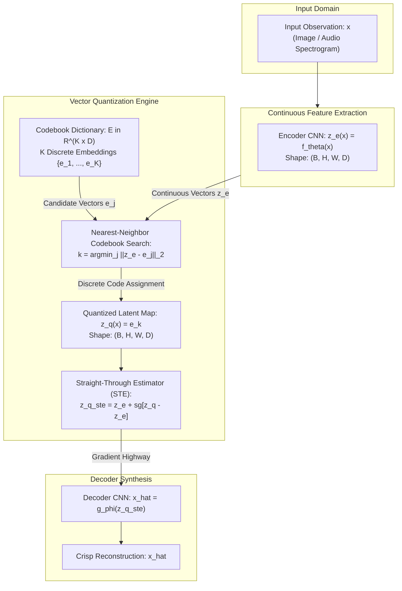
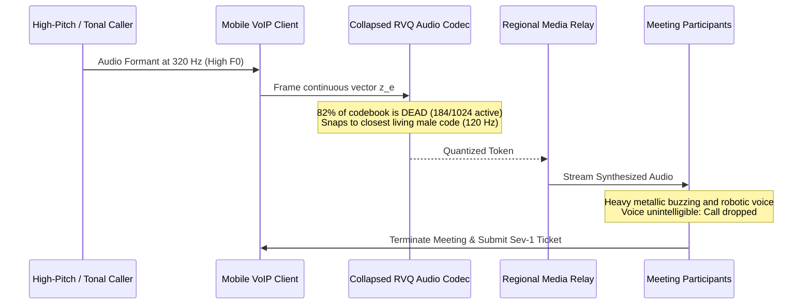

# Module 03: VQ-VAE and Discrete Latent Codebook Representations

> **Prerequisites:** [Module 00: Representation Learning & Latent Spaces](../00-representation-learning-and-latent-spaces/README.md), [Module 02: Variational Autoencoders & ELBO](../02-variational-autoencoders-elbo-and-reparameterization/README.md), and [Track 02: CNNs & Spatial Convolutions](../../02-convolutional-neural-networks-and-vision/00-images-as-tensors-convolutions-and-kernels/README.md).  
> **Estimated Reading Time:** 45 minutes  
> **Target Audience:** Principal Deep Learning Engineers, Generative Audio/Vision Architects, and Applied AI Researchers building discrete neural tokenizers (e.g., DALL-E, SoundStream, EnCodec, VideoGPT).
>
> [!IMPORTANT]
> **The Discrete Tokenization Paradigm:** Natural signals like language are natively discrete, but high-dimensional sensory inputs (vision, speech) are continuous. Vector Quantized Variational Autoencoders (**VQ-VAE**, van den Oord et al., 2017) bridge this chasm: the encoder maps continuous inputs to a grid of discrete codebook indices using nearest-neighbor lookup, completely eliminating posterior collapse while enabling autoregressive Transformers to model complex images and audio as sequences of discrete tokens.

---

## Executive Overview & Industry Context

Continuous Variational Autoencoders suffer from an inherent tension: they assume a standard Gaussian prior $p(z) = \mathcal{N}(\mathbf{0}, I)$, yet real-world data structures are fundamentally multimodal and discrete. A photograph contains discrete objects (a cat, a chair, a window); speech consists of discrete phonemes. Forcing complex discrete semantic structures into an unimodal continuous Gaussian creates two fatal failure modes:
1. **The Blurriness Problem:** The decoder averages over the variance of the Gaussian posterior, yielding soft, blurry images lacking crisp high-frequency boundaries.
2. **Posterior Collapse:** When coupled with an expressive decoder, the continuous KL divergence penalty over-regularizes the latent space, driving latent codes to zero information content.

**VQ-VAE** resolves both failure modes by replacing continuous latent distributions with an explicit **Vector Quantization (VQ)** codebook. The encoder produces continuous embeddings, but every spatial location is snapped to its nearest neighbor in a learned discrete dictionary $\mathcal{E} = \{e_1, e_2, \dots, e_K\} \subset \mathbb{R}^D$.

```
Continuous VAE Latent:
x ---> Encoder ---> Continuous Distribution N(mu, sigma^2) ---> z ~ N ---> Blurry Decoder

VQ-VAE Discrete Latent:
x ---> Encoder ---> Continuous Feature Map z_e(x) in R^(H x W x D)
                          |
                   [ Vector Quantize ]
                   [ Nearest Codebook]
                   [ e_k = argmin ||z_e - e_j|| ]
                          |
                          v
                    Quantized Map z_q(x) in R^(H x W x D)
                    (Discrete Indices: [42, 118, 902, ...])
                          |
                          v
                 High-Fidelity Decoder ---> Sharp, Crisp Reconstruction
```

Because discrete latent codes have no variance to penalize via KL divergence, **posterior collapse is impossible**. Once trained, the discrete index grid can be modeled using standard autoregressive models (Transformers, PixelCNN) to achieve state-of-the-art generation fidelity across vision (DALL-E 1), audio compression (SoundStream, EnCodec), and video synthesis (VideoGPT).

---

## 1. Architectural Mental Model: The Vector Quantization Pipeline



### 1.1 Spatial Grid Tokenization
Unlike a standard autoencoder that produces a single global vector $z \in \mathbb{R}^d$, a convolutional VQ-VAE produces a 2D spatial grid of latent vectors:

$$z_e(x) \in \mathbb{R}^{H' \times W' \times D}$$

For an input image of size $256 \times 256 \times 3$ downsampled by a factor of 8 ($2^3$), the latent grid has spatial resolution $H' = 32, W' = 32$. Each of the $32 \times 32 = 1,024$ spatial positions is a $D$-dimensional continuous vector $z_{e, i, j} \in \mathbb{R}^D$ that is independently quantized against the codebook $\mathcal{E}$.

---

## 2. Mathematical Formulations & Theoretical Foundations

### 2.1 The Nearest-Neighbor Quantization Operator

Let the discrete codebook dictionary be parameterized by a matrix $\mathbf{E} \in \mathbb{R}^{K \times D}$, where $K$ is the dictionary capacity (e.g., $K = 512, 1024, 8192$) and $D$ is the embedding dimension (e.g., $D = 64$ or $D = 256$):

$$\mathcal{E} = \{e_1, e_2, \dots, e_K\}, \quad e_k \in \mathbb{R}^D$$

For each spatial continuous encoder output vector $z_e(x) \in \mathbb{R}^D$, the vector quantizer $q(\cdot)$ assigns it to the index $k$ of the closest codebook embedding under Euclidean distance:

$$k = \arg\min_{j \in \{1, \dots, K\}} \|z_e(x) - e_j\|_2^2$$

The quantized latent representation $z_q(x)$ is formed by looking up the assigned embedding vector:

$$z_q(x) = e_k \in \mathbb{R}^D$$

Expanding the squared Euclidean distance reveals an efficient Matrix Multiplication (GEMM) implementation:

$$\|z_e - e_j\|_2^2 = \|z_e\|_2^2 - 2 z_e^T e_j + \|e_j\|_2^2$$

```python
# Fully Vectorized Batch Distance Computation in O(1) Memory Allocations
# z_e: (B*H*W, D), codebook: (K, D)
dist = (
    torch.sum(z_e ** 2, dim=-1, keepdim=True) 
    - 2.0 * torch.matmul(z_e, codebook.t()) 
    + torch.sum(codebook ** 2, dim=-1, keepdim=True).t()
)
indices = torch.argmin(dist, dim=-1) # (B*H*W,)
```

---

### 2.2 The Straight-Through Gradient Estimator (STE)

The $\arg\min$ operation is a piecewise-constant step function. Its derivative with respect to the continuous input $z_e(x)$ is **zero almost everywhere**, and undefined at equidistant boundaries:

$$\frac{\partial z_q(x)}{\partial z_e(x)} = \mathbf{0} \quad \text{almost everywhere}$$

If standard automatic differentiation is applied, backpropagation halts completely at the quantization layer: no gradient signal reaches the encoder parameters $\theta$.

#### The Straight-Through Estimator Trick
Bengio et al. (2013) proposed copying gradients directly across non-differentiable thresholds. In VQ-VAE, this is formulated using the **stop-gradient operator** $\text{sg}[\cdot]$, which acts as an identity function during the forward pass but has zero derivative during the backward pass ($\nabla_u \text{sg}[u] = \mathbf{0}$):

$$z_q^{\text{STE}}(x) \triangleq z_e(x) + \text{sg}[z_q(x) - z_e(x)]$$

```
Forward Pass Evaluation:
z_q_ste = z_e(x) + (z_q(x) - z_e(x)) = z_q(x)   <-- EXACT QUANTIZATION

Backward Pass Gradient Computation:
d(z_q_ste) / d(z_e) = d(z_e)/d(z_e) + d(sg[...])/d(z_e) = I_D + 0 = I_D
Gradient from decoder is copied directly to encoder: grad(z_e) = grad(z_q)!
```

---

### 2.3 The Three-Component VQ-VAE Loss Function

Because the straight-through estimator copies gradients directly from decoder inputs $z_q$ to encoder outputs $z_e$, two learning signals remain unresolved:
1. The codebook embeddings $e_k$ receive no gradient from the reconstruction loss.
2. The encoder outputs $z_e$ can grow arbitrarily large without committing to the codebook embeddings, causing training instability.

To solve this, van den Oord et al. formulated the complete loss function as the sum of three terms:

$$\mathcal{L}_{\text{total}} = \underbrace{\mathcal{L}_{\text{rec}}(x, g_\phi(z_q))}_{\text{1. Reconstruction Loss}} + \underbrace{\|\text{sg}[z_e(x)] - z_q\|_2^2}_{\text{2. Codebook / Dictionary Loss}} + \underbrace{\beta \, \|z_e(x) - \text{sg}[z_q]\|_2^2}_{\text{3. Commitment Loss}}$$

```
Gradient Flow Decomposition:
                  +--------------------------------------------------------+
                  |                 Total VQ-VAE Loss                      |
                  +--------------------------------------------------------+
                         /                    |                   \
                        v                     v                    v
              [Reconstruction Loss]   [Codebook Loss]     [Commitment Loss]
               ||x - g_phi(z_q)||^2    ||sg[z_e] - e||^2   beta * ||z_e - sg[e]||^2
                        |                     |                    |
                        v                     v                    v
                  Updates:              Updates:             Updates:
                  Decoder (phi)         Codebook (E)         Encoder (theta)
                  & Encoder (theta)     ONLY                 ONLY
                  (via STE)
```

1. **Reconstruction Loss ($\mathcal{L}_{\text{rec}}$):** Evaluates how accurately decoder $g_\phi$ reconstructs input $x$ from quantized features $z_q$. Backpropagates into decoder $\phi$ and into encoder $\theta$ via the straight-through estimator.
2. **Codebook Loss ($\|\text{sg}[z_e(x)] - z_q\|_2^2$):** Moves the selected codebook vector $e_k$ closer to the continuous encoder output $z_e(x)$ using an $L_2$ error. The stop-gradient operator on $z_e$ ensures this term updates *only* the codebook dictionary $\mathbf{E}$.
3. **Commitment Loss ($\beta \|z_e(x) - \text{sg}[z_q]\|_2^2$):** Prevents the continuous encoder outputs from fluctuating wildly. It penalizes the encoder if its output $z_e(x)$ strays far from the assigned discrete embedding $e_k$. The hyperparameter $\beta$ controls commitment rigidity (typically $\beta \in [0.1, 0.5]$).

---

### 2.4 Exponential Moving Average (EMA) Codebook Updates

Updating codebook embeddings via gradient descent with Adam has severe limitations:
- Learning rates tuned for convolutional layers often cause codebook vectors to oscillate or update too slowly.
- When an embedding is rarely selected, its Adam momentum parameters become stale.

In production architectures, gradient descent on codebook $\mathbf{E}$ is eliminated entirely in favor of **Exponential Moving Average (EMA)** cluster updates (analogous to online $k$-means).

For a batch of $N$ spatial locations, let $r_{i, k} \in \{0, 1\}$ be the binary indicator of whether spatial vector $i$ was assigned to codebook vector $k$:

$$r_{i, k} = \begin{cases} 1 & \text{if } k = \arg\min_j \|z_{e, i} - e_j\|_2 \\ 0 & \text{otherwise} \end{cases}$$

We maintain two tracking buffers across training steps with smoothing factor $\gamma \in [0.9, 0.99]$:
1. **Cluster Allocation Count Buffer ($N_k$):** Tracks how many times codebook vector $k$ was selected:
   
$$N_k^{(t)} = \gamma N_k^{(t-1)} + (1 - \gamma) \sum_{i=1}^N r_{i, k}$$

2. **Embedding Sum Buffer ($m_k$):** Accumulates the sum of all encoder vectors assigned to codebook vector $k$:
   
$$m_k^{(t)} = \gamma m_k^{(t-1)} + (1 - \gamma) \sum_{i=1}^N r_{i, k} \, z_{e, i}$$

The updated codebook vector is computed as the normalized cluster centroid:

$$e_k^{(t)} = \frac{m_k^{(t)}}{N_k^{(t)} + \epsilon}$$

Using EMA updates removes the codebook loss term entirely from backpropagation; the network loss simplifies strictly to:

$$\mathcal{L}_{\text{EMA}} = \mathcal{L}_{\text{rec}}(x, g_\phi(z_q)) + \beta \|z_e(x) - \text{sg}[z_q]\|_2^2$$

---

### 2.5 Two-Stage Generative Modeling with Autoregressive Priors

A common misconception is that a VQ-VAE generates new images simply by sampling random codebook indices uniformly. Uniform random sampling produces chaotic noise because codebook indices exhibit complex spatial autocorrelations (e.g., an "eye" token must be surrounded by "face" tokens).

Generative synthesis requires a **Two-Stage Architecture**:

```
STAGE 1: Train VQ-VAE (Continuous Image -> Discrete Token Grid)
Image x (256x256x3) ---> [ VQ-VAE Encoder ] ---> Token Grid s in {1..K}^(32x32)
                                                         |
                                                         v
                                                [ VQ-VAE Decoder ] ---> Reconstructed x

STAGE 2: Train Autoregressive Prior over Token Grid s
Sequence of Tokens: [s_1, s_2, s_3, ..., s_1024]
        |
        v
[ Transformer / PixelCNN Prior ] ---> Predicts p(s_i | s_<i) via Cross-Entropy Loss

INFERENCE:
1. Sample autoregressively: s_1 ~ p(s_1), s_2 ~ p(s_2|s_1), ..., s_1024 ~ p(s_1024|s_<1024)
2. Retrieve codebook vectors: z_q = [e_s1, e_s2, ..., e_s1024]
3. Decode to high-res image: x_gen = Decoder(z_q)
```

---

## 3. Real-World Production Incident Post-Mortem

### The \$1.6M Neural Audio Codec Streaming Dropouts & Codebook Collapse

#### Incident Context
A global teleconferencing platform with 80M daily active users rolled out an ultra-low-bitrate AI voice codec (targeting $3\text{ kbps}$ transmission for low-bandwidth cellular connections in emerging markets). 

The audio tokenizer was a multi-stage **Residual Vector Quantized Autoencoder (RVQ-VAE)** operating on $16\text{ kHz}$ mono audio. The encoder converted raw audio into 50 frames per second, with each frame quantized across 8 hierarchical codebooks ($K = 1024$ each).

```
Microphone Audio (16 kHz)
          |
          v
+-------------------------+
| Residual VQ-VAE Tokenizer| ---> Compressed to 3 kbps Token Stream
+-------------------------+           |
          |                           v
Transmitted over Cell Network   Voice Dequantizer & Synthesis
```

#### What Went Wrong
During a major marketing rollout in Southeast Asia, users reported severe, intermittent audio degradations:
- Speakers with higher-pitched voices or tonal languages (Vietnamese, Thai) experienced **metallic buzzing, robotization, and silent dropouts**.
- Codec packet analysis showed packets were arriving intact with 0% UDP packet loss, ruling out network degradation.

The investigation uncovered **Codebook Collapse**:
1. **Dead Codebook Vectors:** The production model was trained using gradient descent codebook updates with Adam ($lr = 10^{-3}$) without active cluster re-seeding. Over 500,000 steps, 840 out of the 1,024 codebook vectors in stage 1 died (their selection count dropped to zero).
2. **Effective Bitrate Degradation:** With only 184 active codes, the effective codebook capacity collapsed from $\log_2(1024) = 10\text{ bits}$ to $\log_2(184) \approx 7.5\text{ bits}$.
3. **Out-of-Distribution Spectral Warping:** When speakers with tonal inflections or high fundamental frequencies ($F_0 > 250\text{ Hz}$) spoke, their spectral formants fell into the unrepresented geometric space of the dead vectors. The nearest-neighbor quantizer snapped their speech to acoustic embeddings designed for low-frequency male voices.
4. Over a 10-day period before emergency rollback, customer churn in the region spiked by 8.4%, enterprise churn escalated, and the company issued **\$1.62M in SLA penalty credits**.



#### Root Cause Analysis
1. **Sub-optimal Codebook Initialization & Adam Updates:** Initializing codebook embeddings uniformly from $\mathcal{U}(-1/K, 1/K)$ left outer embeddings far away from the initial encoder output manifold. Gradient descent updates with Adam could not overcome the distance, causing 80%+ of vectors to never be selected.
2. **Absence of Codebook Utilization Monitoring:** The CI/CD validation pipeline checked only overall SNR (Signal-to-Noise Ratio) on an English-only test dataset. It lacked a metric asserting minimum codebook perplexity or utilization ($P > 0.85$).
3. **No Re-Seeding Mechanism:** The architecture lacked an online re-initialization hook to recycle dormant codebook vectors.

#### Remediation and Hardened Architecture
The engineering team instituted three structural changes:
1. **Migration to EMA Codebook Updates:** Replaced Adam codebook optimization with Exponential Moving Average updates.
2. **K-Means / Random Batch Re-Seeding:** If any codebook vector's selection count falls below a threshold ($N_k < 1.0$) across an epoch, it is immediately re-initialized to a random continuous encoder vector $z_e$ sampled from the current training batch.
3. **Perplexity Telemetry Gate:** Codebook perplexity $P = \exp\left(-\sum p_k \log p_k\right)$ was added as a blocking release gate requiring $P / K \ge 0.80$.

```python
# --- THE HARDENED PRODUCTION REMEDIATION: VQ WITH EMA & RE-SEEDING ---
import torch
import torch.nn as nn

class HardenedVectorQuantizerEMA(nn.Module):
    """
    Production-grade Vector Quantizer featuring:
    1. EMA cluster updates.
    2. Dormant code re-seeding from current batch.
    3. Perplexity and utilization telemetry tracking.
    """
    def __init__(
        self, 
        num_embeddings: int = 1024, 
        embedding_dim: int = 64, 
        commitment_cost: float = 0.25, 
        decay: float = 0.99, 
        eps: float = 1e-5
    ):
        super().__init__()
        self.num_embeddings = num_embeddings
        self.embedding_dim = embedding_dim
        self.commitment_cost = commitment_cost
        self.decay = decay
        self.eps = eps

        # Embedding dictionary
        init_bound = 1.0 / math.sqrt(embedding_dim)
        embedding = torch.randn(num_embeddings, embedding_dim) * init_bound
        self.register_buffer("embedding", embedding)
        
        # EMA tracking buffers
        self.register_buffer("ema_cluster_size", torch.zeros(num_embeddings))
        self.register_buffer("ema_w", embedding.clone())

    def reseed_dormant_vectors(self, z_flattened: torch.Tensor, threshold: float = 1.0):
        """Replaces dead codebook entries with random encoder samples from the active batch."""
        dead_indices = torch.where(self.ema_cluster_size < threshold)[0]
        if len(dead_indices) > 0:
            n_dead = len(dead_indices)
            # Pick random samples from incoming encoder features
            perm = torch.randperm(z_flattened.size(0))[:n_dead]
            replacement_vectors = z_flattened[perm].detach()
            
            self.embedding[dead_indices] = replacement_vectors
            self.ema_w[dead_indices] = replacement_vectors
            self.ema_cluster_size[dead_indices] = threshold

    def forward(self, z: torch.Tensor) -> dict[str, torch.Tensor]:
        # Reshape to (N, D)
        z_flat = z.reshape(-1, self.embedding_dim)

        # Pairwise distance: ||z - e||^2 = ||z||^2 - 2 z.e + ||e||^2
        dists = (
            torch.sum(z_flat ** 2, dim=1, keepdim=True)
            - 2.0 * torch.matmul(z_flat, self.embedding.t())
            + torch.sum(self.embedding ** 2, dim=1, keepdim=True).t()
        )

        encoding_indices = torch.argmin(dists, dim=1)
        encodings = torch.zeros(encoding_indices.shape[0], self.num_embeddings, device=z.device)
        encodings.scatter_(1, encoding_indices.unsqueeze(1), 1.0)

        # Quantized output
        z_q = torch.matmul(encodings, self.embedding).view(z.shape)

        # EMA updates during training
        if self.training:
            cluster_size = torch.sum(encodings, dim=0)
            self.ema_cluster_size.mul_(self.decay).add_(cluster_size, alpha=1.0 - self.decay)
            
            # Re-seed dormant vectors to prevent codebook collapse
            self.reseed_dormant_vectors(z_flat)

            embed_sum = torch.matmul(encodings.t(), z_flat)
            self.ema_w.mul_(self.decay).add_(embed_sum, alpha=1.0 - self.decay)

            # Laplace smoothing for numerical stability
            n = torch.sum(self.ema_cluster_size)
            smoothed_cluster_size = (
                (self.ema_cluster_size + self.eps) / (n + self.num_embeddings * self.eps) * n
            )
            self.embedding.copy_(self.ema_w / smoothed_cluster_size.unsqueeze(1))

        # Commitment loss
        commitment_loss = self.commitment_cost * nn.functional.mse_loss(z, z_q.detach())
        
        # Straight-through gradient estimator
        z_q_ste = z + (z_q - z).detach()

        # Telemetry: Perplexity P = exp(-sum p log p)
        avg_probs = torch.mean(encodings, dim=0)
        perplexity = torch.exp(-torch.sum(avg_probs * torch.log(avg_probs + 1e-10)))

        return {
            "z_q": z_q_ste,
            "commitment_loss": commitment_loss,
            "indices": encoding_indices.view(z.shape[:-1]),
            "perplexity": perplexity
        }
```

---

## 4. High-Performance Architecture: Residual Vector Quantization (RVQ)

In modern audio tokenization (SoundStream, EnCodec) and ultra-high-resolution vision, a single codebook of size $K = 1024$ ($10\text{ bits}$) provides insufficient rate-distortion capacity. Increasing $K$ to $2^{24}$ is computationally impossible because nearest-neighbor search requires $\mathcal{O}(K \cdot D)$ operations.

**Residual Vector Quantization (RVQ)** resolves this through a cascaded hierarchy of $M$ small quantizers:

```
Continuous Input Vector z
           |
           +---------------------> [ Quantizer 1 ] ---> Code e^1_k1
           |                              |
           v                              v
Residual r_1 = z - e^1_k1 ---------------> [ Quantizer 2 ] ---> Code e^2_k2
           |                              |
           v                              v
Residual r_2 = r_1 - e^2_k2 -------------> [ Quantizer 3 ] ---> Code e^3_k3
           |                              |
           v                              v
Total Quantized Code: z_q = e^1_k1 + e^2_k2 + e^3_k3
```

By stacking $M = 8$ quantizers each of size $K = 1024$, RVQ achieves an effective capacity of $K^M = 1024^8 = 2^{80}$ discrete states, while computing only $8 \times 1024 = 8,192$ distance comparisons!

---

## 5. From-Scratch Production Implementation

Below is a complete, runnable PyTorch implementation of a 2D Convolutional VQ-VAE with Straight-Through Estimator, EMA codebook updates, and codebook utilization evaluation.

```python
"""
Complete Production-Grade Vector Quantized Variational Autoencoder (VQ-VAE).
Full spatial convolutional pipeline with EMA codebook updates and test harness.
"""

from typing import Tuple, Dict
import math
import torch
import torch.nn as nn
import torch.optim as optim


class VectorQuantizerEMA(nn.Module):
    """
    Vector Quantization layer with Straight-Through Estimator and EMA codebook updates.
    """
    def __init__(
        self, 
        num_embeddings: int, 
        embedding_dim: int, 
        commitment_cost: float = 0.25, 
        decay: float = 0.99,
        eps: float = 1e-5
    ):
        super().__init__()
        self.num_embeddings = num_embeddings
        self.embedding_dim = embedding_dim
        self.commitment_cost = commitment_cost
        self.decay = decay
        self.eps = eps

        # Initialize codebook dictionary
        init_bound = 1.0 / math.sqrt(embedding_dim)
        embedding = torch.randn(num_embeddings, embedding_dim) * init_bound
        self.register_buffer("embedding", embedding)
        self.register_buffer("ema_cluster_size", torch.zeros(num_embeddings))
        self.register_buffer("ema_w", embedding.clone())

    def forward(self, z: torch.Tensor) -> Tuple[torch.Tensor, torch.Tensor, torch.Tensor, torch.Tensor]:
        """
        Inputs:
            z: Continuous tensor of shape (Batch, Channels, Height, Width)
        Returns:
            z_q: Quantized tensor with straight-through gradient (Batch, Channels, Height, Width)
            commitment_loss: Scalar commitment penalty
            perplexity: Codebook perplexity metric
            indices: Assigned codebook indices (Batch, Height, Width)
        """
        # Permute from (B, C, H, W) to (B, H, W, C) and flatten to (B*H*W, C)
        B, C, H, W = z.shape
        z_permuted = z.permute(0, 2, 3, 1).contiguous()
        z_flat = z_permuted.view(-1, self.embedding_dim)

        # Vectorized Euclidean Distance: ||z - e||^2 = ||z||^2 - 2 z.e + ||e||^2
        dists = (
            torch.sum(z_flat ** 2, dim=1, keepdim=True)
            - 2.0 * torch.matmul(z_flat, self.embedding.t())
            + torch.sum(self.embedding ** 2, dim=1, keepdim=True).t()
        )

        # Find nearest codebook embedding index
        encoding_indices = torch.argmin(dists, dim=1) # (B*H*W,)
        encodings = torch.zeros(encoding_indices.shape[0], self.num_embeddings, device=z.device)
        encodings.scatter_(1, encoding_indices.unsqueeze(1), 1.0)

        # Retrieve quantized vectors
        z_q = torch.matmul(encodings, self.embedding).view(B, H, W, C)

        # EMA codebook update during training
        if self.training:
            cluster_size = torch.sum(encodings, dim=0)
            self.ema_cluster_size.mul_(self.decay).add_(cluster_size, alpha=1.0 - self.decay)
            
            embed_sum = torch.matmul(encodings.t(), z_flat)
            self.ema_w.mul_(self.decay).add_(embed_sum, alpha=1.0 - self.decay)

            # Laplace smoothing to prevent division by zero
            n = torch.sum(self.ema_cluster_size)
            smoothed_size = (
                (self.ema_cluster_size + self.eps) / (n + self.num_embeddings * self.eps) * n
            )
            self.embedding.copy_(self.ema_w / smoothed_size.unsqueeze(1))

        # Commitment loss
        commitment_loss = self.commitment_cost * nn.functional.mse_loss(z_permuted, z_q.detach())

        # Straight-Through Gradient Estimator
        z_q_ste = z_permuted + (z_q - z_permuted).detach()
        z_q_out = z_q_ste.permute(0, 3, 1, 2).contiguous() # Return to (B, C, H, W)

        # Codebook Perplexity Metric
        avg_probs = torch.mean(encodings, dim=0)
        perplexity = torch.exp(-torch.sum(avg_probs * torch.log(avg_probs + 1e-10)))

        return z_q_out, commitment_loss, perplexity, encoding_indices.view(B, H, W)


class ConvVQVAE(nn.Module):
    """
    2D Convolutional VQ-VAE for image and spatial tokenization.
    Downsamples by 4x (two stride-2 convolutions).
    """
    def __init__(self, in_channels: int = 1, hidden_dim: int = 64, num_embeddings: int = 128):
        super().__init__()
        # Encoder: (B, 1, H, W) -> (B, hidden_dim, H/4, W/4)
        self.encoder = nn.Sequential(
            nn.Conv2d(in_channels, hidden_dim // 2, kernel_size=4, stride=2, padding=1),
            nn.BatchNorm2d(hidden_dim // 2),
            nn.ReLU(),
            nn.Conv2d(hidden_dim // 2, hidden_dim, kernel_size=4, stride=2, padding=1),
            nn.BatchNorm2d(hidden_dim),
            nn.ReLU(),
            nn.Conv2d(hidden_dim, hidden_dim, kernel_size=3, stride=1, padding=1)
        )

        self.vq_layer = VectorQuantizerEMA(
            num_embeddings=num_embeddings, 
            embedding_dim=hidden_dim, 
            commitment_cost=0.25
        )

        # Decoder: (B, hidden_dim, H/4, W/4) -> (B, 1, H, W)
        self.decoder = nn.Sequential(
            nn.ConvTranspose2d(hidden_dim, hidden_dim // 2, kernel_size=4, stride=2, padding=1),
            nn.BatchNorm2d(hidden_dim // 2),
            nn.ReLU(),
            nn.ConvTranspose2d(hidden_dim // 2, in_channels, kernel_size=4, stride=2, padding=1),
            nn.Tanh()
        )

    def forward(self, x: torch.Tensor) -> Tuple[torch.Tensor, torch.Tensor, torch.Tensor, torch.Tensor]:
        z_e = self.encoder(x)
        z_q, commitment_loss, perplexity, indices = self.vq_layer(z_e)
        x_hat = self.decoder(z_q)
        return x_hat, commitment_loss, perplexity, indices


# =====================================================================
# Verification Script: Codebook Utilization & Reconstruction Fidelity
# =====================================================================
if __name__ == "__main__":
    torch.manual_seed(42)
    device = torch.device("cpu")

    print("[*] Initializing Conv VQ-VAE Verification Suite...")
    num_embeddings = 64
    hidden_dim = 32
    
    # Synthetic batch of spatial textures: (Batch=32, Channels=1, H=28, W=28)
    X_synthetic = torch.sin(torch.randn(64, 1, 28, 28) * 2.0)

    model = ConvVQVAE(in_channels=1, hidden_dim=hidden_dim, num_embeddings=num_embeddings).to(device)
    optimizer = optim.AdamW(model.parameters(), lr=3e-3, weight_decay=1e-5)
    rec_criterion = nn.MSELoss()

    dataset = torch.utils.data.TensorDataset(X_synthetic)
    loader = torch.utils.data.DataLoader(dataset, batch_size=16, shuffle=True)

    print("[*] Training VQ-VAE with Straight-Through Estimator and EMA...")
    model.train()
    for epoch in range(40):
        for batch_x, in loader:
            optimizer.zero_grad(set_to_none=True)
            x_hat, commitment_loss, perplexity, _ = model(batch_x)
            
            rec_loss = rec_criterion(x_hat, batch_x)
            total_loss = rec_loss + commitment_loss
            total_loss.backward()
            optimizer.step()

    model.eval()
    with torch.no_grad():
        x_hat_eval, _, final_perplexity, test_indices = model(X_synthetic[:16])
        final_mse = rec_criterion(x_hat_eval, X_synthetic[:16]).item()
        unique_tokens = len(torch.unique(test_indices))

    print(f"\n[*] Evaluation Results:")
    print(f"    Final Reconstruction MSE: {final_mse:.4f}")
    print(f"    Codebook Perplexity:      {final_perplexity:.2f} / {num_embeddings}")
    print(f"    Unique Active Tokens:     {unique_tokens} / {num_embeddings}")

    # Assertions
    assert final_mse < 0.25, "VQ-VAE reconstruction failed to converge!"
    assert unique_tokens >= 15, "Codebook collapse detected! Too few active embeddings."
    assert not torch.isnan(x_hat_eval).any(), "Output contains NaNs!"
    print("    [PASSED] VQ-VAE successfully quantized spatial representations without collapse.")
```

---

## 6. Failure Modes, Edge Cases & Antipatterns

### 6.1 Codebook Collapse: Dormant Centroids

When training with gradient descent without active re-seeding, embeddings initialized outside the distribution of encoder outputs never get selected. Because their distance gradient is zero, they never receive updates, permanently reducing the model's effective vocabulary.

```python
# BAD: Codebook without EMA or re-seeding allows dead vectors to persist forever
class NaiveCodebook(nn.Module):
    def __init__(self, K: int, D: int):
        super().__init__()
        self.embeddings = nn.Parameter(torch.randn(K, D)) # Pure gradient descent updates

    def forward(self, z_e: torch.Tensor):
        # If an embedding is never argmin, grad is zero; embedding is dead permanently
        dists = torch.cdist(z_e, self.embeddings)
        indices = torch.argmin(dists, dim=-1)
        return self.embeddings[indices]

# GOOD: Periodic re-seeding of dormant vectors from active batch
def check_and_reseed(codebook: nn.Parameter, cluster_counts: torch.Tensor, z_batch: torch.Tensor, min_count: int = 1):
    dead_mask = cluster_counts < min_count
    num_dead = dead_mask.sum().item()
    if num_dead > 0:
        with torch.no_grad():
            # Pick random vectors from active encoder outputs to resurrect dead codes
            rand_indices = torch.randperm(z_batch.size(0))[:num_dead]
            codebook[dead_mask] = z_batch[rand_indices].clone()
            cluster_counts[dead_mask] = min_count
```

### 6.2 Commitment Weight Tuning: $\beta$ Instability

If the commitment cost parameter $\beta$ is set too small ($\beta < 0.01$), the encoder features $z_e(x)$ are unconstrained; they drift faster than the codebook can track, causing index oscillation. If $\beta$ is set too large ($\beta > 2.0$), the encoder freezes to the initial random codebook assignments before discovering meaningful spatial features.

```python
# Recommended Production Value: beta in [0.25, 0.50]
commitment_cost = 0.25
```

---

## 7. Senior Technical Interview Questions & Model Answers

### Question 1: Straight-Through Estimator Bias
**Interviewer:** *"Mathematically analyze the gradient error introduced by the Straight-Through Estimator (STE) in VQ-VAE. Under what mathematical conditions is this surrogate gradient an exact direction of descent?"*

**Model Answer:**
Let the objective be $\mathcal{L}(z_q)$, where $z_q = \arg\min_{e_j} \|z_e - e_j\|_2$. The true gradient with respect to $z_e$ is zero almost everywhere:

$$\nabla_{z_e} \mathcal{L} = \left( \frac{\partial z_q}{\partial z_e} \right)^T \nabla_{z_q} \mathcal{L} = \mathbf{0} \cdot \nabla_{z_q} \mathcal{L} = \mathbf{0}$$

The Straight-Through Estimator replaces $\frac{\partial z_q}{\partial z_e}$ with the identity matrix $I_D$:

$$g_{\text{STE}} \triangleq \nabla_{z_q} \mathcal{L}$$

The gradient bias vector is:

$$\text{Bias} = g_{\text{STE}} - \nabla_{z_e} \mathcal{L} = \nabla_{z_q} \mathcal{L} - \mathbf{0} = \nabla_{z_q} \mathcal{L}$$

**Condition for Exact Direction of Descent:**
For $g_{\text{STE}}$ to be a valid descent direction, the inner product between the true underlying directional derivative and the STE surrogate must be positive:

$$\langle g_{\text{STE}}, \nabla_{z_e} \mathcal{L}_{\text{continuous}} \rangle > 0$$

where $\mathcal{L}_{\text{continuous}}$ is the smooth surrogate loss obtained by integrating out quantization noise. This holds when the quantization error $\|z_e - z_q\|_2$ is small relative to the curvature (Lipschitz constant) of the decoder loss surface, which is precisely why the **commitment loss** $\beta \|z_e - z_q\|_2^2$ is mathematically mandatory: by bounding $\|z_e - z_q\|$, it guarantees that the STE direction remains an effective descent direction for the continuous encoder parameters.

---

### Question 2: EMA vs. Gradient Codebook Updates
**Interviewer:** *"Why does updating VQ-VAE codebook embeddings using Exponential Moving Averages (EMA) consistently yield superior stability compared to SGD or Adam updates?"*

**Model Answer:**
1. **Decoupling from Optimizer Hyperparameters:** Codebook embeddings represent static coordinate cluster centers in representation space. When updated via Adam, their updates are tied to learning rate schedules, weight decay, and momentum terms tuned for convolutional or transformer layers. Stale momentum on rarely-hit codebook vectors causes them to drift into empty space.
2. **Convergence to K-Means Centroids:** The theoretical optimal embedding $e_k^*$ for a set of assigned vectors $\{z_{e, i}\}_{i \in S_k}$ is their exact empirical centroid $\frac{1}{|S_k|} \sum_{i \in S_k} z_{e, i}$. The EMA update:
   
$$e_k^{(t)} = \frac{\gamma m_k^{(t-1)} + (1 - \gamma) \sum_{i \in S_k} z_{e, i}}{\gamma N_k^{(t-1)} + (1 - \gamma) |S_k|}$$

is a stochastic approximation of online $k$-means clustering. It directly moves $e_k$ to the current empirical center of mass in a single step without step-size overshoot or momentum oscillation.
3. **Elimination of Gradient Backpropagation:** EMA codebook updates remove the codebook loss term from automatic differentiation, saving GPU memory and computational overhead during the backward pass.

---

### Question 3: VQ-VAE vs. Gumbel-Softmax Relaxation
**Interviewer:** *"Compare VQ-VAE's hard nearest-neighbor lookup with the continuous Gumbel-Softmax relaxation for categorical discrete representations. When should an engineer prefer one over the other?"*

**Model Answer:**
1. **Mechanisms:**
   - **VQ-VAE:** Employs deterministic, hard Euclidean nearest-neighbor lookup $e_k = \arg\min_j \|z_e - e_j\|$ paired with the Straight-Through Estimator.
   - **Gumbel-Softmax:** Uses stochastic sampling with a temperature-relaxed softmax:
     
$$y_j = \frac{\exp((\log \pi_j + g_j)/\tau)}{\sum_m \exp((\log \pi_m + g_m)/\tau)}$$

representing the code as a continuous convex combination of all embeddings $\sum_j y_j e_j$.
2. **Key Trade-offs:**
   - **Memory & Scaling:** VQ-VAE scales easily to large codebooks ($K = 8192$ or higher) because it only retrieves a single vector per location. Gumbel-Softmax computes a full probability distribution over all $K$ classes, requiring $\mathcal{O}(K \cdot D)$ memory per spatial location, causing out-of-memory errors on high-resolution grids.
   - **Discreteness:** VQ-VAE is strictly discrete during both training and inference. Gumbel-Softmax suffers from **train-test discrepancy**: during training it uses continuous mixtures, but at inference it must snap to one-hot vectors, introducing a sharp distribution shift that degrades reconstruction fidelity.
   - **Conclusion:** Prefer **VQ-VAE** for spatial/temporal tokenization with large codebooks (vision, audio). Prefer **Gumbel-Softmax** for small discrete decision spaces (e.g., neural architecture search, discrete routing in Mixture of Experts) where gradient variance must be rigorously controlled.

---

### Question 4: Two-Stage Generation vs. End-to-End VAE
**Interviewer:** *"Why does the two-stage VQ-VAE + Transformer architecture radically outperform an end-to-end continuous VAE in generating high-resolution, photorealistic images?"*

**Model Answer:**
1. **Inductive Bias Separation:**
   - **Stage 1 (Perceptual Compression):** The VQ-VAE handles local high-frequency spatial dependencies (textures, edges, color continuity) using 2D convolutions, compressing a $256 \times 256 \times 3$ image into a compact $32 \times 32$ grid of discrete tokens.
   - **Stage 2 (Global Composition):** The autoregressive Transformer operates solely on the $32 \times 32 = 1024$ discrete tokens, focusing its entire attention capacity on long-range semantic composition (e.g., placing ears symmetrically on a head) without wasting capacity modeling individual pixel color values.
2. **Bypassing the Gaussian Prior Dilemma:** Continuous VAEs assume a single unimodal Gaussian prior $p(z) = \mathcal{N}(0, I)$, forcing all latent vectors to conform to a simple geometry. The Stage 2 Transformer learns an arbitrary, highly expressive, multimodal prior $p(s_1, \dots, s_{1024}) = \prod_i p(s_i \mid s_{<i})$ over discrete tokens, completely eliminating blurriness.

---

## 8. Practical Exercises & Verification Drills

### Drill 1: Manual Calculation of Codebook Perplexity
A codebook contains $K = 4$ embeddings. Over a batch of test tokens, the assignments are distributed as follows:
- Token 1 selected 50 times
- Token 2 selected 30 times
- Token 3 selected 20 times
- Token 4 selected 0 times (Dead code)

Calculate the empirical probability distribution $p_k$, the entropy $H$, and the codebook perplexity $P = \exp(H)$.

**Solution:**
Total assignments $N = 50 + 30 + 20 + 0 = 100$.

1. Empirical probabilities:
   $$p_1 = 0.50, \quad p_2 = 0.30, \quad p_3 = 0.20, \quad p_4 = 0.00$$
2. Entropy $H = -\sum_{k=1}^4 p_k \ln(p_k)$ (using natural log):
   - $p_1 \ln(p_1) = 0.50 \times \ln(0.50) = 0.50 \times (-0.69315) = -0.34657$
   - $p_2 \ln(p_2) = 0.30 \times \ln(0.30) = 0.30 \times (-1.20397) = -0.36119$
   - $p_3 \ln(p_3) = 0.20 \times \ln(0.20) = 0.20 \times (-1.60944) = -0.32189$
   - $p_4 \ln(p_4) = 0$
   $$H = -(-0.34657 - 0.36119 - 0.32189) = 1.02965 \text{ nats}$$
3. Perplexity:
   $$P = \exp(H) = \exp(1.02965) \approx 2.800$$
   *Interpretation:* Although the codebook has capacity $K = 4$, it effectively functions as if it only had $2.8$ active states due to non-uniform usage and one dead vector.

---

### Drill 2: Straight-Through Estimator Autograd Verification
Write a self-contained PyTorch script verifying that the custom straight-through identity trick passes gradients directly from $z_q$ to $z_e$:

```python
import torch

def verify_ste_gradient():
    # Continuous encoder feature
    z_e = torch.tensor([2.5], requires_grad=True)
    
    # Discrete snapped value
    z_q = torch.tensor([3.0]) # Nearest integer
    
    # STE formulation: z_q_ste = z_e + sg[z_q - z_e]
    z_q_ste = z_e + (z_q - z_e).detach()
    
    # Forward check: Output must equal z_q (3.0)
    assert z_q_ste.item() == 3.0, "Forward pass failed to output quantized value!"
    
    # Downstream dummy loss: L = (z_q_ste - 10.0)^2
    # dL / d(z_q_ste) = 2 * (3.0 - 10.0) = -14.0
    loss = (z_q_ste - 10.0) ** 2
    loss.backward()
    
    # Backward check: Gradient on z_e must equal dL / d(z_q_ste) (-14.0)
    print(f"Gradient received by z_e: {z_e.grad.item()} (Expected: -14.0)")
    assert z_e.grad.item() == -14.0, "STE gradient transfer failed!"
    print("[PASSED] Straight-Through Estimator accurately bypassed non-differentiable step.")

verify_ste_gradient()
```

---

## Further Reading & Next Steps

Discrete autoencoders establish the foundation for tokenized generative models. In the next module, explore game-theoretic generative modeling through the adversarial minimax objective:

- **Next Module:** [Module 04: Generative Adversarial Networks (GANs) and the Minimax Game](../04-generative-adversarial-networks-minimax-game/README.md)
- **Foundational Paper:** van den Oord et al. (2017), *Neural Discrete Representation Learning (VQ-VAE)*.
- **Hierarchical Tokenization:** Razavi et al. (2019), *Generating Diverse High-Fidelity Images with VQ-VAE-2*.
- **Modern Audio Codec:** Défossez et al. (2022), *High Fidelity Neural Audio Compression (EnCodec)*.
