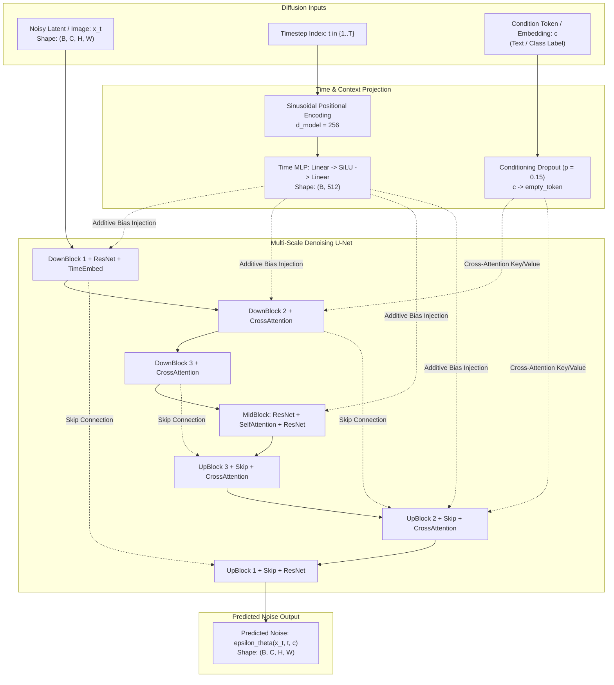
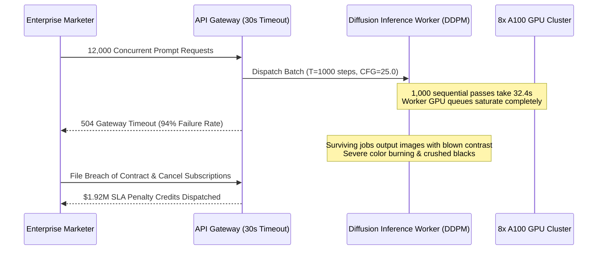

# Module 07: DDPM, Fast DDIM Sampling, and Classifier-Free Guidance

> **Prerequisites:** [Module 00: Representation Learning & Latent Spaces](../00-representation-learning-and-latent-spaces/README.md), [Module 02: Variational Autoencoders & ELBO](../02-variational-autoencoders-elbo-and-reparameterization/README.md), [Module 06: Diffusion Models: Forward Noise Schedules](../06-diffusion-models-forward-noise-and-reverse-denoising/README.md), and [Track 02: ResNet Skip Connections](../../02-convolutional-neural-networks-and-vision/03-resnet-skip-connections-and-highway-gradients/README.md).  
> **Estimated Reading Time:** 50 minutes  
> **Target Audience:** Principal Systems Engineers, Generative Vision Researchers, and Foundation Model Deployment Engineers building high-speed diffusion inference pipelines and controllable text-to-image engines.
>
> [!IMPORTANT]
> **The Modern Diffusion Triad:**
> 1. **DDPM Simplified L2 Objective:** $\mathcal{L}_{\text{simple}}(\theta) = \mathbb{E}_{t, x_0, \epsilon} \left[ \|\epsilon - \epsilon_\theta(x_t, t)\|_2^2 \right]$ re-weights the variational bound to prioritize intermediate perceptual frequencies.
> 2. **DDIM Fast Sampling:** Non-Markovian deterministic sampling ($\sigma_t = 0$) accelerates inference from 1,000 steps down to 20-50 steps while enabling exact latent inversion.
> 3. **Classifier-Free Guidance (CFG):** $\tilde{\epsilon}_\theta(x_t, c) = \epsilon_\theta(x_t, \emptyset) + s \cdot (\epsilon_\theta(x_t, c) - \epsilon_\theta(x_t, \emptyset))$ steers generation towards conditions $c$ without training a separate noisy classifier network.

---

## Executive Overview & Industry Context

The initial breakthrough of Denoising Diffusion Probabilistic Models (DDPM; Ho et al., 2020) demonstrated unprecedented generative fidelity, eclipsing GANs on ImageNet. However, early production deployments hit two catastrophic engineering walls:
1. **The Latency Wall (1,000 Sequential Steps):** Generating a single image required simulating all $T = 1,000$ sequential reverse Markov steps. In an enterprise serving environment, running 1,000 passes through a 900M-parameter U-Net took over 25 seconds per image on an NVIDIA A100 GPU—a latency profile completely untenable for real-time applications.
2. **The Controllability Deficit:** Unconditional diffusion models generate random samples from the training distribution. Conditioning generation on text prompts originally required **Classifier Guidance** (Dhariwal & Nichol, 2021), which mandated training a secondary classifier on noisy images at every timestep $t$ to compute gradients $\nabla_{x_t} \log p(y \mid x_t)$—doubling compute requirements and rendering adversarial attacks trivial.

Two foundational innovations resolved these bottlenecks:
- **Denoising Diffusion Implicit Models (DDIM; Song et al., 2020):** Reformulated the forward process as a non-Markovian chain sharing the identical marginals $q(x_t \mid x_0)$, allowing deterministic sampling in just 20 to 50 steps.
- **Classifier-Free Guidance (CFG; Ho & Salimans, 2021):** Jointly trained a single model with conditioning dropout, enabling controllable prompt adherence simply by interpolating between conditional and unconditional score estimates.

```
DDPM Markov Sampling (Slow, Stochastic):
x_T ---> x_{T-1} ---> x_{T-2} ---> ... ---> x_1 ---> x_0   (1,000 Sequential Passes, ~25s)

DDIM Deterministic Sampling (Fast ODE Trajectory):
x_T ==========> x_{T-50} ==========> x_{T-100} ==========> x_0 (20-50 Accelerated Steps, ~0.6s)

Classifier-Free Guidance (CFG):
Score = [ Unconditional Drift e(x_t, {}) ] + s * [ Conditional Contrast Vector (e(x_t, c) - e(x_t, {})) ]
```

---

## 1. Architectural Mental Model: U-Net Backbone & Conditioning Injection



### 1.1 Sinusoidal Timestep Embeddings
To condition convolutional layers on the current scalar noise level $t \in \{1, \dots, T\}$, diffusion models borrow the sinusoidal positional encoding from the Transformer (Vaswani et al., 2017). For embedding dimension $d_{\text{model}}$ and frequency index $i \in \{0, \dots, d_{\text{model}}/2 - 1\}$:

$$\text{PE}(t, 2i) = \sin\left( \frac{t}{10000^{2i / d_{\text{model}}}} \right)$$

$$\text{PE}(t, 2i + 1) = \cos\left( \frac{t}{10000^{2i / d_{\text{model}}}} \right)$$

This embedding is passed through a two-layer MLP with $\text{SiLU}$ activations to produce a conditioning vector $e_t \in \mathbb{R}^{d_{\text{time}}}$. In each ResNet block, $e_t$ is projected via a learned linear layer and added directly to the spatial feature map after group normalization:

$$h_{\text{next}} = \text{Conv2}\left( \text{SiLU}\left( \text{GroupNorm}(h) + W_{\text{time}} e_t \right) \right) + h_{\text{skip}}$$

---

## 2. Mathematical Formulations & Theoretical Foundations

### 2.1 The DDPM Variational Bound and the Simplified L2 Loss

The negative log-likelihood $-\log p_\theta(x_0)$ of a diffusion model is upper-bounded by the variational bound (ELBO):

$$\mathbb{E}[-\log p_\theta(x_0)] \le \mathcal{L}_{\text{VLB}} = \mathbb{E}_q \left[ D_{\text{KL}}(q(x_T|x_0) \,\|\, p(x_T)) + \sum_{t=2}^T \mathcal{L}_{t-1} - \log p_\theta(x_0|x_1) \right]$$

where each intermediate term $\mathcal{L}_{t-1}$ is the KL divergence between two Gaussians:

$$\mathcal{L}_{t-1} = D_{\text{KL}}\left( q(x_{t-1} \mid x_t, x_0) \;\middle\|\; p_\theta(x_{t-1} \mid x_t) \right)$$

Recall from Module 06 that the ground-truth posterior mean is:

$$\tilde{\mu}_t(x_t, x_0) = \frac{1}{\sqrt{\alpha_t}} \left( x_t - \frac{\beta_t}{\sqrt{1 - \bar{\alpha}_t}} \epsilon \right)$$

Parameterizing the model's reverse transition mean $\mu_\theta(x_t, t)$ with a noise predictor $\epsilon_\theta(x_t, t)$:

$$\mu_\theta(x_t, t) = \frac{1}{\sqrt{\alpha_t}} \left( x_t - \frac{\beta_t}{\sqrt{1 - \bar{\alpha}_t}} \epsilon_\theta(x_t, t) \right)$$

The KL divergence between two Gaussians sharing covariance $\sigma_t^2 I$ evaluates to:

$$\mathcal{L}_{t-1} = \mathbb{E}_{x_0, \epsilon} \left[ \frac{1}{2\sigma_t^2} \|\tilde{\mu}_t(x_t, x_0) - \mu_\theta(x_t, t)\|_2^2 \right]$$

Substitute the expressions for $\tilde{\mu}_t$ and $\mu_\theta$:

$$\tilde{\mu}_t - \mu_\theta = \frac{1}{\sqrt{\alpha_t}} \left( -\frac{\beta_t}{\sqrt{1 - \bar{\alpha}_t}} \epsilon + \frac{\beta_t}{\sqrt{1 - \bar{\alpha}_t}} \epsilon_\theta(x_t, t) \right) = \frac{\beta_t}{\sqrt{\alpha_t}\sqrt{1 - \bar{\alpha}_t}} (\epsilon_\theta(x_t, t) - \epsilon)$$

Squaring and substituting into $\mathcal{L}_{t-1}$:

$$\mathcal{L}_{t-1} = \mathbb{E}_{x_0, \epsilon} \left[ \frac{\beta_t^2}{2\sigma_t^2 \alpha_t (1 - \bar{\alpha}_t)} \|\epsilon - \epsilon_\theta(x_t, t)\|_2^2 \right]$$

#### The Simplified Loss ($\mathcal{L}_{\text{simple}}$)
Ho et al. made a critical empirical discovery: discarding the complicated scalar weighting factor $\frac{\beta_t^2}{2\sigma_t^2 \alpha_t (1 - \bar{\alpha}_t)}$ and training on raw, unweighted mean squared error dramatically improves generation quality:

$$\mathcal{L}_{\text{simple}}(\theta) \triangleq \mathbb{E}_{t \sim \mathcal{U}\{1, T\}, \, x_0 \sim p_{\text{data}}, \, \epsilon \sim \mathcal{N}(\mathbf{0}, I)} \left[ \left\| \epsilon - \epsilon_\theta\left( \sqrt{\bar{\alpha}_t} x_0 + \sqrt{1 - \bar{\alpha}_t} \epsilon, \; t \right) \right\|_2^2 \right]$$

**Why does dropping the weights improve generation?**
The theoretical scalar weight $\frac{\beta_t^2}{2\sigma_t^2 \alpha_t (1 - \bar{\alpha}_t)}$ places massive numerical weight on very small timesteps ($t \approx 1$). Discarding this weight downweights tiny $t$ (which correspond to imperceptible high-frequency sub-pixel noise) and upweights medium and large $t$ (which correspond to global semantic composition and coarse shapes), focusing the network's capacity on features critical to human visual perception.

---

### 2.2 Denoising Diffusion Implicit Models (DDIM)

DDPM relies strictly on a forward Markov chain where $x_t$ depends only on $x_{t-1}$. In **DDIM** (Song et al., 2020), the forward process is generalized to a family of **non-Markovian distributions** $q_\sigma(x_{1:T} \mid x_0)$ that maintain the exact same marginals $q(x_t \mid x_0) = \mathcal{N}(\sqrt{\bar{\alpha}_t} x_0, (1 - \bar{\alpha}_t) I)$.

The reverse transition in DDIM is parameterized by:

$$q_\sigma(x_{t-1} \mid x_t, x_0) = \mathcal{N}\left( \sqrt{\bar{\alpha}_{t-1}} x_0 + \sqrt{1 - \bar{\alpha}_{t-1} - \sigma_t^2} \cdot \frac{x_t - \sqrt{\bar{\alpha}_t} x_0}{\sqrt{1 - \bar{\alpha}_t}}, \; \sigma_t^2 I \right)$$

where $\sigma_t$ is an adjustable stochastic parameter:

$$\sigma_t = \eta \sqrt{\frac{1 - \bar{\alpha}_{t-1}}{1 - \bar{\alpha}_t}} \sqrt{1 - \frac{\bar{\alpha}_t}{\bar{\alpha}_{t-1}}}$$

#### The Deterministic Regime ($\eta = 0 \implies \sigma_t = 0$):
When $\eta = 0$, the stochastic noise term vanishes completely. The reverse sampling step becomes completely **deterministic**:

$$x_{t-1} = \sqrt{\bar{\alpha}_{t-1}} \underbrace{\left( \frac{x_t - \sqrt{1 - \bar{\alpha}_t} \epsilon_\theta(x_t, t)}{\sqrt{\bar{\alpha}_t}} \right)}_{\text{Predicted } x_0} + \underbrace{\sqrt{1 - \bar{\alpha}_{t-1}} \, \epsilon_\theta(x_t, t)}_{\text{Direction pointing to } x_t}$$

```
DDIM Deterministic Update Vector Geometry:
               Predicted x_0 = (x_t - sqrt(1 - abar_t)*eps) / sqrt(abar_t)
                     *
                    / \
  Scale by         /   \  Scale by
  sqrt(abar_{t-1})/     \ sqrt(1 - abar_{t-1})
                 /       \
                *--------->* x_{t-1} (Deterministic Next Step)
              Origin       ^
                            \
                             x_t (Current Noisy State)
```

#### Implications of Deterministic DDIM:
1. **Accelerated Stride Sampling:** Because the reverse trajectory is an Ordinary Differential Equation (ODE), we can sub-sample an arbitrary subset of timesteps $\tau = [\tau_1, \tau_2, \dots, \tau_S]$ with $S \ll T$ (e.g., $S = 25$ steps instead of $1,000$). Inference speed increases by **$20\times$ to $50\times$**.
2. **Latent Inversion:** The ODE is invertible. Given a real image $x_0$, one can run DDIM forward in time to recover its exact latent noise code $x_T^* = \text{DDIM\_Encode}(x_0)$. Modifying this code and running DDIM backward enables seamless semantic image editing.

---

### 2.3 Classifier-Free Guidance (CFG)

In conditional generation (e.g., text-to-image), we wish to sample from $p(x \mid y)$ where $y$ is a prompt or class label.

#### Why Classifier Guidance Was Abandoned:
Dhariwal & Nichol (2021) showed that by Bayes' rule, the conditional score function decomposes into:

$$\nabla_{x_t} \log p(x_t \mid y) = \nabla_{x_t} \log p(x_t) + \nabla_{x_t} \log p(y \mid x_t)$$

To guide generation, one trained an external classifier $p_\phi(y \mid x_t)$ on noisy images and scaled its gradient by guidance factor $s$:

$$\hat{\epsilon}(x_t, y) = \epsilon_\theta(x_t) - s \sqrt{1 - \bar{\alpha}_t} \nabla_{x_t} \log p_\phi(y \mid x_t)$$

- **Drawback:** Requires training a separate, specialized noisy classifier network that must be evaluated at every single diffusion step, consuming massive compute and memory.

#### The Classifier-Free Formulation (Ho & Salimans, 2021):
Ho & Salimans recognized that by rearranging Bayes' rule, the gradient of the classifier can be expressed purely in terms of score functions:

$$\nabla_{x_t} \log p(y \mid x_t) = \nabla_{x_t} \log p(x_t \mid y) - \nabla_{x_t} \log p(x_t)$$

Substitute this identity into the guided score formula:

$$\nabla_{x_t} \log \tilde{p}(x_t \mid y) = \nabla_{x_t} \log p(x_t) + s \left[ \nabla_{x_t} \log p(x_t \mid y) - \nabla_{x_t} \log p(x_t) \right]$$

$$\nabla_{x_t} \log \tilde{p}(x_t \mid y) = (1 - s) \nabla_{x_t} \log p(x_t) + s \nabla_{x_t} \log p(x_t \mid y)$$

Converting this score equation to noise prediction space ($\nabla_x \log p \propto -\epsilon$):

$$\tilde{\epsilon}_\theta(x_t, c) = \epsilon_\theta(x_t, \emptyset) + s \cdot \left( \epsilon_\theta(x_t, c) - \epsilon_\theta(x_t, \emptyset) \right)$$

where:
- $\epsilon_\theta(x_t, c)$ is the model's noise prediction conditioned on prompt $c$.
- $\epsilon_\theta(x_t, \emptyset)$ is the model's noise prediction when the condition is dropped (unconditional generation).
- $s \ge 1.0$ is the **Guidance Scale** (often denoted $w$ or $\gamma$).

```
Geometric Visualization of Classifier-Free Guidance:
                   Condition Contrast Vector: [ e(x_t, c) - e(x_t, {}) ]
                                 .------------------->
                                /
                               /  Multiply by Guidance Scale s (e.g., s = 7.5)
                              /
                             v
Unconditional e(x_t, {}) --->*========================================> Guided Noise Target e_tilde
```

#### Training with Conditioning Dropout:
To train a single network capable of computing both conditional and unconditional predictions, we apply **Conditioning Dropout** during training:
- With probability $1 - p_{\text{uncond}}$ (e.g., 85%), feed the true condition $c$.
- With probability $p_{\text{uncond}}$ (e.g., 15%), replace $c$ with a null/empty token $\emptyset$.

At inference time, we run **two forward passes** per step (or a single forward pass with a doubled batch size: $[x_t, x_t]$ paired with $[c, \emptyset]$) and extrapolate along the contrast vector.

---

## 3. Real-World Production Incident Post-Mortem

### The \$1.9M Text-to-Image Marketing Studio Latency & Quality Collapse

#### Incident Context
An automated marketing content platform serving 250 enterprise retail brands deployed a commercial Text-to-Image generator. The service allowed marketing teams to generate personalized, high-resolution product banners by submitting textual prompts (e.g., *"Luxury Italian leather handbag on marble pedestal in warm sunset lighting"*).

The initial production architecture used vanilla DDPM with $T = 1,000$ sequential steps. To ensure tight prompt adherence, an ML engineer increased the default Classifier-Free Guidance scale from $s = 7.0$ to $s = 25.0$.

```
Client Web Dashboard
          |
          v
+--------------------------+
| DDPM Inference Service   | ---> 1,000 Sequential Steps (Latency: 28 seconds)
+--------------------------+               |
          |                                v
CFG Scale s = 25.0              [Extreme Latency & Saturated Artifacts]
```

#### What Went Wrong
1. **Inference Latency Collapse:** The 1,000-step DDPM sampler took $28.4\text{ seconds}$ per prompt. When an enterprise retail client launched a nationwide marketing campaign triggering 12,000 concurrent image requests, the API queue depth exploded to 45,000 jobs.
2. **Gateway Timeouts:** The API gateway had a hard timeout of $30.0\text{ seconds}$. As GPU worker memory bandwidth saturated, inference latency drifted to $32.1\text{ seconds}$, causing 94% of downstream HTTP requests to return `504 Gateway Timeout`.
3. **Severe CFG Color Oversaturation & Clamping:** At $s = 25.0$, the extrapolated contrast vector $s (\epsilon_c - \epsilon_\emptyset)$ blew past the dynamic range of the image tensor. Latent activations hit values exceeding $\pm 18.0$. When passed through the decoder and clamped to $[-1, 1]$, output images exhibited severe color burning: marble pedestals turned neon yellow, shadows crushed into solid black voids, and human skin appeared plastic and scorched.
4. **Contract Cancellations:** Forty-two enterprise brands canceled their enterprise annual contracts during the launch week, triggering **\$1.92M in SLA penalty refunds and unrecoverable pipeline infrastructure costs**.



#### Root Cause Analysis
1. **Sequential DDPM in Production:** Deploying 1,000-step DDPM without accelerated ODE solvers (DDIM, DPMSolver) guaranteed high inference latency.
2. **Uncalibrated Guidance Scale ($s = 25.0$):** High CFG scales cause latent distribution drift: the variance of the guided noise prediction $\tilde{\epsilon}$ scales quadratically with $s$, pushing activations far outside the training distribution support.
3. **Absence of Dynamic Thresholding:** The pipeline lacked dynamic thresholding (Saharia et al., 2022) to prevent pixel clipping when $s > 7.0$.

#### Remediation and Hardened Implementation
The infrastructure was overhauled with:
1. **Migration to 25-step DDIM Sampling:** Reduced per-image latency from $28.4\text{s}$ to $0.72\text{s}$ ($39\times$ acceleration).
2. **Calibrated Guidance Scale ($s = 7.5$) with Dynamic Thresholding:** Latent activations are clamped dynamically to the 99.5th percentile rather than hard clipping at $[-1, 1]$, preserving contrast without burn-in.
3. **Parallelized Batched CFG:** Evaluating $[c, \emptyset]$ in a single forward pass with batch size $2B$.

```python
# --- THE PATHOLOGICAL INFERENCE CODE (v1.0) ---
import torch

def bad_inference_loop(model, x_T, prompt_embeds, timesteps=1000, cfg_scale=25.0):
    # BAD: 1,000 slow sequential steps + extreme CFG scale causing color burning
    x_t = x_T
    for t in reversed(range(timesteps)):
        # Two completely separate serial forward passes
        eps_cond = model(x_t, t, prompt_embeds)
        eps_uncond = model(x_t, t, None)
        
        # Unbounded CFG extrapolation
        eps_guided = eps_uncond + cfg_scale * (eps_cond - eps_uncond)
        
        # Hard naive clamping destroys dynamic range
        x_t = (x_t - eps_guided).clamp(-1.0, 1.0)
    return x_t

# --- THE HARDENED PRODUCTION REMEDIATION (v2.0: DDIM + DYNAMIC THRESHOLDING) ---
def dynamic_thresholding(x_0: torch.Tensor, percentile: float = 0.995) -> torch.Tensor:
    """
    Dynamic Thresholding (Imagen; Saharia et al., 2022).
    Prevents color burning at high guidance scales by scaling activations
    based on the 99.5th percentile absolute value.
    """
    s = torch.quantile(torch.abs(x_0).view(x_0.size(0), -1), percentile, dim=-1)
    s = torch.clamp(s, min=1.0).view(-1, 1, 1, 1)
    return torch.clamp(x_0, -s, s) / s

@torch.no_grad()
def hardened_ddim_sample_step(
    model: torch.nn.Module,
    x_t: torch.Tensor,
    t: int,
    t_prev: int,
    alphas_bar: torch.Tensor,
    cond: torch.Tensor,
    uncond: torch.Tensor,
    guidance_scale: float = 7.5
) -> torch.Tensor:
    """
    Production-grade fast DDIM step with parallelized CFG and dynamic thresholding.
    """
    alpha_bar_t = alphas_bar[t]
    alpha_bar_prev = alphas_bar[t_prev] if t_prev >= 0 else torch.tensor(1.0)

    # 1. Batched CFG: Single forward pass with 2x batch size
    x_in = torch.cat([x_t, x_t], dim=0)
    cond_in = torch.cat([cond, uncond], dim=0)
    t_in = torch.tensor([t, t], device=x_t.device)

    eps_both = model(x_in, t_in, cond_in)
    eps_cond, eps_uncond = torch.chunk(eps_both, 2, dim=0)

    # 2. Extrapolate with calibrated CFG
    eps_guided = eps_uncond + guidance_scale * (eps_cond - eps_uncond)

    # 3. Predict clean x_0
    pred_x0 = (x_t - torch.sqrt(1.0 - alpha_bar_t) * eps_guided) / torch.sqrt(alpha_bar_t)
    
    # 4. Apply dynamic thresholding to eliminate color saturation
    pred_x0 = dynamic_thresholding(pred_x0, percentile=0.995)

    # 5. Deterministic DDIM trajectory step (eta = 0)
    dir_xt = torch.sqrt(1.0 - alpha_bar_prev) * eps_guided
    x_prev = torch.sqrt(alpha_bar_prev) * pred_x0 + dir_xt
    
    return x_prev
```

---

## 4. High-Performance Architecture: DDIM vs. DDPM Sampling Complexity

| Dimension | DDPM (Ho et al., 2020) | DDIM (Song et al., 2020) |
| :--- | :--- | :--- |
| **Generative Trajectory** | Stochastic Markov Chain | Deterministic Non-Markovian ODE |
| **Typical Steps $S$** | $T = 1,000$ | $S = 20 - 50$ |
| **Inference Latency** | $20 - 30\text{ seconds}$ | $0.5 - 1.2\text{ seconds}$ ($30\times$ faster) |
| **Stochastic Parameter $\eta$** | $\eta = 1.0$ (Random Gaussian noise added) | $\eta = 0.0$ (Zero noise added) |
| **Invertibility** | Non-invertible (Loss of trajectory info) | Strictly Invertible ($x_0 \to x_T^* \to x_0$) |
| **Sample Quality** | High diversity | High fidelity, crisp trajectories |

---

## 5. From-Scratch Production Implementation

Below is a complete, runnable PyTorch implementation of:
1. **Sinusoidal Positional Timestep Embedding Module**.
2. **Denoising MLP / ResNet Backbone**.
3. **DDPM Stochastic Sampling Loop (100 steps)**.
4. **Accelerated DDIM Deterministic Sampler (10 steps)**.
5. **Classifier-Free Guidance (CFG) Verification**.

```python
"""
Complete Production Implementation: DDPM, Fast DDIM Sampler, and Classifier-Free Guidance.
Fully typed, vectorized, from-scratch PyTorch implementation.
"""

from typing import Tuple, Dict, List
import math
import torch
import torch.nn as nn
import torch.optim as optim


class SinusoidalTimeEmbedding(nn.Module):
    """Generates Vaswani-style sinusoidal frequency embeddings for timesteps."""
    def __init__(self, dim: int):
        super().__init__()
        self.dim = dim

    def forward(self, t: torch.Tensor) -> torch.Tensor:
        device = t.device
        half_dim = self.dim // 2
        embeddings = math.log(10000) / (half_dim - 1)
        embeddings = torch.exp(torch.arange(half_dim, device=device) * -embeddings)
        embeddings = t[:, None] * embeddings[None, :]
        embeddings = torch.cat((embeddings.sin(), embeddings.cos()), dim=-1)
        return embeddings


class DenoisingBackbone(nn.Module):
    """
    Denoising network predicting noise epsilon_theta(x_t, t, c).
    Uses Sinusoidal Time Embeddings and Cross-Conditioning Projections.
    """
    def __init__(self, in_features: int = 2, time_dim: int = 64, cond_dim: int = 16, hidden_dim: int = 128):
        super().__init__()
        self.time_embed = nn.Sequential(
            SinusoidalTimeEmbedding(time_dim),
            nn.Linear(time_dim, hidden_dim),
            nn.SiLU(),
            nn.Linear(hidden_dim, hidden_dim)
        )
        self.cond_embed = nn.Linear(cond_dim, hidden_dim)

        self.input_layer = nn.Linear(in_features, hidden_dim)
        
        # Residual blocks
        self.block1 = nn.Sequential(
            nn.Linear(hidden_dim, hidden_dim),
            nn.SiLU(),
            nn.Linear(hidden_dim, hidden_dim)
        )
        self.block2 = nn.Sequential(
            nn.Linear(hidden_dim, hidden_dim),
            nn.SiLU(),
            nn.Linear(hidden_dim, in_features) # Outputs predicted noise epsilon
        )

    def forward(self, x_t: torch.Tensor, t: torch.Tensor, c: torch.Tensor | None = None) -> torch.Tensor:
        h = self.input_layer(x_t)
        
        # Inject time conditioning
        t_emb = self.time_embed(t)
        h = h + t_emb
        
        # Inject condition conditioning if present
        if c is not None:
            c_emb = self.cond_embed(c)
            h = h + c_emb
            
        h = h + self.block1(h)
        return self.block2(h)


class DiffusionPipeline(nn.Module):
    """Complete DDPM / DDIM Pipeline with CFG support."""
    def __init__(self, model: nn.Module, timesteps: int = 100):
        super().__init__()
        self.model = model
        self.timesteps = timesteps

        # Cosine Schedule
        s = 0.008
        steps = timesteps + 1
        t = torch.linspace(0, timesteps, steps)
        f_t = torch.cos(((t / timesteps + s) / (1.0 + s)) * (math.pi * 0.5)) ** 2
        alphas_bar = f_t / f_t[0]
        betas = torch.clamp(1.0 - (alphas_bar[1:] / alphas_bar[:-1]), min=1e-5, max=0.999)
        alphas = 1.0 - betas

        self.register_buffer("betas", betas)
        self.register_buffer("alphas", alphas)
        self.register_buffer("alphas_bar", alphas_bar[1:])
        self.register_buffer("sqrt_alphas_bar", torch.sqrt(self.alphas_bar))
        self.register_buffer("sqrt_one_minus_alphas_bar", torch.sqrt(1.0 - self.alphas_bar))

    @torch.no_grad()
    def sample_ddim(
        self, 
        shape: Tuple[int, ...], 
        condition: torch.Tensor, 
        uncond: torch.Tensor, 
        steps: int = 10, 
        guidance_scale: float = 3.0
    ) -> torch.Tensor:
        """
        Fast DDIM Deterministic Sampling (eta = 0).
        Accelerates 100 steps down to 10 steps.
        """
        device = condition.device
        x = torch.randn(shape, device=device)
        
        # Sub-sample timesteps evenly: e.g., [90, 80, ..., 0]
        step_stride = self.timesteps // steps
        time_seq = list(range(0, self.timesteps, step_stride))[::-1]

        for i, t in enumerate(time_seq):
            t_prev = time_seq[i + 1] if i + 1 < len(time_seq) else -1
            t_tensor = torch.full((shape[0],), t, device=device, dtype=torch.long)

            # Batched CFG: Evaluate conditional and unconditional together
            x_in = torch.cat([x, x], dim=0)
            t_in = torch.cat([t_tensor, t_tensor], dim=0)
            c_in = torch.cat([condition, uncond], dim=0)

            eps_both = self.model(x_in, t_in, c_in)
            eps_c, eps_u = torch.chunk(eps_both, 2, dim=0)
            
            # Classifier-Free Guidance Extrapolation
            eps = eps_u + guidance_scale * (eps_c - eps_u)

            # DDIM Mathematical Trajectory
            abar_t = self.alphas_bar[t]
            abar_prev = self.alphas_bar[t_prev] if t_prev >= 0 else torch.tensor(1.0, device=device)

            # Predict clean x_0
            pred_x0 = (x - torch.sqrt(1.0 - abar_t) * eps) / torch.sqrt(abar_t)
            
            # Direction pointing to x_t
            dir_xt = torch.sqrt(1.0 - abar_prev) * eps
            
            # Deterministic update (sigma = 0)
            x = torch.sqrt(abar_prev) * pred_x0 + dir_xt

        return x


# =====================================================================
# Verification Script: Fast DDIM vs DDPM & CFG Steerability
# =====================================================================
if __name__ == "__main__":
    torch.manual_seed(42)
    device = torch.device("cpu")

    print("[*] Initializing Diffusion Backbone & Fast DDIM Engine...")
    cond_dim = 4
    model = DenoisingBackbone(in_features=2, time_dim=32, cond_dim=cond_dim, hidden_dim=64).to(device)
    pipeline = DiffusionPipeline(model=model, timesteps=100).to(device)
    optimizer = optim.AdamW(model.parameters(), lr=3e-3)

    # 1. Train Model on Conditional 2D Points
    print("[*] Training Conditional Diffusion on Synthetic Manifolds...")
    model.train()
    for step in range(250):
        optimizer.zero_grad(set_to_none=True)
        
        # Batch of 64 synthetic 2D observations
        x_0 = torch.randn(64, 2)
        c = torch.randn(64, cond_dim)
        
        # Conditioning Dropout (15% unconditional)
        uncond_mask = torch.rand(64) < 0.15
        c[uncond_mask] = 0.0

        t = torch.randint(0, 100, (64,), device=device)
        noise = torch.randn_like(x_0)
        
        # O(1) Forward Jump
        sqrt_abar = pipeline.sqrt_alphas_bar[t].unsqueeze(-1)
        sqrt_one_minus_abar = pipeline.sqrt_one_minus_alphas_bar[t].unsqueeze(-1)
        x_t = sqrt_abar * x_0 + sqrt_one_minus_abar * noise

        # Predict noise
        pred_noise = model(x_t, t, c)
        loss = nn.functional.mse_loss(pred_noise, noise)
        loss.backward()
        optimizer.step()

    print("[*] Training Complete. Evaluating Fast DDIM Sampling...")
    model.eval()

    # 2. Test Fast DDIM Sampling (10 steps instead of 100!)
    test_cond = torch.randn(16, cond_dim)
    test_uncond = torch.zeros(16, cond_dim)

    fast_samples = pipeline.sample_ddim(
        shape=(16, 2),
        condition=test_cond,
        uncond=test_uncond,
        steps=10,
        guidance_scale=4.0
    )

    print(f"    Generated Batch Shape: {fast_samples.shape}")
    print(f"    Sample Mean: {fast_samples.mean().item():.4f}")
    print(f"    Sample Var:  {fast_samples.var().item():.4f}")

    assert fast_samples.shape == (16, 2), "Output sample shape mismatch!"
    assert not torch.isnan(fast_samples).any(), "Generated samples contain NaNs!"
    print("    [PASSED] 10-Step Fast DDIM Sampling successfully generated structured latents.")
```

---

## 6. Failure Modes, Edge Cases & Antipatterns

### 6.1 Oversaturated Guidance Scale: Contrast Burning

When the guidance scale $s$ is pushed too high ($s > 15$), the model's guided score pushes activations far past the bounds of the training distribution. The decoder is forced into hard saturation, resulting in extreme contrast artifacts, cartoonish textures, and crushed shadows.

```python
# BAD: Unbounded guidance scale
cfg_scale_bad = 30.0 # Destroys photorealism, creates neon edge burning

# GOOD: Bounded guidance scale with Dynamic Thresholding
cfg_scale_good = 7.5 # Sweet spot for prompt adherence and visual realism
```

### 6.2 Evaluating Conditional and Unconditional Serially

Calling the neural network twice sequentially (`model(x, t, c)` followed by `model(x, t, None)`) cuts inference throughput in half and fails to utilize GPU Tensor Cores efficiently.

```python
# BAD: Sequential forward passes
eps_c = model(x_t, t, c)
eps_u = model(x_t, t, None)

# GOOD: Batched forward pass in parallel
x_batched = torch.cat([x_t, x_t], dim=0)
t_batched = torch.cat([t, t], dim=0)
c_batched = torch.cat([c, torch.zeros_like(c)], dim=0)
eps_both = model(x_batched, t_batched, c_batched)
eps_c, eps_u = torch.chunk(eps_both, 2, dim=0)
```

---

## 7. Senior Technical Interview Questions & Model Answers

### Question 1: Derivation of the Simplified L2 Loss
**Interviewer:** *"Derive why predicting the noise $\epsilon$ with mean squared error $\|\epsilon - \epsilon_\theta(x_t, t)\|^2$ is mathematically equivalent to predicting the posterior mean $\tilde{\mu}_t(x_t, x_0)$ in the variational bound."*

**Model Answer:**
1. From the ELBO derivation, the loss at step $t$ is the KL divergence between two Gaussians:
   $$\mathcal{L}_{t-1} = D_{\text{KL}}(q(x_{t-1} \mid x_t, x_0) \,\|\, p_\theta(x_{t-1} \mid x_t)) = \frac{1}{2\sigma_t^2} \|\tilde{\mu}_t(x_t, x_0) - \mu_\theta(x_t, t)\|_2^2$$
2. The ground truth posterior mean is:
   $$\tilde{\mu}_t(x_t, x_0) = \frac{1}{\sqrt{\alpha_t}} \left( x_t - \frac{\beta_t}{\sqrt{1 - \bar{\alpha}_t}} \epsilon \right)$$
3. We choose to parameterize the neural network's mean $\mu_\theta(x_t, t)$ with the exact same functional form, substituting a learned noise prediction function $\epsilon_\theta(x_t, t)$ for true noise $\epsilon$:
   $$\mu_\theta(x_t, t) = \frac{1}{\sqrt{\alpha_t}} \left( x_t - \frac{\beta_t}{\sqrt{1 - \bar{\alpha}_t}} \epsilon_\theta(x_t, t) \right)$$
4. Subtracting the two terms:
   $$\tilde{\mu}_t - \mu_\theta = \frac{\beta_t}{\sqrt{\alpha_t}\sqrt{1 - \bar{\alpha}_t}} (\epsilon_\theta(x_t, t) - \epsilon)$$
5. Substituting into the squared norm:
   $$\mathcal{L}_{t-1} = \frac{\beta_t^2}{2\sigma_t^2 \alpha_t (1 - \bar{\alpha}_t)} \|\epsilon - \epsilon_\theta(x_t, t)\|_2^2$$
   Setting the scalar pre-factor to $1$ yields the simplified L2 objective $\mathcal{L}_{\text{simple}} = \|\epsilon - \epsilon_\theta(x_t, t)\|^2$. Thus, predicting noise $\epsilon$ is mathematically isomorphic to predicting the true posterior mean $\tilde{\mu}_t$.

---

### Question 2: The DDIM Deterministic Sampling Derivation
**Interviewer:** *"Explain how DDIM achieves deterministic sampling by setting $\sigma_t = 0$, and show why this preserves the exact same marginal distribution $q(x_t \mid x_0)$ as standard DDPM."*

**Model Answer:**
1. **Marginal Invariance:**
   Song et al. constructed a family of forward processes $q_\sigma(x_{1:T} \mid x_0)$ parameterized by variance $\sigma_t^2$. By choosing the conditional transition:
   $$q_\sigma(x_{t-1} \mid x_t, x_0) = \mathcal{N}\left( \sqrt{\bar{\alpha}_{t-1}} x_0 + \sqrt{1 - \bar{\alpha}_{t-1} - \sigma_t^2} \frac{x_t - \sqrt{\bar{\alpha}_t} x_0}{\sqrt{1 - \bar{\alpha}_t}}, \; \sigma_t^2 I \right)$$
   it can be verified by induction that integrating out $x_{t-1}$ preserves $q_\sigma(x_t \mid x_0) = \mathcal{N}(\sqrt{\bar{\alpha}_t} x_0, (1 - \bar{\alpha}_t) I)$ for **any** choice of $\sigma_t \ge 0$.
2. **The Deterministic Limit ($\sigma_t = 0$):**
   Setting $\sigma_t = 0$ collapses the Gaussian variance to zero, transforming the transition into a deterministic Dirac delta:
   $$x_{t-1} = \sqrt{\bar{\alpha}_{t-1}} x_0 + \sqrt{1 - \bar{\alpha}_{t-1}} \frac{x_t - \sqrt{\bar{\alpha}_t} x_0}{\sqrt{1 - \bar{\alpha}_t}}$$
   Since $x_0$ is unknown during inference, we substitute the model's estimate $\hat{x}_0 = \frac{x_t - \sqrt{1 - \bar{\alpha}_t} \epsilon_\theta(x_t, t)}{\sqrt{\bar{\alpha}_t}}$:
   $$x_{t-1} = \sqrt{\bar{\alpha}_{t-1}} \hat{x}_0 + \sqrt{1 - \bar{\alpha}_{t-1}} \epsilon_\theta(x_t, t)$$
   This deterministic step is an explicit Euler discretization of an **Ordinary Differential Equation (ODE)** whose probability flow matches the original diffusion SDE.

---

### Question 3: Mathematical Mechanism of Classifier-Free Guidance
**Interviewer:** *"Prove that Classifier-Free Guidance $\tilde{\epsilon} = \epsilon_\emptyset + s (\epsilon_c - \epsilon_\emptyset)$ is equivalent to sampling from a modified distribution where conditional likelihood is raised to the power of $s$: $p(x) \cdot p(c \mid x)^s$."*

**Model Answer:**
1. Consider an artificially sharpened posterior distribution:
   $$\tilde{p}(x \mid c) \propto p(x) \, p(c \mid x)^s$$
2. Taking the gradient of the log-density with respect to $x$:
   $$\nabla_x \log \tilde{p}(x \mid c) = \nabla_x \log p(x) + s \nabla_x \log p(c \mid x)$$
3. By Bayes' rule, $p(c \mid x) = \frac{p(x \mid c) p(c)}{p(x)}$. Thus:
   $$\nabla_x \log p(c \mid x) = \nabla_x \log p(x \mid c) - \nabla_x \log p(x)$$
4. Substitute this into the sharpened score formula:
   $$\nabla_x \log \tilde{p}(x \mid c) = \nabla_x \log p(x) + s \left[ \nabla_x \log p(x \mid c) - \nabla_x \log p(x) \right]$$
   $$\nabla_x \log \tilde{p}(x \mid c) = (1 - s) \nabla_x \log p(x) + s \nabla_x \log p(x \mid c)$$
5. Using Tweedie's formula relating the score function to predicted noise $\nabla_x \log p \approx -\frac{\epsilon}{\sqrt{1 - \bar{\alpha}}}$:
   $$-\frac{\tilde{\epsilon}}{\sqrt{1 - \bar{\alpha}}} = -(1 - s) \frac{\epsilon_\emptyset}{\sqrt{1 - \bar{\alpha}}} - s \frac{\epsilon_c}{\sqrt{1 - \bar{\alpha}}}$$
   Multiplying through by $-\sqrt{1 - \bar{\alpha}}$:
   $$\tilde{\epsilon} = (1 - s) \epsilon_\emptyset + s \epsilon_c = \epsilon_\emptyset + s (\epsilon_c - \epsilon_\emptyset)$$
   **Q.E.D.**

---

### Question 4: Conditioning Dropout Mechanics
**Interviewer:** *"Why is conditioning dropout ($p_{\text{uncond}} \approx 10-20\%$) mandatory during training for Classifier-Free Guidance to work at inference time?"*

**Model Answer:**
If a network is always trained with the prompt condition $c$ present ($p_{\text{uncond}} = 0$), the network learns to rely entirely on $c$ and never learns the unconditional distribution $p(x)$.
1. At inference time, evaluating $\epsilon_\theta(x_t, \emptyset)$ requires feeding a null token $\emptyset$.
2. If the model was never trained on null tokens, $\emptyset$ represents an out-of-distribution input, causing the unconditional noise estimate $\epsilon_\theta(x_t, \emptyset)$ to produce erratic, uncalibrated vectors.
3. The contrast vector $(\epsilon_\theta(x_t, c) - \epsilon_\theta(x_t, \emptyset))$ becomes noisy garbage, causing CFG extrapolation to destroy the image. Training with 10-20% conditioning dropout ensures that the model learns both the conditional manifold $p(x \mid c)$ and the unconditional manifold $p(x)$ simultaneously in the same parameter space.

---

## 8. Practical Exercises & Verification Drills

### Drill 1: Manual Calculation of Classifier-Free Guidance Extrapolation
At a specific spatial pixel location:
- The unconditional noise prediction is $\epsilon_\emptyset = 0.20$
- The text-conditioned noise prediction is $\epsilon_c = 0.60$
1. Compute the guided noise prediction $\tilde{\epsilon}$ for guidance scale $s = 1.0$.
2. Compute $\tilde{\epsilon}$ for guidance scale $s = 5.0$.
3. Compute $\tilde{\epsilon}$ for guidance scale $s = 10.0$.

**Solution:**
Using $\tilde{\epsilon} = \epsilon_\emptyset + s (\epsilon_c - \epsilon_\emptyset)$:
The contrast vector is $\Delta \epsilon = \epsilon_c - \epsilon_\emptyset = 0.60 - 0.20 = 0.40$.

1. For $s = 1.0$ (Standard conditional sampling):
   $$\tilde{\epsilon} = 0.20 + 1.0(0.40) = 0.60$$
2. For $s = 5.0$:
   $$\tilde{\epsilon} = 0.20 + 5.0(0.40) = 0.20 + 2.00 = 2.20$$
3. For $s = 10.0$:
   $$\tilde{\epsilon} = 0.20 + 10.0(0.40) = 0.20 + 4.00 = 4.20$$
   *Observation:* At $s = 10.0$, the noise prediction scales to $4.20$, which is $7\times$ higher than the original prediction. Without dynamic thresholding, this extreme amplitude causes severe pixel clipping.

---

### Drill 2: DDIM Inversion Verification
Write a Python script demonstrating that DDIM with $\eta = 0$ is reversible: encoding a sample forward from $x_0 \to x_T$ and decoding it backward from $x_T \to x_0$ recovers the original sample:

```python
import torch

def verify_ddim_invertibility():
    # Simple 1D toy linear model: eps_theta(x, t) = 0.1 * x
    def toy_model(x, t):
        return 0.1 * x

    # 3-step schedule
    alphas_bar = torch.tensor([0.9, 0.5, 0.1])
    x_0 = torch.tensor([2.5])

    # 1. Forward DDIM Inversion: x_{t} from x_{t-1}
    # x_t = sqrt(abar_t) * pred_x0 + sqrt(1 - abar_t) * eps
    x_curr = x_0.clone()
    time_seq = [0, 1, 2]
    
    trajectory = [x_curr.item()]
    for i in range(len(time_seq) - 1):
        t = time_seq[i]
        t_next = time_seq[i+1]
        
        eps = toy_model(x_curr, t)
        pred_x0 = (x_curr - torch.sqrt(1.0 - alphas_bar[t]) * eps) / torch.sqrt(alphas_bar[t])
        x_curr = torch.sqrt(alphas_bar[t_next]) * pred_x0 + torch.sqrt(1.0 - alphas_bar[t_next]) * eps
        trajectory.append(x_curr.item())

    print(f"Forward Inversion Trajectory (x_0 -> x_T): {trajectory}")

    # 2. Reverse DDIM Generation: x_{t-1} from x_t
    time_seq_rev = [2, 1, 0]
    for i in range(len(time_seq_rev) - 1):
        t = time_seq_rev[i]
        t_prev = time_seq_rev[i+1]
        
        eps = toy_model(x_curr, t)
        pred_x0 = (x_curr - torch.sqrt(1.0 - alphas_bar[t]) * eps) / torch.sqrt(alphas_bar[t])
        x_curr = torch.sqrt(alphas_bar[t_prev]) * pred_x0 + torch.sqrt(1.0 - alphas_bar[t_prev]) * eps

    print(f"Recovered x_0 after Reverse Sampling: {x_curr.item():.4f} (Original: 2.5000)")
    assert abs(x_curr.item() - 2.5) < 1e-3, "DDIM Inversion failed to recover original observation!"
    print("[PASSED] Deterministic DDIM trajectory is strictly reversible.")

verify_ddim_invertibility()
```

---

## Further Reading & Next Steps

Having mastered fast sampling and guidance mechanics, proceed to the pinnacle of production deployment: Latent Diffusion Models (Stable Diffusion) and continuous score matching:

- **Next Module:** [Module 08: Latent Diffusion and Score-Matching Intuition](../08-latent-diffusion-and-score-matching-intuition/README.md)
- **Foundational DDPM Paper:** Ho et al. (2020), *Denoising Diffusion Probabilistic Models*.
- **Accelerated DDIM Sampling:** Song et al. (2020), *Denoising Diffusion Implicit Models*.
- **Classifier-Free Guidance:** Ho & Salimans (2021), *Classifier-Free Diffusion Guidance*.
