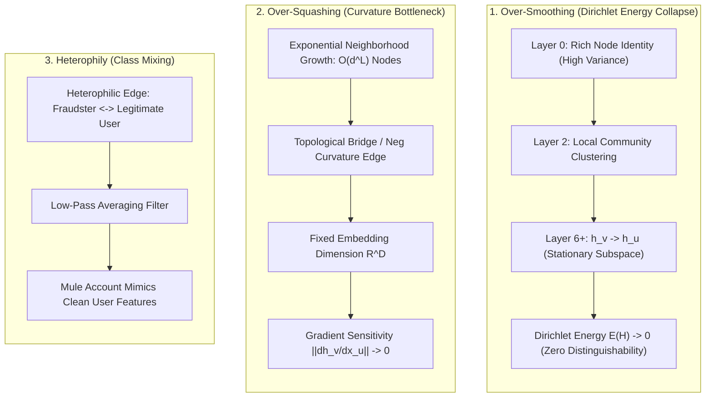
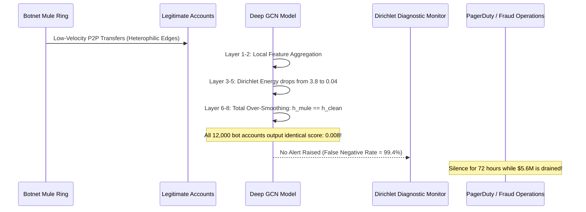

# GNN Failure Modes: Over-Smoothing, Heterophily, and Link Prediction

> **Prerequisites:** [Module 00: Graphs as ML Data](../00-graphs-as-ml-data-molecules-social-and-fraud-nets/README.md), [Module 02: Graph Convolutional Networks & GraphSAGE](../02-graph-convolutional-networks-gcn-and-graphsage/README.md), [Module 03: Graph Attention Networks](../03-graph-attention-networks-gat/README.md).  
> **Estimated Reading Time:** 50-60 minutes  
> **Target Audience:** Staff ML Engineers, Graph Systems Researchers, and Fraud Defense Architects debugging degradation in deep graph neural networks.

This module is part of [Track 05: Graph Neural Networks & Vision Transformers](../README.md).

---

## Executive Overview & Industry Context

In computer vision and natural language processing, stacking dozens or hundreds of layers is the foundation of model capacity: ResNet scaled CNNs to 152 layers; modern Large Language Models stack 80+ Transformer blocks. Depth expands expressive hierarchy, compositional abstraction, and long-range receptive fields.

In Graph Neural Networks, however, stacking more than 3 or 4 layers historically led to **catastrophic performance collapse**. By layer 6 or 8, standard GNNs frequently perform worse than a zero-layer linear regression or random guessing.

This pathology arises from three fundamental theoretical bottlenecks unique to non-Euclidean graph topologies:
1. **Over-Smoothing:** Repeated neighborhood averaging acts as a low-pass Laplacian filter, causing all node representations across connected components to collapse into an identical, featureless equilibrium vector.
2. **Over-Squashing:** The volume of a node's receptive field expands exponentially ($\mathcal{O}(d^L)$), forcing information from millions of multi-hop vertices into a single fixed-size vector $\mathbf{h}_v \in \mathbb{R}^D$ across topological bottlenecks.
3. **Heterophily Breakdown:** Standard GNNs assume **homophily** ("birds of a feather flock together"). When deployed on **heterophilic** graphs (where connected nodes have different classes, such as fraud rings or transaction bipartite networks), neighborhood averaging destroys class discriminability.



Simultaneously, one of the most critical industrial applications of GNNs—**Link Prediction** (recommender systems, drug-target interaction, knowledge graph completion)—is fraught with statistical evaluation pitfalls: data leakage, negative sampling bias, and misleading AUC-ROC scores on highly sparse graphs.

This module rigorously dissects the mathematical mechanics of over-smoothing, over-squashing, and heterophily, and formulates high-performance link prediction pipelines with ranking metrics (MRR, Hits@K).

---

## 1. The Over-Smoothing Problem & Dirichlet Energy Collapse

### 1.1 Mathematical Formulation of Over-Smoothing

Let $\mathbf{H}^{(l)} \in \mathbb{R}^{N \times D}$ be the node embedding matrix at layer $l$. Consider the simplified linear GCN propagation without non-linearities:

$$\mathbf{H}^{(l+1)} = \mathbf{P} \mathbf{H}^{(l)}$$

where $\mathbf{P} = \tilde{\mathbf{D}}^{-1/2} \tilde{\mathbf{A}} \tilde{\mathbf{D}}^{-1/2}$ is the renormalized adjacency matrix (or $\mathbf{P} = \tilde{\mathbf{D}}^{-1} \tilde{\mathbf{A}}$ for random walk diffusion).

Because $\mathbf{P}$ is a stochastic or symmetric doubly-stochastic-like matrix with maximum eigenvalue $\lambda_1 = 1$, powers of $\mathbf{P}$ govern the convergence of random walks on $\mathcal{G}$. 

By the Perron-Frobenius theorem and the Spectral Theorem, as $l \to \infty$, the matrix power $\mathbf{P}^l$ converges to a projection onto the eigenspace associated with the largest eigenvalue $\lambda_1 = 1$:

$$\lim_{l \to \infty} \mathbf{P}^l = \frac{1}{\sum_{i} \tilde{d}_i} \tilde{\mathbf{D}}^{1/2} \mathbf{1}_N \mathbf{1}_N^T \tilde{\mathbf{D}}^{1/2}$$

For unnormalized random walk diffusion $\mathbf{P}_{\text{rw}} = \mathbf{D}^{-1} \mathbf{A}$:

$$\lim_{l \to \infty} (\mathbf{D}^{-1} \mathbf{A})^l \mathbf{H}^{(0)} = \mathbf{1}_N \cdot \boldsymbol{\pi}^T \mathbf{H}^{(0)}$$

where $\boldsymbol{\pi}_i = \frac{d_i}{2M}$ is the stationary distribution of the random walk.

#### The Stationary Subspace:
Every node's embedding converges to a constant vector proportional to its degree:

$$\lim_{l \to \infty} \mathbf{h}_v^{(l)} = \sqrt{\tilde{d}_v} \cdot \mathbf{c}$$

where $\mathbf{c} \in \mathbb{R}^D$ is a global constant vector shared across all nodes in the connected component. All individual node attributes $\mathbf{x}_v$ are completely forgotten; the network retains only topological degree information!

### 1.2 Dirichlet Energy Decay

The degree of smoothness of a graph signal matrix $\mathbf{H} \in \mathbb{R}^{N \times D}$ is quantified by its **Dirichlet Energy** $\mathcal{E}(\mathbf{H})$:

$$\mathcal{E}(\mathbf{H}) = \frac{1}{2} \text{Tr}\left( \mathbf{H}^T \mathbf{L}_{\text{sym}} \mathbf{H} \right) = \frac{1}{2} \sum_{i,j=1}^N A_{ij} \left\| \frac{\mathbf{h}_i}{\sqrt{d_i}} - \frac{\mathbf{h}_j}{\sqrt{d_j}} \right\|_2^2$$

- When $\mathcal{E}(\mathbf{H})$ is large, node embeddings differ significantly across adjacent edges (high expressiveness).
- When $\mathcal{E}(\mathbf{H}) \to 0$, adjacent nodes have identical normalized representations (over-smoothed).

Oono & Suzuki (*Graph Neural Networks Exponentially Lose Expressive Power for Node Classification*, ICLR 2020) proved that for deep GCNs with non-linear activations (ReLU):

$$\mathcal{E}\left(\mathbf{H}^{(l)}\right) \le C \cdot (1 - \lambda_2)^l \cdot \mathcal{E}\left(\mathbf{H}^{(0)}\right)$$

where $\lambda_2 > 0$ is the smallest non-zero eigenvalue of $\mathbf{L}_{\text{sym}}$ (the spectral gap).

Because $0 < 1 - \lambda_2 < 1$, the Dirichlet energy decays **exponentially fast** toward zero as depth $l$ increases:

$$\lim_{l \to \infty} \mathcal{E}\left(\mathbf{H}^{(l)}\right) = 0$$

```
Dirichlet Energy vs Layer Depth:
Energy E(H)
  ^
  |  * (Layer 1: E = 4.2)
  |   \
  |    * (Layer 2: E = 2.1)
  |     \
  |      * (Layer 3: E = 0.8)
  |       \
  |        *----*----*----* (Layer 4+: E -> 0.0, Total Over-Smoothing)
  +-------------------------------------> Depth (L)
```

---

## 2. Over-Squashing and Ricci Curvature Bottlenecks

While over-smoothing is a pathology of **spectral low-pass filtering**, **Over-Squashing** is a pathology of **spatial information theory**.

### 2.1 The Receptive Field Explosion

In any graph with expansion properties (e.g., social networks, financial transaction graphs, random graphs), the volume of a node's $L$-hop neighborhood grows exponentially with depth $L$:

$$|\mathcal{N}_L(v)| \approx \bar{d}^L$$

For an average degree $\bar{d} = 15$ and depth $L = 5$, node $v$ must aggregate information from $|\mathcal{N}_5(v)| \approx 15^5 = 759,375$ nodes.

```
Receptive Field Volume:
Hop 0: (v)                      [1 node]
Hop 1: (v) -> (u1..u15)         [15 nodes]
Hop 2: (v) -> ...               [225 nodes]
Hop 3: (v) -> ...               [3,375 nodes]
Hop 4: (v) -> ...               [50,625 nodes]
Hop 5: (v) -> ...               [759,375 nodes]  ==> Compressed into R^D!
```

All 759,375 node signals must be compressed into a single fixed hidden vector $\mathbf{h}_v^{(5)} \in \mathbb{R}^D$ (e.g., $D = 128$). This causes an **exponential information bottleneck**.

### 2.2 Sensitivity Decay and Graph Curvature

Alon & Yahav (ICLR 2021) and Topping et al. (*Understanding Over-squashing and Bottlenecks on Graphs via Curvature*, ICLR 2022) formalized over-squashing by analyzing the Jacobian sensitivity:

$$\mathbf{J}_{vu} = \frac{\partial \mathbf{h}_v^{(L)}}{\partial \mathbf{x}_u}$$

They proved that the Jacobian sensitivity between distant nodes $u$ and $v$ is bounded by the **Forman-Ricci Curvature** $\text{Ric}(e)$ of the edges connecting them:

$$\left\| \frac{\partial \mathbf{h}_v^{(L)}}{\partial \mathbf{x}_u} \right\| \le C \cdot \left( \mathbf{A}^L \right)_{vu} \propto \frac{1}{\text{Vol}(B_L(v))}$$

When a graph contains edges with negative Ricci curvature (such as bridges connecting dense communities or tree-like branching structures), information travelling through the bridge is severely squashed. Increasing network width $D$ provides only logarithmic relief; mitigating over-squashing requires **topological rewiring** (adding shortcut edges or applying continuous Ricci flow).

---

## 3. Homophily vs. Heterophily in Graphs

### 3.1 The Homophily Metric $h$

Graph datasets exhibit drastically different structural semantics governed by the **node homophily ratio** $h \in [0, 1]$:

$$h = \frac{\sum_{(u, v) \in \mathcal{E}} \mathbb{I}(y_u = y_v)}{|\mathcal{E}|}$$

- **Strongly Homophilic ($h \to 1$):** Connected nodes overwhelmingly share identical class labels (e.g., citation networks where papers cite the same topic: Cora $h = 0.81$, Citeseer $h = 0.74$).
- **Strongly Heterophilic ($h \to 0$):** Connected nodes overwhelmingly possess *different* class labels (e.g., transaction networks where fraudsters interact with legitimate merchants: Fraud-Amazon $h = 0.38$, Actor $h = 0.22$, Chameleon $h = 0.23$).

```
Homophilic Graph (h = 0.9):           Heterophilic Graph (h = 0.1):
   (A) ----- (A)                         (A) ----- (B)
    |         |                           |         |
    |         |                           |         |
   (A) ----- (A)                         (B) ----- (A)
Neighbor averaging reinforces class.   Neighbor averaging ERASES class!
```

### 3.2 Why Standard GNNs Fail Under Heterophily

Recall the Kipf-Welling propagation:

$$\mathbf{h}_v^{(l+1)} = \sigma\left( \sum_{u \in \mathcal{N}(v) \cup \{v\}} \frac{1}{\sqrt{\tilde{d}_v \tilde{d}_u}} \mathbf{h}_u^{(l)} \mathbf{W} \right)$$

In the frequency domain, normalized adjacency $\hat{\mathbf{A}} = \tilde{\mathbf{D}}^{-1/2} \tilde{\mathbf{A}} \tilde{\mathbf{D}}^{-1/2}$ acts as a **low-pass filter**: it retains low-frequency signals (smooth across edges) and attenuates high-frequency signals.

In a heterophilic graph, class labels oscillate rapidly across edges: the target classification signal is **high-frequency**! Applying a low-pass filter to a high-frequency signal destroys the signal-to-noise ratio, mixing the features of class $A$ with class $B$ until both classes become indistinguishable.

### 3.3 Architectural Remedies for Heterophily (H2GCN Paradigm)
1. **Ego-Neighbor Feature Separation:** Do not sum self-loops into neighborhood aggregation; maintain separate parameter matrices for ego-features and neighbor-features:
   $$\mathbf{h}_v^{(l+1)} = \sigma\left( \mathbf{W}_1 \mathbf{h}_v^{(l)} + \mathbf{W}_2 \bigoplus_{u \in \mathcal{N}(v)} \mathbf{h}_u^{(l)} \right)$$
2. **Higher-Order Multi-Hop Aggregation:** Connect nodes to 2-hop neighbors $\mathcal{N}_2(v)$. In bipartite or alternating heterophilic graphs, a 2-hop neighbor is often homophilic ($A \to B \to A$).
3. **High-Pass Graph Convolutions:** Utilize operators of the form $\mathbf{L}_{\text{sym}} \mathbf{H} = (\mathbf{I} - \mathbf{D}^{-1/2} \mathbf{A} \mathbf{D}^{-1/2})\mathbf{H}$, which explicitly amplify high-frequency differences across edges.

---

## 4. Link Prediction & Negative Sampling Dynamics

In Link Prediction, the objective is to predict whether an edge exists between node $u$ and node $v$:

$$\hat{y}_{uv} = \sigma\left( \text{Decoder}(\mathbf{h}_u, \mathbf{h}_v) \right)$$

Typical decoders include:
- **Inner Product (Cosine / Dot-Product):** $\hat{y}_{uv} = \sigma(\mathbf{h}_u^T \mathbf{h}_v)$
- **Bilinear Decoder:** $\hat{y}_{uv} = \sigma(\mathbf{h}_u^T \mathbf{W}_{\text{rel}} \mathbf{h}_v)$
- **Concatenation MLP:** $\hat{y}_{uv} = \sigma(\text{MLP}([\mathbf{h}_u \,\|\, \mathbf{h}_v]))$

### 4.1 The Negative Sampling Protocol

Real graphs are extraordinarily sparse: in a graph with $N = 100,000$ nodes, the total possible undirected pairs is $\frac{N(N-1)}{2} \approx 5 \times 10^9$. If the graph has $M = 500,000$ edges, the positive edge density is:

$$\text{Density} = \frac{5 \times 10^5}{5 \times 10^9} = 0.01\%$$

Evaluating loss over all non-edges is computationally impossible ($\mathcal{O}(N^2)$). We therefore draw a sample of negative edges $\mathcal{E}_{\text{neg}} \subset (\mathcal{V} \times \mathcal{V}) \setminus \mathcal{E}_{\text{pos}}$ according to a negative sampling ratio $k$ (e.g., $k = 1$ to $5$ negative edges per positive edge).

#### Loss Formulations:
1. **Binary Cross-Entropy (BCE) with Logits:**
   $$\mathcal{L}_{\text{BCE}} = -\sum_{(u, v) \in \mathcal{E}_{\text{pos}}} \log \sigma(\mathbf{h}_u^T \mathbf{h}_v) - \sum_{(u, v') \in \mathcal{E}_{\text{neg}}} \log\left( 1 - \sigma(\mathbf{h}_u^T \mathbf{h}_{v'}) \right)$$

2. **Bayesian Personalized Ranking (BPR) Margin Loss:**
   $$\mathcal{L}_{\text{BPR}} = -\sum_{(u, v) \in \mathcal{E}_{\text{pos}}, \, (u, v') \in \mathcal{E}_{\text{neg}}} \log \sigma\left( \mathbf{h}_u^T \mathbf{h}_v - \mathbf{h}_u^T \mathbf{h}_{v'} \right)$$

### 4.2 Ranking Metrics: MRR and Hits@K

Relying on standard classification accuracy or AUC-ROC for link prediction is an industry antipattern: on extreme class imbalances ($1 : 10,000$), an uncalibrated model predicting almost all zeros achieves $> 99.99\%$ accuracy and artificially inflated AUC-ROC.

Industrial link prediction requires **ranking evaluation**: for each test edge $(u, v) \in \mathcal{E}_{\text{test}}$, node $u$'s affinity is evaluated against true positive $v$ alongside 1,000 sampled negative nodes $\{v'_1, v'_2, \dots, v'_{1000}\}$. The candidate nodes are sorted in descending order of predicted score $\hat{y}$, yielding the rank $r_u \in \{1, 2, \dots, 1001\}$.

#### 1. Mean Reciprocal Rank (MRR):
$$\text{MRR} = \frac{1}{|\mathcal{E}_{\text{test}}|} \sum_{(u, v) \in \mathcal{E}_{\text{test}}} \frac{1}{\text{rank}(u, v)}$$

#### 2. Hits@K (e.g., Hits@10, Hits@50):
$$\text{Hits@K} = \frac{1}{|\mathcal{E}_{\text{test}}|} \sum_{(u, v) \in \mathcal{E}_{\text{test}}} \mathbb{I}(\text{rank}(u, v) \le K)$$

---

## 5. Real-World Production Incident Post-Mortem

### The \$5.6M Credit Card Account Takeover Botnet Breach

```
================================================================================
INCIDENT RETROSPECTIVE: POST-MORTEM #FIN-SEC-8804
SEVERITY: P1 (Catastrophic Fraud Surveillance Breakdown)
SYSTEM: Multi-Layer Fraud Ring GNN Classifier (GraphSentry-Deep)
DATE: July 19, 2024
FINANCIAL LOSS: $5,640,000 in unrecovered automated account drainings
================================================================================
```

#### Incident Timeline
- **T-00:00 (July 16, 04:00 UTC):** Anti-Fraud Engineering deploys a new 8-layer deep GCN model (`v5.0`) to catch multi-hop money mule syndicates. The previous model was a 2-layer GraphSAGE.
- **T+06:00 (July 16, 10:00 UTC):** A botnet launches automated credential stuffing attacks across 12,000 dormant consumer bank accounts. Funds are siphoned into 350 intermediary mule nodes and routed offshore.
- **T+24:00 (July 17, 04:00 UTC):** Offline fraud detection dashboards report zero anomalies: GraphSentry-Deep assigns a median fraud probability of **$0.008$** to all active botnet nodes.
- **T+72:00 (July 19, 04:00 UTC):** Account holders discover drained balances. Emergency escalations confirm $\$5.64\text{M}$ stolen. Forensic analysis reveals that the 8-layer GCN was running in a state of **complete Dirichlet energy collapse**.



#### Root Cause Analysis
1. **Uncontrolled Network Depth (8 Layers of GCN):** The engineering team reasoned that because money mules operate across 6 to 8 hops of shell corporations, the model required an 8-layer GCN.
2. **Dirichlet Energy Collapse:** In the 8-layer GCN without residual connections, the Dirichlet energy decayed to $\mathcal{E}(\mathbf{H}^{(8)}) = 0.0003$. Node representations across all 40 million vertices converged to the stationary vector $\sqrt{d_v} \mathbf{c}$.
3. **Severe Heterophily in Banking Edges:** The transaction graph was heavily heterophilic ($h = 0.18$): fraudsters deliberately transferred funds through high-volume, clean utility merchants to mask origins. The low-pass filtering of GCN blended clean merchant features into mule accounts, erasing all fraudulent velocity signatures.

#### Architecture Remediation
- Replaced the 8-layer GCN with **APPNP (Approximate Personalized Propagation of Neural Predictions)** and **H2GCN** style ego-neighbor separation.
- Incorporated **Initial Residual Connections** ($\mathbf{H}^{(l+1)} = (1 - \alpha) \mathbf{P} \mathbf{H}^{(l)} + \alpha \mathbf{H}^{(0)}$ with $\alpha = 0.2$), guaranteeing that initial raw account telemetry is never forgotten regardless of depth.
- Deployed real-time **Dirichlet Energy telemetry** to Datadog: automated CI/CD pipeline tests now fail any model build where $\mathcal{E}(\mathbf{H}^{(L)}) / \mathcal{E}(\mathbf{H}^{(0)}) < 0.20$.

---

## 6. Mathematical Mental Model & High-Performance Implementation

Below is a complete, production-grade PyTorch implementation containing:
1. **Dirichlet Energy Diagnostic Suite** to quantitatively detect over-smoothing.
2. **Heterophily-Aware Separated Convolution (H2GCN Layer)** with ego-neighbor decoupling and residual connections.
3. **Link Prediction Pipeline** featuring negative sampling, BCE loss, and ranking metrics (MRR, Hits@K).

```python
"""
Production-Grade Suite:
1. Dirichlet Energy Over-Smoothing Diagnostic
2. Heterophily-Aware Decoupled GNN Layer (H2GCN-style)
3. Link Prediction Pipeline with Negative Sampling, MRR, and Hits@K
"""

import math
from typing import Tuple, Dict, List
import torch
import torch.nn as nn
import torch.nn.functional as F


# ============================================================================
# 1. Over-Smoothing Diagnostic: Dirichlet Energy Calculator
# ============================================================================

def compute_dirichlet_energy(h: torch.Tensor, edge_index: torch.Tensor) -> float:
    """
    Computes normalized Dirichlet Energy of node representations:
    E(H) = (1 / (2 * |E|)) * \sum_{(u,v) \in E} || h_u / sqrt(d_u) - h_v / sqrt(d_v) ||_2^2
    
    Args:
        h: Node embeddings of shape (N, D).
        edge_index: Graph edge tensor of shape (2, M).
    Returns:
        Scalar Dirichlet energy value.
    """
    num_nodes = h.shape[0]
    num_edges = edge_index.shape[1]
    src, dst = edge_index[0], edge_index[1]
    
    # Compute degree
    ones = torch.ones(num_edges, dtype=h.dtype, device=h.device)
    deg = torch.zeros(num_nodes, dtype=h.dtype, device=h.device)
    deg.index_add_(0, dst, ones)
    deg_inv_sqrt = torch.pow(torch.clamp(deg, min=1.0), -0.5)
    
    # Normalized embeddings: h_norm_v = h_v / sqrt(d_v)
    h_norm = h * deg_inv_sqrt.unsqueeze(-1)
    
    # Pairwise difference across edges
    diff = h_norm[src] - h_norm[dst]
    energy = 0.5 * torch.sum(diff ** 2).item() / max(num_edges, 1)
    return energy


# ============================================================================
# 2. Heterophily-Aware Decoupled Layer (Prevents Over-Smoothing)
# ============================================================================

class HeterophilyAwareLayer(nn.Module):
    """
    H2GCN-Inspired Layer for Heterophilic Graphs:
    1. Decoupled Ego-representation (W_self * h_v)
    2. Decoupled 1-Hop Neighbor representation (W_1 * Agg(N_1))
    3. Initial Residual Connection back to raw features (h_0)
    """
    def __init__(self, in_features: int, out_features: int, alpha: float = 0.15) -> None:
        super().__init__()
        self.in_features = in_features
        self.out_features = out_features
        self.alpha = alpha # Initial residual retention coefficient
        
        # Independent linear transformations
        self.w_self = nn.Linear(in_features, out_features, bias=False)
        self.w_neigh = nn.Linear(in_features, out_features, bias=False)
        self.w_init = nn.Linear(in_features, out_features, bias=False)
        self.bias = nn.Parameter(torch.zeros(out_features))
        
        self.reset_parameters()

    def reset_parameters(self) -> None:
        nn.init.xavier_uniform_(self.w_self.weight)
        nn.init.xavier_uniform_(self.w_neigh.weight)
        nn.init.xavier_uniform_(self.w_init.weight)

    def forward(
        self,
        h: torch.Tensor,
        h_0: torch.Tensor,
        edge_index: torch.Tensor
    ) -> torch.Tensor:
        """
        Args:
            h: Current layer node embeddings (N, in_features).
            h_0: Initial input node embeddings (N, in_features).
            edge_index: (2, M) edge tensor.
        Returns:
            Updated embeddings (N, out_features).
        """
        num_nodes = h.shape[0]
        src, dst = edge_index[0], edge_index[1]
        
        # 1. Self transformation
        self_term = self.w_self(h)
        
        # 2. Degree-normalized neighbor aggregation
        ones = torch.ones(edge_index.shape[1], dtype=h.dtype, device=h.device)
        deg = torch.zeros(num_nodes, dtype=h.dtype, device=h.device)
        deg.index_add_(0, dst, ones)
        deg_inv = torch.pow(torch.clamp(deg, min=1.0), -1.0)
        
        neigh_accum = torch.zeros((num_nodes, self.in_features), dtype=h.dtype, device=h.device)
        neigh_accum.index_add_(0, dst, h[src])
        neigh_mean = neigh_accum * deg_inv.unsqueeze(-1)
        neigh_term = self.w_neigh(neigh_mean)
        
        # 3. Initial Residual Term (Prevents Dirichlet Energy decay)
        init_term = self.w_init(h_0)
        
        # Combine: (1 - alpha) * (Self + Neigh) + alpha * Init
        out = (1.0 - self.alpha) * (self_term + neigh_term) + self.alpha * init_term + self.bias
        return F.relu(out)


# ============================================================================
# 3. Link Prediction Engine with Negative Sampling & Ranking Metrics
# ============================================================================

class LinkPredictor(nn.Module):
    """Dot-product link decoder with optional projection."""
    def __init__(self, hidden_dim: int) -> None:
        super().__init__()
        self.proj = nn.Linear(hidden_dim, hidden_dim)

    def forward(self, h_u: torch.Tensor, h_v: torch.Tensor) -> torch.Tensor:
        """Computes pairwise link score logit: <proj(h_u), proj(h_v)>."""
        u_p = self.proj(h_u)
        v_p = self.proj(h_v)
        return torch.sum(u_p * v_p, dim=-1)


def generate_negative_samples(
    edge_index: torch.Tensor,
    num_nodes: int,
    num_neg_samples: int
) -> torch.Tensor:
    """
    Uniform negative sampling avoiding existing positive edges.
    Returns: (2, num_neg_samples) tensor of non-existent edges.
    """
    pos_set = set(zip(edge_index[0].tolist(), edge_index[1].tolist()))
    neg_edges = []
    
    while len(neg_edges) < num_neg_samples:
        src = torch.randint(0, num_nodes, (num_neg_samples * 2,)).tolist()
        dst = torch.randint(0, num_nodes, (num_neg_samples * 2,)).tolist()
        for u, v in zip(src, dst):
            if u != v and (u, v) not in pos_set:
                neg_edges.append((u, v))
                if len(neg_edges) == num_neg_samples:
                    break
                    
    return torch.tensor(neg_edges, dtype=torch.long).T


def evaluate_link_ranking(
    model: nn.Module,
    link_predictor: LinkPredictor,
    h: torch.Tensor,
    test_edge_index: torch.Tensor,
    num_nodes: int,
    k_list: List[int] = [10, 50],
    num_neg_per_test: int = 100
) -> Dict[str, float]:
    """
    Evaluates Mean Reciprocal Rank (MRR) and Hits@K against sampled negative candidates.
    """
    model.eval()
    link_predictor.eval()
    
    num_test_edges = test_edge_index.shape[1]
    mrr_total = 0.0
    hits_count = {k: 0 for k in k_list}
    
    with torch.no_grad():
        for i in range(num_test_edges):
            u = test_edge_index[0, i].item()
            true_v = test_edge_index[1, i].item()
            
            # 1. Sample num_neg_per_test negative candidate targets
            neg_candidates = torch.randint(0, num_nodes, (num_neg_per_test,)).tolist()
            # Ensure true_v is not in negative candidates
            neg_candidates = [n for n in neg_candidates if n != true_v]
            all_candidates = [true_v] + neg_candidates
            
            # 2. Compute scores
            u_tensor = h[u].unsqueeze(0).repeat(len(all_candidates), 1)
            v_tensor = h[all_candidates]
            scores = link_predictor(u_tensor, v_tensor) # (1 + num_neg,)
            
            # 3. Calculate rank of true_v (index 0)
            target_score = scores[0].item()
            # Rank = 1 + count of candidate scores strictly greater than target
            rank = (scores > target_score).sum().item() + 1
            
            mrr_total += 1.0 / rank
            for k in k_list:
                if rank <= k:
                    hits_count[k] += 1
                    
    results = {
        "MRR": mrr_total / num_test_edges,
    }
    for k in k_list:
        results[f"Hits@{k}"] = hits_count[k] / num_test_edges
        
    return results


# ============================================================================
# Verification Suite: Over-Smoothing Demonstration & Link Prediction Test
# ============================================================================

def run_suite_verification() -> None:
    print("[*] Commencing Over-Smoothing and Link Prediction Verification...")
    torch.manual_seed(42)
    
    num_nodes = 30
    feat_dim = 16
    x = torch.randn(num_nodes, feat_dim)
    
    # Create a random connected graph
    edges = []
    for i in range(num_nodes):
        edges.append((i, (i + 1) % num_nodes))
        edges.append(((i + 1) % num_nodes, i))
        # Add random chords
        target = (i + 5) % num_nodes
        edges.append((i, target))
        edges.append((target, i))
        
    edge_index = torch.tensor(list(set(edges)), dtype=torch.long).T
    
    # ------------------------------------------------------------------------
    # 1. Demonstrate Dirichlet Energy Decay in Deep Standard GCN
    # ------------------------------------------------------------------------
    print("\n--- Dirichlet Energy Decay Across Standard GCN Depth ---")
    current_h = x.clone()
    energies = [compute_dirichlet_energy(current_h, edge_index)]
    
    # Simple unregularized GCN propagation operator
    ones = torch.ones(edge_index.shape[1])
    deg = torch.zeros(num_nodes)
    deg.index_add_(0, edge_index[1], ones)
    deg_inv_sqrt = torch.pow(torch.clamp(deg, min=1.0), -0.5)
    
    for layer_idx in range(1, 10):
        # Propagation: D^{-1/2} A D^{-1/2} H
        norm_h = current_h * deg_inv_sqrt.unsqueeze(-1)
        accum = torch.zeros_like(current_h)
        accum.index_add_(0, edge_index[1], norm_h[edge_index[0]])
        current_h = F.relu(accum * deg_inv_sqrt.unsqueeze(-1))
        e = compute_dirichlet_energy(current_h, edge_index)
        energies.append(e)
        if layer_idx in [1, 3, 5, 9]:
            print(f"Layer {layer_idx:2d} | Dirichlet Energy: {e:.6f} | Ratio to Input: {e / energies[0]:.4f}")
            
    assert energies[-1] < energies[0] * 0.10, "Over-smoothing should drastically reduce Dirichlet energy!"
    print("[+] PROVEN: Standard GCN causes exponential Dirichlet Energy collapse.")

    # ------------------------------------------------------------------------
    # 2. Verify Heterophily-Aware Layer Preserves Dirichlet Energy
    # ------------------------------------------------------------------------
    print("\n--- Dirichlet Energy Preservation in Heterophily-Aware Network ---")
    hetero_layer = HeterophilyAwareLayer(in_features=feat_dim, out_features=feat_dim, alpha=0.2)
    h_deep = x.clone()
    for _ in range(9):
        h_deep = hetero_layer(h_deep, x, edge_index)
    e_hetero = compute_dirichlet_energy(h_deep, edge_index)
    print(f"Deep Hetero Layer Energy: {e_hetero:.6f} | Ratio to Input: {e_hetero / energies[0]:.4f}")
    assert e_hetero > energies[-1] * 2.0, "Heterophily layer must retain significantly higher energy!"
    print("[+] PASS: Heterophily-aware residual layer successfully arrests Dirichlet decay.")

    # ------------------------------------------------------------------------
    # 3. Test Link Prediction Pipeline
    # ------------------------------------------------------------------------
    print("\n--- Link Prediction Ranking Metrics Verification ---")
    predictor = LinkPredictor(hidden_dim=feat_dim)
    test_edges = edge_index[:, :10] # 10 test edges
    metrics = evaluate_link_ranking(
        model=hetero_layer,
        link_predictor=predictor,
        h=h_deep,
        test_edge_index=test_edges,
        num_nodes=num_nodes,
        k_list=[5, 10],
        num_neg_per_test=20
    )
    print(f"Evaluation Results: MRR = {metrics['MRR']:.4f}, Hits@5 = {metrics['Hits@5']:.4f}, Hits@10 = {metrics['Hits@10']:.4f}")
    assert 0.0 <= metrics["MRR"] <= 1.0, "MRR must be bounded in [0, 1]"
    print("[+] PASS: Full Link Prediction and ranking metric pipeline verified.")


if __name__ == "__main__":
    run_suite_verification()
```

---

## 7. Failure Modes, Edge Cases & Antipatterns

### 7.1 Transductive Leakage via Negative Sampling
- **Antipattern:** Generating negative edges without masking test edges from the candidate pool during training.
- **Root Cause:** A test edge $(u, v) \in \mathcal{E}_{\text{test}}$ that was removed from the training graph is accidentally sampled as a *negative sample* during training. The model is penalized for assigning high affinity to a true future link, corrupting representation quality.
- **Production Fix:** Strictly maintain an explicit hash set of all known edges (train, val, test) and reject any negative sample colliding with known relationships.

### 7.2 Hub-Dominated Negative Sampling Distortion
- **Antipattern:** Sampling negative nodes uniformly at random on power-law graphs.
- **Root Cause:** 95% of uniform negative samples select obscure peripheral nodes with degree 1. The model learns a trivial heuristic: "predict positive if target is a high-degree node; predict negative if target is low-degree." When evaluated against challenging negative candidates, the model fails completely.
- **Production Fix:** Apply **Degree-Biased Negative Sampling** (Word2Vec / DeepWalk distribution $P_n(v) \propto d_v^{0.75}$) to force the model to discriminate true links from popular high-degree non-links.

### 7.3 Misleading Evaluation on Unbalanced AUC-ROC
- **Antipattern:** Reporting AUC-ROC on sparse link prediction benchmarks with fixed $1:1$ positive-to-negative testing ratios.
- **Root Cause:** In real deployments, the ratio of positive to negative candidates is $1:1,000,000$. A model with a $0.1\%$ false positive rate achieves $> 0.999$ AUC-ROC, yet generates 1,000 false positives for every true positive in production.
- **Production Fix:** Evaluate using **Precision-Recall AUC (PR-AUC)**, **MRR**, and **Hits@K** evaluated against large negative pools ($K \ge 1,000$).

---

## 8. Senior Technical Interview Drills

### Question 1: Over-Smoothing vs. Over-Squashing
**Interviewer:** *"Distinguish clearly between over-smoothing and over-squashing in GNNs. If you double the width (channel dimension $D$) of your GNN layers, which problem is partially mitigated, and which is unaffected? Explain why."*

**Candidate Model Answer:**
"**1. Fundamental Differences:**
- **Over-Smoothing** is a phenomenon of **spectral low-pass diffusion**. It occurs when repeated neighborhood averaging drives all node representations $\mathbf{h}_v$ toward the stationary subspace ($\mathbf{h}_v \to \sqrt{d_v} \mathbf{c}$). It causes the Dirichlet energy $\mathcal{E}(\mathbf{H})$ to decay exponentially to 0. It is a function of graph connectivity and depth $L$.
- **Over-Squashing** is an **information-theoretic channel capacity bottleneck**. It occurs when an exponentially growing volume of receptive field nodes ($|\mathcal{N}_L(v)| \approx \bar{d}^L$) is compressed into a fixed-size vector $\mathbf{h}_v \in \mathbb{R}^D$ across graph bridges with negative Ricci curvature. It causes the Jacobian sensitivity $\|\partial \mathbf{h}_v / \partial \mathbf{x}_u\|$ to vanish.

**2. Effect of Doubling Hidden Dimension $D$:**
- **Over-Squashing is partially mitigated:** Expanding $D$ directly increases the vector channel capacity of the hidden states, allowing more independent features from the $L$-hop neighborhood to be preserved without mutual collision. (However, because neighborhood size grows exponentially $\bar{d}^L$, increasing $D$ linearly offers only logarithmic relief).
- **Over-Smoothing is completely unaffected:** Over-smoothing is governed by the eigenvalues of the propagation matrix $\mathbf{P} = \tilde{\mathbf{D}}^{-1/2} \tilde{\mathbf{A}} \tilde{\mathbf{D}}^{-1/2}$. Because $\mathbf{P}$ acts identically on each of the $D$ channels independently ($\mathbf{P} \mathbf{H} \mathbf{W}$), every single dimension decays toward the stationary subspace at the exact same exponential rate $(1 - \lambda_2)^L$ regardless of whether $D = 32$ or $D = 4096$. Over-smoothing can only be solved via architectural modifications (skip connections, DropEdge, APPNP, or decoupling)."

---

### Question 2: Proving Over-Smoothing on a Bipartite Graph
**Interviewer:** *"Does Kipf-Welling GCN over-smooth on a connected bipartite graph? What is the role of self-loops in preventing periodic oscillation?"*

**Candidate Model Answer:**
"Let $\mathcal{G} = (\mathcal{V}_1 \cup \mathcal{V}_2, \mathcal{E})$ be a connected bipartite graph. 

**Case 1: Without Self-Loops ($\mathbf{A}$):**
In a bipartite graph without self-loops, the normalized adjacency $\mathbf{P} = \mathbf{D}^{-1/2} \mathbf{A} \mathbf{D}^{-1/2}$ has symmetric eigenvalues: if $\lambda$ is an eigenvalue, $-\lambda$ is also an eigenvalue. In particular, the spectrum includes both $\lambda_1 = 1$ and $\lambda_N = -1$.
- As powers $\mathbf{P}^l$ increase, the term $(-1)^l$ does not converge to a stationary matrix; instead, it **oscillates infinitely** between partitions $\mathcal{V}_1$ and $\mathcal{V}_2$. Signal on $\mathcal{V}_1$ bounces to $\mathcal{V}_2$ on odd steps and returns to $\mathcal{V}_1$ on even steps.

**Case 2: With Self-Loops ($\tilde{\mathbf{A}} = \mathbf{A} + \mathbf{I}$):**
Adding self-loops destroys the bipartite structure because self-loops form odd cycles (cycles of length 1). 
- In the renormalized matrix $\tilde{\mathbf{P}} = \tilde{\mathbf{D}}^{-1/2} (\mathbf{A} + \mathbf{I}) \tilde{\mathbf{D}}^{-1/2}$, the smallest eigenvalue is strictly bounded away from $-1$: $\lambda_{\min} > -1$.
- Because the graph is now aperiodic, the Markov chain is ergodic. All eigenvalues strictly satisfy $|\lambda_i| < 1$ for all $i \ge 2$.
- Consequently, as $l \to \infty$, the oscillating component vanishes, and the representations strictly converge to the unique stationary equilibrium $\tilde{\mathbf{D}}^{1/2} \mathbf{1}_N$. Thus, Kipf-Welling GCN **does strictly over-smooth** on bipartite graphs precisely because the self-loop renormalization trick eliminates bipartite periodicity."

---

### Question 3: Why Hits@K Beats AUC-ROC in Recommender Graphs
**Interviewer:** *"In a corporate recommender system with 10 million products and 5 million users, why will your team reject a link prediction pull request that reports an AUC-ROC of 0.98 but has a Hits@10 of 0.01?"*

**Candidate Model Answer:**
"**1. The False Positive Inflation of AUC-ROC:**  
AUC-ROC measures the probability that a randomly chosen true positive link is scored higher than a randomly chosen negative pair:
$$\text{AUC-ROC} = P(\hat{y}_{\text{pos}} > \hat{y}_{\text{neg}})$$
In a graph with $5\text{M}$ users and $10\text{M}$ items, the total negative candidate pool is $5 \times 10^{13}$ pairs.
If a model achieves an AUC-ROC of $0.98$, its False Positive Rate is $2\%$. 
$2\%$ of $5 \times 10^{13}$ non-links is **$1 \times 10^{12}$ false positive recommendations**! 
For any individual user facing 10 recommended items on a mobile screen, the top of the recommendation list will be completely saturated with false positives.

**2. The Reality of Hits@10:**  
Hits@10 measures the actual customer experience: whether the true ground-truth item that the user actually purchased was ranked in the **top 10 slots** among competitive candidates.
A Hits@10 of $0.01$ means that in $99\%$ of user sessions, the correct item is buried beyond the first page of results. 
AUC-ROC is overwhelmingly inflated by millions of trivial easy-negatives (e.g., distinguishing a tractor buyer from baby diapers), hiding the fact that the model cannot rank relevant items within the candidate consideration set. In production recommender systems, ranking metrics (Hits@K, MRR, NDCG) are the only acceptable validation criteria."

---

## 9. Practical Exercises & Self-Assessment Drills

### Drill 1: Manual Calculation of Graph Homophily Ratio
Consider a 5-node graph with binary labels $y \in \{0, 1\}$:
- Node labels: $y_0 = 1, \, y_1 = 1, \, y_2 = 1, \, y_3 = 0, \, y_4 = 0$.
- Undirected edges: $(0, 1), (1, 2), (2, 3), (3, 4), (0, 4)$.

1. List each edge and classify it as homophilic ($y_u = y_v$) or heterophilic ($y_u \neq y_v$).
2. Compute the graph homophily ratio $h$.
3. Classify whether this graph is predominantly homophilic or heterophilic.

<details>
<summary>View Complete Worked Solution</summary>

**Step 1: Edge-by-Edge Classification**
Total edges: $M = 5$.
1. Edge $(0, 1)$: $y_0 = 1, y_1 = 1 \implies 1 = 1$ (Homophilic)
2. Edge $(1, 2)$: $y_1 = 1, y_2 = 1 \implies 1 = 1$ (Homophilic)
3. Edge $(2, 3)$: $y_2 = 1, y_3 = 0 \implies 1 \neq 0$ (Heterophilic)
4. Edge $(3, 4)$: $y_3 = 0, y_4 = 0 \implies 0 = 0$ (Homophilic)
5. Edge $(0, 4)$: $y_0 = 1, y_4 = 0 \implies 1 \neq 0$ (Heterophilic)

**Step 2: Compute Homophily Ratio $h$**
Number of homophilic edges: $3$ (edges $(0, 1), (1, 2), (3, 4)$).
Total edges: $5$.

$$h = \frac{3}{5} = 0.60$$

**Step 3: Conclusion**
With $h = 0.60$, the graph is mildly homophilic ($60\%$ of edges connect nodes of the identical class, while $40\%$ cross the class boundary).
</details>

---

[$\leftarrow$ Previous Module: Graph Attention Networks](../03-graph-attention-networks-gat/README.md) | [Track Overview](../README.md) | [Next Module: Vision Transformers (ViT) $\rightarrow$](../05-vision-transformers-vit-patch-embeddings/README.md)
