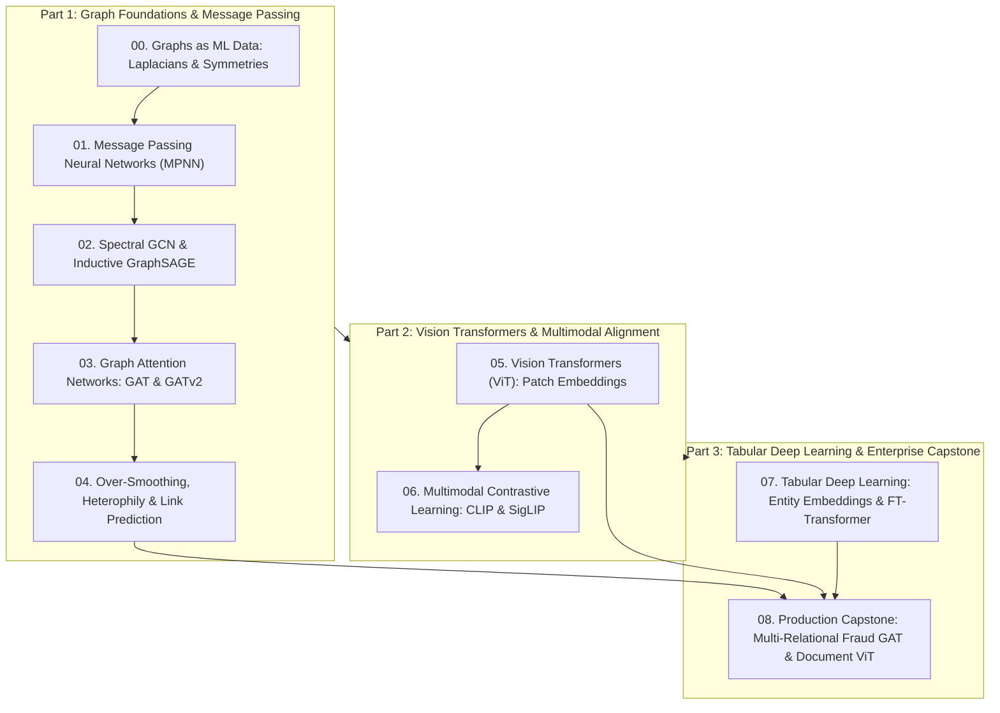

# Track 05: Graph Neural Networks & Vision Transformers

Welcome to **Track 05: Graph Neural Networks & Vision Transformers**, the advanced non-Euclidean and foundational vision curriculum of the Backend & Machine Learning Engineering Roadmap.

This track explores the transition from rigid 1D/2D Euclidean grid structures to arbitrary topological graphs, global self-attention vision models, multimodal contrastive alignment, and deep tabular feature tokenization.

---

## Track Curriculum & Architectural Map

---

## Master Module Catalog

| # | Module Title | Primary Formulations & Mathematical Foundations | Production Incident Post-Mortem | File Size |
| :-: | :--- | :--- | :--- | :-: |
| **00** | [Graphs as ML Data: Representations, Laplacians, and Symmetries](00-graphs-as-ml-data-molecules-social-and-fraud-nets/README.md) | Adjacency $\mathbf{A}$, Degree $\mathbf{D}$, Unnormalized $\mathbf{L} = \mathbf{D} - \mathbf{A}$, Symmetric Normalized $\mathbf{L}_{\text{sym}} = \mathbf{D}^{-1/2}\mathbf{L}\mathbf{D}^{-1/2}$, Random Walk $\mathbf{L}_{\text{rw}} = \mathbf{D}^{-1}\mathbf{L}$, Dirichlet Energy $\mathcal{E}(\mathbf{x}) = \mathbf{x}^T \mathbf{L} \mathbf{x}$, Permutation Invariance vs. Equivariance. | **\$2.4M Financial Fraud Ring Evasion Incident**: Cypher query node ordering mismatch breaking non-permutation-equivariant layer. | ~46.6 KB |
| **01** | [Message Passing Neural Networks (MPNN)](01-message-passing-neural-networks-mpnn/README.md) | Gilmer et al. spatial framework: Message phase $\mathcal{M}_t(h_v, h_u, e_{vu})$, Aggregation $\bigoplus$ (sum, mean, max) and 1-WL expressiveness (DeepSets / GIN), GRU/LSTM State Update $\mathcal{U}_t$, Readout $\mathcal{R}$. Edge feature fusion. | **\$4.1M Drug Discovery Candidate Pipeline Crash**: OOM from naive full-graph dense message matrix allocation and aggregation overflow. | ~37.1 KB |
| **02** | [Graph Convolutional Networks (GCN) and GraphSAGE](02-graph-convolutional-networks-gcn-and-graphsage/README.md) | Graph Fourier Transform $\hat{\mathbf{x}} = \mathbf{U}^T \mathbf{x}$, Truncated Chebyshev polynomials, Kipf-Welling first-order approximation $\mathbf{H}^{(l+1)} = \sigma(\tilde{\mathbf{D}}^{-1/2}\tilde{\mathbf{A}}\tilde{\mathbf{D}}^{-1/2}\mathbf{H}^{(l)}\mathbf{W}^{(l)})$. GraphSAGE inductive fixed-budget neighborhood sampling and aggregators. | **\$1.8M E-Commerce Graph Recommendation Outage**: Full-batch GCN memory explosion and exponential neighbor explosion during Black Friday peak. | ~42.9 KB |
| **03** | [Graph Attention Networks (GAT) and GATv2](03-graph-attention-networks-gat/README.md) | Masked self-attention coefficients $\alpha_{ij}$, Multi-head attention stabilization (concatenation vs. averaging). Brody et al. proof of Static Attention Collapse in classic GAT and strictly dynamic GATv2 resolution $\mathbf{a}^T\text{LeakyReLU}(\mathbf{W}_L h_i + \mathbf{W}_R h_j)$. | **\$3.2M AML False-Negative Disaster**: Static attention collapse in classic GAT overlooking high-risk transactions routed through high-volume corporate hubs. | ~36.3 KB |
| **04** | [GNN Failure Modes: Over-Smoothing, Heterophily, and Link Prediction](04-over-smoothing-heterophily-and-link-prediction/README.md) | Over-smoothing (Dirichlet energy decay $\mathcal{E}(\mathbf{H}^{(l)}) \to 0$ as $l \to \infty$), Over-squashing (Ricci curvature bottlenecks), Homophily ratio $h = \frac{\sum_{(u,v)} \mathbb{I}(y_u=y_v)}{|\mathcal{E}|}$, H2GCN decoupled layers. Link prediction with negative sampling, MRR, Hits@K. | **\$5.6M Credit Card Account Takeover Botnet Breach**: 8-layer deep GCN Dirichlet energy collapse rendering the model blind to synthetic money mule rings. | ~40.2 KB |
| **05** | [Vision Transformers (ViT): Patch Embeddings and Self-Attention](05-vision-transformers-vit-patch-embeddings/README.md) | Patchification ($P \times P$ non-overlapping patches, $N = \frac{HW}{P^2}$), Linear projection via Conv2d equivalence, prepending learnable `[CLS]` token, 1D learnable position embeddings, Pre-LN Transformer blocks, 2D Bicubic Positional Interpolation for multi-resolution fine-tuning. | **\$2.1M Autonomous Driving Vision Outage**: Zero-padding spatial aspect ratio distortion and patch boundary artifact causing hallucinated phantom obstacles in fog. | ~41.6 KB |
| **06** | [Multimodal Contrastive Learning: CLIP and SigLIP](06-multimodal-contrastive-learning-clip-and-siglip/README.md) | Dual-encoder architecture, Cosine similarity matrix $S_{ij} = \hat{\mathbf{u}}_i^T \hat{\mathbf{v}}_j$, Clamped learned logit scale $\tau$, Symmetric InfoNCE loss, Distributed All-Gather bottleneck. SigLIP pairwise decoupled sigmoid loss with learnable bias $b$, Zero-shot classification. | **\$6.8M Visual Search Engine Outage**: Distributed InfoNCE All-Gather memory spike crashing 256 H100 nodes during fine-tuning due to global denominator tensor synchronization. | ~40.5 KB |
| **07** | [Tabular Deep Learning: Entity Embeddings and FT-Transformer](07-tabular-deep-learning-entity-embeddings-and-ft-transformer/README.md) | Why tabular data resists deep learning (heterogeneity, coordinate independence, axis-aligned splits). Entity Embeddings for categoricals. FT-Transformer Feature Tokenizer ($t_j = x_j \mathbf{w}_j + \mathbf{b}_j$), pairwise feature attention. GBDT vs. Deep Learning trade-offs. | **\$8.5M Algorithmic Trading Liquidation Incident**: Deep tabular network catastrophic linear extrapolation on out-of-distribution market volatility spike where GBDT would have clipped safely. | ~37.4 KB |
| **08** | [Capstone: Multi-Relational Fraud Graph & Document ViT Classifier](08-capstone-fraud-graph-and-vit-classifier/README.md) | End-to-end FinTech enterprise defense: Document Verification ViT for KYC forgery detection, Multi-Relational Graph Attention Network (RGAT) over heterogeneous transaction topologies, Gated Cross-Attention Fusion Head operating under $< 50\text{ ms}$ P99 SLA. | **\$14.2M Multi-State Synthetic Identity Syndicate Breach**: Collusion across 10,400 synthetic accounts bypassing isolated KYC vision checks and tabular single-hop rules. | ~42.0 KB |

---

## Key Hardware & Systems Paradigms Mastered

Across this track, you implement deep learning architectures designed for high-performance hardware execution:
- **Sparse Matrix Multiplication (SpMM):** Leveraging `torch.sparse.mm` and CSR/COO layouts to compute normalized graph convolutions without allocating dense $\mathcal{O}(N^2)$ adjacency matrices.
- **Atomic-Free Scatter Aggregation:** Vectorized neighborhood pooling utilizing in-place `scatter_reduce_` and `index_add_` to avoid materializing intermediate $\mathcal{O}(M \cdot D)$ message tensors in DRAM.
- **Linear Memory Chunked SigLIP Streaming:** Eliminating distributed cross-GPU `all-gather` bottlenecks by computing pairwise sigmoid losses in streaming tiles of $B_{\text{chunk}} \times D$.
- **2D Bicubic Positional Interpolation:** Dynamically adapting pretrained Vision Transformers to arbitrary higher-resolution image inputs during inference without retraining.

---

## Prerequisites & Roadmap Navigation

- **Previous Track:** [Track 04: Autoencoders, VAEs, GANs & Diffusion Models](../04-autoencoders-vaes-gans-and-diffusion/README.md)
- **Next Track:** [Track 06: Neural Network Performance, Optimization & Deployment](../06-neural-network-performance-and-deployment/README.md)
- **Math Track Reference:** [Vector and Matrix Linear Algebra](../../../ml/02-math-for-machine-learning/00-vectors-matrices-and-linear-transformations/README.md)
