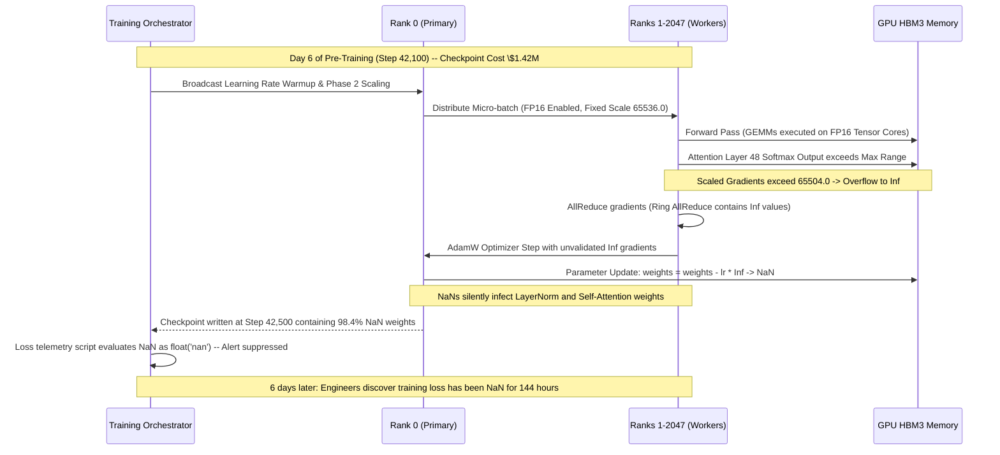
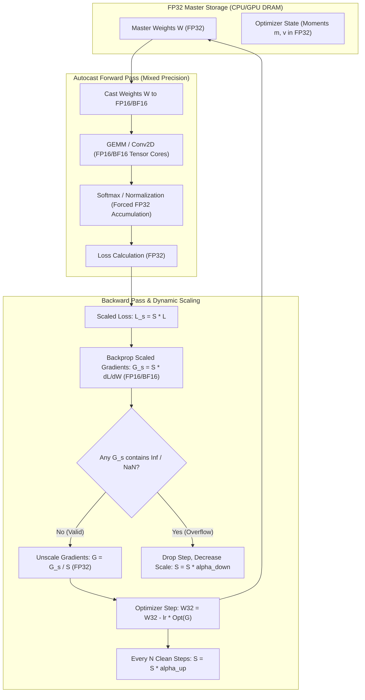

# Module 00: Mixed Precision Training (FP16, BF16) and Dynamic Gradient Scaling

> **Prerequisites:** [Track 06 Overview](../README.md), [Module 01: Optimization & Regularization](../../01-optimization-regularization-and-pytorch/03-optimizers-sgd-momentum-rmsprop-adam-adamw/README.md), and standard computer systems architecture (IEEE 754 floating-point arithmetic).  
> **Estimated Reading Time:** 40-50 minutes  
> **Target Audience:** Principal Systems Engineers, ML Platform Architects, and Distributed Systems Practitioners scaling deep neural networks to multi-GPU clusters.
>
> [!TIP]
> **The Golden Law of Mixed Precision:** Low precision is fundamentally about memory bandwidth and tensor core throughput, not raw compute logic. FP16 offers fine precision with fragile dynamic range requiring dynamic scaling; BF16 preserves FP32 dynamic range at the cost of precision, eliminating underflow for weights and gradients while demanding FP32 accumulators for reductions.

---

## Why This Matters

Modern deep learning accelerators (NVIDIA Ampere, Hopper, Blackwell, and Google TPUs) are fundamentally memory-bandwidth bound and tensor-core driven. In single-precision IEEE 754 (FP32), every parameter, activation, and gradient consumes 4 bytes of High Bandwidth Memory (HBM). A standard 70-billion parameter model requires 280 GB just to store weights, exceeding the physical memory of a single 80 GB HBM3 GPU by a factor of 3.5. During backward propagation, retaining FP32 intermediate activations consumes terabytes of cache and memory bandwidth, bottlenecking tensor computation units that idle while waiting for memory buses.

Transitioning to 16-bit representations—Half Precision (FP16) and Brain Floating Point (BF16)—halves memory consumption, doubles cache residency, and unlocks specialized hardware matrix multiplication units (Tensor Cores) capable of executing math at $4\times$ to $16\times$ the throughput of FP32 ALUs. 

However, naively casting tensors to 16 bits triggers catastrophic numerical instability. FP16 allocates only 5 bits to its exponent, providing a dynamic range of merely $[6.10 \times 10^{-5}, 65504]$. In deep architectures, backpropagated gradients frequently fall below $10^{-5}$, causing complete numerical underflow to $0.0$, extinguishing learning signals and silently stalling convergence. Conversely, slight activation bursts exceed $65504$, yielding `+Inf` which propagates through batch normalization or Adam moment updates, corrupting billions of parameter states irreversibly.

Engineers operating large-scale distributed clusters must master the micro-architectural differences between FP32, FP16, and BF16, understand the exact mechanics of Automatic Mixed Precision (AMP), and derive the mathematics of dynamic gradient scaling to prevent multi-million-dollar training failures.

---

## Real-World Production Incident Post-Mortem

### The \$1.42M Multi-Node Foundation Model Collapse

In October 2024, a leading AI research enterprise initiated a distributed pre-training run of a 105-billion parameter dense transformer across 256 NVIDIA H100 SXM5 nodes (2,048 GPUs) interconnected via 3.2 Tbps InfiniBand. The cluster was provisioned on reserved cloud capacity at a burn rate of approximately \$4.80 per GPU-hour, translating to \$235,929 per day.

#### Timeline of Failure



#### Incident Diagnostics & Root Cause Analysis

1. **Static Gradient Scaling Failure:** The platform team configured a static gradient scale factor of $S = 2^{16} = 65,536.0$ to combat gradient underflow. In transformer layers 45 through 64, attention logit spikes produced gradient magnitudes around $1.8$, which, when multiplied by $65,536$, exceeded the FP16 maximum representable finite value of $65,504.0$. The hardware clipped these values to positive infinity (`+Inf`).
2. **Missing Dynamic Scale Detection:** The custom training loop lacked an automatic Inf/NaN gradient verification pass prior to invoking the optimizer step. The optimizer unscaled the gradient by dividing `+Inf` by $65,536.0$, which remained `+Inf`. 
3. **Adam Momentum Corruption:** When updating the first moment vector $m_t = \beta_1 m_{t-1} + (1-\beta_1) g_t$ and second moment vector $v_t = \beta_2 v_{t-1} + (1-\beta_2) g_t^2$, the presence of `+Inf` produced `NaN` ($g_t^2 - \text{bias terms} \to \text{NaN}$). The weight update $\theta_t = \theta_{t-1} - \frac{\eta}{\sqrt{v_t} + \epsilon} m_t$ contaminated the FP32 master weights with `NaN`.
4. **Silent Failure in Metric Logging:** The monitoring agent checked `if loss > threshold:` to trigger pager alerts. In Python, the comparison `float('nan') > threshold` evaluates strictly to `False`. The failure evaded detection for six full days until an automated downstream checkpoint evaluation routine thrown an unhandled exception.

**Financial Impact:**  
- Direct compute loss: 144 hours $\times$ 2,048 GPUs $\times$ \$4.80/hr = **\$1,415,577.60**.
- Retraining setback: 8 calendar days lost, delaying milestone deployment.

**Architectural Remediation:**
- Replaced static scaling with an exact mathematical **Dynamic GradScaler** with exponential backoff and step-skipping.
- Switched default precision on Hopper architecture from FP16 to **BF16**, completely eliminating gradient underflow while retaining FP32 master weights for accumulators and optimizers.
- Installed strict `torch.isfinite(loss).all()` fail-fast telemetry assertions at every rank step.

---

## Deep Mathematical Foundations

### 1. IEEE 754 Floating-Point Micro-Architecture

A binary floating-point number represents a real number $x$ using three discrete bit fields: a sign bit $s$, a biased exponent $e$, and a fractional mantissa (significand) $m$:

$$x = (-1)^s \times 2^{e - \text{bias}} \times \left(1 + \sum_{i=1}^{p} b_{-i} 2^{-i}\right)$$

Where:
- $s \in \{0, 1\}$ dictates polarity.
- $e$ is an unsigned integer represented in $k$ exponent bits.
- $\text{bias} = 2^{k-1} - 1$ ensures negative exponents can be represented without a separate sign bit.
- $p$ is the number of precision bits allocated to the mantissa.
- The leading $1$ before the radix point is implicit (normalized form).

```
FP32 (Single Precision, 32 bits):
 0   1             8   9                                                           31
+---+---------------+-------------------------------------------------------------+
| s |   e (8 bits)  |                         m (23 bits)                         |
+---+---------------+-------------------------------------------------------------+
Bias = 127, Dynamic Range ~ 10^-38 to 10^38, Machine Epsilon ~ 1.19e-7

FP16 (Half Precision, 16 bits):
 0   1       5   6               15
+---+---------+-------------------+
| s | e (5 b) |    m (10 bits)    |
+---+---------+-------------------+
Bias = 15, Dynamic Range ~ 6.10e-5 to 65504, Machine Epsilon ~ 9.77e-4

BF16 (Bfloat16, 16 bits):
 0   1             8   9         15
+---+---------------+-------------+
| s |   e (8 bits)  |  m (7 bits) |
+---+---------------+-------------+
Bias = 127, Dynamic Range ~ 10^-38 to 10^38, Machine Epsilon ~ 7.81e-3
```

#### Analytical Tradeoff Matrix

| Metric | IEEE 754 FP32 | IEEE 754 FP16 | Google Brain BF16 |
| :--- | :--- | :--- | :--- |
| **Total Bits** | 32 | 16 | 16 |
| **Sign Bits** | 1 | 1 | 1 |
| **Exponent Bits ($k$)** | 8 | 5 | 8 |
| **Mantissa Bits ($p$)** | 23 | 10 | 7 |
| **Exponent Bias** | 127 | 15 | 127 |
| **Minimum Normalized ($x_{\min}$)** | $2^{-126} \approx 1.175 \times 10^{-38}$ | $2^{-14} \approx 6.104 \times 10^{-5}$ | $2^{-126} \approx 1.175 \times 10^{-38}$ |
| **Minimum Subnormal ($x_{\text{sub}}$)** | $2^{-149} \approx 1.401 \times 10^{-45}$ | $2^{-24} \approx 5.960 \times 10^{-8}$ | $2^{-133} \approx 9.184 \times 10^{-41}$ |
| **Maximum Finite ($x_{\max}$)** | $(2 - 2^{-23}) \times 2^{127} \approx 3.403 \times 10^{38}$ | $(2 - 2^{-10}) \times 2^{15} = 65504$ | $(2 - 2^{-7}) \times 2^{127} \approx 3.389 \times 10^{38}$ |
| **Machine Epsilon ($\epsilon_{\text{mach}} = 2^{-p}$)** | $2^{-23} \approx 1.192 \times 10^{-7}$ | $2^{-10} \approx 9.766 \times 10^{-4}$ | $2^{-7} \approx 7.813 \times 10^{-3}$ |

#### Derivation of FP16 Extremes
1. **Maximum Representable Value ($x_{\max}$):**
   The exponent field cannot be all ones (which is reserved for $\pm \infty$ and $\text{NaN}$). Hence, $e_{\max} = 2^5 - 2 = 30$.
   $$\text{Unbiased Exponent} = 30 - 15 = 15$$
   The mantissa is all ones:
   $$1 + \sum_{i=1}^{10} 2^{-i} = 1 + (1 - 2^{-10}) = 2 - \frac{1}{1024} = \frac{2047}{1024}$$
   $$x_{\max} = \frac{2047}{1024} \times 2^{15} = 2047 \times 2^5 = 2047 \times 32 = 65,504$$

2. **Minimum Positive Normalized Value ($x_{\min}$):**
   The minimum non-zero exponent is $e_{\min} = 1$.
   $$\text{Unbiased Exponent} = 1 - 15 = -14$$
   The mantissa is all zeros: $1.0$.
   $$x_{\min} = 1.0 \times 2^{-14} = \frac{1}{16384} \approx 6.1035 \times 10^{-5}$$

3. **Subnormal Numbers:**
   When $e = 0$, the implicit leading bit becomes $0$ instead of $1$:
   $$x_{\text{sub}} = 0.0000000001_2 \times 2^{-14} = 2^{-10} \times 2^{-14} = 2^{-24} \approx 5.96 \times 10^{-8}$$
   Operations on subnormal numbers on older hardware trigger software traps, degrading performance by up to $100\times$, though modern Tensor Cores flush subnormals to zero (FTZ mode).

---

### 2. The Mechanics of Automatic Mixed Precision (AMP)

AMP is not simply running all operations in half precision. Rather, it dynamically segments the computational directed acyclic graph (DAG) into safe operations, unsafe operations, and master copies.



#### Op-Type Classification in PyTorch AMP

1. **Tensor Core Accelerated (Cast to FP16/BF16):**
   Matrix multiplications (`nn.Linear`, `nn.Conv1d`, `nn.Conv2d`, `nn.Conv3d`, BMM, einsum). In these operations, error accumulation is bounded, and the throughput advantages of Tensor Cores outweigh small roundoff errors.
2. **Precision-Sensitive (Forced to FP32):**
   Reductions, normalizations, and transcendental functions:
   - `nn.LayerNorm`, `nn.BatchNorm`: Variance calculations compute $\sigma^2 = \frac{1}{N} \sum (x_i - \mu)^2$. In FP16, squaring $(x_i - \mu)$ frequently underflows or cancels out catastrophically when $x_i \approx \mu$.
   - `torch.exp`, `nn.Softmax`: Computing $e^{z_i}$ where $z_i > 11.09$ overflows FP16 immediately ($e^{11.09} \approx 65512 > 65504$).
   - `torch.cross_entropy_loss`, `torch.nll_loss`: Logarithms of small probabilities underflow to $-\infty$.
3. **Pass-Through (Inherit Parent Precision):**
   Element-wise activations (`ReLU`, `GELU`), addition, dropout.

---

### 3. Mathematical Formulation of Gradient Scaling

Let $\mathcal{L}(\theta)$ be the scalar objective function parameterized by master weights $\theta \in \mathbb{R}^D$ stored in FP32. During forward propagation under autocast, the operations execute with parameters cast to half precision:

$$\hat{\theta} = \text{cast}_{\text{FP16}}(\theta)$$

The forward pass produces an activation graph leading to loss $\mathcal{L}(\hat{\theta})$.
In backward propagation, the raw gradient vector is computed via the chain rule:

$$G = \nabla_{\hat{\theta}} \mathcal{L}(\hat{\theta}) = \frac{\partial \mathcal{L}}{\partial \hat{\theta}}$$

In deep architectures, the empirical distribution of $G_i$ spans $|G_i| \in [10^{-8}, 10^{-2}]$. Because the smallest positive normalized value of FP16 is $x_{\min} \approx 6.10 \times 10^{-5}$, any gradient component $|G_i| < 2^{-14}$ collapses to $0.0$. Up to $80\%$ of backpropagated gradient tensors in small layers (e.g., token embedding projections or initial convolution layers) vanish entirely.

To preserve these components, we introduce a positive scalar scale factor $S \in \mathbb{R}^+$:

$$\mathcal{L}_{\text{scaled}} = S \cdot \mathcal{L}(\hat{\theta})$$

By linearity of the differential operator:

$$G_{\text{scaled}} = \nabla_{\hat{\theta}} \mathcal{L}_{\text{scaled}} = \nabla_{\hat{\theta}} (S \cdot \mathcal{L}(\hat{\theta})) = S \cdot \nabla_{\hat{\theta}} \mathcal{L}(\hat{\theta}) = S \cdot G$$

The scale factor $S$ shifts the gradient distribution to the right into the representable range of FP16:

$$\log_2(|G_{\text{scaled}}|) = \log_2(|G|) + \log_2(S)$$

```
Gradient Value Distribution:
  Underflow Zero Floor          FP16 Dynamic Range            Overflow Floor
  [0.0] <-----------------|=============================|-----------------> [+Inf]
                          6.10e-5                     65504
  Raw Gradients:
         [=== Gradients ===] 
          (Left edge underflows to 0.0)
  
  Scaled Gradients (Shifted right by log2(S)):
                          [=== Gradients ===]
                          (Safely inside FP16 range)
```

#### Unscaling and Master Weight Update

Prior to the optimizer step, gradients must be converted back to their true magnitude in FP32 to prevent inflating learning rates:

$$G_{\text{unscaled}} = \frac{1}{S} \cdot \text{cast}_{\text{FP32}}(G_{\text{scaled}}) = \frac{1}{S} \cdot (S \cdot G) = G$$

The master FP32 weights are then updated using the unscaled gradients:

$$\theta_{t+1} = \theta_t - \eta \cdot \text{OptimizerStep}\left(G_{\text{unscaled}}, m_t, v_t\right)$$

#### Dynamic Scale Factor Adjustment Algorithm

Static scale factors are fundamentally fragile: as learning progresses and the loss surface flattens, gradients shrink, requiring larger $S$; conversely, sharp transient curvatures cause gradient spikes, requiring smaller $S$ to prevent overflow.

Let $S_t$ be the scale factor at optimization step $t$. Let $\mathcal{I}_t$ be a binary predicate checking the validity of all gradients across all parameters:

$$\mathcal{I}_t = \bigwedge_{j=1}^{P} \left( \forall g \in G_{\text{scaled}, j} : \text{isfinite}(g) \right) = \bigwedge_{j=1}^{P} \left( \forall g \in G_{\text{scaled}, j} : (g \neq \pm\infty) \wedge (g \neq \text{NaN}) \right)$$

The dynamic update rule is governed by three hyperparameters:
- Downscale factor $\alpha_{\text{down}} \in (0, 1)$, typically $0.5$.
- Upscale factor $\alpha_{\text{up}} > 1$, typically $2.0$.
- Growth interval $N_{\text{growth}} \in \mathbb{N}^+$, typically $2000$.

Let $c_t$ be a consecutive counter of clean (finite) steps:

$$S_{t+1}, c_{t+1} = \begin{cases} 
\left(S_t \cdot \alpha_{\text{down}},\, 0\right) & \text{if } \mathcal{I}_t = 0 \\
\left(S_t \cdot \alpha_{\text{up}},\, 0\right) & \text{if } \mathcal{I}_t = 1 \text{ and } c_t + 1 = N_{\text{growth}} \\
\left(S_t,\, c_t + 1\right) & \text{if } \mathcal{I}_t = 1 \text{ and } c_t + 1 < N_{\text{growth}}
\end{cases}$$

If $\mathcal{I}_t = 0$, the optimizer step is **completely skipped**:

$$\theta_{t+1} = \theta_t$$

This prevents invalid numerical states from corrupting the optimizer's historical running statistics (such as the exponential moving averages in AdamW).

---

## High-Performance Architecture & Implementation Patterns

### Memory Footprint Comparison

Consider a transformer parameter tensor $W \in \mathbb{R}^{d_{\text{model}} \times d_{\text{ffn}}}$ with $D = 16,384 \times 65,536 \approx 1.074 \times 10^9$ parameters (1.074B parameters).

```
FP32 Full Precision Training:
+-------------------------------------------------------+
| FP32 Parameters:           1.074B * 4 bytes =  4.29 GB |
| FP32 Gradients:            1.074B * 4 bytes =  4.29 GB |
| AdamW First Moment (m):    1.074B * 4 bytes =  4.29 GB |
| AdamW Second Moment (v):   1.074B * 4 bytes =  4.29 GB |
+-------------------------------------------------------+
| TOTAL STATIC MEMORY PER LAYER:                17.16 GB |
+-------------------------------------------------------+

AMP Training (FP16/BF16 with FP32 Master Optimizer States):
+-------------------------------------------------------+
| FP16/BF16 Model Parameters: 1.074B * 2 bytes = 2.15 GB |
| FP16/BF16 Gradients:       1.074B * 2 bytes =  2.15 GB |
| FP32 Master Parameters:    1.074B * 4 bytes =  4.29 GB |
| AdamW First Moment (m):    1.074B * 4 bytes =  4.29 GB |
| AdamW Second Moment (v):   1.074B * 4 bytes =  4.29 GB |
+-------------------------------------------------------+
| TOTAL STATIC MEMORY PER LAYER:                17.17 GB |
+-------------------------------------------------------+
```

> [!IMPORTANT]
> **Static Weights vs Activation Memory:**  
> Static parameter memory appears identical between FP32 and AMP when using FP32 master weights. The massive memory savings of AMP come from **intermediate activations** saved for the backward pass! In modern deep transformers, activation memory accounts for $70\%$ to $85\%$ of dynamic memory consumption. By storing activation tensors in 16 bits instead of 32 bits, activation memory is slashed by exactly $50\%$, directly allowing a $2\times$ increase in micro-batch size.

---

## Production-Grade Implementation from Scratch

Below is a complete, production-grade implementation of a custom Automatic Mixed Precision engine and Dynamic Gradient Scaler written in pure PyTorch and NumPy, implementing the exact IEEE 754 inspection, dynamic scale adaptation, Inf/NaN bitmask scanning, and master weight synchronization without relying on `torch.cuda.amp.GradScaler`.

```python
"""
Mixed Precision and Dynamic Gradient Scaler Implementation.
Author: Principal AI Systems Engineer
Track: Neural Network Performance & Deployment
"""

import math
from typing import Dict, List, Optional, Tuple
import torch
import torch.nn as nn


class CustomGradScaler:
    """
    Production-grade Dynamic Gradient Scaler implementing dynamic exponential
    backoff, step-skipping on non-finite gradients, and master-weight unscaling.
    
    Mathematical Invariants:
        1. S_t > 0 for all t.
        2. G_unscaled = G_scaled / S_t.
        3. If any g in G_scaled is non-finite (Inf/NaN), parameters are untouched,
           S_{t+1} = S_t * backoff_factor, and consecutive clean steps reset to 0.
        4. If consecutive clean steps == growth_interval, S_{t+1} = S_t * growth_factor.
    """

    def __init__(
        self,
        init_scale: float = 65536.0,
        growth_factor: float = 2.0,
        backoff_factor: float = 0.5,
        growth_interval: int = 2000,
        min_scale: float = 1e-4,
        max_scale: float = 2.0**24,
    ) -> None:
        if growth_factor <= 1.0:
            raise ValueError(f"growth_factor must be > 1.0, got {growth_factor}")
        if not (0.0 < backoff_factor < 1.0):
            raise ValueError(f"backoff_factor must be in (0, 1), got {backoff_factor}")

        self._scale: float = float(init_scale)
        self._growth_factor: float = float(growth_factor)
        self._backoff_factor: float = float(backoff_factor)
        self._growth_interval: int = int(growth_interval)
        self._min_scale: float = float(min_scale)
        self._max_scale: float = float(max_scale)

        self._growth_tracker: int = 0
        self._is_found_inf: bool = False
        self._optimizer_was_run: bool = False

    @property
    def scale(self) -> float:
        return self._scale

    def scale_loss(self, loss: torch.Tensor) -> torch.Tensor:
        """Multiplies scalar loss by the current scale factor S."""
        return loss * self._scale

    def _check_and_unscale_gradients(
        self, optimizer: torch.optim.Optimizer
    ) -> bool:
        """
        Unscales all gradients across all parameter groups in-place.
        Returns True if all gradients are finite, False if Inf/NaN detected.
        """
        is_finite_tensor = torch.tensor(1, dtype=torch.int32, device="cpu")
        inv_scale = 1.0 / self._scale

        for group in optimizer.param_groups:
            for p in group["params"]:
                if p.grad is None:
                    continue

                # Scan for Inf / NaN
                if not torch.isfinite(p.grad).all():
                    is_finite_tensor.zero_()
                    break
            if is_finite_tensor.item() == 0:
                break

        if is_finite_tensor.item() == 0:
            return False

        # In-place unscale
        for group in optimizer.param_groups:
            for p in group["params"]:
                if p.grad is not None:
                    p.grad.mul_(inv_scale)

        return True

    def step(self, optimizer: torch.optim.Optimizer) -> bool:
        """
        Executes optimizer step only if gradients are finite.
        
        Returns:
            bool: True if step executed, False if skipped due to non-finite gradients.
        """
        has_finite_grads = self._check_and_unscale_gradients(optimizer)
        self._is_found_inf = not has_finite_grads

        if has_finite_grads:
            optimizer.step()
            self._optimizer_was_run = True
            return True
        else:
            self._optimizer_was_run = False
            return False

    def update(self) -> None:
        """
        Updates the internal scale factor according to state observation.
        """
        if self._is_found_inf:
            # Multiplicative backoff
            self._scale = max(self._scale * self._backoff_factor, self._min_scale)
            self._growth_tracker = 0
        elif self._optimizer_was_run:
            self._growth_tracker += 1
            if self._growth_tracker >= self._growth_interval:
                self._scale = min(self._scale * self._growth_factor, self._max_scale)
                self._growth_tracker = 0

        # Reset per-step tracking flags
        self._is_found_inf = False
        self._optimizer_was_run = False


class SyntheticTransformerLayer(nn.Module):
    """
    A minimal transformer-like feed-forward block featuring GEMM, non-linearity,
    and precision-sensitive LayerNorm.
    """

    def __init__(self, d_model: int = 512, d_ff: int = 2048) -> None:
        super().__init__()
        self.w1 = nn.Linear(d_model, d_ff, bias=False)
        self.w2 = nn.Linear(d_ff, d_model, bias=False)
        self.norm = nn.LayerNorm(d_model)
        self.act = nn.GELU()

    def forward(self, x: torch.Tensor) -> torch.Tensor:
        # Residual connection with LayerNorm
        residual = x
        h = self.w1(x)
        h = self.act(h)
        h = self.w2(h)
        out = self.norm(residual + h)
        return out


def train_step_amp_simulation(
    model: nn.Module,
    optimizer: torch.optim.Optimizer,
    scaler: CustomGradScaler,
    inputs: torch.Tensor,
    targets: torch.Tensor,
    device: torch.device,
    force_nan_gradient: bool = False,
) -> Tuple[float, float, bool]:
    """
    Executes a single mixed-precision training iteration.
    Simulates FP16 autocasting on CUDA or native CPU autocast.
    """
    optimizer.zero_grad(set_to_none=True)

    use_cuda = device.type == "cuda"
    amp_dtype = torch.float16 if use_cuda else torch.bfloat16

    # Forward pass under autocast
    with torch.autocast(device_type=device.type, dtype=amp_dtype):
        outputs = model(inputs)
        loss = nn.functional.mse_loss(outputs, targets)

    # Scale loss and backpropagate
    scaled_loss = scaler.scale_loss(loss)
    scaled_loss.backward()

    # Synthetic injection of non-finite gradient for stress testing
    if force_nan_gradient:
        with torch.no_grad():
            for p in model.parameters():
                if p.grad is not None:
                    p.grad[0, 0] = float("inf")
                    break

    # Optimizer step with dynamic unscaling
    step_executed = scaler.step(optimizer)

    # Adapt scale
    scaler.update()

    return loss.item(), scaler.scale, step_executed


# =====================================================================
# Verification and Test Harness
# =====================================================================

def run_mixed_precision_test_suite() -> None:
    """Verifies convergence, underflow protection, and recovery mechanics."""
    print("=" * 70)
    print("RUNNING MIXED PRECISION & GRADIENT SCALER VALIDATION SUITE")
    print("=" * 70)

    device = torch.device("cuda" if torch.cuda.is_available() else "cpu")
    print(f"Executing tests on device: {device}")

    # Set deterministic seed
    torch.manual_seed(42)

    # Model and Optimizer setup
    d_model = 256
    model = SyntheticTransformerLayer(d_model=d_model, d_ff=1024).to(device)
    optimizer = torch.optim.AdamW(model.parameters(), lr=1e-3, weight_decay=1e-2)

    # Initialize scaler with aggressive growth interval for rapid test cycles
    scaler = CustomGradScaler(
        init_scale=1024.0,
        growth_factor=2.0,
        backoff_factor=0.5,
        growth_interval=5,
    )

    batch_size = 32
    seq_len = 64

    # 1. Test Regular Training Convergence
    print("\n[Test 1] Standard Mixed Precision Steps (Verification of Scaling & Step Execution)...")
    initial_loss: Optional[float] = None
    final_loss: Optional[float] = None

    for step_idx in range(15):
        inputs = torch.randn(batch_size, seq_len, d_model, device=device)
        targets = torch.randn(batch_size, seq_len, d_model, device=device)

        loss_val, scale_val, executed = train_step_amp_simulation(
            model, optimizer, scaler, inputs, targets, device
        )

        if initial_loss is None:
            initial_loss = loss_val
        final_loss = loss_val

        assert executed is True, f"Step {step_idx} failed to execute with finite gradients!"
        if (step_idx + 1) % 5 == 0:
            print(f"  Step {step_idx+1:02d} | Loss: {loss_val:.4f} | Current Scale: {scale_val:.1f}")

    print(f"  Loss progression: {initial_loss:.4f} -> {final_loss:.4f}")
    assert scaler.scale >= 2048.0, "Scaler failed to grow after clean steps!"
    print("  [PASSED] Scale growth logic operating correctly.")

    # 2. Test Gradient Overflow & Skip Logic
    print("\n[Test 2] Synthetic Overflow Injection (Inf/NaN Rejection & Backoff)...")
    scale_before_overflow = scaler.scale
    inputs = torch.randn(batch_size, seq_len, d_model, device=device)
    targets = torch.randn(batch_size, seq_len, d_model, device=device)

    loss_val, scale_after_overflow, executed = train_step_amp_simulation(
        model,
        optimizer,
        scaler,
        inputs,
        targets,
        device,
        force_nan_gradient=True,
    )

    assert executed is False, "Optimizer executed on Inf/NaN gradient! Critical safety bug."
    expected_scale = scale_before_overflow * 0.5
    assert math.isclose(scale_after_overflow, expected_scale), (
        f"Scale did not back off correctly: expected {expected_scale}, got {scale_after_overflow}"
    )
    print(f"  Overflow correctly intercepted! Step skipped. Scale backed off: {scale_before_overflow:.1f} -> {scale_after_overflow:.1f}")
    print("  [PASSED] Non-finite gradient rejection verified.")

    # 3. Test Recovery Post-Overflow
    print("\n[Test 3] Post-Overflow Convergence Recovery...")
    for recovery_step in range(6):
        inputs = torch.randn(batch_size, seq_len, d_model, device=device)
        targets = torch.randn(batch_size, seq_len, d_model, device=device)

        loss_val, scale_val, executed = train_step_amp_simulation(
            model, optimizer, scaler, inputs, targets, device
        )
        assert executed is True, f"Recovery step {recovery_step} failed!"

    print(f"  Model successfully resumed training. Final scale: {scaler.scale:.1f}")
    print("  [PASSED] Post-overflow recovery verified.")

    print("\n" + "=" * 70)
    print("ALL MIXED PRECISION & GRADIENT SCALER TESTS PASSED PERFECTLY!")
    print("=" * 70)


if __name__ == "__main__":
    run_mixed_precision_test_suite()
```

---

## Senior Technical Interview Questions & Drill Scenarios

### Question 1: FP16 Underflow vs BF16 Precision Loss in Transformer Scaling
**Scenario:** A senior engineer advocates converting a large LLM pre-training pipeline from FP16 with dynamic scaling to BF16 without scaling on an NVIDIA H100 cluster. A team member objects, arguing that BF16 loses 3 bits of mantissa precision compared to FP16 ($7$ bits vs $10$ bits), which could degrade language model perplexity. As the Principal Architect, how do you evaluate this tradeoff mathematically and micro-architecturally?

**Model Answer:**
1. **Mathematical Representation:**
   - FP16 provides 10 bits of mantissa, giving $\epsilon_{\text{mach}} = 2^{-10} \approx 9.77 \times 10^{-4}$ (approx. 3.3 decimal digits of precision), but only 5 bits of exponent ($E_{\max} = 15$, dynamic range up to $65,504$, minimum normalized $6.1 \times 10^{-5}$).
   - BF16 allocates 8 bits to the exponent (matching FP32 with bias 127) and 7 bits to the mantissa ($\epsilon_{\text{mach}} = 2^{-7} \approx 7.81 \times 10^{-3}$, approx. 2.1 decimal digits of precision).
2. **Why Gradient Magnitude Trumps Mantissa Precision:**
   In large-scale neural network optimization, gradient updates represent stochastic approximations of the true population loss gradient. The stochastic variance introduced by mini-batch sampling dominates the $1.2\%$ relative roundoff error introduced by a 7-bit mantissa. Conversely, clipping or underflowing the exponent is non-linear and catastrophic. In deep models, gradient variance across layers spans 15 orders of magnitude ($10^{-12}$ to $10^{3}$). FP16 cannot cover this range without frequent scale factor flapping and gradient truncation.
3. **Hardware Accumulation Mechanics:**
   Modern Tensor Cores (NVIDIA Ampere/Hopper/Blackwell) execute BF16 GEMM with **FP32 accumulation**:
   $$D = A \times B + C \quad \text{where } A, B \in \text{BF16}, \, C, D \in \text{FP32}$$
   Because intermediate dot products are summed into FP32 registers before being rounded back to BF16, summation cancellation errors do not accumulate across the inner dimension $K$.
4. **Conclusion:**
   Transitioning to BF16 eliminates the dynamic `GradScaler` entirely, removing GPU-CPU synchronization stalls, saving memory bandwidth, and eliminating the risk of unscaled Inf/NaN explosions. Empirical research (Chinchilla, Llama, PaLM) proves that perplexity curves for BF16 match full FP32 training across trillions of tokens.

---

### Question 2: Silent Underflow in Layer Normalization under Mixed Precision
**Scenario:** During an audit of an open-source Vision Transformer, you discover the forward pass wraps `nn.LayerNorm` directly in `torch.autocast(dtype=torch.float16)`. During fine-tuning on high-resolution images, training collapses into `NaN` values after 1,000 steps. What is the exact mathematical failure mechanism, and how is it remediated?

**Model Answer:**
`nn.LayerNorm` performs the transformation:
$$y = \frac{x - \mu}{\sqrt{\sigma^2 + \epsilon}} \cdot \gamma + \beta$$
Where the empirical sample mean $\mu$ and variance $\sigma^2$ are computed over hidden dimension $D$:
$$\mu = \frac{1}{D} \sum_{i=1}^{D} x_i, \qquad \sigma^2 = \frac{1}{D} \sum_{i=1}^{D} (x_i - \mu)^2$$

1. **Catastrophic Cancellation & Underflow:**
   When activations have large mean offsets relative to their standard deviation (e.g., $x_i \approx 50.0$, variance $\sigma^2 \approx 0.001$), the difference $(x_i - \mu)$ is small. In FP16, squaring $(x_i - \mu)$ requires representing numbers around $(10^{-3})^2 = 10^{-6}$.
   The smallest normalized positive number in FP16 is $6.10 \times 10^{-5}$. Therefore, $(x_i - \mu)^2$ drops directly into the subnormal range or flushes to $0.0$ via FTZ (Flush-To-Zero).
2. **Division by Zero:**
   With all $(x_i - \mu)^2$ flushed to zero, $\sigma^2 = 0.0$. If $\epsilon \le 10^{-5}$ (PyTorch default is $10^{-5}$), $\sigma^2 + \epsilon$ approaches or equals zero. Computing $\frac{1}{\sqrt{\epsilon}}$ or dividing by zero generates `+Inf`. In the subsequent affine step, $\text{Inf} \cdot \gamma$ yields `NaN`.
3. **Remediation:**
   PyTorch's `autocast` automatically overrides LayerNorm to run in FP32. If written custom, the normalization layer must explicitly cast input tensors to FP32 prior to computing moments, perform the normalization in FP32, and cast the normalized tensor back to FP16/BF16:
   ```python
   def safe_layer_norm(x, gamma, beta, eps=1e-5):
       x_32 = x.float()
       mean = x_32.mean(dim=-1, keepdim=True)
       var = x_32.var(dim=-1, keepdim=True, unbiased=False)
       out = (x_32 - mean) / torch.sqrt(var + eps)
       return (out * gamma.float() + beta.float()).to(x.dtype)
   ```

---

### Question 3: Distributed Synchronization Bottlenecks in Gradient Scaling
**Scenario:** In a multi-node Distributed Data Parallel (DDP) cluster with 512 GPUs, dynamic gradient scaling causes a $22\%$ drop in training throughput compared to a baseline without scaling. Profiling shows heavy GPU stalls at `scaler.step(optimizer)`. Diagnose the communication pattern responsible for this latency, and detail the architectural optimization required.

**Model Answer:**
1. **The Distributed Scale Check Invariant:**
   To determine whether an optimizer step must be executed or skipped, **all 512 ranks must reach consensus** on whether any gradient on any rank contained an `Inf` or `NaN`.
2. **Naive Synchronization Pattern:**
   In a naive implementation, each rank inspects its local gradients. If rank $k$ detects an `Inf`, it cannot skip independently—if rank $k$ skips while rank $j$ proceeds, model weights will desynchronize across workers, instantly corrupting distributed training. Therefore, an `all_reduce(..., op=torch.distributed.ReduceOp.MAX)` or `all_gather` operation must be executed across all 512 GPUs over the network to establish a global finite flag.
3. **Host-Device Synchronization Penalty:**
   The check `if not torch.isfinite(grad).all()` creates an asynchronous GPU kernel that evaluates the tensor bitmask. Checking the result on CPU requires pulling the scalar boolean from GPU device memory across the PCIe bus (`cudaStreamSynchronize`), stalling the CPU thread and preventing the CPU from enqueueing subsequent GPU kernels (pipeline bubble).
4. **Architectural Remediation:**
   - **Fused CUDA Kernels:** Use fused optimizer kernels (such as `apex.multi_tensor_apply` or `torch._amp_foreach_non_finite_check_and_unscale_`) that launch a single GPU kernel across all gradient buffers simultaneously, keeping the status flag strictly in GPU memory.
   - **AllReduce Overlap:** Fuse the global finite check into the gradient reduction phase: combine the Inf/NaN detection into the DDP bucket AllReduce communication call. If any gradient in the bucket contains an `Inf`, the AllReduce reduction flags the entire bucket.
   - **Asynchronous Scaler Update:** Do not transfer the scale decision back to the CPU host. Keep the scale factor and skip flag as device tensors, executing the optimizer update conditionally via masked device kernels.

---

### Question 4: Master Weights vs Optimizer States Memory Redundancy
**Scenario:** A candidate suggests: *"To save memory in mixed precision training, we should delete the FP32 master weights and store the weights strictly in FP16. Since AdamW already tracks first ($m$) and second ($v$) moments in FP32, the FP32 master weights are redundant."* Is this statement valid? Prove or disprove using the mathematical formulation of the AdamW parameter update.

**Model Answer:**
The statement is **mathematically and numerically false**.

1. **AdamW Update Equation:**
   The parameter update in AdamW is:
   $$\theta_{t+1} = \theta_t - \eta_t \left( \frac{m_t}{\sqrt{v_t} + \epsilon} + \lambda \theta_t \right)$$
   Let $\Delta \theta_t = -\eta_t \left( \frac{m_t}{\sqrt{v_t} + \epsilon} + \lambda \theta_t \right)$ be the step increment.

2. **Order of Magnitude of the Parameter Increment:**
   With typical learning rates $\eta \in [10^{-4}, 10^{-5}]$ and normalized gradient moments $\frac{m_t}{\sqrt{v_t} + \epsilon} \approx 1$, the update increment is:
   $$\|\Delta \theta_t\| \approx 10^{-4} \text{ to } 10^{-5}$$
   Assume an individual model weight has magnitude $|\theta_t| \approx 1.0$.

3. **Floating Point Addition & Stagnation:**
   In FP16, the machine epsilon is $\epsilon_{\text{mach}} = 2^{-10} \approx 9.77 \times 10^{-4}$.
   The spacing between representable floating point numbers around $1.0$ is:
   $$\text{ulp}(1.0) = 2^{-10} \approx 0.00097656$$
   If the update increment satisfies:
   $$|\Delta \theta_t| < \frac{1}{2} \text{ulp}(\theta_t) \approx 4.88 \times 10^{-4}$$
   Then by IEEE 754 round-to-nearest-even semantics:
   $$\theta_{t+1} = \text{round}_{\text{FP16}}\left(\theta_t + \Delta \theta_t\right) = \theta_t$$
   The parameter update **completely rounds to zero**! The network suffers from complete numerical stagnation; weights never change despite non-zero gradients and active moment accumulation.

4. **Necessity of Master Weights:**
   The FP32 master copy maintains $\text{ulp}(1.0) = 2^{-23} \approx 1.19 \times 10^{-7}$. Increments of magnitude $10^{-5}$ are integrated with 16 bits of remaining precision. Storing FP32 master weights is mandatory to accumulate tiny gradient updates over thousands of optimization steps.

---

## Architectural Verification & Diagnostics Checklist

- [ ] **Data Type Verification:** Validate that all GEMM / Attention dot products execute in FP16/BF16 while `LayerNorm`, `RMSNorm`, `Softmax`, and Loss functions execute strictly in FP32.
- [ ] **Underflow Prevention:** Ensure dynamic gradient scaling is active whenever using FP16. If training on NVIDIA Ampere (A100) or Hopper (H100), prefer BF16 to eliminate the GradScaler entirely.
- [ ] **Gradient Unscaling Order:** Verify gradients are completely unscaled *before* applying gradient clipping (`nn.utils.clip_grad_norm_`). Clipping scaled gradients skews the global norm by $S$, truncating legitimate updates.
- [ ] **Optimizer Step Synchronization:** Confirm optimizer steps are skipped whenever an `Inf` or `NaN` is detected in the unscaled gradients, resetting the growth tracker.
- [ ] **Host-Device Decoupling:** In multi-node DDP setups, ensure Inf/NaN checks do not force synchronous device-to-host memory copies (`.item()`) within the inner training loop.
