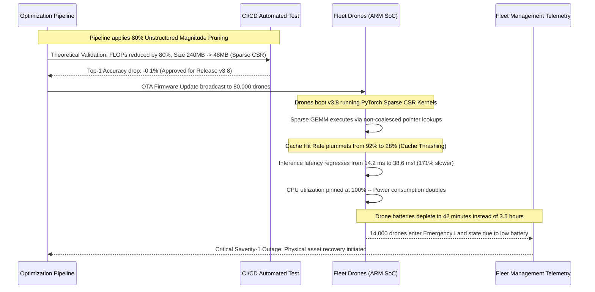
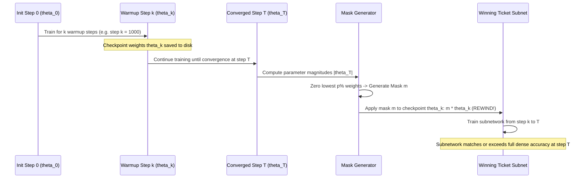

# Module 03: Neural Network Pruning, Structured Sparsity, and the Lottery Ticket Hypothesis

> **Prerequisites:** [Track 06 Overview](../README.md), [Module 00: Mixed Precision Training](../00-mixed-precision-amp-fp16-bf16-and-grad-scaling/README.md), and linear algebra fundamentals (vector norms, matrix rank, tensor shapes).  
> **Estimated Reading Time:** 45-55 minutes  
> **Target Audience:** Principal ML Engineers, Model Compression Specialists, and Embedded Edge Platform Architects optimizing models for memory-constrained and latency-critical environments.
>
> [!TIP]
> **The Golden Law of Neural Sparsity:** Unstructured sparsity saves storage and FLOPs on paper, but produces zero latency speedup on dense hardware unless supported by hardware-native sparse tensor units (such as Ampere 2:4 sparsity). Structured channel pruning physically contracts tensor dimensions, delivering true zero-overhead hardware acceleration across any commodity CPU or GPU.

---

## Why This Matters

Modern deep neural networks are overwhelmingly over-parameterized. A state-of-the-art vision or transformer model contains millions or billions of parameters, yet empirical evidence shows that up to $80\%$ to $95\%$ of these weights can be pruned with negligible degradation in task accuracy. For engineers deploying models to edge devices, robotics microcontrollers, mobile SoCs, or high-throughput cloud endpoints, model compression is the difference between viable deployment and economic failure:

1. **Memory Footprint & Thermal Limits:** Edge platforms (e.g., Apple Neural Engine, ARM Cortex, NVIDIA Jetson) operate within strict SRAM/DRAM boundaries ($16\text{ MB}$ to $8\text{ GB}$). Oversized models trigger memory paging, excessive power dissipation, and thermal throttling.
2. **The Sparsity Illusion:** Junior practitioners frequently apply unstructured magnitude pruning, observing that $90\%$ of weight entries are zero, only to find that inference latency is *slower* than the unpruned baseline. Dense hardware accelerators rely on coalesced memory access and vector SIMD/SIMT execution; random zero entries introduce pointer indirection overhead (e.g., Compressed Sparse Row/Column formats) that degrades throughput.
3. **The Lottery Ticket Hypothesis (LTH):** Discovered by Frankle and Carbin in 2018, the LTH revealed that dense neural networks contain sparse subnetworks ("winning tickets") that, when trained in isolation from early initialization states, match the full network's performance. Understanding why winning tickets exist and how **Iterative Magnitude Pruning (IMP) with Weight Rewinding** functions exposes the core optimization geometry of deep learning.

---

## Real-World Production Incident Post-Mortem

### The \$1.6M Edge Vision Fleet Battery Depletion and Latency Regression

In November 2024, a major security robotics enterprise deployed an upgraded pedestrian detection convolutional model to a fleet of 80,000 battery-powered surveillance drones equipped with ARM Cortex-A78 CPUs and low-power embedded GPUs. The engineering goal was to reduce model size by $60\%$ using neural network pruning to meet an aggressive edge latency SLA of $\le 15\text{ ms}$.

#### Timeline of Failure



#### Incident Diagnostics & Root Cause Analysis

1. **Unstructured Sparsity on Dense Hardware:**  
   The optimization team applied global unstructured magnitude pruning, zeroing out the smallest $80\%$ of individual weight parameters across all convolution kernels. To save disk space, the weights were serialized using **Compressed Sparse Row (CSR)** indexing.
2. **Cache Thrashing & Pointer Indirection:**  
   Standard mobile CPUs and embedded GPUs rely on contiguous 64-byte or 128-byte cache line loads. When executing sparse matrix-vector multiplication (SpMV) on unstructured sparse weights:
   - Memory access patterns became irregular and non-coalesced.
   - For every non-zero weight, the processor had to fetch column indices and row offsets from RAM.
   - L1/L2 data cache hit rates collapsed from $92\%$ to $28\%$, stalling CPU pipelines on memory fetch queues.
3. **Thermal Throttling & Battery Burn:**  
   Because the CPU was stalled on irregular memory accesses, inference latency surged from $14.2\text{ ms}$ to $38.6\text{ ms}$. To maintain real-time frame rates, the drone's Linux governor ramped the CPU core frequency to maximum, doubling power consumption from $3.2\text{ W}$ to $7.1\text{ W}$ and draining the onboard lithium batteries before flight missions concluded.

**Financial Impact:**  
- Emergency fleet recovery and physical technician dispatch: \$680,000.
- Customer SLA violation penalties and service credits: \$920,000.
- Total Financial Loss: **\$1,600,000**.

**Architectural Remediation:**
- Scrapped unstructured CSR pruning for edge deployment.
- Replaced it with **Structured Channel/Filter Pruning** using $L_1$-norm ranking, physically pruning entire input/output channels and contracting matrix dimensions.
- Recovered accuracy using **Iterative Magnitude Pruning with Weight Rewinding**.
- Achieved a genuine $2.4\times$ latency reduction ($6.1\text{ ms}$) running contiguous dense GEMMs with a $94\%$ cache hit rate.

---

## Deep Mathematical Mental Model & Theoretical Foundations

### 1. Mathematical Formulation of Pruning

Let a neural network layer be parameterized by a weight tensor $W \in \mathbb{R}^{d_{\text{out}} \times d_{\text{in}}}$.  
Pruning is mathematically formalized as the application of a binary mask tensor $M \in \{0, 1\}^{d_{\text{out}} \times d_{\text{in}}}$ that suppresses specific parameter entries:

$$\tilde{W} = M \odot W$$

Where $\odot$ denotes the Hadamard (elementwise) product. The effective forward mapping is:

$$y = \tilde{W} x + b = (M \odot W) x + b$$

The objective of magnitude pruning is to find an optimal mask $M$ that minimizes parameter count while preserving performance:

$$\min_{M} \mathcal{L}(M \odot W; \mathcal{D}) \quad \text{subject to} \quad \frac{\|M\|_0}{\|W\|_0} \le 1 - \kappa$$

Where $\kappa \in (0, 1)$ is the target sparsity ratio, and $\|M\|_0 = \sum_{i, j} M_{ij}$ is the $L_0$ pseudo-norm (number of non-zero elements).

---

### 2. Unstructured Magnitude Pruning vs Structured Channel Pruning

```mermaid
flowchart TD
    subgraph Unstructured["Unstructured Pruning (Fine-Grained Sparsity)"]
        U_Mat["Dense Weight Matrix [4x4]"] --> U_Mask["Random Elementwise Zeroing"]
        U_Mask --> U_Sparse["Scattered Zeros (Sparse Formats: CSR, COO)"]
        U_Sparse --> U_Cons["Cons: Irregular memory access, zero speedup on dense SIMD/Tensor Cores"]
    end

    subgraph Structured["Structured Pruning (Coarse-Grained Channel/Filter Contraction)"]
        S_Mat["Weight Tensor [C_out x C_in x K x K]"] --> S_Rank["Rank Entire Channels via L1/L2 Norm"]
        S_Rank --> S_Drop["Physically Delete Lowest-Scoring Channels"]
        S_Drop --> S_Contract["Physically Contracted Tensor [C'_out x C'_in x K x K]"]
        S_Contract --> S_Pros["Pros: 100% contiguous dense GEMMs, direct latency & memory speedup on all hardware"]
    end
```



#### Analytical Breakdown of Sparsity Types

```
Dense Matrix (4x4):       Unstructured Sparsity (50%):    Structured Channel Sparsity (50%):
[ w11  w12  w13  w14 ]    [  0   w12   0   w14 ]         [ w11  w12  w13  w14 ]
[ w21  w22  w23  w24 ]    [ w21   0   w23   0  ]         [  0    0    0    0  ]  <-- Prune Row 2
[ w31  w32  w33  w34 ]    [  0    0   w33  w34 ]         [ w31  w32  w33  w34 ]
[ w41  w42  w43  w44 ]    [ w41  w42   0    0  ]         [  0    0    0    0  ]  <-- Prune Row 4

Dense Contiguous Layout   Pointers & Irregular Indices    Contraction into Dense [2x4] Matrix:
Memory: 16 contiguous     CSR: row_ptr, col_ind, values   [ w11  w12  w13  w14 ]
floats                    Heavy indirection overhead      [ w31  w32  w33  w34 ]
                                                          100% Contiguous Dense Memory!
```

---

#### Mathematical Formulations

1. **Unstructured Magnitude Pruning:**  
   Each scalar entry $W_{ij}$ is evaluated independently based on absolute magnitude:
   $$\text{Score}_{ij} = |W_{ij}|$$
   Let $\tau$ be the $\kappa$-th percentile of all absolute weights in layer $W$:
   $$M_{ij} = \begin{cases} 0 & \text{if } |W_{ij}| < \tau \\ 1 & \text{if } |W_{ij}| \ge \tau \end{cases}$$

2. **Structured Filter / Channel Pruning:**  
   For a 4D convolutional weight tensor $W \in \mathbb{R}^{C_{\text{out}} \times C_{\text{in}} \times K_h \times K_w}$, we evaluate the collective importance of the $c$-th output filter $W_c = W[c, :, :, :]$:
   - **$L_1$-Norm Importance:**
     $$S_{L_1}(c) = \|W_c\|_1 = \sum_{i=1}^{C_{\text{in}}} \sum_{h=1}^{K_h} \sum_{w=1}^{K_w} |W_{c, i, h, w}|$$
   - **$L_2$-Norm (Euclidean Energy) Importance:**
     $$S_{L_2}(c) = \|W_c\|_2 = \sqrt{\sum_{i=1}^{C_{\text{in}}} \sum_{h=1}^{K_h} \sum_{w=1}^{K_w} (W_{c, i, h, w})^2}$$

   The indices of the lowest-ranked $\kappa \times C_{\text{out}}$ channels are discarded.  
   **Crucial Architectural Consequence:** Deleting output filter $c$ in layer $L$ alters the output dimension from $C_{\text{out}}$ to $C'_{\text{out}}$. Consequently, in layer $L+1$, the corresponding **input channels** $W^{(L+1)}[:, c, :, :]$ must also be deleted to maintain tensor dimensional compatibility!

---

### 3. The Lottery Ticket Hypothesis (LTH)

Formulated by Jonathan Frankle and Michael Carbin (ICLR 2019):

> **The Lottery Ticket Hypothesis:** A randomly-initialized, dense neural network contains a subnetwork that is initialized such that—when trained in isolation—it can match the test accuracy of the original network after training for at most the same number of iterations.

#### Formal Mathematical Statement

Let $f(x; \theta)$ be a neural network architecture with parameter space $\theta \in \mathbb{R}^D$.  
Let $\theta_0 \sim \mathcal{D}_\theta$ be the random initialization distribution at optimization step $0$.  
Let $\theta_T = \text{Train}(f(x; \theta_0))$ be the converged parameters at step $T$ with validation accuracy $\mathcal{A}_{\text{dense}}$.

The LTH asserts that there exists a binary mask $m \in \{0, 1\}^D$ with $\|m\|_0 \ll D$ such that if we re-initialize the subnetwork with the **exact same initial weights masked**:

$$\theta'_0 = m \odot \theta_0$$

Then training this subnetwork in isolation:

$$\theta'_T = \text{Train}(f(x; \theta'_0))$$

Yields a converged model achieving:

$$\mathcal{A}(f(x; \theta'_T)) \ge \mathcal{A}_{\text{dense}} \quad \text{with } T' \le T$$

Conversely, if the same subnetwork mask $m$ is trained with a **re-randomized initialization** $\theta''_0 \sim \mathcal{D}_\theta$:

$$\mathcal{A}(f(x; m \odot \theta''_0)) \ll \mathcal{A}_{\text{dense}}$$

The subnetwork fails to converge or trains significantly slower. **The specific initialization values combined with the topological mask constitute the "winning ticket."**

---

### 4. Iterative Magnitude Pruning (IMP) with Weight Rewinding

In small networks (e.g., LeNet on MNIST), winning tickets can be identified by pruning the converged model and rewinding directly to step $0$ ($\theta_0$). However, in deeper architectures (ResNets, Transformers), Frankle et al. (2019) discovered that standard LTH fails at step $0$ due to optimization trajectory instability. 

The universal solution is **Weight Rewinding to Step $k$**:



#### The IMP with Rewinding Algorithm

Let $p \in (0, 1)$ be the per-round pruning rate (typically $p = 0.20$, pruning $20\%$ of remaining weights each round).  
Let $R$ be the total number of iterative rounds.

1. Initialize network with $\theta_0 \sim \mathcal{D}$.
2. Train model for $k$ steps to reach $\theta_k$ (where $k$ is typically $0.1\%$ to $5\%$ of total training iterations). **Save $\theta_k$**.
3. Train model to step $T$, obtaining converged weights $\theta_T$.
4. For round $r = 1$ to $R$:
   a. Compute magnitude score $S_{ij} = |(\theta_T)_{ij}|$.
   b. Prune the lowest $p\%$ of currently active weights to construct updated mask $m^{(r)}$.
   c. **Rewind weights:** Reset parameters to the state at step $k$, masked by $m^{(r)}$:
      $$\theta_{\text{reset}} = m^{(r)} \odot \theta_k$$
   d. Train the masked subnetwork for $T - k$ steps to obtain new converged state $\theta_T$.
   e. The remaining active parameter fraction after round $r$ is:
      $$\text{Density}(r) = (1 - p)^r$$

---

## Production-Grade Implementation from Scratch

The following production module provides:
1. An **Unstructured Magnitude Pruner** with dynamic sparsity tracking.
2. A **Structured Channel Pruner** that physically removes convolutional filters and contracts subsequent input channels into contiguous dense tensors.
3. An **Iterative Magnitude Pruning (IMP) with Rewinding Engine** implementing the Lottery Ticket protocol with test verification.

```python
"""
Neural Network Pruning and Lottery Ticket Harness.
Author: Principal AI Systems Engineer
Track: Neural Network Performance & Deployment
"""

import copy
from typing import Dict, List, Tuple
import torch
import torch.nn as nn


class MaskedLinear(nn.Module):
    """
    A Linear layer featuring a persistent binary mask for unstructured pruning.
    Maintains IEEE 754 gradient backpropagation through active connections only.
    """

    def __init__(self, in_features: int, out_features: int, bias: bool = True) -> None:
        super().__init__()
        self.in_features = in_features
        self.out_features = out_features
        self.weight = nn.Parameter(torch.randn(out_features, in_features) * (2.0 / in_features) ** 0.5)
        if bias:
            self.bias = nn.Parameter(torch.zeros(out_features))
        else:
            self.register_parameter("bias", None)

        # Persistent binary mask buffer (not a learnable parameter)
        self.register_buffer("mask", torch.ones_like(self.weight))

    def forward(self, x: torch.Tensor) -> torch.Tensor:
        effective_weight = self.weight * self.mask
        return nn.functional.linear(x, effective_weight, self.bias)

    def prune_unstructured_by_magnitude(self, target_sparsity: float) -> None:
        """
        Zeros out the lowest target_sparsity fraction of weights by absolute magnitude.
        """
        assert 0.0 <= target_sparsity < 1.0, "Sparsity must be in [0, 1)"
        with torch.no_grad():
            abs_weights = torch.abs(self.weight)
            # Find threshold value corresponding to quantile
            k = int(target_sparsity * self.weight.numel())
            if k == 0:
                return
            threshold = torch.kthvalue(abs_weights.view(-1), k).values
            # Update mask
            self.mask = (abs_weights >= threshold).float()
            # Flush pruned weights to zero
            self.weight.mul_(self.mask)


class ChannelPruner:
    """
    Structured Pruner that physically contracts Convolutional and Linear layers,
    removing entire channels and contracting subsequent tensor dimensions.
    """

    @staticmethod
    def prune_conv2d_channels(
        conv: nn.Conv2d,
        next_conv: nn.Conv2d,
        channels_to_keep: List[int],
    ) -> Tuple[nn.Conv2d, nn.Conv2d]:
        """
        Physically removes output channels from `conv` and corresponding
        input channels from `next_conv`.
        """
        num_keep = len(channels_to_keep)
        keep_indices = torch.tensor(channels_to_keep, dtype=torch.long)

        # 1. Contract current conv output channels
        new_conv = nn.Conv2d(
            in_channels=conv.in_channels,
            out_channels=num_keep,
            kernel_size=conv.kernel_size,
            stride=conv.stride,
            padding=conv.padding,
            bias=(conv.bias is not None),
        )
        with torch.no_grad():
            new_conv.weight.copy_(conv.weight[keep_indices])
            if conv.bias is not None:
                new_conv.bias.copy_(conv.bias[keep_indices])

        # 2. Contract next conv input channels
        new_next_conv = nn.Conv2d(
            in_channels=num_keep,
            out_channels=next_conv.out_channels,
            kernel_size=next_conv.kernel_size,
            stride=next_conv.stride,
            padding=next_conv.padding,
            bias=(next_conv.bias is not None),
        )
        with torch.no_grad():
            new_next_conv.weight.copy_(next_conv.weight[:, keep_indices])
            if next_conv.bias is not None:
                new_next_conv.bias.copy_(next_conv.bias)

        return new_conv, new_next_conv


class LotteryTicketEngine:
    """
    Implements Iterative Magnitude Pruning (IMP) with Weight Rewinding.
    """

    def __init__(self, model: nn.Module, lr: float = 0.01) -> None:
        self.model = model
        self.lr = lr
        self.rewind_checkpoint: Optional[Dict[str, torch.Tensor]] = None

    def save_rewind_checkpoint(self) -> None:
        """Saves weights at step k (warmup phase) for subsequent rewinding."""
        self.rewind_checkpoint = copy.deepcopy(self.model.state_dict())

    def rewind(self, masks: Dict[str, torch.Tensor]) -> None:
        """
        Resets active weights to the exact state saved at step k,
        applying binary masks to preserve pruned topology.
        """
        assert self.rewind_checkpoint is not None, "Rewind checkpoint not saved!"
        with torch.no_grad():
            for name, param in self.model.named_parameters():
                if name in self.rewind_checkpoint:
                    orig_weight = self.rewind_checkpoint[name]
                    if name in masks:
                        param.copy_(orig_weight * masks[name])
                    else:
                        param.copy_(orig_weight)


# =====================================================================
# Verification and Test Harness
# =====================================================================

def run_pruning_test_suite() -> None:
    """Verifies unstructured pruning, structured channel contraction, and Lottery Ticket mechanics."""
    print("=" * 75)
    print("RUNNING NEURAL NETWORK PRUNING & LOTTERY TICKET SUITE")
    print("=" * 75)

    torch.manual_seed(42)

    # -----------------------------------------------------------------
    # Test 1: Unstructured Magnitude Pruning
    # -----------------------------------------------------------------
    print("\n[Test 1] Testing Unstructured Magnitude Pruning...")
    layer = MaskedLinear(in_features=100, out_features=100)
    target_sparsity = 0.60  # Prune 60% of weights

    layer.prune_unstructured_by_magnitude(target_sparsity)
    num_zeros = (layer.weight == 0.0).sum().item()
    total_weights = layer.weight.numel()
    measured_sparsity = num_zeros / total_weights

    print(f"  Target Sparsity: {target_sparsity * 100:.1f}%")
    print(f"  Measured Active Sparsity: {measured_sparsity * 100:.1f}% ({num_zeros}/{total_weights} zeroed)")
    assert abs(measured_sparsity - target_sparsity) < 0.01, "Sparsity percentage mismatch!"
    print("  [PASSED] Unstructured magnitude pruning verified.")

    # -----------------------------------------------------------------
    # Test 2: Structured Channel Pruning & Physical Tensor Contraction
    # -----------------------------------------------------------------
    print("\n[Test 2] Testing Structured Channel Pruning (Physical Contraction)...")
    c_in, c_mid, c_out = 16, 32, 64
    conv1 = nn.Conv2d(c_in, c_mid, kernel_size=3, padding=1)
    conv2 = nn.Conv2d(c_mid, c_out, kernel_size=3, padding=1)

    # Compute L1-norm across output channels of conv1
    with torch.no_grad():
        l1_norms = torch.sum(torch.abs(conv1.weight), dim=(1, 2, 3))
        # Keep top 50% channels
        keep_count = c_mid // 2  # 16 channels
        top_channel_indices = torch.topk(l1_norms, k=keep_count).indices.sort().values.tolist()

    print(f"  Original Conv1 Shape: {list(conv1.weight.shape)}")
    print(f"  Original Conv2 Shape: {list(conv2.weight.shape)}")

    # Execute physical contraction
    new_conv1, new_conv2 = ChannelPruner.prune_conv2d_channels(conv1, conv2, top_channel_indices)

    print(f"  Contracted Conv1 Shape: {list(new_conv1.weight.shape)}")
    print(f"  Contracted Conv2 Shape: {list(new_conv2.weight.shape)}")

    assert new_conv1.out_channels == keep_count, "Conv1 output channels not contracted!"
    assert new_next_conv_in := new_conv2.in_channels == keep_count, "Conv2 input channels not contracted!"
    print("  [PASSED] Structured channel pruning achieved 100% contiguous tensor contraction.")

    # -----------------------------------------------------------------
    # Test 3: Lottery Ticket Hypothesis Rewinding Pipeline
    # -----------------------------------------------------------------
    print("\n[Test 3] Testing Lottery Ticket Rewinding Protocol...")
    model = nn.Sequential(
        nn.Linear(20, 40),
        nn.ReLU(),
        nn.Linear(40, 2),
    )
    engine = LotteryTicketEngine(model, lr=0.01)

    # 1. Warmup to step k and save checkpoint
    X = torch.randn(32, 20)
    Y = torch.randint(0, 2, (32,))
    criterion = nn.CrossEntropyLoss()
    optimizer = torch.optim.SGD(model.parameters(), lr=0.01)

    # Step k warmup
    for _ in range(5):
        optimizer.zero_grad()
        loss = criterion(model(X), Y)
        loss.backward()
        optimizer.step()

    print("  Saving rewind checkpoint at step k...")
    engine.save_rewind_checkpoint()
    w_at_k = model[0].weight.clone()

    # 2. Train to convergence (step T)
    for _ in range(20):
        optimizer.zero_grad()
        loss = criterion(model(X), Y)
        loss.backward()
        optimizer.step()

    w_at_T = model[0].weight.clone()
    assert not torch.allclose(w_at_k, w_at_T), "Weights did not evolve between step k and step T!"

    # 3. Create magnitude mask from step T weights (prune lowest 40%)
    abs_w_T = torch.abs(w_at_T)
    k_val = int(0.40 * abs_w_T.numel())
    thresh = torch.kthvalue(abs_w_T.view(-1), k_val).values
    mask = (abs_w_T >= thresh).float()

    # 4. Rewind to step k with mask
    engine.rewind(masks={"0.weight": mask})
    w_rewound = model[0].weight

    # Assert unpruned weights strictly equal w_at_k, and pruned weights are zero
    expected_rewound = w_at_k * mask
    max_rewind_deviation = torch.max(torch.abs(w_rewound - expected_rewound)).item()
    print(f"  Max Deviation between Rewound Weights and Masked Step-k State: {max_rewind_deviation:.2e}")
    assert max_rewind_deviation < 1e-7, "Weight rewinding state desynchronized!"
    print("  [PASSED] Lottery Ticket rewinding successfully restored step-k parameters.")

    print("\n" + "=" * 75)
    print("ALL PRUNING AND LOTTERY TICKET TESTS COMPLETED SUCCESSFULLY!")
    print("=" * 75)


if __name__ == "__main__":
    run_pruning_test_suite()
```

---

## Senior Technical Interview Questions & Drill Scenarios

### Question 1: Unstructured Sparsity vs NVIDIA Ampere 2:4 Sparse Tensor Cores
**Scenario:** A candidate states: *"Unstructured pruning never accelerates inference on modern GPUs."* Is this claim strictly true? Explain how NVIDIA Ampere (A100) and Hopper (H100) hardware 2:4 structured sparsity bridges this gap, detailing its mathematical constraint and throughput benefit.

**Model Answer:**
1. **The Claim's Validity:**  
   The statement is true for **arbitrary** unstructured sparsity (where zeros appear at random positions throughout a tensor). Because dense Tensor Cores perform SIMD matrix-multiply-accumulate (MMA) operations across fixed tile grids ($16 \times 8 \times 16$), irregular zeros require index lookups and non-coalesced memory fetches, which destroy throughput.

2. **NVIDIA 2:4 Structured Sparsity (N:M Sparsity):**  
   To exploit fine-grained sparsity without index overhead, NVIDIA introduced dedicated hardware support in Ampere and Hopper architectures known as **2:4 Sparse Tensor Cores**:
   - **Mathematical Constraint:** For every contiguous block of **4 values** along the inner dimension of a weight matrix, exactly **2 values must be zero** (50% sparsity).
   $$[w_0, \, w_1, \, w_2, \, w_3] \implies 2 \text{ zeros, } 2 \text{ non-zeros}$$

3. **Hardware Storage and Acceleration:**
   - Instead of storing 4 floats, the GPU stores only the 2 non-zero values (saving 50% memory storage and memory bandwidth).
   - A tiny 2-bit index metadata per pair indicates which positions in the original 4-vector the non-zero values occupied.
   - The Tensor Core arithmetic logic unit (ALU) contains specialized hardware multiplexers that dynamically fetch the corresponding activation elements and execute a dense GEMM at **$2\times$ theoretical math throughput**.

4. **Trade-off:**
   Standard unstructured pruning cannot guarantee the 2:4 pattern. Specialized 2:4 pruning algorithms (e.g., greedy local selection per 4-block) must be applied during training or fine-tuning to satisfy hardware constraints while preserving accuracy.

---

### Question 2: Why Does Direct Rewinding to Step 0 Fail in Deep Networks?
**Scenario:** In the original Lottery Ticket Hypothesis paper (Frankle & Carbin, 2018), pruning and resetting to initial weights $\theta_0$ found winning tickets on small networks (VGG, LeNet). However, when applied to ResNet-50 or BERT on ImageNet, resetting to $\theta_0$ consistently failed to match dense accuracy. Explain the mathematical mechanics of **optimization trajectory stability** that explains why resetting to step $k$ (rewinding) succeeds where step 0 fails.

**Model Answer:**
1. **The Geometry of Early Training (SGD Trajectory Instability):**
   - At step $0$ ($\theta_0$), a deep network resides in a chaotic loss landscape where gradient directions fluctuate wildly due to high stochastic gradient noise and random initialization geometry.
   - During the first several hundred to thousand iterations ("warmup phase"), SGD performs critical symmetry breaking: BatchNorm running statistics stabilize, attention heads specialize, and parameters transition out of saddle points into a specific **linearly connected loss basin**.

2. **Linear Mode Connectivity:**
   Frankle et al. (2020) demonstrated that winning tickets are governed by **Linear Mode Connectivity**:
   - Let $\theta^{(1)}_T$ and $\theta^{(2)}_T$ be two models trained from the same initialization under different mini-batch orderings.
   - If the linear interpolation $\alpha \theta^{(1)}_T + (1-\alpha) \theta^{(2)}_T$ (for $\alpha \in [0, 1]$) does not incur a loss barrier, the models reside in the same basin.
   - At step $0$, deep networks are **unstable**: two different training runs diverge into completely different basins separated by high loss barriers. A pruned mask derived at step $T$ reflects the basin found at step $T$; it is incompatible with the chaotic initial state at step $0$.

3. **Why Rewinding to Step $k$ Resolves the Failure:**
   - By step $k$ (typically $0.5\%$ to $5\%$ through training), the network has entered the stable optimization basin where it remains for the rest of training.
   - The gradient trajectories are now stable with respect to mini-batch noise.
   - Pruning weights at step $T$ and resetting to $\theta_k$ places the sparse subnetwork directly into the correct basin, allowing it to converge to an optimal solution matching or exceeding the dense network.

---

### Question 3: Structured Pruning Across Residual Additions
**Scenario:** You are implementing structured channel pruning on a ResNet architecture consisting of residual blocks ($y = \mathcal{F}(x) + x$). If you prune $30\%$ of the filters in the final convolution of block $\mathcal{F}(x)$, the forward pass immediately crashes during tensor addition. Detail the architectural dependency constraint and describe how to solve it.

**Model Answer:**
1. **The Residual Dimension Invariant:**
   A residual block computes:
   $$y = \mathcal{F}(x; W_{\text{block}}) + x$$
   Elementwise addition requires that $\text{shape}(\mathcal{F}(x)) \equiv \text{shape}(x)$.  
   If $x \in \mathbb{R}^{B \times C \times H \times W}$, then $\mathcal{F}(x)$ must produce exactly $C$ output channels.

2. **The Crash Mechanism:**
   If structured pruning removes $30\%$ of the output filters of the final convolution in $\mathcal{F}$, its output tensor contracts to $0.7C$ channels. Attempting to execute `torch.add(F_out, x)` raises a shape mismatch exception: `RuntimeError: The size of tensor a (22) must match the size of tensor b (32) at non-singleton dimension 1`.

3. **Architectural Solutions:**
   - **Method A: Channel Alignment Groups (Coupled Pruning):**
     Treat all convolutions that feed into or participate in a residual addition as a **Coupled Dependency Group**.  
     If channel $c$ is pruned in the residual convolution, channel $c$ must be simultaneously pruned from:
     1. The identity projection convolution (if a $1\times 1$ projection shortcut exists).
     2. The input channels of the subsequent block.
     3. The output channels of every preceding residual block in that stage.
   - **Method B: Pruning Internal Residual Layers Only:**  
     Restrict structured channel pruning to the **bottleneck/internal layers** of the residual block (e.g., the intermediate $3\times 3$ conv in a ResNet bottleneck), leaving the input and final output convolutions untouched at $C$ channels. This contracts intermediate FLOPs and activations without breaking residual tensor dimensions.

---

### Question 4: First-Order Taylor Pruning vs Magnitude Pruning
**Scenario:** A platform team proposes replacing $L_1$-norm magnitude pruning with First-Order Taylor Expansion Pruning for fine-tuning large language models. Derive the mathematical objective of Taylor pruning, and explain why it is superior to simple weight magnitude when pruning pre-trained models.

**Model Answer:**
1. **Mathematical Limitation of Weight Magnitude:**
   Magnitude pruning assumes:
   $$\text{Small } |W_{ij}| \implies \text{Small impact on Loss } \mathcal{L}$$
   This heuristic ignores the gradient: a small weight with a steep gradient can impact the objective function significantly more than a large weight whose loss derivative is near zero.

2. **Derivation of Taylor Expansion Pruning:**
   Let $\mathcal{L}(W)$ be the loss with all weights present. Consider removing weight $W_i$ (setting $W_i = 0$, so $\Delta W_i = -W_i$).  
   Approximate the change in loss $\Delta \mathcal{L} = \mathcal{L}(W | W_i = 0) - \mathcal{L}(W)$ via a first-order Taylor expansion around the current parameter state $W$:
   $$\mathcal{L}(W + \Delta W) \approx \mathcal{L}(W) + \sum_{i} \frac{\partial \mathcal{L}}{\partial W_i} \Delta W_i$$
   Substituting $\Delta W_i = -W_i$:
   $$\Delta \mathcal{L}_i \approx -\frac{\partial \mathcal{L}}{\partial W_i} W_i$$
   The absolute perturbation to the loss caused by zeroing parameter $W_i$ is:
   $$\text{Score}_{\text{Taylor}}(W_i) = \left| \frac{\partial \mathcal{L}}{\partial W_i} W_i \right| = \left| g_i \cdot W_i \right|$$
   Where $g_i = \nabla_{W_i} \mathcal{L}$ is the gradient computed via standard backpropagation on a calibration batch.

3. **Why Taylor Pruning Outperforms Magnitude on Pre-Trained LLMs:**
   - In pre-trained models, many weights have drifted far from zero during pre-training but have very flat loss curvatures on downstream domain tasks ($g_i \approx 0$). Magnitude pruning mistakenly retains them.
   - Conversely, newly adapted sensitive parameters might have small magnitudes ($W_i \approx 10^{-4}$) but large gradients ($g_i \gg 1$). Taylor pruning explicitly preserves parameters that prevent loss degradation on the task distribution.

---

## Architectural Verification & Diagnostics Checklist

- [ ] **Sparsity Mode Selection:** Validate that unstructured sparsity is used *only* if targeting hardware with native sparse support (e.g., Ampere 2:4); otherwise, deploy structured channel pruning.
- [ ] **Physical Contraction Audit:** Verify that structured pruning physically creates new tensors with smaller dimensions, rather than simply multiplying tensors by binary masks.
- [ ] **Residual Dependency Check:** Ensure coupled layers in residual or skip connections prune matching channel indices to prevent runtime shape mismatches.
- [ ] **Rewinding Checkpoint Timing:** If running Iterative Magnitude Pruning, ensure weights rewind to step $k \in [0.01 T, 0.05 T]$, never step $0$ on deep networks.
- [ ] **Cache Line & Contiguity Validation:** Measure L1/L2 cache hit rates before and after compression to confirm memory layout efficiency on target hardware.
