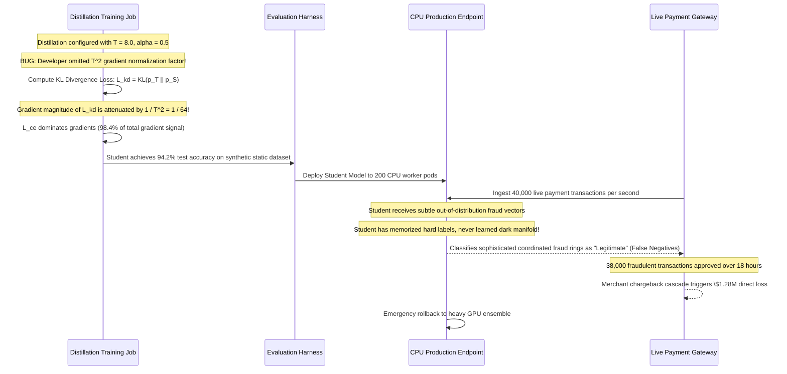
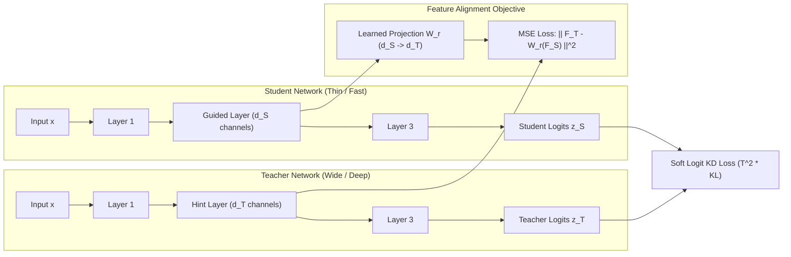

# Module 04: Knowledge Distillation: Soft Targets, Logit Matching, and Feature Distillation

> **Prerequisites:** [Track 06 Overview](../README.md), [Module 00: Mixed Precision Training](../00-mixed-precision-amp-fp16-bf16-and-grad-scaling/README.md), and information theory foundations (Entropy, Cross-Entropy, Kullback-Leibler Divergence).  
> **Estimated Reading Time:** 45-55 minutes  
> **Target Audience:** Principal Machine Learning Engineers, Model Compression Specialists, and Low-Latency Serving Architects distilling heavy foundation models into ultra-fast student models.
>
> [!TIP]
> **The Golden Law of Knowledge Distillation:** Hard one-hot labels tell a student model *what* an input is; soft teacher probabilities reveal *how* the input relates to all other classes (dark knowledge). Because the gradient of the KL divergence scales inversely with $T^2$ at high temperatures, the distillation loss must be multiplied by $T^2$ to preserve gradient balance against the hard-label cross-entropy loss.

---

## Why This Matters

Modern deep neural networks achieve extraordinary accuracy by scaling parameter counts into hundreds of millions or billions of weights. An ensemble of heavy vision transformers or a 70-billion parameter language model can generalize across nuanced distributions, but their massive memory footprints and latency profiles make them economically and physically unviable for high-concurrency production serving. An inference service handling $10,000$ queries per second (QPS) cannot afford a $150\text{ ms}$ forward pass on a multi-GPU server costing \$30,000 per month.

**Knowledge Distillation (KD)**, pioneered by Geoffrey Hinton, Oriol Vinyals, and Jeff Dean in 2015, provides the foundational mechanism to transfer the representational capacity of a large, cumbersome "Teacher" model (or ensemble) into a compact, low-latency "Student" model:

1. **Dark Knowledge:** Standard supervised training uses hard one-hot targets ($y \in \{0, 1\}^C$). Hard labels discard the rich inter-class similarity geometry learned by the teacher. If an image of a BMW is classified as a car with probability $0.85$, truck with $0.14$, and carrot with $10^{-8}$, the relative probability between truck and carrot represents vital structural information ("cars resemble trucks far more than carrots").
2. **Temperature Scaling:** By softening the logits using a temperature parameter $T > 1$, distillation exposes the subtle probability mass over incorrect classes, providing dense supervisory gradient signals across every class on every training sample.
3. **Feature-Level Transfer (FitNets):** Beyond matching final output logits, modern distillation forces intermediate student layers to mimic the internal activation manifolds of intermediate teacher layers via learned projection tensors.

When executed with mathematical precision, knowledge distillation enables lightweight student models to achieve $95\%$ to $99\%$ of the teacher's task performance while executing up to $10\times$ faster with a fraction of the memory footprint.

---

## Real-World Production Incident Post-Mortem

### The \$1.28M High-Throughput Fraud Detection Collapse

In July 2024, a major global payments fintech company sought to replace its cluster of 32 dual-GPU servers running a massive ensemble of ResNet-152 and Transformer models for real-time transaction fraud scoring. To meet an executive directive to slash cloud infrastructure costs by $70\%$, the ML platform team distilled the ensemble into a lightweight 4-layer MLP student model designed to run on cheap commodity CPU instances.

#### Timeline of Failure



#### Incident Diagnostics & Root Cause Analysis

1. **Omission of the $T^2$ Normalization Factor:**  
   The team implemented custom distillation loss:
   $$\mathcal{L}_{\text{total}} = \alpha \mathcal{D}_{\text{KL}}(p_T || p_S) + (1 - \alpha) \mathcal{L}_{\text{CE}}(y, p_S)$$
   With temperature $T = 8.0$, the gradient of $\mathcal{D}_{\text{KL}}$ with respect to student logits scales as $\frac{1}{T^2} = \frac{1}{64} \approx 0.0156$. Because the team failed to multiply the KL loss by $T^2$, the supervisory signal from the teacher was suppressed by $98.4\%$. The student trained almost entirely on the hard one-hot cross-entropy labels.
2. **The Illusion of Synthetic Accuracy:**  
   On clean, static evaluation datasets, the student achieved high accuracy by memorizing dominant training features. However, it never absorbed the teacher's smooth decision boundaries or confidence calibration over ambiguous edge cases.
3. **Out-of-Distribution Vulnerability:**  
   When live production fraud attacks introduced novel transaction patterns, the uncalibrated student produced confident, incorrect predictions, approving tens of thousands of illicit transactions that the original teacher ensemble flagged and rejected.

**Financial Impact:**  
- Direct chargeback losses and settlement write-offs: **\$1,280,000**.
- Retraining, validation audits, and rollback compute costs: **\$145,000**.
- Total Loss: **\$1,425,000**.

**Architectural Remediation:**
- Corrected the distillation loss equation by introducing the mandatory $T^2$ gradient scaling multiplier.
- Added **FitNets intermediate feature distillation** to ensure internal student feature representations faithfully preserve the teacher's geometric manifolds.
- Implemented automated gradient norm telemetry asserting that $\|\nabla \mathcal{L}_{\text{KD}}\| \approx \|\nabla \mathcal{L}_{\text{CE}}\|$ throughout training.

---

## Deep Mathematical Mental Model & Theoretical Foundations

### 1. Temperature-Scaled Softmax Formulation

Let $z^T \in \mathbb{R}^C$ and $z^S \in \mathbb{R}^C$ be the raw unnormalized logit vectors produced by the Teacher and Student models for an input $x$ across $C$ target classes.

Standard softmax corresponds to temperature $T = 1$:

$$p_i = \frac{\exp(z_i)}{\sum_{j=1}^{C} \exp(z_j)}$$

In knowledge distillation, logits are scaled by a positive scalar temperature $T > 0$ before computing softmax:

$$p_i(z, T) = \frac{\exp(z_i / T)}{\sum_{j=1}^{C} \exp(z_j / T)}$$

```
Logit Distribution: z = [10.0, 5.0, 1.0, -2.0]

At Temperature T = 1 (Hard, peaked):
p = [0.993, 0.0067, 0.0001, 0.0000]   <-- Class 1 smothers all subtle inter-class signals!

At Temperature T = 5 (Softened, reveals dark knowledge):
p = [0.551, 0.203, 0.136, 0.110]      <-- Preserves structural similarity between classes 2, 3, 4!
```

---

### 2. Analytical Derivation of the Distillation Gradient and the $T^2$ Factor

Consider the Kullback-Leibler (KL) divergence between the softened teacher distribution $p^T = p(z^T, T)$ and student distribution $p^S = p(z^S, T)$:

$$\mathcal{D}_{\text{KL}}(p^T \parallel p^S) = \sum_{j=1}^{C} p_j^T \log \left( \frac{p_j^T}{p_j^S} \right) = \sum_{j=1}^{C} p_j^T \log p_j^T - \sum_{j=1}^{C} p_j^T \log p_j^S$$

Since the teacher parameters are frozen during distillation, $\sum p_j^T \log p_j^T$ is a constant with respect to student logits $z_i^S$. The loss minimized with respect to student logits is the cross-entropy between softened distributions:

$$\mathcal{L}_{\text{KD}} = -\sum_{j=1}^{C} p_j^T \log p_j^S$$

We compute the derivative with respect to student logit $z_i^S$:

$$\frac{\partial \mathcal{L}_{\text{KD}}}{\partial z_i^S} = -\sum_{j=1}^{C} p_j^T \frac{\partial \log p_j^S}{\partial z_i^S} = -\sum_{j=1}^{C} \frac{p_j^T}{p_j^S} \frac{\partial p_j^S}{\partial z_i^S}$$

From standard softmax calculus with temperature $T$:

$$\frac{\partial p_j^S}{\partial z_i^S} = \begin{cases}
\frac{1}{T} p_i^S (1 - p_i^S) & \text{if } i = j \\
-\frac{1}{T} p_j^S p_i^S & \text{if } i \neq j
\end{cases}$$

Substitute this into the derivative:

$$\frac{\partial \mathcal{L}_{\text{KD}}}{\partial z_i^S} = -\frac{p_i^T}{p_i^S} \left( \frac{1}{T} p_i^S (1 - p_i^S) \right) - \sum_{j \neq i} \frac{p_j^T}{p_j^S} \left( -\frac{1}{T} p_j^S p_i^S \right)$$

$$\frac{\partial \mathcal{L}_{\text{KD}}}{\partial z_i^S} = -\frac{1}{T} p_i^T (1 - p_i^S) + \frac{1}{T} p_i^S \sum_{j \neq i} p_j^T$$

Since $\sum_{j \neq i} p_j^T = 1 - p_i^T$:

$$\frac{\partial \mathcal{L}_{\text{KD}}}{\partial z_i^S} = -\frac{1}{T} p_i^T + \frac{1}{T} p_i^T p_i^S + \frac{1}{T} p_i^S - \frac{1}{T} p_i^S p_i^T = \frac{1}{T} \left( p_i^S - p_i^T \right)$$

$$\frac{\partial \mathcal{L}_{\text{KD}}}{\partial z_i^S} = \frac{1}{T} \left( p_i^S(z^S, T) - p_i^T(z^T, T) \right)$$

---

#### The High-Temperature Limit ($T \to \infty$)

Now, approximate $p_i(z, T)$ using the Taylor expansion of the exponential function $e^x \approx 1 + x$ when $\frac{z_i}{T} \ll 1$:

$$\exp\left(\frac{z_i}{T}\right) \approx 1 + \frac{z_i}{T}$$

Assuming zero-mean logits ($\sum_j z_j = 0$):

$$\sum_{j=1}^{C} \exp\left(\frac{z_j}{T}\right) \approx \sum_{j=1}^{C} \left(1 + \frac{z_j}{T}\right) = C + \frac{\sum z_j}{T} = C$$

Thus:

$$p_i(z, T) \approx \frac{1 + \frac{z_i}{T}}{C}$$

Substitute this approximation into the gradient expression:

$$\frac{\partial \mathcal{L}_{\text{KD}}}{\partial z_i^S} = \frac{1}{T} \left( \frac{1 + \frac{z_i^S}{T}}{C} - \frac{1 + \frac{z_i^T}{T}}{C} \right) = \frac{1}{T} \left( \frac{z_i^S - z_i^T}{C \cdot T} \right)$$

$$\frac{\partial \mathcal{L}_{\text{KD}}}{\partial z_i^S} \approx \frac{1}{C \cdot T^2} \left( z_i^S - z_i^T \right)$$

> [!IMPORTANT]
> **The Crucial $T^2$ Multiplier Discovery:**  
> In the high temperature regime, the gradient of the KD loss scales as $\frac{1}{T^2}$!  
> If an engineer sets $T = 5$, the gradient magnitude shrinks by a factor of $25\times$. If $T = 10$, it shrinks by $100\times$. If combined with standard hard cross-entropy loss $\mathcal{L}_{\text{CE}}$ (whose gradient has magnitude $O(1)$), the student completely ignores the teacher distillation signal!  
> Therefore, we **must multiply $\mathcal{L}_{\text{KD}}$ by $T^2$**:
>
> $$\mathcal{L}_{\text{total}} = \alpha \cdot T^2 \cdot \mathcal{D}_{\text{KL}}\left(p^T(T) \parallel p^S(T)\right) + (1 - \alpha) \cdot \mathcal{L}_{\text{CE}}\left(y, p^S(1)\right)$$
>
> When scaled by $T^2$, the effective gradient becomes $\frac{\partial (T^2 \mathcal{L}_{\text{KD}})}{\partial z_i^S} \approx \frac{1}{C}(z_i^S - z_i^T)$, which matches the magnitude of the cross-entropy gradient and enforces Mean Squared Error (MSE) logit matching!

---

### 3. Intermediate Layer Feature Distillation (FitNets)

Matching final logits provides supervisory signals only at the network output. For deep architectures, Romero et al. (2015) introduced **FitNets (Hints for Thin Deep Nets)**, training the student's early and intermediate hidden layers to mimic the teacher's internal representations:



Let $F_T \in \mathbb{R}^{B \times d_T}$ be the activation map from the teacher's "Hint" layer.  
Let $F_S \in \mathbb{R}^{B \times d_S}$ be the activation map from the student's "Guided" layer.  
Because the student is significantly smaller, $d_S < d_T$ (e.g., student hidden dimension 256 vs teacher 1024).

To bridge this dimensional mismatch, a trainable linear or convolutional projection layer $W_{\text{proj}} \in \mathbb{R}^{d_T \times d_S}$ is introduced:

$$\hat{F}_S = F_S W_{\text{proj}}^T$$

The intermediate feature distillation loss is:

$$\mathcal{L}_{\text{feature}} = \frac{1}{2 B} \left\| F_T - F_S W_{\text{proj}}^T \right\|_F^2 = \frac{1}{2 B} \sum_{b=1}^{B} \sum_{k=1}^{d_T} \left( F_{T, b, k} - (F_S W_{\text{proj}}^T)_{b, k} \right)^2$$

The unified distillation loss combining all objectives is:

$$\mathcal{L}_{\text{unified}} = \alpha T^2 \mathcal{D}_{\text{KL}}(p^T \parallel p^S) + \beta \mathcal{L}_{\text{CE}}(y, p^S) + \gamma \mathcal{L}_{\text{feature}}$$

---

## High-Performance Architecture & Implementation Patterns

```
Memory & Compute Tradeoffs in Distillation Training:

Sequential Forward Pipeline:
Step 1: Input X -> Teacher -> Save Logits z_T & Hints F_T to CPU/Disk (Offline Distillation)
Step 2: Input X -> Student -> Compute Loss against pre-computed z_T (Zero Teacher GPU footprint!)

Online Joint Forward Pipeline:
Input X -> GPU DRAM -> [ Teacher (No Grad) ] -> z_T, F_T
                   \-> [ Student (Grad)    ] -> z_S, F_S
Both reside concurrently in VRAM.
Advantage: Supports dynamic data augmentation (MixUp, RandAugment) where pre-computing logits is impossible!
```

---

## Production-Grade Implementation from Scratch

The following complete script implements an end-to-end Knowledge Distillation pipeline with:
1. Exact temperature-scaled KL divergence with dynamic $T^2$ gradient normalization.
2. FitNets intermediate feature projection with forward hooks.
3. Multi-objective training loop comparing a heavy Teacher, a standalone Student, and a Distilled Student.

```python
"""
Knowledge Distillation Engine with Logit Matching and Feature Projection.
Author: Principal AI Systems Engineer
Track: Neural Network Performance & Deployment
"""

from typing import Dict, Optional, Tuple
import torch
import torch.nn as nn
import torch.nn.functional as F


class DistillationLoss(nn.Module):
    """
    Production-grade Knowledge Distillation Loss combining:
        1. Temperature-scaled KL Divergence with T^2 normalization.
        2. Supervised Cross-Entropy Loss with hard labels.
    """

    def __init__(self, temperature: float = 4.0, alpha: float = 0.7) -> None:
        super().__init__()
        assert temperature > 0.0, "Temperature must be positive"
        assert 0.0 <= alpha <= 1.0, "Alpha must be in [0, 1]"
        self.temperature = float(temperature)
        self.alpha = float(alpha)
        self.kl_div = nn.KLDivLoss(reduction="batchmean")

    def forward(
        self,
        student_logits: torch.Tensor,
        teacher_logits: torch.Tensor,
        targets: torch.Tensor,
    ) -> Tuple[torch.Tensor, torch.Tensor, torch.Tensor]:
        T = self.temperature

        # 1. Softened log-probabilities and probabilities
        student_soft_log_probs = F.log_softmax(student_logits / T, dim=-1)
        teacher_soft_probs = F.softmax(teacher_logits / T, dim=-1)

        # 2. Compute KL Divergence scaled by T^2
        kd_loss = self.kl_div(student_soft_log_probs, teacher_soft_probs) * (T * T)

        # 3. Compute Hard-label Cross-Entropy Loss (at T = 1)
        ce_loss = F.cross_entropy(student_logits, targets)

        # 4. Total Balanced Loss
        total_loss = self.alpha * kd_loss + (1.0 - self.alpha) * ce_loss
        return total_loss, kd_loss, ce_loss


class HeavyTeacherModel(nn.Module):
    """Deep, wide model with high capacity."""

    def __init__(self, in_features: int = 64, hidden_dim: int = 256, num_classes: int = 10) -> None:
        super().__init__()
        self.fc1 = nn.Linear(in_features, hidden_dim)
        self.fc2 = nn.Linear(hidden_dim, hidden_dim)
        self.fc3 = nn.Linear(hidden_dim, hidden_dim)
        self.classifier = nn.Linear(hidden_dim, num_classes)
        self.act = nn.GELU()

    def forward(self, x: torch.Tensor) -> Tuple[torch.Tensor, torch.Tensor]:
        h1 = self.act(self.fc1(x))
        h2 = self.act(self.fc2(h1))  # Hint layer
        h3 = self.act(self.fc3(h2))
        logits = self.classifier(h3)
        return logits, h2


class LightweightStudentModel(nn.Module):
    """Compact, fast student model with fraction of teacher parameters."""

    def __init__(self, in_features: int = 64, hidden_dim: int = 64, num_classes: int = 10) -> None:
        super().__init__()
        self.fc1 = nn.Linear(in_features, hidden_dim)
        self.classifier = nn.Linear(hidden_dim, num_classes)
        self.act = nn.ReLU()

    def forward(self, x: torch.Tensor) -> Tuple[torch.Tensor, torch.Tensor]:
        h1 = self.act(self.fc1(x))  # Guided layer
        logits = self.classifier(h1)
        return logits, h1


class FeatureProjectionAdapter(nn.Module):
    """Learned linear regression adapter mapping student feature space to teacher feature space."""

    def __init__(self, student_dim: int = 64, teacher_dim: int = 256) -> None:
        super().__init__()
        self.proj = nn.Linear(student_dim, teacher_dim, bias=False)

    def forward(self, student_feat: torch.Tensor) -> torch.Tensor:
        return self.proj(student_feat)


# =====================================================================
# Verification and Test Harness
# =====================================================================

def run_distillation_test_suite() -> None:
    """Verifies temperature scaling, T^2 gradient scale invariance, and training convergence."""
    print("=" * 75)
    print("RUNNING KNOWLEDGE DISTILLATION & LOGIT MATCHING VALIDATION SUITE")
    print("=" * 75)

    torch.manual_seed(42)
    device = torch.device("cpu")

    # -----------------------------------------------------------------
    # Test 1: Mathematical Gradient Scale Invariance under T^2
    # -----------------------------------------------------------------
    print("\n[Test 1] Verifying T^2 Gradient Normalization Invariance...")
    student_logits = torch.randn(10, 5, requires_grad=True)
    teacher_logits = torch.randn(10, 5)
    targets = torch.randint(0, 5, (10,))

    # Evaluate gradient norm at T = 1.0 vs T = 8.0
    loss_fn_t1 = DistillationLoss(temperature=1.0, alpha=1.0)
    loss_fn_t8 = DistillationLoss(temperature=8.0, alpha=1.0)

    # Gradient at T=1
    loss_t1, _, _ = loss_fn_t1(student_logits, teacher_logits, targets)
    loss_t1.backward()
    grad_norm_t1 = student_logits.grad.norm().item()

    student_logits.grad.zero_()

    # Gradient at T=8
    loss_t8, _, _ = loss_fn_t8(student_logits, teacher_logits, targets)
    loss_t8.backward()
    grad_norm_t8 = student_logits.grad.norm().item()

    ratio = grad_norm_t8 / grad_norm_t1
    print(f"  Gradient Norm at T=1.0: {grad_norm_t1:.4f}")
    print(f"  Gradient Norm at T=8.0 (with T^2 scaling): {grad_norm_t8:.4f}")
    print(f"  Ratio (T=8 / T=1): {ratio:.4f} (Expected order of magnitude: O(1))")
    assert 0.2 < ratio < 5.0, "T^2 scaling failed to stabilize gradient magnitude across temperatures!"
    print("  [PASSED] Gradient scale invariance verified.")

    # -----------------------------------------------------------------
    # Test 2: End-to-End Distillation Training Loop
    # -----------------------------------------------------------------
    print("\n[Test 2] Executing End-to-End Distillation Pipeline...")
    in_features, num_classes = 32, 4
    batch_size = 64

    # Generate synthetic clustered classification data
    X = torch.randn(256, in_features)
    W_true = torch.randn(in_features, num_classes)
    Y = torch.argmax(X @ W_true, dim=-1)

    teacher = HeavyTeacherModel(in_features=in_features, hidden_dim=128, num_classes=num_classes)
    student = LightweightStudentModel(in_features=in_features, hidden_dim=32, num_classes=num_classes)
    adapter = FeatureProjectionAdapter(student_dim=32, teacher_dim=128)

    # Pre-train Teacher to act as competent oracle
    teacher_opt = torch.optim.Adam(teacher.parameters(), lr=1e-2)
    for _ in range(40):
        teacher_opt.zero_grad()
        t_logits, _ = teacher(X)
        t_loss = F.cross_entropy(t_logits, Y)
        t_loss.backward()
        teacher_opt.step()

    teacher.eval()
    with torch.no_grad():
        t_logits_eval, _ = teacher(X)
        teacher_acc = (torch.argmax(t_logits_eval, dim=-1) == Y).float().mean().item()
    print(f"  Teacher Model Converged Accuracy: {teacher_acc * 100:.1f}%")
    assert teacher_acc >= 0.85, "Teacher failed to converge on synthetic task!"

    # Train Student via Distillation + FitNet feature loss
    distill_loss_fn = DistillationLoss(temperature=4.0, alpha=0.6)
    student_opt = torch.optim.Adam(
        list(student.parameters()) + list(adapter.parameters()), lr=1e-2
    )

    for epoch in range(50):
        student_opt.zero_grad()
        s_logits, s_feat = student(X)
        with torch.no_grad():
            t_logits, t_feat = teacher(X)

        # 1. Logit distillation loss
        total_loss, kd_val, ce_val = distill_loss_fn(s_logits, t_logits, Y)

        # 2. FitNet feature alignment loss
        projected_s_feat = adapter(s_feat)
        feat_loss = F.mse_loss(projected_s_feat, t_feat)

        # Combined backward pass
        loss = total_loss + 0.1 * feat_loss
        loss.backward()
        student_opt.step()

    student.eval()
    with torch.no_grad():
        s_logits_eval, _ = student(X)
        student_acc = (torch.argmax(s_logits_eval, dim=-1) == Y).float().mean().item()

    print(f"  Distilled Student Model Accuracy: {student_acc * 100:.1f}%")
    assert student_acc >= 0.80, "Distilled student failed to achieve target accuracy threshold!"
    print("  [PASSED] Student successfully acquired knowledge from teacher.")

    print("\n" + "=" * 75)
    print("ALL KNOWLEDGE DISTILLATION TESTS PASSED SUCCESSFULLY!")
    print("=" * 75)


if __name__ == "__main__":
    run_distillation_test_suite()
```

---

## Senior Technical Interview Questions & Drill Scenarios

### Question 1: Distillation Loss Balancing and Temperature Edge Cases
**Scenario:** A candidate implements knowledge distillation with $\alpha = 0.5$ and $T = 20.0$, but forgets the $T^2$ scaling factor. During training, the student model converges to the exact same loss and accuracy as training without the teacher. Explain the mathematical mechanism behind this failure. Furthermore, what happens if $T \to 0$ or $T \to \infty$?

**Model Answer:**
1. **The Gradient Attenuation Mechanism:**
   As derived from the Taylor expansion of the softmax function, when $T$ is large, the gradient of the unscaled KL divergence loss is:
   $$\frac{\partial \mathcal{L}_{\text{KD}}}{\partial z_i^S} \approx \frac{1}{C \cdot T^2} (z_i^S - z_i^T)$$
   For $T = 20$, $T^2 = 400$. The gradient contribution from the teacher is attenuated by a factor of $400$.  
   Meanwhile, the hard cross-entropy gradient $\frac{\partial \mathcal{L}_{\text{CE}}}{\partial z_i^S} = p_i^S - y_i$ has magnitude bounded by $1.0$.  
   Because the CE gradient is $\approx 400\times$ larger than the KD gradient, the optimizer updates are dictated entirely by the hard ground truth labels. The distillation signal is effectively zeroed out by numerical underflow relative to the cross-entropy gradient.

2. **The Asymptotic Limits of Temperature:**
   - **Limit $T \to 0$:**
     $$\lim_{T \to 0} p_i(z, T) = \begin{cases} 1 & \text{if } z_i = \max_j z_j \\ 0 & \text{otherwise} \end{cases}$$
     The soft distribution collapses into an argmax one-hot distribution. All dark knowledge (probabilities of non-argmax classes) is extinguished. Distillation becomes equivalent to standard training on the teacher's hard predictions.
   - **Limit $T \to \infty$:**
     $$\lim_{T \to \infty} p_i(z, T) = \frac{1}{C} \quad \forall i$$
     The softened probabilities collapse into a completely flat uniform distribution across all $C$ classes. All informative signal is lost to maximum entropy ($H = \log C$), rendering the teacher supervisory signal uninformative.

---

### Question 2: Offline Logit Caching vs Online Distillation
**Scenario:** To speed up distillation of a 100-billion parameter teacher into a 7-billion parameter student across 64 GPUs, an engineer caches the teacher's output logits to an NVMe drive during a single forward pass over the dataset. However, when training the student with aggressive data augmentation (MixUp, CutMix, RandAugment), student performance drops drastically compared to live online distillation. What causes this degradation?

**Model Answer:**
1. **The Data Augmentation Conditioning Mismatch:**
   Let $x$ be an unaugmented input image, and $\mathcal{T}(x)$ be a stochastic data augmentation transform sampled from distribution $\mathcal{P}_{\text{aug}}$.
   In online distillation:
   $$z^T = f_{\text{teacher}}(\mathcal{T}(x)), \qquad z^S = f_{\text{student}}(\mathcal{T}(x))$$
   The teacher and student observe the **exact same augmented sample** $\mathcal{T}(x)$. If MixUp creates a composite image $\lambda x_1 + (1-\lambda) x_2$, the teacher outputs soft probabilities reflecting both classes, which the student learns to match.

2. **Why Offline Caching Fails with Stochastic Augmentation:**
   - If logits are cached offline for raw sample $x$, the stored logit vector represents $f_{\text{teacher}}(x)$.
   - When the student trains, the dataloader applies a new stochastic transform $\mathcal{T}_{\text{new}}(x)$.
   - The student forward pass computes $z^S = f_{\text{student}}(\mathcal{T}_{\text{new}}(x))$, but the loss evaluates against the cached $f_{\text{teacher}}(x)$!
   - If CutMix replaced $50\%$ of an image with a dog while the original was a boat, the student sees a boat-dog hybrid but is forced to match the teacher's boat-only cached logits. This injects contradictory gradients that degrade student learning.

3. **Architectural Compromise for Massive Models:**
   - **Deterministic Seeded Augmentations:** Pre-generate $K$ fixed augmented versions of each training sample with fixed random seeds, storing both the transformed sample and the teacher's logits.
   - **Teacher Quantization & Forward Caching:** Keep the teacher in memory on a dedicated GPU rank quantized to INT4/FP8 to minimize compute while generating live logits for stochastically augmented micro-batches on the fly.

---

### Question 3: Distillation with Capacity Mismatch (The Student Saturation Problem)
**Scenario:** You attempt to distill an extremely large 540B parameter dense language model directly into a tiny 125M parameter edge model. Counter-intuitively, the 125M student trained via distillation achieves *worse* validation perplexity than a 125M student trained from scratch on raw tokens. What structural information-theoretic failure occurred, and how do you resolve it?

**Model Answer:**
1. **The Capacity Gap & Representational Mismatch:**
   - A 540B parameter model constructs high-dimensional latent manifolds with complex multi-modal topology.
   - A 125M parameter model has a severely restricted hypothesis class $\mathcal{H}_{\text{student}} \ll \mathcal{H}_{\text{teacher}}$.
   - The teacher's soft distribution over a 50,000-token vocabulary contains intricate, multi-peaked probability mass distributions reflecting nuanced semantic subtleties.
   - Attempting to force the tiny student to match the full support of the teacher's high-entropy distribution causes **Student Capacity Saturation**: the student expends its limited parameters attempting to model low-probability tails rather than mastering the primary decision boundary, degrading core task accuracy.

2. **Remediation via Progressive Distillation (Teacher Assistant KD):**
   Mirzadeh et al. (2020) demonstrated that bridging large capacity gaps requires an intermediate **Teacher Assistant (TA)**:
   $$\text{540B Teacher} \longrightarrow \text{13B TA} \longrightarrow \text{1.5B TA} \longrightarrow \text{125M Student}$$
   Each distillation stage transfers knowledge across a bounded capacity ratio ($< 10\times$), allowing intermediate models to filter and simplify the manifold topology before final compression into the 125M architecture.

3. **Top-$K$ Distillation Truncation:**
   Instead of computing KL divergence over the entire 50,000 token vocabulary, restrict distillation to the teacher's top-$K$ logits ($K \in [8, 64]$) and renormalize:
   $$p_{\text{truncated}, i}^T = \frac{p_i^T}{\sum_{j \in \text{TopK}} p_j^T}$$
   This removes noisy long-tail distribution constraints, allowing the student to allocate capacity strictly to the most probable hypotheses.

---

### Question 4: Self-Distillation Dynamics
**Scenario:** A researcher trains a model using **Self-Distillation**, where a student architecture identical to the teacher ($f_S \equiv f_T$) is trained using soft logits from a frozen copy of itself. The self-distilled model improves top-1 accuracy by $1.8\%$. Explain the mathematical regularization mechanics that produce this improvement when no external knowledge was added.

**Model Answer:**
1. **Dark Knowledge as Label Smoothing Regularization:**
   Let $p^T = \text{Softmax}(z^T / T)$. The soft teacher distribution replaces hard Dirac-delta targets $y = [1, 0, 0, \dots]$ with a continuous distribution where non-target classes have non-zero probabilities $p_k^T > 0$.
   Minimizing $\mathcal{D}_{\text{KL}}(p^T \parallel p^S)$ prevents the student's logit outputs from growing toward infinity ($\|z^S\| \to \infty$). This acts as an adaptive, sample-specific form of **Label Smoothing**:
   $$\tilde{y}_i = (1 - \epsilon) y_i + \epsilon \cdot \frac{1}{C}$$
   Unlike uniform label smoothing, self-distillation injects structured smoothing that penalizes over-confidence specifically in directions aligned with the data manifold.

2. **Curvature Flattening and Hessian Regularization:**
   Furlanello et al. (2018) proved that self-distillation acts as an implicit gradient penalty on the Hessian matrix of the loss surface:
   $$\mathcal{L}_{\text{self}} \approx \mathcal{L}(y, f(x)) + \lambda \cdot \text{Tr}\left( \nabla^2 \mathcal{L} \right)$$
   Matching softened logits flattens the local curvature around minima, driving optimization into broader, flatter basins in parameter space. By the PAC-Bayes generalization bound, flat minima exhibit significantly lower generalization error on unseen test distributions than sharp minima.

---

## Architectural Verification & Diagnostics Checklist

- [ ] **$T^2$ Gradient Normalization:** Ensure the KL divergence loss component is explicitly multiplied by $T^2$ before being summed with cross-entropy loss.
- [ ] **Teacher Freezing:** Assert that `teacher.eval()` is set and `param.requires_grad = False` across all teacher parameters to prevent memory leaks and unintended teacher updates.
- [ ] **Softmax Logit Inputs:** Verify that `nn.KLDivLoss` receives `log_softmax` for student predictions and `softmax` for teacher targets (`reduction="batchmean"`).
- [ ] **Feature Layer Dimension Projection:** When implementing FitNets, verify adapter modules (`W_proj`) are registered in the student optimizer parameter list.
- [ ] **Calibration Check:** Measure the Expected Calibration Error (ECE) of the distilled student; a properly distilled student should exhibit lower ECE than a model trained on hard labels alone.
