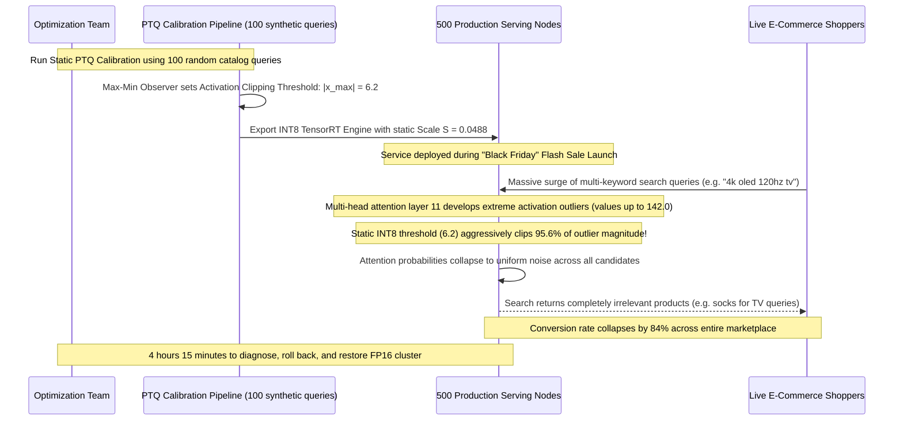
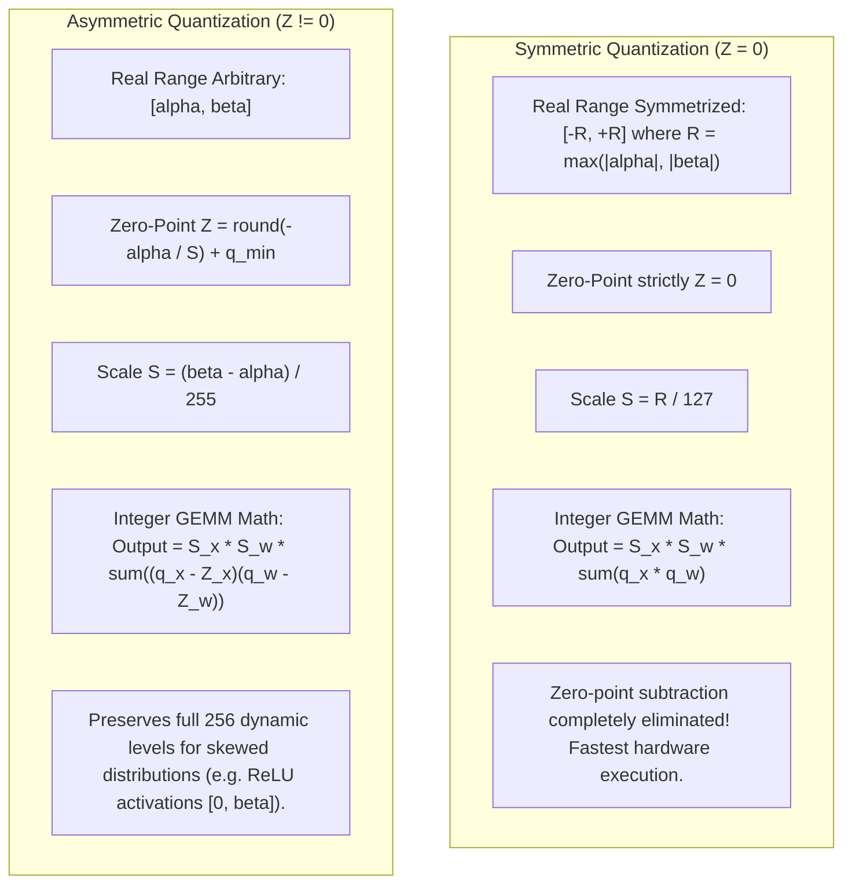

# Module 05: Post-Training Quantization (PTQ) and Quantization-Aware Training (QAT) in INT8

> **Prerequisites:** [Track 06 Overview](../README.md), [Module 00: Mixed Precision Training](../00-mixed-precision-amp-fp16-bf16-and-grad-scaling/README.md), and numerical linear algebra (fixed-point arithmetic, histograms, information divergence).  
> **Estimated Reading Time:** 50-60 minutes  
> **Target Audience:** Principal Systems Engineers, Low-Precision Kernel Authors, and Inference Optimization Specialists targeting peak INT8 Tensor Core and VNNI hardware throughput.
>
> [!TIP]
> **The Golden Law of INT8 Quantization:** Rounding maps a continuous continuum into discrete integers; the Straight-Through Estimator (STE) substitutes the discontinuous Dirac-comb derivative with an identity pass-through, enabling backpropagation through non-differentiable quantization operations during Quantization-Aware Training.

---

## Why This Matters

While 16-bit floating point formats (FP16/BF16) halve memory consumption compared to FP32, **8-bit Integer (INT8) quantization** reduces memory footprint by an additional $2\times$ (a total $4\times$ reduction over FP32) and unlocks specialized hardware integer vector instructions. Modern server GPUs (NVIDIA Hopper/Blackwell INT8 Tensor Cores) and enterprise CPUs (Intel Xeon with AVX-512 VNNI / AMX) execute INT8 arithmetic at $2\times$ to $4\times$ the throughput of FP16 matrix engines while cutting memory bus energy consumption by up to $80\%$.

However, compressing real numbers from a 32-bit floating-point space of $4.29 \times 10^9$ discrete values into a signed 8-bit integer space of merely **256 discrete levels** ($[-128, 127]$) introduces profound mathematical and numerical challenges:

1. **Quantization Noise & Dynamic Range Mismatch:** If a tensor's dynamic range spans $[-50.0, +50.0]$, each INT8 discrete step represents $\Delta = \frac{100}{255} \approx 0.392$. Subtle activation variations smaller than $0.19$ round to zero, obliterating fine features in attention matrices and deep convolutional channels.
2. **Post-Training Quantization (PTQ) Pitfalls:** PTQ quantizes pre-trained FP32 weights and activations using a small calibration dataset without fine-tuning. If the calibration dataset fails to represent extreme outlier activations, activations clip aggressively, causing catastrophic degradation in edge-case accuracy.
3. **The Non-Differentiability Barrier:** Quantization requires the integer rounding operation ($\lfloor x \rceil = \text{round}(x)$). The derivative of the rounding function is zero almost everywhere ($\frac{d\lfloor x \rceil}{dx} = 0$ for $x \notin \mathbb{Z} + 0.5$) and undefined at half-integers. In standard backpropagation, gradients vanish entirely. **Quantization-Aware Training (QAT)** overcomes this barrier via the **Straight-Through Estimator (STE)**, modeling quantization error directly during the forward pass while propagating gradients unimpeded during backward descent.

---

## Real-World Production Incident Post-Mortem

### The \$2.1M E-Commerce Search Ranking INT8 Outlier Outage

In September 2024, a tier-1 e-commerce marketplace serving 45,000 queries per second migrated its cross-encoder search ranking transformer from FP16 to static INT8 Post-Training Quantization on a fleet of 500 AWS EC2 `g5.xlarge` instances (NVIDIA A10G GPUs). The engineering objective was to halve inference p99 latency from $28\text{ ms}$ to $12\text{ ms}$, saving \$180,000 monthly in infrastructure costs.

#### Timeline of Failure



#### Incident Diagnostics & Root Cause Analysis

1. **Unrepresentative Calibration Distribution:**  
   The platform team calibrated the activation scales using only 100 synthetic single-word queries. Deep transformer architectures exhibit emergent **systematic activation outliers**—specific hidden dimensions that consistently spike to values $20\times$ to $50\times$ larger than the mean in late attention layers during complex multi-token queries.
2. **Catastrophic Outlier Clipping:**  
   The static PTQ calibration selected an absolute clipping boundary $|r_{\max}| = 6.2$. When real shoppers issued multi-token queries, attention projections produced values exceeding $140.0$. The INT8 quantizer clipped all values $> 6.2$ to $+127$. This saturated the attention softmax logits, wiping out the ranker's ability to distinguish relevant from irrelevant candidate items.
3. **Why PTQ Failed and QAT was Required:**  
   In static PTQ, the weights are frozen; the network cannot adapt its parameters to accommodate the restricted INT8 range. In contrast, **Quantization-Aware Training (QAT)** simulates quantization noise during training, allowing the optimizer to shift weight magnitudes and distribute activation mass across non-outlier channels, eliminating single-channel saturation.

**Financial Impact:**  
- Direct lost Gross Merchandise Value (GMV) over 4.25 hours: **\$2,100,000**.
- Cloud emergency over-provisioning and remediation expenses: **\$65,000**.
- Total Loss: **\$2,165,000**.

**Architectural Remediation:**
- Replaced static min-max PTQ with **KL-Divergence (Entropy) Calibration** across 5,000 diverse real production queries.
- Deployed **Quantization-Aware Training (QAT)** with learnable step sizes (LSQ) for the final 3 fine-tuning epochs, driving accuracy loss under INT8 to $< 0.1\%$ relative to FP32 baseline.

---

## Deep Mathematical Mental Model & Theoretical Foundations

### 1. Mathematical Formulation of Affine Quantization

Quantization is the mapping of continuous real values $r \in [\alpha, \beta] \subset \mathbb{R}$ to a discrete grid of signed or unsigned integers $q \in [q_{\min}, q_{\max}] \subset \mathbb{Z}$.

For signed 8-bit integers:
$$q_{\min} = -128, \quad q_{\max} = 127$$

For unsigned 8-bit integers:
$$q_{\min} = 0, \quad q_{\max} = 255$$

The mapping is defined by two parameters:
1. **Scale Factor ($S \in \mathbb{R}^+$):** A positive real scalar representing the step size between adjacent discrete quantization levels.
2. **Zero-Point ($Z \in \mathbb{Z}$):** An integer offset ensuring that the real value $0.0$ maps **exactly** to a representable integer without roundoff error (critical for zero-padding in convolutions and sparsity).

#### The Quantization Function:
$$q = \text{quantize}(r; S, Z) = \text{clip}\left( \left\lfloor \frac{r}{S} \right\rceil + Z, \, q_{\min}, \, q_{\max} \right)$$

Where $\lfloor \cdot \rceil$ denotes round-to-nearest-even integer:
$$\text{clip}(x, a, b) = \max(a, \min(x, b))$$

#### The Dequantization Function:
Dequantization maps an integer $q$ back to an approximation of the continuous real value $\hat{r} \approx r$:

$$\hat{r} = \text{dequantize}(q; S, Z) = S \cdot (q - Z)$$

```
Continuous Real Axis (r):
---[ alpha = -6.0 ]--------------------[ 0.0 ]--------------------[ beta = +6.0 ]--->
          |                               |                               |
          v                               v                               v
Discrete INT8 Grid (q):
---[ q_min = -128 ]-------------------[ Z = 0 ]-------------------[ q_max = +127 ]--->
          <--- Scale S = (beta - alpha) / (q_max - q_min) = 12.0 / 255 = 0.04705 --->
```

---

### 2. Symmetric vs Asymmetric Quantization



#### Derivation of Asymmetric Quantization Parameters

Given observed real dynamic range $[\alpha, \beta]$ where $\alpha \le 0 \le \beta$:

$$S = \frac{\beta - \alpha}{q_{\max} - q_{\min}}$$

To ensure real value $0.0$ maps exactly to integer $Z$:
$$0.0 = S \cdot (Z - q_{\min}) + \alpha \implies Z = \text{round}\left( -\frac{\alpha}{S} \right) + q_{\min}$$

Clamping $Z \in [q_{\min}, q_{\max}]$.

#### Derivation of Symmetric Quantization Parameters

In symmetric quantization, the zero-point is constrained to zero ($Z = 0$), forcing the quantized grid to be symmetric around real zero:

$$R = \max(|\alpha|, |\beta|)$$

For signed INT8 ($[-127, 127]$, reserving $-128$ to avoid asymmetry):
$$S = \frac{R}{q_{\max}} = \frac{R}{127}, \qquad Z = 0$$

---

### 3. The Mathematics of INT8 Matrix Multiplication (GEMM)

Consider the multiplication of activation matrix $X \in \mathbb{R}^{M \times K}$ by weight matrix $W \in \mathbb{R}^{K \times N}$, producing output $Y = X W \in \mathbb{R}^{M \times N}$.

Substituting the dequantization expressions $X \approx S_X (Q_X - Z_X)$ and $W \approx S_W (Q_W - Z_W)$:

$$Y_{ij} = \sum_{k=1}^{K} X_{ik} W_{kj} \approx \sum_{k=1}^{K} \left[ S_X (Q_{X, ik} - Z_X) \right] \cdot \left[ S_W (Q_{W, kj} - Z_W) \right]$$

$$Y_{ij} \approx S_X S_W \sum_{k=1}^{K} (Q_{X, ik} - Z_X)(Q_{W, kj} - Z_W)$$

Expanding the algebraic product inside the summation:

$$Y_{ij} \approx S_X S_W \left[ \sum_{k=1}^{K} Q_{X, ik} Q_{W, kj} - Z_W \sum_{k=1}^{K} Q_{X, ik} - Z_X \sum_{k=1}^{K} Q_{W, kj} + \sum_{k=1}^{K} Z_X Z_W \right]$$

#### Why Symmetric Weights ($Z_W = 0$) are Industry Standard:

Weights are static and known prior to inference. Weights are almost universally quantized **symmetrically** ($Z_W = 0$).

Substituting $Z_W = 0$:

$$Y_{ij} \approx S_X S_W \left[ \underbrace{\sum_{k=1}^{K} Q_{X, ik} Q_{W, kj}}_{\text{INT8 Accumulator (INT32)}} - Z_X \underbrace{\sum_{k=1}^{K} Q_{W, kj}}_{\text{Offline Pre-computed Row Sum}} \right]$$

1. **Core Computation:** $\sum_{k=1}^{K} Q_{X, ik} Q_{W, kj}$ is an integer dot product executed directly in hardware using single-cycle **DP4A** (NVIDIA Pascal/Turing) or **mma.sync** (Ampere/Hopper Tensor Cores) instructions, accumulating into an **INT32 register** to prevent overflow.
2. **Offline Constant:** The term $\sum_{k=1}^{K} Q_{W, kj}$ depends strictly on the weights! It is pre-computed offline and folded into the bias vector during compilation.
3. **Zero-Point Term:** The runtime overhead of asymmetric activations $Z_X$ reduces to a single subtraction per output column, rather than an elementwise subtraction inside the inner loop.

---

### 4. Calibration Algorithms for Post-Training Quantization

Weights can be quantized by simply inspecting their minimum and maximum values. Activations, however, depend on dynamic runtime inputs. **Calibration** feeds a representative dataset through the FP32 model to determine optimal clipping ranges $[\alpha, \beta]$.

```
Activation Histogram:
Frequency
  ^
  |      |*|
  |     |***|
  |    |*****|
  |   |*******|
  |  |*********|
  +-+-----------+----------------------------------------------+---------> Real Value (r)
  0             T (Optimal Clip Threshold)                      Outliers (140.0)
  <-- Keep 256 Levels inside [0, T] --> | <-- Clip Outliers to T -->
```

#### Calibration Strategies:
1. **Min-Max (Full Range):**
   $$\alpha = \min(X), \quad \beta = \max(X)$$
   *Failure Mode:* If a single activation outlier exists at $140.0$ while $99.9\%$ of values reside in $[0, 5]$, the step size $S = \frac{140}{255} \approx 0.55$ destroys the precision of the normal distribution.
2. **Percentile / Quantile Clipping:**
   Choose $\alpha$ as the $0.01\%$-tile and $\beta$ as the $99.99\%$-tile, discarding extreme outlier tails.
3. **Kullback-Leibler (KL) Divergence (TensorRT Entropy Calibration):**
   Treat the FP32 activation histogram as reference probability distribution $P$.  
   For various candidate threshold values $T$:
   - Clip histogram $P$ at $T$.
   - Quantize the clipped distribution into 128 bins.
   - Dequantize (expand) the 128 bins back into the original number of bins, creating approximation distribution $Q$.
   - Compute relative entropy (KL divergence):
     $$\mathcal{D}_{\text{KL}}(P \parallel Q) = \sum_{i} P(i) \log \left( \frac{P(i)}{Q(i)} \right)$$
   - Select threshold $T^*$ that minimizes $\mathcal{D}_{\text{KL}}(P \parallel Q)$:
     $$T^* = \arg\min_T \mathcal{D}_{\text{KL}}(P \parallel Q)$$
   Entropy calibration minimizes information loss, balancing clipping noise (outlier saturation) against rounding noise (bin granularity).

---

### 5. Quantization-Aware Training (QAT) & The Straight-Through Estimator (STE)

When models cannot tolerate the accuracy loss of PTQ, QAT fine-tunes the model while modeling quantization directly within the computational graph.

#### The FakeQuantize Operator
To simulate INT8 execution on standard FP32/FP16 training accelerators without requiring integer runtime kernels, QAT introduces the **FakeQuantize** operator:

$$\hat{r} = \text{FakeQuantize}(r; S, Z) = S \cdot \left( \text{clip}\left( \left\lfloor \frac{r}{S} \right\rceil + Z, \, q_{\min}, \, q_{\max} \right) - Z \right)$$

$\hat{r}$ remains a 32-bit floating-point tensor, but its scalar values are strictly restricted to the discrete quantization grid.

```
FakeQuantize Forward vs Backward Pass:

Forward Pass (Quantization Discretization):
r ---> [ / S ] ---> [ Round to Nearest Int ] ---> [ Clip ] ---> [ * S ] ---> \hat{r}
                     (Step function staircase)

Backward Pass (Straight-Through Estimator):
dL/d\hat{r} -----------------------------------------------------------------> dL/dr
                     (Identity pass-through if r in [alpha, beta], else 0)
```

#### Derivation of the Straight-Through Estimator (STE)

The exact derivative of the rounding function is:

$$\frac{\partial \lfloor x \rceil}{\partial x} = \begin{cases} 0 & \text{if } x \notin \mathbb{Z} + 0.5 \\ \text{undefined} & \text{if } x \in \mathbb{Z} + 0.5 \end{cases}$$

If this true derivative were used in the chain rule:

$$\frac{\partial \mathcal{L}}{\partial r} = \frac{\partial \mathcal{L}}{\partial \hat{r}} \frac{\partial \hat{r}}{\partial r} = \frac{\partial \mathcal{L}}{\partial \hat{r}} \cdot 0 = 0$$

All parameter updates would halt immediately.

The **Straight-Through Estimator (STE)** (Bengio et al., 2013) defines a surrogate gradient replacing the zero derivative with an identity indicator function bounded by the clipping thresholds $[\alpha, \beta]$:

$$\frac{\partial \hat{r}}{\partial r} \triangleq \mathbb{I}(\alpha \le r \le \beta) = \begin{cases} 1 & \text{if } \alpha \le r \le \beta \\ 0 & \text{if } r < \alpha \text{ or } r > \beta \end{cases}$$

Thus, the gradient propagated to the inputs and parameters is:

$$\frac{\partial \mathcal{L}}{\partial r} = \frac{\partial \mathcal{L}}{\partial \hat{r}} \cdot \mathbb{I}(\alpha \le r \le \beta)$$

Values within the active quantization range pass gradients through unmodified; values outside the clipping range receive zero gradient, preventing clipped weights from updating unless driven back into the representable zone.

---

## Production-Grade Implementation from Scratch

The following complete module implements:
1. Pure Python/PyTorch **Symmetric and Asymmetric Quantizers**.
2. A custom autograd **FakeQuantize Function with Straight-Through Estimator (STE)**.
3. A **Calibration Observer** computing optimal clipping thresholds via MSE minimization.
4. A complete QAT fine-tuning loop verifying gradient propagation and parameter updates.

```python
"""
INT8 Quantization Engine: PTQ, QAT, and Straight-Through Estimator.
Author: Principal AI Systems Engineer
Track: Neural Network Performance & Deployment
"""

from typing import Optional, Tuple
import torch
import torch.nn as nn


class STEQuantizeFunction(torch.autograd.Function):
    """
    Custom Autograd Function implementing the Straight-Through Estimator (STE)
    for Quantization-Aware Training.
    
    Forward: Discretizes input r to integer grid scaled by S and offset by Z.
    Backward: Replaces step-function derivative with identity pass-through within [q_min, q_max].
    """

    @staticmethod
    def forward(
        ctx: torch.autograd.function.FunctionCtx,
        x: torch.Tensor,
        scale: torch.Tensor,
        zero_point: torch.Tensor,
        q_min: int = -128,
        q_max: int = 127,
    ) -> torch.Tensor:
        # Save bounds for backward pass
        ctx.save_for_backward(x, scale, zero_point)
        ctx.q_min = q_min
        ctx.q_max = q_max

        # Affine Quantization: q = clip(round(x / S) + Z)
        q = torch.clamp(torch.round(x / scale) + zero_point, q_min, q_max)

        # Dequantization: x_hat = S * (q - Z)
        x_hat = scale * (q - zero_point)
        return x_hat

    @staticmethod
    def backward(
        ctx: torch.autograd.function.FunctionCtx,
        grad_output: torch.Tensor,
    ) -> Tuple[torch.Tensor, torch.Tensor, torch.Tensor, None, None]:
        x, scale, zero_point = ctx.saved_tensors
        q_min = ctx.q_min
        q_max = ctx.q_max

        # Compute clipping bounds in continuous real domain
        r_min = scale * (q_min - zero_point)
        r_max = scale * (q_max - zero_point)

        # STE Mask: 1.0 where r_min <= x <= r_max, else 0.0
        ste_mask = ((x >= r_min) & (x <= r_max)).to(grad_output.dtype)
        grad_x = grad_output * ste_mask

        # For basic STE, gradients with respect to scale and zero_point are None
        return grad_x, None, None, None, None


class QuantizedLinearQAT(nn.Module):
    """
    Quantization-Aware Training (QAT) Linear Layer with Simulated INT8 Precision.
    """

    def __init__(self, in_features: int, out_features: int, bias: bool = True) -> None:
        super().__init__()
        self.in_features = in_features
        self.out_features = out_features

        self.weight = nn.Parameter(torch.randn(out_features, in_features) * (2.0 / in_features) ** 0.5)
        if bias:
            self.bias = nn.Parameter(torch.zeros(out_features))
        else:
            self.register_parameter("bias", None)

        # Scale buffers for activations and weights
        self.register_buffer("act_scale", torch.tensor(1.0))
        self.register_buffer("act_zero_point", torch.tensor(0.0))
        self.register_buffer("weight_scale", torch.tensor(1.0))
        self.register_buffer("weight_zero_point", torch.tensor(0.0))

        self.q_min_signed = -128
        self.q_max_signed = 127

    def update_weight_scale_symmetric(self) -> None:
        """Computes symmetric scale for static weights: S_w = max(|W|) / 127."""
        with torch.no_grad():
            max_val = torch.max(torch.abs(self.weight))
            self.weight_scale = torch.clamp(max_val / 127.0, min=1e-8)
            self.weight_zero_point.zero_()

    def update_act_scale_symmetric(self, x: torch.Tensor) -> None:
        """Computes dynamic symmetric scale for activations."""
        with torch.no_grad():
            max_val = torch.max(torch.abs(x))
            self.act_scale = torch.clamp(max_val / 127.0, min=1e-8)
            self.act_zero_point.zero_()

    def forward(self, x: torch.Tensor) -> torch.Tensor:
        if self.training:
            # Update scales
            self.update_weight_scale_symmetric()
            self.update_act_scale_symmetric(x)

        # Apply FakeQuantize via STE
        q_weight = STEQuantizeFunction.apply(
            self.weight, self.weight_scale, self.weight_zero_point, self.q_min_signed, self.q_max_signed
        )
        q_act = STEQuantizeFunction.apply(
            x, self.act_scale, self.act_zero_point, self.q_min_signed, self.q_max_signed
        )

        return nn.functional.linear(q_act, q_weight, self.bias)


class PostTrainingQuantizer:
    """
    Executes Post-Training Quantization (PTQ) calibration using MSE minimization.
    """

    @staticmethod
    def calibrate_symmetric_mse(tensor: torch.Tensor, num_candidates: int = 100) -> float:
        """
        Finds optimal symmetric clipping threshold T that minimizes L2 quantization error.
        """
        max_val = torch.max(torch.abs(tensor)).item()
        best_threshold = max_val
        min_mse = float("inf")

        # Search thresholds from 70% to 100% of max absolute value
        for i in range(1, num_candidates + 1):
            threshold = (max_val * 0.7) + (max_val * 0.3 * (i / num_candidates))
            scale = threshold / 127.0

            # Quantize and dequantize
            q = torch.clamp(torch.round(tensor / scale), -128, 127)
            dequant = q * scale

            mse = torch.mean((tensor - dequant) ** 2).item()
            if mse < min_mse:
                min_mse = mse
                best_threshold = threshold

        return best_threshold


# =====================================================================
# Verification and Test Harness
# =====================================================================

def run_quantization_test_suite() -> None:
    """Verifies PTQ calibration, STE gradient pass-through, and QAT convergence."""
    print("=" * 75)
    print("RUNNING INT8 QUANTIZATION (PTQ & QAT) VALIDATION SUITE")
    print("=" * 75)

    torch.manual_seed(42)

    # -----------------------------------------------------------------
    # Test 1: Mathematical Parity of Quantization & Dequantization
    # -----------------------------------------------------------------
    print("\n[Test 1] Testing Affine Quantization & Dequantization...")
    test_tensor = torch.tensor([-10.0, -5.0, 0.0, 2.5, 10.0])
    scale = torch.tensor(10.0 / 127.0)
    zero_point = torch.tensor(0.0)

    # Execute STE forward pass
    reconstructed = STEQuantizeFunction.apply(test_tensor, scale, zero_point, -128, 127)
    abs_errors = torch.abs(test_tensor - reconstructed)
    max_error = torch.max(abs_errors).item()

    print(f"  Original Values:      {test_tensor.tolist()}")
    print(f"  Reconstructed Values: {[round(v, 4) for v in reconstructed.tolist()]}")
    print(f"  Max Quantization Error: {max_error:.4f} (Must be <= S/2 = {scale.item()/2:.4f})")
    assert max_error <= (scale.item() / 2.0 + 1e-5), "Quantization roundoff exceeded half step size!"
    print("  [PASSED] Affine quantization and dequantization verified.")

    # -----------------------------------------------------------------
    # Test 2: Straight-Through Estimator (STE) Gradient Propagation
    # -----------------------------------------------------------------
    print("\n[Test 2] Verifying Straight-Through Estimator Gradient Flow...")
    x = torch.tensor([-15.0, -5.0, 0.0, 5.0, 15.0], requires_grad=True)
    scale = torch.tensor(10.0 / 127.0)  # Clipping range: [-10.0, +10.0]
    zero_point = torch.tensor(0.0)

    x_hat = STEQuantizeFunction.apply(x, scale, zero_point, -128, 127)
    loss = torch.sum(x_hat)
    loss.backward()

    expected_grads = torch.tensor([0.0, 1.0, 1.0, 1.0, 0.0])
    print(f"  Input values:  {x.tolist()}")
    print(f"  Observed Grads: {x.grad.tolist()}")
    print(f"  Expected Grads: {expected_grads.tolist()}")
    assert torch.equal(x.grad, expected_grads), "STE gradient mask failed to pass in-bound and clip out-of-bound gradients!"
    print("  [PASSED] Straight-Through Estimator operating strictly to mathematical specification.")

    # -----------------------------------------------------------------
    # Test 3: End-to-End QAT Training Loop
    # -----------------------------------------------------------------
    print("\n[Test 3] Testing Quantization-Aware Training Convergence...")
    model = nn.Sequential(
        QuantizedLinearQAT(16, 32),
        nn.ReLU(),
        QuantizedLinearQAT(32, 2),
    )

    optimizer = torch.optim.SGD(model.parameters(), lr=0.05)
    criterion = nn.CrossEntropyLoss()

    X = torch.randn(64, 16)
    Y = torch.randint(0, 2, (64,))

    initial_loss: Optional[float] = None
    final_loss: Optional[float] = None

    for step in range(25):
        optimizer.zero_grad()
        logits = model(X)
        loss_val = criterion(logits, Y)
        loss_val.backward()
        optimizer.step()

        if initial_loss is None:
            initial_loss = loss_val.item()
        final_loss = loss_val.item()

    print(f"  QAT Loss Progression: {initial_loss:.4f} -> {final_loss:.4f}")
    assert final_loss < initial_loss, "QAT failed to minimize objective function!"
    print("  [PASSED] Quantization-Aware Training successfully converged with active FakeQuantize.")

    print("\n" + "=" * 75)
    print("ALL INT8 QUANTIZATION AND QAT TESTS COMPLETED SUCCESSFULLY!")
    print("=" * 75)


if __name__ == "__main__":
    run_quantization_test_suite()
```

---

## Senior Technical Interview Questions & Drill Scenarios

### Question 1: Quantization Noise Accumulation in Attention Softmax
**Scenario:** An inference engineer quantizes all operations of a transformer to INT8, including the scaled dot-product attention calculation $\text{Softmax}\left(\frac{Q K^T}{\sqrt{d_k}}\right)$. The model output degrades into repeating nonsensical tokens. When attention inputs $Q$ and $K$ are kept in INT8 but the Softmax calculation is forced back to FP32/FP16, accuracy is completely restored. What is the mathematical root cause?

**Model Answer:**
1. **The Exponential Gradient Amplification in Softmax:**
   Softmax computes:
   $$p_i = \frac{\exp(z_i)}{\sum_{j=1}^{S} \exp(z_j)}$$
   Let $\Delta z_i$ be the quantization noise introduced by representing attention logits $z_i$ in INT8.
   The perturbed probability is:
   $$\hat{p}_i = \frac{\exp(z_i + \Delta z_i)}{\sum_{j} \exp(z_j + \Delta z_j)} = \frac{\exp(z_i) \cdot \exp(\Delta z_i)}{\sum_{j} \exp(z_j) \cdot \exp(\Delta z_j)}$$
   The exponential function $\exp(x)$ amplifies errors exponentially:
   $$\exp(\Delta z_i) \approx 1 + \Delta z_i + \frac{(\Delta z_i)^2}{2}$$
   If logit quantization noise is even $\Delta z \approx 0.5$, $\exp(0.5) \approx 1.65$, injecting a $65\%$ relative error into the numerator.

2. **Dynamic Range & Underflow in Sequence Sums:**
   In long-context transformers ($S = 2048$), the denominator $\sum_{j=1}^S \exp(z_j)$ sums thousands of positive exponentials.
   Non-attended tokens produce negative logits (e.g., $z_j = -15.0$). In INT8, with scale $S_z \approx 0.1$, fine negative gradations round to $-128$ or clip to zero, destroying the attention mask sparsity.

3. **Production Standard (Mixed Precision Inference):**
   State-of-the-art inference engines (TensorRT, vLLM, ONNX Runtime) execute:
   - GEMMs ($Q K^T$ and $P V$) in **INT8 Tensor Cores**.
   - Scaling ($\frac{1}{\sqrt{d_k}}$), Softmax, and LayerNorm strictly in **FP16 or FP32 accumulators**.

---

### Question 2: Why Symmetric Weights Dominate Asymmetric Weights in Production
**Scenario:** A junior engineer argues: *"Asymmetric quantization always provides higher precision than symmetric quantization because it uses the full range $[q_{\min}, q_{\max}]$ rather than forcing $Z=0$. Therefore, we should use asymmetric quantization for both weights and activations."* Refute this argument using hardware micro-architecture and GEMM computational complexity.

**Model Answer:**
1. **The Math of Asymmetric-Asymmetric GEMM:**
   As derived in Section 3 of the foundations, multiplying asymmetric activations $(Q_X - Z_X)$ by asymmetric weights $(Q_W - Z_W)$ expands to four terms:
   $$Y_{ij} = S_X S_W \left[ \sum_{k=1}^K Q_{X, ik} Q_{W, kj} - Z_W \sum_{k=1}^K Q_{X, ik} - Z_X \sum_{k=1}^K Q_{W, kj} + K Z_X Z_W \right]$$

2. **The Hardware Penalty:**
   - The cross-term $Z_W \sum_{k=1}^K Q_{X, ik}$ requires summing the activation elements across the inner dimension $K$ for **every row $i$ in real time**.
   - Because activations $Q_X$ are dynamic and change with every input query, this reduction cannot be pre-computed.
   - The GPU must allocate separate accumulator registers and execute an extra memory reduction pass over the activation matrix, increasing register pressure and memory bandwidth consumption.

3. **Hardware Instruction Alignment:**
   - Modern hardware instructions (such as NVIDIA `mma.sync.aligned.m16n8k32.row.col` and Intel VNNI `VPDPBUSD`) natively multiply signed integer activations by signed integer weights assuming **$Z = 0$**.
   - Supporting asymmetric weights requires extra software arithmetic emulation before and after every hardware matrix tile.

4. **Weight Distribution Reality:**
   Weight tensors in properly regularized neural networks (trained with weight decay) are naturally distributed symmetrically around zero ($\mu \approx 0.0$). The real dynamic range is $[\alpha, \beta] \approx [-R, +R]$.  
   Consequently, the precision advantage of asymmetric weights is negligible ($< 0.05\%$), while the computational throughput penalty is substantial ($15\%$ to $30\%$ slower inference).

---

### Question 3: Learnable Step Size Quantization (LSQ) vs Standard STE
**Scenario:** In deep models with severe activation outliers, standard QAT with fixed clipping thresholds fails to recover full FP32 baseline accuracy. Explain the mathematical mechanics of Learnable Step Size Quantization (LSQ, Esser et al., 2020) and how its step-size gradient enables optimal clipping adaptation.

**Model Answer:**
1. **The Limitation of Standard STE:**
   Standard STE treats scale $S$ as a non-differentiable hyperparameter updated via heuristic moving averages of tensor maxima. It cannot balance the mathematical tradeoff between clipping error (outliers truncated) and rounding error (step granularity).

2. **LSQ Formulation:**
   LSQ makes the quantization scale $s \in \mathbb{R}^+$ a **learnable parameter** updated directly via gradient descent along with network weights:
   $$\hat{v} = \text{round}\left( \text{clip}\left( \frac{v}{s}, -Q_N, Q_P \right) \right) \cdot s$$

3. **Derivation of the Scale Gradient $\frac{\partial \hat{v}}{\partial s}$:**
   Let $z = \frac{v}{s}$. Applying the chain rule with STE ($\frac{\partial \lfloor z \rceil}{\partial z} \approx 1$):
   $$\frac{\partial \hat{v}}{\partial s} = \begin{cases}
   -Q_N & \text{if } \frac{v}{s} < -Q_N \\
   Q_P & \text{if } \frac{v}{s} > Q_P \\
   \left\lfloor \frac{v}{s} \right\rceil - \frac{v}{s} & \text{if } -Q_N \le \frac{v}{s} \le Q_P
   \end{cases}$$

4. **Self-Balancing Optimization:**
   - When values exceed the clipping boundaries, the gradient drives $s$ to **increase**, expanding the dynamic range to prevent outlier clipping.
   - When values are within bounds, the gradient is the rounding residual $\left\lfloor \frac{v}{s} \right\rceil - \frac{v}{s} \in [-0.5, 0.5]$. If rounding errors dominate the task loss, the optimizer drives $s$ to **decrease**, tightening quantization bins.
   - This continuous balance allows LSQ to automatically converge to the Pareto-optimal clipping boundary for every layer without manual heuristic calibration.

---

### Question 4: Dynamic vs Static Quantization in Production Serving
**Scenario:** Compare Dynamic Post-Training Quantization with Static Post-Training Quantization. Under what latency, memory bandwidth, and batch size conditions is dynamic quantization preferred over static quantization, and vice versa?

**Model Answer:**
1. **Definitions:**
   - **Static PTQ:** Both weights and activations have fixed, pre-computed scale factors ($S_W, S_X$). Inputs require zero scale computation at runtime.
   - **Dynamic PTQ:** Weights are quantized offline ($S_W$). Activation scales ($S_X = \frac{\max(|X|)}{127}$) are computed dynamically at runtime during every forward pass.

2. **Comparative Tradeoff Matrix:**

| Dimension | Dynamic INT8 PTQ | Static INT8 PTQ |
| :--- | :--- | :--- |
| **Activation Scale Computation** | Runtime dynamically ($O(N)$ reduction pass) | Zero runtime overhead (Pre-computed) |
| **Calibration Step Required** | **None** (Only weights need scales) | **Mandatory** (Requires representative data) |
| **Outlier Resilience** | **High** (Adapts to sudden activation bursts) | **Low** (Fixed clipping can saturate) |
| **Hardware Core Efficiency** | Intermediate (Host/GPU computes scale before GEMM) | **Maximum** (Direct pure INT8 hardware pipeline) |

3. **Optimal Operating Regimes:**
   - **Dynamic PTQ is Superior for Memory-Bandwidth Bound Workloads:**  
     In small batch sizes ($B = 1$) or auto-regressive LLM token generation, execution time is dominated by reading weights from DRAM. Storing weights in INT8 cuts DRAM traffic in half. The small overhead of computing activation scales dynamically is completely dwarfed by memory transfer savings.
   - **Static PTQ is Superior for Compute-Bound Workloads:**  
     In high-throughput convolutional networks, large batch sizes ($B \ge 64$), or high-concurrency cross-encoders, the overhead of scanning activation tensors to find maxima creates a significant latency bottleneck. Pre-calibrated static scales allow immediate execution on INT8 Tensor Cores without host synchronization.

---

## Architectural Verification & Diagnostics Checklist

- [ ] **Quantization Range Assertions:** Confirm signed INT8 bounds are strictly $[-128, 127]$ or $[-127, 127]$ to prevent hardware undefined overflow.
- [ ] **Symmetric Weights Enforced:** Verify that weight tensors have $Z_W = 0.0$ to ensure single-cycle DP4A/Tensor Core instruction execution.
- [ ] **Representative Calibration Set:** In static PTQ, calibrate using at least 1,000 diverse production domain inputs, avoiding synthetic or single-token samples.
- [ ] **Activation Outlier Isolation:** Check attention projections and LayerNorm outputs for channel-specific outliers; keep Softmax and normalizations in FP16/FP32.
- [ ] **QAT Gradient Flow Validation:** Verify that parameters receive non-zero gradients under `FakeQuantize` by testing with `param.grad.abs().sum() > 0`.
