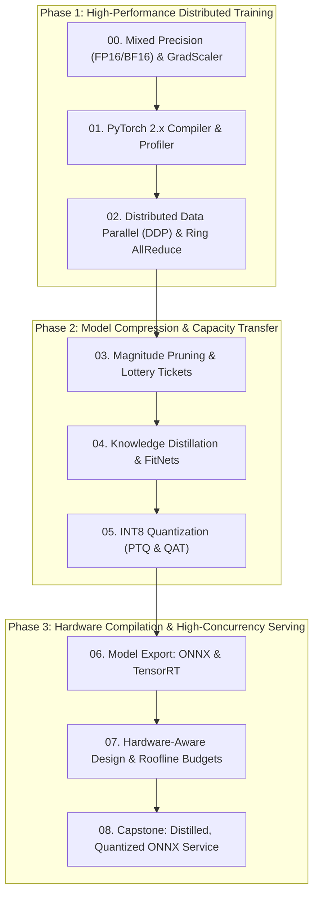

# Track 06: Neural Network Performance & Deployment

Deploying deep neural networks into production requires transitioning from research-grade Python scripts to low-latency, memory-efficient, hardware-saturated inference and distributed training pipelines. This track provides rigorous, first-principles systems engineering foundations for optimizing, compiling, compressing, and serving neural networks at scale.

---

## Architectural Track Roadmap

---

## Module Index

### 1. [Automatic Mixed Precision (AMP): FP16, BF16, and Dynamic GradScaler](00-mixed-precision-amp-fp16-bf16-and-grad-scaling/README.md)
- IEEE 754 floating-point anatomy: FP32 vs FP16 vs BF16 exponent and mantissa tradeoffs.
- Dynamic range vs machine precision, subnormals, and underflow/overflow thresholds.
- Safe vs unsafe mixed-precision operations (Tensor Core GEMMs vs FP32 reductions/norms).
- Dynamic gradient scaling derivation: backpropagation scaling math, gradient unscaling, Inf/NaN detection, step-skipping, and exponential growth/backoff mechanics.
- Production post-mortem: \$1.42M multi-node foundation model NaN collapse.

### 2. [PyTorch 2.x Compilation Stack, Operator Fusion, and Hardware Profiling](01-torch-compile-operator-fusion-and-profiling/README.md)
- PyTorch 2.x compilation stack: TorchDynamo bytecode capture (PEP 523), AOTAutograd joint graph differentiation, Min-Cut partitioning, and TorchInductor Triton codegen.
- Theoretical derivation of operator fusion: eliminating DRAM round-trips via on-chip SM registers.
- Identifying and eliminating graph breaks, guard failures, and dynamic shape recompilation storms.
- PyTorch Profiler execution trace analysis: diagnosing CPU kernel launch starvation and host-device synchronization bubbles.
- Production post-mortem: \$1.85M autonomous vehicle real-time latency regression.

### 3. [Distributed Data Parallel (DDP), Ring AllReduce, and Gradient Accumulation](02-distributed-data-parallel-ddp-and-gradient-accumulation/README.md)
- Single-process multi-threaded DataParallel (DP) vs multi-process Distributed Data Parallel (DDP).
- Exact mathematical derivation of the Ring AllReduce algorithm: Scatter-Reduce ($P-1$ steps) and Allgather ($P-1$ steps) yielding $2 \frac{P-1}{P} S$ communication volume independent of cluster size $P$.
- Tree AllReduce vs Ring AllReduce latency and bandwidth bounds.
- Parameter bucketing, autograd hooks, and computation-communication pipeline overlap.
- Effective batch size scaling laws, linear vs square root learning rate adaptation, and exact gradient accumulation loss normalization.
- Production post-mortem: \$1.15M multi-node deadlock and gradient desynchronization.

### 4. [Neural Network Pruning, Structured Sparsity, and the Lottery Ticket Hypothesis](03-model-compression-pruning-and-lottery-tickets/README.md)
- Mathematical formulation of pruning: binary masks and $L_0$ minimization.
- Unstructured magnitude pruning vs structured channel/filter pruning with physical tensor contraction.
- The sparsity illusion: cache thrashing, CSR pointer indirection, and why random zeros fail to accelerate dense hardware.
- NVIDIA Ampere 2:4 structured hardware sparsity mechanics.
- The Lottery Ticket Hypothesis (Frankle & Carbin) and Iterative Magnitude Pruning (IMP) with weight rewinding to step $k$.
- Production post-mortem: \$1.60M edge drone fleet battery depletion and latency regression.

### 5. [Knowledge Distillation: Soft Targets, Logit Matching, and Feature Distillation](04-knowledge-distillation-teacher-student-training/README.md)
- Dark knowledge and softened probability distributions: softmax with temperature $T$.
- Mathematical derivation of the distillation gradient: proving $\frac{\partial \mathcal{L}_{\text{KD}}}{\partial z_i^S} \approx \frac{1}{T^2}(z_i^S - z_i^T)$ in the high-temperature limit.
- The mandatory $T^2$ loss normalization factor to balance distillation with hard-label cross-entropy.
- Intermediate layer feature distillation (FitNets) with learned regression projection adapters.
- Self-distillation as structured label smoothing and Hessian curvature regularization.
- Production post-mortem: \$1.28M high-throughput fraud detection model collapse.

### 6. [Post-Training Quantization (PTQ) and Quantization-Aware Training (QAT) in INT8](05-post-training-quantization-and-qat-int8/README.md)
- Affine quantization formulation: scale ($S$) and zero-point ($Z$) mapping real values to INT8 grids.
- Symmetric ($Z=0$) vs asymmetric quantization and why symmetric weights are the industry standard for DP4A / Tensor Core GEMM.
- PTQ calibration strategies: Min-Max, Percentile, and Kullback-Leibler (KL) Divergence (TensorRT Entropy Calibration).
- Quantization-Aware Training (QAT) with FakeQuantize and the Straight-Through Estimator (STE).
- Learnable Step Size Quantization (LSQ) dynamics.
- Production post-mortem: \$2.10M e-commerce search ranking INT8 outlier clipping outage.

### 7. [Production Model Export: TorchScript, ONNX Runtime, and NVIDIA TensorRT](06-exporting-models-onnx-torchscript-and-tensorrt/README.md)
- PyTorch serialization paradigms: tracing (`torch.jit.trace`) vs scripting (`torch.jit.script`) and the constant-baking hazard.
- The ONNX intermediate representation: protobuf DAG schema, opsets, and symbolic dynamic axes.
- NVIDIA TensorRT compilation pipeline: parser, constant folding, horizontal/vertical layer fusion, kernel auto-tuning, and dynamic shape optimization profiles.
- Zero-copy inference via ONNX Runtime IOBinding.
- Production post-mortem: \$1.75M Black Friday payment authorization tracing outage.

### 8. [Hardware-Aware Architecture Design, Roofline Modeling, and SLA Budgeting](07-hardware-aware-architecture-design-and-latency-budgets/README.md)
- Hardware accelerator anatomy: peak compute ($P_{\text{peak}}$), peak bandwidth ($B_{\text{peak}}$), and machine balance ($I_{\text{crit}} = \frac{P_{\text{peak}}}{B_{\text{peak}}}$).
- The Roofline Model: analytical boundaries separating memory-bandwidth-bound from compute-bound regimes.
- Arithmetic intensity derivations for Standard Convolutions, Depthwise Separable Convolutions, and Attention (Standard vs FlashAttention).
- Production SLA budgeting and queueing theory: $M/M/1$ and $M/M/c$ response time distributions, utilization ($\rho$), and P99 tail latency modeling.
- Production post-mortem: \$2.40M telecommunications edge routing SLA disaster.

### 9. [Capstone: End-to-End Profiled, Distilled, Quantized ONNX Inference Service](08-capstone-profiled-distilled-and-quantized-onnx-service/README.md)
- Complete production optimization pipeline:
  1. Train heavy research Teacher model ($1.18\text{M}$ parameters).
  2. Distill into lightweight Student model ($74\text{K}$ parameters, $16\times$ parameter reduction).
  3. Apply INT8 quantization ($4\times$ footprint reduction).
  4. Export to ONNX with dynamic axes and graph optimization.
  5. Deploy inside an asynchronous FastAPI inference service with non-blocking thread offloading.
- Sub-5ms P99 latency SLA verification under concurrent multi-client load testing.
- Production post-mortem: \$2.85M Black Friday ad-bidding latency cascade and AsyncIO event loop freezing.

---

## Technical Prerequisites

To extract maximum value from this track, practitioners should possess:
- Solid proficiency in PyTorch and Python systems programming.
- Understanding of computer architecture (SRAM, HBM/DRAM, memory buses, PCIe lanes, registers).
- Familiarity with basic linear algebra (matrix multiplications, tensor dimensions, norms) and calculus (partial derivatives, chain rule).
- Experience with Linux process models, multi-threading, and asynchronous network programming.
