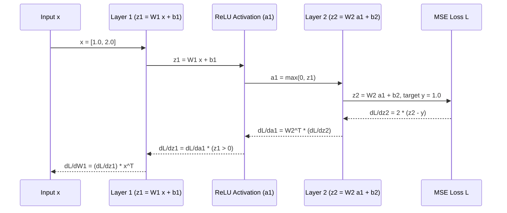
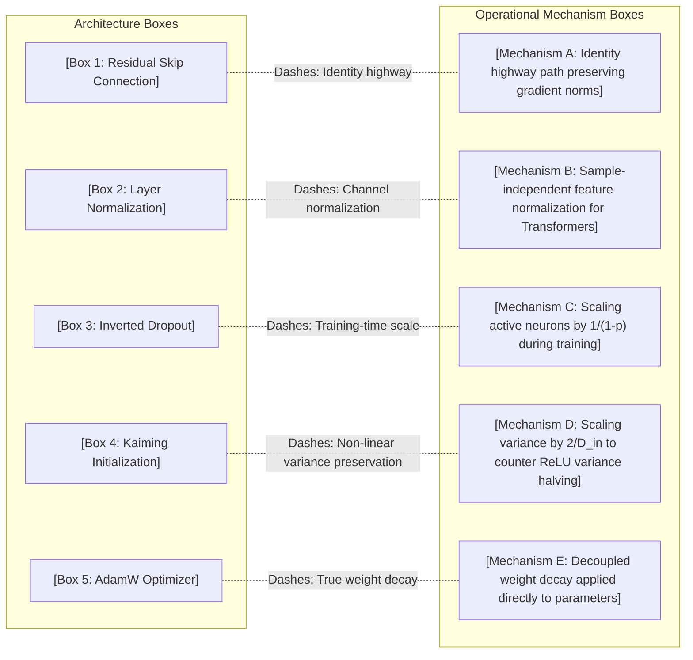

# Deep Learning & Neural Networks Practice Arena

Welcome to the **Deep Learning & Neural Networks Practice Arena**. Developing intuition for deep learning requires moving beyond high-level framework wrappers to derive gradient updates by hand and diagnose failing neural network training runs under time constraints.

> [!TIP]
> **The First-Principles Rule:** If you cannot write a scalar autograd engine or perform a manual backpropagation step on paper with pencil, you will struggle to debug silent numerical collapse, vanishing gradients, or shape broadcasting bugs in large distributed architectures.

---

## 🎯 Flagship Practice Center Links

Test yourself in the interactive browser runners:

| Practice Category | Resource | Format & Scope |
| :--- | :--- | :--- |
| **Technical Interview** | [Deep Learning & Neural Networks Interview Set](/practice/interview/deep-learning-and-neural-networks) | 12 Senior Q&As on XOR, activations, VJPs, He init, AdamW, triage |
| **Coding Kata** | [Scalar Autograd Engine](/practice/code/scalar-reverse-autograd) | Implement reverse-mode automatic differentiation with topological DFS |
| **Interactive Quiz** | [Backpropagation & Autograd](/practice/quizzes/backpropagation-and-autograd) | Reverse-mode mechanics, vector-Jacobian products, chain rule |
| **Hands-On Exercise** | [Micrograd Autograd Engine](/practice/exercises/micrograd-autograd-engine) | Build a computational graph engine from scratch in Python |

---

## 📝 Hand-Calculation Backpropagation Drills

Practice computing these forward and backward passes by hand on paper before checking the derivations:



### Drill 1: Two-Layer Scalar Network by Hand
Given:
- Input $x = 2.0$, target $y = 1.0$.
- Layer 1 weight $w_1 = 0.5$, bias $b_1 = 0.0$.
- Layer 2 weight $w_2 = -1.0$, bias $b_2 = 1.0$.
- Activation $\text{ReLU}(z) = \max(0, z)$.
- Loss $L = \frac{1}{2} (\hat{y} - y)^2$.

**Forward Pass:**
1. $z_1 = w_1 x + b_1 = 0.5 \times 2.0 + 0 = 1.0$
2. $a_1 = \text{ReLU}(z_1) = \max(0, 1.0) = 1.0$
3. $z_2 = \hat{y} = w_2 a_1 + b_2 = -1.0 \times 1.0 + 1.0 = 0.0$
4. $L = \frac{1}{2} (0.0 - 1.0)^2 = 0.5$

**Backward Pass:**
1. Output sensitivity: $\frac{\partial L}{\partial \hat{y}} = \hat{y} - y = 0.0 - 1.0 = -1.0$
2. Layer 2 weight gradient: $\frac{\partial L}{\partial w_2} = \frac{\partial L}{\partial \hat{y}} \cdot a_1 = (-1.0) \times 1.0 = -1.0$
3. Layer 2 bias gradient: $\frac{\partial L}{\partial b_2} = \frac{\partial L}{\partial \hat{y}} \cdot 1 = -1.0$
4. Hidden activation sensitivity: $\frac{\partial L}{\partial a_1} = \frac{\partial L}{\partial \hat{y}} \cdot w_2 = (-1.0) \times (-1.0) = 1.0$
5. ReLU gate derivative: $\frac{\partial L}{\partial z_1} = \frac{\partial L}{\partial a_1} \cdot \mathbf{1}(z_1 > 0) = 1.0 \times 1.0 = 1.0$
6. Layer 1 weight gradient: $\frac{\partial L}{\partial w_1} = \frac{\partial L}{\partial z_1} \cdot x = 1.0 \times 2.0 = 2.0$
7. Layer 1 bias gradient: $\frac{\partial L}{\partial b_1} = \frac{\partial L}{\partial z_1} \cdot 1 = 1.0$

---

### Drill 2: Softmax Cross-Entropy Elegant Cancellation
Prove why the gradient of multi-class Cross-Entropy loss with Softmax activation collapses to $\nabla_z L = p - y$:
1. Let $p_i = \frac{e^{z_i}}{\sum_k e^{z_k}}$ and $L = -\sum_k y_k \ln(p_k)$.
2. Case $i = j$: $\frac{\partial p_i}{\partial z_i} = p_i (1 - p_i)$.
3. Case $i \neq j$: $\frac{\partial p_i}{\partial z_j} = -p_i p_j$.
4. Differentiating $L$ with respect to logit $z_j$:
   $$\frac{\partial L}{\partial z_j} = -\sum_k \frac{y_k}{p_k} \frac{\partial p_k}{\partial z_j} = -\frac{y_j}{p_j} (p_j (1 - p_j)) - \sum_{k \neq j} \frac{y_k}{p_k} (-p_k p_j)$$
5. Simplify the terms:
   $$\frac{\partial L}{\partial z_j} = -y_j (1 - p_j) + p_j \sum_{k \neq j} y_k = -y_j + y_j p_j + p_j \sum_{k \neq j} y_k = -y_j + p_j \sum_{\text{all } k} y_k$$
6. Since one-hot labels sum to 1 ($\sum_k y_k = 1$):
   $$\frac{\partial L}{\partial z_j} = p_j - y_j$$

---

## ⚡ PyTorch Shape & Tensor Debugging Drills

Master these 3 tensor shape transformations that frequently cause subtle bugs in neural networks:

### 1. The Accidental 1D Broadcasting Bug
```python
# Danger: y has shape (N,), but y_hat has shape (N, 1)
# y_hat - y will NOT produce (N, 1), it broadcasts into an (N, N) matrix!
y_hat = torch.randn(32, 1)
y_bad = torch.randn(32)
diff_bad = y_hat - y_bad  # Shape: (32, 32)! Silent memory and math explosion!

# Correct: Always match dimensional rank
y_good = y_bad.unsqueeze(1)  # Shape: (32, 1)
diff_good = y_hat - y_good   # Shape: (32, 1)
```

### 2. Batch Matrix Multiplication with `torch.bmm`
```python
# Query: (Batch, Num_queries, Dim) -> (16, 8, 64)
# Key:   (Batch, Num_keys, Dim)    -> (16, 12, 64)
# Attention scores: (Batch, Num_queries, Num_keys) -> (16, 8, 12)
Q = torch.randn(16, 8, 64)
K = torch.randn(16, 12, 64)
scores = torch.bmm(Q, K.transpose(1, 2))  # (16, 8, 64) x (16, 64, 12) = (16, 8, 12)
```

### 3. Proper Gradient Zeroing
```python
# Always zero gradients before backward pass, otherwise gradients ACCUMULATE across batches
optimizer.zero_grad(set_to_none=True)  # set_to_none=True is faster than zeroing memory
loss.backward()
optimizer.step()
```

---

## 🔬 Training Failure Triage Checklist

When a neural network training loop misbehaves, run through this 5-step triage procedure:

1. **Sanity Check (Overfit Single Batch):**
   - Take 4 to 8 training samples and train for 100 epochs without weight decay or dropout.
   - If training loss does not plunge to near $0.0$, the bug is in the forward pass, loss formulation, or backward step—not your hyperparameters.
2. **NaN Loss Detection:**
   - Enable PyTorch anomaly detection: `torch.autograd.set_detect_anomaly(True)`.
   - Inspect operations that divide or take logarithms. Add an epsilon: `torch.sqrt(x + 1e-8)`.
3. **Exploding Gradients:**
   - Print total gradient norm before the optimizer step:
     ```python
     norm = torch.nn.utils.clip_grad_norm_(model.parameters(), max_norm=1.0)
     ```
   - If `norm > 1000`, learning rate is too high, initialization is scaled incorrectly, or skip connections are missing.
4. **Dead Neurons (Zero Gradient):**
   - If ReLU neurons receive large negative bias shifts, their activations and derivatives become $0.0$ permanently.
   - Switch hidden layers to `LeakyReLU(negative_slope=0.01)` or `GELU()` and verify gradients resume flowing.
5. **Loss Plateauing:**
   - Verify input normalization: raw inputs with magnitudes in $[0, 255]$ or unnormalized tabular columns will stall gradient updates. Scale inputs to mean 0 and variance 1.

---

## 🧩 Box-Joining & Dash-Matching Active Recall Drills

Connect deep learning architecture components across dashed lines:



---

## ✍️ Fill-in-the-Blanks with Dashes (`___`) Speed Drills

- [ ] **1. XOR Linearity:** A single perceptron computes a single linear `_______` (hyperplane/manifold), making it incapable of solving the non-linear XOR gate without a hidden layer. *(Answer: hyperplane)*
- [ ] **2. Backpropagation VJP:** In reverse-mode automatic differentiation, backprop computes the Vector-Jacobian Product (VJP) in `____` space per operation, avoiding the materialization of the full Jacobian matrix. *(Answer: O(1))*
- [ ] **3. Dying ReLU:** Standard ReLU neurons can permanently die when large negative gradients push biases to large negative values, causing the activation and its derivative to become `____` across all inputs. *(Answer: 0.0)*
- [ ] **4. Softmax Cross-Entropy Derivative:** For multiclass classification with logits $z$ and one-hot labels $y$, the analytical gradient of the cross-entropy loss with respect to logit $z$ is simply $\nabla_z L = `_______`$. *(Answer: $p - y$)*
- [ ] **5. Inverted Dropout Inference:** Inverted dropout multiplies active neurons by $1 / (1 - p)$ during `_______` (training/testing), which ensures that testing/inference requires `____` extra computations or parameter alterations. *(Answer: training; zero)*


