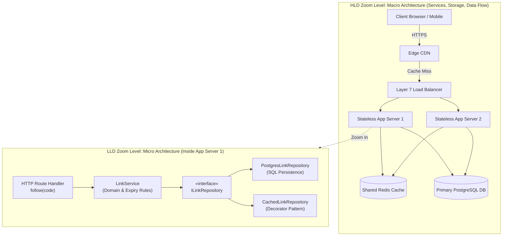
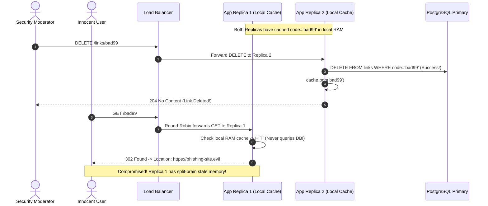

# Lesson 01: What Is System Design? HLD vs LLD

> **Prerequisites:** None (Foundational lesson; assumes basic familiarity with HTTP and any backend language).  
> **Estimated Reading Time:** 25 minutes  
> **Target Audience:** Software engineers and architects preparing for High-Level Design (HLD) and Low-Level Design (LLD) system design interviews.

> [!TIP]
> **The Golden Rule of System Design:** System design is not reciting buzzwords or drawing complex distributed systems from memory—it is turning concrete functional and non-functional requirements into justified architectural choices. Never introduce a new component (cache, queue, replica, or CDN) until an explicit scale, latency, or durability number forces you to pay its operational and consistency cost.

---

## Visual Mental Models & Architecture

### Visual Diagram

<a id="visual-diagram"></a>

### High-Level Design (HLD) vs. Low-Level Design (LLD)

System design interviews test engineering reasoning at two distinct zoom levels. Understanding which lens you are using prevents giving class-hierarchy answers in an infrastructure round or drawing load balancers in an object-oriented design round (see the [diagram below](#visual-diagram)).



### Evolutionary Scaling Progression (Stages 0 to 4)

Every scalable architecture begins as a single process and grows sequentially only when measured bottlenecks force each transition.

```mermaid
flowchart LR
    S0["Stage 0: Single Process<br/>(In-Memory Dict)<br/>0 Network Hops"] -->|"Fails: Restart loses data;<br/>cannot scale out"| S1["Stage 1: External DB<br/>(SQLite / Postgres)<br/>Durable State"]
    S1 -->|"Fails: Single app node<br/>is CPU bottleneck & SPOF"| S2["Stage 2: LB + Replicas<br/>(Stateless Fleet)<br/>High Availability"]
    S2 -->|"Fails: DB overwhelmed<br/>by hot read queries"| S3["Stage 3: Shared Cache<br/>(Redis)<br/>Sub-ms Hot Reads"]
    S3 -->|"Fails: Global users hit<br/>cross-continent latency"| S4["Stage 4: Global CDN<br/>(Edge Cache-Control)<br/>Edge Termination"]
```



---

## Systematic Taxonomic Reference Grids

### HLD vs. LLD Architectural Comparison Matrix

| Evaluation Axis | High-Level Design (HLD) | Low-Level Design (LLD) |
| :--- | :--- | :--- |
| **Core Question** | Which distributed parts exist, and how do bytes flow between them? | How is code organized inside a single service boundary? |
| **Primary Primitives** | API Gateways, Load Balancers, Caches, Queues, Databases, CDNs. | Classes, Interfaces, Value Objects, Dependency Injection, Design Patterns. |
| **Deliverables** | Box-and-arrow topology diagrams, back-of-envelope capacity math, API contracts. | UML class diagrams, sequence diagrams, SOLID module interfaces. |
| **Typical Prompt** | *"Design a URL shortener, news feed, or real-time chat platform."* | *"Design a parking lot, elevator controller, or rate-limiter library."* |
| **Failure Mode** | Single Point of Failure (SPOF), database bottlenecks, split-brain state. | Tight coupling, untestable business logic, concurrency race conditions. |
| **Curriculum Links** | [Track 14: System Design Interview Practice](../../../backend/14-system-design-interview-practice/README.md) | [Low-Level Design Track (LLD)](../../../lld/README.md) |

### Evolutionary System Progression: What Every Box Buys and Costs

| Stage | Added Infrastructure | What It Buys You | Operational & Architectural Cost |
| :--- | :--- | :--- | :--- |
| **Stage 0** | Single Monolith + In-Memory State | Zero network latency; zero operational overhead; ideal for local prototypes. | Data vanishes on restart; impossible to run $>1$ replica cleanly. |
| **Stage 1** | Dedicated Database Server | Process restarts survive; multiple app servers can share truth; backups possible. | Introduces network hop (0.5–2 ms), connection pool management, and schema migrations. |
| **Stage 2** | Load Balancer + Stateless Fleet | Horizontal read/write scaling; zero-downtime rolling deploys; node fault tolerance. | **Strict Stateless Rule** ([Lesson 19](../19-stateless-vs-stateful/README.md)): local memory cannot hold sessions; LB becomes a potential SPOF ([Lesson 17](../17-single-point-of-failure/README.md)). |
| **Stage 3** | Shared Distributed Cache (Redis) | Offloads 80–99% of repetitive DB reads; slashes p99 read latency to $\sim 1\text{ ms}$. | Stale reads within TTL window; cache invalidation complexity; cache stampede risk. |
| **Stage 4** | Global Edge CDN | Answers served from edge nodes near user; eliminates origin traffic spikes. | Loss of instant revocation (cannot recall cached redirect until TTL expires or API purge); extra vendor cost. |

---

## Production War Stories: Incident Post-Mortem

### SEV-1 Post-Mortem: The Process-Local Cache Split-Brain & Phantom Redirect Outage

#### Incident Overview
* **Severity:** SEV-1 (Data Corruption Visibility & Security Policy Violation)
* **Detection Time:** 3 hours post-deployment
* **Resolution Time:** 1 hour 15 minutes
* **Impact:** Deleted malicious phishing short-links remained active and redirecting users for up to 24 hours across 40% of application replicas.

#### What Happened
A growing link-shortening startup scaled from Stage 1 (single server + PostgreSQL) to Stage 2 (6 stateless FastAPI containers behind an AWS Application Load Balancer). To reduce PostgreSQL read load, an engineer implemented a Python in-process dictionary cache (`cache: dict[str, str] = {}`) with a 1-hour expiration inside each container, rather than deploying a shared Redis cluster.

1. A security moderator flagged and deleted a malicious phishing short-link (`code = "bad99"`) via the moderation dashboard.
2. The `DELETE /links/bad99` request was routed by the Load Balancer exclusively to **Replica #2**.
3. Replica #2 deleted the row from PostgreSQL and deleted `"bad99"` from its own local Python dictionary.
4. However, Replicas #1, #3, #4, #5, and #6 had previously cached `"bad99"` in their local memory heaps. They received zero notification of the deletion.
5. For the next 55 minutes, 5 out of every 6 incoming user requests continued receiving `302 Found` redirects to the phishing website, even though the record no longer existed in PostgreSQL! Worse, the CDN in front honored `Cache-Control: public, max-age=3600` and cemented the malicious redirect globally.



#### Root Cause Analysis
1. **Violation of the Stateless Replica Rule:** Keeping mutable cache state inside local process memory (`dict`) caused fleet replicas to diverge silently.
2. **Absence of Centralized Cache Invalidation:** A delete mutation on one node could not propagate invalidation signals to sibling replicas.
3. **Aggressive Edge Caching Without Purge Hooks:** Sending `Cache-Control: max-age=3600` without integrating CDN purge APIs prevented immediate takedowns.

#### The Fix & Architectural Hardening
1. **Migrated to Shared Redis Cluster (Stage 3):** Replaced process-local dictionaries with a centralized Redis cache so mutations (`DEL links:bad99`) invalidate state identically for all replicas.
2. **Event-Driven CDN Purge Webhook:** Linked database delete triggers to an asynchronous CDN cache invalidation API call.
3. **Strict Lease Duration:** Lowered edge TTL to `max-age=60` on security-sensitive dynamic redirects.

---

## Multi-Language Production Code Tabs

The implementations below demonstrate clean **LLD separation of concerns** (`LinkRepository` interface + domain service) inside an **HLD Stage 1–4 edge-cache-ready URL Shortener**. Notice how the handler emits `Cache-Control: public, max-age=60` so Stage 4 CDNs can accelerate redirects cleanly.

### Stage 1–4 Architectural Reference Implementations

````carousel
```go
// Go: Clean HLD + LLD Separation (Repository Interface + Cache-Control Redirect)
package main

import (
	"context"
	"crypto/rand"
	"database/sql"
	"encoding/base64"
	"encoding/json"
	"errors"
	"fmt"
	"log"
	"net/http"
	"strings"

	_ "github.com/mattn/go-sqlite3"
)

// LLD Boundary: Abstract Repository Interface
type LinkRepository interface {
	Save(ctx context.Context, code, url string) error
	FindURL(ctx context.Context, code string) (string, error)
}

// Concrete Persistence Adapter
type SQLiteLinkRepository struct {
	db *sql.DB
}

func (r *SQLiteLinkRepository) Save(ctx context.Context, code, url string) error {
	_, err := r.db.ExecContext(ctx, "INSERT INTO links (code, url) VALUES (?, ?)", code, url)
	return err
}

func (r *SQLiteLinkRepository) FindURL(ctx context.Context, code string) (string, error) {
	var url string
	err := r.db.QueryRowContext(ctx, "SELECT url FROM links WHERE code = ?", code).Scan(&url)
	if errors.Is(err, sql.ErrNoRows) {
		return "", nil
	}
	return url, err
}

// Domain Service
type LinkService struct {
	repo LinkRepository
}

func (s *LinkService) CreateShortLink(ctx context.Context, targetURL string) (string, error) {
	b := make([]byte, 4)
	if _, err := rand.Read(b); err != nil {
		return "", err
	}
	code := strings.TrimRight(base64.URLEncoding.EncodeToString(b), "=")
	if err := s.repo.Save(ctx, code, targetURL); err != nil {
		return "", err
	}
	return code, nil
}

func main() {
	db, err := sql.Open("sqlite3", "links.db")
	if err != nil {
		log.Fatal(err)
	}
	_, _ = db.Exec("CREATE TABLE IF NOT EXISTS links (code TEXT PRIMARY KEY, url TEXT NOT NULL)")

	service := &LinkService{repo: &SQLiteLinkRepository{db: db}}

	mux := http.NewServeMux()
	mux.HandleFunc("POST /links", func(w http.ResponseWriter, r *http.Request) {
		var body struct {
			URL string `json:"url"`
		}
		if err := json.NewDecoder(r.Body).Decode(&body); err != nil || body.URL == "" {
			http.Error(w, "invalid url payload", http.StatusBadRequest)
			return
		}
		code, err := service.CreateShortLink(r.Context(), body.URL)
		if err != nil {
			http.Error(w, "failed to create link", http.StatusInternalServerError)
			return
		}
		w.Header().Set("Content-Type", "application/json")
		w.WriteHeader(http.StatusCreated)
		_ = json.NewEncoder(w).Encode(map[string]string{
			"code":      code,
			"short_url": fmt.Sprintf("/%s", code),
		})
	})

	mux.HandleFunc("GET /{code}", func(w http.ResponseWriter, r *http.Request) {
		code := r.PathValue("code")
		url, err := service.repo.FindURL(r.Context(), code)
		if err != nil {
			http.Error(w, "internal error", http.StatusInternalServerError)
			return
		}
		if url == "" {
			http.Error(w, "unknown code", http.StatusNotFound)
			return
		}
		// HLD Stage 4: Authorize Edge CDNs to cache this redirect safely
		w.Header().Set("Cache-Control", "public, max-age=60")
		http.Redirect(w, r, url, http.StatusFound)
	})

	log.Println("Listening on :8000")
	log.Fatal(http.ListenAndServe(":8000", mux))
}
```
<!-- slide -->
```typescript
// TypeScript/Node.js: Stateless App Server with LinkRepository & CDN Cache-Control
import express, { Request, Response } from 'express';
import { randomBytes } from 'crypto';
import Database from 'better-sqlite3';

// LLD Interface
interface ILinkRepository {
  save(code: string, url: string): void;
  findUrl(code: string): string | null;
}

class SqliteLinkRepository implements ILinkRepository {
  constructor(private db: Database.Database) {
    this.db.exec('CREATE TABLE IF NOT EXISTS links (code TEXT PRIMARY KEY, url TEXT NOT NULL)');
  }

  save(code: string, url: string): void {
    this.db.prepare('INSERT INTO links (code, url) VALUES (?, ?)').run(code, url);
  }

  findUrl(code: string): string | null {
    const row = this.db.prepare('SELECT url FROM links WHERE code = ?').get(code) as { url: string } | undefined;
    return row ? row.url : null;
  }
}

class LinkService {
  constructor(private repo: ILinkRepository) {}

  createShortLink(targetUrl: string): string {
    const code = randomBytes(4).toString('base64url');
    this.repo.save(code, targetUrl);
    return code;
  }

  resolveLink(code: string): string | null {
    return this.repo.findUrl(code);
  }
}

const db = new Database(process.env.DB_PATH || 'links.db');
const service = new LinkService(new SqliteLinkRepository(db));
const app = express();
app.use(express.json());

app.post('/links', (req: Request, res: Response) => {
  const { url } = req.body;
  if (!url) return res.status(400).json({ detail: 'url required' });
  const code = service.createShortLink(url);
  res.status(201).json({ code, short_url: `/${code}` });
});

app.get('/:code', (req: Request, res: Response) => {
  const url = service.resolveLink(req.params.code);
  if (!url) return res.status(404).json({ detail: 'unknown code' });

  // HLD Stage 4: Instruct CDN and browsers to cache for 60s
  res.setHeader('Cache-Control', 'public, max-age=60');
  res.redirect(302, url);
});

app.listen(8000, () => console.log('Shortener listening on port 8000'));
```
<!-- slide -->
```python
# Python: FastAPI Stage 1-4 Shortener with LLD Repository Abstraction
import os
import secrets
import sqlite3
from typing import Protocol
from fastapi import FastAPI, HTTPException
from fastapi.responses import RedirectResponse
from pydantic import BaseModel, HttpUrl

CACHE_SECONDS = 60

# LLD Interface
class ILinkRepository(Protocol):
    def save(self, code: str, url: str) -> None: ...
    def find_url(self, code: str) -> str | None: ...

class SqliteLinkRepository:
    def __init__(self, db_path: str):
        self.db_path = db_path
        self._run("CREATE TABLE IF NOT EXISTS links (code TEXT PRIMARY KEY, url TEXT NOT NULL)")

    def _run(self, sql: str, args: tuple = ()) -> list[tuple]:
        db = sqlite3.connect(self.db_path)
        try:
            with db:
                return db.execute(sql, args).fetchall()
        finally:
            db.close()

    def save(self, code: str, url: str) -> None:
        self._run("INSERT INTO links (code, url) VALUES (?, ?)", (code, url))

    def find_url(self, code: str) -> str | None:
        rows = self._run("SELECT url FROM links WHERE code = ?", (code,))
        return rows[0][0] if rows else None

class NewLink(BaseModel):
    url: HttpUrl

def create_app(repo: ILinkRepository) -> FastAPI:
    app = FastAPI(title="Stateless Shortener")

    @app.post("/links", status_code=201)
    def create_link(body: NewLink):
        code = secrets.token_urlsafe(4)
        repo.save(code, str(body.url))
        return {"code": code, "short_url": f"/{code}"}

    @app.get("/{code}")
    def follow(code: str):
        url = repo.find_url(code)
        if url is None:
            raise HTTPException(status_code=404, detail="unknown code")
        # HLD Stage 4: Enable CDN edge caching cleanly
        return RedirectResponse(
            url,
            status_code=302,
            headers={"Cache-Control": f"public, max-age={CACHE_SECONDS}"}
        )

    return app

repo = SqliteLinkRepository(os.environ.get("DB_PATH", "links.db"))
app = create_app(repo)
```
<!-- slide -->
```csharp
// C#: ASP.NET Core Minimal API with Dependency-Injected Repository & Edge Headers
using System;
using System.Security.Cryptography;
using Microsoft.AspNetCore.Builder;
using Microsoft.AspNetCore.Http;
using Microsoft.Data.Sqlite;
using Microsoft.Extensions.DependencyInjection;

var builder = WebApplication.CreateBuilder(args);
var dbPath = Environment.GetEnvironmentVariable("DB_PATH") ?? "links.db";
builder.Services.AddSingleton<ILinkRepository>(new SqliteLinkRepository(dbPath));

var app = builder.Build();

app.MapPost("/links", (LinkRequest body, ILinkRepository repo) =>
{
    var bytes = RandomNumberGenerator.GetBytes(4);
    var code = Convert.ToBase64String(bytes).TrimEnd('=').Replace('+', '-').Replace('/', '_');
    repo.Save(code, body.Url);
    return Results.Created($"/{code}", new { code, short_url = $"/{code}" });
});

app.MapGet("/{code}", (string code, ILinkRepository repo, HttpContext ctx) =>
{
    var url = repo.FindUrl(code);
    if (url is null)
        return Results.NotFound(new { detail = "unknown code" });

    // HLD Stage 4: Authorize CDN edge caching
    ctx.Response.Headers.CacheControl = "public, max-age=60";
    return Results.Redirect(url, permanent: false);
});

app.Run("http://localhost:8000");

record LinkRequest(string Url);

interface ILinkRepository
{
    void Save(string code, string url);
    string? FindUrl(string code);
}

class SqliteLinkRepository : ILinkRepository
{
    private readonly string _connStr;

    public SqliteLinkRepository(string path)
    {
        _connStr = $"Data Source={path}";
        using var conn = new SqliteConnection(_connStr);
        conn.Open();
        using var cmd = conn.CreateCommand();
        cmd.CommandText = "CREATE TABLE IF NOT EXISTS links (code TEXT PRIMARY KEY, url TEXT NOT NULL)";
        cmd.ExecuteNonQuery();
    }

    public void Save(string code, string url)
    {
        using var conn = new SqliteConnection(_connStr);
        conn.Open();
        using var cmd = conn.CreateCommand();
        cmd.CommandText = "INSERT INTO links (code, url) VALUES (@code, @url)";
        cmd.Parameters.AddWithValue("@code", code);
        cmd.Parameters.AddWithValue("@url", url);
        cmd.ExecuteNonQuery();
    }

    public string? FindUrl(string code)
    {
        using var conn = new SqliteConnection(_connStr);
        conn.Open();
        using var cmd = conn.CreateCommand();
        cmd.CommandText = "SELECT url FROM links WHERE code = @code";
        cmd.Parameters.AddWithValue("@code", code);
        return cmd.ExecuteScalar() as string;
    }
}
```
````

---

## Practical Hands-On Verification CLI Workflows

Follow these steps to run two independent processes sharing a single durable database, verifying the fundamental rule of stateless scaling and inspecting HTTP `302` wire headers.

### Step 1: Launch Two Stateless App Instances Sharing State

Start Replica 1 on port 8001 and Replica 2 on port 8002 pointing at the exact same `links.db` database:

```bash
# Terminal 1 (Linux/macOS):
DB_PATH=links.db uvicorn shortener_v1:app --port 8001

# Terminal 2 (Linux/macOS):
DB_PATH=links.db uvicorn shortener_v1:app --port 8002
```

*(In Windows PowerShell: `$env:DB_PATH = "links.db"; uvicorn shortener_v1:app --port 8001`)*

### Step 2: Write to Replica 1

Dispatch a `POST /links` request strictly to Replica 1 on port `8001`:

```bash
curl -s -X POST http://127.0.0.1:8001/links \
  -H "Content-Type: application/json" \
  -d '{"url": "https://backendroadmap.com"}'
```

**Expected Wire Output:**
```json
{"code":"xY9k_Q","short_url":"/xY9k_Q"}
```

### Step 3: Read From Replica 2 & Verify Edge Cache Headers

Follow the short link against **Replica 2** on port `8002` (which has never handled the write!) using `curl -i`:

```bash
curl -i http://127.0.0.1:8002/xY9k_Q
```

**Expected Wire Output:**
```http
HTTP/1.1 302 Found
date: Wed, 11 Nov 2026 07:15:00 GMT
server: uvicorn
location: https://backendroadmap.com
cache-control: public, max-age=60
content-length: 0
```

Because state was moved out of process RAM (Stage 0 $\to$ Stage 1), Replica 2 immediately serves the redirect accurately, and `cache-control: public, max-age=60` authorizes downstream CDNs to cache the `302 Found` response cleanly.

---

## Operational Validation Checkpoints (Scenario Quizzes)

<details>
<summary><strong>Checkpoint 1: The Two-Replica State Divergence</strong></summary>

**Scenario:** An engineer writes a URL shortener storing links in a local process hash map (`links = {}`). To handle increased traffic, they spin up two containers behind a round-robin load balancer. When a user creates a short link, 50% of subsequent clicks succeed with `302 Found`, while the other 50% fail with `404 Not Found`. Why does this happen, and what specific architectural principle resolves it?

<strong>Answer:</strong>
Because the hash map lives exclusively in the private virtual memory space of each container process. When the load balancer routes `POST /links` to Container A, only Container A holds the key-value pair. Subsequent `GET /{code}` requests routed to Container B find an empty map and return `404`. To scale horizontally behind a load balancer, application servers must follow the **Stateless Architecture Rule**: extract all mutable state out of process RAM into an external shared data store (e.g., PostgreSQL or Redis) so every replica reads from and writes to the same authoritative source of truth.
</details>

<details>
<summary><strong>Checkpoint 2: Differentiating HLD vs. LLD Under Interview Constraints</strong></summary>

**Scenario:** You are asked to design a distributed rate limiter in a High-Level Design (HLD) round. Halfway through, you spend 15 minutes drawing the exact inheritance hierarchy and internal method signatures of a `TokenBucketStrategyFactory` Java class. Why is this a tactical mistake in an HLD round, and what should you cover instead?

<strong>Answer:</strong>
In an HLD round, detailing class inheritance hierarchies (`TokenBucketStrategyFactory`) focuses at the wrong zoom level (LLD). While clean code structure matters for maintainability, clean Java classes cannot prevent a split-brain cluster or a Redis hot-key outage. In an HLD interview, you should focus on macro distributed mechanics: where the limiter runs (API Gateway edge vs sidecar), how distributed state is synchronized atomically across servers (Redis + Lua scripts vs sticky routing), clock skew and race conditions, fail-open vs fail-closed degradation when Redis goes down, and latency overhead per request.
</details>

<details>
<summary><strong>Checkpoint 3: The Cache-Control Purge Trap</strong></summary>

**Scenario:** You optimize your URL shortener by emitting `Cache-Control: public, max-age=86400` (24 hours) so Edge CDNs cache redirects globally. Ten minutes later, a link owner notices a typo in the destination URL and deletes the short link in the web dashboard, returning `204 No Content`. Why do global users continue hitting the old, typoed destination for another 23 hours and 50 minutes, and what two architectural mitigations resolve this trade-off?

<strong>Answer:</strong>
Because Edge CDNs strictly honor the `Cache-Control: max-age=86400` contract—once stored at an edge POP (Point of Presence), the CDN will answer incoming `GET` requests directly from its local cache without contacting your origin servers for 24 hours.
To mitigate this staleness cost:
1. **Event-Driven Cache Purge:** When deleting or updating a link, emit an asynchronous invalidation call to the CDN's Purge API (`/purge/{code}`) to evict the edge entry immediately.
2. **Shorten the Cache Lease:** Reduce `max-age` (e.g., `60` seconds) or use `stale-while-revalidate` depending on how much stale window the business can tolerate versus origin database read load.
</details>

---

## Further Reading & Sources

- [What Is System Design? HLD vs LLD Explained (video, 2:24)](https://www.youtube.com/watch?v=aNVDz45U-cM) — Video walkthrough by the curriculum author.
- [Track 14, Module 01: The System Design Interview Framework](../../../backend/14-system-design-interview-practice/01-the-system-design-interview-framework/README.md) — The complete 7-step whiteboard pacing framework.
- [Low-Level Design Track (LLD)](../../../lld/README.md) — Complete object-oriented design patterns and SOLID engineering guide.
- [Designing Data-Intensive Applications](https://dataintensive.net/) — Martin Kleppmann's foundational text on reliability, scalability, and maintainability.
- [The System Design Primer](https://github.com/donnemartin/system-design-primer) — Free, open-source notes on load balancers, caches, CDNs, and the CAP theorem, with interview questions and sample designs.
- [AWS Well-Architected Framework](https://docs.aws.amazon.com/wellarchitected/latest/framework/welcome.html) — Standard methodology for evaluating trade-offs across architecture pillars.
- [Site Reliability Engineering](https://sre.google/sre-book/table-of-contents/) — Google's free online book covering load balancing, handling overload, and cascading failures.
- [NGINX: HTTP Load Balancing](https://nginx.org/en/docs/http/load_balancing.html) — The `upstream` block and round-robin defaults used in Stage 2 scaling.
- [MDN: HTTP Caching](https://developer.mozilla.org/en-US/docs/Web/HTTP/Guides/Caching) — How `Cache-Control: max-age` works, what shared CDN caches do with it, and invalidation windows.
- [FastAPI: First Steps](https://fastapi.tiangolo.com/tutorial/first-steps/) — The Python web framework used in the reference shortener service.

---

## Free PDF notes

Download the short version of this lesson as a printable PDF, with its diagrams and eight interview questions: [SD-A-001.pdf](https://backendroadmap.com/notes/system-design/SD-A-001.pdf). All Phase 1 notes in one file: [Phase 1, Core Fundamentals (PDF)](https://backendroadmap.com/notes/system-design/Phase1_Core_Fundamentals_Notes.pdf).

---

## Next

Continue with [Lesson 02: Client-Server and Multi-Tier Architecture](../02-client-server-and-multi-tier-architecture/README.md) to explore how dividing a system into presentation, application, and data tiers enables independent scaling and defense-in-depth security.
