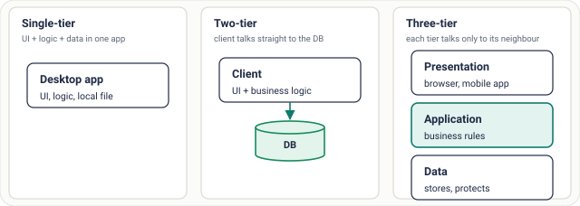
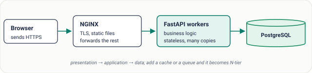

# Lesson 02: Client-Server and Multi-Tier Architecture

## Roadmap

You are in **System Design Interview Prep**, Track 01, **Core Fundamentals**: lesson 2 of 19 (why almost every app is split into layers). It builds on [Lesson 01: What Is System Design? HLD vs LLD](../01-what-is-system-design/README.md). Next comes [Lesson 03: Functional Requirements](../03-functional-requirements/README.md).

These are the written notes for the lesson's video. Prefer paper? The same notes are a free, printable PDF: [download SD-A-002.pdf](https://backendroadmap.com/notes/system-design/SD-A-002.pdf).

## Concept

> [!key] A client asks, a server answers; splitting the server side into presentation, application and data tiers lets each part scale, change and be secured on its own.

## Explanation

### Client and server

A **client** (a browser, a mobile app, another service) sends a **request**. A **server** does the work and sends back a **response**. The client never touches the server's internals; it only sees the API. That contract is what lets you change, scale or replace the server without shipping a new client.

### One, two, three … N tiers

*Figure 1. As tiers are added, business logic moves out of the client and the database stops being exposed to every user.*

| Layout | Where the logic lives | Good for | Problem |
|---|---|---|---|
| **Single-tier** | One program on one machine | Desktop tools, scripts | Nothing is shared or scalable |
| **Two-tier** | In every client | Small internal tools | DB exposed to all clients; logic copied everywhere |
| **Three-tier** | The application tier | Most web and mobile apps | More moving parts to run |
| **N-tier** | App tier + caches, queues, workers | Large systems | Operational complexity, more hops |

### A real request, tier by tier

*Figure 2. A typical three-tier web stack. Only the application tier can reach the database.*

1. **Browser → NGINX.** The reverse proxy terminates TLS, serves static files and forwards API calls.
2. **NGINX → FastAPI workers.** A pool of identical, stateless workers runs the business rules.
3. **Workers → PostgreSQL.** Reads and writes go to the data tier, which owns the state.

### Why separate the tiers

- **Independent scaling.** The app tier is stateless, so you scale it *out* by adding workers. The data tier holds state, so it scales differently: a bigger machine, read replicas, or sharding.
- **Independent change.** Redesign the UI without touching the database; migrate the database without changing the UI.
- **Security.** Only the app tier can reach the database, so the data sits behind one controlled door instead of being open to every client.

> [!example] **Worked example: the slowest tier wins.** The database is overloaded and every page slows to 2 s. You double the app servers. Pages get *slower*: twice the workers open twice the database connections and add load to the bottleneck. The fix belongs in the data tier: a cache for hot reads, connection pooling, read replicas, or better indexes.

> [!model] **Trade-off: more tiers vs fewer hops.** Every tier adds a network hop (often 0.5–2 ms inside a data centre), another thing to deploy and another thing that can fail. Add a tier when it solves a real problem (scaling, security, caching), not by default.

## Key terms

| Term | Meaning |
|---|---|
| **Client / server** | asks / answers |
| **Tier** | a layer with one job, often its own machines |
| **Presentation tier** | what users see |
| **Application tier** | business rules, stateless |
| **Data tier** | owns and protects state |
| **Reverse proxy** | front door: TLS, routing, static files |

## Interview questions

Each question is tagged by kind: **Basic** (definitions), **Scenario** (apply it to a system) and **Tricky** (the follow-ups interviewers use to go deeper). Answer out loud before you open the answer.

> [!interview] Why separate the application tier from the data tier? (Basic)

What a strong answer covers

So each can scale, change and be secured independently: stateless app servers scale out cheaply, the stateful database scales with replicas or sharding, and only the app tier can reach the data.

> [!interview] What's the difference between two-tier and three-tier? (Basic)

What a strong answer covers

In two-tier, clients talk to the database directly and carry the business logic. Three-tier puts an application server in between, so logic lives in one place and the database is no longer exposed.

> [!interview] Why must the application tier be stateless to scale out? (Basic)

What a strong answer covers

Any copy must be able to serve any request. If a session lives in one server's memory, a load balancer can't move that user elsewhere; keep state in a database, cache or signed token instead.

> [!interview] Pages slow down when the database is overloaded. You add app servers. What happens? (Scenario)

What a strong answer covers

It gets worse: more app servers open more database connections and add load to the bottleneck. Measure, then fix the data tier with caching, pooling, read replicas or indexing.

> [!interview] Where would you put a cache in a three-tier app? (Scenario)

What a strong answer covers

Between the application tier and the database for hot reads (Redis), and at the edge for static content (CDN). The app tier checks the cache first and falls back to the database.

> [!interview] A mobile app needs data from three backend services. How do you avoid three round trips from the phone? (Scenario)

What a strong answer covers

Add a layer in front (an API gateway or a backend-for-frontend) that calls the services in parallel inside the data centre and returns one response.

> [!interview] Every tier adds latency. When is a new tier not worth it? (Tricky)

What a strong answer covers

When it doesn't solve a measured problem. Each hop adds network time, deployment work and a failure point; a small app with low traffic is often better as a simple three-tier stack.

> [!interview] Is a microservices system still “three-tier”? (Tricky)

What a strong answer covers

Each service is usually its own small multi-tier stack (API, logic, its own database). The system overall is N-tier: gateway, many services, caches, queues and data stores.

## Common mistakes & troubleshooting

- Scaling the app tier when the database is the bottleneck.
- Keeping user sessions in an app server's memory, which breaks horizontal scaling.
- Letting clients talk to the database directly “just for this report”.

## Free PDF notes

Download these notes as a printable PDF, with every diagram: [SD-A-002.pdf](https://backendroadmap.com/notes/system-design/SD-A-002.pdf). All Phase 1 notes in one file: [Phase 1, Core Fundamentals (PDF)](https://backendroadmap.com/notes/system-design/Phase1_Core_Fundamentals_Notes.pdf).

## Next

Continue with [Lesson 03: Functional Requirements](../03-functional-requirements/README.md).
