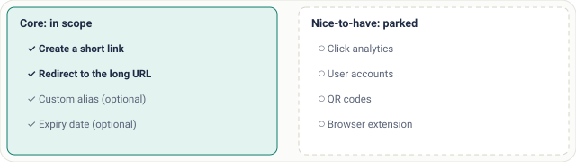
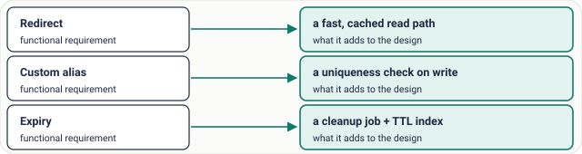

# Lesson 03: Functional Requirements

## Roadmap

You are in **System Design Interview Prep**, Track 01, **Core Fundamentals**: lesson 3 of 19 (what the system must do, and what to leave out). It builds on [Lesson 02: Client-Server and Multi-Tier Architecture](../02-client-server-and-multi-tier-architecture/README.md). Next comes [Lesson 04: Non-Functional Requirements](../04-non-functional-requirements/README.md).

These are the written notes for the lesson's video. Prefer paper? The same notes are a free, printable PDF: [download SD-A-003.pdf](https://backendroadmap.com/notes/system-design/SD-A-003.pdf).

## Concept

> [!key] Functional requirements are the features, written as user actions; pick the 3–5 that make the product work, park the rest, and confirm the list before you design.

## Explanation

### What they are

Functional requirements describe **what** the system does: its features. Not how fast or how big (that's non-functional, next lesson). Write them as **user actions**: “a user can create a short link”, “a user opening the link is redirected”. User actions are concrete, testable, and map straight to API endpoints.

### From questions to a short list

1. **Ask first.** Who are the users? What must they be able to do? What does success look like?
2. **List the core use cases.** For a URL shortener: create a short link, redirect to the original URL.
3. **Add the optional extras the interviewer cares about:** a custom alias, an expiry date.
4. **Park the nice-to-haves.** Write them down so the interviewer sees you thought of them, then leave them out.
5. **Confirm.** “I'll focus on creating and redirecting, with custom aliases and expiry. Analytics are out of scope. Does that match what you want?”

*Figure 1. A URL shortener's requirements, split into what you design now and what you park.*

> [!model] **The rule of thumb.** Keep **3–5 core use cases**. For each feature ask: without it, does the product still work? If yes, it's out of scope for now. A smaller scope lets you go deep on the hard parts in 45 minutes instead of drawing a shallow version of everything.

### Requirements decide the architecture

Every requirement adds work to the design, so the list you agree on shapes everything after it.

*Figure 2. Each functional requirement becomes a concrete piece of the design.*

### Worked example: a chat app

> [!example] **Chat app, in scope.** - Send and receive one-to-one messages
> - Group chats
> - Online status (presence)
> - Message history
> - Read receipts
> **Confirm the edges:** “Are media uploads, voice or video calls in scope?” Usually they are not, and each would add a large subsystem (object storage, media processing, real-time media servers).

## Key terms

| Term | Meaning |
|---|---|
| **Functional requirement** | a feature: what the system does |
| **Use case** | one user action and its result |
| **Scope** | what you will and won't design |
| **Nice-to-have** | noted, then parked |
| **Core use case** | without it, the product doesn't work |
| **Clarifying question** | turns a vague prompt into a list |

## Interview questions

Each question is tagged by kind: **Basic** (definitions), **Scenario** (apply it to a system) and **Tricky** (the follow-ups interviewers use to go deeper). Answer out loud before you open the answer.

> [!interview] How do you decide which features are in scope? (Basic)

What a strong answer covers

Ask clarifying questions, list the user actions, keep the 3–5 the product can't work without, park the rest out loud, and confirm the list with the interviewer.

> [!interview] What's the difference between a functional and a non-functional requirement? (Basic)

What a strong answer covers

Functional says what the system does (“send a message”). Non-functional says how well (“delivered in under 500 ms, 99.99% available”). The first drives the API and data model; the second drives the architecture's capacity and redundancy.

> [!interview] List functional requirements for a chat app. (Basic)

What a strong answer covers

One-to-one messages, group chats, online presence, message history, read receipts. Confirm whether media, voice and video are in scope; usually they are not.

> [!interview] The prompt is just “Design YouTube.” What do you ask? (Scenario)

What a strong answer covers

Who uploads and who watches? Must I cover upload, processing, playback, search, comments, recommendations? Which are core? Then agree on something like upload, transcode, stream and view counts, and park the rest.

> [!interview] You agreed on “create and redirect.” The interviewer later asks about analytics. What do you do? (Scenario)

What a strong answer covers

Show you parked it on purpose, then sketch how it plugs in without redesigning: emit a click event on each redirect to a queue, aggregate it asynchronously, and keep the redirect path fast.

> [!interview] What does “custom alias” add to a URL shortener's design? (Scenario)

What a strong answer covers

A uniqueness check at write time (a unique index or conditional insert), a rule for reserved words, and a clear error when the alias is taken.

> [!interview] Why not include every feature you can think of? (Tricky)

What a strong answer covers

Time and depth. In 45 minutes a broad design stays shallow; interviewers score depth on the hard parts. A tight scope also makes the capacity estimates and trade-offs concrete.

> [!interview] Is “the system must be secure” a functional requirement? (Tricky)

What a strong answer covers

No, it's a quality attribute (non-functional). A functional version would be a specific action, like “only the owner can delete their link”.

## Common mistakes & troubleshooting

- Drawing boxes before agreeing on features.
- Listing 15 features and designing none well.
- Mixing in non-functional goals (“must be fast”) instead of user actions.
- Never confirming scope, then being asked about a feature you skipped.

## Free PDF notes

Download these notes as a printable PDF, with every diagram: [SD-A-003.pdf](https://backendroadmap.com/notes/system-design/SD-A-003.pdf). All Phase 1 notes in one file: [Phase 1, Core Fundamentals (PDF)](https://backendroadmap.com/notes/system-design/Phase1_Core_Fundamentals_Notes.pdf).

## Next

Continue with [Lesson 04: Non-Functional Requirements](../04-non-functional-requirements/README.md).
