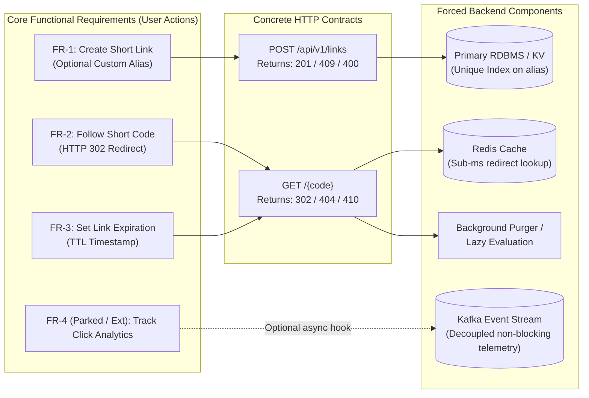
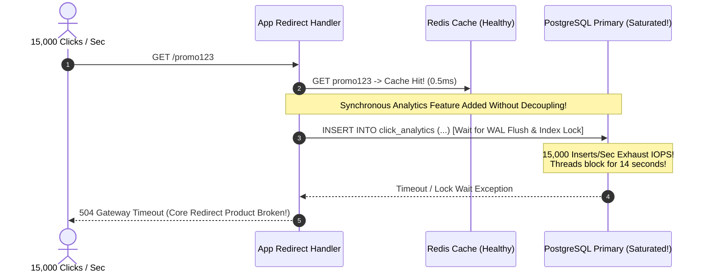

# Lesson 03: Functional Requirements

> **Prerequisites:** [Lesson 02: Client-Server and Multi-Tier Architecture](../02-client-server-and-multi-tier-architecture/README.md).  
> **Estimated Reading Time:** 25 minutes  
> **Target Audience:** Software engineers and architects transforming vague product prompts into bounded, testable system specifications.

> [!TIP]
> **The Golden Rule of Functional Scoping:** Functional requirements define **what** the system does as explicit user actions, never how fast or scalable it runs. Always bound a system design interview to **3–5 core P0 use cases** before drawing a single architectural box—explicitly park secondary features out loud so you can build deep technical rigor on the critical path instead of sketching a shallow diagram of 15 features.

---

## Visual Mental Models & Architecture

### Triage: Separating Core P0 Requirements from Parked Features

In a 45-minute architecture interview, scope creep is fatal. Without deliberate triage, you will waste critical architectural depth designing reporting dashboards or account billing before addressing the core system bottleneck.


*Figure 1. A URL shortener's requirements, split into what you design now and what you park.*

### Direct Mapping: From User Action to Concrete Infrastructure

Every functional requirement you accept translates directly into API routes, database constraints, and dedicated infrastructure components.


*Figure 2. Each functional requirement becomes a concrete piece of the design.*



---

## Systematic Taxonomic Reference Grids

### Functional vs. Non-Functional Separation Matrix

| Engineering Dimension | Functional Requirements (FR) | Non-Functional Requirements (NFR) |
| :--- | :--- | :--- |
| **Core Focus** | **What** the system does (features, user workflows). | **How well** the system performs (scale, latency, reliability). |
| **Granularity** | Discrete user actions (CRUD operations, notifications, queries). | Quantitative system constraints (p99 < 50ms, 99.99% uptime). |
| **Primary Architectural Impact** | Determines **API contracts, Domain Models, and Endpoints**. | Determines **Topology (caches, replicas, sharding, CDNs)**. |
| **Example (Bad / Vague)** | *"Manage short links and analytics."* | *"System must be super fast and secure."* |
| **Example (Concrete)** | *"Owner creates short link with custom alias; visitors redirect unless expired."* | *"Support 10,000 redirect RPS at p99 < 25ms with 99.99% availability."* |

### Interview Scoping & Triage Guide Across Classic Prompts

| Classic Prompt | Mandatory Questions to Ask First | P0 Core Requirements (Design Now) | Parked Out-of-Scope (Mention & Defer) |
| :--- | :--- | :--- | :--- |
| **Design a URL Shortener** | Custom aliases? Expiration? Edit/delete links? Analytics needed? | 1. Generate unique short URL<br/>2. Redirect visitor (`302`)<br/>3. Optional custom alias & TTL | User accounts/OAuth, real-time click heatmaps, malware URL scanning. |
| **Design a Chat App** | 1:1 only or group chats? Max group size? Media uploads? Read receipts? | 1. 1:1 & small group messaging<br/>2. Online presence indicator<br/>3. Persistent message history | Voice/video calls (WebRTC), full-text message search, large video transcoding. |
| **Design YouTube** | Upload formats? Resolutions? Comments/likes? Live streaming? | 1. Video upload & chunked ingestion<br/>2. Transcoding pipeline<br/>3. Adaptive bitrate playback | Live streaming, recommendation ML engine, comment moderation, ad bidding. |
| **Design Rate Limiter** | Per-user, per-IP, or per-tenant? Soft warning or hard drop? Multi-region? | 1. Evaluate request against quota rule<br/>2. Return `429` + `Retry-After`<br/>3. Low-latency distributed state check | Self-serve billing UI, anomaly ML fraud detection, complex reporting UI. |

---

## Production War Stories: Incident Post-Mortem

### SEV-2 Post-Mortem: The Unscoped Synchronous Click Analytics Meltdown

#### Incident Overview
* **Severity:** SEV-2 (Core Critical-Path Latency Degradation & Complete Redirect Freeze)
* **Detection Time:** 12 minutes after minor feature deployment
* **Resolution Time:** 45 minutes
* **Impact:** Redirect latency jumped from 12ms to 14,000ms (14 seconds), triggering upstream load balancer 504 timeouts for 85,000 clicks/minute.

#### What Happened
A URL shortener platform originally focused strictly on its core P0 functional requirements (`create` and `redirect`). During a sprint review, a product manager asked to *"just log every click into the `click_analytics` table so marketing can see daily totals."*

An engineer added a synchronous `INSERT INTO click_analytics` directly inside the hot `GET /{code}` redirect endpoint:
```python
@app.get("/{code}")
def follow(code: str):
    url = cache.get(code) or db.fetch_url(code)
    # BUG: Unscoped non-critical feature placed synchronously on critical path!
    db.execute(
        "INSERT INTO click_analytics (code, user_agent, ip, ts) VALUES (:c, :ua, :ip, NOW())",
        {"c": code, "ua": req.headers["user-agent"], "ip": req.client.host}
    )
    return RedirectResponse(url, status_code=302)
```

Three days later, an influencer shared a link that generated 15,000 clicks per second:
1. Reads (`SELECT url`) were cached cleanly in Redis and handled 15,000 RPS effortlessly.
2. However, the synchronous `INSERT INTO click_analytics` bypassed the cache and hammered the single PostgreSQL primary with 15,000 row writes/second plus B-Tree index maintenance.
3. PostgreSQL IOPS saturated at 100%, exhausting write connection slots and blocking every `GET /{code}` HTTP worker thread waiting for `INSERT` completion before sending the `302 Found` redirect!



#### Root Cause Analysis
1. **Conflating Critical P0 Flows with Secondary Features:** Analytics is a non-blocking secondary requirement that should never sit synchronously on the critical user-facing redirect path.
2. **Database Write Amplification:** Converting a 100% read-heavy cache hit workload (`GET /{code}`) into a synchronous database write workload eliminated the architectural benefit of Redis caching.

#### The Fix & Architectural Hardening
1. **Decoupled Analytics via Asynchronous Event Stream:** Emitted a non-blocking fire-and-forget click event (`kafka.produce("clicks", ...)`) with an in-memory bounded buffer. If the broker buffers overflow, metrics drop gracefully rather than stalling a customer's `302 Redirect`.
2. **Micro-Batched Ingestion:** Background stream consumers aggregate click increments over 10-second windows in memory and flush bulk updates (`UPDATE links SET clicks = clicks + batch_count`) to the warehouse database.

---

## Multi-Language Production Code Tabs

The implementations below show how cleanly agreed **Functional Requirements** map directly to concrete API contracts:
- **FR-1:** `POST /links` supporting custom aliases (`409 Conflict` if taken, `400 Bad Request` for reserved keywords).
- **FR-2:** `GET /{code}` performing fast redirect lookup (`302 Found`, `404 Unknown`).
- **FR-3:** Enforcing link expiration cleanly (`410 Gone`).
- **FR-4 (Parked / Extensible Hook):** Firing an asynchronous analytics hook without blocking the critical path.

### Functional Contract Implementation Across Languages

````carousel
```go
// Go: Functional Requirements Mapped to Clean REST Contracts & Non-Blocking Hook
package main

import (
	"encoding/json"
	"net/http"
	"sync"
	"time"
)

type ShortLink struct {
	Code      string
	TargetURL string
	ExpiresAt *time.Time
}

var reservedAliases = map[string]bool{
	"health": true, "admin": true, "api": true, "links": true,
}

type ShortenerServer struct {
	mu          sync.RWMutex
	store       map[string]ShortLink
	clickEvents chan string // FR-4: Decoupled non-blocking analytics queue
}

func NewShortenerServer() *ShortenerServer {
	s := &ShortenerServer{
		store:       make(map[string]ShortLink),
		clickEvents: make(chan string, 10000),
	}
	// Background non-blocking analytics drainer
	go func() {
		for code := range s.clickEvents {
			_ = code // Batch write to analytical datastore asynchronously
		}
	}()
	return s
}

// FR-1: Create Short Link with Optional Custom Alias & Expiry
func (s *ShortenerServer) HandleCreate(w http.ResponseWriter, r *http.Request) {
	var req struct {
		URL           string `json:"url"`
		CustomAlias   string `json:"custom_alias"`
		ExpiresInSecs int    `json:"expires_in_seconds"`
	}
	if err := json.NewDecoder(r.Body).Decode(&req); err != nil || req.URL == "" {
		http.Error(w, "invalid payload", http.StatusBadRequest)
		return
	}

	code := req.CustomAlias
	if code != "" {
		if reservedAliases[code] {
			http.Error(w, "alias uses a reserved platform keyword", http.StatusBadRequest)
			return
		}
	} else {
		code = fmt.Sprintf("lnk%d", time.Now().UnixNano()%100000)
	}

	var expiresAt *time.Time
	if req.ExpiresInSecs > 0 {
		t := time.Now().Add(time.Duration(req.ExpiresInSecs) * time.Second)
		expiresAt = &t
	}

	s.mu.Lock()
	defer s.mu.Unlock()
	if _, exists := s.store[code]; exists {
		http.Error(w, "custom alias already taken", http.StatusConflict) // 409
		return
	}

	s.store[code] = ShortLink{Code: code, TargetURL: req.URL, ExpiresAt: expiresAt}
	w.WriteHeader(http.StatusCreated)
	_ = json.NewEncoder(w).Encode(map[string]string{"code": code, "short_url": "/" + code})
}

// FR-2 & FR-3: Redirect & Enforce Expiry Without Blocking on Analytics
func (s *ShortenerServer) HandleRedirect(w http.ResponseWriter, r *http.Request) {
	code := r.PathValue("code")

	s.mu.RLock()
	link, exists := s.store[code]
	s.mu.RUnlock()

	if !exists {
		http.Error(w, "unknown short code", http.StatusNotFound) // 404
		return
	}
	if link.ExpiresAt != nil && time.Now().After(*link.ExpiresAt) {
		http.Error(w, "short link expired", http.StatusGone) // 410 Gone (FR-3)
		return
	}

	// FR-4 Extensibility: Non-blocking enqueue (drops cleanly if analytics queue full)
	select {
	case s.clickEvents <- code:
	default:
	}

	http.Redirect(w, r, link.TargetURL, http.StatusFound) // 302
}
```
<!-- slide -->
```typescript
// TypeScript/Node.js: Functional Contract Implementation with Non-Blocking Event Hook
import express, { Request, Response } from 'express';
import { EventEmitter } from 'events';

interface ShortLink {
  code: string;
  url: string;
  expiresAt?: number;
}

const RESERVED_WORDS = new Set(['health', 'admin', 'api', 'links', 'metrics']);
const store = new Map<string, ShortLink>();
const analyticsBus = new EventEmitter();

// FR-4 Extensibility: Parked analytics processed asynchronously off critical path
analyticsBus.on('link.clicked', (code: string) => {
  setImmediate(() => {
    // Buffer and flush asynchronously to warehouse/Kafka
  });
});

const app = express();
app.use(express.json());

// FR-1: Create Link (supports Custom Alias & Expiry)
app.post('/links', (req: Request, res: Response) => {
  const { url, custom_alias, expires_in_seconds } = req.body;
  if (!url) return res.status(400).json({ error: 'url is required' });

  const code = custom_alias ? custom_alias.trim().toLowerCase() : Math.random().toString(36).substring(2, 8);

  if (RESERVED_WORDS.has(code)) {
    return res.status(400).json({ error: `Alias '${code}' is a reserved keyword` });
  }
  if (store.has(code)) {
    return res.status(409).json({ error: 'Custom alias already in use' }); // 409 Conflict
  }

  const expiresAt = expires_in_seconds ? Date.now() + expires_in_seconds * 1000 : undefined;
  store.set(code, { code, url, expiresAt });

  res.status(201).json({ code, short_url: `/${code}` });
});

// FR-2 & FR-3: Redirect & Expiry Check
app.get('/:code', (req: Request, res: Response) => {
  const link = store.get(req.params.code);
  if (!link) return res.status(404).json({ error: 'unknown code' });

  if (link.expiresAt && Date.now() > link.expiresAt) {
    return res.status(410).json({ error: 'link has expired' }); // 410 Gone
  }

  // Non-blocking emission
  analyticsBus.emit('link.clicked', link.code);

  res.redirect(302, link.url);
});
```
<!-- slide -->
```python
# Python: FastAPI Functional Requirements Contract Implementation
import secrets
import time
from fastapi import FastAPI, HTTPException, BackgroundTasks
from fastapi.responses import RedirectResponse
from pydantic import BaseModel, HttpUrl

RESERVED_ALIASES = {"health", "admin", "api", "links", "docs"}
links_db: dict[str, dict] = {}

app = FastAPI(title="Scoped URL Shortener")

class CreateLinkRequest(BaseModel):
    url: HttpUrl
    custom_alias: str | None = None
    expires_in_seconds: int | None = None

def emit_click_telemetry(code: str) -> None:
    """Parked FR-4: Executed asynchronously after redirect response is flushed."""
    pass

# FR-1: Create Short Link with Custom Alias Collision & Reserved Guard
@app.post("/links", status_code=201)
def create_link(body: CreateLinkRequest):
    code = body.custom_alias.strip().lower() if body.custom_alias else secrets.token_urlsafe(4)

    if code in RESERVED_ALIASES:
        raise HTTPException(status_code=400, detail=f"Alias '{code}' is reserved")
    if code in links_db:
        raise HTTPException(status_code=409, detail="Custom alias already taken")

    expires_at = (time.time() + body.expires_in_seconds) if body.expires_in_seconds else None
    links_db[code] = {"url": str(body.url), "expires_at": expires_at}
    return {"code": code, "short_url": f"/{code}"}

# FR-2 & FR-3: Redirect with Expiry Enforcement & Non-Blocking Telemetry
@app.get("/{code}")
def follow_link(code: str, background_tasks: BackgroundTasks):
    entry = links_db.get(code)
    if entry is None:
        raise HTTPException(status_code=404, detail="Unknown short code")

    if entry["expires_at"] is not None and time.time() > entry["expires_at"]:
        raise HTTPException(status_code=410, detail="Link expired")  # HTTP 410 Gone

    background_tasks.add_task(emit_click_telemetry, code)
    return RedirectResponse(entry["url"], status_code=302)
```
<!-- slide -->
```csharp
// C#: Minimal API Mapping Functional Requirements Cleanly to HTTP Contracts
using System;
using System.Collections.Concurrent;
using System.Collections.Generic;
using System.Threading.Channels;
using Microsoft.AspNetCore.Builder;
using Microsoft.AspNetCore.Http;

var builder = WebApplication.CreateBuilder(args);
var app = builder.Build();

var links = new ConcurrentDictionary<string, (string Url, DateTimeOffset? ExpiresAt)>();
var reservedWords = new HashSet<string>(StringComparer.OrdinalIgnoreCase) { "health", "admin", "api", "links" };
var telemetryChannel = Channel.CreateBounded<string>(10_000);

// FR-1: Create Link (Supports Custom Alias + Reserved Check + Expiry)
app.MapPost("/links", (CreateLinkDto body) =>
{
    var code = string.IsNullOrWhiteSpace(body.CustomAlias)
        ? Guid.NewGuid().ToString("N")[..6]
        : body.CustomAlias.Trim().ToLowerInvariant();

    if (reservedWords.Contains(code))
        return Results.BadRequest(new { error = $"Alias '{code}' is reserved" });

    DateTimeOffset? expiresAt = body.ExpiresInSeconds.HasValue
        ? DateTimeOffset.UtcNow.AddSeconds(body.ExpiresInSeconds.Value)
        : null;

    if (!links.TryAdd(code, (body.Url, expiresAt)))
        return Results.Conflict(new { error = "Custom alias already taken" }); // 409 Conflict

    return Results.Created($"/{code}", new { code, short_url = $"/{code}" });
});

// FR-2 & FR-3: Redirect & Enforce Expiration Cleanly
app.MapGet("/{code}", (string code) =>
{
    if (!links.TryGetValue(code, out var entry))
        return Results.NotFound(new { error = "unknown code" });

    if (entry.ExpiresAt.HasValue && DateTimeOffset.UtcNow > entry.ExpiresAt.Value)
        return Results.StatusCode(StatusCodes.Status410Gone); // 410 Gone

    telemetryChannel.Writer.TryWrite(code); // Non-blocking analytics enqueue
    return Results.Redirect(entry.Url, permanent: false);
});

app.Run("http://localhost:8000");

record CreateLinkDto(string Url, string? CustomAlias, int? ExpiresInSeconds);
```
````

---

## Practical Hands-On Verification CLI Workflows

Test your Functional Requirement API contracts systematically—verifying valid creation (`201`), alias conflict resolution (`409`), reserved word blocking (`400`), and link expiration semantics (`410 Gone`).

### Step 1: Validate Reserved Alias Blocking (FR-1 Guard)

Attempt to claim `"admin"` as a custom alias:

```bash
curl -i -s -X POST http://127.0.0.1:8000/links \
  -H "Content-Type: application/json" \
  -d '{"url": "https://attacker.example", "custom_alias": "admin"}'
```

**Expected Wire Output:**
```http
HTTP/1.1 400 Bad Request
content-type: application/json

{"detail":"Alias 'admin' is reserved"}
```

### Step 2: Validate Atomic Alias Collision Enforcement (409 Conflict)

Register `"launch26"` once, then attempt a conflicting registration for `"launch26"`:

```bash
# 1st attempt: Succeeds cleanly
curl -s -X POST http://127.0.0.1:8000/links \
  -H "Content-Type: application/json" \
  -d '{"url": "https://example.com/v1", "custom_alias": "launch26"}'

# 2nd attempt: Must be rejected with 409 Conflict
curl -i -s -X POST http://127.0.0.1:8000/links \
  -H "Content-Type: application/json" \
  -d '{"url": "https://example.com/v2", "custom_alias": "launch26"}'
```

**Expected Wire Output (2nd Attempt):**
```http
HTTP/1.1 409 Conflict
content-type: application/json

{"detail":"Custom alias already taken"}
```

### Step 3: Validate Expiration Enforcement (FR-3: 410 Gone)

Create a link configured with `expires_in_seconds: 2`, wait 3 seconds, and attempt retrieval:

```bash
curl -s -X POST http://127.0.0.1:8000/links \
  -H "Content-Type: application/json" \
  -d '{"url": "https://example.com", "custom_alias": "flash", "expires_in_seconds": 2}'

sleep 3

curl -i -s http://127.0.0.1:8000/flash
```

**Expected Wire Output:**
```http
HTTP/1.1 410 Gone
content-type: application/json

{"detail":"Link expired"}
```

---

## Operational Validation Checkpoints (Scenario Quizzes)

<details>
<summary><strong>Checkpoint 1: Scoping Under Interview Ambiguity</strong></summary>

**Scenario:** An interviewer opens a 45-minute round with a two-word prompt: *"Design YouTube."* If you immediately walk to the whiteboard and begin drawing Kafka, CDNs, transcoders, comment moderation AI, live chat WebSockets, and real-time ad-bidding auctions, why are you likely to fail the round? What should your first 3 minutes look like?

<strong>Answer:</strong>
Listing 15 components immediately leaves you with 2 minutes per subsystem—guaranteeing a superficial, check-box design lacking concrete scaling math, failure analysis, or concurrency handling. Instead, spend the first 3 minutes asking clarifying questions to scope the system down to **3–5 core P0 user actions**:
1. *"Should we focus on VOD (Video on Demand) upload and adaptive playback, and treat Live Streaming, Comments, and Ad-Bidding as out-of-scope for now?"*
2. *"Are we optimizing primarily for upload ingestion or massive global playback ratio?"*
Once confirmed, you park the secondary features explicitly on the side of the board and achieve deep mastery over chunked uploads, transcoding DAG pipelines, and CDN bitrate delivery.
</details>

<details>
<summary><strong>Checkpoint 2: Architectural Pivot When a Parked Feature Re-Enters</strong></summary>

**Scenario:** In a URL shortener interview, you agreed with the interviewer to park "Real-Time Click Analytics" so you could focus on ultra-fast `create` and `redirect` paths. Thirty minutes later, after you finish your core architecture, the interviewer asks: *"Actually, marketing now requires click counts and referrers per link. Does your architecture break?"* How do you integrate analytics safely without degrading redirect latency?

<strong>Answer:</strong>
Because we intentionally decoupled the system cleanly along functional boundaries, analytics plugs in asynchronously without modifying the synchronous redirect database flow:
- The `GET /{code}` redirect handler resolves from Redis/CDN and emits an asynchronous click telemetry event onto a lightweight message queue/event bus (such as Kafka or Amazon Kinesis).
- Dedicated analytical stream workers (e.g., Flink or batch consumers) consume click events in 10-second windows and write aggregated counts into a separate analytical store (ClickHouse or PostgreSQL batch updates).
- Crucially, if the analytics broker is down or slow, the redirect path drops the event gracefully and still completes the user's `302 Redirect` in $< 15\text{ ms}$.
</details>

<details>
<summary><strong>Checkpoint 3: Differentiating Security Constraints from Functional Actions</strong></summary>

**Scenario:** During requirements gathering for a banking ledger, a stakeholder states: *"Requirement 1: The system must be secure. Requirement 2: The system must be fast."* Why do both statements fail as Functional Requirements, and how must you rewrite them into actionable engineering targets?

<strong>Answer:</strong>
Neither statement describes a specific user action; both are vague **Non-Functional qualities**:
1. *"Must be secure"* $\to$ Convert into concrete **Functional** actions (e.g., *"FR: Only authenticated account owners may initiate transfers; transfer requests require MFA verification"*) alongside measurable **Non-Functional** standards (e.g., *"NFR: TLS 1.3 in transit, AES-256 encryption at rest, PCI-DSS compliant audit log"*).
2. *"Must be fast"* $\to$ Convert into concrete **Non-Functional** percentile targets paired with load (e.g., *"NFR: p99 transfer settlement latency < 250 ms at 2,000 peak TPS"*).
</details>

---

## Further Reading & Sources

- [Track 14, Module 01: The System Design Interview Framework](../../../backend/14-system-design-interview-practice/01-the-system-design-interview-framework/README.md) — Step-by-step pacing rubric from scoping to failure analysis.
- [RFC 9110: HTTP Semantics — 410 Gone vs 404 Not Found](https://www.rfc-editor.org/rfc/rfc9110#section-15.5.11) — Standard semantic distinction for expired vs missing resources.
- [Martin Fowler: Specification by Example & Requirements Triage](https://martinfowler.com/bliki/SpecificationByExample.html) — Turning vague business concepts into executable scenarios.

---

## Free PDF notes

Download these notes as a printable PDF, with every diagram: [SD-A-003.pdf](https://backendroadmap.com/notes/system-design/SD-A-003.pdf). All Phase 1 notes in one file: [Phase 1, Core Fundamentals (PDF)](https://backendroadmap.com/notes/system-design/Phase1_Core_Fundamentals_Notes.pdf).

---

## Next

Continue with [Lesson 04: Non-Functional Requirements](../04-non-functional-requirements/README.md) to quantify latency, availability, durability, and consistency as hard engineering numbers that drive your architecture.
