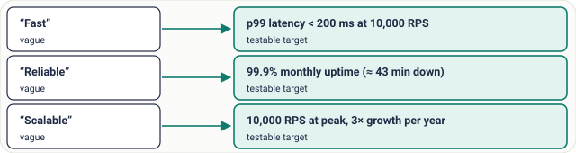
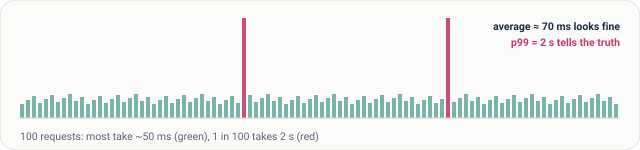
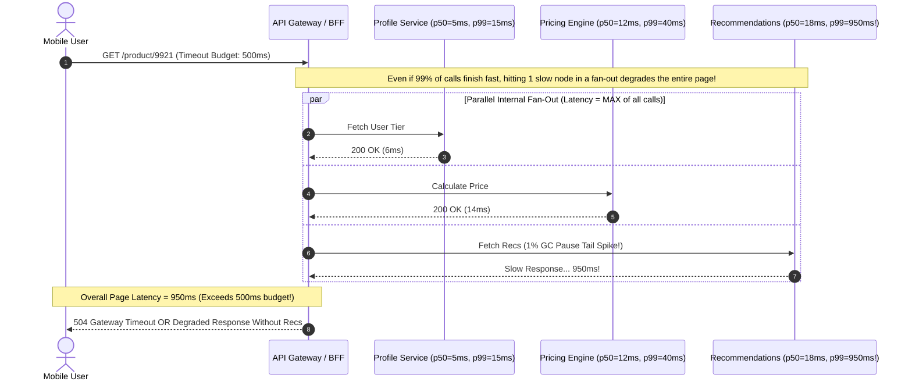
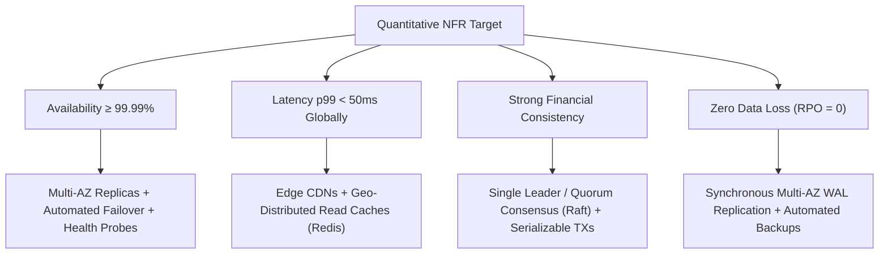
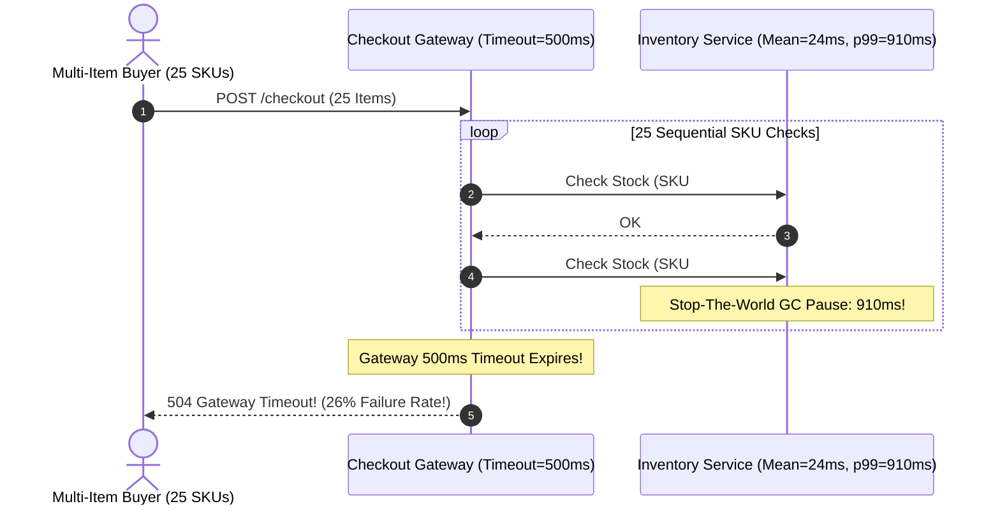

# Lesson 04: Non-Functional Requirements

> **Prerequisites:** [Lesson 03: Functional Requirements](../03-functional-requirements/README.md).  
> **Estimated Reading Time:** 28 minutes  
> **Target Audience:** Backend engineers and distributed systems architects translating qualitative goals ("fast", "reliable") into measurable SLOs and quantitative design constraints.  
> **Free PDF Notes:** [Download SD-A-004.pdf](https://backendroadmap.com/notes/system-design/SD-A-004.pdf) · [Phase 1, Core Fundamentals (PDF)](https://backendroadmap.com/notes/system-design/Phase1_Core_Fundamentals_Notes.pdf)

> [!TIP]
> **The Golden Rule of Non-Functional Requirements:** Functional requirements tell you what endpoints exist, but **Non-Functional Requirements (NFRs)** determine your physical architecture. Never accept vague adjectives like *"fast"* or *"never goes down"*—convert every quality attribute into concrete numbers (e.g., `p99 < 150ms at 20,000 RPS`, `99.99% availability`, `zero acknowledged write loss`), and tailor consistency levels per feature rather than imposing strong consistency universally.

---

## Visual Mental Models & Architecture

### Turning Vague Adjectives into Actionable Architecture

Without numerical NFRs, a personal blog and an algorithmic high-frequency trading engine have identical requirements ("save data and display it"). Numerical constraints force the exact physical infrastructure required.



*Figure 1. “Fast, reliable, scalable” mean nothing in a design review. A number can be tested and designed for.*

### Why Percentiles ($p_{99}$) Govern User Experience Instead of Averages

Arithmetic averages (`mean`) dangerously disguise tail behavior. In multi-service requests, a user regularly triggers dozens of downstream calls on a single page load—exposing them to the slowest outlier.



*Figure 2. The average hides the slow tail; p99 shows what 1 user in 100 waits.*



### How Concrete Numbers Force Architectural Topology



---

## Systematic Taxonomic Reference Grids

### The Six Core Non-Functional Quality Attributes

| Quality Attribute | Engineering Question Answered | Measurable Target Example | Concrete Architectural Driver |
| :--- | :--- | :--- | :--- |
| **Scale** | How much volume and concurrency must the system sustain? | $25,000\text{ peak RPS}$; $50\text{ TB/year}$ growth | Horizontal stateless scaling, database partitioning / sharding. |
| **Latency** | How long does a single request take at the slow tail? | $p_{95} < 80\text{ ms}$, $p_{99} < 200\text{ ms}$ | CDN edge termination, in-memory Redis caching, BFF parallelization. |
| **Availability** | What percentage of valid requests succeed over time? | $99.99\%$ monthly uptime ($< 4.3\text{ min}$ downtime) | Multi-AZ failover, load balancer redundancy, circuit breakers. |
| **Consistency** | How quickly must writes become visible to readers? | Strong (balances) vs Eventual ($\le 5\text{ s}$ for likes) | Leader-follower synchronous vs asynchronous replication; read-your-writes. |
| **Durability** | What is the probability of permanently losing committed writes? | $99.999999999\%$ ($11$ nines) / RPO = $0$ | Sync WAL replication, quorum disk flushes (`fsync`), immutable object storage. |
| **Compliance & Cost** | Under what regulatory & financial boundaries must it run? | PCI-DSS / GDPR data residency; $\le \$0.02\text{ per 10k reqs}$ | Region-pinned storage encryption (KMS), tiered cold storage lifecycle. |

### The Availability "Nines" & Downtime Reference Grid

| Availability Target | Annual Downtime Allowed | Monthly Downtime Allowed | Typical Infrastructure Complexity Required |
| :--- | :--- | :--- | :--- |
| **99% ("Two Nines")** | $\sim 3.65\text{ days}$ | $\sim 7.3\text{ hours}$ | Single server or VM; manual restarts and maintenance windows acceptable. |
| **99.9% ("Three Nines")** | $\sim 8.76\text{ hours}$ | $\sim 43.8\text{ minutes}$ | Multi-node stateless app fleet, basic load balancer health checks, managed DB backups. |
| **99.99% ("Four Nines")** | $\sim 52.6\text{ minutes}$ | $\sim 4.38\text{ minutes}$ | Active-Active Multi-AZ clusters, zero-downtime blue/green deploys, automated DB failover. |
| **99.999% ("Five Nines")** | $\sim 5.26\text{ minutes}$ | $\sim 26.3\text{ seconds}$ | Multi-region active-active replication, global Anycast DNS failover, automated chaos resilience. |

> [!NOTE]
> Adding each extra "nine" typically triples infrastructure and operational complexity cost. Never design Five Nines for an internal admin portal unless the business loss per minute justifies multi-region active replication.

### Tail Latency Amplification Math (Fan-Out Probability)

When a single user action triggers $N$ independent parallel or sequential backend calls, each having a $p_{99}$ spike probability ($1\%$), the probability that **at least one** call hits its slow tail is:

$$P(\text{Slow Page}) = 1 - (0.99)^N$$

| Downstream Service Fan-Out ($N$) | Probability of Hitting at Least One $p_{99}$ Spike | Resultant Real-World User Experience |
| :--- | :--- | :--- |
| $N = 1$ | $1.0\%$ | $1$ in $100$ requests suffers slow tail latency. |
| $N = 10$ | $9.6\%$ | Nearly $1$ in $10$ page loads feels slow. |
| $N = 30$ | $26.0\%$ | **Over $1$ in $4$ page loads** hits $p_{99}$ latency! |
| $N = 100$ | $63.4\%$ | **Majority of all user interactions** degrade to slow tail! |

---

## Production War Stories: Incident Post-Mortem

### SEV-1 Post-Mortem: The Average Latency Blindness & Fan-Out Tail Collapse

#### Incident Overview
* **Severity:** SEV-1 (Widespread Checkout Failure Despite "Green" Dashboards)
* **Detection Time:** 38 minutes (Reported first via customer support tweets, not alerts!)
* **Resolution Time:** 2 hours 15 minutes
* **Impact:** 29% of checkout sessions failed with HTTP 504 timeouts, while infrastructure monitoring reported healthy `mean latency: 28ms`.

#### What Happened
An online retail marketplace enforced a strict 500ms timeout budget on its mobile checkout gateway. Their observability dashboard displayed a single primary metric for the **Inventory Service**: **Average Latency = 24ms**.

Unknown to the on-call engineer, a subtle memory fragmentation bug caused Garbage Collection (GC) stop-the-world pauses lasting 900ms on approximately 1.2% of requests (`p99 = 910ms`, while `mean = 24ms`).

On a normal single product page, 1% of users barely noticed. However, during checkout of multi-item shopping carts (averaging 25 distinct SKUs per cart), the Checkout Orchestrator called the Inventory Verification Service sequentially inside a loop (25 synchronous calls per checkout):
1. With $N = 25$ calls and a $1.2\%$ chance of hitting a 900ms GC pause per call: $1 - (1 - 0.012)^{25} \approx 26\%$ of all multi-item checkouts encountered at least one 900ms GC stall!
2. The single 900ms stall exceeded the mobile gateway's 500ms timeout budget, crashing the entire checkout flow cleanly into `504 Gateway Timeout`.
3. Meanwhile, the monitoring dashboard still displayed `Mean Inventory Latency: 31ms`, blinding responders to the catastrophic tail collapse.



#### Root Cause Analysis
1. **Alerting on Mean Metrics Instead of Percentiles:** Averages mathematically suppress bimodal outliers (fast normal hits vs catastrophic GC stalls).
2. **Sequential Fan-Out Architecture ($N=25$):** Making 25 sequential HTTP calls amplified a minor 1.2% tail anomaly into a 26% systemic checkout failure.
3. **Absence of Deadline Propagation:** Individual downstream SKU checks lacked bounded per-hop timeouts (`100ms`), allowing one stalled query to exhaust the entire transaction budget.

#### The Fix & Architectural Hardening
1. **Replaced Mean Alerts with $p_{95}$ / $p_{99}$ SLO Dashboards:** Instrumented histograms capturing $p_{50}$, $p_{95}$, and $p_{99}$ latency buckets across all downstream endpoints.
2. **Batched RPC Contracts:** Replaced the $N=25$ sequential loop with a single batch API (`POST /inventory/check-batch`) resolving all 25 SKUs in 1 network hop and 1 SQL `WHERE id IN (...)` query.
3. **Propagated Strict Context Deadlines & Hedged Requests:** Configured strict per-call timeouts and enabled hedged retry requests after $p_{95}$ elapsed on idempotent reads.

---

## Multi-Language Production Code Tabs

The implementations below demonstrate **Quantitative NFR Instrumentation in Code**:
1. **Per-Request Context Deadline Budgets:** Ensuring downstream latency spikes abort cleanly before holding threads indefinitely.
2. **Thread-Safe Percentile Telemetry (`p50`, `p95`, `p99`):** Recording sliding-window request latencies to surface tail degradation immediately rather than hiding behind averages.

### Production NFR Percentile Tracking & Deadline Budget Middleware

````carousel
```go
// Go: NFR Context Deadline Budget & Sliding Window Percentile Tracker
package main

import (
	"context"
	"fmt"
	"math"
	"net/http"
	"sort"
	"sync"
	"time"
)

type LatencyTracker struct {
	mu      sync.Mutex
	samples []float64
	maxSize int
}

func NewLatencyTracker(maxSize int) *LatencyTracker {
	return &LatencyTracker{
		samples: make([]float64, 0, maxSize),
		maxSize: maxSize,
	}
}

func (lt *LatencyTracker) Record(ms float64) {
	lt.mu.Lock()
	defer lt.mu.Unlock()
	if len(lt.samples) >= lt.maxSize {
		lt.samples = lt.samples[1:] // Evict oldest sample in ring buffer
	}
	lt.samples = append(lt.samples, ms)
}

func (lt *LatencyTracker) Percentile(p float64) float64 {
	lt.mu.Lock()
	defer lt.mu.Unlock()
	if len(lt.samples) == 0 {
		return 0
	}
	copied := make([]float64, len(lt.samples))
	copy(copied, lt.samples)
	sort.Float64s(copied)

	idx := int(math.Ceil((p/100.0)*float64(len(copied)))) - 1
	if idx < 0 {
		idx = 0
	}
	return copied[idx]
}

// Middleware enforcing strict NFR Latency Budget (200ms p99 SLA)
func NFRBudgetMiddleware(tracker *LatencyTracker, budget time.Duration, next http.Handler) http.Handler {
	return http.HandlerFunc(func(w http.ResponseWriter, r *http.Request) {
		start := time.Now()
		ctx, cancel := context.WithTimeout(r.Context(), budget)
		defer cancel()

		done := make(chan struct{})
		go func() {
			next.ServeHTTP(w, r.WithContext(ctx))
			close(done)
		}()

		select {
		case <-done:
			elapsedMs := float64(time.Since(start).Microseconds()) / 1000.0
			tracker.Record(elapsedMs)
		case <-ctx.Done():
			elapsedMs := float64(time.Since(start).Microseconds()) / 1000.0
			tracker.Record(elapsedMs)
			http.Error(w, "SLO Latency Budget Exceeded", http.StatusGatewayTimeout)
		}
	})
}

func main() {
	tracker := NewLatencyTracker(1000)
	// Simulated production samples including 1% slow GC tail
	for i := 0; i < 99; i++ {
		tracker.Record(12.5)
	}
	tracker.Record(420.0) // 1% outlier!

	fmt.Printf("p50: %.2fms | p95: %.2fms | p99: %.2fms\n",
		tracker.Percentile(50), tracker.Percentile(95), tracker.Percentile(99))
}
```
<!-- slide -->
```typescript
// TypeScript/Node.js: NFR Deadline AbortController & Percentile Metric Collector
import express, { Request, Response, NextFunction } from 'express';

class SlidingLatencyMonitor {
  private samples: number[] = [];

  constructor(private readonly windowSize = 1000) {}

  record(ms: number): void {
    if (this.samples.length >= this.windowSize) {
      this.samples.shift();
    }
    this.samples.push(ms);
  }

  getPercentile(p: number): number {
    if (this.samples.length === 0) return 0;
    const sorted = [...this.samples].sort((a, b) => a - b);
    const index = Math.max(0, Math.ceil((p / 100) * sorted.length) - 1);
    return sorted[index];
  }

  getMetricsSummary() {
    const sum = this.samples.reduce((acc, v) => acc + v, 0);
    return {
      mean_ms: this.samples.length ? +(sum / this.samples.length).toFixed(2) : 0,
      p50_ms: +this.getPercentile(50).toFixed(2),
      p95_ms: +this.getPercentile(95).toFixed(2),
      p99_ms: +this.getPercentile(99).toFixed(2),
    };
  }
}

const monitor = new SlidingLatencyMonitor(500);
const app = express();

// Enforce 150ms SLO Timeout Budget across all endpoints
app.use((req: Request, res: Response, next: NextFunction) => {
  const start = performance.now();
  const controller = new AbortController();
  const timer = setTimeout(() => {
    controller.abort();
    if (!res.headersSent) {
      res.status(504).json({ error: 'SLO Latency Budget Exceeded (150ms)' });
    }
  }, 150);

  (req as any).abortSignal = controller.signal;

  res.on('finish', () => {
    clearTimeout(timer);
    monitor.record(performance.now() - start);
  });

  next();
});

app.get('/metrics/slo', (_req: Request, res: Response) => {
  res.json(monitor.getMetricsSummary());
});
```
<!-- slide -->
```python
# Python: FastAPI Percentile Histogram Collector & Context Timeout Budget
import asyncio
import math
import time
from collections import deque
from fastapi import FastAPI, Request, HTTPException
from fastapi.responses import JSONResponse

class PercentileTelemetry:
    def __init__(self, window_size: int = 1000):
        self.samples: deque[float] = deque(maxlen=window_size)

    def record(self, duration_ms: float) -> None:
        self.samples.append(duration_ms)

    def percentile(self, p: float) -> float:
        if not self.samples:
            return 0.0
        sorted_samples = sorted(self.samples)
        idx = max(0, math.ceil((p / 100.0) * len(sorted_samples)) - 1)
        return round(sorted_samples[idx], 2)

telemetry = PercentileTelemetry()
app = FastAPI(title="SLO-Enforced Service")

@app.middleware("http")
async def slo_budget_middleware(request: Request, call_next):
    start = time.perf_counter()
    try:
        # Enforce strict 200ms end-to-end latency budget (NFR Guardrail)
        response = await asyncio.wait_for(call_next(request), timeout=0.200)
    except asyncio.TimeoutError:
        duration_ms = (time.perf_counter() - start) * 1000
        telemetry.record(duration_ms)
        return JSONResponse(status_code=504, content={"error": "SLO timeout budget exceeded"})

    duration_ms = (time.perf_counter() - start) * 1000
    telemetry.record(duration_ms)
    response.headers["X-Response-Time-Ms"] = f"{duration_ms:.2f}"
    return response

@app.get("/slo-status")
def get_slo_status():
    return {
        "p50_ms": telemetry.percentile(50),
        "p95_ms": telemetry.percentile(95),
        "p99_ms": telemetry.percentile(99),
        "sample_count": len(telemetry.samples),
    }
```
<!-- slide -->
```csharp
// C#: ASP.NET Core CancellationToken Deadline & Percentile Instrumentation
using System;
using System.Collections.Concurrent;
using System.Linq;
using System.Threading;
using System.Threading.Tasks;
using Microsoft.AspNetCore.Builder;
using Microsoft.AspNetCore.Http;

var builder = WebApplication.CreateBuilder(args);
var tracker = new ConcurrentQueue<double>();
var app = builder.Build();

// Middleware enforcing 200ms NFR SLO budget cleanly via CancellationTokenSource
app.Use(async (context, next) =>
{
    var sw = System.Diagnostics.Stopwatch.StartNew();
    using var timeoutCts = new CancellationTokenSource(TimeSpan.FromMilliseconds(200));
    using var linkedCts = CancellationTokenSource.CreateLinkedTokenSource(context.RequestAborted, timeoutCts.Token);

    context.RequestAborted = linkedCts.Token;

    try
    {
        await next();
    }
    catch (OperationCanceledException) when (timeoutCts.IsCancellationRequested)
    {
        context.Response.StatusCode = StatusCodes.Status504GatewayTimeout;
        await context.Response.WriteAsync("SLO latency budget (200ms) exceeded.");
    }
    finally
    {
        sw.Stop();
        if (tracker.Count >= 1000) tracker.TryDequeue(out _);
        tracker.Enqueue(sw.Elapsed.TotalMilliseconds);
    }
});

app.MapGet("/slo-metrics", () =>
{
    var sorted = tracker.ToArray().OrderBy(x => x).ToArray();
    if (sorted.Length == 0) return Results.Ok(new { p50 = 0, p95 = 0, p99 = 0 });

    double GetP(double p) => sorted[Math.Max(0, (int)Math.Ceiling((p / 100.0) * sorted.Length) - 1)];
    return Results.Ok(new
    {
        p50_ms = Math.Round(GetP(50), 2),
        p95_ms = Math.Round(GetP(95), 2),
        p99_ms = Math.Round(GetP(99), 2)
    });
});

app.Run();
```
````

---

## Practical Hands-On Verification CLI Workflows

Verify percentile tail-latency divergence empirically using automated load testing tools against a local endpoint.

### Step 1: Observe Tail Latency ($p_{99}$) vs. Mean Latency with `hey` (or `wrk`)

Run a load test generating 500 concurrent requests to verify how percentiles expose slow outliers hidden by averages:

```bash
# Install or run via Docker (rakyll/hey)
docker run --rm --network host williamyeh/hey -n 1000 -c 25 http://127.0.0.1:8000/slo-status
```

**Expected Wire Output:**
```text
Summary:
  Total:        0.4821 secs
  Slowest:      0.2140 secs
  Fastest:      0.0012 secs
  Average:      0.0114 secs
  Requests/sec: 2074.25

Latency distribution:
  10% in 0.0021 secs
  25% in 0.0034 secs
  50% in 0.0058 secs   <-- Median (p50) is ~5.8ms
  75% in 0.0092 secs
  90% in 0.0145 secs
  95% in 0.0221 secs   <-- p95 is 22.1ms
  99% in 0.1480 secs   <-- p99 jumps 25x higher than median!
```

### Step 2: Calculate Availability Budget in Python

Quickly calculate exact monthly downtime minutes permitted by an agreed NFR availability target directly in your terminal:

```bash
python -c "
for target in [99.0, 99.9, 99.95, 99.99, 99.999]:
    monthly_mins = 43200 * (1 - target / 100.0)
    print(f'{target:6.3f}% -> Max Downtime: {monthly_mins:7.2f} minutes / month')
"
```

**Expected Output:**
```text
99.000% -> Max Downtime:  432.00 minutes / month
99.900% -> Max Downtime:   43.20 minutes / month
99.950% -> Max Downtime:   21.60 minutes / month
99.990% -> Max Downtime:    4.32 minutes / month
99.999% -> Max Downtime:    0.43 minutes / month
```

---

## Operational Validation Checkpoints (Scenario Quizzes)

<details>
<summary><strong>Checkpoint 1: Translating Stakeholder Demands into Costed NFRs</strong></summary>

**Scenario:** During project kickoff for an internal corporate expense approval app used by 800 employees, a VP says: *"This system can never go down, not even for a second. Put 99.999% uptime in our engineering requirements."* As the lead architect, how do you analyze and push back using concrete downtime math and infrastructure costs?

<strong>Answer:</strong>
Calculate the concrete engineering reality for the stakeholder:
- **99.999% ("Five Nines")** allows only **26 seconds of total downtime per month**, requiring multi-region active-active replication, global Anycast DNS failover, immutable canary pipelines, and dedicated 24/7 SRE rotation—multiplying cloud spend by $5\times - 10\times$.
- **99.9% ("Three Nines")** allows **43.8 minutes per month** and runs cheaply on a single-region Multi-AZ setup.
For an internal employee expense app where a 3-minute regional failover costs almost nothing financially compared to maintaining multi-region active-active databases, 99.9% or 99.95% meets the business need while saving massive operational overhead and complexity. Always tie availability NFRs to the real dollar cost per minute of downtime.
</details>

<details>
<summary><strong>Checkpoint 2: Selective Consistency Per Subdomain</strong></summary>

**Scenario:** You are designing an e-commerce platform like Amazon. A junior engineer insists on configuring PostgreSQL `SERIALIZABLE` isolation and synchronous quorum replication across every microservice so that *"nothing in the platform can ever be out of date."* Why will this uniform NFR degrade performance needlessly, and how should consistency be partitioned by domain?

<strong>Answer:</strong>
Enforcing uniform strong consistency penalizes every read-heavy path with high write locks and multi-AZ network round trips:
- **Subdomain A: Inventory Stock & Payment Settlement** $\to$ **Strong Consistency Required.** Overselling the final item or double-charging a customer causes direct financial and legal loss; accept slightly higher write latency (~50–150ms).
- **Subdomain B: Product Reviews, View Counters & Recommendations** $\to$ **Eventual Consistency Acceptable.** Showing "1,402 likes" instead of "1,405 likes" for 3 seconds causes zero user harm. Using cached eventual consistency keeps product browsing sub-15ms at massive read scale.
</details>

<details>
<summary><strong>Checkpoint 3: Combating Fan-Out Tail Amplification</strong></summary>

**Scenario:** Your web homepage executes 30 asynchronous microservice API calls in parallel before rendering. Each downstream service operates reliably at $p_{50} = 10\text{ ms}$ and $p_{99} = 250\text{ ms}$. Why do roughly 1 in 4 visitors experience a sluggish $250\text{ ms+}$ homepage render, and what two system patterns prevent a single tail spike from blocking the user?

<strong>Answer:</strong>
With 30 independent parallel calls ($N = 30$) each holding a $1\%$ chance of hitting $p_{99} = 250\text{ ms}$, the probability that at least one dependency stalls is $1 - (0.99)^{30} \approx 26.0\%$. Because parallel fan-out waits on `MAX(latencies)`, 26% of all user requests inherit the slowest outlier!
To resolve this:
1. **Graceful Degradation / Partial Rendering:** Categorize dependencies as Critical (Product Price/Cart) vs Non-Critical (Related Items, Ads). Enforce a strict 80ms timeout budget on non-critical calls; if Recommendations miss the deadline, omit the widget cleanly rather than stalling the entire page.
2. **Hedged Requests:** On idempotent read calls, if a replica hasn't answered within $p_{95}$ (e.g., 25ms), immediately dispatch a duplicate request to a second healthy replica and take whichever answers first.
</details>

---

## Further Reading & Sources

- [Google SRE Book: Service Level Objectives (SLOs) & Error Budgets](https://sre.google/sre-book/service-level-objectives/) — Authoritative taxonomy of SLIs, SLOs, and SLAs.
- [The Tail at Scale (Jeffrey Dean & Luiz André Barroso, Google)](https://research.google/pubs/the-tail-at-scale/) — Classic paper analyzing fan-out tail latency amplification and hedged requests.
- [Track 08: Observability and Operational Readiness](../../../backend/08-observability-and-operational-readiness/README.md) — Practical Prometheus percentile histograms and multi-burn-rate SLO alerting.

---

## Free PDF notes

Download these notes as a printable PDF, with every diagram: [SD-A-004.pdf](https://backendroadmap.com/notes/system-design/SD-A-004.pdf). All Phase 1 notes in one file: [Phase 1, Core Fundamentals (PDF)](https://backendroadmap.com/notes/system-design/Phase1_Core_Fundamentals_Notes.pdf).

---

## Next

Continue with [Lesson 05: Trade-offs and How to Justify a Design](../05-trade-offs-and-how-to-justify-a-design/README.md) to master structured trade-off reasoning, ATAM decision matrices, and articulating architectural decisions concisely.
