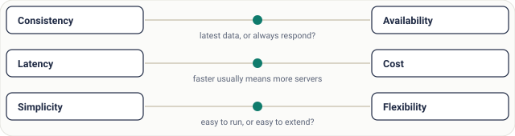
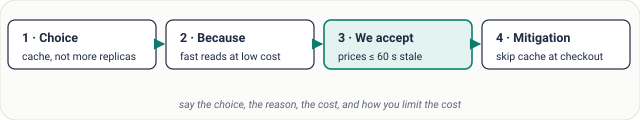
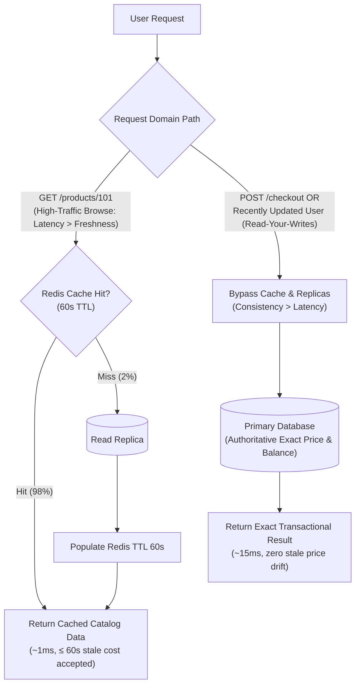
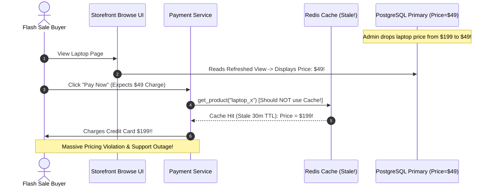

# Lesson 05: Trade-offs and How to Justify a Design

> **Prerequisites:** [Lesson 04: Non-Functional Requirements](../04-non-functional-requirements/README.md).  
> **Estimated Reading Time:** 25 minutes  
> **Target Audience:** Software engineers and architects moving beyond *"it depends"* to defend architectural trade-offs quantitatively in technical reviews and interviews.

> [!TIP]
> **The Golden Rule of Architectural Trade-offs:** There is no zero-cost decision in distributed systems—every component improves one quality attribute while degrading another. Never end an answer with *"it depends."* Commit to a clear decision using the **Four-Part Justification Formula**: **(1) State the choice, (2) Anchor it in the ranked requirement, (3) Name the exact cost accepted, and (4) Specify the technical mitigation that bounds that cost.**

---

## Visual Mental Models & Architecture

### The Fundamental Design Tensions

Almost every backend architecture debate navigates three recurring axes: Latency vs. Consistency, Availability vs. Complexity, and Throughput vs. Operational Cost. Requirements dictate exactly where the slider sits.



*Figure 1. Three trade-offs you will meet in nearly every interview. The requirements decide where the dot sits.*

### The Four-Part Trade-Off Articulation Blueprint



*Figure 2. The four-part trade-off statement. Part 3 is what interviewers listen for: you know what you gave up.*

### Dual-Path Mitigation: Cache for Browse + Authoritative Primary for Checkout

A mature trade-off isolates stale tolerance by domain criticality: accepting 60-second eventual consistency on high-traffic catalog reads while strictly bypassing caches on transactional money movements.



---

## Systematic Taxonomic Reference Grids

### Classic Architectural Trade-Off Pairings Matrix

| Design Decision | Alternative Rejected | Primary Quality Gained | Accepted Cost / Downside | Mandatory Engineering Mitigation |
| :--- | :--- | :--- | :--- | :--- |
| **Redis Cache (60s TTL)** | Direct DB Read Replicas | Ultra-low latency ($\sim 1\text{ms}$); drops DB CPU by $80\%+$ | Stale reads up to $60\text{s}$; cache stampede risk | **Mitigate:** Bypass cache on financial mutations; use singleflight/jittered TTLs. |
| **Async Message Queue (Kafka)** | Synchronous HTTP RPC | Decouples traffic spikes; absorbs burst load safely | End-to-end processing delay; eventual consistency | **Mitigate:** Return `202 Accepted` + client polling/WebSockets; dead-letter queues (DLQ). |
| **Modular Monolith** | Microservices Fleet | Rapid iteration for small teams; zero RPC serialization tax | Single shared deployment unit; tight runtime blast radius | **Mitigate:** Enforce clean internal interface seams so modules extract cleanly later. |
| **Eventual Consistency** | Synchronous Quorum Writes | High write availability across network partitions | Replicas temporarily disagree (replication lag) | **Mitigate:** Implement **Read-Your-Writes** pinning so users immediately see their own edits. |
| **NoSQL / Wide-Column Partitioning** | Single Relational Primary | Horizontal multi-terabyte write throughput | No multi-partition ACID joins; rigid query access patterns | **Mitigate:** Pre-compute denormalized read views; enforce idempotent consumer retries. |

### ATAM-Style Scoring Matrix: Solving a Read-Heavy Catalog Bottleneck

When evaluating options systematically (inspired by the Architecture Trade-off Analysis Method), list ranked non-functional attributes and score options transparently:

| Candidate Architecture | Read Latency (Rank #1) | Data Freshness (Rank #2) | Operational Cost (Rank #3) | Engineering Verdict |
| :--- | :---: | :---: | :---: | :--- |
| **Option A: Redis Cache (60s TTL)** | **$\sim 1\text{ ms}$ (Best)** | $\le 60\text{ s}$ stale | **Lowest** (Minimal DB scaling) | **WIN** for browse pages; bypass cache during checkout. |
| **Option B: 4x DB Read Replicas** | $\sim 5 - 12\text{ ms}$ | $\sim 200\text{ ms} - 1\text{ s}$ lag | High ($4\times$ DB compute nodes) | Pick if query predicates are too dynamic/unpredictable to cache. |
| **Option C: Vertical Scaling Primary** | $\sim 5 - 12\text{ ms}$ | **Exact (Zero lag)** | Highest + Hard hardware ceiling | Short-term stopgap only; does not solve cross-region read scale. |

---

## Production War Stories: Incident Post-Mortem

### SEV-1 Post-Mortem: The Unmitigated Cache Price-Drift & Checkout Mismatch

#### Incident Overview
* **Severity:** SEV-1 (Financial Discrepancy & Automated Chargeback Surge)
* **Detection Time:** 2 hours 10 minutes post-flash-sale start
* **Resolution Time:** 1 hour 55 minutes
* **Impact:** 4,800 customers saw a \$49 promotional price on the storefront, were billed \$199 at checkout (or vice versa), forcing manual refunds totaling \$215,000.

#### What Happened
An online electronics retailer experienced heavy database CPU utilization on its product catalog table. To solve the bottleneck, an engineer implemented a Redis cache layer in front of the `ProductRepository.get_price(sku)` helper function with a 30-minute TTL (`1800s`):
```python
# Flawed Universal Caching Without Transactional Bypass
async def get_product(sku: str):
    cached = await redis.get(f"product:{sku}")
    if cached:
        return json.loads(cached) # Served stale price blindly everywhere!
    product = await db.fetch_product(sku)
    await redis.set(f"product:{sku}", json.dumps(product), ex=1800)
    return product
```

Because `get_product()` was shared across **both** the public browsing storefront and the backend payment order processor, an operational flaw emerged:
1. At 12:00 UTC, marketing updated a laptop price in PostgreSQL from \$199 to \$49 for a 1-hour flash sale.
2. Cache invalidation failed quietly on 3 Redis shards due to a misconfigured key prefix (`prod:` vs `product:`).
3. Browse web nodes read from a refreshed shard showing **\$49**.
4. The payment service connected to a stale cache shard still returning **\$199**—and charged customers' credit cards \$199 while their receipt screen rendered \$49!



#### Root Cause Analysis
1. **Unbounded Cache Scope:** Applying an eventually consistent cache identically across both informational display paths and authoritative financial checkout mutations violated domain consistency requirements.
2. **Missing Cache-Bypass Contract:** The system lacked an explicit `authoritative=True` parameter or separate checkout read path bypassing Redis entirely to query the Primary database.

#### The Fix & Architectural Hardening
1. **Strict Cache-Bypass Rule on Money Paths:** Split reads into `get_cached_catalog_product()` (Browse: 60s TTL) and `get_authoritative_checkout_price()` (Checkout: direct Primary DB query inside the order transaction).
2. **Price Snapshot Verification:** Forced the checkout UI to pass the `expected_price` displayed to the user; if `expected_price != db_price`, the transaction aborts gracefully with HTTP `409 Conflict` asking the customer to confirm the updated price.

---

## Multi-Language Production Code Tabs

The implementations below demonstrate **Dual-Path Trade-Off Mitigation** in code:
1. **Browsing Path (`use_cache = True`):** Accepts $\le 60\text{s}$ stale tolerance in exchange for $\sim 1\text{ms}$ cached speed.
2. **Checkout & Read-Your-Writes Path (`use_cache = False` / Session Pinning):** Strictly bypasses cache to query the authoritative Primary database whenever money changes hands or immediately after a user modifies their own profile.

### Production Trade-Off & Read-Your-Writes Implementations

````carousel
```go
// Go: Explicit Cache vs Authoritative Path & Read-Your-Writes Pinning
package main

import (
	"context"
	"fmt"
	"sync"
	"time"
)

type Product struct {
	SKU   string
	Price int // cents
}

type CacheEntry struct {
	Product   Product
	ExpiresAt time.Time
}

type ProductCatalogService struct {
	mu            sync.RWMutex
	primaryDB     map[string]Product
	cache         map[string]CacheEntry
	recentWriters sync.Map // Tracks users who just wrote (Read-Your-Writes Guard)
}

func NewProductCatalogService() *ProductCatalogService {
	return &ProductCatalogService{
		primaryDB: map[string]Product{"laptop-pro": {SKU: "laptop-pro", Price: 19900}},
		cache:     make(map[string]CacheEntry),
	}
}

// 1. Storefront Browse Path: Trades up to 60s staleness for 1ms memory speed
func (s *ProductCatalogService) GetForBrowse(ctx context.Context, userID, sku string) (Product, string) {
	// MITIGATION: Read-Your-Writes Guard! If this user just edited, bypass cache!
	if writeTime, ok := s.recentWriters.Load(userID); ok {
		if time.Since(writeTime.(time.Time)) < 10*time.Second {
			return s.GetAuthoritativeFromPrimary(ctx, sku), "primary-db (read-your-writes)"
		}
	}

	s.mu.RLock()
	cached, exists := s.cache[sku]
	s.mu.RUnlock()

	if exists && time.Now().Before(cached.ExpiresAt) {
		return cached.Product, "redis-cache (eventual)"
	}

	// Cache Miss -> Query Primary & populate 60s TTL
	prod := s.GetAuthoritativeFromPrimary(ctx, sku)
	s.mu.Lock()
	s.cache[sku] = CacheEntry{Product: prod, ExpiresAt: time.Now().Add(60 * time.Second)}
	s.mu.Unlock()
	return prod, "primary-db (populated-cache)"
}

// 2. Checkout Path: Explicitly bypasses cache to ensure zero stale price risk
func (s *ProductCatalogService) GetAuthoritativeFromPrimary(_ context.Context, sku string) Product {
	s.mu.RLock()
	defer s.mu.RUnlock()
	return s.primaryDB[sku]
}

// 3. Mutation: Records writer timestamp to guarantee Read-Your-Writes consistency
func (s *ProductCatalogService) AdminUpdatePrice(_ context.Context, adminID, sku string, newPrice int) {
	s.mu.Lock()
	s.primaryDB[sku] = Product{SKU: sku, Price: newPrice}
	s.mu.Unlock()

	// Pin this admin to Primary for 10s so they immediately see their own update!
	s.recentWriters.Store(adminID, time.Now())
	fmt.Printf("Updated SKU %s to $%d.%02d (Cache NOT immediately purged globally)\n", sku, newPrice/100, newPrice%100)
}
```
<!-- slide -->
```typescript
// TypeScript/Node.js: Explicit Consistency Routing (Browse Cache vs Checkout Primary)
interface Product {
  sku: string;
  priceCents: number;
}

class DualPathCatalogService {
  private primaryDb = new Map<string, Product>([
    ['laptop-pro', { sku: 'laptop-pro', priceCents: 19900 }],
  ]);
  private cache = new Map<string, { data: Product; expiresAt: number }>();
  private recentWriterPins = new Map<string, number>(); // userId -> timestamp

  // Path A: Storefront Browse (Speed > Freshness, bounded by 60s TTL + Read-Your-Writes)
  public async getCatalogProduct(userId: string, sku: string): Promise<{ product: Product; source: string }> {
    const pinnedUntil = this.recentWriterPins.get(userId) || 0;
    if (Date.now() < pinnedUntil) {
      // Mitigation: User recently wrote data -> Bypass stale cache so they see their own write
      return { product: this.getAuthoritativeProduct(sku), source: 'primary-read-your-writes' };
    }

    const cached = this.cache.get(sku);
    if (cached && Date.now() < cached.expiresAt) {
      return { product: cached.data, source: 'cache-hit' };
    }

    const fresh = this.getAuthoritativeProduct(sku);
    this.cache.set(sku, { data: fresh, expiresAt: Date.now() + 60_000 });
    return { product: fresh, source: 'cache-miss-populated' };
  }

  // Path B: Checkout Flow (Strict Freshness > Speed: Always bypasses cache!)
  public getAuthoritativeProduct(sku: string): Product {
    const prod = this.primaryDb.get(sku);
    if (!prod) throw new Error(`SKU ${sku} not found`);
    return prod;
  }

  // Mutation: Pin author to Primary DB for 10 seconds
  public updatePrice(adminUserId: string, sku: string, newPriceCents: number): void {
    this.primaryDb.set(sku, { sku, priceCents: newPriceCents });
    this.recentWriterPins.set(adminUserId, Date.now() + 10_000);
  }
}
```
<!-- slide -->
```python
# Python: FastAPI Dual-Path Trade-Off Mitigation (Catalog Cache vs Checkout Bypass)
import time
from fastapi import FastAPI, Header, HTTPException
from pydantic import BaseModel

app = FastAPI(title="Trade-off & Consistency Router")

primary_db: dict[str, int] = {"laptop-pro": 19900}
redis_cache: dict[str, tuple[int, float]] = {}   # sku -> (price, expires_at)
writer_pins: dict[str, float] = {}               # user_id -> pin_expires_at

class CheckoutRequest(BaseModel):
    sku: str
    displayed_price_cents: int

# 1. Fast Browse Path: Accepts 60s staleness to protect Primary DB
@app.get("/catalog/{sku}")
def browse_product(sku: str, x_user_id: str = Header(default="anon")):
    # Mitigation: Enforce Read-Your-Writes if user mutated recently
    if time.monotonic() < writer_pins.get(x_user_id, 0):
        return {"sku": sku, "price_cents": primary_db[sku], "source": "primary (read-your-writes)"}

    cached = redis_cache.get(sku)
    if cached and cached[1] > time.monotonic():
        return {"sku": sku, "price_cents": cached[0], "source": "cache (≤60s stale window)"}

    price = primary_db[sku]
    redis_cache[sku] = (price, time.monotonic() + 60)
    return {"sku": sku, "price_cents": price, "source": "primary-miss-populated"}

# 2. Admin Mutation: Updates Primary & sets 10s Read-Your-Writes pin
@app.post("/admin/price/{sku}")
def update_price(sku: str, new_price_cents: int, x_user_id: str = Header(default="admin")):
    primary_db[sku] = new_price_cents
    writer_pins[x_user_id] = time.monotonic() + 10
    return {"status": "updated", "authoritative_price": new_price_cents}

# 3. Authoritative Checkout Path: Bypasses cache and guards against price drift
@app.post("/checkout")
def checkout(body: CheckoutRequest):
    authoritative_price = primary_db.get(body.sku)
    if authoritative_price is None:
        raise HTTPException(status_code=404, detail="Unknown SKU")

    if body.displayed_price_cents != authoritative_price:
        # Cleanly abort checkout rather than quietly charging wrong amount!
        raise HTTPException(
            status_code=409,
            detail=f"Price changed from {body.displayed_price_cents} to {authoritative_price}. Please confirm."
        )
    return {"status": "charged", "amount_cents": authoritative_price}
```
<!-- slide -->
```csharp
// C#: ASP.NET Core Dual-Path Consistency & Cache Bypass Controller
using System;
using System.Collections.Concurrent;
using Microsoft.AspNetCore.Builder;
using Microsoft.AspNetCore.Http;

var builder = WebApplication.CreateBuilder(args);
var app = builder.Build();

var primaryDb = new ConcurrentDictionary<string, int>();
primaryDb["laptop-pro"] = 19900;

var cache = new ConcurrentDictionary<string, (int Price, DateTimeOffset ExpiresAt)>();
var writerPins = new ConcurrentDictionary<string, DateTimeOffset>();

// 1. Storefront Read: Tolerates up to 60s staleness unless Read-Your-Writes pin active
app.MapGet("/catalog/{sku}", (string sku, HttpRequest req) =>
{
    var userId = req.Headers["X-User-Id"].ToString();
    if (writerPins.TryGetValue(userId, out var pinUntil) && DateTimeOffset.UtcNow < pinUntil)
    {
        return Results.Ok(new { sku, price = primaryDb[sku], source = "primary (read-your-writes)" });
    }

    if (cache.TryGetValue(sku, out var entry) && DateTimeOffset.UtcNow < entry.ExpiresAt)
    {
        return Results.Ok(new { sku, price = entry.Price, source = "cache-hit" });
    }

    var freshPrice = primaryDb[sku];
    cache[sku] = (freshPrice, DateTimeOffset.UtcNow.AddSeconds(60));
    return Results.Ok(new { sku, price = freshPrice, source = "cache-populated" });
});

// 2. Authoritative Checkout: Strictly bypasses cache & detects stale displayed prices
app.MapPost("/checkout", (CheckoutPayload payload) =>
{
    if (!primaryDb.TryGetValue(payload.Sku, out var authoritativePrice))
        return Results.NotFound();

    if (payload.DisplayedPriceCents != authoritativePrice)
    {
        return Results.Conflict(new
        {
            error = "Price drifted between catalog browse and checkout",
            actualPrice = authoritativePrice
        });
    }

    return Results.Ok(new { status = "paid", chargedCents = authoritativePrice });
});

app.Run("http://localhost:8000");

record CheckoutPayload(string Sku, int DisplayedPriceCents);
```
````

---

## Practical Hands-On Verification CLI Workflows

Verify the Dual-Path Consistency mitigation empirically using `curl` against your local server: observe regular users hitting cached responses while the updating administrator gets **Read-Your-Writes**, and checkout safely guards against price drift.

### Step 1: Populate Cache & Trigger an Admin Price Update

```bash
# 1. Anonymous user populates the 60s catalog cache ($199.00)
curl -s http://127.0.0.1:8000/catalog/laptop-pro
# -> {"sku":"laptop-pro","price_cents":19900,"source":"primary-miss-populated"}

# 2. Admin drops flash sale price to $49.00 (without purging global cache)
curl -s -X POST "http://127.0.0.1:8000/admin/price/laptop-pro?new_price_cents=4900" \
  -H "X-User-Id: admin_alice"
```

### Step 2: Compare Anonymous Cache Reader vs. Admin Read-Your-Writes

```bash
# 3. Anonymous buyer still gets sub-ms cached response ($199.00) within 60s window
curl -s http://127.0.0.1:8000/catalog/laptop-pro -H "X-User-Id: shopper_bob"
# -> {"sku":"laptop-pro","price_cents":19900,"source":"cache (≤60s stale window)"}

# 4. Admin Alice bypasses cache via Read-Your-Writes pin and immediately sees $49.00!
curl -s http://127.0.0.1:8000/catalog/laptop-pro -H "X-User-Id: admin_alice"
# -> {"sku":"laptop-pro","price_cents":4900,"source":"primary (read-your-writes)"}
```

### Step 3: Verify Transactional Checkout Price Drift Guard (HTTP 409)

Shopper Bob saw the stale cached price (`19900`) and clicks Checkout:

```bash
curl -i -s -X POST http://127.0.0.1:8000/checkout \
  -H "Content-Type: application/json" \
  -d '{"sku": "laptop-pro", "displayed_price_cents": 19900}'
```

**Expected Wire Output:**
```http
HTTP/1.1 409 Conflict
content-type: application/json

{"detail":"Price changed from 19900 to 4900. Please confirm."}
```

Checkout strictly bypassed the cache, caught the discrepancy before charging the credit card, and protected both business and buyer!

---

## Operational Validation Checkpoints (Scenario Quizzes)

<details>
<summary><strong>Checkpoint 1: Moving Beyond "It Depends" Under Pressure</strong></summary>

**Scenario:** An interviewer asks: *"Should we use SQL (PostgreSQL) or NoSQL (DynamoDB/Cassandra) for our new application?"* If you simply reply *"It depends on whether we need consistency or high write throughput,"* why does the interviewer mark that response incomplete, and how do you upgrade it into a Staff-level answer?

<strong>Answer:</strong>
*"It depends"* is a starting framing, never a decision. To turn it into a Staff-level answer, apply the **Four-Part Trade-Off Statement**:
1. **Anchor on ranked requirements:** *"If this is a double-entry financial ledger requiring complex multi-row ACID transactions and strong balance consistency, I choose **PostgreSQL** over DynamoDB."*
2. **Name the exact accepted cost:** *"We accept a vertical ceiling on single-primary write throughput (typically ~5k–15k TPS) and plan for horizontal sharding only if write QPS grows past one primary's IOPS."*
3. **Name the reversal trigger:** *"Conversely, if this is an IoT telemetry ingestion system handling 500k writes/sec with simple time-series key lookups and zero multi-table joins, I pivot immediately to DynamoDB/Cassandra."*
</details>

<details>
<summary><strong>Checkpoint 2: The Read-Your-Writes Consistency Mitigation</strong></summary>

**Scenario:** A social platform scales reads by introducing asynchronous PostgreSQL read replicas (average replication lag: 400ms). When a user edits their profile bio (`POST /profile`) and immediately refreshes the page (`GET /profile`), the load balancer routes their read to a lagging replica, making it look like their edit vanished. How do you preserve cheap read-replica scaling globally while fixing this user-facing bug?

<strong>Answer:</strong>
Do not disable read replicas or force synchronous quorum writes globally! Apply **Session-Scoped Read-Your-Writes Consistency**:
- When a user performs a write mutation (`POST/PUT/DELETE`), record a short-lived flag (e.g., a signed cookie `last_write_ts` or Redis key `pin_primary:{user_id}` with a 5-second TTL).
- On subsequent `GET` requests from that same user within that 5-second window, the routing layer checks the flag and routes only **their** reads directly to the **Primary DB**.
- All other 99.9% of readers continue hitting the ultra-fast read replicas without feeling the primary load.
</details>

<details>
<summary><strong>Checkpoint 3: Microservices vs. Modular Monolith for a Seed-Stage Startup</strong></summary>

**Scenario:** A 4-engineer startup is building a multi-tenant B2B project tracker. One engineer proposes splitting the platform upfront into 8 independent Kubernetes microservices (Users, Projects, Tasks, Billing, Notifications, Analytics, Search, Files) communicated over Kafka. Using a structured trade-off analysis, justify pushing back with a Modular Monolith.

<strong>Answer:</strong>
Score the two options against the startup's dominant non-functional constraints (**Developer Velocity** and **Low Operational Overhead**):
- **8 Microservices:** Gains independent team deployability—which a 4-person team doesn't need yet—at the massive cost of 8 CI/CD pipelines, distributed tracing complexity, network serialization failures, and cross-service transaction consistency (Sagas).
- **Modular Monolith:** Gains ultra-fast single-command local debugging, sub-microsecond in-process function calls, and native ACID database joins across modules. **Mitigation for future growth:** Organize the codebase into strictly isolated internal domain packages interacting solely through explicit service interfaces (`IProjectService`). When one specific subsystem eventually faces independent scaling pressure or team ownership growth, that single module extracts cleanly into a standalone microservice.
</details>

---

## Further Reading & Sources

- [Architecture Trade-off Analysis Method (ATAM) — SEI CMU](https://resources.sei.cmu.edu/library/asset-view.cfm?assetid=513908) — Structured engineering methodology for weighing competing quality attributes.
- [Martin Fowler: MonolithFirst Strategy](https://martinfowler.com/bliki/MonolithFirst.html) — Why boundaries matter more than network hops early on.
- [Designing Data-Intensive Applications: Replication Lag & Read-Your-Writes](https://dataintensive.net/) — Practical mitigations for eventual consistency.

---

## Free PDF notes

Download these notes as a printable PDF, with every diagram: [SD-A-005.pdf](https://backendroadmap.com/notes/system-design/SD-A-005.pdf). All Phase 1 notes in one file: [Phase 1, Core Fundamentals (PDF)](https://backendroadmap.com/notes/system-design/Phase1_Core_Fundamentals_Notes.pdf).

---

## Next

Continue with [Lesson 06: Vertical Scaling](../06-vertical-scaling/README.md) to explore when scaling up ("a bigger machine") outperforms distributed scaling—and the four hard physical limits that bring it to an end.
