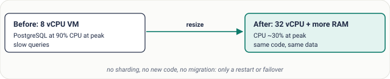
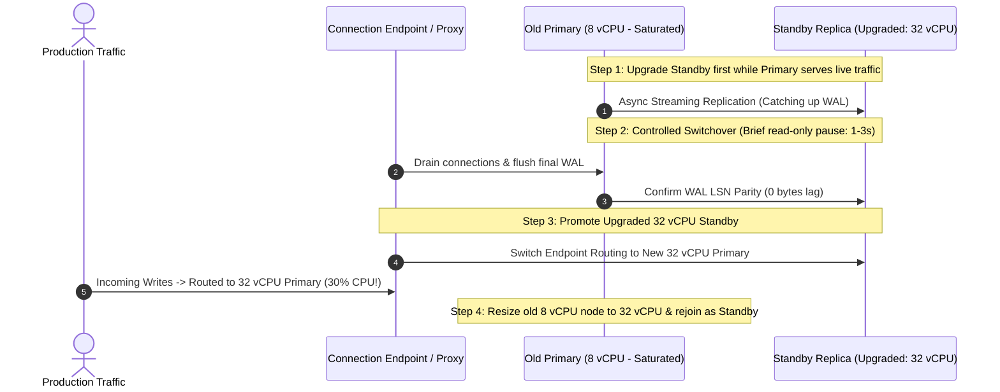
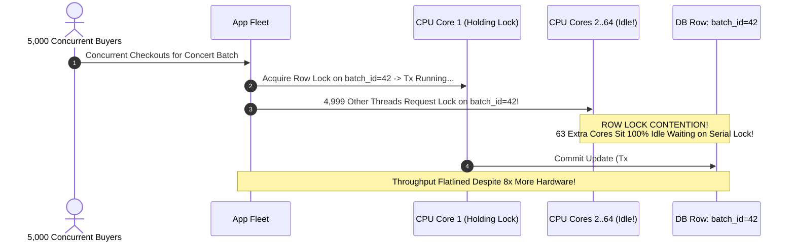

# Lesson 06: Vertical Scaling

> **Prerequisites:** [Lesson 05: Trade-offs and How to Justify a Design](../05-trade-offs-and-how-to-justify-a-design/README.md).  
> **Estimated Reading Time:** 25 minutes  
> **Target Audience:** Backend engineers and database reliability architects evaluating when to scale up hardware ("bigger box") versus when to re-architect for distributed horizontal scaling.

> [!TIP]
> **The Golden Rule of Vertical Scaling:** Never dismiss vertical scaling ("scaling up") out of pride—resizing a stateful database from 8 vCPUs to 32 vCPUs requires zero code rewrites and frequently delivers the fastest, cheapest relief while buying months of architectural runway. However, **always know your exit trigger**: vertical scaling hits a hard silicon ceiling, follows a steep non-linear cost curve, requires careful failover to avoid resize downtime, and leaves your system with a Single Point of Failure (SPOF).

---

## Visual Mental Models & Architecture

### Buying Instant Headroom Without Code Changes

When a stateful relational database sits at 90% CPU and disk I/O contention, upgrading the instance class expands both CPU cores and RAM buffer pools (`shared_buffers`), keeping the hot working set completely in memory rather than thrashing SSDs.



*Figure 1. A database at its limit, fixed by resizing the machine.*

### The Four Physical Walls Ending Vertical Scaling


*Figure 2. Why scaling up is a first step, not a final answer.*

### Zero-Downtime Blue/Green Database Resize via Replica Failover

Naively resizing a primary database VM forces an abrupt instance reboot and minutes of total outage. Production systems resize vertically without customer-visible downtime using standby failover.



---

## Systematic Taxonomic Reference Grids

### The Four Limits of Vertical Scaling Taxonomy

| Constraint Limit | Engineering Reality | Cloud Pricing / Scaling Curve | Architectural Implication |
| :--- | :--- | :--- | :--- |
| **1. Hardware Ceiling** | Even bare-metal cloud instances max out (e.g., 192–448 vCPUs, 12–24 TB RAM). | Abrupt hard stop. | Beyond the largest single machine, **sharding or read-splitting** is physically mandatory. |
| **2. Non-Linear Cost Curve** | High-memory specialized nodes cost disproportionately more per GB and vCPU. | Exponential cost per incremental unit of throughput. | Two commodity 16-vCPU servers cost significantly less than one specialized 32-vCPU instance. |
| **3. Amdahl's Law Bottleneck** | Lock contention, global mutexes, and disk `fsync` run serially regardless of core count. | Diminishing returns ($4\times$ cores often yields $\le 1.8\times$ speed). | Throwing 64 cores at a row-lock bottleneck wastes 80% of the new silicon. |
| **4. Single Point of Failure** | CPU, RAM, PSU, and hypervisor remain unified inside one chassis failure domain. | $0\%$ improvement to Availability SLA. | Upgrading hardware never substitutes for Multi-AZ replication. |

### Vertical vs. Horizontal Decision Matrix

| Workload Profile | Optimal Scaling Strategy | Justification | Exit Trigger to Pivot |
| :--- | :--- | :--- | :--- |
| **Early-Stage Relational DB** | **Scale Up First** | Preserves native ACID joins, foreign keys, and zero distributed transaction overhead. | Peak writes saturate largest NVMe primary or reads saturate primary CPU $\to$ add Read Replicas. |
| **Stateless API Web Fleet** | **Scale Out Immediately** | Stateless nodes scale linearly and tolerate single-node termination cleanly. | Never rely on giant single API servers; run smaller replicas across multiple AZs. |
| **Urgent Traffic Spike Emergency** | **Scale Up Temporarily** | Achieves relief in minutes via cloud console/Terraform without risking complex code rollouts. | Once incident stabilizes, analyze slow queries and migrate reads to caches/replicas. |
| **Massive IoT Telemetry Writes** | **Scale Out (Shard)** | Write throughput exceeds single-node disk controller IOPS rapidly. | Shard upfront by `device_id` + time bucket using partitioned tables or NoSQL. |

---

## Production War Stories: Incident Post-Mortem

### SEV-1 Post-Mortem: The Amdahl's Law Lock Contention Fallacy & Midnight Resize Outage

#### Incident Overview
* **Severity:** SEV-1 (42-Minute Planned Upgrade Turned Outage + Zero Throughput Gain)
* **Detection Time:** Immediate upon traffic ramp following maintenance
* **Resolution Time:** 3 hours 10 minutes
* **Impact:** Checkout froze completely during upgrade, and post-upgrade checkout TPS improved by only 8% despite spending $4\times$ more on an ultra-high-CPU instance.

#### What Happened
A high-volume ticket marketplace ran its primary PostgreSQL inventory database on an `8 vCPU / 32 GB RAM` instance. During major concert ticket drops, checkout latency spiked to 9 seconds and database CPU reached 94%.

Convinced they simply needed more compute power, the infrastructure team scheduled an aggressive vertical scale-up directly on the standalone primary instance to a massive **`64 vCPU / 256 GB RAM`** machine right before a stadium tour sale:
1. Because they had no active hot-standby replica configured for failover, resizing the standalone VM forced an AWS EBS detachment, instance stop, hardware migration, and PostgreSQL crash-recovery WAL replay—taking the entire business offline for **42 minutes**.
2. Once booted on the 64-vCPU monster instance, the concert ticket drop launched.
3. Monitoring revealed an alarming surprise: overall database CPU sat peacefully at **18%**, yet checkout throughput capped at the **exact same 120 TPS**, and checkout latency stayed trapped above 8 seconds!
4. `pg_stat_activity` uncovered the true culprit: every single buyer attempted to execute `UPDATE ticket_batches SET remaining = remaining - 1 WHERE batch_id = 42`. Because all 64 CPU cores were fighting for the exact same PostgreSQL **single-row write lock** (`batch_id = 42`), 63 of the 64 CPU cores sat completely idle waiting in lock queues (**Amdahl's Law serial fraction**)!



#### Root Cause Analysis
1. **Unverified Bottleneck Assumption:** The team assumed high CPU meant compute starvation rather than inspecting `pg_locks` and `wait_event_type` to spot lock contention.
2. **Amdahl's Law Violation:** Scaling cores vertically accelerates parallel independent work, not serialized mutex/row locks.
3. **Standalone Primary Upgrade Without Failover:** Resizing a single instance directly rather than promoting an upgraded replica caused a 42-minute hard outage.

#### The Fix & Architectural Hardening
1. **Striped Counters & Redis Atomic Decrements:** Replaced single-row database lock contention with sharded inventory buckets (splitting 10,000 tickets into 50 stripes `batch_42_0`..`batch_42_49`) or Redis atomic `DECRBY` pre-reservation before asynchronous DB settlement.
2. **Always-On Multi-AZ Standby:** Added an active standby replica so future vertical instance upgrades use 2-second rolling failover switches rather than cold instance reboots.

---

## Multi-Language Production Code Tabs

The code examples below demonstrate **Amdahl's Law & Lock Contention Empirics** alongside **Database Connection Sizing Safeguards**. Watch how increasing worker threads past the serial critical-section limit stops delivering speedup—proving why upgrading from 8 to 64 cores fails when a serialized lock dominates!

### Empirically Demonstrating Serial Contention vs. Parallel Scaling

````carousel
```go
// Go: Amdahl's Law Simulator & Worker Scaling Benchmark
package main

import (
	"fmt"
	"sync"
	"time"
)

// Simulates a workload where a portion (serialTime) holds an exclusive global row lock,
// while (parallelTime) executes independently across CPU cores.
func benchmarkWorkload(workers int, totalTasks int, serialWork, parallelWork time.Duration) time.Duration {
	var globalRowLock sync.Mutex
	var wg sync.WaitGroup
	tasksPerWorker := totalTasks / workers

	start := time.Now()
	for w := 0; w < workers; w++ {
		wg.Add(1)
		go func() {
			defer wg.Done()
			for t := 0; t < tasksPerWorker; t++ {
				// 1. Parallel Phase (e.g., JSON parsing, crypto, independent rows)
				time.Sleep(parallelWork)

				// 2. Serial Critical Section (e.g., Single DB Row Lock)
				globalRowLock.Lock()
				time.Sleep(serialWork)
				globalRowLock.Unlock()
			}
		}()
	}
	wg.Wait()
	return time.Since(start)
}

func main() {
	const totalTasks = 80
	// Scenario A: Almost fully parallel (Serial = 0.2ms, Parallel = 5ms)
	// Scenario B: High lock contention (Serial = 4ms, Parallel = 1ms)
	fmt.Println("=== Scenario B: High Row-Lock Contention (Serial = 4ms, Parallel = 1ms) ===")
	for _, cores := range []int{1, 4, 16, 64} {
		elapsed := benchmarkWorkload(cores, totalTasks, 4*time.Millisecond, 1*time.Millisecond)
		fmt.Printf("Workers/Cores: %2d -> Total Execution: %v (Throughput plateaued!)\n", cores, elapsed.Round(time.Millisecond))
	}
}
```
<!-- slide -->
```typescript
// TypeScript/Node.js: Amdahl's Law Calculator & Contention Bottleneck Model
interface WorkloadProfile {
  parallelFraction: number; // e.g., 0.90 = 90% parallelizable, 10% serial lock
  singleCoreThroughputRPS: number;
}

/**
 * Computes theoretical maximum speedup using Amdahl's Law:
 * S(N) = 1 / ((1 - P) + (P / N))
 */
function calculateAmdahlSpeedup(profile: WorkloadProfile, cpuCores: number): {
  speedup: number;
  projectedRPS: number;
  efficiencyPercent: number;
} {
  const s = 1 - profile.parallelFraction;
  const speedup = 1 / (s + profile.parallelFraction / cpuCores);
  const efficiencyPercent = (speedup / cpuCores) * 100;

  return {
    speedup: +speedup.toFixed(2),
    projectedRPS: Math.round(profile.singleCoreThroughputRPS * speedup),
    efficiencyPercent: +efficiencyPercent.toFixed(1),
  };
}

// A workload with 25% serial DB row-lock contention (75% parallel)
const contendedCheckout: WorkloadProfile = {
  parallelFraction: 0.75,
  singleCoreThroughputRPS: 100,
};

console.log('Vertical Scaling ROI under 25% Lock Contention:');
for (const cores of [1, 4, 8, 32, 64, 128]) {
  const res = calculateAmdahlSpeedup(contendedCheckout, cores);
  console.log(
    `${cores.toString().padStart(3)} vCPUs -> Speedup: ${res.speedup}x | Est RPS: ${res.projectedRPS} | Core Efficiency: ${res.efficiencyPercent}%`
  );
}
```
<!-- slide -->
```python
# Python: Amdahl's Law & Vertical Memory Working-Set Sizing Estimator
from dataclasses import dataclass

@dataclass
class VerticalNodeSpec:
    vcpus: int
    ram_gb: int
    monthly_cost_usd: float

def amdahls_speedup(parallel_fraction: float, cores: int) -> float:
    """S(N) = 1 / ((1 - p) + p / N)"""
    serial_fraction = 1.0 - parallel_fraction
    return 1.0 / (serial_fraction + (parallel_fraction / cores))

def evaluate_scale_up_roi(parallel_fraction: float, tiers: list[VerticalNodeSpec]) -> None:
    base_rps = 500
    print(f"{'vCPUs':>6} | {'RAM':>6} | {'Cost/mo':>9} | {'Speedup':>8} | {'Throughput':>11} | {'RPS / $':>8}")
    print("-" * 64)
    for node in tiers:
        speedup = amdahls_speedup(parallel_fraction, node.vcpus)
        rps = base_rps * speedup
        rps_per_dollar = rps / node.monthly_cost_usd
        print(f"{node.vcpus:>6} | {node.ram_gb:>4}GB | ${node.monthly_cost_usd:>8.0f} | {speedup:>7.2f}x | {rps:>9.0f}/s | {rps_per_dollar:>7.2f}")

# Typical RDS Pricing Tier Escalation with 15% Serial Contention (P = 0.85)
cloud_tiers = [
    VerticalNodeSpec(vcpus=2, ram_gb=8, monthly_cost_usd=120),
    VerticalNodeSpec(vcpus=8, ram_gb=32, monthly_cost_usd=480),
    VerticalNodeSpec(vcpus=32, ram_gb=128, monthly_cost_usd=2100),
    VerticalNodeSpec(vcpus=64, ram_gb=256, monthly_cost_usd=4600),
    VerticalNodeSpec(vcpus=128, ram_gb=512, monthly_cost_usd=11200), # Non-linear cloud price jump
]

if __name__ == "__main__":
    evaluate_scale_up_roi(0.85, cloud_tiers)
```
<!-- slide -->
```csharp
// C#: Simulating Vertical Scaling Efficiency Loss (Amdahl's Law) & Lock Contention
using System;
using System.Collections.Generic;

class VerticalScalingAnalyzer
{
    public static double CalculateAmdahlSpeedup(double parallelFraction, int cores)
    {
        double serialFraction = 1.0 - parallelFraction;
        return 1.0 / (serialFraction + (parallelFraction / cores));
    }

    static void Main()
    {
        // Even with 90% perfectly parallel code, 10% serial locks cap max infinite speedup at 10x!
        double parallelFraction = 0.90;
        var coreCounts = new List<int> { 1, 2, 4, 8, 16, 32, 64, 128 };

        Console.WriteLine("Amdahl's Law Vertical Scaling Table (10% Serial Contention):");
        foreach (int cores in coreCounts)
        {
            double speedup = CalculateAmdahlSpeedup(parallelFraction, cores);
            double coreUtilization = (speedup / cores) * 100.0;
            Console.WriteLine($"Cores: {cores,3} -> Speedup: {speedup,5:F2}x | Marginal Efficiency: {coreUtilization,5:F1}%");
        }
    }
}
```
````

---

## Practical Hands-On Verification CLI Workflows

Inspect memory working-set coverage, CPU hardware limits, and simulate Amdahl's Law diminishing returns directly on your terminal.

### Step 1: Quantify Amdahl's Law Diminishing Returns via CLI

Run this quick command to inspect why moving from 32 to 128 vCPUs rarely quadruples database throughput when even 10% of queries serialize on row locks or WAL disk flushes:

```bash
python -c "
p = 0.90 # 90% parallelizable, 10% serial bottleneck
for n in [1, 4, 8, 16, 32, 64, 128]:
    speedup = 1 / ((1 - p) + p / n)
    eff = (speedup / n) * 100
    print(f'{n:3d} vCPUs -> {speedup:5.2f}x speedup ({eff:5.1f}% hardware efficiency)')
"
```

**Expected Output:**
```text
  1 vCPUs ->  1.00x speedup (100.0% hardware efficiency)
  4 vCPUs ->  3.08x speedup ( 76.9% hardware efficiency)
  8 vCPUs ->  4.71x speedup ( 58.8% hardware efficiency)
 16 vCPUs ->  6.40x speedup ( 40.0% hardware efficiency)
 32 vCPUs ->  7.80x speedup ( 24.4% hardware efficiency)
 64 vCPUs ->  8.77x speedup ( 13.7% hardware efficiency)
128 vCPUs ->  9.34x speedup (  7.3% hardware efficiency)
```

Notice that **quadrupling** from 32 to 128 vCPUs only raises throughput from $7.80\times$ to $9.34\times$ (a tiny $19.7\%$ gain) while leaving $92.7\%$ of the additional silicon under-utilized!

### Step 2: Check PostgreSQL Buffer Cache Hit Ratio (Working Set vs. Disk)

Verify whether vertical RAM scaling is currently solving disk thrashing inside a running PostgreSQL instance:

```bash
docker exec -i saas-onboarding-test psql -U postgres -c "
SELECT 
  sum(heap_blks_read) AS disk_reads,
  sum(heap_blks_hit)  AS ram_hits,
  round(sum(heap_blks_hit) * 100.0 / NULLIF(sum(heap_blks_hit) + sum(heap_blks_read), 0), 2) AS cache_hit_pct
FROM pg_statio_user_tables;
"
```

If `cache_hit_pct` drops below `95%`, upgrading RAM vertically (`shared_buffers`) immediately keeps the hot working set off NVMe SSDs without rewriting SQL.

---

## Operational Validation Checkpoints (Scenario Quizzes)

<details>
<summary><strong>Checkpoint 1: Resizing a Single Primary Database With Zero Extended Outage</strong></summary>

**Scenario:** Your production PostgreSQL primary runs on an `8 vCPU / 32 GB` VM and needs an urgent upgrade to `32 vCPU / 128 GB` to support next week's seasonal surge. If you change the cloud instance class directly on the primary VM, the database goes hard down for 12 minutes during hardware swap and WAL recovery. What exact operational choreography reduces downtime to $< 5\text{ seconds}$?

<strong>Answer:</strong>
Perform a **Rolling Standby Promotion Upgrade**:
1. Provision (or reuse) an existing hot-standby streaming replica already upgraded to `32 vCPU / 128 GB`.
2. Verify streaming WAL replication lag reaches $0\text{ ms}$ (fully synchronized).
3. Briefly pause writes / drain active transactions (`1-3` seconds) and promote the upgraded `32 vCPU` replica to become the new Primary.
4. Repoint application DNS/PgBouncer endpoints to the new Primary.
5. Finally, stop and vertically upgrade (or replace) the old `8 vCPU` node to `32 vCPU` and attach it cleanly as the new Standby replica.
</details>

<details>
<summary><strong>Checkpoint 2: Why 4x Hardware Only Delivered 1.2x Throughput</strong></summary>

**Scenario:** A fintech team upgraded their single-primary database server from 16 vCPUs to 64 vCPUs hoping to $4\times$ peak settlement throughput. During load testing, peak TPS only improved by 20% while CPU utilization dropped from 85% to 22%. Explain the underlying bottleneck using Amdahl's Law.

<strong>Answer:</strong>
**Amdahl's Law** states that total parallel speedup is bounded strictly by the serial fraction $(1 - p)$ of a workload: $S(N) = \frac{1}{(1 - p) + \frac{p}{N}}$.
When CPU drops to 22% after adding 48 extra cores, compute is no longer the bottleneck. Some critical path operates serially: either thousands of threads contending on a single database row lock (e.g., updating one master house account balance), disk `fsync()` WAL flush bandwidth on commit, or single-threaded application locks. Adding cores cannot speed up a single-file line; the architecture must eliminate the serialization hotspot (batch updates, sharded ledger rows, asynchronous settlement).
</details>

<details>
<summary><strong>Checkpoint 3: Justifying "Just Get a Bigger Box" to Senior Reviewers</strong></summary>

**Scenario:** In a system design interview, you propose keeping an analytics ingestion store on a single vertically scaled PostgreSQL server (`64 vCPU, 512 GB RAM, NVMe`) rather than introducing a 6-node sharded Cassandra cluster. How do you defend vertical scaling as the superior senior engineering decision—and avoid sounding naive?

<strong>Answer:</strong>
Anchor the justification in capacity math and engineering leverage:
1. **Fit Under the Ceiling:** *"Our projected 3-year dataset is 400 GB at 2,500 write TPS. A single modern PostgreSQL NVMe server comfortably handles 15,000+ TPS and keeps the entire hot working set inside 512 GB RAM."*
2. **Complexity & Consistency Gains:** *"Scaling vertically avoids cross-shard distributed joins, distributed transaction Sagas, and eventual consistency bugs, cutting engineering build time by 3 months."*
3. **Explicit Exit Trigger:** *"We preserve a Multi-AZ standby for High Availability (solving the SPOF weakness of one box), and our explicit trigger to pivot to horizontal sharding is when sustained writes cross 60% disk IOPS or dataset exceeds 2 TB."*
</details>

---

## Further Reading & Sources

- [Designing Data-Intensive Applications: Scaling Up vs. Scaling Out](https://dataintensive.net/) — Practical analysis of shared-memory vs shared-nothing hardware architectures.
- [Amdahl's Law — Wikipedia & Parallel Computing Limits](https://en.wikipedia.org/wiki/Amdahl%27s_law) — Mathematical limits of adding CPU cores to partially serial workloads.
- [PostgreSQL Memory Configuration & Buffer Tuning (`shared_buffers`)](https://www.postgresql.org/docs/current/runtime-config-resource.html) — Optimizing vertical RAM allocations.

---

## Free PDF notes

Download these notes as a printable PDF, with every diagram: [SD-A-006.pdf](https://backendroadmap.com/notes/system-design/SD-A-006.pdf). All Phase 1 notes in one file: [Phase 1, Core Fundamentals (PDF)](https://backendroadmap.com/notes/system-design/Phase1_Core_Fundamentals_Notes.pdf).

---

## Next

Continue with [Lesson 07: Horizontal Scaling](../07-horizontal-scaling/README.md) to learn how stateless application fleets scale seamlessly behind load balancers—and why databases require fundamentally harder replication and sharding strategies.
