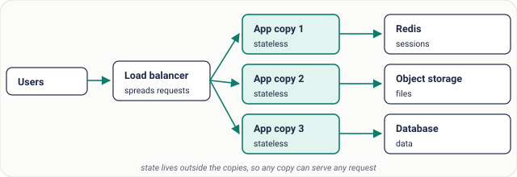
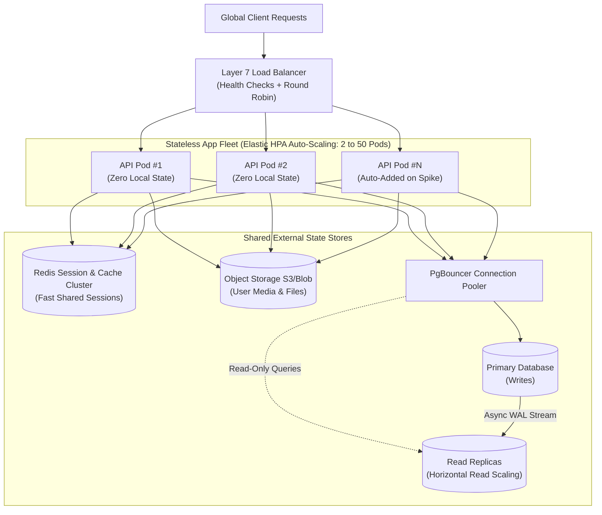
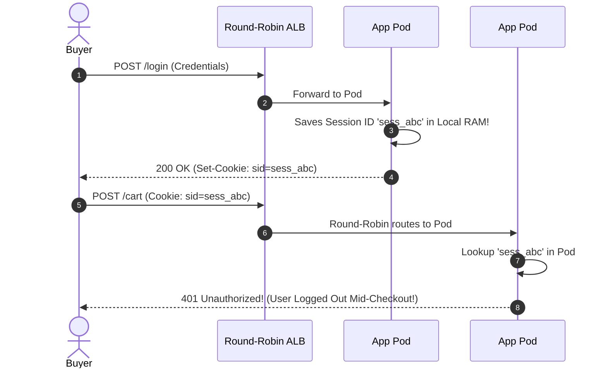

# Lesson 07: Horizontal Scaling

> **Prerequisites:** [Lesson 06: Vertical Scaling](../06-vertical-scaling/README.md).  
> **Estimated Reading Time:** 26 minutes  
> **Target Audience:** Backend engineers and cloud architects building elastic, stateless application clusters and horizontally partitioned data topologies.

> [!TIP]
> **The Golden Rule of Horizontal Scaling:** Application servers scale horizontally almost effortlessly **only when they are completely stateless**—holding zero user sessions, uploaded files, or local memory locks. Never mask stateful bugs using sticky load balancer sessions; extract state cleanly into Redis, Object Storage, or signed JWTs, and remember that read replicas scale reads horizontally while **only sharding scales writes**.

---

## Visual Mental Models & Architecture

### Stateless Compute Fleet Behind Load Balancers

When compute instances hold zero local session state, any incoming request can route to any replica interchangeably. Load balancers detect unhealthy instances and Kubernetes Horizontal Pod Autoscalers (HPA) expand or contract the fleet cleanly.



*Figure 1. A horizontally scaled service: identical, stateless copies behind a load balancer, with state in shared stores.*

### Why Compute Scales Easily While Databases Require Partitioning


*Figure 2. Stateless web servers share nothing. Databases share everything.*

### Kubernetes HPA Elasticity & Externalized State Topology



---

## Systematic Taxonomic Reference Grids

### Horizontal Scaling Trade-Off Matrix: Compute vs. Data Layers

| Layer | Scaling Mechanism | Write Capacity Scaled? | Primary Operational Complexity Introduced | Critical Anti-Pattern to Avoid |
| :--- | :--- | :---: | :--- | :--- |
| **Stateless API Tier** | Multiple Pods / VMs behind ALB/NLB | **Yes** (Linear) | Health probes, zero-downtime draining, centralized distributed tracing. | Storing sessions, auth state, or file uploads on local pod memory/disk. |
| **Worker / Consumer Tier** | Queue-Depth Autoscaling (KEDA / SQS) | **Yes** (Parallel jobs) | Idempotent task handlers, poison-pill Dead Letter Queues (DLQ). | Autoscaling workers based on CPU when tasks spend 90% time blocked on network I/O. |
| **Cache Tier (Redis)** | Redis Cluster / Consistent Hash Ring | **Yes** (Sharded keyspace) | Slot rebalancing, hot-key throttling (`celebrity_key`). | Running unbounded cross-slot `MGET` / Lua multi-key atomic transactions. |
| **Relational DB (Reads)** | Read Replicas (Streaming WAL) | **No** (Primary still owns 100% writes) | Eventual replication lag causing Read-Your-Writes UX glitches. | Assuming read replicas alleviate high INSERT/UPDATE write saturation. |
| **Relational DB (Writes)** | Horizontal Sharding by Shard Key | **Yes** | Cross-shard joins forbidden; distributed transactions (2PC/Saga); hotspot rebalancing. | Sharding prematurely before optimizing queries, indexes, caching, and vertical headroom. |

### Sticky Sessions vs. Shared External State Comparison

| Engineering Dimension | Sticky Sessions (Session Affinity Cookie) | Shared External State (Redis / Signed JWT) |
| :--- | :--- | :--- |
| **Fault Tolerance** | **Poor:** Node crash drops 100% of users pinned to that server. | **High:** Node dies mid-request; next request routes seamlessly to healthy replica. |
| **Elasticity & Deploys** | **Slow:** Cannot scale down or drain nodes immediately without breaking active shoppers. | **Instant:** Nodes spin up and terminate cleanly every second with zero user disruption. |
| **Load Distribution** | **Uneven:** Long-lived enterprise power users skew one pod to 95% CPU while others idle. | **Uniform:** Load balancer routes every individual request cleanly across healthiest pods. |

---

## Production War Stories: Incident Post-Mortem

### SEV-1 Post-Mortem: The Stateful Cookie Drop & Sticky-Session Scale-Down Stampede

#### Incident Overview
* **Severity:** SEV-1 (Continuous Session Loss Affecting 100% of Logged-In Checkout Users)
* **Detection Time:** 14 minutes post-horizontal-scale rollout
* **Resolution Time:** 1 hour 45 minutes
* **Impact:** Every marketing spike forced users to log back in repeatedly, abandoning active shopping carts and losing \$92,000 in hourly revenue.

#### What Happened
An e-commerce company ran cleanly on a single Express.js application server storing shopping cart items and login sessions inside `express-session`'s default in-memory `MemoryStore`.

Ahead of a major product launch, DevOps spun up **12 horizontal replicas** behind a Round-Robin AWS Load Balancer:
1. A shopper logged in; Load Balancer routed `POST /login` to **Replica #3**. Replica #3 wrote the session into its own RAM.
2. The user clicked "Add to Cart"; Load Balancer routed `POST /cart` to **Replica #7**. Replica #7 checked its empty RAM store, found zero session cookie match, rejected the user with `401 Unauthorized`, and forced an unexpected redirect back to `/login`.
3. In panic, the team enabled **Load Balancer Sticky Sessions** (`AWSALB` cookie affinity) so users pinned to a single pod.
4. Two hours later, peak traffic passed and Kubernetes Horizontal Pod Autoscaler (HPA) terminated 6 "excess" pods during scale-in—instantly wiping out active shopping carts in RAM for 50% of customers currently browsing the site! Meanwhile, Replica #3 remained pegged at 98% CPU because 400 sticky mobile corporate clients shared a single NAT gateway session affinity!



#### Root Cause Analysis
1. **Violation of the Stateless Service Contract:** Relying on default in-process session stores silently coupled user state to specific volatile memory heaps.
2. **Misapplying Sticky Sessions as an Architectural Fix:** Enabling LB affinity temporarily masked random 401 errors while creating uneven load imbalance and catastrophic data loss whenever autoscalers scaled down pods.

#### The Fix & Architectural Hardening
1. **Externalized Session State into Redis Cluster:** Swapped `MemoryStore` for a centralized Redis session backend with sub-millisecond reads (`connect-redis`) so all 12 pods share one consistent truth.
2. **Removed Sticky Sessions:** Reverted load balancing to pure Least-Connections / Round-Robin routing, achieving flat uniform CPU distribution across pods and seamless zero-downtime HPA scale-in.

---

## Multi-Language Production Code Tabs

The implementations below show how **Stateless Horizontal Scaling** works cleanly in production:
1. **Externalized Redis Session Store:** Any replica handles login or session validation interchangeably without local memory state.
2. **Graceful Readiness Drain Hook:** Allowing Kubernetes HPA or rolling deploys to terminate pods without dropping in-flight HTTP sockets.

### Production Stateless Replica & External Session Implementations

````carousel
```go
// Go: Stateless Replica Authentication Backed by Centralized Redis Sessions
package main

import (
	"context"
	"crypto/rand"
	"encoding/hex"
	"encoding/json"
	"fmt"
	"log"
	"net/http"
	"os"
	"time"

	"github.com/go-redis/redis/v8"
)

type SessionData struct {
	UserID   string `json:"user_id"`
	CartSize int    `json:"cart_size"`
}

type StatelessAuthServer struct {
	rdb        *redis.Client
	replicaID  string
}

func (s *StatelessAuthServer) HandleLogin(w http.ResponseWriter, r *http.Request) {
	b := make([]byte, 16)
	_, _ = rand.Read(b)
	sid := hex.EncodeToString(b)

	sessionBytes, _ := json.Marshal(SessionData{UserID: "user_901", CartSize: 3})

	// Store state in EXTERNAL Redis, NEVER in process memory!
	err := s.rdb.Set(r.Context(), "sess:"+sid, sessionBytes, 30*time.Minute).Err()
	if err != nil {
		http.Error(w, "Session store unavailable", http.StatusServiceUnavailable)
		return
	}

	http.SetCookie(w, &http.Cookie{Name: "sid", Value: sid, HttpOnly: true, Path: "/"})
	w.Header().Set("X-Served-By-Replica", s.replicaID)
	fmt.Fprintf(w, "Logged in on replica %s cleanly\n", s.replicaID)
}

func (s *StatelessAuthServer) HandleProfile(w http.ResponseWriter, r *http.Request) {
	cookie, err := r.Cookie("sid")
	if err != nil {
		http.Error(w, "Unauthorized", http.StatusUnauthorized)
		return
	}

	// Any horizontal replica can verify the session instantaneously via Redis
	val, err := s.rdb.Get(r.Context(), "sess:"+cookie.Value).Result()
	if err == redis.Nil {
		http.Error(w, "Session expired or invalid", http.StatusUnauthorized)
		return
	}

	w.Header().Set("Content-Type", "application/json")
	w.Header().Set("X-Served-By-Replica", s.replicaID)
	w.Write([]byte(val))
}

func main() {
	hostname, _ := os.Hostname()
	rdb := redis.NewClient(&redis.Options{Addr: "localhost:6379"})
	srv := &StatelessAuthServer{rdb: rdb, replicaID: hostname}

	http.HandleFunc("/login", srv.HandleLogin)
	http.HandleFunc("/profile", srv.HandleProfile)
	log.Printf("Stateless replica %s ready on :8000", hostname)
	log.Fatal(http.ListenAndServe(":8000", nil))
}
```
<!-- slide -->
```typescript
// TypeScript/Node.js: Stateless Express Replica + External Redis Session + SIGTERM Drain
import express, { Request, Response } from 'express';
import Redis from 'ioredis';
import { randomUUID } from 'crypto';
import * as os from 'os';

const app = express();
app.use(express.json());

const redis = new Redis(process.env.REDIS_URL || 'redis://localhost:6379');
const REPLICA_ID = os.hostname();

// Health check for Load Balancer / Kubernetes Readiness Probe
let isDraining = false;
app.get('/healthz', (_req: Request, res: Response) => {
  if (isDraining) return res.status(503).send('Draining');
  res.status(200).send('OK');
});

app.post('/login', async (req: Request, res: Response) => {
  const sid = randomUUID();
  const payload = JSON.stringify({ userId: req.body.userId || 'usr_42', role: 'buyer' });

  // Externalize state to shared Redis (zero local state!)
  await redis.set(`sess:${sid}`, payload, 'EX', 1800);

  res.setHeader('X-Served-By', REPLICA_ID);
  res.status(200).json({ sessionId: sid, replica: REPLICA_ID });
});

app.get('/profile', async (req: Request, res: Response) => {
  const sid = req.headers['x-session-id'] as string;
  if (!sid) return res.status(401).json({ error: 'Missing X-Session-Id' });

  const sessionData = await redis.get(`sess:${sid}`);
  if (!sessionData) return res.status(401).json({ error: 'Invalid or expired session' });

  res.setHeader('X-Served-By', REPLICA_ID);
  res.json({ session: JSON.parse(sessionData), replica: REPLICA_ID });
});

const server = app.listen(8000, () => console.log(`Replica ${REPLICA_ID} listening`));

// Elastic HPA Scale-In Protection: Drain gracefully on SIGTERM
process.on('SIGTERM', () => {
  isDraining = true; // Stop receiving new ALB traffic immediately
  server.close(() => {
    redis.quit();
    process.exit(0);
  });
});
```
<!-- slide -->
```python
# Python: Stateless FastAPI Replica with External Redis Session Verification
import os
import json
import uuid
import redis.asyncio as aioredis
from fastapi import FastAPI, Header, HTTPException, Response

app = FastAPI(title="Stateless Elastic API")
redis_client = aioredis.from_url(os.getenv("REDIS_URL", "redis://localhost:6379"), decode_responses=True)
REPLICA_ID = os.getenv("HOSTNAME", f"pid-{os.getpid()}")

@app.post("/login")
async def login(user_id: str, response: Response):
    sid = str(uuid.uuid4())
    session_payload = json.dumps({"user_id": user_id, "cart": ["sku_101"]})

    # Externalize session into distributed Redis with 30-min TTL
    await redis_client.setex(f"sess:{sid}", 1800, session_payload)

    response.headers["X-Served-By-Replica"] = REPLICA_ID
    return {"session_id": sid, "created_on": REPLICA_ID}

@app.get("/cart")
async def get_cart(response: Response, x_session_id: str = Header(default="")):
    if not x_session_id:
        raise HTTPException(status_code=401, detail="Missing X-Session-Id")

    raw = await redis_client.get(f"sess:{x_session_id}")
    if raw is None:
        raise HTTPException(status_code=401, detail="Session invalid or expired")

    response.headers["X-Served-By-Replica"] = REPLICA_ID
    return {"session": json.loads(raw), "served_by": REPLICA_ID}
```
<!-- slide -->
```csharp
// C#: ASP.NET Core Stateless Replica Backed by StackExchange.Redis
using System;
using System.Text.Json;
using Microsoft.AspNetCore.Builder;
using Microsoft.AspNetCore.Http;
using StackExchange.Redis;

var builder = WebApplication.CreateBuilder(args);
var redis = ConnectionMultiplexer.Connect(Environment.GetEnvironmentVariable("REDIS_URL") ?? "localhost:6379");
builder.Services.AddSingleton<IConnectionMultiplexer>(redis);

var app = builder.Build();
var replicaId = Environment.MachineName;

app.MapPost("/login", async (string userId, IConnectionMultiplexer mux, HttpResponse resp) =>
{
    var sid = Guid.NewGuid().ToString("N");
    var db = mux.GetDatabase();
    var payload = JsonSerializer.Serialize(new { UserId = userId, Items = 2 });

    // Externalize session out of replica RAM into Redis
    await db.StringSetAsync($"sess:{sid}", payload, TimeSpan.FromMinutes(30));

    resp.Headers["X-Served-By-Replica"] = replicaId;
    return Results.Ok(new { sessionId = sid, replica = replicaId });
});

app.MapGet("/cart", async (HttpRequest req, HttpResponse resp, IConnectionMultiplexer mux) =>
{
    var sid = req.Headers["X-Session-Id"].ToString();
    if (string.IsNullOrEmpty(sid)) return Results.Unauthorized();

    var db = mux.GetDatabase();
    var val = await db.StringGetAsync($"sess:{sid}");
    if (val.IsNullOrEmpty) return Results.Unauthorized();

    resp.Headers["X-Served-By-Replica"] = replicaId;
    return Results.Ok(new { session = JsonSerializer.Deserialize<object>(val!), servedBy = replicaId });
});

app.Run("http://0.0.0.0:8000");
```
````

---

## Practical Hands-On Verification CLI Workflows

Prove empirically that horizontal scaling preserves seamless request handling across independent backend processes once session state is moved to Redis.

### Step 1: Launch Redis & Two Independent App Replicas

Start the shared Redis instance (if not already running) and spawn Replica A on port `8001` and Replica B on port `8002`:

```bash
docker run -d --name saas-governor-redis -p 6379:6379 redis:7-alpine

# Terminal 1: Launch Replica A
HOSTNAME=replica-alpha uvicorn stateless_app:app --port 8001

# Terminal 2: Launch Replica B
HOSTNAME=replica-beta uvicorn stateless_app:app --port 8002
```

### Step 2: Authenticate on Replica A (`8001`) and Verify Cross-Replica Retrieval on Replica B (`8002`)

```bash
# 1. Login on Replica Alpha (Port 8001)
LOGIN_RESP=$(curl -s -X POST "http://127.0.0.1:8001/login?user_id=alice_99")
echo "$LOGIN_RESP"
# -> {"session_id":"a7f31b0e-...","created_on":"replica-alpha"}

SID=$(echo "$LOGIN_RESP" | python -c "import sys, json; print(json.load(sys.stdin)['session_id'])")

# 2. Fetch Cart from Replica Beta (Port 8002) using the same session token!
curl -s -i http://127.0.0.1:8002/cart -H "X-Session-Id: $SID"
```

**Expected Wire Output:**
```http
HTTP/1.1 200 OK
x-served-by-replica: replica-beta
content-type: application/json

{"session":{"user_id":"alice_99","cart":["sku_101"]},"served_by":"replica-beta"}
```

Even if you aggressively terminate **Replica Alpha** (`Ctrl+C`), Replica Beta continues serving `alice_99` with zero interruption!

---

## Operational Validation Checkpoints (Scenario Quizzes)

<details>
<summary><strong>Checkpoint 1: The Queue Worker CPU Autoscaling Trap</strong></summary>

**Scenario:** You run an asynchronous video thumbnail & webhook dispatch worker pool scaled by Kubernetes HPA targeting `average CPU > 70%`. During a sudden spike of 500,000 incoming webhook events, jobs fall 4 hours behind in the Redis queue, yet Kubernetes **never adds a single extra worker pod**. When you inspect metrics, worker CPU sits peacefully at 12%. Why did autoscaling fail, and what metric must govern worker elasticity?

<strong>Answer:</strong>
Webhook dispatch and third-party API calls are **I/O-bound**, not CPU-bound. A single async worker thread spends 95% of its lifecycle blocked waiting on TCP socket responses from external endpoints, barely consuming CPU cycles while the backlog skyrockets.
Autoscale I/O-bound background workers on **Queue Depth (number of waiting messages)** or **Oldest Message Age (lag seconds)** using KEDA/Prometheus external metrics—not CPU utilization.
</details>

<details>
<summary><strong>Checkpoint 2: Why Adding Replicas Crashed the Database</strong></summary>

**Scenario:** An API fleet scales cleanly from 5 stateless containers to 60 containers during a traffic event. Each container initializes a local SQLAlchemy connection pool of `max_connections = 20`. Almost immediately after scaling to 60 pods, the entire platform fails with database errors while CPU on the app servers is completely normal. Calculate the root cause and describe the architecture fix.

<strong>Answer:</strong>
$60\text{ pods} \times 20\text{ connections per pod} = 1,200\text{ concurrent TCP connections}$ hitting a single PostgreSQL server configured with a typical `max_connections` ceiling of `300–500`. Furthermore, PostgreSQL spawns one OS backend process per connection (~10 MB RAM + context switching overhead), crashing the DB server.
**Fixes:**
1. Insert a centralized transaction-level **Connection Pooler (PgBouncer)** between the elastic app fleet and PostgreSQL to multiplex 1,200 logical app sockets onto 60–100 actual physical DB server processes.
2. Shrink per-pod pool size aggressively (`pool_size = 5`) and verify `total_pods * pool_size < DB_max_connections`.
</details>

<details>
<summary><strong>Checkpoint 3: Scaling Writes vs. Scaling Reads with Replicas</strong></summary>

**Scenario:** An IoT platform collects temperature sensor writes at 120,000 writes/second. A junior engineer proposes adding 10 PostgreSQL Read Replicas to spread the incoming write traffic horizontally. Why does adding read replicas provide zero write scaling relief, and what actually scales writes?

<strong>Answer:</strong>
In leader-follower relational replication, **every single write must execute first on the single Primary node** and then replay onto every single Read Replica. Adding 10 read replicas means all 11 machines still have to execute 120,000 write WAL entries/second! In fact, heavy replication streaming can slightly increase primary overhead.
To scale **writes horizontally**, you must partition writes across multiple independent primaries using **Sharding** (partitioning by `sensor_id` or `tenant_id`), or adopt a write-partitioned distributed engine (Cassandra, DynamoDB, CockroachDB, or Kafka ingestion buffers).
</details>

---

## Further Reading & Sources

- [Kubernetes Documentation: Horizontal Pod Autoscaler (HPA)](https://kubernetes.io/docs/tasks/run-application/horizontal-pod-autoscale/) — Configuring CPU, memory, and custom queue-depth autoscaling metrics.
- [Twelve-Factor App: VI. Processes (Stateless & Share-Nothing)](https://12factor.net/processes) — Foundational architectural manifesto for horizontal compute scaling.
- [PostgreSQL & Horizontal Sharding Concepts](https://dataintensive.net/) — Partitioning strategies and cross-shard trade-offs.

---

## Free PDF notes

Download these notes as a printable PDF, with every diagram: [SD-A-007.pdf](https://backendroadmap.com/notes/system-design/SD-A-007.pdf). All Phase 1 notes in one file: [Phase 1, Core Fundamentals (PDF)](https://backendroadmap.com/notes/system-design/Phase1_Core_Fundamentals_Notes.pdf).

---

## Next

Continue with [Lesson 08: Latency](../08-latency/README.md) to break latency down into network, queueing, processing, and I/O components, and master component latency budgets.
