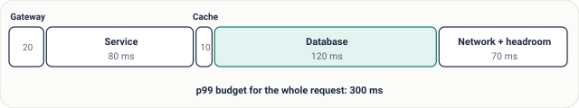

# Lesson 08: Latency

## Roadmap

You are in **System Design Interview Prep**, Track 01, **Core Fundamentals**: lesson 8 of 19 (p99, latency budgets and the numbers to know). It builds on [Lesson 07: Horizontal Scaling](../07-horizontal-scaling/README.md). Next comes [Lesson 09: Throughput and Little's Law](../09-throughput-and-littles-law/README.md).

These are the written notes for the lesson's video. Prefer paper? The same notes are a free, printable PDF: [download SD-A-008.pdf](https://backendroadmap.com/notes/system-design/SD-A-008.pdf).

## Concept

> [!key] Latency is the time for one request, made of network, queueing, processing and I/O; measure it as percentiles, know the key numbers, and split the target into a budget per component.

## Explanation

### What latency is made of

Latency is the time from sending a request to receiving the full response. It's never one thing; it's the sum of four parts, and each part has different fixes.

*Figure 1. The four parts of latency. Queueing is the sneaky one: it grows fast near full utilization, even when your code doesn't get slower.*

### Measure percentiles, not averages

**p50** is the typical request; **p95** and **p99** are the slow tail. If one page calls 10 services, the chance that at least one call is at or beyond its p99 is 1 − 0.9910 ≈ **10%**. With 50 calls it's ~40%. The tail is what users actually feel.

### Numbers every engineer should know

| Operation | Typical time | Relative to memory |
|---|---|---|
| Read from main memory | ~100 ns | 1× |
| Random read from an SSD | ~100 µs | ~1,000× |
| Round trip inside one data centre | ~0.5 ms | ~5,000× |
| Read 1 MB sequentially from an SSD | ~1 ms | ~10,000× |
| Round trip across regions (e.g. India ↔ Europe) | 100–150 ms | ~1,000,000× |

Rough orders of magnitude are enough: they tell you instantly that a cross-region call inside a loop is a bad idea, and that caching in memory beats any disk.

### Latency budgets

*Figure 2. A 300 ms p99 target split into a budget per component. Every team knows its number.*

If a part goes over budget, you know where to look, and each fix maps to one part of latency:

| Too much … | Fix |
|---|---|
| **Network** | Move closer to users (CDN, regions), cut round trips, batch calls |
| **Queueing** | Add capacity, lower utilization, shed low-priority load |
| **Processing** | Profile hot code, do less work per request, move work to async jobs |
| **I/O / database** | Add an index, cache hot reads, avoid N+1 queries |

## Key terms

| Term | Meaning |
|---|---|
| **Latency** | time for one request |
| **p99** | 99% of requests are faster |
| **Tail latency** | the slowest few percent |
| **Queueing delay** | time waiting for a free worker |
| **Latency budget** | max time per component |
| **RTT** | round-trip time |

## Interview questions

Each question is tagged by kind: **Basic** (definitions), **Scenario** (apply it to a system) and **Tricky** (the follow-ups interviewers use to go deeper). Answer out loud before you open the answer.

> [!interview] Why use p99 instead of the average? (Basic)

What a strong answer covers

Averages hide the slow tail, and pages make many calls, so most users hit some call's p99 regularly. Percentiles show what users actually feel.

> [!interview] How does a cross-region round trip compare with a memory read? (Basic)

What a strong answer covers

Roughly 100 ms versus 100 ns: about a million times slower.

> [!interview] What are the parts of latency? (Basic)

What a strong answer covers

Network time, queueing (waiting for a worker), processing (your code) and I/O (disks, databases). Each has different fixes.

> [!interview] Your API's p99 jumped from 120 ms to 900 ms but code didn't change. Where do you look? (Scenario)

What a strong answer covers

Queueing and dependencies: higher utilization, a saturated pool or a slow database. Check traffic, CPU, pool wait time and database latency, using traces to see which span grew.

> [!interview] Split a 300 ms p99 budget for a checkout request. (Scenario)

What a strong answer covers

Gateway ~20 ms, service logic ~80, cache ~10, database ~120, and ~70 for network and headroom. Then each team owns its number.

> [!interview] A page calls 5 services one after another, each 60 ms. How do you speed it up? (Scenario)

What a strong answer covers

Call independent services in parallel (≈ 60 ms instead of 300), cache results that change rarely, or have one aggregator call them inside the data centre.

> [!interview] With 10 calls per page, why do ~10% of pages hit a p99? (Tricky)

What a strong answer covers

Each call has a 1% chance of being in its slowest 1%. The chance at least one of 10 is: 1 − 0.9910 ≈ 9.6%.

> [!interview] Can adding a cache make p99 worse? (Tricky)

What a strong answer covers

Yes, if misses add a network hop before the database, or the cache is overloaded or cold after a restart. Measure hit rate and miss latency, and warm caches after deploys.

## Common mistakes & troubleshooting

- Reporting average latency.
- Calling services one after another when they could run in parallel.
- Ignoring cross-region round trips in the design.
- Measuring latency without stating the load it was measured at.

## Free PDF notes

Download these notes as a printable PDF, with every diagram: [SD-A-008.pdf](https://backendroadmap.com/notes/system-design/SD-A-008.pdf). All Phase 1 notes in one file: [Phase 1, Core Fundamentals (PDF)](https://backendroadmap.com/notes/system-design/Phase1_Core_Fundamentals_Notes.pdf).

The Phase 2 video on this page has its own notes: [SD-D-002: Latency Numbers & Powers of Two Every Engineer Should Know](https://backendroadmap.com/notes/system-design/SD-D-002.pdf). All of them in one file: [Phase 2, Estimation (PDF)](https://backendroadmap.com/notes/system-design/Phase2_Estimation_Notes.pdf).

## Next

Continue with [Lesson 09: Throughput and Little's Law](../09-throughput-and-littles-law/README.md).
