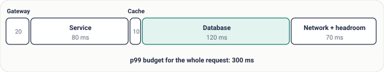
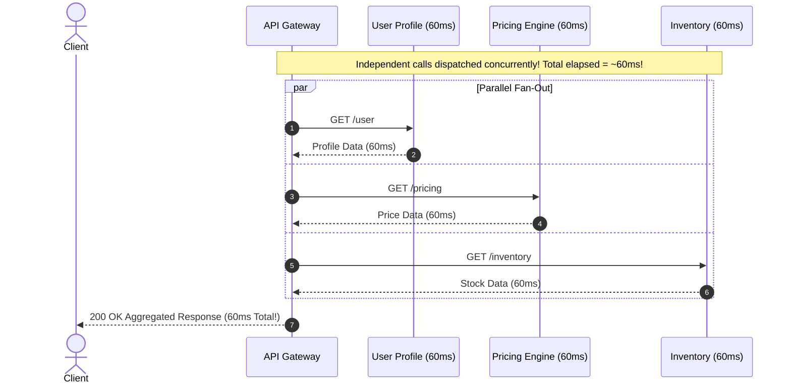
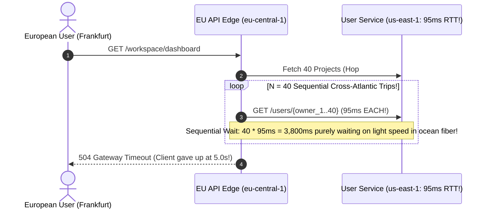

# Lesson 08: Latency

> **Prerequisites:** [Lesson 07: Horizontal Scaling](../07-horizontal-scaling/README.md).  
> **Estimated Reading Time:** 32 minutes  
> **Target Audience:** Backend engineers, performance architects, and SREs diagnosing $p_{99}$ tail latency, cross-region network bottlenecks, and microservice latency budgets.  
> **Free PDF Notes:** [Download SD-A-008.pdf](https://backendroadmap.com/notes/system-design/SD-A-008.pdf) · [Numbers Cheat Sheet SD-D-002.pdf](https://backendroadmap.com/notes/system-design/SD-D-002.pdf) · [Phase 1, Core Fundamentals (PDF)](https://backendroadmap.com/notes/system-design/Phase1_Core_Fundamentals_Notes.pdf) · [Phase 2, Estimation (PDF)](https://backendroadmap.com/notes/system-design/Phase2_Estimation_Notes.pdf)

> [!NOTE]
> **In one line:** Latency is how long one request takes from the user's side. It is the sum of network, queueing, processing, and I/O time; you measure it as percentiles, not averages; and you control it with a budget per component, fewer round trips, and parallel calls.

> [!TIP]
> **The Golden Rule of Latency Engineering:** Never treat latency as a single monolithic timer—decompose every end-to-end request into **Network, Queueing, Processing, and I/O** delays, enforce explicit per-component $p_{99}$ budgets, and parallelize independent downstream calls. Moving an operation from RAM ($100\text{ ns}$) to a cross-region WAN call ($150\text{ ms}$) slows execution by a factor of **1,500,000$\times$**—eliminating unnecessary round-trips beats micro-optimizing CPU loops every time.

---

## 1. What Latency Is, and What It Isn't

You click **Buy** and wait. That wait is **latency**: the duration from the exact moment a request is sent by the client to the moment the complete response arrives. It is the number users feel most directly, and it is almost always the first non-functional requirement asked about in a senior system design interview.

Three related ideas are frequently conflated:

| Term | Precise Meaning | Production Example |
| :--- | :--- | :--- |
| **Latency** | Time taken for a single request, end to end | *This checkout took $180\text{ ms}$ from mobile click to confirmation.* |
| **Throughput** | How many completed requests the system finishes per second | *The payment fleet processes $2,000\text{ checkouts/second}$.* |
| **Server Time** | Only the portion of time measured internally inside your service | *The server handler span clocked $100\text{ ms}$ (ignoring network hops).* |

Low latency and high throughput are fundamentally different engineering goals. A system can easily serve $50,000\text{ requests per second}$ while each individual request still suffers a grueling $2\text{ second}$ delay. [Lesson 09: Throughput & Little's Law](../09-throughput-and-littles-law/README.md) links these two metrics mathematically.

### Why Latency Matters
1. **Human Perception Thresholds (Jakob Nielsen):**
   - $\sim 100\text{ ms}$ feels instantaneous to human perception.
   - $\sim 1.0\text{ s}$ preserves a user's seamless train of thought.
   - $> 10\text{ s}$ causes users to completely abandon the flow or bounce from the site.
2. **Latency Compounds Across Dependencies:** A modern web page or mobile screen rarely makes just one call. When a user action fans out to 10 or 20 microservices, the total page response time is bound by the *slowest* dependency. Small tail delays deep in the system snowball into massive delays at the user layer.
3. **Latency Targets Dictate Infrastructure Architecture:** Strict latency SLOs determine whether you require edge CDN caching, read replicas in Frankfurt and Tokyo, asynchronous event-driven background queues, or specialized in-memory data grids.

---

## 2. The Four Parts of Latency

Latency is never a single monolithic block. Every end-to-end request spends its lifetime across four distinct physical components:

| Component | Where the Time Goes | Typical Root Cause When It Is High | Primary Architectural Fix |
| :--- | :--- | :--- | :--- |
| **1. Network** | Bytes travelling across wires, routers, and switches between client, CDN, load balancer, and backend | Geographic distance, missing connection reuse, repeated TCP/TLS handshakes, $N+1$ remote calls | Deploy edge CDNs; reuse connections (HTTP/2, Keep-Alive); batch requests; terminate TLS at edge. |
| **2. Queueing** | Requests sitting idle waiting for an available thread, worker process, connection, or database lock | High server utilization ($> 70\%$), bursty traffic, undersized connection or thread pools | Add capacity; size pools using Little's Law; enforce load shedding (`503`) to reject excess queueing. |
| **3. Processing** | CPU cores actively executing code: parsing JSON, executing business logic, serializing responses | CPU-bound algorithms, unoptimized regex, reflection, un-indexed string scans, garbage collection pauses | Profile with flamegraphs; switch to binary serialization (Protobuf); optimize algorithms; tune GC. |
| **4. I/O** | CPU waiting on external storage: disks, relational databases, cache misses, downstream microservices | Missing database indexes, large table scans, cache misses, disk write flushes (`fsync`), slow 3rd-party APIs | Add composite indexes; cache hot reads in Redis; add read replicas; offload heavy work to background workers. |

### Visualizing the Anatomy of an End-to-End Request


*Figure 1. A 180 ms request split into its four constituent parts. The server's internal timer only observes the middle 100 ms; the client also pays for network transit in both directions.*

```
+---------------------------------------------------------------------------------------------------+
| Total End-to-End User Latency: 180 ms                                                             |
+-------------------+-------------------+-------------------+-------------------+-------------------+
| Network (Inbound) | Queueing Delay    | Processing (CPU)  | Database / I/O    | Network (Outbound)|
| 40 ms             | 25 ms             | 30 ms             | 45 ms             | 40 ms             |
+-------------------+-------------------+-------------------+-------------------+-------------------+
|                   | <--------- Internal Server Timer Span: 100 ms ----------> |                   |
+---------------------------------------------------------------------------------------------------+
```

> [!WARNING]
> **The Observability Blindspot:** Notice the massive discrepancy in Figure 1. Your internal APM dashboard (Datadog, Prometheus) proudly claims a fast $100\text{ ms}$ response time, but the end user waited $180\text{ ms}$! Always verify **where** a latency metric was captured: inside the app handler, at the ingress load balancer, or directly in the client browser.

---

## 3. Queueing: The Part That Explodes

Processing time and database read times stay relatively flat as traffic increases—until hardware saturates. **Queueing delay does not.**

When a server runs at light load, an incoming request almost always finds an idle worker thread or database connection. However, as resource utilization ($\rho$) climbs, requests increasingly arrive while existing workers are still busy. Incoming requests are forced to wait in an OS socket backlog or thread pool queue.

From queueing theory (the standard $M/M/1$ queue model), average response time is governed by the classic relation:

$$\text{Response Time} \approx \frac{\text{Service Time}}{1 - \text{Utilization}}$$

Where $\text{Utilization} = \rho = \frac{\text{Arrival Rate } \lambda}{\text{Service Capacity } \mu}$.

| Server Utilization ($\rho$) | Latency Multiplier $\frac{1}{1 - \rho}$ | Response Time ($10\text{ ms}$ base work) | Operational State & Behavior |
| :---: | :---: | :---: | :--- |
| **$50\%$** | $2.0\times$ | $20\text{ ms}$ | **Comfortable baseline:** Absorbs sudden $2\times$ traffic spikes without degradation. |
| **$70\%$** | $3.3\times$ | $33\text{ ms}$ | **Autoscaling Target:** Standard target for Kubernetes Horizontal Pod Autoscaler (HPA). |
| **$80\%$** | $5.0\times$ | $50\text{ ms}$ | **Warning Zone:** Jitter becomes noticeable to users; small bursts cause tail spikes. |
| **$90\%$** | $10.0\times$ | $100\text{ ms}$ | **Critical Queueing:** Every request waits behind a backlog; $5\times$ slower than normal. |
| **$95\%$** | $20.0\times$ | $200\text{ ms}$ | **Danger Zone:** Minor network pause triggers queue spillover, client timeouts, and retries. |
| **$99\%$** | $100.0\times$ | $1,000\text{ ms}$ | **Catastrophic Saturation:** Effective outage; system burns 100% CPU on dead/cancelled requests. |

```
Response Time (ms)
   ^
100|                                             * (90% -> 100ms)
 80|                                            *
 60|                                           *
 50|                                    * (80% -> 50ms)
 40|                                   *
 20|                   * (50% -> 20ms)
 10|-------------------*------------------------- (Base Service Time = 10ms)
   +---------------------------------------------> Utilization (%)
     0%               50%              80%   90% 100%
```

> [!IMPORTANT]
> **The 60–70% Rule in Production:** This exponential curve is why production fleets keep peak CPU, thread pools, and connection pools around **$60-70\%$ utilization**. A sudden latency spike on a service where no new code was deployed is almost always a queueing problem: unexpected traffic surges, smaller connection pools, or a slow downstream dependency holding workers hostage.

---

## 4. Measure Percentiles, Never Averages

Latency is not a single scalar; it is a **continuous probability distribution**. Most requests are fast, but rare stalls (garbage collection pauses, page faults, lock contention, packet retransmissions) create a heavy, long tail to the right.

An **arithmetic average** squashes that entire distribution into a meaningless number that describes virtually no real user:

| Percentile Metric | Exact Meaning | Who It Actually Describes |
| :--- | :--- | :--- |
| **$p_{50}$ (Median)** | $50\%$ of requests are faster than this number | The typical, median user experience under normal conditions. |
| **$p_{95}$** | $95\%$ are faster; $1$ out of every $20$ requests is slower | A regular daily user who makes multiple API requests. |
| **$p_{99}$** | $99\%$ are faster; $1$ out of every $100$ requests is slower | Heavy power users, and anyone loading complex pages with multiple calls. |
| **$p_{99.9}$** | $99.9\%$ are faster; $1$ in $1,000$ requests is slower | Critical at hyperscale (e.g. Amazon, Google): millions of people per hour! |

### Concrete Example: How an Average Deceives You
Imagine a batch of 100 requests:
- **90 requests** complete in $40\text{ ms}$.
- **9 requests** complete in $300\text{ ms}$.
- **1 request** stalls for $2,000\text{ ms}$.

$$\text{Arithmetic Average} = \frac{(90 \times 40) + (9 \times 300) + (1 \times 2,000)}{100} = \frac{3,600 + 2,700 + 2,000}{100} = \mathbf{83\text{ ms}}$$

An average of $83\text{ ms}$ looks acceptable on an engineering slide, yet **not a single request took $83\text{ ms}$!**
- The median ($p_{50}$) is $40\text{ ms}$.
- The $p_{95}$ is $300\text{ ms}$.
- The worst-case is $2,000\text{ ms}$.

Only percentiles alert you that $10\%$ of your users are waiting more than $7\times$ longer than the rest!

---

## 5. Why the Tail Matters More Than You'd Think

In microservice architectures, a single user click rarely hits one backend server. Instead, an API Gateway fans out to dozens of downstream services (Auth, Catalog, Cart, Inventory, Recommendations, Reviews, Pricing).

Because a page response cannot finish until its **slowest** component call completes, the probability that a user experiences tail latency grows exponentially with the number of calls $N$:

$$P(\text{Page hits at least one } p_{99}\text{-slow call}) = 1 - (0.99)^N$$

| Number of Downstream Calls ($N$) | Chance User Hits a $p_{99}$ Slowdown | Real-World Architectural Equivalent |
| :---: | :---: | :--- |
| **1 call** | **$1.0\%$** | Simple monolithic endpoint (healthcheck, ping). |
| **5 calls** | **$4.9\%$** | Standard CRUD service with auth and profile lookup. |
| **10 calls** | **$9.6\%$** | Medium dashboard page loading user feed and widgets. |
| **20 calls** | **$18.2\%$** | E-commerce product details page (pricing, inventory, reviews). |
| **50 calls** | **$39.5\%$** | Complex personalized home feed with ML recommendations. |
| **100 calls** | **$63.4\%$** | Enterprise portal aggregating multiple reporting subsystems. |

```
P(Slow Page)
 70%|                                                    * (100 calls -> 63.4%)
 60%|
 50%|                                  * (50 calls -> 39.5%)
 40%|
 30%|
 20%|                 * (20 calls -> 18.2%)
 10%|     * (10 calls -> 9.6%)
  0%+-----+--------+--------+--------+--------+--------+-------->
    0     10       20       30       40       50      100 calls (N)
```

> [!IMPORTANT]
> At $N = 100$ backend calls, **over $63\%$ of your users will hit a $p_{99}$ latency spike on every single page view!** Tail latency is not a rare edge case; at microservice scale, the tail *is* the common user experience.

---

## 6. Numbers Every Backend Engineer Must Know

You do not need to memorize microsecond decimal points, but you **must** know the relative orders of magnitude. Having these numbers in your head lets you reject fatally flawed system designs in seconds during architectural reviews:

| Operation | Physical Hardware / Network Layer | Exact Latency | Log Scale Multiplier | Engineering & Architectural Implication |
| :--- | :--- | :---: | :---: | :--- |
| **L1/L2 CPU Cache Reference** | On-die Silicon Register | $\sim 1\text{ ns}$ | $0.01\times$ | Keep tight performance loops cache-line friendly ($64\text{ bytes}$). |
| **Main Memory (RAM) Read** | Local DRAM Bus | $\sim 100\text{ ns}$ | **$1\times$ Baseline** | Golden standard for hot in-memory lookups (Redis, local cache). |
| **Compress 1 KB with Snappy** | Host CPU ALU | $\sim 3\text{ µs}$ | $\sim 30\times$ | Compressing data in RAM is far cheaper than shipping raw bytes over WAN! |
| **Random Read from NVMe SSD** | PCIe bus / NVMe flash | $\sim 100\text{ µs}$ | $\sim 1,000\times$ | Avoid random disk seeks on hot query paths; keep indexes in memory. |
| **Intra-Datacenter Round Trip** | Local Rack Top-of-Rack Switch | $\sim 0.5\text{ ms}$ | $\sim 5,000\times$ | Fast enough for microservice RPCs inside the same Availability Zone. |
| **Read 1 MB Sequentially from SSD** | NVMe Storage Controller | $\sim 1\text{ ms}$ | $\sim 10,000\times$ | Sequential I/O (Kafka logs, PostgreSQL WAL) massively outperforms random I/O. |
| **Disk `fsync()` Durability Flush** | SSD Flash Block Write | $1 - 5\text{ ms}$ | $\sim 20,000\times$ | Must use group commits to amortize fsync cost across thousands of transactions. |
| **Cross-Continent WAN Round Trip** | Subsea Fiber (e.g. India $\leftrightarrow$ Europe) | $100 - 150\text{ ms}$ | **$\sim 1,500,000\times$** | **Fatal inside synchronous loops!** A single intercontinental hop equals 1.5 million RAM reads! |

---

## 7. Where Network Time Hides: Round Trips

Network latency is primarily determined by distance and speed-of-light in glass fibre ($\sim 200\text{ km/ms}$ in practice, after refraction and routing overhead). However, software protocols frequently multiply that base delay through unnecessary round trips (RTTs).

### Cold Connection Establishment vs. Persistent Connection Reuse

When an HTTP client opens a fresh connection across a $100\text{ ms}$ WAN link, it must pay for **three full round trips** before receiving a single byte of application response:

```
COLD CONNECTION (No Reuse): 300 ms Total Latency
Client                                                             Server
  |                                                                   |
  |--- 1. TCP SYN --------------------------------------------------->| (100 ms RTT)
  |<-- TCP SYN-ACK ---------------------------------------------------|
  |                                                                   |
  |--- 2. TLS 1.3 ClientHello ---------------------------------------->| (100 ms RTT)
  |<-- TLS ServerHello + Finished ------------------------------------|
  |                                                                   |
  |--- 3. HTTP GET /checkout ---------------------------------------->| (100 ms RTT)
  |<-- HTTP 200 OK (Response Payload) --------------------------------|
  |                                                                   |

PERSISTENT CONNECTION REUSE (HTTP/2 / Keep-Alive): 100 ms Total Latency
Client                                                             Server
  |                                                                   |
  |--- 1. HTTP GET /checkout (Reused TCP+TLS Socket) ---------------->| (100 ms RTT)
  |<-- HTTP 200 OK ---------------------------------------------------|
```

> [!TIP]
> **Connection Pooling Saves 66% of Network Latency:** Reusing established connections via HTTP/2 multiplexing, gRPC channels, or TCP Keep-Alive drops latency from $300\text{ ms}$ to $100\text{ ms}$ without altering a single line of backend application code!

---

## 8. Latency Budgets: Splitting the $p_{99}$ Target

In mature engineering organizations, latency is managed like financial capital: teams are allocated a strict **Latency Budget**.

If the checkout experience requires an end-to-end SLO of $p_{99} \le 300\text{ ms}$, that $300\text{ ms}$ is broken down into explicit per-tier quotas:



*Figure 2. A 300 ms p99 target split into a budget per component, leaving headroom for network transit and unexpected jitter.*

```
+-----------------------------------------------------------------------------------------+
| Overall User-Facing p99 SLO Target: 300 ms                                              |
+-------------------+-------------------+-------------------+-------------------+---------+
| API Gateway Ingress| Application Logic | Redis Cache Read  | PostgreSQL Query  | Headroom|
| Budget: 20 ms     | Budget: 80 ms     | Budget: 10 ms     | Budget: 120 ms    | & Net:  |
| Timeout: 25 ms    | Timeout: 90 ms    | Timeout: 12 ms    | Timeout: 130 ms   | 70 ms   |
+-------------------+-------------------+-------------------+-------------------+---------+
```

### Operational Rules for Latency Budgets
1. **Downstream Timeouts Must Derive from the Budget:** If your database budget is $120\text{ ms}$, your database query timeout must be set to $\sim 130\text{ ms}$—never the default $30\text{ seconds}$! A query that runs for 5 seconds when the user gives up at 300ms is pure wasted compute.
2. **Every Layer Must Measure Its Own Span:** Using OpenTelemetry distributed tracing, each tier reports its execution histogram so you know immediately which specific component breached its budget during an incident.

---

## 9. Five Ways to Cut Latency

Production latency optimization follows five systematic engineering strategies:

### 1. Do Independent Work in Parallel
If an endpoint calls five services taking $60\text{ ms}$ each:
- **Sequential Waterfall:** $60 + 60 + 60 + 60 + 60 = \mathbf{300\text{ ms}}$.
- **Parallel Dispatch:** Total time equals $\mathbf{\max(60\text{ ms}) \approx 60\text{ ms}}$!



### 2. Remove Round Trips (The $N+1$ Anti-Pattern)
Fetching a list of $N$ items and then issuing one remote call per item in a loop scales latency linearly with list size ($O(N \cdot \text{RTT})$). Consolidate into a single batched query:
- Replace `for item in items: query(item.id)` with `WHERE id IN (...)` or `POST /items/batch`.

### 3. Cache, and Move Data Closer to the User
- **Edge Layer:** Cache static assets, images, and public GET endpoints on CDN points-of-presence (Cloudflare, CloudFront).
- **Application Layer:** Cache hot database reads in Redis or Memcached ($< 1\text{ ms}$ in-memory lookup vs $15\text{ ms}$ disk query).
- **Data Layer:** Deploy read replicas in geographic regions near your users (e.g. Frankfurt, Tokyo) to turn cross-ocean hops into local intra-datacenter reads.

### 4. Take Slow Work Off the Critical Request Path
Never perform heavy or non-essential work while the user is actively blocked waiting for an HTTP response:
- Move email notifications, analytics events, PDF generation, and webhook dispatches to an asynchronous background queue (RabbitMQ, Kafka, Celery, SQS).
- Return `202 Accepted` immediately once the intent is durably recorded.

### 5. Tame the Tail: Timeouts, Hedged Requests, and Load Shedding
- **Client Timeouts:** Always enforce explicit deadlines. If a downstream call exceeds its budget, fail fast or degrade gracefully (e.g. return cached recommendations).
- **Hedged Requests (Dean & Barroso, *The Tail at Scale*):** If a read request to Replica A has not responded by its $p_{95}$ latency threshold (e.g., $30\text{ ms}$), fire an identical duplicate request to Replica B. Return whichever replica completes first and cancel the slower one. Only $\sim 5\%$ of requests trigger a hedge, but catastrophic tail latency ($p_{99.9}$) drops from seconds to under $80\text{ ms}$! (Note: Only hedge *idempotent read operations*).
- **Load Shedding:** When server queues fill up, reject low-priority traffic early with `503 Service Unavailable` so critical requests continue completing fast.

---

## 10. Production War Story: Incident Post-Mortem

### SEV-1 Post-Mortem: The N+1 Sequential Cross-Region Loop Meltdown

#### Incident Overview
* **Severity:** SEV-1 (P99 Latency Surge from 140ms to 11.4 Seconds on Primary Feed)
* **Detection Time:** 18 minutes post-release
* **Resolution Time:** 1 hour 05 minutes
* **Impact:** Mobile app users across Europe and Asia experienced broken homepage feeds and aborted sessions for over an hour.

#### What Happened
A global SaaS marketplace hosted its primary relational database cluster in `us-east-1` (Virginia), while serving edge API nodes in both `us-east-1` and `eu-central-1` (Frankfurt). To personalize a user's workspace dashboard displaying 40 active projects, an engineer added a clean helper loop populating project owner avatars:

```python
# Flawed N+1 Sequential Cross-Region Loop!
@app.get("/workspace/dashboard")
async def get_dashboard(user_id: str):
    projects = await fetch_projects(user_id) # 1 query returning 40 projects (110ms)
    for proj in projects:
        # BUG: Executed 40 SEQUENTIAL network hops across the Atlantic (us-east-1 <-> eu-central-1)!
        proj.owner = await user_client.get_user(proj.owner_id)
    return projects
```

Inside the developer's local environment (`localhost`), 40 SQL/HTTP lookups took $40 \times 0.4\text{ ms} = 16\text{ ms}$—passing every functional integration test cleanly.

Upon deploying to the Frankfurt edge cluster (`eu-central-1`) talking back to the centralized Virginia User Service (`us-east-1`, $95\text{ ms}$ network RTT across the Atlantic):
1. Step 1 fetched 40 projects ($95\text{ ms}$).
2. Inside the `for` loop, each sequential `await get_user()` burned an extra **95ms cross-Atlantic round-trip**: $40 \times 95\text{ ms} = 3,800\text{ ms}$ minimum!
3. Combined with TLS setup, TCP windowing, and DB execution, $p_{99}$ surged from 140ms to **11.4 seconds**, saturating worker threads and cascading into global gateway timeouts.



#### The Fix & Architectural Hardening
1. **One Batched Call:** Consolidated the 40 individual calls into a single vectorized batch request `POST /users/batch` passing all unique `owner_ids` in one single round trip.
2. **Read Replica in Frankfurt:** Deployed read-only User profile replicas into `eu-central-1` ($< 1\text{ ms}$ local hop).
3. **Automated Static Analysis Rule:** Enforced an architectural lint check prohibiting remote network calls inside iterative loops.

---

## 11. Multi-Language Production Code Tabs

The implementations below demonstrate two essential production latency optimization techniques:
1. **Eliminating Sequential Waterfalls via Parallel Fan-Out:** Executing three independent 60ms downstream lookups concurrently so total time equals $\approx 60\text{ms}$ instead of $180\text{ms}$.
2. **Hedged Requests for Tail Latency Suppression:** Dispatching a backup request to Replica B if Replica A does not respond within the fast $p_{95}$ threshold (`30ms`), returning whichever replica answers first!

### Parallel Fan-Out & Hedged Read Implementations

````carousel
```go
// Go: Parallel Service Fan-Out + Hedged Read Tail Suppression
package main

import (
	"context"
	"fmt"
	"math/rand"
	"sync"
	"time"
)

// HedgedCall sends request to primary replica; if no answer within hedgeAfter, fires backup concurrently!
func HedgedCall(ctx context.Context, hedgeAfter time.Duration, replicaFn func(context.Context, int) (string, error)) (string, error) {
	ctx, cancel := context.WithCancel(ctx)
	defer cancel()

	resCh := make(chan string, 2)
	errCh := make(chan error, 2)

	// Fire Primary Replica immediately
	go func() {
		res, err := replicaFn(ctx, 1)
		if err == nil {
			resCh <- res
		} else {
			errCh <- err
		}
	}()

	select {
	case res := <-resCh:
		return res, nil
	case <-time.After(hedgeAfter):
		// p95 Latency Threshold Elapsed -> Fire Hedged Request to Replica 2!
		go func() {
			res, err := replicaFn(ctx, 2)
			if err == nil {
				resCh <- res
			} else {
				errCh <- err
			}
		}()
	case <-ctx.Done():
		return "", ctx.Err()
	}

	select {
	case res := <-resCh:
		return res, nil
	case <-ctx.Done():
		return "", ctx.Err()
	}
}

func main() {
	start := time.Now()
	var wg sync.WaitGroup
	results := make([]string, 3)

	// Execute 3 independent services IN PARALLEL + Hedged tail defense
	for i := 0; i < 3; i++ {
		wg.Add(1)
		go func(idx int) {
			defer wg.Done()
			res, _ := HedgedCall(context.Background(), 30*time.Millisecond, func(ctx context.Context, replica int) (string, error) {
				// Simulate Replica 1 experiencing a rare 250ms GC pause tail spike!
				delay := 15 * time.Millisecond
				if replica == 1 && rand.Intn(3) == 0 {
					delay = 250 * time.Millisecond
				}
				select {
				case <-time.After(delay):
					return fmt.Sprintf("Svc-%d (Replica %d in %v)", idx, replica, delay), nil
				case <-ctx.Done():
					return "", ctx.Err()
				}
			})
			results[idx] = res
		}(i)
	}
	wg.Wait()
	fmt.Printf("Total Page Latency: %v | Results: %v\n", time.Since(start).Round(time.Millisecond), results)
}
```
<!-- slide -->
```typescript
// TypeScript/Node.js: Parallel Fan-Out Aggregation & Hedged Tail Request
async function fetchReplicaWithLatency(svc: string, replicaId: number, signal: AbortSignal): Promise<string> {
  const simulatedLatency = replicaId === 1 && Math.random() < 0.3 ? 250 : 20;
  return new Promise((resolve, reject) => {
    const timer = setTimeout(() => resolve(`${svc}:replica-${replicaId} (${simulatedLatency}ms)`), simulatedLatency);
    signal.addEventListener('abort', () => {
      clearTimeout(timer);
      reject(new Error('Aborted due to faster response'));
    });
  });
}

async function hedgedRequest(svc: string, hedgeTimeoutMs: number = 30): Promise<string> {
  const ac = new AbortController();
  const primaryPromise = fetchReplicaWithLatency(svc, 1, ac.signal);

  let timerId: NodeJS.Timeout | null = null;
  const timeoutPromise = new Promise<never>((_, reject) => {
    timerId = setTimeout(() => reject(new Error('HedgeTrigger')), hedgeTimeoutMs);
  });

  try {
    const res = await Promise.race([primaryPromise, timeoutPromise]);
    if (timerId) clearTimeout(timerId);
    return res;
  } catch (err: any) {
    if (err.message === 'HedgeTrigger') {
      const backupPromise = fetchReplicaWithLatency(svc, 2, ac.signal);
      const winner = await Promise.race([primaryPromise, backupPromise]);
      ac.abort();
      return winner;
    }
    throw err;
  }
}

async function main() {
  const start = Date.now();
  const [profile, pricing, inventory] = await Promise.all([
    hedgedRequest('UserProfile'),
    hedgedRequest('PricingEngine'),
    hedgedRequest('InventoryService')
  ]);
  console.log(`Parallel Hedged Finished in ${Date.now() - start}ms:`, { profile, pricing, inventory });
}

main();
```
<!-- slide -->
```python
# Python: asyncio.gather Parallel Fan-Out + Hedged Tail Request
import asyncio
import random
import time

async def simulate_replica(service_name: str, replica_id: int) -> str:
    # 25% probability of replica 1 hitting a 250ms tail spike
    delay = 0.250 if (replica_id == 1 and random.random() < 0.25) else 0.020
    await asyncio.sleep(delay)
    return f"{service_name}:replica-{replica_id} ({int(delay*1000)}ms)"

async def hedged_call(service_name: str, hedge_after: float = 0.030) -> str:
    first_task = asyncio.create_task(simulate_replica(service_name, replica_id=1))
    done, _ = await asyncio.wait({first_task}, timeout=hedge_after)
    
    if done:
        return first_task.result()
    
    # Primary exceeded 30ms p95 threshold -> dispatch hedge to Replica 2!
    second_task = asyncio.create_task(simulate_replica(service_name, replica_id=2))
    done, pending = await asyncio.wait(
        {first_task, second_task}, 
        return_when=asyncio.FIRST_COMPLETED
    )
    
    for task in pending:
        task.cancel()
        
    return list(done)[0].result()

async def main():
    start = time.perf_counter()
    # Execute 3 independent dependencies concurrently
    results = await asyncio.gather(
        hedged_call("UserProfile"),
        hedged_call("PricingEngine"),
        hedged_call("InventoryService")
    )
    elapsed = (time.perf_counter() - start) * 1000
    print(f"Parallel Hedged Fan-Out finished in {elapsed:.1f}ms: {results}")

if __name__ == "__main__":
    asyncio.run(main())
```
<!-- slide -->
```csharp
// C#: Task.WhenAll Parallel Dispatch with Hedged Backup Replica
using System;
using System.Diagnostics;
using System.Threading;
using System.Threading.Tasks;

class Program
{
    static async Task<string> SimulateCallAsync(string service, int replica, CancellationToken ct)
    {
        int delayMs = (replica == 1 && Random.Shared.Next(4) == 0) ? 250 : 20;
        await Task.Delay(delayMs, ct);
        return $"{service}:replica-{replica} ({delayMs}ms)";
    }

    static async Task<string> HedgedCallAsync(string service, int hedgeAfterMs = 30)
    {
        using var cts = new CancellationTokenSource();
        var primary = SimulateCallAsync(service, 1, cts.Token);

        var completed = await Task.WhenAny(primary, Task.Delay(hedgeAfterMs, cts.Token));
        if (completed == primary)
        {
            return await primary;
        }

        // Fire hedged backup replica
        var backup = SimulateCallAsync(service, 2, cts.Token);
        var winner = await Task.WhenAny(primary, backup);
        cts.Cancel(); // Cancel lingering slower request
        return await winner;
    }

    static async Task Main()
    {
        var sw = Stopwatch.StartNew();
        var results = await Task.WhenAll(
            HedgedCallAsync("Catalog"),
            HedgedCallAsync("Pricing"),
            HedgedCallAsync("Inventory")
        );
        sw.Stop();
        Console.WriteLine($"Parallel Hedged Fan-Out finished in {sw.ElapsedMilliseconds}ms: {string.Join(", ", results)}");
    }
}
```
````

---

## 12. Practical Hands-On Verification CLI Workflows

Inspect the physical limits of network distance and empirically verify sequential vs parallel execution using terminal tools.

### Step 1: Verify Real Network Physics via `ping` (Intra-Zone vs Inter-Continent)
Observe how network distance enforces an absolute speed-of-light lower bound regardless of CPU optimization:

```bash
# Local Loopback (RAM / Socket Baseline ~0.05ms)
ping -c 3 127.0.0.1

# Public Edge Anycast CDN / Resolver (~5-20ms)
ping -c 3 1.1.1.1
```

### Step 2: Observe Sequential vs. Parallel Timing in Shell
Run a quick shell script demonstrating how 5 sequential 100ms network calls consume 500ms, while parallel execution finishes in ~100ms:

```bash
# 1. Sequential Loop (Sum = ~0.50s+)
time (for i in 1 2 3 4 5; do sleep 0.1; done)

# 2. Parallel Fan-Out (Max = ~0.10s)
time (for i in 1 2 3 4 5; do sleep 0.1 & done; wait)
```

---

## 13. Common Mistakes to Avoid

1. **Reporting Arithmetic Averages:** Averages obscure the slow tail and describe virtually no real customer. Always report $p_{50}$, $p_{95}$, and $p_{99}$.
2. **Quoting Latency Without Measuring Point or Traffic Load:** Saying *"our API takes 50ms"* is meaningless without stating whether it was measured at the client or backend handler, and whether the system was running at 20% or 90% load.
3. **Sequential Microservice Waterfalls:** Executing five independent $60\text{ ms}$ service calls sequentially ($300\text{ ms}$) instead of in parallel ($\approx 60\text{ ms}$).
4. **Remote Calls Inside Iterative Loops ($N+1$):** Calling an external API or database per item in a list across WAN regions.
5. **Running Production Servers Near 100% Utilization:** Squeezing maximum hardware efficiency causes queueing delay to explode like $\frac{1}{1 - \rho}$.
6. **Missing or Oversized Timeouts:** Omitting timeouts on downstream RPCs, or setting a 30-second timeout when the upstream client gives up after 500ms.
7. **Assuming a Cache Always Accelerates Requests:** Cache misses add a network hop to Redis *before* querying PostgreSQL. If cache hit rates drop below 70%, the cache actively harms $p_{99}$ latency.

---

## 14. Key Terms Glossary

| Key Term | Clear Architectural Definition |
| :--- | :--- |
| **Latency** | The total duration taken for a single request from dispatch to completed response reception. |
| **Response Time** | End-to-end latency as measured strictly from the client's perspective (including all network travel). |
| **$p_{99}$ Percentile** | The latency threshold below which 99% of requests complete; only 1% take longer. |
| **Tail Latency** | The slowest portion of the latency distribution (e.g., $p_{99}$, $p_{99.9}$), driven by outliers and queues. |
| **Round-Trip Time (RTT)** | The time required for a network packet to travel from sender to destination and return. |
| **Queueing Delay** | Time a request spends waiting in memory or socket backlogs for a free worker or connection. |
| **Utilization ($\rho$)** | The fraction of total capacity currently occupied by in-progress work. |
| **Latency Budget** | The apportioned maximum latency quota assigned to each individual tier in a request path. |
| **Fan-Out** | A pattern where one inbound request triggers multiple concurrent downstream microservice calls. |
| **$N+1$ Anti-Pattern** | Issuing one query to fetch $N$ records followed by $N$ individual remote queries to hydrate them. |
| **Hedged Request** | Sending a duplicate request to a secondary replica if the primary has not answered by its $p_{95}$. |
| **Coordinated Omission** | A benchmarking flaw where load generators pause during server stalls, artificially hiding tail latency. |

---

## 15. System Design Interview Questions & Answers

### Basic Conceptual Questions

<details>
<summary><strong>Q1: What is latency, and how is it different from throughput? [BASIC]</strong></summary>

**Answer:**
Latency is the time taken for a single request to travel end-to-end (e.g., $180\text{ ms}$ for a checkout). Throughput is the volume of requests the system successfully finishes per unit of time (e.g., $2,000\text{ checkouts/second}$).
They are mathematically linked through concurrency ($L = \lambda \times W$), but represent distinct goals: a system can have massive throughput (like a freight train or bulk data pipeline) while still having terrible latency per item.
</details>

<details>
<summary><strong>Q2: What are the four parts of latency? [BASIC]</strong></summary>

**Answer:**
1. **Network:** Travel time across physical distance, fiber, routers, and protocol handshakes (DNS, TCP, TLS).
2. **Queueing:** Time spent waiting in backlogs for an idle CPU thread, worker process, or database connection.
3. **Processing:** CPU time actively executing your application logic, parsing payloads, and serializing data.
4. **I/O:** Time waiting on external hardware or systems: SSD reads, database locks, cache lookups, and downstream RPCs.
</details>

<details>
<summary><strong>Q3: Why should you use p99 instead of the average? [BASIC]</strong></summary>

**Answer:**
The arithmetic average hides the slow tail and describes almost no actual user. Latency distributions are heavily skewed to the right. Percentiles reveal the true distribution: $p_{50}$ represents the typical experience, while $p_{99}$ reflects the slowest 1% of requests. In multi-service architectures with fan-out, most users hit somebody's $p_{99}$ regularly.
</details>

<details>
<summary><strong>Q4: How does a cross-region round trip compare with a memory read? [BASIC]</strong></summary>

**Answer:**
A local main memory (RAM) read takes $\sim 100\text{ ns}$. An intercontinental network round trip (e.g., US to Europe or India) takes $100 - 150\text{ ms}$ ($100,000,000 - 150,000,000\text{ ns}$).
A cross-region network trip is approximately **1,000,000 to 1,500,000 times slower** than a memory read! This is why placing remote calls inside iterative loops across regions causes immediate catastrophic failure.
</details>

### Scenario-Based Architecture Questions

<details>
<summary><strong>Q5: Your API's p99 jumped from 120 ms to 900 ms, p50 did not move, and nothing was deployed. Where do you look? [SCENARIO]</strong></summary>

**Answer:**
Look directly at **Queueing Delay** and downstream dependencies:
1. **Traffic Spikes / Pool Saturation:** Check if a micro-burst of traffic saturated thread pools, HTTP connection pools, or database connection pools (e.g. PgBouncer). When pools saturate, median requests that arrive during normal windows pass quickly ($p_{50} = 40\text{ ms}$), but requests arriving during bursts queue up ($p_{99} = 900\text{ ms}$).
2. **Downstream Dependency Stalls:** Inspect distributed traces for slow spans. A minor database lock or 3rd-party webhook slowdown will hold worker connections longer, creating an artificial pool bottleneck upstream.
3. **Garbage Collection (GC) Pauses:** Check JVM or Go runtime metrics for stop-the-world GC pauses that periodically freeze threads for hundreds of milliseconds.
</details>

<details>
<summary><strong>Q6: Split a 300 ms p99 budget for a checkout request. [SCENARIO]</strong></summary>

**Answer:**
A standard enterprise checkout $p_{99} \le 300\text{ ms}$ budget:
- **API Gateway Ingress:** $20\text{ ms}$ (TLS termination, JWT auth validation, rate limiting).
- **Service Business Logic:** $80\text{ ms}$ (Cart validation, tax computation, discount rules).
- **Redis Cache Read:** $10\text{ ms}$ (Session lookup, fraud rule cache).
- **Database Write (PostgreSQL):** $120\text{ ms}$ (ACID order creation, inventory row lock).
- **Network Transit & Safety Headroom:** $70\text{ ms}$ (Client-to-gateway network hops and jitter buffer).

Each downstream call is configured with a timeout matching its specific quota to prevent rogue dependencies from consuming the entire budget.
</details>

<details>
<summary><strong>Q7: A page calls five independent services in sequence, 60 ms each. How do you make it faster? [SCENARIO]</strong></summary>

**Answer:**
1. **Parallel Dispatch:** Because the calls are independent, dispatch all 5 calls concurrently (`Promise.all`, `asyncio.gather`, `Task.WhenAll`). Total latency collapses from $300\text{ ms}$ ($5 \times 60\text{ ms}$) to $\approx \mathbf{60\text{ ms}}$ ($\max(60\text{ ms})$).
2. **Backend-For-Frontend (BFF) Aggregator:** Perform the fan-out inside the datacenter over local high-speed VPC links ($\sim 0.5\text{ ms}$ RTT) rather than having the mobile client execute 5 WAN round trips across mobile networks.
3. **Caching:** Cache the services whose data changes infrequently (e.g., user profile, static catalog metadata).
</details>

<details>
<summary><strong>Q8: Users in Asia complain about slowness; your only region is in the US. What do you do? [SCENARIO]</strong></summary>

**Answer:**
Because cross-Pacific network latency enforces a physical floor of $150 - 200\text{ ms}$ per RTT:
1. **Edge TLS Termination:** Deploy Cloudflare or AWS CloudFront points of presence (POPs) in Tokyo, Singapore, and Mumbai. Terminating TCP and TLS handshakes locally saves 2 full RTTs ($300-400\text{ ms}$) on new connections.
2. **Edge CDN & Regional Read Replicas:** Serve static assets and cacheable read APIs directly from Asian edge caches and regional read-only database replicas ($< 5\text{ ms}$ latency).
3. **Batching:** Consolidate multiple API queries into single batched payloads so the user only pays the trans-Pacific transit penalty once.
4. **Long-Term:** Deploy a multi-region active-active deployment or local write cell in Asia with asynchronous replication back to the US.
</details>

### Advanced & Tricky Interview Questions

<details>
<summary><strong>Q9: With 10 backend calls per page, why are about 10% of pages slow? [TRICKY]</strong></summary>

**Answer:**
Each backend call has a $1\%$ ($0.01$) probability of hitting its $p_{99}$ slow tail. Assuming independent distributions, the probability that *none* of the 10 calls hits a $p_{99}$ spike is:

$$(0.99)^{10} \approx 0.9044 \quad (90.4\%)$$

Therefore, the probability that a page experiences **at least one** $p_{99}$ slow call is:

$$P = 1 - (0.99)^{10} = 1 - 0.9044 = \mathbf{9.56\%} \approx 10\%$$

One in every ten page views is dragged down by somebody's $p_{99}$ tail!
</details>

<details>
<summary><strong>Q10: Why does latency shoot up as utilization approaches 100%, even with the exact same code? [TRICKY]</strong></summary>

**Answer:**
Because of **stochastic arrival clustering and queueing theory** ($\frac{1}{1 - \rho}$).
Requests do not arrive spaced apart like clockwork; they arrive stochastically (Poisson process). At low utilization ($50\%$), bursts find idle worker threads. At $95\%$ utilization, there is zero spare headroom: when a burst arrives, requests must wait in line. Waiting time is cumulative: every request in queue delays every request behind it. At $99\%$, the latency multiplier reaches $100\times$, turning a $10\text{ ms}$ function into a $1,000\text{ ms}$ wait without a single change to application code.
</details>

<details>
<summary><strong>Q11: Can adding a cache make p99 latency worse? [TRICKY]</strong></summary>

**Answer:**
**Yes, in three common production scenarios:**
1. **Cache Miss Penalty:** Every cache miss must now execute the Redis lookup *plus* the database query. Under poor hit rates ($< 60\%$), requests pay an extra network hop.
2. **Cache Stampede (Thundering Herd):** When a popular key expires, thousands of concurrent requests miss simultaneously and hammer PostgreSQL at the exact same millisecond, triggering thread exhaustion and massive tail latency spikes.
3. **Redis Event Loop Stalls:** If an engineer runs expensive commands like `KEYS *`, massive `HGETALL`, or large Lua scripts on single-threaded Redis, all concurrent cache queries stall for hundreds of milliseconds.
</details>

<details>
<summary><strong>Q12: What are hedged requests, and when shouldn't you use them? [TRICKY]</strong></summary>

**Answer:**
A **hedged request** sends a duplicate copy of a request to a secondary replica if the primary replica has not answered within its $p_{95}$ latency threshold (e.g., $30\text{ ms}$), taking the first answer that returns and cancelling the slower one.
**When NOT to use them:**
- **Non-Idempotent Writes:** Never hedge operations that modify state (e.g. charging credit cards, decrementing inventory balances), as network races could execute the write twice.
- **Resource Exhaustion Under Overload:** If your downstream service is slow because its CPU or database is saturated ($100\%$ busy), sending duplicate hedged requests adds more traffic to an already drowning system, inducing instant collapse.
</details>

---

## 16. One-Page Latency Cheat Sheet

```
+---------------------------------------------------------------------------------------------------------+
|                                    LATENCY MASTER CHEAT SHEET                                           |
+---------------------------------------------------------------------------------------------------------+
| 1. CORE FORMULA:                                                                                        |
|    Total Latency = Network + Queueing + Processing + I/O. Always identify WHICH part grew first!       |
+---------------------------------------------------------------------------------------------------------+
| 2. NUMBERS TO REMEMBER:                                                                                 |
|    RAM Read: 100 ns  |  NVMe SSD Read: 100 µs  |  Same DC RTT: 0.5 ms  |  Cross-Continent: 100-150 ms   |
|    -> Moving from RAM to Cross-Region WAN is 1,500,000x slower! Never put remote calls in loops.        |
+---------------------------------------------------------------------------------------------------------+
| 3. QUEUEING RULE OF THUMB:                                                                              |
|    Response Time ≈ Service Time / (1 - Utilization). Keep peak utilization around 60-70%.               |
|    Utilization: 50% -> 2x  |  80% -> 5x  |  90% -> 10x  |  95% -> 20x  |  99% -> 100x!                  |
+---------------------------------------------------------------------------------------------------------+
| 4. TAIL LATENCY COMPOUNDING:                                                                            |
|    P(Slow Page) = 1 - (0.99)^N. With 10 calls, ~10% of pages hit p99. With 100 calls, ~63% hit p99!     |
+---------------------------------------------------------------------------------------------------------+
| 5. TOP 5 LATENCY CUTS:                                                                                  |
|    1. Parallelize independent calls: max(t) instead of sum(t).                                          |
|    2. Eliminate round trips: batching (WHERE id IN (...)), reuse connections (HTTP/2 keep-alive).       |
|    3. Cache and move closer: Edge CDN, regional read replicas, Redis in-memory lookups.                 |
|    4. Asynchronous offloading: push slow tasks off request path into background queues (202 Accepted).  |
|    5. Tame the tail: enforce strict budgets & timeouts; hedge idempotent reads after p95 threshold.     |
+---------------------------------------------------------------------------------------------------------+
```

---

## Further Reading & Sources

- Jeffrey Dean & Luiz André Barroso, *The Tail at Scale* (Communications of the ACM, 2013).
- Colin Scott, *Interactive Latency Numbers Every Programmer Should Know*.
- Gil Tene, *How NOT to Measure Latency* (Coordinated omission and percentile analysis).
- Jakob Nielsen, *Response Times: The 3 Important Limits* (Nielsen Norman Group).

---

## Free PDF Notes

Download these notes as a printable PDF, with every diagram: [SD-A-008.pdf](https://backendroadmap.com/notes/system-design/SD-A-008.pdf). All Phase 1 notes in one file: [Phase 1, Core Fundamentals (PDF)](https://backendroadmap.com/notes/system-design/Phase1_Core_Fundamentals_Notes.pdf).

---

## Next

Continue with [Lesson 09: Throughput and Little's Law](../09-throughput-and-littles-law/README.md) to discover how Little's Law ($L = \lambda \times W$) mathematically couples latency and throughput, sizes connection pools, and prevents retry-storm metastable collapses.
