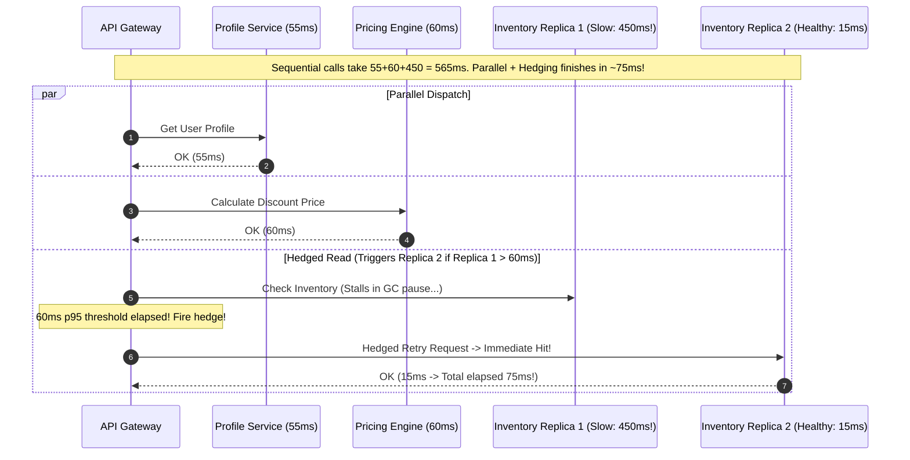
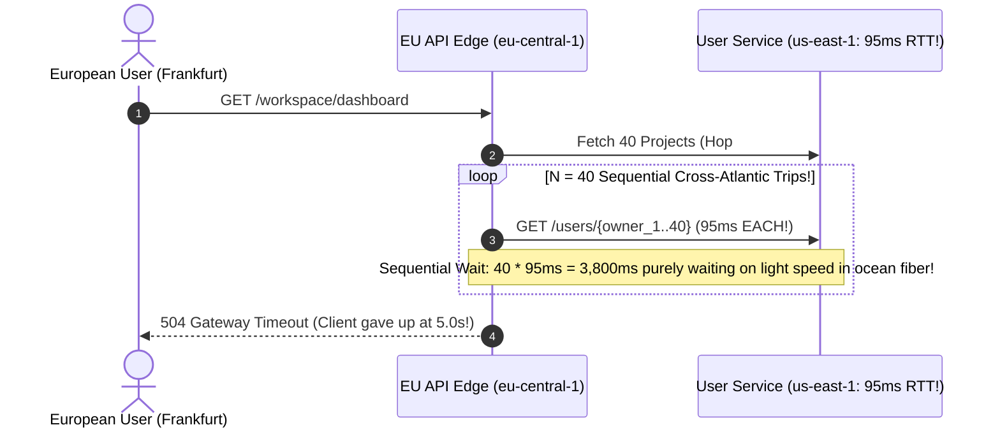

# Lesson 08: Latency

> **Prerequisites:** [Lesson 07: Horizontal Scaling](../07-horizontal-scaling/README.md).  
> **Estimated Reading Time:** 28 minutes  
> **Target Audience:** Backend engineers, performance architects, and SREs diagnosing $p_{99}$ tail latency, cross-region network bottlenecks, and microservice latency budgets.  
> **Free PDF Notes:** [Download SD-A-008.pdf](https://backendroadmap.com/notes/system-design/SD-A-008.pdf) · [Numbers Cheat Sheet SD-D-002.pdf](https://backendroadmap.com/notes/system-design/SD-D-002.pdf) · [Phase 1, Core Fundamentals (PDF)](https://backendroadmap.com/notes/system-design/Phase1_Core_Fundamentals_Notes.pdf) · [Phase 2, Estimation (PDF)](https://backendroadmap.com/notes/system-design/Phase2_Estimation_Notes.pdf)

> [!TIP]
> **The Golden Rule of Latency Engineering:** Never treat latency as a single monolithic timer—decompose every end-to-end request into **Network, Queueing, Processing, and I/O** delays, enforce explicit per-component $p_{99}$ budgets, and parallelize independent downstream calls. Moving an operation from RAM ($100\text{ ns}$) to a cross-region WAN call ($150\text{ ms}$) slows execution by a factor of **1,500,000$\times$**—eliminating unnecessary round-trips beats micro-optimizing CPU loops every time.

---

## Visual Mental Models & Architecture

### The Anatomy of End-to-End Request Latency

User-perceived latency is the sum of time spent crossing networks, sitting idle in worker queues, executing code, and reading disks or databases. Queueing delay is uniquely insidious: it surges exponentially near saturation even when CPU execution time per item does not change.


*Figure 1. The four parts of latency. Queueing is the sneaky one: it grows fast near full utilization, even when your code doesn't get slower.*

### Enforcing a Hierarchical $p_{99}$ Component Latency Budget


*Figure 2. A 300 ms p99 target split into a budget per component. Every team knows its number.*

### Sequential Waterfall vs. Parallelized Fan-Out & Hedged Reads

Calling five internal services sequentially multiplies latency linearly ($5 \times 60\text{ms} = 300\text{ms}$). Parallelizing independent dependencies caps total delay at the slowest branch ($\max \approx 60\text{ms}$), while hedged requests suppress random tail spikes.



---

## Systematic Taxonomic Reference Grids

### Latency Numbers Every Backend Engineer Must Know

Understanding orders of magnitude lets you immediately reject terrible designs during an architecture review (such as looping cross-region RPCs inside an endpoint).

| Operation | Hardware / Network Layer | Typical Latency | Relative Speed Multiplier | Architectural Design Implication |
| :--- | :--- | :---: | :---: | :--- |
| **L1/L2 CPU Cache Reference** | Processor Die | $1 - 4\text{ ns}$ | $0.02\times$ | Keep hot tight loops cache-line friendly. |
| **Main Memory (RAM) Read** | Local DRAM | $\sim 100\text{ ns}$ | **$1\times$ Baseline** | Ideal target for Redis / in-memory hot lookups. |
| **Compressing 1 KB (LZ4/Snappy)** | Local CPU | $\sim 3 - 10\text{ µs}$ | $\sim 50\times$ | Cheaper than sending uncompressed bytes over a WAN. |
| **Random Read from NVMe SSD** | Local PCIe Bus | $\sim 100\text{ µs}$ | $\sim 1,000\times$ | Avoid random disk seeks on critical reads; keep indexes in RAM. |
| **Intra-DC Network Round Trip** | VPC Fiber Switch | $\sim 0.5\text{ ms}$ | $\sim 5,000\times$ | Fast enough for intra-AZ microservice fan-out (with batching). |
| **Sequential 1 MB SSD Read** | Local NVMe Storage | $\sim 1\text{ ms}$ | $\sim 10,000\times$ | Sequential appends (WAL/Kafka logs) beat random updates cleanly. |
| **Disk `fsync()` Durability Flush** | SSD Storage Controller | $1 - 5\text{ ms}$ | $\sim 20,000\times$ | Group commits allow thousands of writes per single flush. |
| **Inter-Continent Round Trip** | Transoceanic Fiber (IN $\leftrightarrow$ EU) | $100 - 150\text{ ms}$ | **$\sim 1,000,000\times$** | **Fatal inside loops!** Eliminate with Edge CDNs and regional replicas. |

### Latency Diagnostic & Remediation Matrix

| Dominant Bottleneck Component | Observability Symptom in Distributed Trace | Immediate Engineering Fix | Architectural Strategy |
| :--- | :--- | :--- | :--- |
| **1. Network RTT** | Large gap between client send and server receive; multiple serial TLS handshakes | Enable HTTP/2 multiplexing & TLS keep-alives; deploy Edge CDN | Push static/cacheable payloads to edge POPs; deploy BFF aggregators inside VPC. |
| **2. Queueing Delay** | Fast database/CPU execution, but long timestamp gap before handler starts | Increase worker concurrency; drop non-critical jobs via load shedding | Keep peak utilization under $65-70\%$ (Little's Law headroom); partition queues. |
| **3. Processing Time** | High continuous flamegraph CPU frames (`regex`, JSON parse, BCrypt) | Switch to faster serializers (Protobuf), reduce allocations | Offload heavy transforms/exports to background async queues (`202 Accepted`). |
| **4. Database / Disk I/O** | Long active SQL spans inside trace; high `blk_read_time` | Eliminate N+1 query loops with `WHERE id IN (...)` batching; add index | Cache hot reads in Redis; tune working set RAM (`shared_buffers`). |

---

## Production War Stories: Incident Post-Mortem

### SEV-1 Post-Mortem: The N+1 Sequential Cross-Region Waterfall Meltdown

#### Incident Overview
* **Severity:** SEV-1 (P99 Latency Surge from 140ms to 11.4 Seconds on Primary Feed)
* **Detection Time:** 18 minutes post-release
* **Resolution Time:** 1 hour 05 minutes
* **Impact:** Mobile app users across Europe and Asia experienced broken homepage feeds and aborted sessions for over an hour.

#### What Happened
A global SaaS marketplace hosted its primary relational metadata cluster in `us-east-1` (Virginia), while serving edge API nodes in both `us-east-1` and `eu-central-1` (Frankfurt). To personalize a user's workspace dashboard displaying 40 active projects, an engineer added a clean helper loop populating project owner avatars:

```python
# Flawed N+1 Sequential Cross-Region Loop!
@app.get("/workspace/dashboard")
async def get_dashboard(user_id: str):
    projects = await fetch_projects(user_id) # 1 query returning 40 projects (110ms)
    for proj in projects:
        # BUG: Executed 40 SEQUENTIAL network hops across the Atlantic (us-east-1 <-> eu-central-1)!
        proj.owner = await user_client.get_user(proj.owner_id)
    return projects
```

Inside the developer's local environment (`localhost`), 40 SQL/HTTP lookups took $40 \times 0.4\text{ms} = 16\text{ms}$—passing every functional integration test cleanly.

Upon deploying to the Frankfurt edge cluster (`eu-central-1`) talking back to the centralized Virginia User Service (`us-east-1`, $95\text{ms}$ network RTT across the Atlantic):
1. Step 1 fetched 40 projects ($95\text{ms}$).
2. Inside the `for` loop, each sequential `await get_user()` burned an extra **95ms cross-Atlantic round-trip**: $40 \times 95\text{ms} = 3,800\text{ms}$ minimum!
3. Combined with TLS setup and DB execution, $p_{99}$ surged from 140ms to **11.4 seconds**, saturating worker threads and cascading into global gateway timeouts.



#### Root Cause Analysis
1. **Sequential N+1 Network Antipattern:** Triggering one RPC per item inside a synchronous loop scaled latency linearly by list cardinality ($O(N \cdot \text{RTT})$).
2. **Cross-Region Physics Blindness:** Testing purely on `localhost` ($< 0.2\text{ms}$) masked the $500\times$ speed penalty of transoceanic fiber optics ($95\text{ms}$ RTT).

#### The Fix & Architectural Hardening
1. **Batch RPC Endpoints:** Consolidated the 40 individual calls into a single vectorized batch request `POST /users/batch` passing all unique `owner_ids` in one single round trip.
2. **Parallel Fan-Out & Regional Read Replicas:** Deployed read-only User Cache replicas into `eu-central-1` (`< 1ms` local hop) and enforced parallel execution (`asyncio.gather` / `Promise.all`) for independent microservice queries.

---

## Multi-Language Production Code Tabs

The implementations below demonstrate two essential production latency optimization techniques:
1. **Eliminating Sequential Waterfalls via Parallel Fan-Out:** Executing three independent 60ms downstream lookups concurrently so total time equals $\approx 60\text{ms}$ instead of $180\text{ms}$.
2. **Hedged Requests for Tail Latency Suppression:** Dispatching a backup request to Replica B if Replica A does not respond within the fast $p_{95}$ threshold (`25ms`), returning whichever replica answers first!

### Parallel Fan-Out & Hedged Read Implementations

````carousel
```go
// Go: Parallel Service Fan-Out + Hedged Read Tail Suppression
package main

import (
	"context"
	"fmt"
	"math/rand"
	"sync"
	"time"
)

// HedgedCall sends request to primary replica; if no answer within hedgeAfter, fires backup concurrently!
func HedgedCall(ctx context.Context, hedgeAfter time.Duration, replicaFn func(context.Context, int) (string, error)) (string, error) {
	ctx, cancel := context.WithCancel(ctx)
	defer cancel()

	resCh := make(chan string, 2)
	errCh := make(chan error, 2)

	// Fire Primary Replica immediately
	go func() {
		res, err := replicaFn(ctx, 1)
		if err == nil {
			resCh <- res
		} else {
			errCh <- err
		}
	}()

	select {
	case res := <-resCh:
		return res, nil
	case <-time.After(hedgeAfter):
		// p95 Latency Threshold Elapsed -> Fire Hedged Request to Replica 2!
		go func() {
			res, err := replicaFn(ctx, 2)
			if err == nil {
				resCh <- res
			} else {
				errCh <- err
			}
		}()
	case <-ctx.Done():
		return "", ctx.Err()
	}

	select {
	case res := <-resCh:
		return res, nil
	case <-ctx.Done():
		return "", ctx.Err()
	}
}

func main() {
	start := time.Now()
	var wg sync.WaitGroup
	results := make([]string, 3)

	// Execute 3 independent services IN PARALLEL + Hedged tail defense
	for i := 0; i < 3; i++ {
		wg.Add(1)
		go func(idx int) {
			defer wg.Done()
			res, _ := HedgedCall(context.Background(), 30*time.Millisecond, func(ctx context.Context, replica int) (string, error) {
				// Simulate Replica 1 experiencing a rare 250ms GC pause tail spike!
				delay := 15 * time.Millisecond
				if replica == 1 && rand.Intn(3) == 0 {
					delay = 250 * time.Millisecond
				}
				select {
				case <-time.After(delay):
					return fmt.Sprintf("Svc-%d (Replica %d in %v)", idx, replica, delay), nil
				case <-ctx.Done():
					return "", ctx.Err()
				}
			})
			results[idx] = res
		}(i)
	}
	wg.Wait()
	fmt.Printf("Total Page Latency: %v | Results: %v\n", time.Since(start).Round(time.Millisecond), results)
}
```
<!-- slide -->
```typescript
// TypeScript/Node.js: Parallel Fan-Out Aggregation & Hedged Tail Request
async function fetchReplicaWithLatency(svc: string, replicaId: number, signal: AbortSignal): Promise<string> {
  // Simulate occasional 300ms tail stall on Replica 1
  const simulatedLatency = replicaId === 1 && Math.random() < 0.25 ? 300 : 18;
  return new Promise((resolve, reject) => {
    const timer = setTimeout(() => resolve(`${svc}:replica-${replicaId} (${simulatedLatency}ms)`), simulatedLatency);
    signal.addEventListener('abort', () => {
      clearTimeout(timer);
      reject(new Error('Aborted due to faster response'));
    });
  });
}

async function hedgedRead(svcName: string, hedgeDelayMs = 30): Promise<string> {
  const controller = new AbortController();
  const primaryPromise = fetchReplicaWithLatency(svcName, 1, controller.signal);

  const backupTimerPromise = new Promise<string>((resolve) => {
    setTimeout(async () => {
      try {
        const res = await fetchReplicaWithLatency(svcName, 2, controller.signal);
        resolve(res);
      } catch {
        // Ignore if aborted cleanly
      }
    }, hedgeDelayMs);
  });

  const winner = await Promise.race([primaryPromise, backupTimerPromise]);
  controller.abort(); // Cancel slower redundant flight immediately
  return winner;
}

async function renderCheckoutPage() {
  const start = performance.now();
  // Parallelize 3 services instead of calling sequentially (MAX vs SUM)
  const [profile, pricing, inventory] = await Promise.all([
    hedgedRead('Profile'),
    hedgedRead('Pricing'),
    hedgedRead('Inventory'),
  ]);
  console.log(`Rendered in ${(performance.now() - start).toFixed(1)}ms:`, { profile, pricing, inventory });
}

renderCheckoutPage();
```
<!-- slide -->
```python
# Python: Parallel Asyncio Fan-Out + Hedged Tail Request Mitigation
import asyncio
import random
import time

async def simulate_replica_call(service: str, replica_id: int) -> str:
    # Replica 1 randomly encounters a 300ms tail pause; healthy nodes take 15ms
    delay = 0.300 if (replica_id == 1 and random.random() < 0.3) else 0.015
    await asyncio.sleep(delay)
    return f"{service}@replica-{replica_id} ({int(delay*1000)}ms)"

async def hedged_fetch(service: str, hedge_threshold_sec: float = 0.030) -> str:
    """Dispatches primary call; triggers backup replica if p95 threshold elapses."""
    t1 = asyncio.create_task(simulate_replica_call(service, 1))
    done, _ = await asyncio.wait({t1}, timeout=hedge_threshold_sec)
    if t1 in done:
        return t1.result()

    # p95 threshold crossed! Fire hedged request to Replica 2 and take first winner
    t2 = asyncio.create_task(simulate_replica_call(service, 2))
    done, pending = await asyncio.wait({t1, t2}, return_when=asyncio.FIRST_COMPLETED)
    winner = next(iter(done)).result()

    for task in pending:
        task.cancel()  # Abort slow tail cleanly
    return winner

async def load_product_page():
    start = time.perf_counter()
    # Parallel execution cuts N * T down to MAX(T)
    results = await asyncio.gather(
        hedged_fetch("Catalog"),
        hedged_fetch("Pricing"),
        hedged_fetch("Stock"),
    )
    elapsed_ms = (time.perf_counter() - start) * 1000
    print(f"Page rendered in {elapsed_ms:.1f}ms -> {results}")

if __name__ == "__main__":
    asyncio.run(load_product_page())
```
<!-- slide -->
```csharp
// C#: Parallel Fan-Out & Task-Based Hedged Tail Suppression
using System;
using System.Threading;
using System.Threading.Tasks;

class HedgedFanOutExample
{
    static async Task<string> SimulateCallAsync(string service, int replica, CancellationToken ct)
    {
        int ms = (replica == 1 && Random.Shared.NextDouble() < 0.3) ? 300 : 15;
        await Task.Delay(ms, ct);
        return $"{service}@replica-{replica} ({ms}ms)";
    }

    static async Task<string> HedgedCallAsync(string service, int hedgeAfterMs = 30)
    {
        using var cts = new CancellationTokenSource();
        var primary = SimulateCallAsync(service, 1, cts.Token);

        var completed = await Task.WhenAny(primary, Task.Delay(hedgeAfterMs, cts.Token));
        if (completed == primary)
        {
            return await primary;
        }

        // Fire hedged backup replica
        var backup = SimulateCallAsync(service, 2, cts.Token);
        var winner = await Task.WhenAny(primary, backup);
        cts.Cancel(); // Cancel lingering slower request
        return await winner;
    }

    static async Task Main()
    {
        var sw = System.Diagnostics.Stopwatch.StartNew();
        var results = await Task.WhenAll(
            HedgedCallAsync("Catalog"),
            HedgedCallAsync("Pricing"),
            HedgedCallAsync("Inventory")
        );
        sw.Stop();
        Console.WriteLine($"Parallel Hedged Fan-Out finished in {sw.ElapsedMilliseconds}ms: {string.Join(", ", results)}");
    }
}
```
````

---

## Practical Hands-On Verification CLI Workflows

Inspect the physical limits of network distance and empirically verify sequential vs parallel execution using terminal tools.

### Step 1: Verify Real Network Physics via `ping` (Intra-Zone vs Inter-Continent)

Observe how network distance enforces an absolute speed-of-light lower bound regardless of CPU optimization:

```bash
# Local Loopback (RAM / Socket Baseline ~0.05ms)
ping -c 3 127.0.0.1

# Public Edge Anycast CDN / Resolver (~5-20ms)
ping -c 3 1.1.1.1
```

### Step 2: Observe Sequential vs. Parallel Timing in CLI

Run a quick shell script demonstrating how 5 sequential 100ms network calls consume 500ms, while parallel execution finishes in ~100ms:

```bash
# 1. Sequential Loop (Sum = ~0.50s+)
time (for i in 1 2 3 4 5; do sleep 0.1; done)

# 2. Parallel Fan-Out (Max = ~0.10s)
time (for i in 1 2 3 4 5; do sleep 0.1 & done; wait)
```

---

## Operational Validation Checkpoints (Scenario Quizzes)

<details>
<summary><strong>Checkpoint 1: Diagnosing Sudden p99 Spikes With Zero Code Changes</strong></summary>

**Scenario:** Your API engineering team has not deployed new code in 5 days, yet $p_{99}$ latency surged from `110ms` to `1,250ms` at 09:30 UTC while `p50` stayed steady at `40ms`. Database CPU sits at 35%, and application server CPU sits at 20%. Which component of the 4-part latency anatomy is almost certainly driving the spike, and what trace metrics prove it?

<strong>Answer:</strong>
Look directly at **Queueing Delay** and downstream resource pool saturation:
Even when CPU averages 35%, a sudden burst of concurrent traffic or slow garbage collection pauses can temporarily exhaust a bounded worker queue, connection pool (e.g., PgBouncer / HTTP client pool), or downstream rate limit. Because $p_{50}$ remains fast (`40ms`), most requests clear the queue quickly, while requests arriving during micro-bursts sit waiting for a free worker slot (`queue_wait_ms` explodes). Inspect OpenTelemetry spans measuring **time between ingress accept and handler start**, plus connection pool acquisition wait histograms.
</details>

<details>
<summary><strong>Checkpoint 2: Calculating Component Budgets & Cross-Region Tax</strong></summary>

**Scenario:** You are designing a globally accessed Checkout API with a strict SLO target of $p_{99} < 200\text{ ms}$. Users connect from Tokyo, London, and New York, while your single PostgreSQL Primary resides in `us-east-1` (Virginia). A user submits a checkout sequence requiring 3 sequential writes/verifications back to the US primary from Tokyo (Tokyo $\leftrightarrow$ Virginia RTT $\approx 160\text{ ms}$). Can software optimizations ever meet the 200ms target under this topology?

<strong>Answer:</strong>
**No—the topology violates speed-of-light physics.** Three sequential TCP/HTTP round trips across the Pacific ($3 \times 160\text{ms} = 480\text{ms}$) already consume $2.4\times$ your total 200ms latency budget before executing a single line of application code or SQL!
To solve this architecturally:
1. Eliminate sequential round-trips: consolidate the 3 calls into a single batched RPC ($1 \times 160\text{ms}$).
2. Terminate TLS locally via regional edge gateways/proxies so the TCP/TLS handshakes stay local in Tokyo ($< 10\text{ms}$), sending batched requests over pre-warmed long-lived backbone tunnels.
3. For global read paths, deploy regional Read Replicas and Edge CDNs inside Tokyo and London.
</details>

<details>
<summary><strong>Checkpoint 3: When Adding a Cache Increases Tail Latency ($p_{99}$)</strong></summary>

**Scenario:** After inserting a Redis cache in front of PostgreSQL, median latency ($p_{50}$) dropped impressively from 25ms to 2ms, yet $p_{99}$ actually **worsened** from 85ms to 140ms! Explain two architectural scenarios where adding a cache actively degrades tail latency.

<strong>Answer:</strong>
1. **Cache Miss Double-Hop Penalty:** For cold keys or low hit-rate endpoints (e.g., long-tail search queries), the application pays a full network hop to Redis (Miss!) **plus** the network hop and query time to PostgreSQL—strictly slower than querying the database directly.
2. **Cold Cache Stampede & Eviction Storms:** Immediately after a Redis node failover, restart, or synchronized TTL expiration, thousands of concurrent requests miss simultaneously and stampede the database with identical heavy queries, exhausting connection pools and sending $p_{99}$ through the roof. Mitigate via cache warming on deploy, TTL jitter, and singleflight request coalescing.
</details>

---

## Further Reading & Sources

- [The Tail at Scale — Jeffrey Dean & Luiz André Barroso (Communications of the ACM)](https://research.google/pubs/the-tail-at-scale/) — Canonical engineering paper on hedged requests and tail amplification.
- [Latency Numbers Every Programmer Should Know (Interactive Timeline)](https://colin-scott.github.io/personal_website/research/interactive_latency.html) — Order-of-magnitude hardware and network comparisons.
- [Track 05: Caching and Performance](../../../backend/05-caching-and-performance/README.md) — Practical cache stampede and Redis performance engineering.

---

## Free PDF notes

Download these notes as a printable PDF, with every diagram: [SD-A-008.pdf](https://backendroadmap.com/notes/system-design/SD-A-008.pdf). All Phase 1 notes in one file: [Phase 1, Core Fundamentals (PDF)](https://backendroadmap.com/notes/system-design/Phase1_Core_Fundamentals_Notes.pdf).

The Phase 2 video on this page has its own notes: [SD-D-002: Latency Numbers & Powers of Two Every Engineer Should Know](https://backendroadmap.com/notes/system-design/SD-D-002.pdf). All of them in one file: [Phase 2, Estimation (PDF)](https://backendroadmap.com/notes/system-design/Phase2_Estimation_Notes.pdf).

---

## Next

Continue with [Lesson 09: Throughput and Little's Law](../09-throughput-and-littles-law/README.md) to connect throughput, latency, and in-flight concurrency mathematically—and discover why approaching 100% server utilization causes response times to explode.
