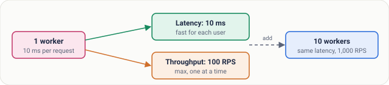
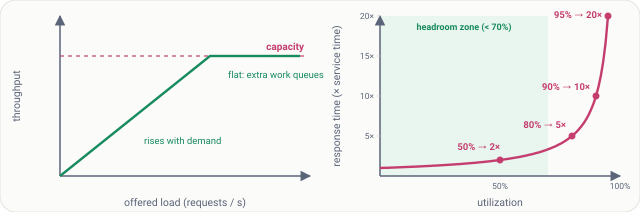
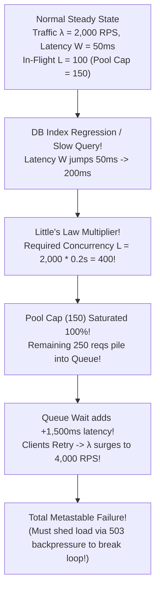
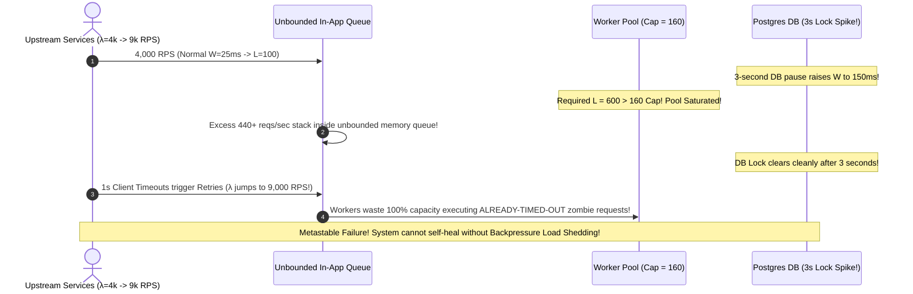

# Lesson 09: Throughput and Little's Law

> **Prerequisites:** [Lesson 08: Latency](../08-latency/README.md).  
> **Estimated Reading Time:** 28 minutes  
> **Target Audience:** Backend engineers, capacity planners, and SREs sizing database connection pools, worker concurrency limits, and autoscaling headroom thresholds.

> [!TIP]
> **The Golden Rule of Capacity & Queueing:** **Little's Law ($L = \lambda \times W$)** mathematically couples Throughput ($\lambda$) and Latency ($W$) through Concurrency ($L$): if downstream latency doubles under constant traffic, in-flight requests double instantly—draining fixed thread/connection pools and triggering cascading collapse. Never target $95\%$ server utilization at peak; because queueing delay explodes proportionally to $\frac{1}{1 - \rho}$, run clusters below **$60-70\%$ peak utilization** and enforce explicit backpressure (`503 Service Unavailable`) before queues lock up.

---

## Visual Mental Models & Architecture

### Latency vs. Throughput: Concurrency Is the Bridge

Think of a highway toll booth: Latency is how fast one car passes through a gate; Throughput is total cars passing per hour. A single fast gate taking $10\text{ ms}$ per car can strictly never exceed $100\text{ cars/second}$—adding parallel lanes increases throughput without speeding up a single car.



*Figure 1. One worker at 10 ms per request can never serve more than 100 requests per second; more workers raise throughput, not latency.*

### Little's Law in Production: $L = \lambda \times W$

For any stable system not growing an unbounded backlog, the average number of requests simultaneously inside the system ($L$) equals the arrival rate ($\lambda$) multiplied by the mean time each request stays inside ($W$).


*Figure 2. 5,000 requests arrive per second and each stays 50 ms, so about 250 are inside the system at any instant.*

### The Saturation Cliff & Queueing Delay Explosion



*Figure 3. Left: throughput flattens at capacity. Right: response time in a simple queue grows like 1 / (1 − utilization), so it explodes near 100% (at 99% it reaches 100×, off this chart).*

### The Metastable Concurrency Collapse Cycle (When Latency Doubles)



---

## Systematic Taxonomic Reference Grids

### Queueing Theory Utilization vs. Response Latency Multiplier ($\frac{1}{1 - \rho}$)

In an $M/M/1$ queueing system, mean response time grows sharply as utilization ($\rho$) approaches $100\%$:

| Resource Utilization ($\rho$) | Latency Multiplier $\left(\frac{1}{1 - \rho}\right)$ | If Base Service Time = $10\text{ ms}$ | Operational Classification & Autoscaling Action |
| :---: | :---: | :---: | :--- |
| **$10\%$** | $1.11\times$ | $11.1\text{ ms}$ | Idle / Over-provisioned (Consider scaling down off-peak). |
| **$50\%$** | $2.0\times$ | $20.0\text{ ms}$ | **Ideal steady-state baseline.** Absorbs $2\times$ burst cleanly. |
| **$70\%$** | $3.3\times$ | $33.3\text{ ms}$ | **Autoscaling Trigger Threshold (HPA Target).** |
| **$85\%$** | $6.7\times$ | $66.7\text{ ms}$ | **Danger Zone.** Losing 1 of 4 nodes pushes remaining nodes over 100%! |
| **$90\%$** | $10.0\times$ | $100.0\text{ ms}$ | **Severe Queueing.** $p_{99}$ SLA likely already breached. |
| **$95\%$** | $20.0\times$ | $200.0\text{ ms}$ | **Saturated.** Minor jitter triggers queue spillover and client retries. |
| **$99\%$** | **$100.0\times$** | **$1,000.0\text{ ms}$** | **Catastrophic Cliff.** Effective platform outage via request timeout cascade. |

### Throughput Units & Bottleneck Resolution Taxonomy

| Infrastructure Layer | Primary Throughput Unit | Typical Capacity Driver | Primary Scaling Technique |
| :--- | :--- | :--- | :--- |
| **Ingress / API Fleet** | Requests Per Second (**RPS**) | CPU threads / Event-loop concurrency | Stateless horizontal replica scaling; non-blocking Async I/O. |
| **Database / Cache** | Queries Per Second (**QPS**) | Disk IOPS, Lock contention, Connection pool | Read replicas, B-Tree/GIN indexing, key-value sharding, Redis caching. |
| **Storage / Network** | **MB/s** or **Gbps** | NIC bandwidth, NVMe PCIe lanes | Payload compression (Gzip/Brotli/Zstd), CDN edge offloading, zero-copy reads. |
| **Streaming / Queues** | **Messages / Second** | Partition count & consumer group lag | Partition scaling (Kafka), micro-batching writes (500 records per insert). |

---

## Production War Stories: Incident Post-Mortem

### SEV-1 Post-Mortem: The Little's Law Pool Drain & Retry Storm Metastable Failure

#### Incident Overview
* **Severity:** SEV-1 (Self-Sustaining Outage Persisting 40 Minutes After Root Cause Cleared)
* **Detection Time:** 3 minutes post-DB vacuum lock
* **Resolution Time:** 1 hour 15 minutes
* **Impact:** Platform remained completely unusable for 40 minutes *even after* the underlying database bottleneck resolved, until operations manually cut incoming ingress traffic by 80% to drain the retry storm.

#### What Happened
A payment notifications microservice operated cleanly at $\lambda = 4,000\text{ RPS}$ with an average downstream processing time of $W = 25\text{ ms}$:
- Applying Little's Law: $L = 4,000 \times 0.025 = 100$ active in-flight connections.
- The team provisioned an HTTP worker pool of `160` connections ($60\%$ safety headroom).

At 14:12 UTC, an automated PostgreSQL lock paused a shared lookup table for just **3 seconds**, temporarily driving $W$ from `25ms` to `150ms`:
1. **Concurrence Explosion:** By Little's Law, required concurrency surged to $L = 4,000 \times 0.150 = 600$ active requests!
2. **Pool Exhaustion:** All 160 pool slots filled instantaneously; 440 requests blocked in an unbounded internal worker FIFO queue.
3. **Client Retry Amplification:** Mobile apps and partner webhooks timed out after 1 second and automatically retried—doubling arrival rate $\lambda$ from $4,000\text{ RPS}$ to $9,000\text{ RPS}$.
4. Even after the PostgreSQL lock vanished 3 seconds later, the system remained locked in **metastable collapse**: every single incoming request spent 4 seconds waiting behind stale dead requests already abandoned by clients, ensuring zero requests succeeded until engineers severed ingress traffic at the load balancer!



#### Root Cause Analysis
1. **Unbounded Request Queueing:** Allowing unlimited connections to wait in memory queues meant requests waited longer than the client's 1-second timeout, burning server CPU on dead requests.
2. **Lack of Active Backpressure (Load Shedding):** The service accepted 9,000 RPS into its queue instead of rejecting excess concurrency immediately with `503 Service Unavailable`.

#### The Fix & Architectural Hardening
1. **Strict Bounded Concurrency Semaphore (Little's Law Cap):** Restricted maximum active + queued requests strictly using a semaphore (`max_in_flight = 200`). Excess requests fail immediately in $< 0.5\text{ms}$ with `HTTP 503` + `Retry-After: 5`.
2. **Request Context Cancellation Check:** Every worker inspects `ctx.Err()` / `request.is_disconnected()` before beginning expensive DB calls—skipping abandoned client requests cleanly.

---

## Multi-Language Production Code Tabs

The implementations below demonstrate **Little's Law Backpressure & Bounded Semaphore Enforcement**:
1. Calculate expected in-flight concurrency ($L = \lambda \times W$) explicitly.
2. Reject requests **before** queuing unbounded backlogs whenever in-flight concurrency crosses capacity—preserving low $p_{99}$ latency for accepted requests and returning `503 Service Unavailable` with `Retry-After` to excess arrivals!

### Bounded In-Flight Concurrency & Load Shedding Middleware

````carousel
```go
// Go: Little's Law Bounded Concurrency Limiter (Immediate 503 Backpressure)
package main

import (
	"fmt"
	"log"
	"net/http"
	"time"
)

// ConcurrencyBulkhead limits maximum concurrent in-flight execution (L)
// to prevent unbounded queue explosions when downstream latency (W) spikes.
type ConcurrencyBulkhead struct {
	sem chan struct{}
}

func NewConcurrencyBulkhead(maxInFlight int) *ConcurrencyBulkhead {
	return &ConcurrencyBulkhead{
		sem: make(chan struct{}, maxInFlight),
	}
}

func (b *ConcurrencyBulkhead) Middleware(next http.Handler) http.Handler {
	return http.HandlerFunc(func(w http.ResponseWriter, r *http.Request) {
		select {
		case b.sem <- struct{}{}:
			// Slot acquired cleanly; execute request and release slot on exit
			defer func() { <-b.sem }()
			next.ServeHTTP(w, r)
		default:
			// Semaphore full! Fail fast in <0.1ms instead of queueing forever!
			w.Header().Set("Retry-After", "2")
			http.Error(w, "Server at safe concurrency capacity (Load Shedding)", http.StatusServiceUnavailable) // 503
		}
	})
}

func main() {
	// Target: 1,000 RPS * 50ms W => Expected L = 50; cap safely at L_max = 80
	bulkhead := NewConcurrencyBulkhead(80)

	handler := http.HandlerFunc(func(w http.ResponseWriter, r *http.Request) {
		// Abort immediately if client disconnected while waiting in network buffer
		if r.Context().Err() != nil {
			return
		}
		time.Sleep(50 * time.Millisecond) // Simulated DB work
		fmt.Fprintln(w, "Processed within safe SLA concurrency")
	})

	log.Println("Listening with Little's Law Concurrency Guard on :8000")
	log.Fatal(http.ListenAndServe(":8000", bulkhead.Middleware(handler)))
}
```
<!-- slide -->
```typescript
// TypeScript/Node.js: Explicit In-Flight Load Shedding & Little's Law Guard
import express, { Request, Response, NextFunction } from 'express';

class InFlightLoadShedder {
  private activeInFlight = 0;

  constructor(private readonly maxInFlight: number) {}

  public middleware() {
    return (req: Request, res: Response, next: NextFunction) => {
      if (this.activeInFlight >= this.maxInFlight) {
        // Immediate fail-fast backpressure: prevent unbounded event loop queueing!
        res.setHeader('Retry-After', '2');
        return res.status(503).json({
          error: 'Service Unavailable',
          message: `Concurrency ceiling (${this.maxInFlight}) reached. Backpressure active.`,
        });
      }

      this.activeInFlight++;
      let released = false;
      const release = () => {
        if (!released) {
          released = true;
          this.activeInFlight--;
        }
      };

      res.on('finish', release);
      res.on('close', release);
      next();
    };
  }

  public getInFlight(): number {
    return this.activeInFlight;
  }
}

// Capacity Math: Peak 2,000 RPS * 30ms W = 60 average in-flight -> Cap cleanly at 100
const shedder = new InFlightLoadShedder(100);
const app = express();

app.use(shedder.middleware());

app.get('/api/work', async (_req: Request, res: Response) => {
  await new Promise((r) => setTimeout(r, 30));
  res.json({ status: 'ok', active_concurrency: shedder.getInFlight() });
});

app.listen(8000, () => console.log('Backpressure-guarded server running on :8000'));
```
<!-- slide -->
```python
# Python: FastAPI Bounded Semaphore Load Shedder Preventing Metastable Queues
import asyncio
from fastapi import FastAPI, Request
from fastapi.responses import JSONResponse

MAX_CONCURRENT_IN_FLIGHT = 80  # Sized via L = λ * W + 1.6x burst headroom
in_flight_sem = asyncio.Semaphore(MAX_CONCURRENT_IN_FLIGHT)
current_active = 0

app = FastAPI(title="Little's Law Load Shedding API")

@app.middleware("http")
async def concurrency_backpressure_middleware(request: Request, call_next):
    global current_active
    # Attempt non-blocking acquire: never queue unbounded tasks!
    if in_flight_sem.locked():
        return JSONResponse(
            status_code=503,
            headers={"Retry-After": "2"},
            content={"error": "Service Busy", "active_in_flight": current_active},
        )

    async with in_flight_sem:
        current_active += 1
        try:
            # Skip already-disconnected requests before doing heavy DB work
            if await request.is_disconnected():
                return JSONResponse(status_code=499, content={"detail": "Client closed request"})
            return await call_next(request)
        finally:
            current_active -= 1

@app.get("/process")
async def process_item():
    await asyncio.sleep(0.05)  # 50ms processing time W
    return {"status": "completed", "in_flight": current_active}
```
<!-- slide -->
```csharp
// C#: ASP.NET Core Bounded SemaphoreSlim Load Shedder (Immediate 503 Backpressure)
using System;
using System.Threading;
using System.Threading.Tasks;
using Microsoft.AspNetCore.Builder;
using Microsoft.AspNetCore.Http;

var builder = WebApplication.CreateBuilder(args);
var app = builder.Build();

// Sized using Little's Law: L_max = (Target RPS * Expected Latency) * Safety Factor
const int MaxConcurrentRequests = 100;
var bulkhead = new SemaphoreSlim(MaxConcurrentRequests, MaxConcurrentRequests);

app.Use(async (context, next) =>
{
    // Wait(0) tests capacity immediately without waiting in an unbounded queue!
    if (!await bulkhead.WaitAsync(0))
    {
        context.Response.StatusCode = StatusCodes.Status503ServiceUnavailable;
        context.Response.Headers.RetryAfter = "2";
        await context.Response.WriteAsync("Service Unavailable: Safe concurrency cap reached.");
        return;
    }

    try
    {
        if (context.RequestAborted.IsCancellationRequested) return;
        await next();
    }
    finally
    {
        bulkhead.Release();
    }
});

app.MapGet("/process", async (CancellationToken ct) =>
{
    await Task.Delay(50, ct);
    return Results.Ok(new { status = "ok", remainingSlots = bulkhead.CurrentCount });
});

app.Run("http://0.0.0.0:8000");
```
````

---

## Practical Hands-On Verification CLI Workflows

Verify Little's Law sizing calculations and observe concurrency load shedding (`200 OK` vs `503 Service Unavailable`) directly via terminal scripts.

### Step 1: Calculate Database Pool & Worker Concurrency via Little's Law Calculator

Run a quick CLI calculator validating safe pool limits across an app cluster:

```bash
python -c "
rps = 3000           # Peak Queries Per Second (λ)
latency_ms = 15      # Slow-day mean query duration (W)
headroom = 1.8       # 80% burst + slow-tail margin

avg_in_flight = rps * (latency_ms / 1000.0)
safe_total_pool = int(avg_in_flight * headroom)
pods = 10
per_pod = safe_total_pool // pods

print(f'Average In-Flight Concurrency (L): {avg_in_flight:.1f}')
print(f'Safe Cluster Total Connections:    {safe_total_pool}')
print(f'Max Pool Size per Pod ({pods} pods):   {per_pod}')
"
```

**Expected Output:**
```text
Average In-Flight Concurrency (L): 45.0
Safe Cluster Total Connections:    81
Max Pool Size per Pod (10 pods):   8
```

### Step 2: Observe Queueing Delay Explosion Near 100% Utilization

Run this script to inspect how response latency multiplies rapidly past $70\%$ server load:

```bash
python -c "
base_ms = 10
for rho in [0.20, 0.50, 0.70, 0.85, 0.90, 0.95, 0.99]:
    wait_mult = 1.0 / (1.0 - rho)
    total_ms = base_ms * wait_mult
    print(f'Utilization {int(rho*100):2d}% -> {wait_mult:6.1f}x multiplier -> Latency: {total_ms:6.1f}ms')
"
```

**Expected Output:**
```text
Utilization 20% ->    1.2x multiplier -> Latency:   12.5ms
Utilization 50% ->    2.0x multiplier -> Latency:   20.0ms
Utilization 70% ->    3.3x multiplier -> Latency:   33.3ms
Utilization 85% ->    6.7x multiplier -> Latency:   66.7ms
Utilization 90% ->   10.0x multiplier -> Latency:  100.0ms
Utilization 95% ->   20.0x multiplier -> Latency:  200.0ms
Utilization 99% ->  100.0x multiplier -> Latency: 1000.0ms
```

---

## Operational Validation Checkpoints (Scenario Quizzes)

<details>
<summary><strong>Checkpoint 1: Diagnosing Connection Pool Drain via Little's Law</strong></summary>

**Scenario:** A microservice processes $\lambda = 2,000\text{ RPS}$ with an average database transaction time of $W = 40\text{ ms}$, using a cluster-wide connection pool capped at $120$ connections. Following a storage I/O regression, average SQL duration rises from $40\text{ ms}$ to $120\text{ ms}$. How many connections does Little's Law demand now, and why does the app crash completely?

<strong>Answer:</strong>
- **Before regression:** $L = 2,000 \times 0.04\text{ s} = 80$ active connections (comfortably below the `120` pool ceiling, $66\%$ utilized).
- **After regression:** $L = 2,000 \times 0.12\text{ s} = 240$ active connections required—**double the entire 120-connection limit**!
Because the pool maxes out at 120, every extra arrival queues waiting for a connection. Waiting increases $W$ further (to $500\text{ ms} \to 2,000\text{ ms}$), forcing $L$ toward $4,000+$ and triggering client retry cascades until active load shedding (`503`) drains the queue.
</details>

<details>
<summary><strong>Checkpoint 2: Why Target 60–70% Peak Utilization Instead of 95%?</strong></summary>

**Scenario:** A finance director sees your Kubernetes servers sitting at $60\%$ CPU during peak afternoon traffic and complains: *"We are wasting $40\%$ of our cloud bill! Downsize the cluster so peak runs at $95\%$ utilization!"* Using both queueing math and $N - 1$ redundancy, explain why downsizing to $95\%$ guarantees weekly outages.

<strong>Answer:</strong>
Two distinct mathematical realities destroy a $95\%$-utilized cluster:
1. **Queueing Theory Saturation Cliff:** Under $\frac{1}{1-\rho}$, running at $60\%$ utilization multiplies request latency by $2.5\times$, whereas $95\%$ pushes latency to **$20\times$** (guaranteed $p_{99}$ SLO failure under normal traffic jitter).
2. **$N - 1$ Failure Tolerance:** Suppose 4 nodes run evenly at $65\%$ utilization ($260\%$ total capacity). If 1 node crashes or restarts during a deploy, the remaining 3 nodes absorb $\frac{260\%}{3} = 86.7\%$ load—survivable while autoscaling launches a replacement. If those 4 nodes ran at $95\%$ ($380\%$ total load), losing 1 node pushes the remaining 3 nodes to **$126.7\%$ capacity**, causing instantaneous total cluster collapse!
</details>

<details>
<summary><strong>Checkpoint 3: Mean vs. Tail Latency inside Little's Law</strong></summary>

**Scenario:** Little's Law strictly applies using the arithmetic mean service time ($W_{\text{mean}}$). Suppose your service averages $W_{\text{mean}} = 40\text{ ms}$, giving $L = 80$ at $2,000\text{ RPS}$, yet $p_{99} = 2,500\text{ ms}$ (a heavy slow tail). If you size your worker thread pool strictly to `85` threads, what happens during normal traffic?

<strong>Answer:</strong>
Although the *mean* concurrency equals 80, real traffic arrives in stochastic micro-bursts (Poisson bursts). If just 10 of those $2.5\text{ s}$ slow-tail queries overlap inside the same second, those 10 queries hold `10` pool slots hostage for $2,500\text{ ms}$ ($62\times$ longer than normal!), leaving only 75 slots for fast traffic and pushing the system into transient saturation. Always apply a **safety headroom factor ($1.5\times - 2.0\times$)** above mean $L$, **and** enforce strict downstream request timeouts (e.g., `500ms`) so slow tail outliers cannot monopolize pool slots indefinitely.
</details>

---

## Further Reading & Sources

- [Little's Law & Queueing Theory in Computer Systems](https://en.wikipedia.org/wiki/Little%27s_law) — Mathematical derivation and steady-state assumptions.
- [Netflix TechBlog: Performance Under Load (Adaptive Concurrency Limits)](https://netflixtechblog.medium.com/performance-under-load-3e6fa9a60581) — Using Little's Law dynamically for distributed adaptive load shedding.
- [Marc Brooker: Metastable Failures & Retry Storms](https://brooker.co.za/blog/2021/05/24/metastable.html) — Deep dive into why queues stay jammed after spikes end.

---

## Free PDF notes

Download these notes as a printable PDF, with every diagram: [SD-A-009.pdf](https://backendroadmap.com/notes/system-design/SD-A-009.pdf). All Phase 1 notes in one file: [Phase 1, Core Fundamentals (PDF)](https://backendroadmap.com/notes/system-design/Phase1_Core_Fundamentals_Notes.pdf).

---

## Next

Continue with [Lesson 10: Availability](../10-availability/README.md) to calculate availability "nines", compare MTBF vs MTTR recovery leverage, and compute series vs parallel reliability chains.
