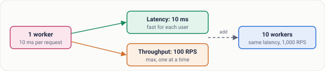
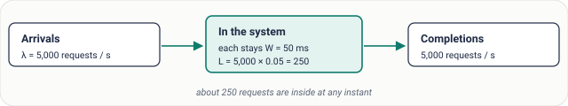
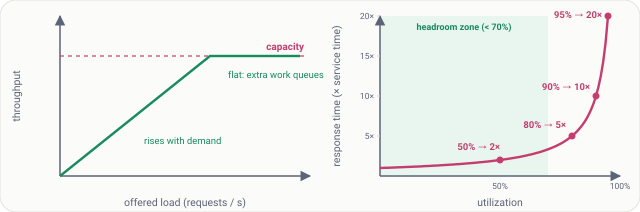
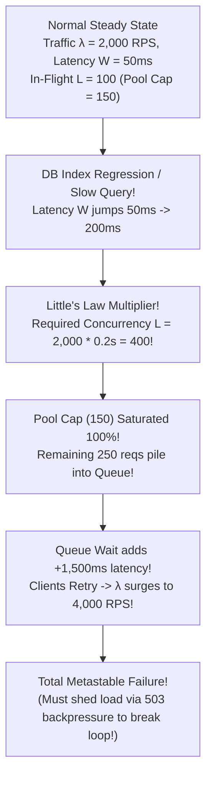
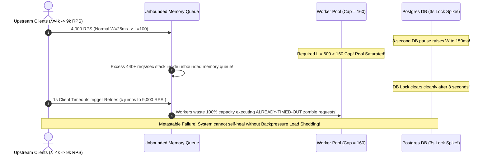

# Lesson 09: Throughput and Little's Law

> **Prerequisites:** [Lesson 08: Latency](../08-latency/README.md).  
> **Estimated Reading Time:** 32 minutes  
> **Target Audience:** Backend engineers, capacity planners, and SREs sizing database connection pools, worker concurrency limits, and autoscaling headroom thresholds.  
> **Free PDF Notes:** [Download SD-A-009.pdf](https://backendroadmap.com/notes/system-design/SD-A-009.pdf) · [Phase 1, Core Fundamentals (PDF)](https://backendroadmap.com/notes/system-design/Phase1_Core_Fundamentals_Notes.pdf)

> [!NOTE]
> **In one line:** Throughput is how much work a system finishes per second; Little's Law links it directly to latency ($\text{In-Flight} = \text{Throughput} \times \text{Latency}$), which dictates how large every thread and connection pool must be, explains why a slowing dependency drains your pools, and proves why systems must maintain headroom below $100\%$ utilization.

> [!TIP]
> **The Golden Rule of Capacity & Queueing:** **Little's Law ($L = \lambda \times W$)** mathematically couples Throughput ($\lambda$) and Latency ($W$) through Concurrency ($L$): if downstream latency doubles under constant traffic, in-flight requests double instantly—draining fixed thread/connection pools and triggering cascading collapse. Never target $95\%$ server utilization at peak; because queueing delay explodes proportionally to $\frac{1}{1 - \rho}$, run clusters below **$60-70\%$ peak utilization** and enforce explicit backpressure (`503 Service Unavailable`) before queues lock up.

---

## 1. Throughput: How Much Work Gets Done

Picture a highway. **Latency** is how long one car takes to make the entire journey from on-ramp to exit. **Throughput** is how many cars successfully pass through the toll plaza per hour. A road can be blazingly fast for an individual sports car at 3:00 AM (low latency, low throughput), or packed with 50,000 slow-moving commuter vehicles per hour (high latency, high throughput).

In backend architecture, throughput is measured across different layers:

| Infrastructure Tier | Standard Throughput Metric | Primary Hardware / Resource Driver | Architectural Scaling Bottleneck |
| :--- | :--- | :--- | :--- |
| **API Fleet / Ingress** | Requests Per Second (**RPS**) | CPU cores, worker threads, async event loops | Worker thread exhaustion, memory per connection. |
| **Databases / Caches** | Queries Per Second (**QPS**) | Disk IOPS, lock contention, connection pools | B-Tree lock contention, single-writer write locks. |
| **Network & Storage** | **MB/s** or **Gbps** | NIC bandwidth, NVMe PCIe lanes, bus width | Network card saturation, MTU fragmentation. |
| **Event Streaming / Queues** | **Messages / Second** | Partition count, consumer group offset commits | Disk flush fsync limits, consumer lag. |

---

## 2. Latency, Throughput, and Concurrency

A single worker thread executing a task that takes $10\text{ ms}$ can mathematically never finish more than 100 requests per second:

$$\text{Max Throughput}_{\text{Single Worker}} = \frac{1}{\text{Duration}} = \frac{1}{0.010\text{ s}} = \mathbf{100\text{ RPS}}$$



*Figure 1. More workers raise throughput without changing individual latency. One worker at 10 ms can never beat 100 RPS; 10 parallel workers achieve 1,000 RPS.*

Therefore, there are **only two fundamental ways** to increase throughput in software:
1. **Make each request take less time ($W \downarrow$):** Add database indexes, cache results in Redis, eliminate round trips. If duration drops from $10\text{ ms}$ to $2\text{ ms}$, single-worker throughput jumps from $100\text{ RPS}$ to $500\text{ RPS}$.
2. **Work on more requests simultaneously ($L \uparrow$):** Add more worker threads, scale out containers horizontally, adopt asynchronous non-blocking event loops.

Every single performance engineering technique in computing is a variation of one of these two levers.

---

## 3. Little's Law: $L = \lambda \times W$

**Little's Law** (proven by John D. C. Little in 1961) is the foundational mathematical theorem of queueing theory. For any stable system (one where requests are not accumulating into an infinite backlog):

$$L = \lambda \times W$$

Where:
* **$L$ (Concurrency / In-Flight Work):** The average number of requests inside the system at any given moment.
* **$\lambda$ (Arrival Rate / Throughput):** The number of requests arriving (and departing) per unit of time (e.g. requests per second).
* **$W$ (Residence Time / Latency):** The average duration each request spends inside the system (service time + queueing delay).



*Figure 2. 5,000 requests arrive per second and each stays 50 ms, so about 250 are inside the system at any instant.*

### The Three Operational Forms of Little's Law

| Formula Variant | Practical Engineering Use Case | Concrete Production Calculation |
| :---: | :--- | :--- |
| **$L = \lambda \times W$** | **Sizing Thread & Connection Pools:** Determine how many concurrent slots are required to serve a given traffic volume. | $\lambda = 5,000\text{ RPS}, W = 50\text{ ms} (0.05\text{ s}) \implies L = 5,000 \times 0.05 = \mathbf{250\text{ in-flight requests}}$. |
| **$W = \frac{L}{\lambda}$** | **Estimating Queue Waiting Time:** Determine how long a new message will sit trapped in a queue backlog. | Backlog $L = 12,000\text{ messages}$, Processing rate $\lambda = 400\text{ msgs/s} \implies W = \frac{12,000}{400} = \mathbf{30\text{ seconds wait}}$. |
| **$\lambda = \frac{L}{W}$** | **Calculating Sustainable Throughput:** Determine the maximum traffic a fixed concurrency pool can support. | Pool cap $L = 100\text{ connections}$, DB query latency $W = 20\text{ ms} (0.02\text{ s}) \implies \lambda = \frac{100}{0.02} = \mathbf{5,000\text{ QPS max}}$. |

---

## 4. When Latency Rises, In-Flight Requests Explode

Here is why Little's Law is the most critical equation for backend reliability: **Concurrency ($L$) is directly proportional to Latency ($W$).**

If incoming traffic ($\lambda$) remains completely flat at $2,000\text{ RPS}$, but a downstream database slows down from $50\text{ ms}$ to $200\text{ ms}$ (a $4\times$ latency increase):

$$L_{\text{normal}} = 2,000 \times 0.050\text{ s} = \mathbf{100\text{ concurrent requests}}$$
$$L_{\text{degraded}} = 2,000 \times 0.200\text{ s} = \mathbf{400\text{ concurrent requests}}$$



*Figure 3. At 2,000 requests/s, a database slowing from 50 ms to 200 ms demands four times as many connections. A pool sized for 150 runs dry.*

```
Traffic: λ = 2,000 RPS (Constant)
+-------------------------------------------------------+
| Normal State: W = 50 ms                               |
| L = 2,000 * 0.050 = 100 in-flight connections        |
| [====================] 100 / 150 Pool Cap (Healthy)   |
+-------------------------------------------------------+
                           |
                           v  Downstream DB slows 4x (Lock contention / Missing Index)
+-------------------------------------------------------+
| Degraded State: W = 200 ms                            |
| L = 2,000 * 0.200 = 400 in-flight connections needed! |
| [==============================] 150 / 150 SATURATED! |
| [++++++++++++++++++++++++++++++] 250 requests QUEUED! |
+-------------------------------------------------------+
```

### The Metastable Concurrency Collapse Cycle

Once connection or worker pools are exhausted, new requests must wait in queues *before* even starting execution. This queue wait time gets added directly onto $W$, causing $W$ to surge to $2,000\text{ ms}$, which in turn forces $L$ to $4,000+$. Clients time out and retry, doubling $\lambda$, and the entire platform enters **metastable collapse**:



---

## 5. The Bottleneck Sets the Ceiling

In multi-tier distributed systems, overall throughput is strictly capped by the slowest stage in the execution path—the **bottleneck**. Adding compute to non-bottleneck tiers provides zero throughput improvement (Amdahl's Law applied to distributed infrastructure):

```
+-----------------------------------+     +-----------------------------------+
| API Server Fleet (Horizontal)     |     | PostgreSQL Master Database        |
| Total Capacity: 10,000 RPS        | --> | Max Write Capacity: 2,000 QPS     |
+-----------------------------------+     +-----------------------------------+
                  \                                 /
                   \_______ Maximum System ________/
                            Throughput: 2,000 RPS
```

> [!WARNING]
> If your API tier handles $10,000\text{ RPS}$ but your primary relational database saturates at $2,000\text{ QPS}$, scaling the API tier from 10 pods to 100 pods does not add a single request of throughput. In fact, it **worsens** the outage by allowing 100 pods to flood the already drowning database with concurrent connections! Always identify and scale the bottleneck stage first.

---

## 6. Saturation: Why 100% Busy Is a Cliff

In manufacturing and classical logistics, running machines at $95\%$ capacity is celebrated as capital efficiency. In software engineering, **running servers at 95% utilization guarantees weekly outages.**

As established in queueing theory ($M/M/1$ model), response time scales proportionally to:

$$\text{Response Time} \approx \frac{\text{Base Service Time}}{1 - \text{Utilization}}$$

| Utilization ($\rho$) | Latency Multiplier $\frac{1}{1 - \rho}$ | Response Time ($10\text{ ms}$ Base Service) | Operational System State |
| :---: | :---: | :---: | :--- |
| **$50\%$** | $2.0\times$ | $20\text{ ms}$ | **Comfortable Baseline:** Absorbs sudden $2\times$ bursts with zero queueing drama. |
| **$70\%$** | $3.3\times$ | $33\text{ ms}$ | **Autoscaling Target:** Standard trigger threshold for Kubernetes HPA. |
| **$85\%$** | $6.7\times$ | $67\text{ ms}$ | **Danger Zone:** Losing 1 of 4 nodes immediately pushes remaining nodes past 100%! |
| **$90\%$** | $10.0\times$ | $100\text{ ms}$ | **Severe Queueing:** Latency is $5\times$ worse than baseline; timeouts begin. |
| **$95\%$** | $20.0\times$ | $200\text{ ms}$ | **Saturated Cliff:** Minor micro-bursts trigger cascading queue spillover. |
| **$99\%$** | $100.0\times$ | $1,000\text{ ms}$ | **Catastrophic Outage:** Queue wait time exceeds client timeouts; 100% dead work. |

```
Response Time (x service time)
  20x|                                                * (95% -> 20x)
  15x|
  10x|                                         * (90% -> 10x)
   5x|                          * (80% -> 5x)
   2x|            * (50% -> 2x)
   1x|------------+-------------+--------------+------+-----> Utilization (%)
     0%          50%           70%            85%    95% 100%
```

> [!IMPORTANT]
> **Why Keep 60–70% Headroom?**
> 1. **Queueing Protection:** At $70\%$ utilization, the latency multiplier is only $3.3\times$. At $95\%$, it jumps to $20\times$.
> 2. **$N - 1$ Failover Redundancy:** If four nodes run at $70\%$ capacity ($280\%$ total load) and one node crashes, the remaining three nodes absorb $\frac{280\%}{3} = \mathbf{93.3\%}$ load—surviving while autoscaling provisions a replacement. If those four nodes ran at $95\%$ ($380\%$ total load), losing one pushes the remaining three to **$126.7\%$ capacity**, triggering instant cluster-wide collapse!

---

## 7. Retry Storms and Backpressure

When systems saturate, the default behavior of client libraries turns a minor blip into an existential outage:

```
[Service Slows Down] ---> [Queues Fill Up] ---> [Clients Time Out at 1s]
         ^                                                   |
         |                                                   v
[Metastable Outage] <--- [Traffic Surges 3x] <--- [Aggressive Immediate Retries]
```

### The Four Backpressure Defenses
1. **Bound Concurrency:** Cap maximum in-flight requests ($L$) using a semaphore derived from Little's Law plus headroom. If the cap is reached, reject immediately in $< 1\text{ ms}$ with `HTTP 503 Service Unavailable` and a `Retry-After: 5` header. Fast rejections are virtually free for servers; queued requests that time out anyway are pure wasted CPU.
2. **Bound Queues:** A queue should never hold more work than you can process within the client's timeout window:
   $$\text{Max Queue Length} = \lambda_{\text{processing}} \times \text{Client Timeout}$$
   If consumers process $400\text{ msgs/s}$ and client timeout is $2\text{ s}$, the queue cap must be $800$ items. Any item beyond 800 will time out before being processed!
3. **Drop Abandoned Work:** Before beginning an expensive database transaction, check whether the client has already disconnected or exceeded its deadline (`ctx.Err()` in Go, `signal.aborted` in Node, `request.is_disconnected()` in Python).
4. **Retry Budgets & Full Jitter:** Restrict clients to spending at most $10\%$ of their total bandwidth on retries, and randomize backoff intervals using **Full Jitter** ($t_{\text{sleep}} = \text{random}(0, 2^{\text{attempt}} \times \text{base})$).

---

## 8. How to Raise Throughput

### The Throughput vs. Latency Trade-Off: Batching
Many throughput optimizations deliberately **increase** latency for individual items in order to drastically reduce overhead per unit of work:

* **Micro-Batching:** In Apache Kafka, producers do not transmit messages immediately. They wait for a few milliseconds (`linger.ms = 5`) to coalesce hundreds of records into a single network packet. A single record waits $5\text{ ms}$ longer (higher latency), but network and compression throughput increases by $10\times$ (higher throughput).
* **Database Multi-Row Inserts:** Executing `INSERT INTO logs VALUES (...), (...), (...)` (100 rows per query) takes $12\text{ ms}$ instead of $100 \times 3\text{ ms} = 300\text{ ms}$.

> [!TIP]
> For **user-facing interactive APIs**, prioritize $p_{99}$ latency and keep batches small. For **background data pipelines, ETL, and log ingest**, maximize throughput and trade latency freely.

---

## 9. Capacity Planning in Five Systematic Steps

Never guess how many servers your cluster needs for peak traffic. Follow the 5-step engineering framework:

```
Step 1: Estimate Peak Demand (λ_peak)
        Example: 5,000 RPS peak (2.5x daily average)
                           |
Step 2: Benchmark Per-Server Capacity via Load Testing
        Find highest RPS where p99 meets SLO: e.g., 800 RPS at p99 < 100ms
                           |
Step 3: Calculate Server Count with Target Utilization Headroom (60-70%)
        Effective Capacity per server = 800 * 0.65 = 520 RPS
        Base Servers N = 5,000 / 520 = 9.6 -> 10 Servers
                           |
Step 4: Add N + 1 or N + 2 Failover Redundancy
        Final Server Fleet = 10 + 2 = 12 Servers
                           |
Step 5: Size Downstream Connection Pools via Little's Law
        L_pool = λ * W * headroom = 5,000 * 0.015s * 1.5 = 113 total pool slots
        Pool per server = 113 / 12 ≈ 10 connections per server instance
```

---

## 10. Production War Story: Incident Post-Mortem

### SEV-1 Post-Mortem: The 3-Second Lock That Created a 40-Minute Outage

#### Incident Overview
* **Severity:** SEV-1 (Self-Sustaining Metastable Outage Persisting 40 Minutes After Root Cause Cleared)
* **Detection Time:** 3 minutes post-DB vacuum lock
* **Resolution Time:** 1 hour 15 minutes
* **Impact:** Payment webhooks and mobile notifications failed globally for 40 minutes *after* database locks cleared, requiring engineers to sever ingress traffic by 80% to drain the storm.

#### What Happened
A notification dispatch service handled $\lambda = 4,000\text{ RPS}$ with average latency $W = 25\text{ ms}$:
- By Little's Law: $L = 4,000 \times 0.025\text{ s} = 100$ in-flight worker connections.
- The team provisioned a pool of `160` worker threads ($60\%$ safety headroom).

At 14:12 UTC, an automated PostgreSQL autovacuum lock stalled user metadata updates for just **3 seconds**, temporarily pushing $W$ from `25ms` to `150ms`:
1. **Little's Law Concurrency Surge:** Required concurrency skyrocketed to $L = 4,000 \times 0.150\text{ s} = \mathbf{600\text{ connections}}$!
2. **Pool Saturation & Memory Queuing:** All 160 pool slots filled in under 40 milliseconds; the remaining 440 arrivals per second piled into an unbounded internal in-memory queue.
3. **Client Retry Amplification:** Mobile clients and webhook partners timed out after 1 second and immediately retried, surging arrival rate $\lambda$ from $4,000\text{ RPS}$ to $9,000\text{ RPS}$.
4. **Metastable Lockup:** Even though the database lock vanished after 3 seconds, every incoming request spent 4 seconds waiting in the massive memory backlog behind dead requests that clients had already abandoned! Workers spent 100% of their CPU executing zombie work.



#### The Fix & Architectural Hardening
1. **Strict Bounded Concurrency Semaphore:** Implemented an in-flight semaphore (`max_concurrency = 200`). Any arrival beyond 200 is immediately rejected in $< 0.2\text{ ms}$ with `503 Service Unavailable` and `Retry-After: 5`.
2. **Context Disconnect Inspection:** Workers check `ctx.Err()` before executing DB calls, dropping abandoned requests instantly.
3. **Client Exponential Backoff with Jitter:** Distributed SDKs were updated to enforce randomized backoff to eliminate coordinated retries.

---

## 11. Multi-Language Production Code Tabs

The implementations below demonstrate **Little's Law Bounded Concurrency & Load Shedding Middleware**:
1. Calculate expected in-flight concurrency ($L = \lambda \times W$) explicitly.
2. Reject requests **before** queuing unbounded backlogs whenever in-flight concurrency crosses capacity—preserving low $p_{99}$ latency for accepted requests and returning `503 Service Unavailable` with `Retry-After` to excess arrivals!

### Bounded In-Flight Concurrency & Load Shedding Middleware

````carousel
```go
// Go: Little's Law Bounded Concurrency Limiter (Immediate 503 Backpressure)
package main

import (
	"fmt"
	"log"
	"net/http"
	"sync/atomic"
	"time"
)

// ConcurrencyLimiter bounds in-flight executions (L) to prevent queue explosions
type ConcurrencyLimiter struct {
	maxInFlight int64
	inFlight    int64
}

func NewConcurrencyLimiter(maxInFlight int64) *ConcurrencyLimiter {
	return &ConcurrencyLimiter{maxInFlight: maxInFlight}
}

func (cl *ConcurrencyLimiter) Middleware(next http.Handler) http.Handler {
	return http.HandlerFunc(func(w http.ResponseWriter, r *http.Request) {
		current := atomic.AddInt64(&cl.inFlight, 1)
		defer atomic.AddInt64(&cl.inFlight, -1)

		if current > cl.maxInFlight {
			// Fast Shedding: Reject immediately to protect in-flight requests
			w.Header().Set("Retry-After", "5")
			http.Error(w, "503 Service Unavailable: Load Shedding Active", http.StatusServiceUnavailable)
			return
		}

		// Verify client hasn't already disconnected before expensive work
		select {
		case <-r.Context().Done():
			http.Error(w, "499 Client Closed Request", 499)
			return
		default:
			next.ServeHTTP(w, r)
		}
	})
}

func main() {
	// Little's Law Sizing: λ = 2,000 RPS, W = 0.050s -> L = 100.
	// Cap at 150 with 50% safety headroom
	limiter := NewConcurrencyLimiter(150)

	handler := http.HandlerFunc(func(w http.ResponseWriter, r *http.Request) {
		time.Sleep(30 * time.Millisecond) // Simulated DB Work
		fmt.Fprintln(w, "OK")
	})

	log.Println("Server running on :8080 with Little's Law Backpressure...")
	log.Fatal(http.ListenAndServe(":8080", limiter.Middleware(handler)))
}
```
<!-- slide -->
```typescript
// TypeScript/Node.js: Bounded Concurrency Limiter & Context Check
import http from 'http';

class ConcurrencyLimiter {
  private inFlight = 0;
  constructor(private readonly maxInFlight: number) {}

  public handle(req: http.IncomingMessage, res: http.ServerResponse, next: () => void) {
    if (this.inFlight >= this.maxInFlight) {
      // Immediate 503 Fail-Fast Backpressure
      res.writeHead(503, {
        'Retry-After': '5',
        'Content-Type': 'text/plain'
      });
      res.end('503 Service Unavailable: Server Concurrency Saturated\n');
      return;
    }

    this.inFlight++;
    let finished = false;

    const cleanup = () => {
      if (!finished) {
        finished = true;
        this.inFlight--;
      }
    };

    res.on('finish', cleanup);
    res.on('close', cleanup);

    // Drop abandoned work if client closed connection early
    req.on('aborted', () => {
      cleanup();
    });

    next();
  }
}

// Little's Law: 1,000 RPS * 40ms = 40 in flight. Cap at 70 with headroom.
const limiter = new ConcurrencyLimiter(70);

const server = http.createServer((req, res) => {
  limiter.handle(req, res, () => {
    // Check if client disconnected before processing
    if (req.destroyed) return;

    setTimeout(() => {
      res.writeHead(200, { 'Content-Type': 'application/json' });
      res.end(JSON.stringify({ status: 'ok', timestamp: Date.now() }));
    }, 35);
  });
});

server.listen(8080, () => console.log('Node.js Little’s Law Concurrency Limiter running on :8080'));
```
<!-- slide -->
```python
# Python/FastAPI: Async Semaphore Concurrency Limiter Middleware
from fastapi import FastAPI, Request, Response, status
import asyncio

app = FastAPI()

class BoundedConcurrencyMiddleware:
    def __init__(self, max_concurrent: int):
        # Little's Law sizing: L = λ * W
        self.semaphore = asyncio.Semaphore(max_concurrent)

    async def __call__(self, request: Request, call_next):
        # Attempt immediate non-blocking acquire
        try:
            # Try acquiring immediately without queueing
            await asyncio.wait_for(self.semaphore.acquire(), timeout=0.001)
        except asyncio.TimeoutError:
            # Saturated! Fail fast in < 1ms
            return Response(
                content="503 Service Unavailable: Concurrency Limit Exceeded",
                status_code=status.HTTP_503_SERVICE_UNAVAILABLE,
                headers={"Retry-After": "5"}
            )

        try:
            # Check client disconnect before expensive computation
            if await request.is_disconnected():
                return Response(status_code=499)
            return await call_next(request)
        finally:
            self.semaphore.release()

# Cap concurrency at 120 in-flight requests
limiter = BoundedConcurrencyMiddleware(max_concurrent=120)

@app.middleware("http")
async def apply_concurrency_limit(request: Request, call_next):
    return await limiter(request, call_next)

@app.get("/checkout")
async def checkout():
    await asyncio.sleep(0.040) # 40ms DB work
    return {"status": "success"}
```
<!-- slide -->
```java
// Java: Little's Law Bounded Concurrency Filter with AtomicInteger
import jakarta.servlet.*;
import jakarta.servlet.http.HttpServletResponse;
import java.io.IOException;
import java.util.concurrent.atomic.AtomicInteger;

public class ConcurrencyLimitFilter implements Filter {
    private final int maxInFlight;
    private final AtomicInteger inFlight = new AtomicInteger(0);

    public ConcurrencyLimitFilter(int maxInFlight) {
        this.maxInFlight = maxInFlight;
    }

    @Override
    public void doFilter(ServletRequest request, ServletResponse response, FilterChain chain)
            throws IOException, ServletException {
        HttpServletResponse httpResponse = (HttpServletResponse) response;

        int current = inFlight.incrementAndGet();
        try {
            if (current > maxInFlight) {
                httpResponse.setHeader("Retry-After", "5");
                httpResponse.sendError(503, "Service Unavailable: Load Shedding Active");
                return;
            }
            chain.doFilter(request, response);
        } finally {
            inFlight.decrementAndGet();
        }
    }
}
```
````

---

## 12. Practical Hands-On Verification CLI Workflows

Empirically demonstrate Little's Law and observe how latency explosion drains concurrency pools using terminal tools.

### Step 1: Simulate Queueing Saturation Curve in Python
Run this quick CLI one-liner to observe the exponential $\frac{1}{1 - \rho}$ latency explosion:

```bash
python3 -c "
base_ms = 10.0
for util in [0.50, 0.70, 0.85, 0.90, 0.95, 0.99]:
    mult = 1.0 / (1.0 - util)
    print(f'Utilization {int(util*100)}% -> {mult:6.1f}x multiplier -> Latency: {base_ms * mult:6.1f}ms')
"
```

### Step 2: Calculate In-Flight Concurrency Sizing
Run an interactive Little's Law calculator directly in your shell:

```bash
# Calculate required concurrency L given arrival rate and latency
python3 -c "
rps = 3500
latency_sec = 0.045 # 45ms
concurrency = rps * latency_sec
print(f'Traffic: {rps} RPS | Latency: {latency_sec*1000}ms')
print(f'Average in-flight requests (L): {concurrency:.1f}')
print(f'Recommended Pool with 50% headroom: {concurrency * 1.5:.0f}')
"
```

---

## 13. Common Mistakes to Avoid

1. **Confusing Latency and Throughput:** Treating "fast" and "handles a lot" as the same attribute. A system can be fast for one user but scale terribly, or process massive batches slowly.
2. **Sizing Connection Pools from Good-Day Averages:** Sizing a pool for $50\text{ ms}$ latency with zero headroom guarantees immediate exhaustion when latency rises to $150\text{ ms}$ during peak hours.
3. **Totaling App Instance Pools Beyond Database Limits:** Giving 20 app instances a pool of 50 connections each requires $20 \times 50 = 1,000$ connections—instantly crashing a PostgreSQL database configured with `max_connections = 200`!
4. **Targeting 90–95% Utilization to Save Money:** Leaves zero headroom for Poisson traffic bursts, pushes latency into the exponential saturation cliff, and causes $N-1$ failover cascading collapse.
5. **Unbounded In-Memory Queues & Unlimited Retries:** Queueing work indefinitely burns memory, causes garbage collection stalls, and wastes 100% of server CPU processing requests that users already abandoned.
6. **Scaling the Wrong Tier:** Adding 20 more API containers when the backend database is the true bottleneck simply amplifies lock contention and accelerates failure.

---

## 14. Key Terms Glossary

| Key Term | Clear Architectural Definition |
| :--- | :--- |
| **Throughput** | The rate of completed units of work per unit of time (e.g. RPS, QPS, messages/second). |
| **Latency ($W$)** | The duration a single request spends inside the system from arrival to completion. |
| **Concurrency ($L$)** | The total number of requests simultaneously inside the system (in-flight) at any instant. |
| **Arrival Rate ($\lambda$)** | The rate at which new requests enter the system per second. |
| **Little's Law** | The fundamental mathematical theorem linking concurrency, throughput, and latency: $L = \lambda \times W$. |
| **Utilization ($\rho$)** | The fraction of total capacity currently busy; response time scales like $\frac{1}{1 - \rho}$. |
| **Bottleneck** | The single slowest stage or resource in a pipeline that sets the throughput ceiling for the whole system. |
| **Saturation** | The operational state where load exceeds maximum processing capacity, forcing excess work into queues. |
| **Backpressure** | Signaling upstream callers to slow down or shedding excess load instead of queueing without bounds. |
| **Load Shedding** | Deliberately dropping a fraction of incoming requests (`503`) to protect the system and ensure remaining work finishes fast. |
| **Metastable Failure** | An overload state that perpetuates itself even after the original triggering fault has completely cleared. |
| **$N+1$ Redundancy** | Provisioning enough spare capacity so that the system operates comfortably even if one full instance or zone fails. |

---

## 15. System Design Interview Questions & Answers

### Basic Conceptual Questions

<details>
<summary><strong>Q1: What's the difference between latency and throughput? [BASIC]</strong></summary>

**Answer:**
Latency is how long a single request takes to complete from start to finish (e.g., $40\text{ ms}$). Throughput is how many requests the system finishes per unit of time (e.g., $2,000\text{ RPS}$).
Concurrency links them. A single worker thread taking $10\text{ ms}$ per request is fast for individual users, but can never process more than $100\text{ RPS}$ on its own. To achieve high throughput, you must either make each request faster or process more requests simultaneously in parallel.
</details>

<details>
<summary><strong>Q2: What is Little's Law, and how do you use it in system design? [BASIC]</strong></summary>

**Answer:**
Little's Law states that for any stable system:

$$\text{In-Flight Requests } (L) = \text{Arrival Rate } (\lambda) \times \text{Residence Time } (W)$$

In system design interviews, you use it to size **everything that holds concurrent work**:
- If an API receives $\lambda = 5,000\text{ RPS}$ and average latency is $W = 50\text{ ms}$ ($0.05\text{ s}$), there will be an average of $5,000 \times 0.05 = \mathbf{250\text{ in-flight requests}}$.
- Therefore, your worker thread pools, downstream HTTP client connection pools, and memory allocations must accommodate at least 250 concurrent slots plus safety headroom ($1.5\times - 2\times$).
</details>

<details>
<summary><strong>Q3: Why does latency rise sharply near 100% utilization? [BASIC]</strong></summary>

**Answer:**
Because requests arrive stochastically (Poisson arrivals) rather than at perfectly spaced intervals. At low utilization ($50\%$), an incoming burst almost always finds an idle worker. Near $100\%$, workers are almost always occupied, forcing every arrival to wait in a queue.
In standard queueing theory ($M/M/1$ queue), response time is governed by $\frac{1}{1 - \rho}$:
- At $50\%$ utilization: latency is $2\times$ base service time.
- At $90\%$ utilization: latency is $10\times$ base service time.
- At $99\%$ utilization: latency is $100\times$ base service time!
</details>

<details>
<summary><strong>Q4: How do you increase a service's throughput? [BASIC]</strong></summary>

**Answer:**
First, **find the bottleneck stage** using profiling and distributed tracing. Then apply one of two strategies:
1. **Make each request faster ($W \downarrow$):** Add database indexes, cache results in Redis, use batching, eliminate sequential round trips, or optimize serialization.
2. **Handle more requests at once ($L \uparrow$):** Scale horizontally across more container replicas, increase worker pool concurrency, adopt non-blocking asynchronous event loops, or shard database partitions.
Validate with a load test ensuring $p_{99}$ latency remains within your SLO target.
</details>

### Scenario-Based Architecture Questions

<details>
<summary><strong>Q5: Your API does 2,000 RPS at 40 ms. After a deploy, latency becomes 200 ms. What happens? [SCENARIO]</strong></summary>

**Answer:**
By Little's Law, in-flight concurrency explodes:
- **Before:** $L = 2,000 \times 0.040\text{ s} = \mathbf{80\text{ in-flight requests}}$.
- **After:** $L = 2,000 \times 0.200\text{ s} = \mathbf{400\text{ in-flight requests}}$ ($5\times$ increase!).

If your connection pool was provisioned for $\sim 100$ connections, all 100 connections are instantly consumed. Incoming requests queue up, adding seconds of queue wait time, client timeouts fire, clients retry, and the service crashes under cascading failure.
**Immediate action:** Roll back the deployment immediately, then inspect distributed traces to identify which downstream dependency regressed.
</details>

<details>
<summary><strong>Q6: Size a database connection pool for 3,000 queries/s at 15 ms each, across 10 app instances. [SCENARIO]</strong></summary>

**Answer:**
1. **Average Concurrency across Fleet:**
   $$L = \lambda \times W = 3,000\text{ QPS} \times 0.015\text{ s} = \mathbf{45\text{ concurrent queries}}$$
2. **Add Headroom Factor ($1.5\times - 2.0\times$):**
   $$L_{\text{total}} = 45 \times 1.6 \approx \mathbf{72\text{ total connections}}$$
3. **Apportion Across 10 App Instances:**
   $$\text{Pool per instance} = \frac{72}{10} \approx \mathbf{7 - 8\text{ connections per instance}}$$
4. **Sanity Check Against Database Limit:** Ensure the database's `max_connections` (e.g. PostgreSQL default 100) is comfortably above 72, leaving headroom for admin connections, migrations, and background workers.
</details>

<details>
<summary><strong>Q7: A queue has 12,000 messages and consumers process 400/s. How long does a new message wait, and how do you fix it? [SCENARIO]</strong></summary>

**Answer:**
Apply the Little's Law rearrangement for wait time:

$$W = \frac{L}{\lambda} = \frac{12,000\text{ messages}}{400\text{ messages/second}} = \mathbf{30\text{ seconds}}$$

A message entering the queue waits **30 seconds** before being read.
**How to fix it:**
1. **Scale Consumers / Partitions:** Increase Kafka partitions and scale consumer worker pods to double processing rate to $800\text{ msgs/s}$ (cutting wait to 15s).
2. **Batching:** Have consumers fetch and process messages in batches of 50 or 100 using multi-row DB inserts.
3. **Dead Letter & Load Shedding:** If messages are time-sensitive, drop or route low-priority/expired messages to a Dead Letter Queue (DLQ).
</details>

<details>
<summary><strong>Q8: Plan capacity for 5,000 RPS when one server handles 800 RPS within the p99 target. [SCENARIO]</strong></summary>

**Answer:**
1. **Target Headroom Utilization (65%):** Never run servers at 100% capacity ($800\text{ RPS}$).
   $$\text{Safe Capacity per Server} = 800 \times 0.65 = \mathbf{520\text{ RPS}}$$
2. **Compute Baseline Server Count:**
   $$N = \frac{5,000\text{ RPS}}{520\text{ RPS/server}} = 9.61 \implies \mathbf{10\text{ servers}}$$
3. **Add $N + 1$ or $N + 2$ Failover Redundancy:**
   Add 2 servers for zone failure / deployment rollouts: $\mathbf{12\text{ servers}}$.
4. **Downstream Sizing:** Size downstream caches and database pools for $5,000\text{ RPS}$ peak using Little's Law.
</details>

### Advanced & Tricky Interview Questions

<details>
<summary><strong>Q9: Why run servers at 60–70% at peak instead of 95%? [TRICKY]</strong></summary>

**Answer:**
Two distinct mathematical realities destroy a cluster operating at $95\%$ utilization:
1. **Queueing Theory Multiplier ($\frac{1}{1 - \rho}$):** At $65\%$ utilization, queueing latency is $2.8\times$ base service time. At $95\%$, it explodes to **$20\times$**—guaranteeing $p_{99}$ SLO violations during normal traffic jitter.
2. **$N - 1$ Failure Cascades:** Consider 4 servers running at $70\%$ capacity ($280\%$ total load). If 1 server dies, the remaining 3 servers absorb $\frac{280\%}{3} = \mathbf{93.3\%}$ load—strained, but surviving. If those 4 servers ran at $95\%$ ($380\%$ total load), losing 1 server pushes the remaining 3 to **$126.7\%$ capacity**, triggering instantaneous total cluster failure!
</details>

<details>
<summary><strong>Q10: A 3-second database pause caused a 40-minute outage. How is that possible? [TRICKY]</strong></summary>

**Answer:**
This is the classic signature of a **metastable failure driven by a retry storm**:
1. During the 3-second database lock, $W$ surged, causing in-flight requests $L$ to quadruple (Little's Law).
2. Worker pools saturated, and incoming requests piled into an unbounded in-memory queue.
3. Upstream clients timed out after 1 second and retried, doubling arrival rate $\lambda$.
4. Even after the database unlocked after 3 seconds, worker threads remained 100% busy processing old, stale requests that clients had already abandoned!
5. The system cannot self-heal because the arrival rate of retries exceeds processing capacity. Only **load shedding (fast 503s)**, **dropping abandoned work via context cancellation**, and **retry budgets** can break the cycle.
</details>

<details>
<summary><strong>Q11: Average latency is 50 ms but p99 is 2 s. Which one goes into Little's Law? [TRICKY]</strong></summary>

**Answer:**
**The arithmetic mean ($50\text{ ms}$) strictly goes into Little's Law ($L = \lambda \times W$).** Little's Law holds mathematically for long-term averages.
**However, for capacity planning, relying solely on the mean is dangerous:**
Because the slowest 1% of requests take $2\text{ seconds}$ ($40\times$ longer than normal!), each tail request holds a connection slot for $2,000\text{ ms}$. If a small burst of tail requests arrives stochastically, those few requests monopolize dozens of pool slots simultaneously. Therefore, you must:
1. Calculate average pool requirements using mean latency $W_{\text{mean}}$.
2. Add a **$1.5\times - 2.0\times$ safety headroom factor** to absorb tail clustering.
3. Enforce **strict downstream request timeouts** (e.g. $250\text{ ms}$) so slow tail outliers cannot hold connection slots for 2 seconds.
</details>

<details>
<summary><strong>Q12: Does batching improve latency or throughput? [TRICKY]</strong></summary>

**Answer:**
**Batching improves throughput, but almost always worsens latency for individual items.**
- **Why it raises throughput:** Processing 100 items together eliminates repetitive protocol overhead (TCP headers, TLS MAC checks, database transaction commits, disk fsyncs), reducing the total CPU and I/O cost per item.
- **Why it degrades latency:** The first item to arrive must sit idle waiting for the rest of the batch to accumulate (e.g., waiting for Kafka `linger.ms` or a buffer to fill).
**Design Rule:** Use small batches or short flush timeouts for user-facing interactive paths; use aggressive large batches for background streaming, ETL, and log pipelines.
</details>

---

## 16. One-Page Throughput & Little's Law Cheat Sheet

```
+---------------------------------------------------------------------------------------------------------+
|                               THROUGHPUT & LITTLE'S LAW MASTER CHEAT SHEET                              |
+---------------------------------------------------------------------------------------------------------+
| 1. CORE FORMULA:                                                                                        |
|    L = λ * W   ·   In-Flight Requests = Arrival Rate (Throughput) * Residence Time (Latency)            |
|    -> Concurrency is the bridge between Latency and Throughput!                                         |
+---------------------------------------------------------------------------------------------------------+
| 2. REARRANGEMENTS FOR CAPACITY:                                                                         |
|    Sizing Pools:  L = λ * W       (e.g., 2,000 RPS * 0.05s = 100 in flight)                             |
|    Queue Delay:   W = L / λ       (e.g., 10,000 queued msgs / 500 msgs/s = 20s wait)                    |
|    Max Capacity:  λ = L / W       (e.g., 50 pool slots / 0.010s = 5,000 QPS max)                       |
+---------------------------------------------------------------------------------------------------------+
| 3. DOWNSTREAM SLOWDOWN CASCADE:                                                                         |
|    If downstream latency doubles under constant traffic, in-flight requests DOUBLE instantly.           |
|    Always size thread and connection pools with 1.5x - 2.0x headroom!                                   |
+---------------------------------------------------------------------------------------------------------+
| 4. THE 60-70% SATURATION RULE:                                                                          |
|    Response Time ≈ Service Time / (1 - Utilization).                                                    |
|    Utilization: 50% -> 2x  |  70% -> 3.3x  |  85% -> 6.7x  |  90% -> 10x  |  95% -> 20x!                |
|    -> Keep peak utilization under 70% to ensure N-1 survivability and prevent queue saturation cliffs.  |
+---------------------------------------------------------------------------------------------------------+
| 5. THE 4 DEFENSES AGAINST RETRY STORMS:                                                                 |
|    1. Bounded Concurrency: Semaphores capping in-flight work; fail fast with HTTP 503 + Retry-After.     |
|    2. Bounded Queues: Max queue length = processing_rate * client_timeout.                              |
|    3. Context Cancellation: Drop abandoned work if client disconnected before starting DB work.        |
|    4. Full Jitter Retries: Randomize retry backoff to prevent thundering herd spikes.                   |
+---------------------------------------------------------------------------------------------------------+
```

---

## Further Reading & Sources

- John D. C. Little, *A Proof for the Queuing Formula $L = \lambda W$* (Operations Research, 1961).
- Marc Brooker, *Metastable Failures in Distributed Systems* (ACM SIGOPS, 2021).
- Google SRE Book, *Addressing Cascading Failures and Handling Overload*.
- Netflix TechBlog, *Performance Under Load: Adaptive Concurrency Limits*.

---

## Free PDF Notes

Download these notes as a printable PDF, with every diagram: [SD-A-009.pdf](https://backendroadmap.com/notes/system-design/SD-A-009.pdf). All Phase 1 notes in one file: [Phase 1, Core Fundamentals (PDF)](https://backendroadmap.com/notes/system-design/Phase1_Core_Fundamentals_Notes.pdf).

---

## Next

Continue with [Lesson 10: Availability](../10-availability/README.md) to calculate availability "nines", compare MTBF vs MTTR recovery leverage, and compute series vs parallel reliability chains.
