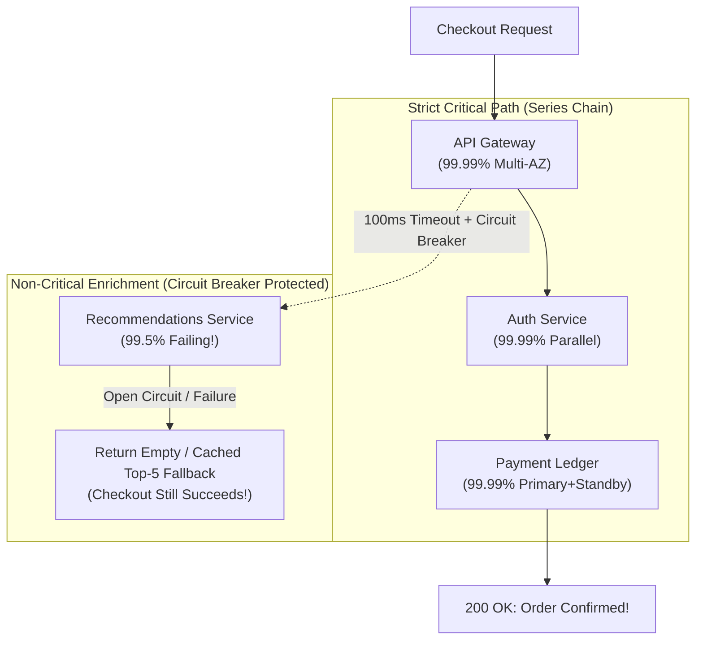
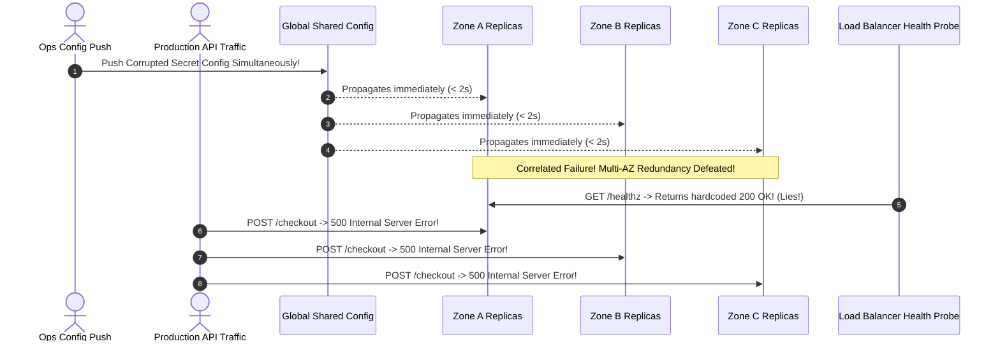

# Lesson 10: Availability

> **Prerequisites:** [Lesson 09: Throughput and Little's Law](../09-throughput-and-littles-law/README.md).  
> **Estimated Reading Time:** 26 minutes  
> **Target Audience:** Backend engineers, reliability engineers (SREs), and architects calculating availability SLAs, designing Multi-AZ failover systems, and eliminating correlated failure domains.  
> **Free PDF Notes:** [Download SD-A-010.pdf](https://backendroadmap.com/notes/system-design/SD-A-010.pdf) · [Phase 1, Core Fundamentals (PDF)](https://backendroadmap.com/notes/system-design/Phase1_Core_Fundamentals_Notes.pdf)

> [!TIP]
> **The Golden Rule of High Availability:** Availability ($\frac{\text{MTBF}}{\text{MTBF} + \text{MTTR}}$) drops cumulatively for every synchronous service added in **series** and compounds dramatically only when **independent** redundant replicas operate in **parallel**. Cutting Mean Time to Recovery (**MTTR**) from 60 minutes to 3 minutes delivers $10\times$ higher availability far more cheaply than trying to prevent hardware from ever failing—provided your redundant zones do not share correlated failures (shared config, shared power, or shared DNS).

---

## Visual Mental Models & Architecture

### Recovery Velocity Leverage: MTBF vs. MTTR

Because hardware disks, switches, and fiber cables inevitably degrade, optimizing **MTTR** (automatic failover and instant rollback) produces orders of magnitude larger uptime gains than futilely chasing infinite MTBF.


*Figure 1. Recovering ten times faster gives ten times less downtime, with the same number of failures.*

### Series Dependency Degradation vs. Parallel Redundancy Multiplication


*Figure 2. Dependencies in a chain multiply availability down; independent replicas multiply the failure chance down.*

### Shortening the Critical Path With Circuit Breakers & Graceful Fallbacks

Adding optional synchronous services (e.g., Fraud Scoring or Personalized Recommendations) directly onto the Checkout critical path erodes overall system availability via series multiplication. Wrapping optional dependencies inside fast Circuit Breakers with cached defaults isolates their failure cleanly.



---

## Systematic Taxonomic Reference Grids

### The Availability "Nines" & Downtime Reference Matrix

| Target Availability | Verbal Name | Max Annual Downtime | Max Monthly Downtime | Max Weekly Downtime | Fault Domain Topology Required |
| :---: | :--- | :---: | :---: | :---: | :--- |
| **$99.0\%$** | Two Nines | $3.65\text{ days}$ | $7.30\text{ hours}$ | $1.68\text{ hours}$ | Single instance + manual VM recovery. |
| **$99.9\%$** | Three Nines | $8.76\text{ hours}$ | $43.8\text{ minutes}$ | $10.1\text{ minutes}$ | Stateless multi-node app + single managed DB backup. |
| **$99.95\%$** | Three-and-a-half | $4.38\text{ hours}$ | $21.9\text{ minutes}$ | $5.04\text{ minutes}$ | Active-Standby DB failover across Availability Zones. |
| **$99.99\%$** | Four Nines | $52.6\text{ minutes}$ | $4.38\text{ minutes}$ | $1.01\text{ minutes}$ | Multi-AZ active-active compute + automated DB promotion + health probes. |
| **$99.999\%$** | Five Nines | $5.26\text{ minutes}$ | $26.3\text{ seconds}$ | $6.05\text{ seconds}$ | Multi-region active-active replication + Global Anycast BGP failover. |

### Series vs. Parallel Reliability Formulas

| Topology Pattern | Mathematical Formula | Worked Numeric Example | Architectural Engineering Action |
| :--- | :--- | :--- | :--- |
| **Series Chain** *(All required)* | $A_{\text{total}} = A_1 \times A_2 \times \dots \times A_n$ | Three $99.9\%$ services in series: $0.999^3 = \mathbf{99.70\%}$ ($26.2\text{ hr}$ down/yr!) | Minimize synchronous dependencies; push analytics, notifications, and logs async. |
| **Parallel Redundancy** *(Either works)* | $A_{\text{total}} = 1 - \prod (1 - A_i)$ | Two **independent** $99.5\%$ replicas: $1 - (0.005)^2 = \mathbf{99.9975\%}$ | Deploy across physically separate Availability Zones (independent power/cooling/fiber). |
| **Correlated Replicas** *(False safety)* | Drops to $A_{\text{shared}}$ | Bad global config pushed simultaneously to 10 zones crashes all 10! | Use progressive canary deploys (1% $\to$ 10% $\to$ 100%) to preserve true failure independence. |

---

## Production War Stories: Incident Post-Mortem

### SEV-1 Post-Mortem: The Correlated Multi-AZ Global Config Push & Synthetic Green Healthcheck Illusion

#### Incident Overview
* **Severity:** SEV-1 (100% Global API Failure Despite Green "Uptime" Dashboard)
* **Detection Time:** 28 minutes (Alerted via Twitter/Customers while synthetic ping probes stayed green!)
* **Resolution Time:** 1 hour 15 minutes
* **Impact:** Every authenticated API endpoint returned `500 Internal Server Error` across all three Availability Zones simultaneously.

#### What Happened
A cloud SaaS architecture prided itself on **"Four Nines" Multi-AZ Redundancy**: running 30 stateless API pods spread equally across 3 separate AWS Availability Zones (`us-east-1a`, `1b`, `1c`), mathematically expecting $1 - (0.001)^3 \approx 99.9999999\%$ availability!

At 11:05 UTC, an operator updated a shared environment configuration feature flag inside Consul/Parameter Store—accidentally inserting a malformed trailing space inside an encryption secret regex. Within 4 seconds:
1. All 30 pods across all **3 Availability Zones** fetched the updated bad config simultaneously and threw unhandled decryption exceptions on every user request.
2. Why didn't PagerDuty fire instantly? Because the Load Balancer health check probed `GET /healthz`, which simply returned hardcoded `200 OK` without executing any actual decryption or database test!
3. The public status page proudly displayed **"100.0% Green Operational"** for 28 minutes while 100% of real customer requests failed!



#### Root Cause Analysis
1. **Correlated Single-Point Config Propagation:** Multi-AZ hardware isolation cannot survive a simultaneous synchronized bad software or config rollout across all zones.
2. **Shallow Health Checks vs. Request-Based SLIs:** Relying on static `200 OK` process heartbeat checks measured whether the Python/Go process ran—not whether it could successfully serve real business logic.

#### The Fix & Architectural Hardening
1. **Request-Level Success Rate SLIs (Server-Side Metrics):** Replaced "uptime ping %" with real HTTP success ratio SLIs ($\frac{\text{2xx + 4xx Requests}}{\text{Total Valid Requests}}$) firing multi-burn-rate alerts within 90 seconds of any 5xx elevation.
2. **Progressive Staged Config Rollouts (Cell/Canary Rings):** Config and secret changes now roll out sequentially—1 canary pod $\to$ 1 AZ (`10%`) $\to$ pause & verify error rates for 5 minutes $\to$ remaining zones—preventing correlated multi-zone wipeouts cleanly.

---

## Multi-Language Production Code Tabs

The implementations below demonstrate **Critical-Path Availability Protection**:
1. **Circuit Breaker + Fallback Degradation:** Removing a flaky non-critical dependency (Recommendations) from the synchronous series chain so Checkout maintains $99.99\%$ availability even when Recommendations goes $100\%$ offline!
2. **Real Dependency Readiness vs. Liveness Health Endpoints:** Distinguishing shallow process liveness from true dependency readiness.

### Critical-Path Circuit Breaker & Graceful Fallback Implementations

````carousel
```go
// Go: Series Availability Isolation via Fast Circuit Breaker & Graceful Fallback
package main

import (
	"context"
	"encoding/json"
	"errors"
	"log"
	"net/http"
	"sync"
	"time"
)

type CircuitBreaker struct {
	mu           sync.Mutex
	failures     int
	openUntil    time.Time
	maxFailures  int
	resetTimeout time.Duration
}

func NewCircuitBreaker(maxFailures int, resetTimeout time.Duration) *CircuitBreaker {
	return &CircuitBreaker{maxFailures: maxFailures, resetTimeout: resetTimeout}
}

func (cb *CircuitBreaker) Execute(fn func() ([]string, error), fallback []string) ([]string, bool) {
	cb.mu.Lock()
	if time.Now().Before(cb.openUntil) {
		cb.mu.Unlock()
		return fallback, true // Circuit OPEN: Instant <0.1ms degraded fallback!
	}
	cb.mu.Unlock()

	res, err := fn()
	cb.mu.Lock()
	defer cb.mu.Unlock()

	if err != nil {
		cb.failures++
		if cb.failures >= cb.maxFailures {
			cb.openUntil = time.Now().Add(cb.resetTimeout)
			log.Println("[CircuitBreaker] Tripped OPEN! Isolating checkout critical path.")
		}
		return fallback, true
	}

	cb.failures = 0
	return res, false
}

func main() {
	recsBreaker := NewCircuitBreaker(3, 15*time.Second)

	http.HandleFunc("/checkout", func(w http.ResponseWriter, r *http.Request) {
		// Step 1: Critical Path Payment (Required!)
		paymentConfirmed := true

		// Step 2: Optional Recommendations wrapped in 100ms timeout + Circuit Breaker
		// Failure here NEVER reduces Checkout availability in series!
		recs, degraded := recsBreaker.Execute(func() ([]string, error) {
			ctx, cancel := context.WithTimeout(r.Context(), 100*time.Millisecond)
			defer cancel()
			_ = ctx
			return nil, errors.New("recommendations service 503 outage")
		}, []string{"Popular-Item-Default-1", "Popular-Item-Default-2"})

		w.Header().Set("Content-Type", "application/json")
		_ = json.NewEncoder(w).Encode(map[string]interface{}{
			"checkout_confirmed": paymentConfirmed,
			"recommendations":    recs,
			"degraded_mode":      degraded,
		})
	})

	log.Println("Resilient checkout service running on :8000")
	log.Fatal(http.ListenAndServe(":8000", nil))
}
```
<!-- slide -->
```typescript
// TypeScript/Node.js: Series Chain Protection with Circuit Breaker + Fallback + Deep SLI Probe
import express, { Request, Response } from 'express';

class SimpleCircuitBreaker {
  private failures = 0;
  private openUntil = 0;

  constructor(private readonly threshold = 3, private readonly cooldownMs = 15000) {}

  async runWithFallback<T>(action: () => Promise<T>, fallbackValue: T): Promise<{ data: T; degraded: boolean }> {
    if (Date.now() < this.openUntil) {
      return { data: fallbackValue, degraded: true }; // Fail-fast fallback
    }

    try {
      const result = await action();
      this.failures = 0;
      return { data: result, degraded: false };
    } catch {
      this.failures++;
      if (this.failures >= this.threshold) {
        this.openUntil = Date.now() + this.cooldownMs;
        console.warn('[CircuitBreaker] Opened circuit for non-critical dependency.');
      }
      return { data: fallbackValue, degraded: true };
    }
  }
}

const recsBreaker = new SimpleCircuitBreaker(3, 15000);
const app = express();

// Real Availability Readiness Check (Validates actual critical dependency connectivity)
app.get('/readyz', async (_req: Request, res: Response) => {
  const dbHealthy = true; // Verify live DB query `SELECT 1`
  if (!dbHealthy) return res.status(503).json({ status: 'not_ready' });
  res.json({ status: 'ready' });
});

app.post('/checkout', async (_req: Request, res: Response) => {
  // Core Critical Path: Charge & Record Order
  const orderId = 'ord_99123';

  // Non-Critical Enrichment: Protected so series failures don't break checkout!
  const recsResult = await recsBreaker.runWithFallback(async () => {
    throw new Error('Recommendations downstream connection refused');
  }, ['Cached-Top-Pick-A', 'Cached-Top-Pick-B']);

  res.status(200).json({
    orderId,
    status: 'confirmed',
    upsellItems: recsResult.data,
    degradedMode: recsResult.degraded,
  });
});

app.listen(8000, () => console.log('High-availability checkout listening on :8000'));
```
<!-- slide -->
```python
# Python: FastAPI Circuit Breaker Isolation & Graceful Series Degradation
import time
import asyncio
from fastapi import FastAPI

class CircuitBreaker:
    def __init__(self, failure_threshold: int = 3, recovery_sec: float = 15.0):
        self.failure_threshold = failure_threshold
        self.recovery_sec = recovery_sec
        self.failures = 0
        self.open_until = 0.0

    async def call_or_fallback(self, coro_fn, fallback):
        if time.monotonic() < self.open_until:
            return fallback, True  # Circuit OPEN: skip slow network timeout!

        try:
            # Strict 100ms timeout budget for optional service
            result = await asyncio.wait_for(coro_fn(), timeout=0.100)
            self.failures = 0
            return result, False
        except Exception:
            self.failures += 1
            if self.failures >= self.failure_threshold:
                self.open_until = time.monotonic() + self.recovery_sec
            return fallback, True

recs_breaker = CircuitBreaker()
app = FastAPI(title="Resilient Availability Architecture")

async def failing_recs_service():
    raise RuntimeError("Upstream recommendations outage")

@app.post("/checkout")
async def checkout():
    # Step 1: Core Payment Critical Path (Must succeed)
    order_status = "confirmed"

    # Step 2: Optional Service Protected by Breaker -> Preserves Overall Availability!
    upsells, degraded = await recs_breaker.call_or_fallback(
        failing_recs_service,
        fallback=["BestSeller-1", "BestSeller-2"]
    )
    return {
        "order_status": order_status,
        "recommended_items": upsells,
        "degraded_fallback_active": degraded,
    }
```
<!-- slide -->
```csharp
// C#: ASP.NET Core Resilience Fallback Removing Optional Call From Critical Availability Chain
using System;
using System.Threading.Tasks;
using Microsoft.AspNetCore.Builder;
using Microsoft.AspNetCore.Http;

var builder = WebApplication.CreateBuilder(args);
var app = builder.Build();

int consecutiveFailures = 0;
DateTimeOffset openUntil = DateTimeOffset.MinValue;

app.MapPost("/checkout", async () =>
{
    string[] recommendations;
    bool degraded = false;

    if (DateTimeOffset.UtcNow < openUntil)
    {
        recommendations = new[] { "Static-Top-1", "Static-Top-2" };
        degraded = true;
    }
    else
    {
        try
        {
            await Task.Delay(5);
            throw new TimeoutException("Recommendations node unreachable");
        }
        catch
        {
            consecutiveFailures++;
            if (consecutiveFailures >= 3)
                openUntil = DateTimeOffset.UtcNow.AddSeconds(15);

            recommendations = new[] { "Static-Top-1", "Static-Top-2" };
            degraded = true;
        }
    }

    // Core Checkout returns 200 OK instead of dropping from 99.99% down to 99.5%!
    return Results.Ok(new { orderConfirmed = true, recommendations, degraded });
});

app.Run("http://0.0.0.0:8000");
```
````

---

## Practical Hands-On Verification CLI Workflows

Verify MTBF/MTTR arithmetic, series/parallel composite reliability math, and observe Circuit Breaker open/fallback behavior in terminal output.

### Step 1: Calculate Composite Series vs. Parallel Chain Availability via CLI

Execute this script to calculate exact series availability degradation and verify how adding redundancy upgrades a weak link:

```bash
python -c "
api, pay, db = 0.9995, 0.9990, 0.9995
series_total = api * pay * db
print(f'1. Baseline Series Chain:       {series_total*100:.4f}% (~{(1-series_total)*525600:.1f} min down/yr)')

# Add active-standby redundancy across zones for DB and Pay
db_parallel = 1 - (1 - 0.9995)**2
pay_parallel = 1 - (1 - 0.9990)**2
hardened_total = api * pay_parallel * db_parallel
print(f'2. With Multi-AZ DB + Pay:      {hardened_total*100:.4f}% (~{(1-hardened_total)*525600:.1f} min down/yr)')
"
```

**Expected Output:**
```text
1. Baseline Series Chain:       99.8001% (~1050.6 min down/yr)
2. With Multi-AZ DB + Pay:      99.9499% (~263.4 min down/yr)
```

### Step 2: Calculate MTBF vs. MTTR Uptime Sensitivity

Compare cutting failure frequency vs cutting automated recovery speed:

```bash
python -c "
def avail(mtbf_min, mttr_min): return mtbf_min / (mtbf_min + mttr_min)
print(f'Manual 60m recovery once/mo:    {avail(43200, 60)*100:.4f}%')
print(f'Auto-failover 2m recovery/mo:   {avail(43200, 2)*100:.4f}%')
"
```

**Expected Output:**
```text
Manual 60m recovery once/mo:    99.8613%
Auto-failover 2m recovery/mo:   99.9954%
```

Automated failover pushed uptime past **99.995%** without reducing how often hardware breaks!

---

## Operational Validation Checkpoints (Scenario Quizzes)

<details>
<summary><strong>Checkpoint 1: Removing Weak Links from a Long Synchronous Series Chain</strong></summary>

**Scenario:** A user profile update triggers 6 synchronous calls in series before returning `200 OK`: Gateway ($99.99\%$), Profile DB ($99.95\%$), Search Indexer ($99.8\%$), Audit Logger ($99.5\%$), Analytics Collector ($99.0\%$), and Email Notifier ($99.2\%$). What is the approximate overall endpoint availability, and what architecture fix instantly jumps it above $99.9\%$?

<strong>Answer:</strong>
- **Current Availability:** Multiplying all 6 synchronous dependencies in series ($0.9999 \times 0.9995 \times 0.998 \times 0.995 \times 0.990 \times 0.992 \approx \mathbf{97.46\%}$ — over **9 days of downtime per year**!).
- **Architectural Fix:** Shorten the critical path! Only **Gateway** and **Profile DB** are strictly mandatory to commit the profile change ($0.9999 \times 0.9995 \approx \mathbf{99.94\%}$). Commit the profile update to PostgreSQL along with an **Outbox Event** inside the same local transaction, then return `200 OK` immediately. Background workers read the outbox and asynchronously feed Search, Audit, Analytics, and Email—removing 4 fragile dependencies cleanly from user-facing availability!
</details>

<details>
<summary><strong>Checkpoint 2: Why Correlated Failures Shatter Parallel Redundancy Math</strong></summary>

**Scenario:** Your architecture team calculates that running 2 redundant database nodes ($99.9\%$ uptime each) achieves $1 - (0.001)^2 = \mathbf{99.9999\%}$ ("Six Nines"!). Yet during a routine OS patch Tuesday evening, the entire site goes completely offline for 20 minutes. Explain what assumption inside the parallel formula failed.

<strong>Answer:</strong>
The parallel availability formula $1 - \prod (1 - A_i)$ relies mathematically on **statistical independence** ($P(A \cap B) = P(A) \cdot P(B)$).
If both replicas live on the same physical power rack, share the same single network router, receive an OS patch simultaneously via Ansible, or execute the exact same buggy database migration at the exact same millisecond, their failure probability becomes **completely correlated** ($P(A \cap B) \approx P(A)$). True parallel availability requires isolating power, Availability Zones, and deploying updates in staggered rolling waves (Canary $\to$ Zone A $\to$ pause $\to$ Zone B).
</details>

<details>
<summary><strong>Checkpoint 3: Detecting Synthetic Healthcheck Blindness</strong></summary>

**Scenario:** Your SLA status page monitors `GET /health` across all 10 application pods and logs `100.00%` availability over 30 days. However, enterprise customers demand SLA credit refunds because 18% of actual API write mutations returned `500 Internal Server Error` during a 3-hour DNS outage affecting your internal database hostname. Why did the health check miss a real SEV-1 outage?

<strong>Answer:</strong>
Static `/health` (liveness) endpoints confirm only that the web framework HTTP process hasn't crashed (`return {"status": "ok"}`). Because the check never parsed an auth token, resolved internal database DNS, or ran `SELECT 1`, it reported healthy even when the application couldn't reach its primary data store!
Monitor user-facing **SLIs (Service Level Indicators)** derived directly from real request metrics ($\frac{\text{Successful HTTP Requests}}{\text{Total Valid Requests}}$) measured at the ingress load balancer—never mistake simple process liveness pings for true business availability.
</details>

---

## Further Reading & Sources

- [Google SRE Book: Availability & MTBF/MTTR Modeling](https://sre.google/sre-book/service-level-objectives/) — Practical definitions of request-based vs time-based availability.
- [Azure Well-Architected Framework: Reliability & Redundancy](https://learn.microsoft.com/en-us/azure/well-architected/reliability/redundancy) — Designing multi-zone and multi-region failure independence.
- [Martin Fowler: Circuit Breaker Pattern](https://martinfowler.com/bliki/CircuitBreaker.html) — Isolating flaky downstream services cleanly.

---

## Free PDF notes

Download these notes as a printable PDF, with every diagram: [SD-A-010.pdf](https://backendroadmap.com/notes/system-design/SD-A-010.pdf). All Phase 1 notes in one file: [Phase 1, Core Fundamentals (PDF)](https://backendroadmap.com/notes/system-design/Phase1_Core_Fundamentals_Notes.pdf).

---

## Next

Continue with [Lesson 11: Reliability, Availability and Durability](../11-reliability-availability-and-durability/README.md) to distinguish *"up and running"* from *"returning correct answers"* from *"never losing committed data."*
