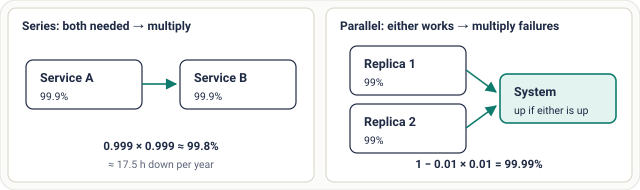

# Lesson 10: Availability

## Roadmap

You are in **System Design Interview Prep**, Track 01, **Core Fundamentals**: lesson 10 of 19 (the nines, MTBF vs MTTR, series vs parallel). It builds on [Lesson 09: Throughput and Little's Law](../09-throughput-and-littles-law/README.md). Next comes [Lesson 11: Reliability, Availability and Durability](../11-reliability-availability-and-durability/README.md).

These are the written notes for the lesson's video. Prefer paper? The same notes are a free, printable PDF: [download SD-A-010.pdf](https://backendroadmap.com/notes/system-design/SD-A-010.pdf).

## Concept

> [!key] Availability is the share of time a system serves requests successfully; it depends on how often things fail and how fast you recover, and it multiplies down in series and up with redundancy.

## Explanation

### The nines

| Availability | Name | Downtime per year | Per month |
|---|---|---|---|
| 99% | two nines | ~3.65 days | ~7.3 h |
| 99.9% | three nines | ~8.76 h | ~43.8 min |
| 99.99% | four nines | ~52.6 min | ~4.4 min |
| 99.999% | five nines | ~5.3 min | ~26 s |

### MTBF and MTTR

Two numbers drive availability: **MTBF** (mean time between failures: how often things break) and **MTTR** (mean time to recovery: how fast you fix them).

availability = MTBF / (MTBF + MTTR)

*Figure 1. Recovering ten times faster gives ten times less downtime, with the same number of failures.*

### Series and parallel

*Figure 2. Dependencies in a chain multiply availability down; independent replicas multiply the failure chance down.*

- **Series** (a request needs A and B): multiply the availabilities. Every extra dependency on the critical path lowers the total.
- **Parallel** (either replica can serve): multiply the *failure* chances. Two 99% replicas fail together only 0.01% of the time.
- The parallel maths holds only if failures are **independent**. Two replicas in the same rack, on the same power or with the same bad config fail together.

> [!example] **Worked example.** A checkout calls the API (99.95%), the payment service (99.9%) and the database (99.95%) in series: 0.9995 × 0.999 × 0.9995 ≈ **99.8%**, about 17.5 hours down a year. Run the database as a primary with a standby in another zone, each 99.95%: the pair is 1 − 0.0005² ≈ 99.99998%, and the chain improves to ≈ **99.85%**. Now the payment service is the weakest link.

### How to improve availability

- **Redundancy** across zones or regions, with failures as independent as you can make them.
- **Remove single points of failure** on the request path.
- **Detect fast, fail over automatically**: health checks and automatic promotion cut MTTR from an hour to seconds or minutes.
- **Timeouts and careful retries**, so a slow dependency doesn't hang everything.
- **Shorten the critical path**: make optional calls asynchronous or degrade gracefully when they fail.

## Key terms

| Term | Meaning |
|---|---|
| **Availability** | share of time serving successfully |
| **MTBF** | mean time between failures |
| **MTTR** | mean time to recovery |
| **Series** | all parts needed: multiply availability |
| **Parallel** | any part enough: multiply failures |
| **Critical path** | calls a request can't succeed without |

## Interview questions

Each question is tagged by kind: **Basic** (definitions), **Scenario** (apply it to a system) and **Tricky** (the follow-ups interviewers use to go deeper). Answer out loud before you open the answer.

> [!interview] Two services at 99.9% each, in series. What's the total? (Basic)

What a strong answer covers

About 99.8%, because you multiply: 0.999 × 0.999 ≈ 0.998, roughly 17.5 hours of downtime a year.

> [!interview] What do MTBF and MTTR mean, and how do they give availability? (Basic)

What a strong answer covers

MTBF is how long between failures; MTTR is how long to recover. Availability = MTBF / (MTBF + MTTR).

> [!interview] Two independent replicas at 99% each. What's the availability? (Basic)

What a strong answer covers

1 − (0.01 × 0.01) = 99.99%, because the system is down only when both fail at once.

> [!interview] You need 99.99% but each server gives 99.5%. What do you do? (Scenario)

What a strong answer covers

Run several replicas across zones behind a load balancer with fast health checks: two independent 99.5% replicas give 1 − 0.005² ≈ 99.9975%. Then check the rest of the chain (load balancer, database) also meets the target.

> [!interview] A service fails once a month and takes an hour to fix. Fastest way to improve it? (Scenario)

What a strong answer covers

Cut MTTR: automatic failover and good alerts can bring recovery to ~6 minutes, which takes availability from ~99.86% to ~99.986% without changing how often it fails.

> [!interview] Your page calls 8 services in series. How do you raise its availability? (Scenario)

What a strong answer covers

Remove non-essential calls from the critical path (make them async or optional with fallbacks), add redundancy to the weakest services, and use timeouts so a slow dependency degrades the page instead of failing it.

> [!interview] Why might two replicas give much less than the calculated 99.99%? (Tricky)

What a strong answer covers

Failures aren't independent: same zone, same power, same bad deploy or config, or a shared dependency like DNS. Correlated failures break the parallel maths.

> [!interview] Your dashboard shows 100% uptime but users report errors. How? (Tricky)

What a strong answer covers

The health check measures “process is up”, not “requests succeed”. Measure availability as the success rate of real requests (an SLI), not a ping.

## Common mistakes & troubleshooting

- Adding dependencies without counting the multiplied availability.
- Assuming replicas fail independently when they share a zone or config.
- Focusing only on MTBF and ignoring recovery time.
- Measuring uptime from a health check while real requests fail.

## Free PDF notes

Download these notes as a printable PDF, with every diagram: [SD-A-010.pdf](https://backendroadmap.com/notes/system-design/SD-A-010.pdf). All Phase 1 notes in one file: [Phase 1, Core Fundamentals (PDF)](https://backendroadmap.com/notes/system-design/Phase1_Core_Fundamentals_Notes.pdf).

## Next

Continue with [Lesson 11: Reliability, Availability and Durability](../11-reliability-availability-and-durability/README.md).
