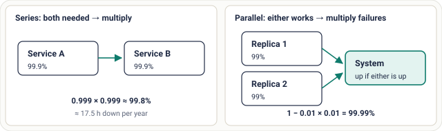
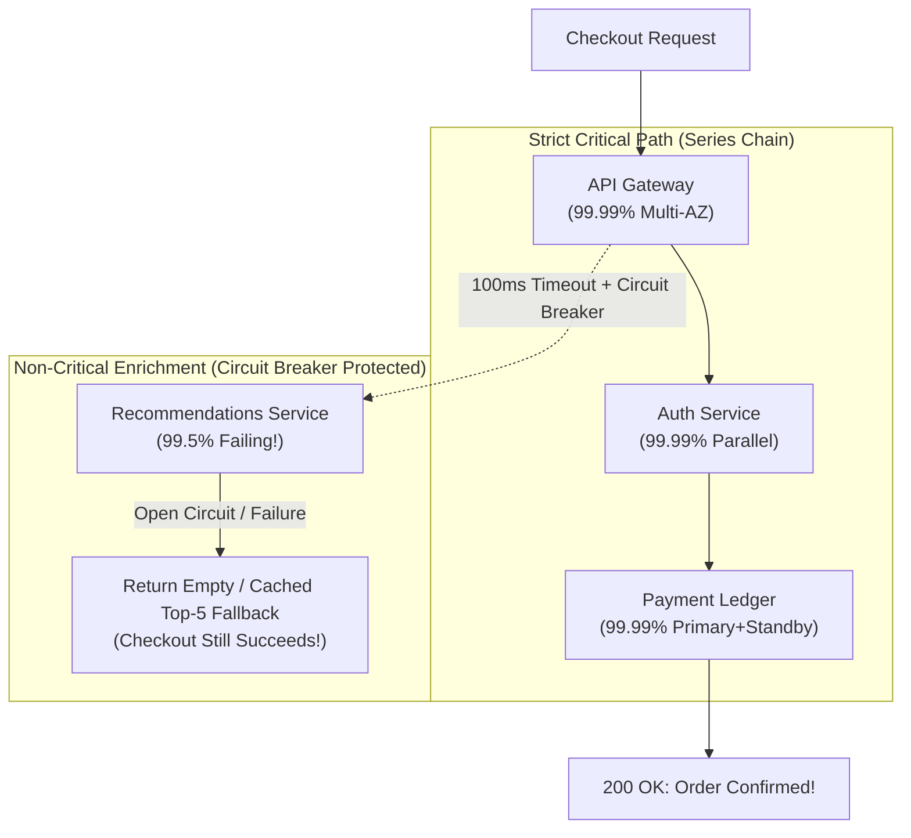
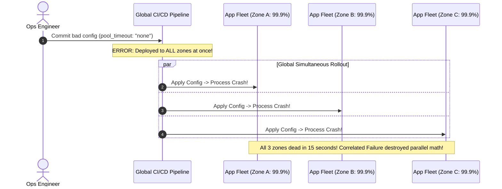

# Lesson 10: Availability

> **Prerequisites:** [Lesson 09: Throughput and Little's Law](../09-throughput-and-littles-law/README.md).  
> **Estimated Reading Time:** 32 minutes  
> **Target Audience:** Backend engineers, reliability engineers (SREs), and architects calculating availability SLAs, designing Multi-AZ failover systems, and eliminating correlated failure domains.  
> **Free PDF Notes:** [Download SD-A-010.pdf](https://backendroadmap.com/notes/system-design/SD-A-010.pdf) · [Phase 1, Core Fundamentals (PDF)](https://backendroadmap.com/notes/system-design/Phase1_Core_Fundamentals_Notes.pdf)

> [!NOTE]
> **In one line:** Availability is the share of time a system serves requests successfully; it depends on how often things break (MTBF) and how fast you recover (MTTR), and it multiplies down in series and up with redundancy.

> [!TIP]
> **The Golden Rule of High Availability:** Availability ($\frac{\text{MTBF}}{\text{MTBF} + \text{MTTR}}$) drops cumulatively for every synchronous service added in **series** and compounds dramatically only when **independent** redundant replicas operate in **parallel**. Cutting Mean Time to Recovery (**MTTR**) from 60 minutes to 6 minutes delivers $10\times$ higher availability far more cheaply than trying to prevent hardware from ever failing—provided your redundant zones do not share correlated failures (shared config, shared power, or shared DNS).

---

## 1. What Availability Is: The Table of "Nines"

Availability is the proportion of time a system remains operational and capable of fulfilling user requests. In industry Service Level Agreements (SLAs), availability is stated in "nines":

| Availability Level | Common Industry Name | Allowed Downtime per Year | Allowed Downtime per Month | Allowed Downtime per Week | Typical Architecture Level |
| :---: | :--- | :---: | :---: | :---: | :--- |
| **$99.0\%$** | "Two Nines" | $\sim 3.65\text{ days}$ | $\sim 7.30\text{ hours}$ | $\sim 1.68\text{ hours}$ | Single-instance VM, no auto-recovery, manual SSH fixes. |
| **$99.9\%$** | "Three Nines" | $\sim 8.76\text{ hours}$ | $\sim 43.8\text{ minutes}$ | $\sim 10.1\text{ minutes}$ | Multi-AZ web tier, single cloud DB with auto-restart. |
| **$99.99\%$** | "Four Nines" | $\sim 52.6\text{ minutes}$ | $\sim 4.38\text{ minutes}$ | $\sim 1.01\text{ minutes}$ | Multi-AZ active-standby database, auto-failover, zero-downtime deploys. |
| **$99.999\%$** | "Five Nines" | $\sim 5.26\text{ minutes}$ | $\sim 25.9\text{ seconds}$ | $\sim 6.05\text{ seconds}$ | Multi-region active-active clusters, telecom switches, Spanner/CockroachDB. |

---

## 2. MTBF and MTTR: The Two True Levers of Uptime

Two fundamental metrics govern availability:
1. **MTBF (Mean Time Between Failures):** How long the system runs cleanly between unexpected outages.
2. **MTTR (Mean Time to Recovery):** How long it takes your engineering platform to detect, diagnose, fail over, and restore operational service.

$$\text{Availability} = \frac{\text{MTBF}}{\text{MTBF} + \text{MTTR}}$$


*Figure 1. Recovering ten times faster gives ten times less downtime, with the same number of failures.*

### Numerical Sensitivity: Why MTTR Is Your Highest-Leverage Investment

Consider a microservice that experiences one unexpected failure per month ($\text{MTBF} = 30\text{ days} = 43,200\text{ minutes}$):

* **Manual Intervention (MTTR = 60 minutes):** An engineer wakes up to a pager, logs into AWS, inspects logs, and reboots the primary database:
  $$\text{Availability} = \frac{43,200}{43,200 + 60} = \frac{43,200}{43,260} \approx \mathbf{99.86\%} \quad (\sim 12\text{ hours downtime/year})$$
* **Automated Healthcheck & Failover (MTTR = 6 minutes):** A consensus cluster (Raft/ZooKeeper) detects heartbeats stopping and automatically promotes a standby replica in 6 minutes:
  $$\text{Availability} = \frac{43,200}{43,200 + 6} = \frac{43,200}{43,206} \approx \mathbf{99.986\%} \quad (\sim 1.2\text{ hours downtime/year})$$

> [!IMPORTANT]
> **Cutting recovery time from 60 minutes to 6 minutes reduced yearly downtime by $10\times$ without preventing a single hardware crash.** In distributed systems, hardware *will* fail. Automated failover, canary rollbacks, and fast detection beats hoping code and servers never crash.

---

## 3. Series vs. Parallel Availability Math

In distributed architecture, request flows are combinations of **Series Chains** and **Parallel Redundancies**.



*Figure 2. Dependencies in a chain multiply availability down; independent replicas multiply the failure chance down.*

### Series Chains: Availability Multiplies Down
If a user request requires Service A **and** Service B to succeed synchronously, the system is available only when **both** are available:

$$A_{\text{series}} = A_1 \times A_2 \times \dots \times A_N$$

Every single extra synchronous dependency added to your critical path **strictly degrades** overall system availability. If you chain five services that each boast $99.9\%$ uptime:

$$A_{\text{total}} = (0.999)^5 \approx \mathbf{99.50\%} \quad (\sim 43.8\text{ hours of downtime/year!})$$

### Parallel Redundancy: Failure Probabilities Multiply Down
If a user request can be served by Replica 1 **or** Replica 2, the system only fails when **both** replicas fail simultaneously:

$$A_{\text{parallel}} = 1 - \prod_{i=1}^{N} (1 - A_i)$$

If you provision two independent servers that each offer only mediocre $99.0\%$ availability ($1\%$ failure rate):

$$A_{\text{total}} = 1 - (0.01 \times 0.01) = 1 - 0.0001 = \mathbf{99.99\%} \quad (\text{"Four Nines"}!)$$

Two cheap $99\%$ servers combined with automated healthcheck failover outperform a single $99.9\%$ expensive bare-metal server!

> [!WARNING]
> **The Correlated Failure Trap:** Parallel math holds **only if failures are truly statistically independent**. If both replicas reside in the same server rack, run on the same power strip, share the same EBS storage volume, or execute an identical buggy code deployment, they fail simultaneously ($P(A \cap B) \approx P(A)$), reducing your multi-node cluster to single-node availability.

---

## 4. Worked Production Example: The Weakest Link

Consider a checkout flow that synchronously calls three components in series:
- **API Gateway:** $99.95\%$ availability
- **Payment Gateway:** $99.90\%$ availability
- **PostgreSQL Database:** $99.95\%$ availability

$$A_{\text{checkout}} = 0.9995 \times 0.9990 \times 0.9995 \approx \mathbf{99.80\%} \quad (\sim 17.5\text{ hours downtime/year})$$

### Upgrading the Database to Multi-AZ Standby
We deploy PostgreSQL as a primary in Zone A with a hot standby in Zone B, each with $99.95\%$ individual availability ($0.0005$ failure chance):

$$A_{\text{DB\_pair}} = 1 - (0.0005)^2 = 1 - 0.00000025 = \mathbf{99.999975\%}$$

Now recalculate the checkout series chain:

$$A_{\text{checkout}} = 0.9995 \times 0.9990 \times 0.99999975 \approx \mathbf{99.85\%}$$

Notice that despite the database achieving "six nines", overall checkout availability improved only marginally (from $99.80\%$ to $99.85\%$). **The Payment Service ($99.90\%$) is now the dominant bottleneck.** To break past $99.9\%$, you must either add fallback payment processors or make payments asynchronous.

---

## 5. Shortening the Critical Path: Circuit Breakers & Graceful Fallbacks

The most effective architectural technique for raising availability is **shortening the synchronous critical path**. Remove non-essential enrichments (recommendations, fraud scoring, analytics) from the blocking series chain:



---

## 6. How to Improve System Availability

1. **Multi-AZ and Multi-Region Redundancy:** Deploy replicas across physically isolated failure domains (independent power, cooling, and networking).
2. **Eliminate Single Points of Failure (SPOFs):** Identify and duplicate any component whose loss halts traffic (load balancers, DNS providers, primary databases).
3. **Automate Fast Detection & Failover (Minimize MTTR):** Use aggressive health checks (e.g. 3 consecutive failed probes over 3 seconds) and automated leader promotion (Raft, Patroni, Sentinel) to cut MTTR from hours to seconds.
4. **Timeouts, Retries with Jitter, and Circuit Breakers:** Wrap every remote call in a tight timeout budget so a hung downstream dependency cannot monopolize worker pools.
5. **Decouple Asynchronously (Event-Driven Architecture):** Move non-critical work (email confirmations, search indexing, analytics logging) to background worker queues (`202 Accepted`).

---

## 7. Production War Story: Incident Post-Mortem

### SEV-1 Post-Mortem: The Correlated Multi-AZ Outage from Shared Configuration

#### Incident Overview
* **Severity:** SEV-1 (100% Platform Outage Across All 3 Availability Zones)
* **Detection Time:** 2 minutes post-configuration merge
* **Resolution Time:** 48 minutes
* **Impact:** 2.4 million users unable to access accounts or process payments during peak morning trading.

#### What Happened
A financial trading platform was engineered for high availability with identical active application fleets distributed evenly across `us-east-1a`, `us-east-1b`, and `us-east-1c`. The architecture team calculated theoretical availability at $1 - (0.001)^3 = \mathbf{99.9999999\%}$ ("Nine Nines").

At 08:30 EST, an engineer updated a database connection pool timeout setting in a centralized Git repository. An automated continuous deployment pipeline simultaneously pushed the new config to **all three zones simultaneously**:
1. The config contained a typo: `pool_timeout_seconds: "none"` instead of an integer.
2. The application framework threw an unhandled parse exception on boot and terminated the process.
3. Because the deployment was applied globally rather than in staggered canary stages, all pods across Zone A, Zone B, and Zone C crashed within 15 seconds.
4. Theoretical parallel availability of $99.9999999\%$ evaporated into a total system blackout.



#### The Fix & Architectural Hardening
1. **Canary Phased Deployments:** Enforced strict rollout waves: deploy to Canary Pod (1%) $\to$ wait 10 minutes $\to$ deploy to Zone A $\to$ wait 30 minutes $\to$ deploy remaining zones.
2. **Schema & Config Validation in CI:** Added pre-merge validation tests rejecting non-integer config variables before CD deployment.
3. **Automated Rollback on Probe Failure:** Ingress proxies automatically rollback to the previous release image if health check error rates spike above $1\%$ within 60 seconds.

---

## 8. Multi-Language Production Code Tabs

The implementations below demonstrate **Critical-Path Availability Protection**:
1. **Circuit Breaker + Fallback Degradation:** Isolating a failing non-critical service (Recommendations) so Checkout preserves $99.99\%$ availability even during complete downstream outages!
2. **Readiness vs. Liveness Probes:** Deep healthcheck validation preventing unhealthy nodes from receiving user traffic.

### Critical-Path Circuit Breaker & Graceful Fallback Implementations

````carousel
```go
// Go: Series Availability Isolation via Fast Circuit Breaker & Graceful Fallback
package main

import (
	"context"
	"encoding/json"
	"errors"
	"log"
	"net/http"
	"sync"
	"time"
)

type CircuitBreaker struct {
	mu           sync.Mutex
	failures     int
	openUntil    time.Time
	maxFailures  int
	resetTimeout time.Duration
}

func NewCircuitBreaker(maxFailures int, resetTimeout time.Duration) *CircuitBreaker {
	return &CircuitBreaker{maxFailures: maxFailures, resetTimeout: resetTimeout}
}

func (cb *CircuitBreaker) Execute(fn func() ([]string, error), fallback []string) ([]string, bool) {
	cb.mu.Lock()
	if time.Now().Before(cb.openUntil) {
		cb.mu.Unlock()
		return fallback, true // Circuit OPEN: Instant <0.1ms degraded fallback!
	}
	cb.mu.Unlock()

	res, err := fn()
	cb.mu.Lock()
	defer cb.mu.Unlock()

	if err != nil {
		cb.failures++
		if cb.failures >= cb.maxFailures {
			cb.openUntil = time.Now().Add(cb.resetTimeout)
			log.Println("[CircuitBreaker] Tripped OPEN! Isolating checkout critical path.")
		}
		return fallback, true
	}

	cb.failures = 0
	return res, false
}

func main() {
	recsBreaker := NewCircuitBreaker(3, 15*time.Second)

	http.HandleFunc("/checkout", func(w http.ResponseWriter, r *http.Request) {
		// Step 1: Critical Path Payment (Required!)
		paymentConfirmed := true

		// Step 2: Optional Recommendations wrapped in 100ms timeout + Circuit Breaker
		// Failure here NEVER reduces Checkout availability in series!
		recs, degraded := recsBreaker.Execute(func() ([]string, error) {
			ctx, cancel := context.WithTimeout(r.Context(), 100*time.Millisecond)
			defer cancel()
			_ = ctx
			return nil, errors.New("recommendations service 503 outage")
		}, []string{"Popular-Item-Default-1", "Popular-Item-Default-2"})

		w.Header().Set("Content-Type", "application/json")
		_ = json.NewEncoder(w).Encode(map[string]interface{}{
			"checkout_confirmed": paymentConfirmed,
			"recommendations":    recs,
			"degraded_mode":      degraded,
		})
	})

	log.Println("Resilient checkout service running on :8000")
	log.Fatal(http.ListenAndServe(":8000", nil))
}
```
<!-- slide -->
```typescript
// TypeScript/Node.js: Series Chain Protection with Circuit Breaker + Fallback + Deep SLI Probe
import express, { Request, Response } from 'express';

class SimpleCircuitBreaker {
  private failures = 0;
  private openUntil = 0;

  constructor(private readonly threshold = 3, private readonly cooldownMs = 15000) {}

  async runWithFallback<T>(action: () => Promise<T>, fallbackValue: T): Promise<{ data: T; degraded: boolean }> {
    if (Date.now() < this.openUntil) {
      return { data: fallbackValue, degraded: true }; // Fail-fast fallback
    }

    try {
      const result = await action();
      this.failures = 0;
      return { data: result, degraded: false };
    } catch {
      this.failures++;
      if (this.failures >= this.threshold) {
        this.openUntil = Date.now() + this.cooldownMs;
        console.warn('[CircuitBreaker] Opened circuit for non-critical dependency.');
      }
      return { data: fallbackValue, degraded: true };
    }
  }
}

const recsBreaker = new SimpleCircuitBreaker(3, 15000);
const app = express();

// Real Availability Readiness Check (Validates actual critical dependency connectivity)
app.get('/readyz', async (_req: Request, res: Response) => {
  const dbHealthy = true; // Verify live DB query `SELECT 1`
  if (!dbHealthy) return res.status(503).json({ status: 'not_ready' });
  res.json({ status: 'ready' });
});

app.post('/checkout', async (_req: Request, res: Response) => {
  // Core Critical Path: Charge & Record Order
  const orderId = 'ord_99123';

  // Non-Critical Enrichment: Protected so series failures don't break checkout!
  const recsResult = await recsBreaker.runWithFallback(async () => {
    throw new Error('Recommendations downstream connection refused');
  }, ['Cached-Top-Pick-A', 'Cached-Top-Pick-B']);

  res.status(200).json({
    orderId,
    status: 'confirmed',
    upsellItems: recsResult.data,
    degradedMode: recsResult.degraded,
  });
});

app.listen(8000, () => console.log('High-availability checkout listening on :8000'));
```
<!-- slide -->
```python
# Python: FastAPI Circuit Breaker Isolation & Graceful Series Degradation
import time
import asyncio
from fastapi import FastAPI

class CircuitBreaker:
    def __init__(self, failure_threshold: int = 3, recovery_sec: float = 15.0):
        self.failure_threshold = failure_threshold
        self.recovery_sec = recovery_sec
        self.failures = 0
        self.open_until = 0.0

    async def call_or_fallback(self, coro_fn, fallback):
        if time.monotonic() < self.open_until:
            return fallback, True  # Circuit OPEN: skip slow network timeout!

        try:
            # Strict 100ms timeout budget for optional service
            result = await asyncio.wait_for(coro_fn(), timeout=0.100)
            self.failures = 0
            return result, False
        except Exception:
            self.failures += 1
            if self.failures >= self.failure_threshold:
                self.open_until = time.monotonic() + self.recovery_sec
            return fallback, True

recs_breaker = CircuitBreaker()
app = FastAPI(title="Resilient Availability Architecture")

async def failing_recs_service():
    raise RuntimeError("Upstream recommendations outage")

@app.post("/checkout")
async def checkout():
    # Step 1: Core Payment Critical Path (Must succeed)
    order_status = "confirmed"

    # Step 2: Optional Service Protected by Breaker -> Preserves Overall Availability!
    upsells, degraded = await recs_breaker.call_or_fallback(
        failing_recs_service,
        fallback=["BestSeller-1", "BestSeller-2"]
    )
    return {
        "order_status": order_status,
        "recommended_items": upsells,
        "degraded_fallback_active": degraded,
    }
```
<!-- slide -->
```csharp
// C#: ASP.NET Core Resilience Fallback Removing Optional Call From Critical Availability Chain
using System;
using System.Threading.Tasks;
using Microsoft.AspNetCore.Builder;
using Microsoft.AspNetCore.Http;

var builder = WebApplication.CreateBuilder(args);
var app = builder.Build();

int consecutiveFailures = 0;
DateTimeOffset openUntil = DateTimeOffset.MinValue;

app.MapPost("/checkout", async () =>
{
    string[] recommendations;
    bool degraded = false;

    if (DateTimeOffset.UtcNow < openUntil)
    {
        recommendations = new[] { "Static-Top-1", "Static-Top-2" };
        degraded = true;
    }
    else
    {
        try
        {
            await Task.Delay(5);
            throw new TimeoutException("Recommendations node unreachable");
        }
        catch
        {
            consecutiveFailures++;
            if (consecutiveFailures >= 3)
                openUntil = DateTimeOffset.UtcNow.AddSeconds(15);

            recommendations = new[] { "Static-Top-1", "Static-Top-2" };
            degraded = true;
        }
    }

    // Core Checkout returns 200 OK instead of dropping from 99.99% down to 99.5%!
    return Results.Ok(new { orderConfirmed = true, recommendations, degraded });
});

app.Run("http://0.0.0.0:8000");
```
````

---

## 9. Practical Hands-On Verification CLI Workflows

Empirically calculate series and parallel availability math and measure MTBF/MTTR sensitivity using command-line scripts.

### Step 1: Calculate Series vs. Parallel Availability in Python
Simulate the worked example from Section 4:

```bash
python3 -c "
api, pay, db = 0.9995, 0.9990, 0.9995

# 1. Baseline Series Chain
series_avail = api * pay * db
downtime_min = (1 - series_avail) * 525600
print(f'1. Baseline Series Chain:       {series_avail*100:.4f}% (~{downtime_min:.1f} min down/yr)')

# 2. Database with Multi-AZ Standby
db_redundant = 1 - (1 - db)**2
improved_series = api * pay * db_redundant
improved_down = (1 - improved_series) * 525600
print(f'2. With Multi-AZ Standby DB:    {improved_series*100:.4f}% (~{improved_down:.1f} min down/yr)')
"
```

### Step 2: Calculate MTBF vs. MTTR Sensitivity
Compare the impact of cutting failure frequency vs cutting automated recovery speed:

```bash
python3 -c "
def avail(mtbf_min, mttr_min):
    return mtbf_min / (mtbf_min + mttr_min)

print(f'Manual 60m recovery once/mo:    {avail(43200, 60)*100:.4f}%')
print(f'Auto-failover 6m recovery/mo:   {avail(43200, 6)*100:.4f}%')
print(f'Auto-failover 1m recovery/mo:   {avail(43200, 1)*100:.4f}%')
"
```

---

## 10. Common Mistakes to Avoid

1. **Adding Dependencies Without Counting Series Availability:** Chaining 10 microservices that each claim $99.9\%$ uptime yields $(0.999)^{10} \approx 99.0\%$, creating over 3.6 days of downtime!
2. **Assuming Replicas Fail Independently:** Placing two database replicas in the same AWS Availability Zone or same server rack provides zero protection against power or networking failures.
3. **Focusing Solely on Preventing Failures (MTBF) While Ignoring MTTR:** Spending \$500k on ultra-redundant hardware while leaving failover as a 2-hour manual runbook.
4. **Measuring Availability Via Synthetic Liveness Healthchecks:** Counting a service as "up" because `GET /health` returns 200, while actual customer database mutations fail with `500 Internal Server Error`.
5. **Ignoring Network and Ingress Availability:** Sizing application servers for $99.99\%$ while running them behind a single, un-replicated load balancer instance.

---

## 11. Key Terms Glossary

| Key Term | Clear Architectural Definition |
| :--- | :--- |
| **Availability** | The proportion of time a system is up, operational, and successfully serving valid user requests. |
| **MTBF** | Mean Time Between Failures: average operational duration elapsed between system breakdowns. |
| **MTTR** | Mean Time to Recovery: average duration required to diagnose, fail over, and restore a failed service. |
| **Series Chain** | An architectural dependency model where every component must succeed; total availability is the product ($A = \prod A_i$). |
| **Parallel Redundancy** | An architectural model where any available replica can serve the request; failure chances multiply ($1 - \prod (1 - A_i)$). |
| **Correlated Failure** | When multiple redundant components fail simultaneously due to a shared dependency (power, DNS, config bug). |
| **Critical Path** | The minimal synchronous sequence of operations strictly required to fulfill a core user transaction. |
| **Circuit Breaker** | A proxy pattern that detects downstream failures and fails fast immediately, protecting upstream callers. |
| **Graceful Degradation** | Returning partial or cached results when a non-essential dependency fails, allowing the core request to succeed. |

---

## 12. System Design Interview Questions & Answers

### Basic Conceptual Questions

<details>
<summary><strong>Q1: Two services at 99.9% each, in series. What's the total availability? [BASIC]</strong></summary>

**Answer:**
About **$99.80\%$**, because in series you multiply individual availabilities:

$$A_{\text{total}} = 0.999 \times 0.999 \approx \mathbf{0.998001} \quad (99.80\%)$$

While $99.9\%$ allows $\sim 8.76\text{ hours}$ of downtime per year, combining two in series doubles downtime to **$\sim 17.5\text{ hours per year}$**.
</details>

<details>
<summary><strong>Q2: What do MTBF and MTTR mean, and how do they determine availability? [BASIC]</strong></summary>

**Answer:**
- **MTBF (Mean Time Between Failures):** How long the system runs cleanly between unexpected outages.
- **MTTR (Mean Time to Recovery):** How fast your engineering team detects, diagnoses, and restores operational service.

$$\text{Availability} = \frac{\text{MTBF}}{\text{MTBF} + \text{MTTR}}$$

Because hardware and networks will inevitably fail, cutting recovery time (e.g., via automated failover and instant rollback) is far more cost-effective than attempting to prevent all failures.
</details>

<details>
<summary><strong>Q3: Two independent replicas at 99% each in parallel. What is the total availability? [BASIC]</strong></summary>

**Answer:**
**$99.99\%$ ("Four Nines")**.
In parallel, the system only fails if **both** replicas fail simultaneously. Multiply the individual failure probabilities:

$$P(\text{Both Fail}) = (1 - 0.99) \times (1 - 0.99) = 0.01 \times 0.01 = 0.0001$$
$$A_{\text{total}} = 1 - 0.0001 = \mathbf{0.9999} \quad (99.99\%)$$
</details>

<details>
<summary><strong>Q4: What is the difference between fault tolerance and high availability? [BASIC]</strong></summary>

**Answer:**
- **High Availability (HA):** Aims to minimize downtime so that when a failure occurs, the system recovers rapidly (low MTTR, e.g. within seconds or minutes). Users might experience a brief retry or dropped connection.
- **Fault Tolerance (FT):** Zero degradation. The system continues operating seamlessly through hardware or component failures without a single dropped request or measurable interruption (e.g. dual-lockstep hardware, Raft consensus quorums). FT is far more expensive to design and operate.
</details>

### Scenario-Based Architecture Questions

<details>
<summary><strong>Q5: A service fails once a month and takes 60 minutes to fix. What is the fastest way to improve its availability? [SCENARIO]</strong></summary>

**Answer:**
**Cut MTTR via automated failover and monitoring.**
- Current: $\text{MTBF} = 43,200\text{ min}$, $\text{MTTR} = 60\text{ min} \implies \text{Availability} = \mathbf{99.86\%}$.
- If you automate healthchecks and leader failover so recovery takes **6 minutes**:
  $$\text{Availability} = \frac{43,200}{43,200 + 6} = \mathbf{99.986\%}$$
You achieve a **$10\times$ reduction in yearly downtime** without changing application code or reducing failure frequency.
</details>

<details>
<summary><strong>Q6: You need 99.99% availability, but each individual server provides only 99.5%. What architecture do you design? [SCENARIO]</strong></summary>

**Answer:**
Run multiple redundant replicas in parallel across independent Availability Zones behind an HA load balancer:
- Two $99.5\%$ replicas: $1 - (0.005)^2 = 1 - 0.000025 = \mathbf{99.9975\%}$ (surpasses the $99.99\%$ target!).
- Ensure strict independence: distribute nodes across different AZs, deploy an active-standby or active-active database, and enforce healthcheck routing so failed instances are removed from traffic within 3 seconds.
</details>

<details>
<summary><strong>Q7: Your webpage calls 8 services in series. How do you raise its overall availability? [SCENARIO]</strong></summary>

**Answer:**
1. **Shorten the Synchronous Critical Path:** Identify non-mandatory dependencies (recommendations, ads, reviews, analytics) and decouple them.
2. **Circuit Breakers with Fallbacks:** Wrap non-critical calls in circuit breakers. If Recommendations fails, return static cached popular items so checkout succeeds.
3. **Asynchronous Decoupling:** Move post-processing (audit logs, emails, analytics) to asynchronous message queues (Kafka, SQS) so they do not block the HTTP response.
4. **Parallel Fan-Out:** Execute independent queries concurrently (`Promise.all`, `asyncio.gather`) so timeout budgets overlap.
</details>

<details>
<summary><strong>Q8: A database cluster has automated failover, but failover takes 45 seconds. How do you handle client traffic during failover? [SCENARIO]</strong></summary>

**Answer:**
1. **Connection Pooling with Retry Queueing:** In-flight queries should not immediately throw 500 errors. Application connection pools (e.g. HikariCP, PgBouncer) buffer incoming requests and retry with exponential backoff and randomized jitter for up to 50 seconds.
2. **Graceful Read Fallback:** Route read queries to read-only replicas in secondary zones while the primary failover election completes.
3. **Idempotency Keys:** Ensure write mutations carry idempotency keys so that when clients retry their post-failover write, duplicate operations are safely ignored.
</details>

### Advanced & Tricky Interview Questions

<details>
<summary><strong>Q9: Why does running replicas in 2 availability zones sometimes fail to give parallel availability? [TRICKY]</strong></summary>

**Answer:**
Because of **Correlated Failure Domains**:
1. **Shared Configuration / Bad Deploys:** If a broken code release or database migration is applied globally to both zones simultaneously, all instances crash together.
2. **Shared Networking / DNS:** If your route53 record or cloud edge load balancer misconfigures, both zones become unreachable.
3. **Capacity Cascades:** If each zone runs at $75\%$ capacity, losing Zone A shifts all traffic to Zone B, which instantly overloads to $150\%$ and crashes—turning a single-zone issue into a total cluster failure.
</details>

<details>
<summary><strong>Q10: Can adding redundancy actually decrease overall system availability? [TRICKY]</strong></summary>

**Answer:**
**Yes!** Adding redundancy introduces **coordination complexity**:
1. **Consensus Quorum Overhead:** Adding nodes to a Raft or Paxos cluster increases consensus latency and network serialization points.
2. **Split-Brain Risk:** If network partitions occur, misconfigured failover mechanisms can promote two primaries simultaneously, corrupting data and forcing a complete manual shutdown.
3. **Cascading Healthcheck Flapping:** Aggressive healthcheck probes can mark healthy but busy nodes as dead, triggering failover storms that overload surviving nodes.
</details>

<details>
<summary><strong>Q11: How do you measure true availability if health check probes return 200 OK while real user mutations fail? [TRICKY]</strong></summary>

**Answer:**
Never rely exclusively on shallow process liveness probes (`GET /health`). Instead, compute user-centric **Service Level Indicators (SLIs)** measured at the ingress load balancer:

$$\text{SLI}_{\text{availability}} = \frac{\text{Count of Successful User Requests (HTTP 2xx, 3xx, 4xx)}}{\text{Total Valid User Requests (Excluding Bad Client 4xx)}}$$

Additionally, run **Synthetic Canaries (Probers)** that execute end-to-end user transactions (e.g., login, add to cart, checkout) every 30 seconds and alert immediately when synthetic transactions fail.
</details>

<details>
<summary><strong>Q12: Why is 99.999% ("five nines") rarely achievable or cost-effective for typical web backend services? [TRICKY]</strong></summary>

**Answer:**
Five nines allows only **$5.26\text{ minutes}$ of total downtime per year** across all scheduled maintenance, unexpected bugs, hardware crashes, and network reconfigurations.
Achieving it requires:
- Multi-region active-active database replication with zero data loss (e.g. Google Spanner atomic clocks).
- Redundant multi-cloud networking and independent DNS providers.
- Fully automated canary deployments and instant automated rollbacks in $< 10\text{ seconds}$.
- The cost to jump from $99.99\%$ to $99.999\%$ often scales **$10\times$ in infrastructure and engineering budget**, which is wasteful if the client accessing the site is on a mobile cellular network that experiences $99\%$ availability at best.
</details>

---

## 13. One-Page Availability Master Cheat Sheet

```
+---------------------------------------------------------------------------------------------------------+
|                                    AVAILABILITY MASTER CHEAT SHEET                                      |
+---------------------------------------------------------------------------------------------------------+
| 1. CORE FORMULA:                                                                                        |
|    Availability = MTBF / (MTBF + MTTR)                                                                  |
|    -> Cutting MTTR (recovery time) from 60m to 6m yields 10x less downtime far more cheaply than MTBF!  |
+---------------------------------------------------------------------------------------------------------+
| 2. THE TABLE OF NINES:                                                                                  |
|    99.0%   (2 nines) -> 3.65 days downtime/year   | 7.30 hours/month                                    |
|    99.9%   (3 nines) -> 8.76 hours downtime/year  | 43.8 minutes/month                                  |
|    99.99%  (4 nines) -> 52.6 minutes downtime/year| 4.38 minutes/month                                  |
|    99.999% (5 nines) -> 5.26 minutes downtime/year| 25.9 seconds/month                                  |
+---------------------------------------------------------------------------------------------------------+
| 3. SERIES VS PARALLEL:                                                                                  |
|    Series (both needed):   A = A1 * A2 * ... * An     -> Multiplies DOWN! Every dependency hurts.       |
|    Parallel (either works):A = 1 - (1-A1)*(1-A2)      -> Multiplies FAILURES DOWN! Redundancy wins.     |
|    -> Example: Two 99% replicas give 1 - (0.01)^2 = 99.99%! (Requires failure independence).            |
+---------------------------------------------------------------------------------------------------------+
| 4. CORRELATED FAILURES BREAK PARALLEL MATH:                                                             |
|    Replicas sharing the same rack, power, AZ, DNS, or simultaneous code deployment fail together!       |
|    -> Always enforce Canary deployments, separate AZs, and automated rollback triggers.                |
+---------------------------------------------------------------------------------------------------------+
| 5. TOP TECHNIQUES TO RAISE AVAILABILITY:                                                                |
|    1. Shorten critical path: move optional enrichments off the synchronous request path.                |
|    2. Circuit breakers & graceful fallbacks: return cached data when dependencies fail.                 |
|    3. Automated fast failover: healthcheck probes + automatic leader promotion to crush MTTR.           |
|    4. Retries with full jitter & timeouts: prevent slow downstream services from exhausting worker pools.|
+---------------------------------------------------------------------------------------------------------+
```

---

## Further Reading & Sources

- Google SRE Book, *Service Level Objectives & Addressing Cascading Failures*.
- AWS Well-Architected Framework, *Reliability Pillar: Fault Isolation & Redundancy*.
- Michael T. Nygard, *Release It!: Design and Deploy Production-Ready Software* (Circuit Breakers & Bulkheads).

---

## Free PDF Notes

Download these notes as a printable PDF, with every diagram: [SD-A-010.pdf](https://backendroadmap.com/notes/system-design/SD-A-010.pdf). All Phase 1 notes in one file: [Phase 1, Core Fundamentals (PDF)](https://backendroadmap.com/notes/system-design/Phase1_Core_Fundamentals_Notes.pdf).

---

## Next

Continue with [Lesson 11: Reliability, Availability and Durability](../11-reliability-availability-and-durability/README.md) to discover why an all-green $99.99\%$ uptime dashboard can still hide catastrophic data corruption.
