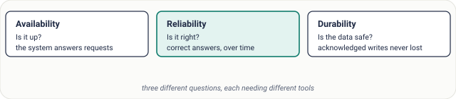
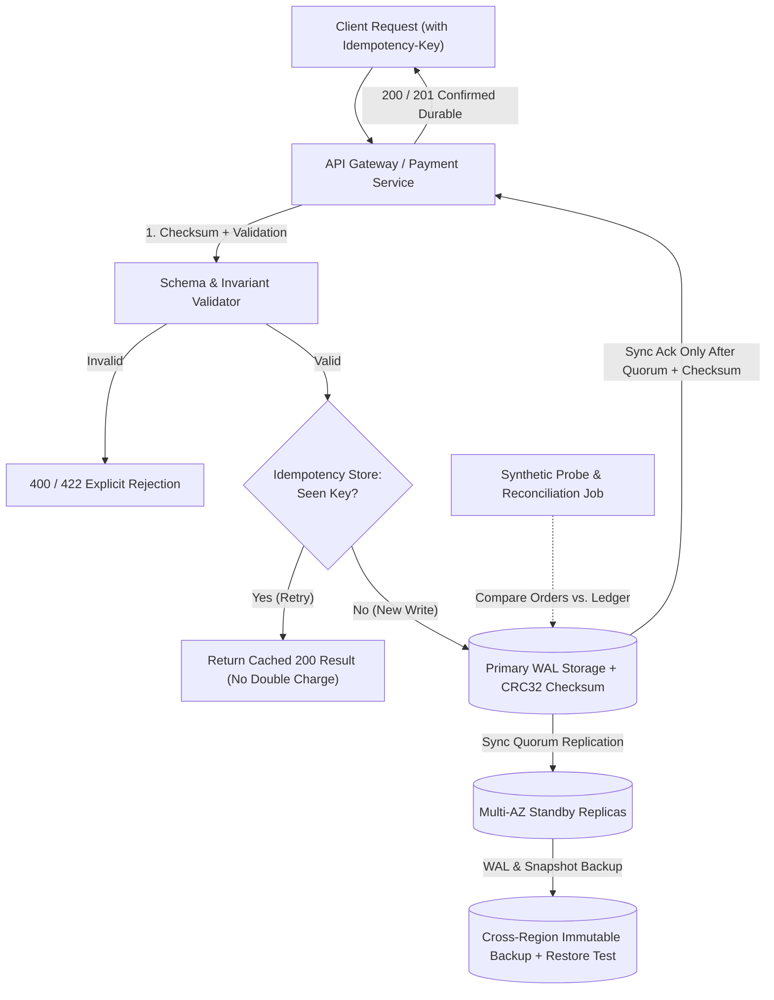
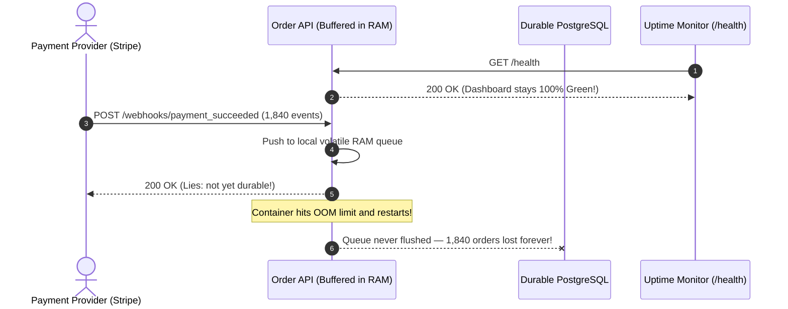

# Lesson 11: Reliability, Availability and Durability

> **Prerequisites:** [Lesson 10: Availability](../10-availability/README.md).  
> **Estimated Reading Time:** 25 minutes  
> **Target Audience:** Software engineers and architects distinguishing uptime metrics from correctness guarantees and zero-data-loss storage engineering.

> [!TIP]
> **The Golden Rule of Operational Guarantees:** Availability measures whether a service **responds** right now; reliability measures whether those responses stay **correct over time**; durability measures whether **acknowledged data survives hardware and site loss**. Never equate a `99.99%` HTTP `200 OK` dashboard with a reliable or durable system—an application can return `200 OK` in `2ms` while corrupting balances or silently dropping every write.

---

## Visual Mental Models & Architecture

### The Venn & Containment Relationship of Availability, Reliability, and Durability

A system cannot be reliable if it is unreachable, so reliability strictly presupposes availability—plus correctness, data integrity, and deterministic side-effect handling.



*Figure 1. A reliable system must also be available, but an available system is not automatically reliable.*

### Why All-Green Uptime Dashboards Hide Silent Failures


*Figure 2. Uptime monitoring can be all green while users get wrong answers.*

### End-to-End Correctness & Durability Architecture



---

## Systematic Taxonomic Reference Grids

### Comparing the Three Properties

| Property | Core Engineering Question | Primary Failure Modes | Real-World Benchmark (Amazon S3 Example) | Core Engineering Mechanisms |
| :--- | :--- | :--- | :--- | :--- |
| **Availability** | Can a client reach the system and get a non-error response *right now*? | Process crash, single point of failure, exhausted connection pool, DNS/LB outage. | **99.99%** ("four nines"): ~52.6 minutes of unreachability per year allowed. | Redundancy, health checks, fast failover, multi-AZ routing, removing SPOFs. |
| **Reliability** | Does the system behave **correctly and accurately over time** (mean time between faults)? | Stale broken caches, wrong pricing config, duplicate retry charges, HTTP `200` hiding errors, dropped queue messages. | Zero silent ledger drift; end-to-end invariant reconciliation passes every cycle. | Automated tests, strict input validation, idempotency keys, canary rollouts, correctness alerts. |
| **Durability** | Once a write is **acknowledged**, does that exact byte sequence survive forever? | Bit rot, un-flushed OS page cache lost on power loss, un-tested backups, single-disk failure, bad replication overwriting deletions. | **99.999999999%** ("eleven nines"): store 10,000,000 objects and expect to lose ~1 object every 10,000 years. | Synchronous multi-AZ replication (`fsync` + WAL), end-to-end checksums, immutable PITR backups, automated restore drills. |

### Key Terms Reference

| Term | Operational Meaning |
| :--- | :--- |
| **Availability** | The system answers requests within timeout bounds when called. |
| **Reliability** | The answers and side effects produced over time remain functionally correct. |
| **Durability** | Acknowledged state survives disk crashes, rack failures, and silent bit corruption. |
| **MTBF (Mean Time Between Failures)** | Average elapsed time between correctness or functional failures (not merely process restarts). |
| **Idempotency Key** | Client-generated unique token ensuring retried mutations execute at most once against state. |
| **Checksum** | Cryptographic or CRC digest persisted beside data to catch silent hardware corruption on read/write. |
| **Restore Test** | Regularly executing automated backup restoration into an isolated database to prove backups actually recover cleanly. |

---

## Production War Stories: Incident Post-Mortem

### SEV-1 Post-Mortem: The "100% Uptime" Silent Pricing & Dropped-Webhook Outage

#### Incident Overview
* **Severity:** SEV-1 (Silent Financial Mispricing & Lost Fulfillment Events)
* **Detection Time:** 6 hours 20 minutes post-deploy (discovered by Finance reconciliation, not engineering alerts)
* **Resolution Time:** 2 hours 10 minutes
* **Impact:** `100.00%` HTTP availability reported on Statuspage while `14,200` checkouts applied an obsolete `$0.00` shipping-waiver cache entry and `1,840` payment webhooks vanished without alerting because the ingestion endpoint buffered into RAM and returned `200 OK` before persistence.

#### What Happened
A fast-growing marketplace separated its checkout microservice from its warehouse webhook consumer.
1. During a Tuesday release, a configuration migration defaulted an environment variable (`DISCOUNT_CACHE_KEY_PREFIX`) to an empty string and updated the webhook handler to reply `200 OK` immediately after appending payloads to a local in-memory `asyncio.Queue` before flushing to PostgreSQL.
2. External uptime monitors probing `GET /health` and synthetic `200 OK` dashboards stayed completely green.
3. Under evening peak traffic, the webhook worker OOM-restarted twice, wiping 1,840 in-flight paid orders from memory—while callers (Stripe) believed those webhooks succeeded (`200 OK`).
4. Simultaneously, a stale catalog cache key caused invalid promo lookups to fall back silently instead of raising a hard error.



#### Root Cause Analysis
1. **Ack-Before-Durability Anti-Pattern:** The API returned `200 OK` before writing to persistent replicated storage (violating durability).
2. **Uptime Blindness:** Alerting monitored only HTTP status codes and CPU, completely missing business-invariant reconciliation (`paid_webhooks_received == orders_marked_paid`).
3. **Silent Degradation Instead of Explicit Error:** Missing promo records silently evaluated to `0` instead of failing closed or firing a correctness alert.

#### The Fix & Architectural Hardening
1. **Persist Before Acknowledge:** Webhook handlers write the raw event payload + SHA-256 payload checksum into a transactional `inbox_events` table (with `UNIQUE(event_id)` for idempotency) **before** sending `200 OK`.
2. **Continuous Correctness Reconciliation:** Deployed a 5-minute reconciliation job comparing payment-gateway settlement totals against persisted order rows, paging on any discrepancy `> 0`.
3. **Weekly Automated Backup Restore Drills:** Added an automated Kubernetes CronJob restoring the latest snapshot and verifying table checksums and row counts.

---

## Multi-Language Production Implementation: Idempotent Checksum-Verified Storage & Synthetic Correctness Probe

The following production-grade implementations demonstrate how to uphold **Reliability** (strict validation + idempotency preventing double execution) and **Durability** (persisting SHA-256 integrity checksums alongside transactional state and running an automated correctness reconciliation check).

````carousel
```go
package reliability

import (
	"context"
	"crypto/sha256"
	"database/sql"
	"encoding/hex"
	"errors"
	"fmt"
)

type OrderRecord struct {
	OrderID     string
	AmountCents int64
	PayloadJSON string
	Checksum    string
}

var ErrChecksumCorrupted = errors.New("durability violation: payload checksum mismatch")

func computeChecksum(orderID string, amountCents int64, payload string) string {
	raw := fmt.Sprintf("%s:%d:%s", orderID, amountCents, payload)
	sum := sha256.Sum256([]byte(raw))
	return hex.EncodeToString(sum[:])
}

// RecordDurableOrder guarantees Reliability (idempotency via UNIQUE key)
// and Durability (SHA-256 checksum persisted inside committed SQL transaction).
func RecordDurableOrder(ctx context.Context, db *sql.DB, idemKey string, order OrderRecord) (bool, error) {
	if order.AmountCents <= 0 {
		return false, errors.New("reliability violation: amount must be positive")
	}
	checksum := computeChecksum(order.OrderID, order.AmountCents, order.PayloadJSON)

	tx, err := db.BeginTx(ctx, &sql.TxOptions{Isolation: sql.LevelSerializable})
	if err != nil {
		return false, err
	}
	defer tx.Rollback()

	// Insert-or-skip ensures retries never create duplicate ledger charges
	res, err := tx.ExecContext(ctx, `
		INSERT INTO durable_orders (idempotency_key, order_id, amount_cents, payload_json, sha256_checksum)
		VALUES ($1, $2, $3, $4, $5)
		ON CONFLICT (idempotency_key) DO NOTHING
	`, idemKey, order.OrderID, order.AmountCents, order.PayloadJSON, checksum)
	if err != nil {
		return false, err
	}
	rows, _ := res.RowsAffected()
	if err := tx.Commit(); err != nil {
		return false, err
	}
	return rows == 1, nil // false means safe idempotent replay
}

// VerifyStoredIntegrity proves stored bytes have not silently rotted over time.
func VerifyStoredIntegrity(ctx context.Context, db *sql.DB, orderID string) error {
	var rec OrderRecord
	err := db.QueryRowContext(ctx, `
		SELECT order_id, amount_cents, payload_json, sha256_checksum
		FROM durable_orders WHERE order_id = $1
	`, orderID).Scan(&rec.OrderID, &rec.AmountCents, &rec.PayloadJSON, &rec.Checksum)
	if err != nil {
		return err
	}
	if computeChecksum(rec.OrderID, rec.AmountCents, rec.PayloadJSON) != rec.Checksum {
		return ErrChecksumCorrupted
	}
	return nil
}
```
<!-- slide -->
```typescript
import crypto from "node:crypto";
import { Pool } from "pg";

export interface OrderInput {
  idempotencyKey: string;
  orderId: string;
  amountCents: number;
  payloadJson: string;
}

function digestOrder(orderId: string, amountCents: number, payloadJson: string): string {
  return crypto
    .createHash("sha256")
    .update(`${orderId}:${amountCents}:${payloadJson}`)
    .digest("hex");
}

export class DurableOrderStore {
  constructor(private readonly pool: Pool) {}

  async commitOrder(input: OrderInput): Promise<{ created: boolean; checksum: string }> {
    if (!Number.isInteger(input.amountCents) || input.amountCents <= 0) {
      throw new Error("Reliability guard: invalid non-positive amount");
    }

    const checksum = digestOrder(input.orderId, input.amountCents, input.payloadJson);
    const client = await this.pool.connect();

    try {
      await client.query("BEGIN");
      const res = await client.query(
        `INSERT INTO durable_orders (idempotency_key, order_id, amount_cents, payload_json, sha256_checksum)
         VALUES ($1, $2, $3, $4, $5)
         ON CONFLICT (idempotency_key) DO NOTHING`,
        [input.idempotencyKey, input.orderId, input.amountCents, input.payloadJson, checksum]
      );
      await client.query("COMMIT");
      return { created: (res.rowCount ?? 0) === 1, checksum };
    } catch (err) {
      await client.query("ROLLBACK");
      throw err;
    } finally {
      client.release();
    }
  }

  async verifyOrderIntegrity(orderId: string): Promise<boolean> {
    const { rows } = await this.pool.query(
      `SELECT order_id, amount_cents, payload_json, sha256_checksum
       FROM durable_orders WHERE order_id = $1`,
      [orderId]
    );
    if (rows.length === 0) throw new Error(`Order ${orderId} missing — durability loss alert`);
    const row = rows[0];
    const expected = digestOrder(row.order_id, Number(row.amount_cents), row.payload_json);
    if (expected !== row.sha256_checksum) {
      throw new Error(`Checksum mismatch on ${orderId}: stored data corrupted`);
    }
    return true;
  }
}
```
<!-- slide -->
```python
import hashlib
import sqlite3
from dataclasses import dataclass


@dataclass(frozen=True)
class DurableOrder:
    order_id: str
    amount_cents: int
    payload_json: str


def compute_sha256(order_id: str, amount_cents: int, payload_json: str) -> str:
    raw = f"{order_id}:{amount_cents}:{payload_json}".encode("utf-8")
    return hashlib.sha256(raw).hexdigest()


class OrderReliabilityEngine:
    def __init__(self, db_path: str) -> None:
        # synchronous=FULL + WAL guarantees acknowledged writes are fsynced to disk
        self.conn = sqlite3.connect(db_path)
        self.conn.execute("PRAGMA journal_mode=WAL;")
        self.conn.execute("PRAGMA synchronous=FULL;")
        self.conn.execute(
            """
            CREATE TABLE IF NOT EXISTS durable_orders (
                idempotency_key TEXT PRIMARY KEY,
                order_id TEXT UNIQUE NOT NULL,
                amount_cents INTEGER NOT NULL CHECK (amount_cents > 0),
                payload_json TEXT NOT NULL,
                sha256_checksum TEXT NOT NULL
            )
            """
        )
        self.conn.commit()

    def write_order(self, idem_key: str, order: DurableOrder) -> str:
        if order.amount_cents <= 0:
            raise ValueError("Reliability guard: amount_cents must be positive")
        checksum = compute_sha256(order.order_id, order.amount_cents, order.payload_json)
        with self.conn:
            cur = self.conn.execute(
                """
                INSERT OR IGNORE INTO durable_orders
                (idempotency_key, order_id, amount_cents, payload_json, sha256_checksum)
                VALUES (?, ?, ?, ?, ?)
                """,
                (idem_key, order.order_id, order.amount_cents, order.payload_json, checksum),
            )
        return "created_and_synced" if cur.rowcount == 1 else "idempotent_replay"

    def reconcile_checksums(self) -> int:
        rows = self.conn.execute(
            "SELECT order_id, amount_cents, payload_json, sha256_checksum FROM durable_orders"
        ).fetchall()
        for oid, amt, payload, stored_sum in rows:
            if compute_sha256(oid, amt, payload) != stored_sum:
                raise RuntimeError(f"Durability corruption detected for {oid}")
        return len(rows)
```
<!-- slide -->
```csharp
using System.Security.Cryptography;
using System.Text;
using Npgsql;

public sealed record OrderPayload(string IdempotencyKey, string OrderId, long AmountCents, string PayloadJson);

public static class DurableOrderRepository
{
    public static string ComputeChecksum(string orderId, long amountCents, string payloadJson)
    {
        var raw = Encoding.UTF8.GetBytes($"{orderId}:{amountCents}:{payloadJson}");
        return Convert.ToHexString(SHA256.HashData(raw)).ToLowerInvariant();
    }

    public static async Task<bool> PersistIdempotentOrderAsync(NpgsqlDataSource db, OrderPayload order)
    {
        if (order.AmountCents <= 0)
            throw new ArgumentOutOfRangeException(nameof(order.AmountCents), "Amount must be positive.");

        var checksum = ComputeChecksum(order.OrderId, order.AmountCents, order.PayloadJson);
        await using var conn = await db.OpenConnectionAsync();
        await using var tx = await conn.BeginTransactionAsync();

        await using var cmd = new NpgsqlCommand("""
            INSERT INTO durable_orders (idempotency_key, order_id, amount_cents, payload_json, sha256_checksum)
            VALUES (@k, @id, @amt, @json, @sum)
            ON CONFLICT (idempotency_key) DO NOTHING;
            """, conn, tx);

        cmd.Parameters.AddWithValue("k", order.IdempotencyKey);
        cmd.Parameters.AddWithValue("id", order.OrderId);
        cmd.Parameters.AddWithValue("amt", order.AmountCents);
        cmd.Parameters.AddWithValue("json", order.PayloadJson);
        cmd.Parameters.AddWithValue("sum", checksum);

        var inserted = await cmd.ExecuteNonQueryAsync() == 1;
        await tx.CommitAsync();
        return inserted;
    }

    public static async Task<bool> VerifyChecksumAsync(NpgsqlDataSource db, string orderId)
    {
        await using var cmd = db.CreateCommand(
            "SELECT order_id, amount_cents, payload_json, sha256_checksum FROM durable_orders WHERE order_id = @id");
        cmd.Parameters.AddWithValue("id", orderId);

        await using var reader = await cmd.ExecuteReaderAsync();
        if (!await reader.ReadAsync()) return false;

        var expected = ComputeChecksum(reader.GetString(0), reader.GetInt64(1), reader.GetString(2));
        return expected == reader.GetString(3);
    }
}
```
````

---

## Practical Hands-On Verification CLI Workflows

Run an empirical **Durability & Idempotency Test** locally using Python + SQLite with `PRAGMA synchronous=FULL` and a synthetic checksum verifier to simulate safe retries and detect silent storage corruption.

### Step 1: Execute Idempotent Durable Write & Retry Verification

```bash
python3 - <<'EOF'
import sqlite3, hashlib

conn = sqlite3.connect("/tmp/durability_lab.db")
conn.execute("PRAGMA journal_mode=WAL;")
conn.execute("PRAGMA synchronous=FULL;")
conn.execute("CREATE TABLE IF NOT EXISTS ledger (idem TEXT PRIMARY KEY, order_id TEXT, cents INT, sha TEXT);")

payload = "ord-901:4999"
sha = hashlib.sha256(payload.encode()).hexdigest()

for attempt in (1, 2):
    cur = conn.execute(
        "INSERT OR IGNORE INTO ledger VALUES (?, ?, ?, ?)",
        ("idem-xyz-901", "ord-901", 4999, sha),
    )
    conn.commit()
    print(f"attempt={attempt} rows_inserted={cur.rowcount}")

row = conn.execute("SELECT order_id, cents, sha FROM ledger WHERE order_id='ord-901'").fetchone()
valid = hashlib.sha256(f"{row[0]}:{row[1]}".encode()).hexdigest() == row[2]
print(f"stored={row} checksum_valid={valid}")
EOF
```

**Expected Output:**
```text
attempt=1 rows_inserted=1
attempt=2 rows_inserted=0
stored=('ord-901', 4999, '...') checksum_valid=True
```

### Step 2: Simulate Silent Storage Corruption & Verify Detection

```bash
python3 - <<'EOF'
import sqlite3, hashlib

conn = sqlite3.connect("/tmp/durability_lab.db")
conn.execute("UPDATE ledger SET cents = 1 WHERE order_id='ord-901';") # simulate silent bit/bug corruption
conn.commit()

row = conn.execute("SELECT order_id, cents, sha FROM ledger WHERE order_id='ord-901'").fetchone()
valid = hashlib.sha256(f"{row[0]}:{row[1]}".encode()).hexdigest() == row[2]
print(f"corrupted_row={row} checksum_valid={valid}")
EOF
```

**Expected Output:**
```text
corrupted_row=('ord-901', 1, '...') checksum_valid=False
```

Even when the database process is 100% available (`200 OK`), checksum reconciliation catches silent corruption before downstream accounting trusts it.

---

## Operational Validation Checkpoints (Scenario Quizzes)

<details>
<summary><strong>Checkpoint 1: Availability vs. Reliability in an E-Commerce Store</strong></summary>

**Scenario:** A retailer's storefront maintains `99.995%` HTTP uptime over Black Friday weekend (`0.005%` 5xx rate), yet customer support logs 900 tickets complaining that orders were billed twice or showed wrong item prices after page reload. Which property held, which failed, and what fixes the root cause?

<strong>Answer:</strong>
**Availability** held (`99.995%`), while **Reliability** (correctness over time) failed:
1. **Double billing** occurs because payment endpoints lacked **idempotency keys**, causing client or proxy retries after transient timeouts to re-execute the charge.
2. **Price drift** occurs when cache keys do not include schema/version stamps or checkout reads from a stale cache rather than the authoritative primary DB.
</details>

<details>
<summary><strong>Checkpoint 2: The Asynchronous Replication Durability Illusion</strong></summary>

**Scenario:** A team sets up a PostgreSQL database with 3 asynchronous read replicas across 3 Availability Zones and boasts: *"We have 4 copies of every row, so we cannot lose an acknowledged customer payment!"* A power failure destroys the primary AZ right after returning `201 Created` to 40 checkout requests. Why are some of those acknowledged payments permanently gone?

<strong>Answer:</strong>
Because **asynchronous replication** returns `201 Created` to the client as soon as the primary flushes locally—before the WAL stream reaches any standby replica. If the primary AZ hardware dies in that millisecond gap and a replica is promoted, those 40 committed transactions do not exist on the new primary. True zero-loss **durability** across AZ failures requires synchronous quorum replication (waiting for at least one standby AZ to persist the write to durable storage before acknowledging `COMMIT`).
</details>

<details>
<summary><strong>Checkpoint 3: Replication vs. Logical Mistake Recovery</strong></summary>

**Scenario:** A primary database synchronously replicates every byte across 3 regions with CRC checksums enabled. An engineer accidentally runs `DELETE FROM invoices;` without a `WHERE` clause during maintenance. Why does synchronous multi-region replication fail to save the data, and what mechanism actually provides recovery?

<strong>Answer:</strong>
Synchronous replication protects against **physical disk, rack, or AZ destruction**, not **logical human or software bugs**: it faithfully replicates `DELETE FROM invoices;` across every replica within milliseconds! To protect durability against bad writes and accidental deletions, you need **isolated point-in-time recovery (PITR) backups** stored offline/immutable, verified via automated **restore tests** on a regular cadence.
</details>

---

## Interview Practice Questions

Each question is tagged by kind: **Basic** (definitions), **Scenario** (apply it to a system), and **Tricky** (deep follow-ups). Answer out loud before opening the solution.

<details>
<summary><strong>1. Can a system be highly available but unreliable? (Basic)</strong></summary>

<strong>What a strong answer covers:</strong>
Yes. It can stay up and respond fast (`200 OK`) while serving stale data, double-charging retries, returning wrong prices, silently dropping writes, or hiding errors inside `200` JSON payloads.
</details>

<details>
<summary><strong>2. What is durability? (Basic)</strong></summary>

<strong>What a strong answer covers:</strong>
The guarantee that once a write is acknowledged to a caller, that data is never lost—achieved with `fsync`/WAL, multi-zone replication before acknowledgement, checksums to detect corruption, and restore-tested backups.
</details>

<details>
<summary><strong>3. How is durability different from availability? (Basic)</strong></summary>

<strong>What a strong answer covers:</strong>
Availability asks *"can I reach the service right now?"* Durability asks *"does my acknowledged data still exist?"* For example, Amazon S3 Standard targets `99.99%` availability (4 nines) alongside `99.999999999%` durability (11 nines): files may briefly be unreachable during a transient outage, yet remain intact.
</details>

<details>
<summary><strong>4. How would you detect that an e-commerce site is up (`200 OK`) but returning wrong answers? (Scenario)</strong></summary>

<strong>What a strong answer covers:</strong>
Reconcile orders against payment-gateway settlements and inventory reservations, run end-to-end synthetic canary purchases, alert on sharp drops in business conversion metrics (orders/min), and parse application-level error codes embedded inside `200` responses.
</details>

<details>
<summary><strong>5. Design storage so an acknowledged order is never lost. (Scenario)</strong></summary>

<strong>What a strong answer covers:</strong>
Write synchronously to a database cluster using a multi-AZ WAL quorum (`synchronous_commit = on` / majority quorum) before returning HTTP `201`, store integrity checksums, take immutable cross-region point-in-time backups, and automate periodic restore verification drills.
</details>

<details>
<summary><strong>6. A retry charged a customer twice. Which property failed, and how do you fix it? (Scenario)</strong></summary>

<strong>What a strong answer covers:</strong>
**Reliability** (correctness over time) failed. Enforce client-generated `Idempotency-Key` headers backed by a unique constraint inside the same database transaction as the payment/order ledger row so retries replay the first outcome safely.
</details>

<details>
<summary><strong>7. Do backups give durability? (Tricky)</strong></summary>

<strong>What a strong answer covers:</strong>
Only if they are recent (bounded RPO), stored in an isolated failure domain (separate region/account), uncorrupted, and **regularly restore-tested**. Untested backups routinely fail during real emergencies due to missing permissions, schema drift, or corrupted WAL chains.
</details>

<details>
<summary><strong>8. Is replication enough for durability? (Tricky)</strong></summary>

<strong>What a strong answer covers:</strong>
No. Replication protects against physical hardware or AZ loss, but instantly propagates logical corruption, bugs, and accidental `DELETE`/`DROP` commands to every replica. You need both replication **and** immutable point-in-time backups with tested restores.
</details>

---

## Common Mistakes & Troubleshooting

- **Confusing 99.99% uptime with reliability:** Always monitor correctness invariants (reconciliation, error payloads, synthetic user journeys), not just HTTP status codes.
- **Holding untested backups:** An unverified backup is Schrodinger's recovery plan—schedule automated restore tests into ephemeral databases.
- **Returning `200/201` before durable `fsync`/replication:** Never buffer writes in volatile RAM queues ahead of client acknowledgement.
- **Assuming replication prevents human error:** Protect against accidental deletions using immutable snapshots and PITR.

---

## Further Reading & Sources

- [Amazon S3 Storage Classes & Durability Design](https://docs.aws.amazon.com/AmazonS3/latest/userguide/storage-class-intro.html) — Official architecture behind 11 nines (`99.999999999%`) durability vs. 4 nines (`99.99%`) availability.
- [Designing Data-Intensive Applications](https://dataintensive.net/) — Foundational coverage of reliability vs. fault tolerance, WAL durability, and replication guarantees.

---

## Free PDF notes

Download these notes as a printable PDF, with every diagram: [SD-A-011.pdf](https://backendroadmap.com/notes/system-design/SD-A-011.pdf). All Phase 1 notes in one file: [Phase 1, Core Fundamentals (PDF)](https://backendroadmap.com/notes/system-design/Phase1_Core_Fundamentals_Notes.pdf).

---

## Next

Continue with [Lesson 12: Scalability](../12-scalability/README.md) to learn how to select the true cost-driving load parameters, mitigate celebrity fan-out spikes, and break Amdahl's Law bottlenecks.
