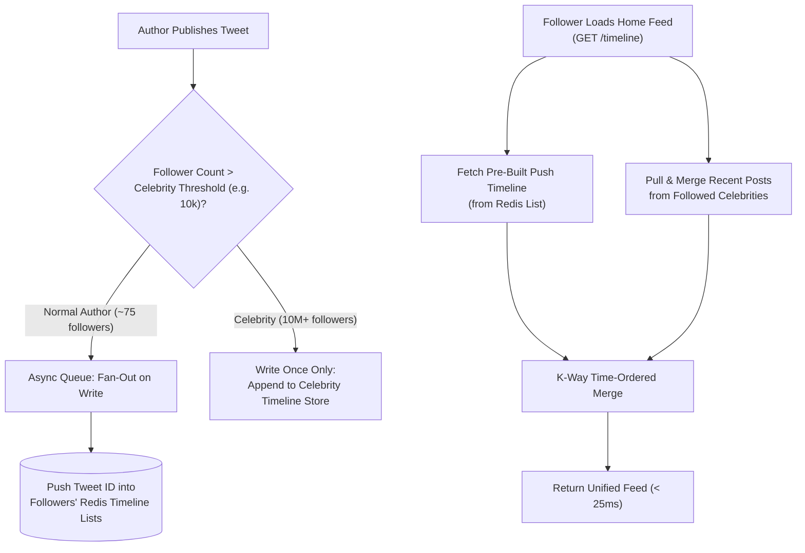
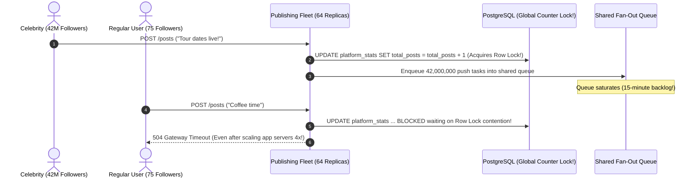

# Lesson 12: Scalability

> **Prerequisites:** [Lesson 11: Reliability, Availability and Durability](../11-reliability-availability-and-durability/README.md).  
> **Estimated Reading Time:** 25 minutes  
> **Target Audience:** Backend engineers and architects sizing distributed systems around true load parameters, fan-out amplification, and Amdahl's Law concurrency bounds.  
> **Free PDF Notes:** [Download SD-A-012.pdf](https://backendroadmap.com/notes/system-design/SD-A-012.pdf) · [Phase 1, Core Fundamentals (PDF)](https://backendroadmap.com/notes/system-design/Phase1_Core_Fundamentals_Notes.pdf)

> [!TIP]
> **The Golden Rule of Scalability:** Scalability is not an adjective ("make it scalable"); it is the **marginal slope** linking added hardware to increased capacity. Always identify the true cost-driving **load parameter** first (often **fan-out amplification**, data volume, or concurrent sockets rather than raw RPS), and ruthlessly eliminate the **serial fraction $s$**—because by Amdahl's Law, if $5\%$ of work stays serialized on a global lock or single primary database, adding 1,000 servers can never exceed a $20\times$ speedup.

---

## Visual Mental Models & Architecture

### Fan-Out Amplification: Twitter Timeline Case Study

When Twitter (~2012) processed ~4,600 new tweets/sec alongside ~300,000 timeline reads/sec, computing feeds on the fly per read was far too costly. Pre-materializing timelines on write worked brilliantly for normal users (~75 followers avg)—until celebrities with tens of millions of followers blew up write queues.


*Figure 1. Fan-out on write: expensive writes, cheap reads. The real load parameter is followers per tweet.*

### Amdahl's Law: Why Scaling Bends Sublinearly


*Figure 2. With 5% serial work, speedup can never exceed 20×; 100 machines give only about 17×.*

### Hybrid Fan-Out Architecture (Push Normal Users, Pull Celebrities)



---

## Systematic Taxonomic Reference Grids

### Selecting the True Load Parameter

| System Archetype | Wrong Naive Metric | True Cost-Driving Load Parameter | Realistic Scale Example | Dominant Bottleneck When Growth Spikes |
| :--- | :--- | :--- | :--- | :--- |
| **Public REST API** | Disk space | **Peak Requests Per Second (RPS)** | `20,000 RPS` burst | CPU serialization, TLS termination, worker threads. |
| **Product Catalog / Storefront** | Total HTTP requests | **Read / Write Ratio** | `100 reads` per `1 write` | Primary DB lock contention if reads aren't offloaded to caches/replicas. |
| **Analytics / Log Store** | Request count | **Data Volume & Growth Rate** | `5 TB` growing `1 TB / year` | Sequential scan I/O, index bloat exceeding RAM working set, compaction stalls. |
| **Social Feed / Notification System** | Tweets created/sec | **Fan-Out Factor (Recipients per Event)** | `4.6k writes/sec` vs. `300k reads/sec` (up to `30M` followers/post) | Queue backlog spikes, tail latency on write amplification. |
| **Real-Time Chat / Multiplayer** | Page views | **Concurrent Persistent Connections** | `1,000,000` open WebSockets | File descriptors (`ulimit`), kernel socket memory buffers, presence fan-out. |

### Amdahl's Law Scaling Ceiling Reference

By **Amdahl's Law**, given serial fraction $s \in (0, 1]$ and $N$ parallel workers/nodes:

$$\text{speedup}(N) = \frac{1}{s + \frac{1 - s}{N}}, \qquad \lim_{N \to \infty} \text{speedup}(N) = \frac{1}{s}$$

| Serial Work Fraction ($s$) | Max Speedup at $N = 10$ Nodes | Max Speedup at $N = 100$ Nodes | Theoretical Ceiling ($N \to \infty$) | Common Production Culprit |
| :---: | :---: | :---: | :---: | :--- |
| **$s = 10\%$ ($0.10$)** | $5.26\times$ | $9.17\times$ | **$10\times$** | Global mutex lock, single auto-increment ID table, un-sharded Python GIL. |
| **$s = 5\%$ ($0.05$)** | $6.90\times$ | **$16.81\times$ (~$17\times$)** | **$20\times$** | Single-primary transactional writes mixed inside read-heavy workflows. |
| **$s = 1\%$ ($0.01$)** | $9.17\times$ | $50.25\times$ | **$100\times$** | Distributed cluster membership heartbeats / coarse leader barriers. |
| **$s = 0.1\%$ ($0.001$)** | $9.91\times$ | $90.99\times$ | **$1,000\times$** | Shared-nothing key-partitioned stateless microservices. |

### Key Terms Reference

| Term | Operational Meaning |
| :--- | :--- |
| **Scalability** | Ability to handle proportional increases in load by adding proportional compute/storage resources. |
| **Load Parameter** | The specific workload dimension (RPS, fan-out, data size, connections) that dominates hardware cost. |
| **Fan-Out** | Number of downstream writes or deliveries triggered by a single upstream user event. |
| **Sublinear Scaling** | Diminishing returns per added machine caused by coordination, contention, and serial work. |
| **Amdahl's Law** | Quantitative limit proving that the non-parallelizable fraction $s$ strictly caps overall system speedup at $1/s$. |
| **Contention** | Multiple threads or machines stalling while competing for the same lock, row, counter, or network interface. |

---

## Production War Stories: Incident Post-Mortem

### SEV-1 Post-Mortem: The Celebrity Fan-Out Stampede & Global Counter Lockout

#### Incident Overview
* **Severity:** SEV-1 (5-Minute Feed Freeze & Cascading Queue Starvation)
* **Detection Time:** 90 seconds after a celebrity live-stream announcement
* **Resolution Time:** 45 minutes
* **Impact:** `42,000,000` fan-out jobs dumped onto a single shared Redis worker pool inside 2 seconds; ordinary users experienced 18-second posting stalls while DB throughput collapsed due to a global `ROW_LOCK` on an analytics counter row.

#### What Happened
A social platform used a pure **Fan-Out on Write (Push)** model across every user tier and maintained a single global `platform_stats` PostgreSQL row incremented inside every post transaction (`UPDATE platform_stats SET total_posts = total_posts + 1 WHERE id = 1`).
1. A music star with `42,000,000` followers posted a concert announcement.
2. The publishing service enqueued `42M` individual timeline push messages into the same Redis/Celery worker tier serving normal users.
3. Simultaneously, auto-scaling doubled app containers from 16 to 64—yet overall write throughput **dropped** because all 64 containers serialized behind the exact same single PostgreSQL row lock on `platform_stats(id=1)` (creating massive contention!).



#### Root Cause Analysis
1. **Unbounded Fan-Out Load Parameter:** Treating a `42M`-follower account identically to a `75`-follower account multiplied 1 write into 42 million queue operations.
2. **High Serial Fraction ($s$) via Shared Global Lock:** Updating a single counter row inside the synchronous hot path introduced global lock contention—triggering **retrograde scaling** (more app nodes = worse lock queue depth).

#### The Fix & Architectural Hardening
1. **Hybrid Fan-Out Engine:** Authors with `< 10,000` followers remain Push (`Fan-Out on Write`); celebrity accounts (`>= 10,000` followers) skip push queues completely and merge dynamically at read time (**Fan-Out on Read**).
2. **Sharded Lock-Free Counters:** Replaced the single counter row with `64` striped counter buckets (`bucket_id = rand(0, 63)`), reducing lock contention by `64x` and reading the total asynchronously via `SUM(count)`.
3. **Priority Bulkhead Queues:** Isolated viral/high-volume bursts onto a lower-priority backfill queue so regular notifications stay `< 200ms`.

---

## Multi-Language Production Implementation: Hybrid Fan-Out Dispatcher & Sharded Counter

The code below demonstrates two production patterns for defeating Amdahl's Law: **(1)** splitting celebrity posts out of fan-out write amplification into read-time merge, and **(2)** striping hot global counters across shards so concurrent replicas scale nearly linearly without a single-row lock.

````carousel
```go
package scalability

import (
	"math/rand"
	"sort"
	"sync/atomic"
)

const CelebrityThreshold = 10_000

type Post struct {
	ID        string
	AuthorID  string
	Timestamp int64
}

// ShardedCounter shrinks serial lock contention by distributing increments across N buckets.
type ShardedCounter struct {
	shards []atomic.Int64
}

func NewShardedCounter(numShards int) *ShardedCounter {
	return &ShardedCounter{shards: make([]atomic.Int64, numShards)}
}

func (c *ShardedCounter) Increment() {
	bucket := rand.Intn(len(c.shards))
	c.shards[bucket].Add(1)
}

func (c *ShardedCounter) Total() int64 {
	var sum int64
	for i := range c.shards {
		sum += c.shards[i].Load()
	}
	return sum
}

// HybridTimelineEngine pushes normal posts to followers and defers celebrity posts to read-time merge.
type HybridTimelineEngine struct {
	pushTimelines map[string][]Post // followerID -> prebuilt feed
	celebPosts    map[string][]Post // celebID -> recent posts
}

func (e *HybridTimelineEngine) Publish(post Post, followers []string) string {
	if len(followers) >= CelebrityThreshold {
		e.celebPosts[post.AuthorID] = append(e.celebPosts[post.AuthorID], post)
		return "fanout_on_read_celeb_bypass"
	}
	for _, f := range followers {
		e.pushTimelines[f] = append(e.pushTimelines[f], post)
	}
	return "fanout_on_write_pushed"
}

func (e *HybridTimelineEngine) ReadHomeTimeline(userID string, followedCelebs []string, limit int) []Post {
	merged := append([]Post{}, e.pushTimelines[userID]...)
	for _, cid := range followedCelebs {
		merged = append(merged, e.celebPosts[cid]...)
	}
	sort.Slice(merged, func(i, j int) bool { return merged[i].Timestamp > merged[j].Timestamp })
	if len(merged) > limit {
		return merged[:limit]
	}
	return merged
}
```
<!-- slide -->
```typescript
export interface Post {
  id: string;
  authorId: string;
  timestampMs: number;
}

const CELEBRITY_FOLLOWER_THRESHOLD = 10_000;

export class ShardedCounter {
  private readonly buckets: Int64Array;

  constructor(shardCount = 64) {
    this.buckets = new Int64Array(shardCount);
  }

  increment(requestHash: number): void {
    const idx = Math.abs(requestHash) % this.buckets.length;
    this.buckets[idx] += 1n;
  }

  total(): bigint {
    return this.buckets.reduce((acc, val) => acc + val, 0n);
  }
}

export class HybridFeedService {
  private readonly pushFeeds = new Map<string, Post[]>();
  private readonly celebrityStores = new Map<string, Post[]>();

  publishPost(post: Post, followerIds: string[]): "push" | "celeb-pull" {
    if (followerIds.length >= CELEBRITY_FOLLOWER_THRESHOLD) {
      const store = this.celebrityStores.get(post.authorId) ?? [];
      store.push(post);
      this.celebrityStores.set(post.authorId, store);
      return "celeb-pull"; // Zero follower queue amplification!
    }

    for (const fid of followerIds) {
      const feed = this.pushFeeds.get(fid) ?? [];
      feed.push(post);
      this.pushFeeds.set(fid, feed);
    }
    return "push";
  }

  getFeed(userId: string, followedCelebrities: string[], limit = 20): Post[] {
    const combined: Post[] = [...(this.pushFeeds.get(userId) ?? [])];
    for (const celebId of followedCelebrities) {
      combined.push(...(this.celebrityStores.get(celebId) ?? []));
    }
    return combined.sort((a, b) => b.timestampMs - a.timestampMs).slice(0, limit);
  }
}
```
<!-- slide -->
```python
from collections import defaultdict
from dataclasses import dataclass
import random

CELEBRITY_THRESHOLD = 10_000


@dataclass(frozen=True)
class Post:
    post_id: str
    author_id: str
    timestamp_ms: int


def amdahls_speedup(serial_fraction: float, workers: int) -> float:
    """Calculates theoretical speedup given serial fraction s in [0, 1] and N workers."""
    return 1.0 / (serial_fraction + (1.0 - serial_fraction) / workers)


class ShardedCounter:
    """Eliminates single-row database lock contention by striping updates across N buckets."""

    def __init__(self, shards: int = 64) -> None:
        self._buckets = [0] * shards

    def increment(self) -> None:
        self._buckets[random.randrange(len(self._buckets))] += 1

    def total(self) -> int:
        return sum(self._buckets)


class HybridFeedRouter:
    def __init__(self) -> None:
        self.push_timelines: dict[str, list[Post]] = defaultdict(list)
        self.celeb_posts: dict[str, list[Post]] = defaultdict(list)

    def publish(self, post: Post, followers: list[str]) -> str:
        if len(followers) >= CELEBRITY_THRESHOLD:
            self.celeb_posts[post.author_id].append(post)
            return "hybrid_pull_deferred"
        for follower_id in followers:
            self.push_timelines[follower_id].append(post)
        return "pushed_to_followers"

    def read_timeline(self, user_id: str, followed_celebs: list[str], limit: int = 20) -> list[Post]:
        merged = list(self.push_timelines[user_id])
        for cid in followed_celebs:
            merged.extend(self.celeb_posts[cid])
        merged.sort(key=lambda p: p.timestamp_ms, reverse=True)
        return merged[:limit]
```
<!-- slide -->
```csharp
using System.Collections.Concurrent;

public sealed record FeedPost(string Id, string AuthorId, long TimestampMs);

public sealed class ShardedCounter
{
    private readonly long[] _shards;

    public ShardedCounter(int shardCount = 64) => _shards = new long[shardCount];

    public void Increment()
    {
        var bucket = Random.Shared.Next(_shards.Length);
        Interlocked.Increment(ref _shards[bucket]);
    }

    public long Total()
    {
        long sum = 0;
        for (int i = 0; i < _shards.Length; i++)
            sum += Interlocked.Read(ref _shards[i]);
        return sum;
    }
}

public sealed class HybridTimelineService
{
    private const int CelebrityThreshold = 10_000;
    private readonly ConcurrentDictionary<string, List<FeedPost>> _pushTimelines = new();
    private readonly ConcurrentDictionary<string, List<FeedPost>> _celebTimelines = new();

    public string Publish(FeedPost post, IReadOnlyCollection<string> followerIds)
    {
        if (followerIds.Count >= CelebrityThreshold)
        {
            var list = _celebTimelines.GetOrAdd(post.AuthorId, _ => new());
            lock (list) list.Add(post);
            return "celeb-pull";
        }

        foreach (var followerId in followerIds)
        {
            var list = _pushTimelines.GetOrAdd(followerId, _ => new());
            lock (list) list.Add(post);
        }
        return "push";
    }
}
```
````

---

## Practical Hands-On Verification CLI Workflows

Verify **Amdahl's Law scaling ceilings** and compare **pure-push vs. hybrid fan-out write amplification** empirically on your terminal.

### Step 1: Compute Amdahl's Law Speedup Curves for Varying Serial Fractions ($s$)

```bash
python3 - <<'EOF'
def speedup(s, n):
    return 1.0 / (s + (1.0 - s) / n)

print(f"{'Workers (N)':>12} | {'s=10% (Max 10x)':>16} | {'s=5% (Max 20x)':>16} | {'s=1% (Max 100x)':>16}")
print("-" * 68)
for n in (1, 4, 16, 64, 100, 1000):
    print(f"{n:>12} | {speedup(0.10, n):>15.2f}x | {speedup(0.05, n):>15.2f}x | {speedup(0.01, n):>15.2f}x")
EOF
```

**Expected Output:**
```text
 Workers (N) |  s=10% (Max 10x) |   s=5% (Max 20x) |  s=1% (Max 100x)
--------------------------------------------------------------------
           1 |            1.00x |            1.00x |            1.00x
           4 |            3.08x |            3.48x |            3.88x
          16 |            6.40x |            9.14x |           13.91x
          64 |            8.77x |           15.42x |           39.26x
         100 |            9.17x |           16.81x |           50.25x
        1000 |            9.91x |           19.63x |           90.99x
```

Notice that with $5\%$ serial work, moving from `100` to `1,000` machines ($10\times$ hardware cost!) buys less than $17\%$ extra throughput (`16.81x` $\to$ `19.63x`).

### Step 2: Benchmark Push vs. Hybrid Fan-Out Amplification

```bash
python3 - <<'EOF'
normal_posts = 4500 * 75          # 4,500 normal authors * 75 avg followers
celeb_pure_push = 1 * 30_000_000  # 1 celebrity tweet pushed to 30M followers
celeb_hybrid = 1 * 1              # hybrid stores 1 write; merges on active readers

print(f"Pure-push writes/sec (with 1 celeb tweet): {normal_posts + celeb_pure_push:,}")
print(f"Hybrid writes/sec    (with 1 celeb tweet): {normal_posts + celeb_hybrid:,}")
print(f"Write amplification avoided: {(normal_posts + celeb_pure_push) / (normal_posts + celeb_hybrid):.1f}x")
EOF
```

**Expected Output:**
```text
Pure-push writes/sec (with 1 celeb tweet): 30,337,500
Hybrid writes/sec    (with 1 celeb tweet): 337,501
Write amplification avoided: 89.9x
```

---

## Operational Validation Checkpoints (Scenario Quizzes)

<details>
<summary><strong>Checkpoint 1: Identifying the Hidden Serial Bottleneck Under Horizontal Scaling</strong></summary>

**Scenario:** An API server fleet handles `5,000 RPS` at $70\%$ CPU on 4 instances. Marketing prepares for a product launch expecting `20,000 RPS`, so Engineering scales the Kubernetes Deployment from 4 pods to 32 pods ($8\times$ compute). During the launch, max throughput stalls at `8,500 RPS`, pod CPU averages `18%`, and p99 latency jumps from `40ms` to `2,800ms`. Using Amdahl's Law and contention mechanics, diagnose why $8\times$ pods delivered only $1.7\times$ throughput.

<strong>Answer:</strong>
When scaling pods $8\times$ causes CPU per pod to *drop* while throughput stalls, the bottleneck is an un-sharded **serial component** external to (or contended by) the app pods:
1. A **single database primary row lock / global counter** or **exhausted DB connection pool (`max_connections`)** where every pod queues behind the same lock or pool wait list.
2. A **downstream rate-limited third-party API** called synchronously inside the request path.
By Amdahl's Law, the pods spend nearly $100\%$ of request time stalled in network wait/lock contention, turning extra replicas into additional lock waiters rather than parallel work.
</details>

<details>
<summary><strong>Checkpoint 2: Sizing a Notification Platform by Load Parameter</strong></summary>

**Scenario:** A developer claims their alerting system scales comfortably to `"1,000 events per second"` because each incoming HTTP `POST /events` takes `2ms` to validate and enqueue. Two weeks later, a tenant creates a wildcard rule matching `50,000` subscribed webhooks per event. One `POST /events` batch triggers a complete cluster collapse. What metric was ignored?

<strong>Answer:</strong>
They dimensioned strictly around **ingress events/sec (`1,000 RPS`)** instead of **Fan-Out Factor (`events/sec × subscribers/event`)**. At `50,000` webhooks per matching event, even `10` events/sec generates `500,000` outbound HTTP deliveries/sec (`500x` write amplification). Scalable notification architectures partition fan-out delivery workers by tenant bulkhead queues and bound maximum synchronous rule fan-out per batch.
</details>

<details>
<summary><strong>Checkpoint 3: Choosing Sharding Keys to Shrink the Serial Fraction ($s$)</strong></summary>

**Scenario:** A real-time leaderboard keeps a single serialized Redis Lua sorted-set (`ZINCRBY global:scores ...`) updated on every game action globally (`250,000 writes/sec`). Because Redis processes commands single-threadedly on one core per shard, CPU saturates at `100%` and p99 spikes. How do you refactor the system to drop $s \to 0$?

<strong>Answer:</strong>
Partition the data so workers rarely coordinate globally:
1. Shard the leaderboard by **region, game mode, or hash bucket** (`ZINCRBY scores:{bucket_0..31}`) across a Redis Cluster of 32 primaries, scaling write throughput $32\times$ horizontally.
2. If a global Top-100 view is required, compute it asynchronously via a scheduled periodic scatter-gather top-K merge every 5 seconds off the critical write path.
</details>

---

## Interview Practice Questions

Each question is tagged by kind: **Basic** (definitions), **Scenario** (apply it to a system), and **Tricky** (deep follow-ups). Answer out loud before opening the solution.

<details>
<summary><strong>1. How do you define load for a system? (Basic)</strong></summary>

<strong>What a strong answer covers:</strong>
Identify the specific **load parameters** driving compute, memory, network, or lock cost—such as requests per second, read/write ratio, dataset size/growth, fan-out per post, or concurrent open connections.
</details>

<details>
<summary><strong>2. What limits linear scaling? (Basic)</strong></summary>

<strong>What a strong answer covers:</strong>
Serial work, cross-node coordination overhead, lock/row contention, network serialization hops, and shared singletons. By Amdahl's Law, with serial fraction $s$, maximum possible speedup is bounded at $1/s$.
</details>

<details>
<summary><strong>3. If 90% of the work is parallel, what is the maximum speedup? (Basic)</strong></summary>

<strong>What a strong answer covers:</strong>
With $90\%$ parallel work, the serial fraction is $s = 0.10$, so theoretical speedup can never exceed $1 / 0.10 = 10\times$, regardless of how many thousands of machines you provision.
</details>

<details>
<summary><strong>4. Design a news feed for users who follow up to 5,000 accounts. Push or pull? (Scenario)</strong></summary>

<strong>What a strong answer covers:</strong>
Use **hybrid fan-out**: push (**fan-out on write**) into follower timelines for normal authors so feed reads stay $O(1)$ fast, skip pre-building for high-follower celebrity accounts, and **pull at read time** to merge recent celebrity posts cleanly on the fly.
</details>

<details>
<summary><strong>5. You doubled the servers and throughput rose only 15%. What do you check? (Scenario)</strong></summary>

<strong>What a strong answer covers:</strong>
Locate the shared serial bottleneck or resource everyone waits on: primary database CPU/locks, exhausted DB connection pool, a single-threaded Redis/broker hotspot, saturated NIC bandwidth, or a shared distributed lock. Profile tail waits before adding more compute.
</details>

<details>
<summary><strong>6. What load parameter matters most for a chat app? (Scenario)</strong></summary>

<strong>What a strong answer covers:</strong>
**Concurrent persistent connections** (WebSockets held open per gateway machine) and **group-chat fan-out** (messages delivered per group post, especially in large channels), much more than raw stateless HTTP RPS.
</details>

<details>
<summary><strong>7. Why did Twitter treat celebrities differently? (Tricky)</strong></summary>

<strong>What a strong answer covers:</strong>
Pushing a tweet from a celebrity with `30M` followers triggers `30M` asynchronous timeline cache writes from a single API call, flooding message queues and delaying feeds for everyone else. Reading and merging celebrity timelines dynamically at read time bounds write amplification to $O(1)$ per celebrity tweet.
</details>

<details>
<summary><strong>8. Is a system that handles 1 M RPS on 1,000 servers scalable? (Tricky)</strong></summary>

<strong>What a strong answer covers:</strong>
Not automatically. Absolute throughput is capacity; **scalability is the slope**—whether moving to `2 M RPS` cleanly works by going from `1,000` to `~2,000` servers at constant per-request cost, rather than hitting a central lock wall at `1.05 M RPS`.
</details>

---

## Common Mistakes & Troubleshooting

- **Saying "the system needs to scale" without picking a load parameter:** Always specify whether growth arrives via RPS, fan-out, data volume, or concurrent sockets.
- **Expecting $2\times$ throughput from $2\times$ servers:** Measure the serial fraction $s$ first using lock/wait profiling.
- **Putting global counters or audit sequence locks on hot paths:** Replace single counters with sharded/striped counters merged asynchronously.
- **Applying uniform push or uniform pull across extreme skew:** Recognize heavy-tail users (celebrities/mega-tenants) and route them onto a hybrid read-time path.

---

## Further Reading & Sources

- [Designing Data-Intensive Applications (Chapter 1: Reliable, Scalable, and Maintainable Applications)](https://dataintensive.net/) — Martin Kleppmann's canonical breakdown of Twitter's fan-out architecture and load parameters.
- [Amdahl's Law — Concurrency & Parallel Speedup Bounds](https://en.wikipedia.org/wiki/Amdahl%27s_law) — Derivation of serial bottlenecks and asymptotic scaling limits.

---

## Free PDF notes

Download these notes as a printable PDF, with every diagram: [SD-A-012.pdf](https://backendroadmap.com/notes/system-design/SD-A-012.pdf). All Phase 1 notes in one file: [Phase 1, Core Fundamentals (PDF)](https://backendroadmap.com/notes/system-design/Phase1_Core_Fundamentals_Notes.pdf).

---

## Next

Continue with [Lesson 13: CAP Theorem](../13-cap-theorem/README.md) to dissect what distributed storage systems actually choose when a network cable cuts a cluster in half.
