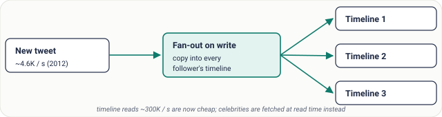
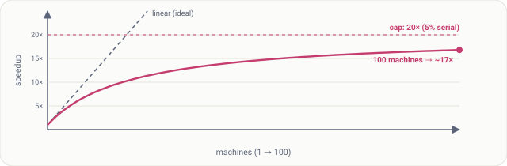

# Lesson 12: Scalability

## Roadmap

You are in **System Design Interview Prep**, Track 01, **Core Fundamentals**: lesson 12 of 19 (load parameters, fan-out and Amdahl's Law). It builds on [Lesson 11: Reliability, Availability and Durability](../11-reliability-availability-and-durability/README.md). Next comes [Lesson 13: CAP Theorem](../13-cap-theorem/README.md).

These are the written notes for the lesson's video. Prefer paper? The same notes are a free, printable PDF: [download SD-A-012.pdf](https://backendroadmap.com/notes/system-design/SD-A-012.pdf).

## Concept

> [!key] Scalability means handling more load by adding resources with proportional gains; it starts with picking the right load parameter, and it's limited by serial work and coordination.

## Explanation

### What scalability really means

A system scales if adding resources gives roughly proportional capacity: double the servers, roughly double the load handled. If doubling servers gives 10% more, it doesn't really scale, however many servers you can afford.

### First, define the load

“Load” depends on the system, and choosing the parameter that actually drives cost is the first step of any scaling discussion:

| Load parameter | Example |
|---|---|
| **Requests per second** | An API at 20,000 RPS peak |
| **Read/write ratio** | A catalogue at 100 reads per write |
| **Data size** | 5 TB growing 1 TB a year |
| **Fan-out** | One post delivered to N followers |
| **Concurrent connections** | 1 M open WebSockets for chat |

### The Twitter example

Around 2012 Twitter handled about 4.6 thousand new tweets per second but about 300 thousand timeline reads per second. Building each timeline at read time was too expensive, so Twitter **pre-built timelines on write**: each tweet is copied into every follower's timeline.

*Figure 1. Fan-out on write: expensive writes, cheap reads. The real load parameter is followers per tweet.*

The average user has about 75 followers, but a celebrity has tens of millions, and one tweet would trigger millions of writes. So celebrity tweets are **fetched at read time** and merged in. The lesson: find the parameter that actually hurts (here fan-out, not tweets per second) and design around it.

### Why scaling is rarely linear

Real systems scale **sublinearly**: the curve bends and flattens because of coordination between machines, shared locks and contention, network overhead, and work that can't run in parallel. Amdahl's Law puts a number on the last one:

speedup(N) = 1 / ( s + (1 − s) / N ) · s = serial fraction

*Figure 2. With 5% serial work, speedup can never exceed 20×; 100 machines give only about 17×.*

> [!model] **What to do about it.** Shrink the serial part: avoid global locks, partition data so machines don't coordinate, make work independent per user or per key, and move coordination off the hot path.

## Key terms

| Term | Meaning |
|---|---|
| **Scalability** | more resources → proportionally more capacity |
| **Load parameter** | the number that drives cost |
| **Fan-out** | work one action triggers |
| **Sublinear** | gains shrink as you add machines |
| **Amdahl's Law** | serial work caps speedup |
| **Contention** | work waiting on a shared resource |

## Interview questions

Each question is tagged by kind: **Basic** (definitions), **Scenario** (apply it to a system) and **Tricky** (the follow-ups interviewers use to go deeper). Answer out loud before you open the answer.

> [!interview] How do you define load for a system? (Basic)

What a strong answer covers

Pick the parameters that drive cost: requests per second, read/write ratio, data size, fan-out, concurrent connections. The right one depends on the system.

> [!interview] What limits linear scaling? (Basic)

What a strong answer covers

Serial work, coordination, contention and network overhead. Amdahl's Law: with a serial fraction s, speedup can't exceed 1/s.

> [!interview] If 90% of the work is parallel, what's the maximum speedup? (Basic)

What a strong answer covers

1 / 0.1 = 10×, no matter how many machines you add.

> [!interview] Design a news feed for users who follow up to 5,000 accounts. Push or pull? (Scenario)

What a strong answer covers

Push (fan-out on write) for normal accounts so reads are cheap; pull at read time for accounts with huge follower counts; merge both when building the feed.

> [!interview] You doubled the servers and throughput rose only 15%. What do you check? (Scenario)

What a strong answer covers

The shared bottleneck: the database, a global lock, a single-threaded component, a saturated network link, or a downstream rate limit. Profile and find what everyone waits on.

> [!interview] What load parameter matters most for a chat app? (Scenario)

What a strong answer covers

Concurrent connections and message fan-out to group members, more than raw requests per second.

> [!interview] Why did Twitter treat celebrities differently? (Tricky)

What a strong answer covers

Fan-out on write for 30 million followers means 30 million writes per tweet, creating huge delays. Fetching celebrity tweets at read time avoids that spike.

> [!interview] Is a system that handles 1 M RPS on 1,000 servers scalable? (Tricky)

What a strong answer covers

Not necessarily. Scalability is about the slope: whether adding servers keeps adding capacity proportionally, and at what cost per request.

## Common mistakes & troubleshooting

- Saying “scalable” without naming the load parameter.
- Designing for RPS when fan-out or data size is the real driver.
- Expecting linear speedup from more machines.
- One global counter or lock that every request touches.

## Free PDF notes

Download these notes as a printable PDF, with every diagram: [SD-A-012.pdf](https://backendroadmap.com/notes/system-design/SD-A-012.pdf). All Phase 1 notes in one file: [Phase 1, Core Fundamentals (PDF)](https://backendroadmap.com/notes/system-design/Phase1_Core_Fundamentals_Notes.pdf).

## Next

Continue with [Lesson 13: CAP Theorem](../13-cap-theorem/README.md).
