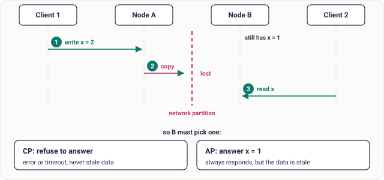
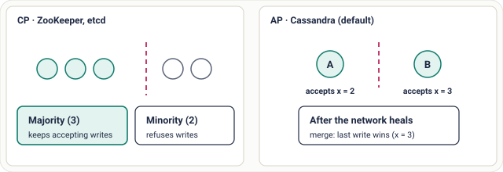

# Lesson 13: CAP Theorem

## Roadmap

You are in **System Design Interview Prep**, Track 01, **Core Fundamentals**: lesson 13 of 19 (what it really says, and what it doesn't). It builds on [Lesson 12: Scalability](../12-scalability/README.md). Next comes [Lesson 14: PACELC Theorem](../14-pacelc-theorem/README.md).

These are the written notes for the lesson's video. Prefer paper? The same notes are a free, printable PDF: [download SD-A-013.pdf](https://backendroadmap.com/notes/system-design/SD-A-013.pdf).

## Concept

> [!key] When the network splits, a distributed system must choose between answering with possibly stale data (availability) and refusing to answer (consistency). Partitions are not optional, so “CA” is not a real choice.

## Explanation

### Precise definitions

“Consistency, availability, partition tolerance: pick two” is catchy, and misleading. The theorem (Brewer's conjecture, proved by Gilbert and Lynch in 2002) uses each word in a narrow sense:

| Property | Meaning in CAP | Not to be confused with |
|---|---|---|
| **C · Consistency** | **Linearizability**: every read returns the latest completed write, as if there were one copy of the data. | The C in ACID (database constraints) |
| **A · Availability** | Every request to a non-failed node gets a non-error response, without a time limit or a “try again”. | “99.99% uptime” (an SLO) |
| **P · Partition tolerance** | The system keeps operating when the network drops or delays messages between nodes. | Surviving a crashed server |

### What happens during a partition

Take two replicas, A and B. The link between them breaks. Client 1 writes `x = 2` to A, which cannot tell B. Client 2 then reads `x` from B, which still has the old value 1.

*Figure 1. During a partition, node B cannot both stay consistent and keep answering. Whatever it does, it gives up one of the two.*

That is the whole theorem: **when a partition happens, you choose consistency or availability.** You cannot opt out of partitions, because real networks lose packets, switches fail and cloud zones disconnect. So for any system spread over a network, “CA” describes either a single machine or a system that pretends the network never breaks.

### What CAP does not say

- **It says nothing about normal operation.** With no partition, a system can be both consistent and available. CAP only describes the failure window.
- **It is not a permanent label.** The choice can differ per operation, per table or even per query. For each one, ask what is worse here: a stale answer or a refused request?
- **It ignores latency.** Even without failures, stronger consistency costs round trips between replicas. That everyday trade-off is what PACELC adds.

*Figure 2. Partitions are short, rare windows. CAP describes behaviour inside them; PACELC adds the latency vs consistency choice for the rest of the time.*

### CP and AP systems in practice

*Figure 3. Left: a 5-node CP cluster split 3 / 2; only the majority side accepts writes. Right: an AP store accepts writes on both sides and merges them when the network heals (here, by keeping the later write).*

|  | CP: choose consistency | AP: choose availability |
|---|---|---|
| **During a partition** | The minority side rejects or times out requests | Every reachable node keeps reading and writing |
| **How** | Majority quorum (Raft, ZAB): a write commits only on more than half the nodes | Local writes, then repair: hinted handoff, read repair, last-write-wins or CRDTs |
| **Examples** | ZooKeeper, etcd, Consul; Spanner (CP with very high availability) | Cassandra and DynamoDB in their default modes, DNS, CDNs |
| **Good for** | Leader election, locks, configuration, bank balances, inventory counts | Shopping carts, social feeds, likes, metrics, sessions |
| **Cost** | Errors or waiting during failures | Stale reads and write conflicts to resolve |

> [!example] **Tunable consistency (Cassandra).** With 3 replicas (N = 3), each query picks how many replicas must answer: `ONE`, `QUORUM` (2 of 3) or `ALL`. If the replicas written (W) plus the replicas read (R) is greater than N, every read overlaps the latest write: `W + R > N`, for example QUORUM writes and QUORUM reads (2 + 2 > 3). `ONE` / `ONE` is faster and more available, but can return stale data. So one database can behave CP-like for one query and AP-like for the next.

> [!model] **How to answer in an interview.** Don't stop at a letter. Describe behaviour: “For the shopping cart I'd stay available during a partition and merge carts afterwards, because a lost sale costs more than a duplicate item. For payments I'd reject writes on the minority side, because a double charge is worse than a short error.”

## Key terms

| Term | Meaning |
|---|---|
| **Linearizability** | reads see the latest write, as if one copy |
| **Partition** | nodes up but unable to talk |
| **Quorum** | a majority of replicas (more than half) |
| **CP** | refuse rather than be wrong |
| **AP** | answer rather than refuse |
| **W + R > N** | read and write sets overlap → consistent reads |

## Practice

### 1. CP or AP?

For each system, decide how it should behave during a partition and give one sentence why:

1. A bank's core ledger.
2. An online store's shopping cart that must always accept "add to cart".
3. An airline seat-reservation system that must never double-book a seat.
4. A social app's like counter.
5. The stock count for a flash sale that must never oversell.

Answer

1. CP: a wrong balance is worse than a short error.
2. AP: keep accepting adds on every side and merge the versions afterwards (the original Dynamo design).
3. CP: selling one seat twice is real damage; refuse instead.
4. AP: a count that is a few likes behind hurts nobody.
5. CP: the count has to be authoritative, even if some requests wait or fail during the partition.

### 2. Merge a partitioned cart

A cart is replicated across two regions with asynchronous replication. During a partition the same user adds a book on their phone (served by region 1) and a lamp on their laptop (served by region 2). When the network heals, both adds must survive. What merge rule gives that, and why is last-write-wins wrong here?

Answer

Treat the cart as a set and merge concurrent adds by **union**, so the cart ends with both items. A CRDT such as an observed-remove set does this and also handles removes correctly. Last-write-wins keeps only the version with the later timestamp, so one device's add silently disappears, and the user notices. Choosing AP means you must also choose a conflict-resolution rule, and the right rule depends on what the data means: union for a cart, last-write-wins for "user's current profile photo", manual review for things like two edits to the same contract.

### 3. Diagnose: "writes stopped during a network blip"

A team runs PostgreSQL with one primary and one **synchronous** standby (`synchronous_standby_names` is set, so a `COMMIT` returns only after the standby confirms it). During a short partition between the two, every write hung and users got timeouts, although the primary itself was healthy. The team wants it to "never hang again, and never lose a write". What CAP choice does this setup encode, and what are their real options?

Answer

Synchronous replication is a deliberate **CP** choice: the primary will not confirm a write the standby does not have, so when it cannot reach the standby it waits instead of letting the two diverge. The hang is the guarantee working, not a bug. During a partition they can keep consistency or availability, not both:

1. **Stay CP** and accept that writes pause while the standby is unreachable. Right when losing an acknowledged write is unacceptable.
2. **Lean AP**: make the standby asynchronous. Writes keep flowing during a partition, but the standby can fall behind, and failing over to it can lose the last writes it never received.

"Never hang and never lose a write during a partition" is exactly what CAP rules out.

To see it yourself, use any primary + streaming replica pair (the two-container setup in [Backend Track 04, Module 08](../../../backend/04-databases-and-data-layer/08-replication-and-sharding/README.md) is enough). On the primary run `ALTER SYSTEM SET synchronous_standby_names = '*'; SELECT pg_reload_conf();`, then `docker compose pause replica` and try an `UPDATE`: it hangs. `docker compose unpause replica` and it returns. If you cancel the hung statement instead, PostgreSQL warns that the transaction "has already committed locally, but might not have been replicated to the standby": synchronous replication blocks the acknowledgement, it cannot undo the local write. Undo the setting with `ALTER SYSTEM RESET synchronous_standby_names; SELECT pg_reload_conf();`.

## Interview questions

Each question is tagged by kind: **Basic** (definitions), **Scenario** (apply it to a system) and **Tricky** (the follow-ups interviewers use to go deeper). Answer out loud before you open the answer.

> [!interview] Explain the CAP theorem precisely. (Basic)

What a strong answer covers

During a network partition, a distributed system cannot provide both linearizable consistency and total availability: a node cut off from the latest write must either refuse the request or return possibly stale data.

> [!interview] Why is CA not a real option? (Basic)

What a strong answer covers

Partitions are not optional in a distributed system: networks fail. CA only describes a single node, or a system that assumes the network never breaks. The real choice is how to behave when a partition happens.

> [!interview] How is consistency in CAP different from the C in ACID? (Basic)

What a strong answer covers

CAP's C is linearizability: every read sees the latest write across replicas. ACID's C means a transaction keeps the database's rules (constraints, invariants) intact. A single-node database can be ACID-consistent with no replicas at all.

> [!interview] Which would you choose for a shopping cart, and for a payment ledger? (Scenario)

What a strong answer covers

Cart: AP. Keep accepting adds on both sides and merge afterwards; a duplicate item is cheap, a lost sale is not. Ledger: CP. Only the majority side commits; a short error is better than a double spend.

> [!interview] You're designing a distributed lock service. CP or AP? (Scenario)

What a strong answer covers

CP. Two clients holding the same lock is a correctness bug. Use a majority quorum (etcd, ZooKeeper) with leases, and give each lock a fencing token so a client whose lease expired can't keep writing. The minority side refuses lock requests during a partition.

> [!interview] A 5-node etcd cluster splits into 3 and 2. What happens on each side? (Scenario)

What a strong answer covers

The side with 3 has a majority: it keeps or elects a leader and keeps accepting writes. The side with 2 can't reach a quorum, so it rejects writes and linearizable reads. When the network heals, the 2 nodes catch up from the leader's log.

> [!interview] Is Cassandra AP or CP? (Tricky)

What a strong answer covers

AP by default, but tunable per query: with QUORUM reads and writes (W + R > N) it returns the latest acknowledged write, and those queries fail when a quorum can't be reached. Describe the behaviour, not just the letters.

> [!interview] With N = 3, W = 2 and R = 2, is every read guaranteed to be the latest? (Tricky)

What a strong answer covers

The read and write sets always overlap, so a read reaches at least one replica with the latest acknowledged write. But with last-write-wins timestamps, clock skew can make an older concurrent write win, and a failed partial write can show up later. It's strong in practice, not perfectly linearizable.

## Common mistakes & troubleshooting

- “We'll pick CA”: impossible across a network.
- Treating CAP consistency as ACID consistency.
- Labelling a whole database CP or AP when its behaviour is tunable per query.
- Forgetting that CAP applies only during a partition.
- Choosing AP without a conflict-resolution rule. Two sides *will* diverge; decide how they merge (union, last-write-wins, CRDT, manual review) before it happens, or the default is silent data loss.
- Deciding partition behaviour during the incident. Pick it on purpose and rehearse it (practice 3) before production does it for you.

## Further reading & sources

- [CAP Twelve Years Later: How the "Rules" Have Changed (Eric Brewer)](https://www.infoq.com/articles/cap-twelve-years-later-how-the-rules-have-changed/) - the theorem's author on why "pick two" misleads and why the choice only bites during a partition.
- [Please stop calling databases CP or AP (Martin Kleppmann)](https://martin.kleppmann.com/2015/05/11/please-stop-calling-databases-cp-or-ap.html) - why describing behaviour per operation beats a one-letter label.
- [The CAP theorem (Julia Evans)](https://jvns.ca/blog/2016/10/23/cap-theorem/) - a short, plain explainer that takes apart the "pick two of three" myth.
- [Dynamo: Amazon's Highly Available Key-value Store](https://www.allthingsdistributed.com/files/amazon-dynamo-sosp2007.pdf) - the classic AP design: the always-writable cart, quorums (N, R, W) and merging divergent versions.

## Free PDF notes

Download these notes as a printable PDF, with every diagram: [SD-A-013.pdf](https://backendroadmap.com/notes/system-design/SD-A-013.pdf). All Phase 1 notes in one file: [Phase 1, Core Fundamentals (PDF)](https://backendroadmap.com/notes/system-design/Phase1_Core_Fundamentals_Notes.pdf).

## Next

Continue with [Lesson 14: PACELC Theorem](../14-pacelc-theorem/README.md).
