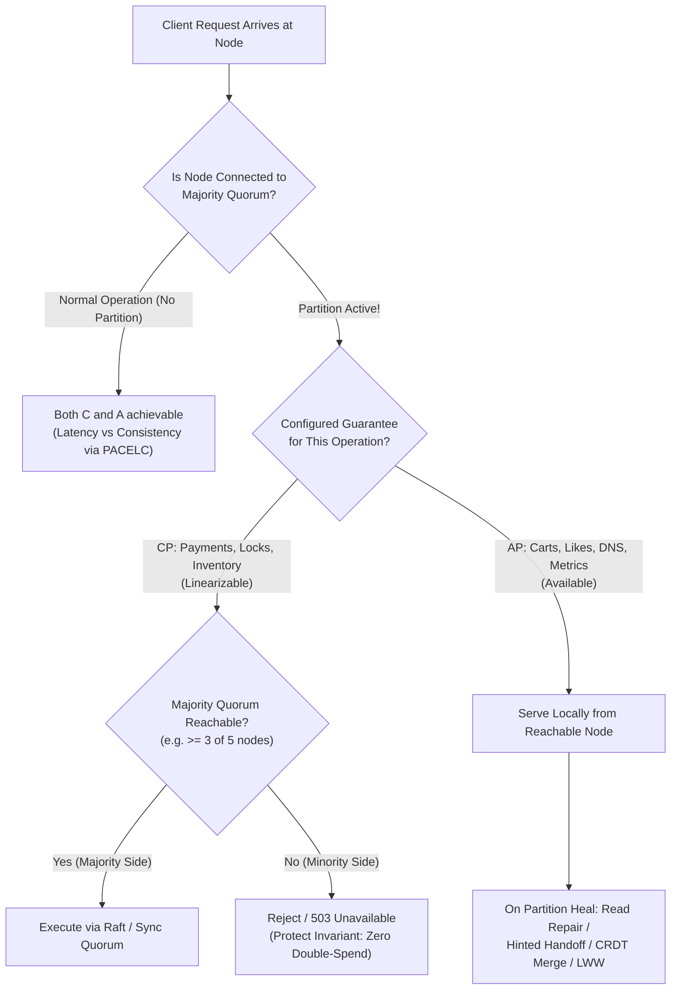
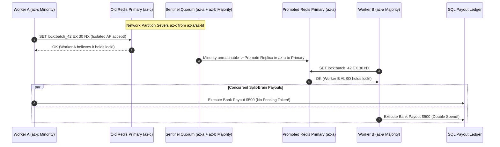

# Lesson 13: CAP Theorem

> **Prerequisites:** [Lesson 12: Scalability](../12-scalability/README.md).  
> **Estimated Reading Time:** 30 minutes  
> **Target Audience:** Backend engineers and distributed systems architects moving beyond the *"pick two of three"* myth to design precise partition behavior, quorums, and conflict-resolution strategies.  
> **Free PDF Notes:** [Download SD-A-013.pdf](https://backendroadmap.com/notes/system-design/SD-A-013.pdf) · [Phase 1, Core Fundamentals (PDF)](https://backendroadmap.com/notes/system-design/Phase1_Core_Fundamentals_Notes.pdf)

> [!TIP]
> **The Golden Rule of the CAP Theorem:** Because physical networks drop packets, disconnect cables, and split zones unpredictably, **Partition Tolerance (P) is mandatory**—you cannot choose "CA" in any multi-node distributed system. When a partition splits a cluster, every operation must make an explicit trade-off: **CP (refuse/error on the minority side to uphold linearizability)** or **AP (keep accepting reads/writes on every reachable node and reconcile divergent versions later via a defined merge rule)**.

---

## Visual Mental Models & Architecture

### What Happens During a Network Partition

Take two replicas, **Node A** and **Node B**, when the network link between them severs. Client 1 writes `x = 2` to A, which cannot notify B. Client 2 then asks B for `x` (where B still holds `x = 1`). B faces an unavoidable dilemma: reject/time out (**CP**), or answer with stale `1` (**AP**).


*Figure 1. During a partition, node B cannot both stay consistent and keep answering. Whatever it does, it gives up one of the two.*

### Failure Windows vs. Normal Operation


*Figure 2. Partitions are short, rare windows. CAP describes behaviour inside them; PACELC adds the latency vs consistency choice for the rest of the time.*

### CP Majority Quorums vs. AP Merge-on-Heal Topology


*Figure 3. Left: a 5-node CP cluster split 3 / 2; only the majority side accepts writes. Right: an AP store accepts writes on both sides and merges them when the network heals (here, by keeping the later write).*

### Partition Decision Flow & Quorum Overlap Mechanics



---

## Systematic Taxonomic Reference Grids

### Precise Academic Definitions (Brewer / Gilbert & Lynch, 2002)

*"Consistency, availability, partition tolerance: pick two"* misleads engineers because each letter carries a narrow distributed-systems meaning—completely distinct from everyday database buzzwords.

| Property | Exact Formal Meaning in CAP | Common Misconception (Do Not Confuse With) |
| :--- | :--- | :--- |
| **C — Consistency** | **Linearizability (Atomic Consistency):** every read returns the value of the most recent completed write (or a subsequent concurrent write), behaving as if one physical copy exists. | The **C in ACID** (foreign-key constraints, check invariants within a single DB transaction). |
| **A — Availability** | Every request arriving at any **non-failed node** must receive a non-error response—with no timeout loophole or *"try again later"* exception. | Operational **99.99% Uptime SLOs** (an AP service is still subject to crashes, while a CP cluster can still achieve five nines uptime). |
| **P — Partition Tolerance** | The cluster continues operating despite arbitrary message drops, switch outages, or asymmetric packet loss between nodes. | Surviving an ordinary single-server reboot or disk crash. |

### CP vs. AP Architectural Comparison

| Engineering Axis | CP Systems (Choose Consistency) | AP Systems (Choose Availability) |
| :--- | :--- | :--- |
| **During a Partition** | Minority side refuses mutations and linearizable reads (returns error/timeout). | Every reachable partition continues reading and accepting local writes. |
| **Coordination Protocol** | Majority consensus quorum (Raft, Paxos, ZAB): write commits only once $\lfloor N/2 \rfloor + 1$ nodes confirm. | Local write + background reconciliation: hinted handoff, read repair, anti-entropy Merkle trees, CRDTs, or Last-Write-Wins (LWW). |
| **Production Systems** | ZooKeeper, etcd, Consul; Google Spanner (CP globally with TrueTime + Multi-AZ replication); PostgreSQL (`synchronous_standby_names`). | Apache Cassandra & Amazon DynamoDB (default settings), DNS, Edge CDNs, Riak. |
| **Best Fit Workloads** | Distributed locks, leader election, configuration metadata, bank ledgers, airline seat reservations, flash-sale inventory. | E-commerce shopping carts (original Amazon Dynamo design), social feeds, like counters, telemetry metrics, session stores. |
| **Accepted Operational Cost** | Elevated write/read failure rate for minority callers while split persists. | Stale reads and **write conflicts** requiring deterministic merge rules (CRDT union vs. LWW data loss risk). |

### Tunable Consistency Math: Strict Quorum Overlap ($W + R > N$)

In Dynamo-style clusters with $N$ replicas per key (e.g., $N = 3$):
- **Write Quorum ($W$):** Minimum replicas that must persist the mutation before returning success.
- **Read Quorum ($R$):** Minimum replicas queried on read; the coordinator picks the version with the newest version/timestamp.
- **Quorum Overlap Rule:** If **$W + R > N$**, the read set and write set are mathematically guaranteed to intersect on at least **one node** holding the latest write (e.g., $N = 3, W = 2, R = 2 \implies 2 + 2 = 4 > 3$). Choosing `ONE` / `ONE` drops into fast AP mode at the expense of stale reads.

> [!NOTE]
> **Interview Precision Tip:** Never label a whole database "CP" or "AP". Describe **per-operation behavior**: *"For our shopping cart, I stay available during partitions and merge concurrent adds via an Observed-Remove Set (CRDT union) because a lost sale costs more than a merged item. For checkout payments, I enforce a majority quorum so a partitioned minority refuses charges rather than double-spending."*

### Key Terms Reference

| Term | Operational Meaning |
| :--- | :--- |
| **Linearizability** | Real-time single-copy illusion: once any write finishes, all subsequent reads see it. |
| **Partition** | Healthy servers remain alive but the network between them drops or delays messages indefinitely. |
| **Quorum** | Strictly more than half of the cluster replicas ($\lfloor N/2 \rfloor + 1$), ensuring two majorities always overlap. |
| **CP** | Reject minority requests to guarantee no stale reads or divergent split-brain writes. |
| **AP** | Keep answering locally everywhere during a split and reconcile conflicts when healed. |
| **$W + R > N$** | Quorum inequality guaranteeing read-replica intersection with the newest acknowledged write set. |

---

## Production War Stories: Incident Post-Mortem

### SEV-1 Post-Mortem: The Minority-Side Distributed Lock & Split-Brain Billing Storm

#### Incident Overview
* **Severity:** SEV-1 (Concurrent Lease Ownership & Duplicate Ledger Payouts)
* **Detection Time:** 14 minutes after Top-of-Rack switch firmware bug split Availability Zone `az-c`
* **Resolution Time:** 52 minutes
* **Impact:** `185` merchant payouts processed twice (`$94,000` over-disbursed) because two worker processes simultaneously believed they held the same distributed lock across a partitioned Redis cluster without fencing tokens or majority quorums.

#### What Happened
A fintech payout runner used a single-node Redis `SET lock:payout_batch EX 30 NX` call as its distributed mutex. To improve availability, engineers enabled an asynchronous Redis replica in `az-c`.
1. A BGP/switch flap partitioned `az-c` (hosting the old Redis primary and Worker A) from `az-a` + `az-b` (hosting Sentinel quorum and Worker B).
2. The Sentinel majority in `az-a`/`az-b` detected the split and immediately promoted the standby to primary, issuing the `lock:payout_batch` lease to **Worker B**.
3. Meanwhile, inside the isolated minority `az-c`, **Worker A** still reached the partitioned old primary (which kept answering in AP style!)—either renewing its lock or acquiring the same lock name independently.
4. Both Worker A and Worker B wrote duplicate bank payout transactions directly to the database.



#### Root Cause Analysis
1. **AP System Used for a CP Correctness Invariant:** Using asynchronous Redis primary/replica failover without a Raft consensus quorum permitted an isolated minority node to continue serving lock mutations.
2. **Missing Monotonic Fencing Tokens:** Downstream ledger writes trusted boolean lock ownership instead of requiring a strictly increasing fencing token (`epoch` / Raft term) rejected atomically by SQL if an older token arrived.

#### The Fix & Architectural Hardening
1. **Migrated Locking to CP Quorum (`etcd`):** Enforced majority Raft consensus so any partitioned minority (`1` or `2` of `5` nodes) immediately fails lock acquisitions/renewals.
2. **Enforced Monotonic Fencing Tokens on Writes:** Attached each lease's monotonic `mod_revision` token to database writes (`WHERE last_fence_token < $token`), ensuring stale isolated workers are rejected at the storage layer even across arbitrary GC pauses.

---

## Multi-Language Production Implementation: Tunable Quorum ($W + R > N$) & CRDT OR-Set Cart Merger

The following implementations demonstrate both halves of CAP design in code: **(1)** an explicit **Tunable Quorum Coordinator** verifying $W + R > N$ and partitioning behavior (`CP` minority refusal vs `AP` local serve), and **(2)** an **Observed-Remove Set (CRDT union)** merge engine showing how AP shopping carts avoid Last-Write-Wins silent data loss.

````carousel
```go
package captheorem

import (
	"errors"
	"sync"
)

var ErrQuorumUnavailable = errors.New("CP rejection: insufficient reachable replicas to satisfy quorum")

type Replica struct {
	ID        string
	Reachable bool
	Value     string
	Version   int64
}

type TunableStore struct {
	mu       sync.RWMutex
	replicas []*Replica
}

func NewTunableStore(n int) *TunableStore {
	reps := make([]*Replica, n)
	for i := 0; i < n; i++ {
		reps[i] = &Replica{ID: string(rune('A' + i)), Reachable: true}
	}
	return &TunableStore{replicas: reps}
}

// Write enforces W replicas confirming; CP mode sets W = N/2 + 1 (quorum), AP mode sets W = 1.
func (s *TunableStore) Write(val string, version int64, requiredW int) error {
	s.mu.Lock()
	defer s.mu.Unlock()

	var acks []*Replica
	for _, r := range s.replicas {
		if r.Reachable {
			acks = append(acks, r)
		}
	}
	if len(acks) < requiredW {
		return ErrQuorumUnavailable
	}
	for i := 0; i < requiredW; i++ {
		acks[i].Value = val
		acks[i].Version = version
	}
	return nil
}

// Read queries R replicas and returns highest version; when W + R > N, intersects latest write.
func (s *TunableStore) Read(requiredR int) (string, int64, error) {
	s.mu.RLock()
	defer s.mu.RUnlock()

	var queried []*Replica
	for _, r := range s.replicas {
		if r.Reachable {
			queried = append(queried, r)
		}
	}
	if len(queried) < requiredR {
		return "", 0, ErrQuorumUnavailable
	}
	best := queried[0]
	for i := 1; i < requiredR; i++ {
		if queried[i].Version > best.Version {
			best = queried[i]
		}
	}
	return best.Value, best.Version, nil
}

// ORSetCart implements AP conflict-free set union so concurrent adds across partitioned regions never vanish.
type ORSetCart struct {
	Adds    map[string]map[string]struct{} // item -> set of unique add tags
	Removes map[string]map[string]struct{} // item -> set of observed tombstoned tags
}

func MergeCarts(left, right ORSetCart) map[string]bool {
	mergedAdds := map[string]map[string]struct{}{}
	mergedRemoves := map[string]map[string]struct{}{}
	for _, src := range []ORSetCart{left, right} {
		for item, tags := range src.Adds {
			if mergedAdds[item] == nil {
				mergedAdds[item] = map[string]struct{}{}
			}
			for t := range tags {
				mergedAdds[item][t] = struct{}{}
			}
		}
		for item, tags := range src.Removes {
			if mergedRemoves[item] == nil {
				mergedRemoves[item] = map[string]struct{}{}
			}
			for t := range tags {
				mergedRemoves[item][t] = struct{}{}
			}
		}
	}
	active := map[string]bool{}
	for item, addTags := range mergedAdds {
		for tag := range addTags {
			if _, removed := mergedRemoves[item][tag]; !removed {
				active[item] = true
				break
			}
		}
	}
	return active
}
```
<!-- slide -->
```typescript
export interface ReplicaNode {
  id: string;
  reachable: boolean;
  value: string | null;
  version: number;
}

export class TunableQuorumCluster {
  constructor(private readonly nodes: ReplicaNode[]) {}

  write(value: string, version: number, W: number): { status: string; acked: number } {
    const alive = this.nodes.filter((n) => n.reachable);
    if (alive.length < W) {
      throw new Error(`CP Abort: reachable=${alive.length} < required W=${W}`);
    }
    for (let i = 0; i < W; i++) {
      alive[i].value = value;
      alive[i].version = version;
    }
    return { status: "COMMITTED", acked: W };
  }

  read(R: number): { value: string | null; version: number; guaranteesLatestIfWPlusRGtN: boolean } {
    const alive = this.nodes.filter((n) => n.reachable);
    if (alive.length < R) {
      throw new Error(`CP Abort: reachable=${alive.length} < required R=${R}`);
    }
    const sample = alive.slice(0, R);
    const newest = sample.reduce((best, cur) => (cur.version > best.version ? cur : best));
    return { value: newest.value, version: newest.version, guaranteesLatestIfWPlusRGtN: true };
  }
}

export interface CartReplicaState {
  adds: Record<string, string[]>;    // item -> unique tag UUIDs
  removes: Record<string, string[]>; // item -> removed tag UUIDs
}

// AP Conflict-Free Merge (Observed-Remove Set) preserves both Book (phone) & Lamp (laptop).
export function mergePartitionedCarts(a: CartReplicaState, b: CartReplicaState): string[] {
  const allItems = new Set([...Object.keys(a.adds), ...Object.keys(b.adds)]);
  const finalItems: string[] = [];

  for (const item of allItems) {
    const adds = new Set([...(a.adds[item] ?? []), ...(b.adds[item] ?? [])]);
    const removes = new Set([...(a.removes[item] ?? []), ...(b.removes[item] ?? [])]);
    for (const tag of adds) {
      if (!removes.has(tag)) {
        finalItems.push(item);
        break;
      }
    }
  }
  return finalItems;
}
```
<!-- slide -->
```python
from dataclasses import dataclass, field


class QuorumPartitionError(RuntimeError):
    """Raised when CP quorum cannot be reached during a partition."""


@dataclass
class Replica:
    node_id: str
    reachable: bool = True
    value: str | None = None
    version: int = 0


class QuorumCoordinator:
    def __init__(self, n: int = 3) -> None:
        self.replicas = [Replica(f"node-{i}") for i in range(n)]

    def write(self, value: str, version: int, w: int) -> None:
        alive = [r for r in self.replicas if r.reachable]
        if len(alive) < w:
            raise QuorumPartitionError(f"CP write rejected: {len(alive)}/{len(self.replicas)} alive, need W={w}")
        for r in alive[:w]:
            r.value = value
            r.version = version

    def read(self, r_count: int) -> tuple[str | None, int]:
        alive = [r for r in self.replicas if r.reachable]
        if len(alive) < r_count:
            raise QuorumPartitionError(f"CP read rejected: {len(alive)}/{len(self.replicas)} alive, need R={r_count}")
        best = max(alive[:r_count], key=lambda rep: rep.version)
        return best.value, best.version


@dataclass
class ORSetCart:
    adds: dict[str, set[str]] = field(default_factory=dict)
    removes: dict[str, set[str]] = field(default_factory=dict)

    def add(self, item: str, tag: str) -> None:
        self.adds.setdefault(item, set()).add(tag)

    def merge(self, other: "ORSetCart") -> set[str]:
        all_items = set(self.adds) | set(other.adds)
        result: set[str] = set()
        for item in all_items:
            union_adds = self.adds.get(item, set()) | other.adds.get(item, set())
            union_rems = self.removes.get(item, set()) | other.removes.get(item, set())
            if union_adds - union_rems:
                result.add(item)
        return result
```
<!-- slide -->
```csharp
public sealed class ReplicaNode
{
    public required string Id { get; init; }
    public bool Reachable { get; set; } = true;
    public string? Value { get; set; }
    public long Version { get; set; }
}

public sealed class TunableCluster(int n)
{
    private readonly List<ReplicaNode> _nodes = Enumerable.Range(0, n)
        .Select(i => new ReplicaNode { Id = $"node-{i}" })
        .ToList();

    public void SetReachable(int idx, bool up) => _nodes[idx].Reachable = up;

    public void Write(string value, long version, int w)
    {
        var alive = _nodes.Where(n => n.Reachable).ToList();
        if (alive.Count < w)
            throw new InvalidOperationException($"CP Reject: {alive.Count} reachable < W={w}");

        foreach (var node in alive.Take(w))
        {
            node.Value = value;
            node.Version = version;
        }
    }

    public (string? Value, long Version) Read(int r)
    {
        var alive = _nodes.Where(n => n.Reachable).ToList();
        if (alive.Count < r)
            throw new InvalidOperationException($"CP Reject: {alive.Count} reachable < R={r}");

        var latest = alive.Take(r).OrderByDescending(n => n.Version).First();
        return (latest.Value, latest.Version);
    }
}
```
````

---

## Practical Hands-On Verification CLI Workflows & Practice Labs

### Practice 1: CP or AP? Classify Under Partition

For each system, decide how it should behave during a partition and give one sentence why:
1. A bank's core ledger.
2. An online store's shopping cart that must always accept "add to cart".
3. An airline seat-reservation system that must never double-book a seat.
4. A social app's like counter.
5. The stock count for a flash sale that must never oversell.

<details><summary><strong>Answer</strong></summary>

1. **CP:** A wrong balance is worse than a short error.
2. **AP:** Keep accepting adds on every side and merge the versions afterwards (the original Dynamo design).
3. **CP:** Selling one seat twice causes real-world double-booking damage; refuse requests on the minority side instead.
4. **AP:** A count that lags by a few likes temporarily hurts nobody.
5. **CP:** The stock count must be authoritative so two buyers never claim the last item, even if requests queue or fail during a split.

</details>

### Practice 2: Merge a Partitioned Shopping Cart

A cart is replicated across two regions with asynchronous replication. During a partition, the same user adds a **book** on their phone (Region 1) and a **lamp** on their laptop (Region 2). When the network heals, both adds must survive. What merge rule guarantees that, and why is Last-Write-Wins (LWW) wrong here?

<details><summary><strong>Answer</strong></summary>

Treat the cart as a set and merge concurrent adds by **union** (specifically an Observed-Remove Set CRDT, which tracks unique add-tags so removals also behave cleanly). **Last-Write-Wins (LWW)** drops whichever device had the earlier timestamp—silently deleting either the book or the lamp. Choosing AP always requires defining an explicit domain merge policy beforehand (set union for carts, LWW for "current profile avatar URL", manual resolution for conflicting contract edits).

</details>

### Practice 3 (CLI Lab): Diagnose `"Writes Stopped During a Network Blip"` on PostgreSQL

A team runs PostgreSQL with one primary and one **synchronous** standby (`synchronous_standby_names` is set, so `COMMIT` returns only after standby confirmation). During a short partition between primary and standby, every write hung until clients timed out—even though the primary stayed healthy. Prove this exact **CP** trade-off empirically using any primary + streaming replica pair (the two-container setup in [Backend Track 04, Module 08](../../../backend/04-databases-and-data-layer/08-replication-and-sharding/README.md) works directly):

```bash
# 1. Enable strict CP synchronous replication on Primary
docker compose exec primary psql -U postgres -c "ALTER SYSTEM SET synchronous_standby_names = '*';" -c "SELECT pg_reload_conf();"

# 2. Simulate a network partition cutting off the standby
docker compose pause replica

# 3. Attempt a write on Primary -> Hangs waiting for standby ACK!
docker compose exec primary psql -U postgres -c "UPDATE accounts SET balance = balance - 10 WHERE id = 1;"

# 4. Heal the partition -> Blocked COMMIT finishes immediately
docker compose unpause replica

# 5. Reset back to asynchronous AP-leaning default
docker compose exec primary psql -U postgres -c "ALTER SYSTEM RESET synchronous_standby_names;" -c "SELECT pg_reload_conf();"
```

<details><summary><strong>Expected Behavior & Diagnosis</strong></summary>

Synchronous replication is a deliberate **CP** choice: the primary refuses to confirm a write the standby cannot durability-match, so when partitioned it blocks instead of letting the two nodes diverge. The hang is the guarantee operating *as designed*, not a bug. If you cancel the hung SQL query (`Ctrl+C`), PostgreSQL warns that the transaction *"has already committed locally, but might not have been replicated to the standby"*: synchronous replication blocks the client acknowledgement rather than undoing local work. Under CAP, you cannot simultaneously "never hang" and "never lose a write across partitions": either accept blocked writes (**CP**) or switch to asynchronous replication (**lean AP**), accepting replica lag and potential loss of unshipped tail commits on primary failover.

</details>

---

## Operational Validation Checkpoints (Scenario Quizzes)

<details>
<summary><strong>Checkpoint 1: The Quorum Math Trap During Partial Failure</strong></summary>

**Scenario:** A 3-node Cassandra cluster (`N = 3`) executes writes at `QUORUM` (`W = 2`) and reads at `ONE` (`R = 1`) to minimize read latency. During normal operation, is every read guaranteed to observe the latest acknowledged write? Why or why not?

<strong>Answer:</strong>
**No.** With $N = 3, W = 2, R = 1$, $W + R = 3$, which is **not** strictly greater than $N$ ($3 \not> 3$). One of the 3 replicas does not yet hold the latest acknowledged write until asynchronous background replication completes; if the `R = 1` read hits that lagging replica, it returns stale data. Enforcing strong overlap requires $W + R > N$ (such as `W = 2, R = 2`).
</details>

<details>
<summary><strong>Checkpoint 2: Why "CA" Relational Databases Still Face CAP</strong></summary>

**Scenario:** During a system design interview, a candidate asserts: *"Our PostgreSQL setup with synchronous multi-AZ replication is a CA system—it guarantees strong consistency AND stays available!"* Identify the exact flaw in that statement when an Availability Zone fiber cut occurs.

<strong>Answer:</strong>
"CA" only describes a single machine or an imaginary network that never splits. The moment a fiber cut partitions the primary AZ from the synchronous standby AZ, PostgreSQL must choose: wait/block writes (**CP**, sacrificing write availability until healed or fenced) or let both isolated sides accept independent writes (**AP**, creating split-brain divergence). Because partitions happen in real cloud networks, every multi-node cluster reduces strictly to **CP** or **AP** during splits.
</details>

<details>
<summary><strong>Checkpoint 3: Designing Per-Endpoint CAP Choices in One Microservice</strong></summary>

**Scenario:** You run an online concert marketplace backed by a globally replicated database. How would you justify choosing different partition behaviors for `GET /concerts/{id}/details` vs. `POST /orders/{id}/reserve-seat`?

<strong>Answer:</strong>
CAP applies **per operation**, not globally to the database product:
- **`GET /concerts/{id}/details` (AP):** Serve cached or local-replica venue descriptions and artist bios even during inter-region partitions—15 seconds of staleness causes zero harm while protecting site reachability.
- **`POST /orders/{id}/reserve-seat` (CP):** Execute strictly against the majority quorum / authoritative region leader. Two buyers claiming Seat `A12` simultaneously causes catastrophic operational failure, so minority-side partitions must reject reservations cleanly (`503 Service Unavailable`) rather than risk double-booking.
</details>

---

## Interview Practice Questions

Each question is tagged by kind: **Basic** (definitions), **Scenario** (apply it to a system), and **Tricky** (deep follow-ups). Answer out loud before opening the solution.

<details>
<summary><strong>1. Explain the CAP theorem precisely. (Basic)</strong></summary>

<strong>What a strong answer covers:</strong>
During a **network partition (P)**, a distributed data store cannot guarantee both **linearizable consistency (C)** and **100% non-error availability (A)** across every non-failed node: nodes cut off from recent writes must either refuse requests (**CP**) or respond with potentially stale data (**AP**).
</details>

<details>
<summary><strong>2. Why is CA not a real option? (Basic)</strong></summary>

<strong>What a strong answer covers:</strong>
Network partitions cannot be eliminated in any distributed system spanning multiple machines—switches, NICs, and AZ links fail. Claiming "CA" describes either a single-node server or a design assuming zero packet loss. Real architectures decide how to behave **when** a partition hits.
</details>

<details>
<summary><strong>3. How is consistency in CAP different from the C in ACID? (Basic)</strong></summary>

<strong>What a strong answer covers:</strong>
CAP's **C** is **linearizability** (real-time agreement across distributed replicas as if one copy existed). ACID's **C** means database transactions preserve schema invariants, foreign keys, and constraints—a single un-replicated database satisfies ACID consistency without needing CAP at all.
</details>

<details>
<summary><strong>4. Which would you choose for a shopping cart, and for a payment ledger? (Scenario)</strong></summary>

<strong>What a strong answer covers:</strong>
**Shopping cart: AP.** Keep accepting cart additions across every region and resolve conflicts via a CRDT set union on heal—an extra merged item is harmless compared to blocking a sale. **Payment ledger: CP.** Only a majority quorum commits transactions; rejecting writes on the minority side avoids double spends and negative overdrafts.
</details>

<details>
<summary><strong>5. You are designing a distributed lock service. CP or AP? (Scenario)</strong></summary>

<strong>What a strong answer covers:</strong>
**CP.** Two processes holding the same lock breaks mutual exclusion. Use a Raft/ZAB consensus cluster (`etcd` / `ZooKeeper`) backed by majority quorum + leases, and pass monotonic **fencing tokens** with every lease so paused lock holders are rejected by storage even if their lease expires mid-flight. Minority partitions must fail lock requests.
</details>

<details>
<summary><strong>6. A 5-node etcd cluster splits into 3 and 2. What happens on each side? (Scenario)</strong></summary>

<strong>What a strong answer covers:</strong>
The **3-node majority** retains/elects a Raft leader and keeps serving writes and linearizable reads normally. The **2-node minority** cannot reach a quorum of $3$, so it rejects writes and linearizable reads. Once the partition heals, the 2 nodes catch up cleanly by replaying the leader's committed WAL log.
</details>

<details>
<summary><strong>7. Is Cassandra AP or CP? (Tricky)</strong></summary>

<strong>What a strong answer covers:</strong>
AP by default (`ONE` / `LOCAL_ONE`), but **tunable per query**: setting `QUORUM` writes and `QUORUM` reads satisfies $W + R > N$ so reads observe the latest write—and fail if a quorum cannot be reached. Describe the exact behavior configured per operation rather than pinning a static letter on the product.
</details>

<details>
<summary><strong>8. With N = 3, W = 2, and R = 2, is every read guaranteed to be the latest? (Tricky)</strong></summary>

<strong>What a strong answer covers:</strong>
Because $W + R = 4 > 3$, read and write replica sets always intersect, meaning reads reach at least one replica with the latest write. However, with Cassandra-style **Last-Write-Wins (LWW)** wall-clock timestamps, NTP clock skew between writers can allow an older write to overwrite a newer one, and an aborted partial write present on 1 node can still be read (`read repair`). Thus quorum guarantees strong overlap, not true linearizability without consensus/CAS.
</details>

---

## Common Mistakes & Troubleshooting

- **Claiming "we pick CA":** Impossible across any network boundary.
- **Confusing CAP linearizability with ACID constraints:** A single-node RDBMS can be ACID-consistent without distributed replication.
- **Stamping a whole database "CP" or "AP":** Most modern stores tune consistency per query or table.
- **Forgetting CAP applies only during partitions:** Everyday healthy-state speed vs. freshness falls under [Lesson 14: PACELC](../14-pacelc-theorem/README.md).
- **Selecting AP without a conflict-resolution rule:** Two sides *will* diverge during splits; decide upfront whether conflict resolution uses union/CRDTs, LWW, or manual reconciliation—otherwise the default is silent overwrite data loss.
- **Improvising partition policy mid-outage:** Test failure behavior beforehand (see Practice Lab 3).

---

## Further Reading & Sources

- [CAP Twelve Years Later: How the "Rules" Have Changed (Eric Brewer)](https://www.infoq.com/articles/cap-twelve-years-later-how-the-rules-have-changed/) — The theorem's author on why *"pick two"* misleads and why the choice bites strictly during partitions.
- [Please stop calling databases CP or AP (Martin Kleppmann)](https://martin.kleppmann.com/2015/05/11/please-stop-calling-databases-cp-or-ap.html) — Why specifying exact behavior per operation beats one-letter database labels.
- [The CAP theorem (Julia Evans)](https://jvns.ca/blog/2016/10/23/cap-theorem/) — Concise explainer unpacking the *"pick two of three"* myth.
- [Dynamo: Amazon's Highly Available Key-value Store](https://www.allthingsdistributed.com/files/amazon-dynamo-sosp2007.pdf) — The foundational AP architecture: always-writable carts, quorums ($N, R, W$), and vector-clock/version merging.

---

## Free PDF notes

Download these notes as a printable PDF, with every diagram: [SD-A-013.pdf](https://backendroadmap.com/notes/system-design/SD-A-013.pdf). All Phase 1 notes in one file: [Phase 1, Core Fundamentals (PDF)](https://backendroadmap.com/notes/system-design/Phase1_Core_Fundamentals_Notes.pdf).

---

## Next

Continue with [Lesson 14: PACELC Theorem](../14-pacelc-theorem/README.md) to examine the everyday **Else: Latency vs. Consistency** trade-off paid during the $99.9\%$ of time when zero partitions exist.
