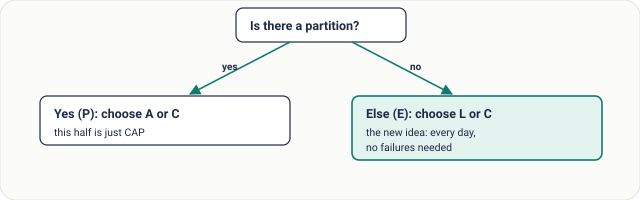
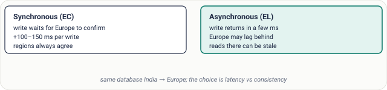

# Lesson 14: PACELC Theorem

## Roadmap

You are in **System Design Interview Prep**, Track 01, **Core Fundamentals**: lesson 14 of 19 (CAP's missing half: latency vs consistency). It builds on [Lesson 13: CAP Theorem](../13-cap-theorem/README.md). Next comes [Lesson 15: Consistency Models](../15-consistency-models/README.md).

These are the written notes for the lesson's video. Prefer paper? The same notes are a free, printable PDF: [download SD-A-014.pdf](https://backendroadmap.com/notes/system-design/SD-A-014.pdf).

## Concept

> [!key] PACELC says: during a Partition choose Availability or Consistency; Else, when healthy, choose Latency or Consistency, because keeping replicas in sync always costs waiting time.

## Explanation

### Reading the name

CAP only describes what happens during a network partition, and partitions are rare. PACELC (Daniel Abadi, 2010) covers the other 99%+ of the time. Read it as a sentence: if **P**artition, choose **A** or **C**; **E**lse, choose **L**atency or **C**onsistency.

*Figure 1. PACELC as a decision. The “else” branch applies every day, with no failures at all.*

### Why there's a trade-off without failures

Replication. To keep replicas consistent, a write must wait until other replicas confirm it, and waiting costs time. If you don't wait, you answer faster, but a replica may briefly return old data.

*Figure 2. Synchronous replication pays latency for agreement; asynchronous pays staleness for speed.*

### Classifying real databases

| System | Class | What it means |
|---|---|---|
| **Cassandra** (default) | PA / EL | Available during partitions, fast otherwise; tunable per query |
| **DynamoDB** (default) | PA / EL | Eventually consistent reads by default; strongly consistent reads on request, at extra latency and cost |
| **Google Spanner** | PC / EC | Consistent always; pays with commit latency (TrueTime, cross-region consensus) |
| **PostgreSQL + sync replica** | PC / EC | Writes wait for the standby; no stale reads from it |
| **PostgreSQL + async replicas** | EL on reads | Fast writes; replica reads can lag |

> [!model] **A sharper interview answer.** Don't stop at “it's AP”. Say what the system does during a partition *and* what it trades in normal operation: “We accept slightly stale reads for low latency on product pages, but reads on the checkout path go to the primary.”

## Key terms

| Term | Meaning |
|---|---|
| **PACELC** | Partition: A or C; Else: L or C |
| **Synchronous replication** | write waits for replicas |
| **Asynchronous replication** | write returns, replicas catch up |
| **Replication lag** | how far a replica is behind |
| **PA/EL** | available + fast, may be stale |
| **PC/EC** | consistent always, slower |

## Interview questions

Each question is tagged by kind: **Basic** (definitions), **Scenario** (apply it to a system) and **Tricky** (the follow-ups interviewers use to go deeper). Answer out loud before you open the answer.

> [!interview] What does PACELC add to CAP? (Basic)

What a strong answer covers

The else case: even with no partition, you trade latency for consistency, because replicas must coordinate to agree.

> [!interview] Classify DynamoDB under PACELC. (Basic)

What a strong answer covers

PA/EL by default (eventually consistent reads), with optional strongly consistent reads that move it toward consistency at extra latency and cost.

> [!interview] Why is Spanner PC/EC? (Basic)

What a strong answer covers

It keeps strong consistency always, using cross-region consensus and TrueTime, and pays for it with higher commit latency.

> [!interview] Your app replicates India → Europe. Users in Europe see old data after edits. Options? (Scenario)

What a strong answer covers

Make the replication synchronous for that data (EC, +100 ms writes), route the author's reads to the primary region for a while (read-your-writes), or accept the lag where it's harmless.

> [!interview] Which reads in an e-commerce site would you make strongly consistent? (Scenario)

What a strong answer covers

Inventory at checkout, payment status and order confirmation. Product pages, reviews and recommendations can be eventually consistent for speed and cost.

> [!interview] When would you pay for synchronous cross-region replication? (Scenario)

What a strong answer covers

When losing or disagreeing on a write is unacceptable (financial ledgers, critical config) and the business can accept ~100 ms more write latency.

> [!interview] Is a single-node PostgreSQL PA, PC, EL or EC? (Tricky)

What a strong answer covers

PACELC is about replicated systems. A single node is consistent but has no replicas to trade against; once you add async replicas, reads from them become EL.

> [!interview] Can one system be EL for one query and EC for another? (Tricky)

What a strong answer covers

Yes. Cassandra (consistency level per query) and DynamoDB (consistent-read flag) let you choose per request; describe the behaviour per feature.

## Common mistakes & troubleshooting

- Thinking consistency only costs something during failures.
- Forgetting cross-region replication adds ~100 ms per synchronous write.
- Labelling a tunable database with one fixed class.
- Using strongly consistent reads everywhere “to be safe” and paying 2× cost.

## Free PDF notes

Download these notes as a printable PDF, with every diagram: [SD-A-014.pdf](https://backendroadmap.com/notes/system-design/SD-A-014.pdf). All Phase 1 notes in one file: [Phase 1, Core Fundamentals (PDF)](https://backendroadmap.com/notes/system-design/Phase1_Core_Fundamentals_Notes.pdf).

## Next

Continue with [Lesson 15: Consistency Models](../15-consistency-models/README.md).
