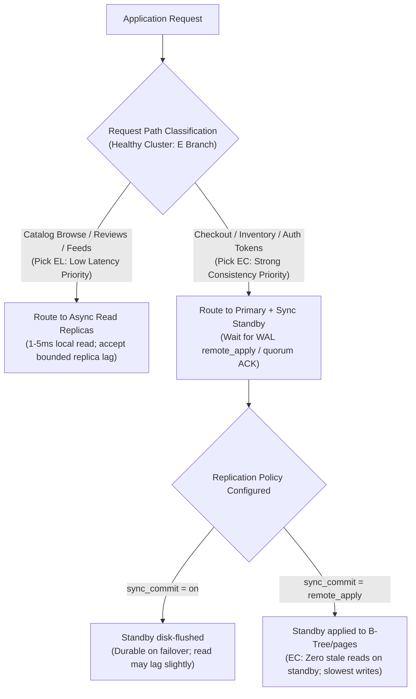
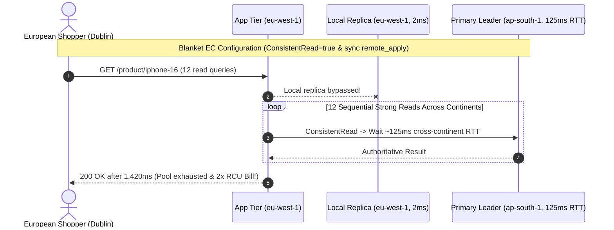

# Lesson 14: PACELC Theorem

> **Prerequisites:** [Lesson 13: CAP Theorem](../13-cap-theorem/README.md).  
> **Estimated Reading Time:** 25 minutes  
> **Target Audience:** Backend engineers and architects optimizing normal-operation **Latency vs. Consistency** trade-offs across replicated databases and multi-region deployments.

> [!TIP]
> **The Golden Rule of PACELC:** Network partitions are rare, brief incidents—CAP governs less than $0.1\%$ of your cluster's lifetime. **PACELC** (Daniel Abadi, 2010) captures the $99.9\%$ everyday reality: **if Partitioned (P), trade Availability (A) vs. Consistency (C); Else (E), when the network is completely healthy, you still must trade Latency (L) vs. Consistency (C)** because coordinating replicas across network links always costs round-trip time.

---

## Visual Mental Models & Architecture

### Reading the PACELC Decision Tree

Read PACELC directly as an `if / else` sentence: **If Partition**, choose **A** or **C**; **Else**, choose **L**atency or **C**onsistency.


*Figure 1. PACELC as a decision. The “else” branch applies every day, with no failures at all.*

### Why Coordination Costs Latency Even Without Failures


*Figure 2. Synchronous replication pays latency for agreement; asynchronous pays staleness for speed.*

### Operation-Scoped "Else" Routing Architecture



---

## Systematic Taxonomic Reference Grids

### Classifying Real Production Databases Under PACELC

| Database / Store | Default PACELC Class | Partition Behavior (`P` Branch) | Healthy Everyday Behavior (`E` Branch) | Per-Query Configurability |
| :--- | :---: | :--- | :--- | :--- |
| **Apache Cassandra** | **PA / EL** | Accepts writes/reads on any reachable node (`ONE`). | Answers fast from coordinator/local replica (`EL`) without cross-rack quorum waits. | Tunable per query (`QUORUM`, `LOCAL_QUORUM`, `ALL`) shifts toward `EC`/`PC`. |
| **Amazon DynamoDB** | **PA / EL** | High partition availability with eventual storage reads. | Default reads return cached/async storage replica (`EL`, single-digit ms, $0.5\times$ RCU cost). | Setting `ConsistentRead=true` routes to leader for fresh `EC` read ($2\times$ RCU cost + higher latency). |
| **Google Cloud Spanner** | **PC / EC** | Refuses minority splits via Paxos consensus across zones/regions. | Enforces external consistency always (`EC`), paying cross-AZ/region commit RTT + TrueTime wait intervals. | Read-only staleness timestamps (`exact_staleness`) allow bounded `EL` optimizations. |
| **PostgreSQL + Sync Standby** | **PC / EC** | Primary blocks `COMMIT` acks if synchronous standby cannot be reached (`synchronous_standby_names`). | Writes wait on standby RTT every commit (`remote_apply` eliminates stale standby reads). | Configurable globally, per session, or per transaction (`SET LOCAL synchronous_commit`). |
| **PostgreSQL + Async Replicas** | **PA-leaning / EL on reads** | Replicas continue answering read queries during split; writes succeed on primary (stale/risk on un-replicated failover). | Fast local WAL flush commits (`EL`); async replica reads trade minor replication lag for massive read scaling. | Route critical reads to Primary (`EC`) and browse reads to Replicas (`EL`). |

### Tuning PostgreSQL & Cache Engines Along the "Else" Dial

The "Else" choice is configuration you set—not an unchangeable vendor label.

| Configuration Setting | What `COMMIT` / Write Actually Waits For | Effective PACELC Mode | Read/Failover Implication |
| :--- | :--- | :---: | :--- |
| **PostgreSQL Default (Async)** | Primary's own local WAL disk flush only; standbys pull asynchronously afterwards. | **EL** | Fastest write latency; standby failover may lose trailing unshipped commits; standby reads show `replica_lag`. |
| **`synchronous_standby_names = '*'` + `synchronous_commit = on`** | Standby confirms WAL segments written/flushed to standby **disk** (not yet replayed into tables). | **PC / Durable, Minor Read Lag** | Zero data loss on failover, *yet* a read directly hitting that standby can briefly miss the just-committed row! |
| **`synchronous_standby_names = '*'` + `synchronous_commit = remote_apply`** | Standby writes WAL **and** applies changes so queries against it reflect the transaction. | **PC / EC** | Slowest writes (full primary-to-standby RTT + apply), zero stale reads from that synchronous standby. |
| **Redis `WAIT numreplicas timeout`** | Blocks client until `numreplicas` acknowledge prior commands over async replication link. | **Bounded EL** | Improves visibility freshness before reply, *not* true crash durability (Redis replication remains asynchronous). |

```sql
-- Measure exact healthy-day staleness budget directly on any PostgreSQL replica:
-- (Measure under active write load; on an idle primary this timestamp gap naturally grows.)
SELECT now() - pg_last_xact_replay_timestamp() AS replica_lag;
```

### Key Terms Reference

| Term | Operational Meaning |
| :--- | :--- |
| **PACELC** | **P**artition $\to$ **A** or **C**; **E**lse $\to$ **L**atency or **C**onsistency. |
| **Synchronous Replication** | Writes stall returning until one or more replicas acknowledge persistence/application. |
| **Asynchronous Replication** | Primary acknowledges immediately upon local flush; replicas apply WAL stream behind in time. |
| **Replication Lag** | Elapsed time (or WAL byte distance) a replica trails behind the primary's commit head. |
| **PA / EL** | Available during partitions and fast in normal operation; accepts bounded stale reads. |
| **PC / EC** | Always consistent (rejects minority splits and pays synchronization latency on healthy days). |

---

## Production War Stories: Incident Post-Mortem

### SEV-2 Post-Mortem: The Cross-Continent Blanket `EC` Latency Meltdown

#### Incident Overview
* **Severity:** SEV-2 (P99 Checkout & Page-Load Latency Surging from `45ms` to `1,400ms`)
* **Detection Time:** 8 minutes post-config push
* **Resolution Time:** 25 minutes
* **Impact:** Global web storefront latency jumped $30\times$ across European traffic (`1,400ms+`) and DynamoDB Read Capacity costs doubled overnight because an engineer turned on global strong consistency (`ConsistentRead=true`) and cross-region `synchronous_commit = 'remote_apply'` globally *"to avoid weird stale bugs."*

#### What Happened
An e-commerce platform replicated product and cart tables from an `ap-south-1` (Mumbai) primary cluster to read replicas in `eu-west-1` (Dublin, `~125ms` cross-continent RTT).
1. After one user complained that a newly uploaded review took 2 seconds to show in Dublin, a well-meaning developer flipped DynamoDB's repository wrapper to pass `ConsistentRead: true` on **every** `GET` call globally and enabled cross-region `synchronous_commit = 'remote_apply'` in PostgreSQL.
2. Every benign European product-page render (fetching 12 sub-queries sequentially per page) stopped reading local Dublin edge storage and crossed continents back to Mumbai leader nodes, multiplying page latency to `12 × 115ms ≈ 1.4 seconds`.
3. Every write in Mumbai stalled waiting `~125ms` for Dublin's `remote_apply` round-trip, exhausting DB connection pools under concurrency!



#### Root Cause Analysis
1. **Confusing Local Safety With Global `EC` Enforcement:** Applying synchronous cross-region consistency to low-criticality reads (reviews, product descriptions, recommendations) forced every healthy request to pay speed-of-light network latency.
2. **Thread Pool Starvation from Long Synchronous Commits:** Holding PostgreSQL connections open for `~125ms` per commit dropped max single-connection write rate from `~500 TPS` down to `8 TPS` (`1000ms / 125ms`).

#### The Fix & Architectural Hardening
1. **Tiered PACELC Per Endpoint:** Reverted product pages, ratings, and catalogs back to local **`PA/EL`** reads (`2ms`), restricting cross-AZ/primary **`EC`** strictly to payment settlement, stock decrement, and active user post-edit read-your-writes.
2. **Synchronous Quorum Restricted Within Region:** Moved `synchronous_standby_names` exclusively to an in-region multi-AZ standby (`< 1.5ms` RTT) rather than an inter-continental replica.

---

## Multi-Language Production Implementation: Operation-Scoped PACELC Router (`EL` vs. `EC`)

The implementations below route normal browse traffic to fast **`EL`** async replicas (with automatic circuit-breaking if `replica_lag` exceeds the configured staleness SLA) while dynamically switching critical writes and `read_consistent` transactions onto **`EC`** primary/sync paths.

````carousel
```go
package pacelc

import (
	"context"
	"time"
)

type ConsistencyPreference int

const (
	PreferEL ConsistencyPreference = iota // Fast async replica (bounded staleness)
	PreferEC                              // Strongly consistent primary / sync commit
)

type PoolRouter interface {
	QueryCatalog(ctx context.Context, sql string) (any, error)
	QueryReplicaLag(ctx context.Context) (time.Duration, error)
	ExecPrimary(ctx context.Context, sql string, syncCommitRemoteApply bool) error
}

type PACELCDataAccess struct {
	router          PoolRouter
	maxStalenessSLA time.Duration
}

func NewPACELCDataAccess(r PoolRouter, sla time.Duration) *PACELCDataAccess {
	return &PACELCDataAccess{router: r, maxStalenessSLA: sla}
}

// ReadProduct dynamically pays E=L (replica) unless strict EC consistency is required or replica lags past SLA.
func (d *PACELCDataAccess) ReadData(ctx context.Context, sql string, pref ConsistencyPreference) (source string, err error) {
	if pref == PreferEC {
		err = d.router.ExecPrimary(ctx, sql, false)
		return "primary_ec_strong", err
	}

	lag, err := d.router.QueryReplicaLag(ctx)
	if err == nil && lag <= d.maxStalenessSLA {
		_, err = d.router.QueryCatalog(ctx, sql)
		return "replica_el_fast", err
	}

	// Circuit-breaker fallback: replica exceeded staleness budget -> route safely to primary
	err = d.router.ExecPrimary(ctx, sql, false)
	return "primary_fallback_lag_exceeded", err
}

// ExecuteMutation configures PostgreSQL synchronous_commit per transaction ("on" vs "remote_apply").
func (d *PACELCDataAccess) ExecuteMutation(ctx context.Context, sql string, strictZeroReplicaLag bool) error {
	return d.router.ExecPrimary(ctx, sql, strictZeroReplicaLag)
}
```
<!-- slide -->
```typescript
import { Pool } from "pg";

export type PacelcMode = "EL" | "EC";

export class PacelcRouter {
  constructor(
    private readonly primaryPool: Pool,
    private readonly replicaPool: Pool,
    private readonly maxReplicaLagMs = 1500
  ) {}

  async readOperation<T>(sql: string, params: unknown[], mode: PacelcMode): Promise<{ source: string; rows: T[] }> {
    if (mode === "EC") {
      const res = await this.primaryPool.query(sql, params);
      return { source: "primary-EC", rows: res.rows as T[] };
    }

    // Check replica lag staleness budget for healthy EL reads
    const lagRes = await this.replicaPool.query(
      `SELECT EXTRACT(EPOCH FROM (now() - pg_last_xact_replay_timestamp())) * 1000 AS lag_ms`
    );
    const lagMs = Number(lagRes.rows[0]?.lag_ms ?? 0);

    if (lagMs <= this.maxReplicaLagMs) {
      const res = await this.replicaPool.query(sql, params);
      return { source: `replica-EL(lag=${lagMs.toFixed(1)}ms)`, rows: res.rows as T[] };
    }

    const fallback = await this.primaryPool.query(sql, params);
    return { source: "primary-lag-fallback", rows: fallback.rows as T[] };
  }

  async writeWithMode(sql: string, params: unknown[], strictRemoteApply: boolean): Promise<void> {
    const client = await this.primaryPool.connect();
    try {
      await client.query("BEGIN");
      const commitMode = strictRemoteApply ? "remote_apply" : "local";
      await client.query(`SET LOCAL synchronous_commit = '${commitMode}'`);
      await client.query(sql, params);
      await client.query("COMMIT");
    } catch (e) {
      await client.query("ROLLBACK");
      throw e;
    } finally {
      client.release();
    }
  }
}
```
<!-- slide -->
```python
from enum import Enum
from typing import Any


class ElseChoice(Enum):
    EL_LOW_LATENCY = "EL"
    EC_STRONG_CONSISTENCY = "EC"


class OperationScopedRepository:
    def __init__(self, primary_conn: Any, replica_conn: Any, staleness_budget_sec: float = 2.0) -> None:
        self.primary = primary_conn
        self.replica = replica_conn
        self.staleness_budget_sec = staleness_budget_sec

    def read_with_policy(self, sql: str, choice: ElseChoice) -> tuple[str, Any]:
        if choice == ElseChoice.EC_STRONG_CONSISTENCY:
            return "primary_ec", self.primary.execute(sql).fetchall()

        # EL path: verify replica fits within acceptable staleness SLA
        lag_row = self.replica.execute(
            "SELECT EXTRACT(EPOCH FROM (now() - pg_last_xact_replay_timestamp()))"
        ).fetchone()
        lag_sec = float(lag_row[0] or 0.0)

        if lag_sec <= self.staleness_budget_sec:
            return f"replica_el_lag_{lag_sec:.2f}s", self.replica.execute(sql).fetchall()

        return "primary_fallback_sla", self.primary.execute(sql).fetchall()

    def write_ledger_tx(self, sql: str, enforce_sync_apply: bool = True) -> None:
        mode = "remote_apply" if enforce_sync_apply else "on"
        with self.primary.begin() as tx:
            tx.execute(f"SET LOCAL synchronous_commit = '{mode}'")
            tx.execute(sql)
```
<!-- slide -->
```csharp
using Npgsql;

public enum PacelcPolicy { EL, EC }

public sealed class PacelcDatabaseRouter(NpgsqlDataSource primary, NpgsqlDataSource replica, double maxLagSeconds = 2.0)
{
    public async Task<string> ExecuteReadAsync(string sql, PacelcPolicy policy)
    {
        if (policy == PacelcPolicy.EC)
        {
            await using var pCmd = primary.CreateCommand(sql);
            _ = await pCmd.ExecuteScalarAsync();
            return "primary-EC";
        }

        await using var lagCmd = replica.CreateCommand(
            "SELECT COALESCE(EXTRACT(EPOCH FROM (now() - pg_last_xact_replay_timestamp())), 0)");
        var lag = Convert.ToDouble(await lagCmd.ExecuteScalarAsync());

        if (lag <= maxLagSeconds)
        {
            await using var rCmd = replica.CreateCommand(sql);
            _ = await rCmd.ExecuteScalarAsync();
            return $"replica-EL (lag={lag:F2}s)";
        }

        await using var fbCmd = primary.CreateCommand(sql);
        _ = await fbCmd.ExecuteScalarAsync();
        return "primary-sla-fallback";
    }

    public async Task CommitWithConsistencyAsync(string sql, bool remoteApply)
    {
        await using var conn = await primary.OpenConnectionAsync();
        await using var tx = await conn.BeginTransactionAsync();

        var mode = remoteApply ? "remote_apply" : "on";
        await new NpgsqlCommand($"SET LOCAL synchronous_commit = '{mode}'", conn, tx).ExecuteNonQueryAsync();
        await new NpgsqlCommand(sql, conn, tx).ExecuteNonQueryAsync();

        await tx.CommitAsync();
    }
}
```
````

---

## Practical Hands-On Verification CLI Workflows & Practice Lab

### Practice 1 (CLI Lab): Pay the `E` in PACELC Empirically

On a healthy primary + streaming replica pair (using the two-container setup in [Backend Track 04, Module 08](../../../backend/04-databases-and-data-layer/08-replication-and-sharding/README.md)), benchmark transaction latency under default **asynchronous (`EL`)** replication, then switch cleanly to **synchronous (`EC`, `remote_apply`)** with **zero partitions present**:

```bash
# 1. Initialize pgbench schema on Primary
docker compose exec primary pgbench -U postgres -i shop

# 2. Baseline EL benchmark (Async replication) — record "latency average" & TPS
docker compose exec primary pgbench -U postgres -c 4 -T 15 shop

# 3. Switch healthy cluster to EC (Wait for standby replay before COMMIT completes)
docker compose exec primary psql -U postgres \
  -c "ALTER SYSTEM SET synchronous_standby_names = '*'" \
  -c "ALTER SYSTEM SET synchronous_commit = 'remote_apply'" \
  -c "SELECT pg_reload_conf()"

# 4. Benchmark again under zero network failures -> compare latency average!
docker compose exec primary pgbench -U postgres -c 4 -T 15 shop

# 5. Check real-time staleness budget from the replica under load
docker compose exec replica psql -U postgres -c "SELECT now() - pg_last_xact_replay_timestamp() AS replica_lag;"

# 6. Restore async defaults when done
docker compose exec primary psql -U postgres \
  -c "ALTER SYSTEM RESET synchronous_standby_names" \
  -c "ALTER SYSTEM RESET synchronous_commit" \
  -c "SELECT pg_reload_conf()"
```

<details><summary><strong>Expected Result & Observation</strong></summary>

Average transaction latency climbs and TPS falls significantly under `remote_apply`, because every `COMMIT` must now pay a full primary-to-standby round trip plus WAL replay before answering the client. On localhost Docker containers this latency tax is sub-millisecond to a few milliseconds; across continents, each write pays `~100 ms` extra! **Crucially, there was no network partition at all**—this is the everyday **`Else: Latency vs. Consistency`** half of PACELC operating on a healthy system.

</details>

---

## Operational Validation Checkpoints (Scenario Quizzes)

<details>
<summary><strong>Checkpoint 1: The PostgreSQL `synchronous_commit = on` Surprise</strong></summary>

**Scenario:** A team sets `synchronous_standby_names = '*'` with the default `synchronous_commit = on` in PostgreSQL and routes `GET /orders/{id}` directly to the standby immediately after `POST /orders` returns `201 Created`. Occasionally, `GET /orders/{id}` still returns `404 Not Found` from that synchronous standby! Why does this happen when synchronous replication is enabled?

<strong>Answer:</strong>
With `synchronous_commit = on`, the primary acknowledges `COMMIT` as soon as the standby writes the WAL record to **standby disk (`flush`)**—before the standby's background startup worker applies that WAL entry into heap/index pages visible to SQL queries. Thus `on` protects failover durability (`PC`) without guaranteeing instantaneous read visibility on the standby. Achieving full **`EC`** zero-lag standby reads requires setting `synchronous_commit = 'remote_apply'` (paying the extra apply wait on every write).
</details>

<details>
<summary><strong>Checkpoint 2: Why Redis `WAIT` Isn't True Durability</strong></summary>

**Scenario:** An engineer adds `WAIT 2 100` after every Redis write so the API waits up to `100ms` for two replicas to confirm receipt before replying `200 OK`. Does `WAIT` convert Redis into a **`PC/EC`** strongly consistent store like Spanner or `etcd`?

<strong>Answer:</strong>
**No.** Redis replication remains fundamentally asynchronous and non-consensus: if the primary crashes immediately after a majority-less split or before `WAIT` completes (or if Redis Sentinel triggers failover during transient splits), acknowledged writes can still drop or diverge. `WAIT` reduces stale-read exposure cleanly on healthy days (**bounded EL**), not linearizable **CP** consensus.
</details>

<details>
<summary><strong>Checkpoint 3: Balancing Cost & Latency on DynamoDB</strong></summary>

**Scenario:** A gaming telemetry service executes `20,000` player profile reads/sec on DynamoDB. Changing every call to `ConsistentRead=true` doubled monthly read bills and raised tail latency from `4ms` to `19ms`, even though `99%` of profile views merely display cosmetic badges. Which reads strictly justify the `EC` tax?

<strong>Answer:</strong>
Only reads preceding **state-mutating financial or inventory decisions** (e.g., verifying coin balance before purchasing a skin, checking anti-cheat ban status on login) justify paying DynamoDB's $2\times$ RCU cost and higher **`EC`** latency via `ConsistentRead=true`. Cosmetic profile views, leaderboards, and match history should remain default **`PA/EL`**.
</details>

---

## Interview Practice Questions

Each question is tagged by kind: **Basic** (definitions), **Scenario** (apply it to a system), and **Tricky** (deep follow-ups). Answer out loud before opening the solution.

<details>
<summary><strong>1. What does PACELC add to CAP? (Basic)</strong></summary>

<strong>What a strong answer covers:</strong>
The **Else** case: even when the network has zero partitions (99%+ of operating time), distributed replicas still force a direct trade-off between **low Latency (EL)** and **strong Consistency (EC)** because keeping replicas synchronized costs network round-trip waits.
</details>

<details>
<summary><strong>2. Classify DynamoDB under PACELC. (Basic)</strong></summary>

<strong>What a strong answer covers:</strong>
**PA / EL by default** (prioritizes partition availability and low-latency eventually consistent reads), while supporting optional per-query **`ConsistentRead=true`** reads that trade extra latency and $2\times$ RCU cost for strong consistency (**EC**).
</details>

<details>
<summary><strong>3. Why is Google Spanner PC/EC? (Basic)</strong></summary>

<strong>What a strong answer covers:</strong>
Spanner enforces strict external consistency continuously across zones/regions using Paxos quorums and TrueTime atomic/GPS clock bounds—accepting refusal if quorum partitions (**PC**) and paying commit wait + cross-replica synchronization latency on every healthy write (**EC**).
</details>

<details>
<summary><strong>4. Your app replicates India → Europe. Users in Europe see old data after edits. Options? (Scenario)</strong></summary>

<strong>What a strong answer covers:</strong>
Three concrete levers: **(1)** Switch critical cross-region writes to synchronous (`EC`, paying `~100 ms` RTT), **(2)** preserve **`EL`** global replication while routing *just the editing user's* reads back to the primary region for a short window or tracking LSNs (**read-your-writes**), or **(3)** explicitly accept bounded staleness where stale reads cause zero harm.
</details>

<details>
<summary><strong>5. Which reads in an e-commerce site would you make strongly consistent? (Scenario)</strong></summary>

<strong>What a strong answer covers:</strong>
**EC (Primary / Sync Quorum):** inventory count at checkout reservation, payment authorization status, gift card redemption, and order state confirmation. **EL (Fast Replicas / Cache):** product descriptions, search results, customer reviews, and star ratings.
</details>

<details>
<summary><strong>6. When would you pay for synchronous cross-region replication? (Scenario)</strong></summary>

<strong>What a strong answer covers:</strong>
When zero RPO (zero lost commits even across whole-region failure) or global linearizable uniqueness is mandatory—such as core banking settlement ledgers, global identity revocation, or critical regulatory audit logs—and business requirements accept `~100 ms` higher write latency.
</details>

<details>
<summary><strong>7. Is a single-node PostgreSQL PA, PC, EL, or EC? (Tricky)</strong></summary>

<strong>What a strong answer covers:</strong>
Neither directly—PACELC characterizes **replicated** systems where multiple copies must coordinate. A single standalone server is trivially consistent with itself (`0` replica coordination delay); the moment you attach async read replicas, replica reads become **`EL`** while the primary remains authoritative.
</details>

<details>
<summary><strong>8. Can one system be EL for one query and EC for another? (Tricky)</strong></summary>

<strong>What a strong answer covers:</strong>
Yes—almost all modern distributed databases tune per request (DynamoDB `ConsistentRead`, Cassandra `ONE` vs `QUORUM`, PostgreSQL routing browse queries to async replicas vs checkout queries to primary). Always design PACELC choices **per operation**, never as a single global checkbox.
</details>

---

## Common Mistakes & Troubleshooting

- **Assuming consistency is free outside failures:** Every synchronous replica confirmation adds network RTT to healthy writes.
- **Ignoring speed-of-light RTT across continents:** Cross-region synchronous replication adds `~100 ms+` to every `COMMIT`.
- **Treating a database product as one fixed PACELC box:** Route browse (`EL`) and ledger (`EC`) paths differently.
- **Turning on `ConsistentRead=true` / `remote_apply` globally "just to be safe":** Doubles infrastructure costs and collapses throughput needlessly.
- **Assuming PostgreSQL `synchronous_commit = on` prevents stale standby reads:** Disk flush is not heap visibility; use `remote_apply` if reading immediately from the synchronous standby.

---

## Further Reading & Sources

- [Consistency Tradeoffs in Modern Distributed Database System Design (Daniel Abadi)](https://www.cs.umd.edu/~abadi/papers/abadi-pacelc.pdf) — Original paper introducing PACELC and the *"else, latency or consistency"* axis.
- [PACELC theorem (Wikipedia)](https://en.wikipedia.org/wiki/PACELC_theorem) — Concise reference comparing major database classifications.
- [PostgreSQL: High Availability, Load Balancing, and Replication](https://www.postgresql.org/docs/current/high-availability.html) — Official documentation detailing streaming replication and each `synchronous_commit` tier.

---

## Free PDF notes

Download these notes as a printable PDF, with every diagram: [SD-A-014.pdf](https://backendroadmap.com/notes/system-design/SD-A-014.pdf). All Phase 1 notes in one file: [Phase 1, Core Fundamentals (PDF)](https://backendroadmap.com/notes/system-design/Phase1_Core_Fundamentals_Notes.pdf).

---

## Next

Continue with [Lesson 15: Consistency Models](../15-consistency-models/README.md) to explore the full spectrum between Linearizability and Eventual Consistency—including Causal order and LSN-tracked Read-Your-Writes session guarantees.
