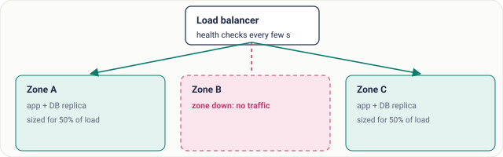
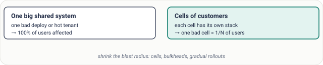
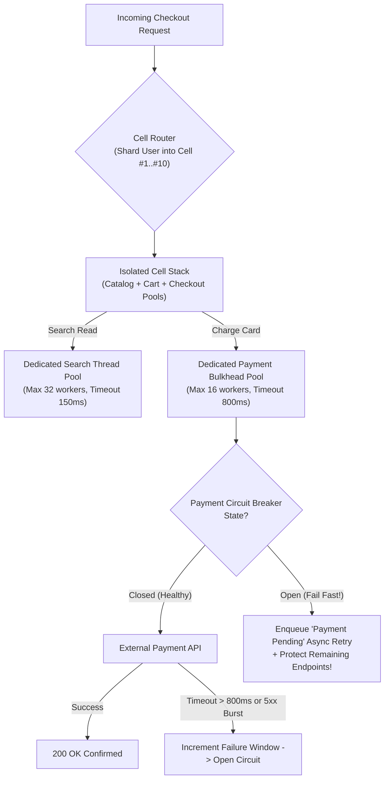
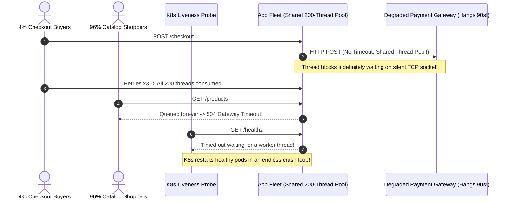

# Lesson 16: Fault Tolerance

> **Prerequisites:** [Lesson 15: Consistency Models](../15-consistency-models/README.md).  
> **Estimated Reading Time:** 26 minutes  
> **Target Audience:** Backend engineers, site reliability engineers (SREs), and distributed systems architects isolating blast radii, provisioning zone-failover headroom, and preventing partial faults from escalating into full outages.  
> **Free PDF Notes:** [Download SD-A-016.pdf](https://backendroadmap.com/notes/system-design/SD-A-016.pdf) · [Phase 1, Core Fundamentals (PDF)](https://backendroadmap.com/notes/system-design/Phase1_Core_Fundamentals_Notes.pdf)

> [!TIP]
> **The Golden Rule of Fault Tolerance:** Hardware crashes, slow downstream APIs, and bad config pushes are statistical certainties—not surprises. **Fault tolerance** ensures a single broken component (**a fault**) never cascades into a user-facing outage (**a failure**) by combining **redundant capacity across independent failure domains** (`1.5x` multi-AZ headroom), **strict isolation boundaries** (cells, dependency bulkheads, tight timeouts, circuit breakers), and **gradual canary rollouts** with automated rollback.

---

## Visual Mental Models & Architecture

### Multi-Zone Failover & Capacity Headroom

Spread stateless and stateful replicas across independent Availability Zones (AZs). When one zone goes offline, load balancers detect failed health checks within seconds and drain traffic onto the remaining zones.



*Figure 1. Replicas in three availability zones. If one zone goes down, the load balancer stops sending it traffic and the other two carry the load.*

> [!NOTE]
> **Plan Capacity Explicitly for a Zone Loss:** If you run across 3 Availability Zones at peak, each zone normally handles $\frac{1}{3}$ (`33.3%`) of peak traffic. If one zone fails, the **remaining 2 zones** must immediately carry $\frac{1}{2}$ (`50%`) each. Therefore every zone must run with **at least `1.5×` its normal share** ($\sim 50\%$ peak capacity). Sizing each zone strictly at `35%` guarantees the survivors saturate and crash when failover begins—turning a single-zone fault into a global failure.

### Cell-Based Blast Radius Containment



*Figure 2. Cells limit how many users one problem can reach.*

### Bulkheads, Timeouts, Circuit Breakers & Graceful Fallback Flow



---

## Systematic Taxonomic Reference Grids

### Fault Taxonomy & Mitigation Controls

| Fault Category | Concrete Real-World Examples | Blast Radius Risk Without Protection | Primary Engineering Controls |
| :--- | :--- | :--- | :--- |
| **Hardware Faults** | SSD sector death, ECC memory errors, top-of-rack switch drop, AZ fiber cut, power loss. | Single-AZ capacity loss overloads remaining zones; un-replicated node loses state. | Multi-AZ placement with $1.5\times$ headroom (`N+1`/`N+2`), synchronous cross-AZ WAL replication. |
| **Software Faults** | Unhandled null panic, heap memory leak, slow hanging third-party dependency, aggressive client retry storms. | One hanging dependency monopolizes shared web workers, taking unrelated healthy endpoints (`GET /catalog`, `GET /health`) down. | Bounded HTTP timeouts, **bulkhead** isolated pools, **circuit breakers**, exponential backoff + jitter. |
| **Human / Operational Faults** | Bad feature flag/YAML push, unindexed query deployed to all shards, accidental `DROP`/`DELETE`, expired cert. | Accounts for a massive share of SEV-1 outages—global rollout breaks `100%` of replicas simultaneously! | Config-as-code schema linting, **1% canary -> 10% -> 100%** progressive rollouts, cell isolation, automated rollback triggers. |

### Fault Containment Patterns Matrix

| Pattern | How It Works | Specific Threat Stopped | Operational Trade-Off |
| :--- | :--- | :--- | :--- |
| **Redundancy + Zone Headroom** | Run replicas across 3+ isolated power/network Availability Zones sized at $\sim 50\%$ peak each. | Correlated hardware/network zone loss. | `~33%–50%` idle baseline compute cost during normal healthy traffic. |
| **Cell Architecture** | Partition customers into independent mini-stacks (Cell A, Cell B... Cell Z) sharing zero runtime DB/cache state. | Bad config push, noisy neighbor, or poison-pill payload crashing 100% of users at once. | Higher control-plane routing orchestration + more smaller DB instances. |
| **Dependency Bulkheads** | Assign capped, independent worker/connection pools per downstream dependency (`PaymentPool`, `EmailPool`). | One slow external service stalling all HTTP server threads globally. | Unused pool capacity in Pool A cannot be borrowed by Pool B. |
| **Canary + Auto-Rollback** | Deploy new code/config to 1 cell or `1%` of traffic first; abort cleanly if p99/5xx crosses budget. | Software regressions and misconfigurations hitting 100% of fleet concurrently. | Slower full deployment rollout duration (e.g., 20–40 min vs. 2 min). |
| **Chaos Engineering** | Intentionally inject latency, drop pods, or blackhole an AZ in controlled production windows (with kill switches). | Unverified assumptions hiding in staging mocks until midnight production outages expose them. | Requires strict blast-radius guardrails and automated abort hooks. |

### Key Terms Reference

| Term | Operational Meaning |
| :--- | :--- |
| **Fault** | A single hardware, software, or human component deviating from specification. |
| **Failure** | The overall system becoming unable to fulfill user requests within SLOs. |
| **Availability Zone (AZ)** | Physically isolated data center facility (independent power, cooling, networking) inside one cloud region. |
| **Blast Radius** | Total percentage of users, tenants, or endpoints disrupted when a given fault occurs. |
| **Bulkhead** | Resource-pool compartmentalization isolating failures in one dependency from sinking the whole process. |
| **Chaos Engineering** | Disciplined fault-injection testing in real environments to surface hidden weaknesses proactively. |

---

## Production War Stories: Incident Post-Mortem

### SEV-1 Post-Mortem: The Unbounded Payment Timeout & Global Thread-Pool Hang

#### Incident Overview
* **Severity:** SEV-1 (100% Site Outage Across Unrelated Read & Login Flows)
* **Detection Time:** 2 minutes after an upstream payment gateway experienced brownout latency
* **Resolution Time:** 41 minutes
* **Impact:** Even though only `4%` of user traffic touched `/checkout`, the entire storefront (`GET /products`, `POST /login`, `GET /health`) stopped responding with `504 Gateway Timeout`—and Kubernetes restarted every pod continuously because liveness probes stalled on exhausted thread pools.

#### What Happened
An online ticketing service shared one global HTTP worker pool (`200 threads`) and one shared `requests` HTTP client (with **no socket timeout specified**!) across all routes.
1. At 18:12 UTC, an external card processor suffered severe database lock contention: instead of failing fast, its API accepted TCP connections and held sockets silent for `90+ seconds`.
2. Users clicking "Pay Now" tied up HTTP worker threads waiting indefinitely—then gave up and hit Refresh, dispatching *more* hanging threads.
3. Within 45 seconds, all `200` worker threads in every pod were stalled inside `payment_gateway.charge()`.
4. When healthy shoppers visited `GET /catalog` or Kubernetes called `GET /healthz`, zero free workers remained in the queue—causing Kubernetes to kill-loop the entire fleet repeatedly!



#### Root Cause Analysis
1. **Absence of Hard Network Timeouts:** Calling an external service with infinite/default timeouts converted upstream slowness into indefinite thread starvation locally.
2. **Missing Bulkheads:** Mixing low-criticality fast reads and slow external payment writes inside one shared concurrency pool allowed a `4%` payment fault to kill `100%` of application endpoints.
3. **Aggressive Auto-Retries Without Circuit Breakers:** Retries kept hammering an already-degraded downstream while failing to degrade gracefully.

#### The Fix & Architectural Hardening
1. **Strict Timeout Contracts:** Enforced connect (`200ms`) + read (`800ms`) timeouts on every outbound dependency client.
2. **Scoped Dependency Bulkhead + Circuit Breaker:** Capped payment gateway concurrency strictly to a semaphore/pool of `24` slots per pod (leaving `176+` workers permanently protected for catalog, auth, and `/healthz`). Added a sliding-window circuit breaker that opens after 5 consecutive failures/timeouts and routes orders into a durable *"Payment Processing"* async queue.
3. **Weekly Chaos Drills:** Scheduled controlled staging/canary fault-injection injecting `5s` latency into synthetic payment mocks to prove `GET /products` p99 remains `< 15ms`.

---

## Multi-Language Production Implementation: Bulkhead Semaphore + Timeout + Circuit Breaker

Each implementation below wraps an unreliable external dependency in three defensive shields: **(1)** bounded **Bulkhead concurrency semaphore** so slow calls cannot starve unrelated API workers, **(2)** strict **per-call Deadline Timeout**, and **(3)** **Circuit Breaker state machine** failing fast into graceful fallback once failure thresholds trip.

````carousel
```go
package faulttolerance

import (
	"context"
	"errors"
	"sync"
	"time"
)

var (
	ErrBulkheadFull = errors.New("bulkhead saturated: shedding payment load to save core API")
	ErrCircuitOpen  = errors.New("circuit open: failing fast while downstream recovers")
)

type ResilientDependencyClient struct {
	sem          chan struct{}
	timeout      time.Duration
	mu           sync.Mutex
	failures     int
	openUntil    time.Time
	maxFailures  int
	cooldown     time.Duration
}

func NewResilientClient(maxConcurrent int, timeout time.Duration, maxFail int, cooldown time.Duration) *ResilientDependencyClient {
	return &ResilientDependencyClient{
		sem:         make(chan struct{}, maxConcurrent),
		timeout:     timeout,
		maxFailures: maxFail,
		cooldown:    cooldown,
	}
}

func (c *ResilientDependencyClient) CallProtected(ctx context.Context, fn func(context.Context) (string, error)) (string, error) {
	c.mu.Lock()
	if time.Now().Before(c.openUntil) {
		c.mu.Unlock()
		return "queued_for_async_retry", ErrCircuitOpen
	}
	c.mu.Unlock()

	// Bulkhead guard: non-blocking acquire protects global server goroutines/pools
	select {
	case c.sem <- struct{}{}:
		defer func() { <-c.sem }()
	default:
		return "queued_for_async_retry", ErrBulkheadFull
	}

	callCtx, cancel := context.WithTimeout(ctx, c.timeout)
	defer cancel()

	res, err := fn(callCtx)
	c.mu.Lock()
	defer c.mu.Unlock()

	if err != nil {
		c.failures++
		if c.failures >= c.maxFailures {
			c.openUntil = time.Now().Add(c.cooldown)
		}
		return "queued_for_async_retry", err
	}
	c.failures = 0
	return res, nil
}
```
<!-- slide -->
```typescript
export class ResilientGatewayShield {
  private inFlight = 0;
  private consecutiveFailures = 0;
  private openUntilMs = 0;

  constructor(
    private readonly bulkheadMaxConcurrent = 16,
    private readonly timeoutMs = 800,
    private readonly tripThreshold = 5,
    private readonly cooldownMs = 15_000
  ) {}

  async execute<T>(action: (signal: AbortSignal) => Promise<T>, fallbackValue: T): Promise<{ result: T; degraded: boolean }> {
    if (Date.now() < this.openUntilMs) {
      return { result: fallbackValue, degraded: true }; // Circuit Open: fast fail
    }
    if (this.inFlight >= this.bulkheadMaxConcurrent) {
      return { result: fallbackValue, degraded: true }; // Bulkhead Full: isolate blast radius
    }

    this.inFlight++;
    const controller = new AbortController();
    const timer = setTimeout(() => controller.abort(), this.timeoutMs);

    try {
      const result = await action(controller.signal);
      this.consecutiveFailures = 0;
      return { result, degraded: false };
    } catch {
      this.consecutiveFailures++;
      if (this.consecutiveFailures >= this.tripThreshold) {
        this.openUntilMs = Date.now() + this.cooldownMs;
      }
      return { result: fallbackValue, degraded: true };
    } finally {
      clearTimeout(timer);
      this.inFlight--;
    }
  }
}
```
<!-- slide -->
```python
import asyncio
import time
from collections.abc import Awaitable, Callable
from typing import TypeVar

T = TypeVar("T")


class ProtectedExternalClient:
    def __init__(
        self,
        bulkhead_limit: int = 16,
        timeout_sec: float = 0.8,
        failure_threshold: int = 5,
        cooldown_sec: float = 15.0,
    ) -> None:
        self._sem = asyncio.Semaphore(bulkhead_limit)
        self.timeout_sec = timeout_sec
        self.failure_threshold = failure_threshold
        self.cooldown_sec = cooldown_sec
        self._failures = 0
        self._open_until = 0.0

    async def call(self, op: Callable[[], Awaitable[T]], fallback: T) -> tuple[str, T]:
        now = time.monotonic()
        if now < self._open_until:
            return "circuit_open_fallback", fallback

        # Non-blocking bulkhead check avoids queueing unrelated API requests behind a stalled vendor
        if self._sem.locked():
            return "bulkhead_full_fallback", fallback

        async with self._sem:
            try:
                value = await asyncio.wait_for(op(), timeout=self.timeout_sec)
                self._failures = 0
                return "ok", value
            except (asyncio.TimeoutError, Exception):
                self._failures += 1
                if self._failures >= self.failure_threshold:
                    self._open_until = time.monotonic() + self.cooldown_sec
                return "fault_degraded_fallback", fallback
```
<!-- slide -->
```csharp
public sealed class BulkheadCircuitShield(int maxConcurrency = 16, int timeoutMs = 800, int maxFailures = 5)
{
    private readonly SemaphoreSlim _bulkhead = new(maxConcurrency, maxConcurrency);
    private readonly TimeSpan _timeout = TimeSpan.FromMilliseconds(timeoutMs);
    private int _consecutiveFailures;
    private long _openUntilTicks;

    public async Task<(string Status, T Result)> RunAsync<T>(
        Func<CancellationToken, Task<T>> dependencyCall,
        T fallback,
        CancellationToken outerToken = default)
    {
        if (DateTime.UtcNow.Ticks < Interlocked.Read(ref _openUntilTicks))
            return ("circuit-open-fast-fail", fallback);

        if (!await _bulkhead.WaitAsync(0, outerToken))
            return ("bulkhead-saturated-shed", fallback);

        try
        {
            using var linkedCts = CancellationTokenSource.CreateLinkedTokenSource(outerToken);
            linkedCts.CancelAfter(_timeout);

            var result = await dependencyCall(linkedCts.Token);
            Interlocked.Exchange(ref _consecutiveFailures, 0);
            return ("healthy", result);
        }
        catch
        {
            if (Interlocked.Increment(ref _consecutiveFailures) >= maxFailures)
                Interlocked.Exchange(ref _openUntilTicks, DateTime.UtcNow.AddSeconds(15).Ticks);

            return ("timeout-or-error-fallback", fallback);
        }
        finally
        {
            _bulkhead.Release();
        }
    }
}
```
````

---

## Practical Hands-On Verification CLI Workflows

Simulate a multi-zone peak capacity failure (`N` vs `N-1` zones) and empirically test how the `ProtectedExternalClient` isolates a stalled payment provider while healthy catalog requests continue finishing instantaneously.

### Step 1: Verify Multi-AZ Peak Headroom & Bulkhead Isolation

```bash
python3 - <<'EOF'
import asyncio, time

peak_rps = 30_000
zone_capacity_underprovisioned = 11_000  # sized only ~36% of peak!
zone_capacity_safe = 15_500              # sized ~52% of peak (~1.5x normal 10k load)

surviving_zones = 2
print(f"3-AZ Peak Load: {peak_rps} RPS | Load per surviving zone during 1-zone outage: {peak_rps/surviving_zones:,.0f} RPS")
print(f"Underprovisioned (36% cap each): total surviving cap = {zone_capacity_underprovisioned*2:,} RPS -> CASCADE FAILURE!")
print(f"Headroom-Planned (52% cap each): total surviving cap = {zone_capacity_safe*2:,} RPS -> FAULT TOLERATED!\n")

sem = asyncio.Semaphore(4) # Payment bulkhead capped at 4 concurrent slots
async def call_payment(i):
    if sem._value == 0:
        return f"req-{i}: SHED immediately (bulkhead full, 0ms)"
    async with sem:
        try:
            await asyncio.wait_for(asyncio.sleep(2.0), timeout=0.15) # Payment vendor hangs 2s!
            return f"req-{i}: paid"
        except asyncio.TimeoutError:
            return f"req-{i}: TIMEOUT clipped at 150ms -> fallback queued"

async def main():
    t0 = time.perf_counter()
    results = await asyncio.gather(*(call_payment(i) for i in range(8)))
    for r in results:
        print(r)
    print(f"All 8 concurrent bursts bounded cleanly in {(time.perf_counter()-t0)*1000:.1f}ms!")

asyncio.run(main())
EOF
```

**Expected Output:**
```text
3-AZ Peak Load: 30000 RPS | Load per surviving zone during 1-zone outage: 15,000 RPS
Underprovisioned (36% cap each): total surviving cap = 22,000 RPS -> CASCADE FAILURE!
Headroom-Planned (52% cap each): total surviving cap = 31,000 RPS -> FAULT TOLERATED!

req-0: TIMEOUT clipped at 150ms -> fallback queued
req-1: TIMEOUT clipped at 150ms -> fallback queued
req-2: TIMEOUT clipped at 150ms -> fallback queued
req-3: TIMEOUT clipped at 150ms -> fallback queued
req-4: SHED immediately (bulkhead full, 0ms)
req-5: SHED immediately (bulkhead full, 0ms)
req-6: SHED immediately (bulkhead full, 0ms)
req-7: SHED immediately (bulkhead full, 0ms)
All 8 concurrent bursts bounded cleanly in ~151.0ms!
```

---

## Operational Validation Checkpoints (Scenario Quizzes)

<details>
<summary><strong>Checkpoint 1: The Multi-AZ Autoscaling Capacity Trap</strong></summary>

**Scenario:** An API runs across `us-east-1a`, `us-east-1b`, and `us-east-1c` handling `12,000 RPS` at peak (`4,000 RPS` per zone). To cut EC2 bills, FinOps removes "excess" reserve nodes so each zone runs at `85%` CPU handling `4,000 RPS` (`max capacity: 4,700 RPS` per zone). What happens at peak traffic if `us-east-1b` loses power before new EC2 instances can warm up (`5+ minutes`)?

<strong>Answer:</strong>
Losing `us-east-1b` dumps its `4,000 RPS` immediately onto the remaining 2 zones (`6,000 RPS` each)—exceeding their `4,700 RPS` ceiling by `28%`! Both surviving zones exhaust CPU/memory, enter GC/OOM stalls, fail health checks, and crash in succession, converting a **1-zone hardware fault** into a **total platform failure**! Never count on slow autoscaling to survive an instant AZ loss—provision `1.5×` steady-state headroom across surviving zones upfront.
</details>

<details>
<summary><strong>Checkpoint 2: Why Adding More Replicas Didn't Prevent a Shared Config Outage</strong></summary>

**Scenario:** A storage team runs 12 replicas of their gateway across 3 Availability Zones and 3 cloud sub-networks. During a routine Tuesday rollout, an engineer pushes a typo in a shared regex feature flag (`GLOBAL_ROUTE_RULES.json`) simultaneously to all 12 instances via Consul. All 12 instances crash with an unhandled panic inside 3 seconds. Why did 12-way redundancy fail?

<strong>Answer:</strong>
Redundancy only tolerates **independent** faults—not **correlated global mutations**. Every replica read the exact same central configuration artifact at the exact same moment, giving the fault a `100%` blast radius. Prevent correlated operational failures via **progressive cell/canary rollouts** (update Cell 0 / `1%` first, evaluate synthetic probes + panic metrics for 10 minutes, and halt/auto-rollback automatically before touching Cells 1–9).
</details>

<details>
<summary><strong>Checkpoint 3: Isolating Noisy Tenants & Poison Pills With Cells</strong></summary>

**Scenario:** A SaaS analytics service uses one multi-tenant PostgreSQL database and one shared worker queue serving `10,000` corporate accounts. One customer runs a malformed recursive export query that triggers an out-of-memory crash loop in PostgreSQL, restarting the database for all `10,000` accounts. How does **Cell-Based Architecture** cut this blast radius by $99\%$?

<strong>Answer:</strong>
By partitioning customers across **100 isolated Cells** (e.g., `100` tenants per independent cell stack holding its own dedicated app replicas, worker queue, and PostgreSQL cluster, routed at the edge gateway by `tenant_id`). If that same poison-pill export hits Cell #42, only the `100` tenants assigned to Cell #42 experience disruption while the remaining `9,900` (`99%`) tenants across Cells #01–#41 and #43–#100 see zero impact.
</details>

---

## Interview Practice Questions

Each question is tagged by kind: **Basic** (definitions), **Scenario** (apply it to a system), and **Tricky** (deep follow-ups). Answer out loud before opening the solution.

<details>
<summary><strong>1. What's the difference between a fault and a failure? (Basic)</strong></summary>

<strong>What a strong answer covers:</strong>
A **fault** is an individual component deviating from expected behavior (a dead disk, slow downstream API, crashed container). A **failure** occurs when the entire user-facing service stops working correctly. Fault tolerance isolates and masks faults before they escalate into failures.
</details>

<details>
<summary><strong>2. How do you limit blast radius? (Basic)</strong></summary>

<strong>What a strong answer covers:</strong>
Combine **cell isolation** (partitioning customers/traffic into independent stacks), **dependency bulkheads** (separate bounded thread/connection pools per downstream), multi-zone dispersion, and **progressive canary deployments** (`1% -> 10% -> 100%`) wired to automatic rollback triggers.
</details>

<details>
<summary><strong>3. What are the three kinds of faults? (Basic)</strong></summary>

<strong>What a strong answer covers:</strong>
**(1) Hardware faults** (disk failures, bad RAM, switch/power/AZ cuts), **(2) Software faults** (memory leaks, unhandled exceptions, hanging dependencies, retry storms), and **(3) Human/operational faults** (broken configs, unvetted deploys, accidental `DELETE`/`DROP` commands—historically a leading cause of severe outages).
</details>

<details>
<summary><strong>4. You run in 3 zones. How much capacity does each need? (Scenario)</strong></summary>

<strong>What a strong answer covers:</strong>
Each zone needs capacity for roughly **50% of peak traffic** (`~1.5×` its normal $\frac{1}{3}$ load), so if one Availability Zone dies completely at peak traffic, the surviving two zones immediately absorb the shifted load without saturating into cascading failures.
</details>

<details>
<summary><strong>5. A slow payment provider makes your whole API time out. Fix? (Scenario)</strong></summary>

<strong>What a strong answer covers:</strong>
Enforce tight **connect & read timeouts**, wrap payment calls inside a capped **bulkhead pool** separate from core endpoints, protect with a **circuit breaker** that fails fast during sustained brownouts, and degrade gracefully (e.g., enqueue orders into an asynchronous retry outbox with `202 Accepted` status).
</details>

<details>
<summary><strong>6. A config push took down every server at once. How do you prevent it? (Scenario)</strong></summary>

<strong>What a strong answer covers:</strong>
Treat configuration identically to production code: schema-validate in CI before merge, roll config updates gradually across **cells/canaries** (`1%` first with bake time), monitor panic/5xx SLOs continuously, and wire automated instant rollback before advancing waves.
</details>

<details>
<summary><strong>7. Do more replicas always mean more fault tolerance? (Tricky)</strong></summary>

<strong>What a strong answer covers:</strong>
**No—only against independent faults.** If 50 replicas share the exact same buggy release, global feature flag, database single-point dependency, or regional power grid, all 50 fail simultaneously. Fault tolerance demands **isolation and failure-domain independence**, not merely higher instance counts.
</details>

<details>
<summary><strong>8. Why run chaos experiments in production? (Tricky)</strong></summary>

<strong>What a strong answer covers:</strong>
Staging environments rarely match real production concurrency, noisy data skew, weird retry timing, or third-party edge behavior. Small, tightly bounded chaos experiments in production (always protected by explicit blast-radius caps and instant abort kill switches) verify resilience assumptions cleanly during daytime hours before real outages strike at 3 AM.
</details>

---

## Common Mistakes & Troubleshooting

- **Running 3 zones provisioned for only 33% of peak each:** Guarantees secondary cascade overload the second one zone drops.
- **Sharing a single global thread pool with zero timeouts across external vendors:** Lets one degraded API freeze `/healthz` and core routes.
- **Rolling unvalidated configuration simultaneously to 100% of pods:** Turns a typo into an instantaneous fleet-wide outage.
- **Confusing higher replica count with independent failure domains:** Spread across zones, cells, and staggered rollout rings.

---

## Further Reading & Sources

- [AWS Well-Architected: Reducing Blast Radius With Cellular Architecture](https://docs.aws.amazon.com/wellarchitected/latest/reducing-scope-of-impact-with-cell-based-architecture/reducing-scope-of-impact-with-cell-based-architecture.html) — Production blueprint for cell routing and isolated fault containment.
- [Principles of Chaos Engineering](https://principlesofchaos.org/) — Formal methodology for safe steady-state hypothesis testing and controlled fault injection.

---

## Free PDF notes

Download these notes as a printable PDF, with every diagram: [SD-A-016.pdf](https://backendroadmap.com/notes/system-design/SD-A-016.pdf). All Phase 1 notes in one file: [Phase 1, Core Fundamentals (PDF)](https://backendroadmap.com/notes/system-design/Phase1_Core_Fundamentals_Notes.pdf).

---

## Next

Continue with [Lesson 17: Single Point of Failure](../17-single-point-of-failure/README.md) to systematically audit an architecture path-by-path for hidden SPOFs and choose between Active-Passive and Active-Active failover topologies.
