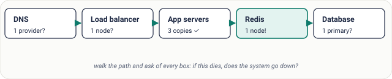
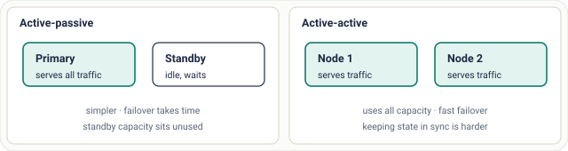

# Lesson 17: Single Point of Failure

## Roadmap

You are in **System Design Interview Prep**, Track 01, **Core Fundamentals**: lesson 17 of 19 (find the weak link, then remove it). It builds on [Lesson 16: Fault Tolerance](../16-fault-tolerance/README.md). Next comes [Lesson 18: Simple Beats Clever](../18-simple-beats-clever/README.md).

These are the written notes for the lesson's video. Prefer paper? The same notes are a free, printable PDF: [download SD-A-017.pdf](https://backendroadmap.com/notes/system-design/SD-A-017.pdf).

## Concept

> [!key] A single point of failure is any component whose loss takes the whole system down; find them by walking the request path, remove them with active-passive or active-active redundancy.

## Explanation

### What a SPOF is

A chain of ten strong links breaks at its one weak link. A **SPOF** is any component that exists once and that everything depends on. Redundancy everywhere else doesn't help if one piece has no backup.

They hide in obvious places (a single database, load balancer or region) and in surprising ones: a single DNS provider, one TLS certificate about to expire, one deploy pipeline, one engineer who holds the keys.

### Finding them

*Figure 1. The app tier is redundant, but sessions live on one Redis node. When it dies, every user is logged out at once.*

> [!example] **Fixing the Redis SPOF.** Add a replica in another zone with **Redis Sentinel** to detect failure and promote it automatically (usually within seconds), or run **Redis Cluster** with replicas per shard. Clients must reconnect to the new primary, so use a Sentinel-aware client.

### Two redundancy patterns

*Figure 2. Active-passive is simpler; active-active uses capacity better but needs state kept in sync across nodes.*

|  | Active-passive | Active-active |
|---|---|---|
| **Traffic** | One node at a time | All nodes at once |
| **Failover** | Seconds to minutes (detect + promote) | Near-instant: others keep serving |
| **Cost** | Standby idle | All capacity used |
| **Hard part** | Promotion without split brain | Concurrent writes and conflicts |
| **Typical use** | Primary database + standby | Stateless app servers, multi-region reads |

### The database tier

- A primary with replicas in other zones, and **automatic failover** that promotes a replica when the primary dies.
- **Backups** stored elsewhere, with tested restores.
- At larger scale, multi-region, or a distributed database designed to survive losing nodes.

## Key terms

| Term | Meaning |
|---|---|
| **SPOF** | one component whose loss stops everything |
| **Active-passive** | standby takes over on failure |
| **Active-active** | all nodes serve at once |
| **Failover** | switching to a backup |
| **Redis Sentinel** | monitors Redis and promotes a replica |
| **Split brain** | two nodes both think they're primary |

## Interview questions

Each question is tagged by kind: **Basic** (definitions), **Scenario** (apply it to a system) and **Tricky** (the follow-ups interviewers use to go deeper). Answer out loud before you open the answer.

> [!interview] How do you find SPOFs? (Basic)

What a strong answer covers

Walk the request path (DNS, load balancer, app, cache, database) and ask of every component: if this dies, does the system go down? Include certificates, secrets, pipelines and people.

> [!interview] How do you remove a SPOF in the database tier? (Basic)

What a strong answer covers

Add replicas in other zones with automatic failover, plus tested backups; at scale, consider multi-region or a distributed database.

> [!interview] Active-passive vs active-active? (Basic)

What a strong answer covers

Active-passive: one serves, a standby takes over (simpler, slower failover, idle capacity). Active-active: all serve (better use, faster failover, harder state sync).

> [!interview] Every user was logged out when one Redis node restarted. Fix it. (Scenario)

What a strong answer covers

Sessions had one home. Add a replica with Sentinel for automatic failover, or Redis Cluster; or use signed session tokens so the cache isn't needed to stay logged in.

> [!interview] Is the load balancer itself a SPOF? (Scenario)

What a strong answer covers

It can be. Use a managed cloud load balancer (redundant by design) or a pair with a floating IP (VRRP/keepalived) and health checks, and spread across zones.

> [!interview] Only one engineer knows how to deploy. Why is that a SPOF, and what do you do? (Scenario)

What a strong answer covers

If they're unavailable, nobody can ship or roll back. Automate the pipeline, document runbooks, and rotate on-call so several people can deploy.

> [!interview] What's split brain, and how do you prevent it? (Tricky)

What a strong answer covers

After a partition, two nodes both act as primary and accept conflicting writes. Prevent it with a majority quorum for promotion and fencing (the old primary is blocked from writing).

> [!interview] Can a region be a SPOF? (Tricky)

What a strong answer covers

Yes. A region-wide outage takes everything there down. Multi-region removes it, at the cost of replication latency, consistency trade-offs and higher spend; use it when the requirement justifies it.

## Common mistakes & troubleshooting

- Redundant app servers in front of one database or cache.
- One load balancer, or one DNS provider.
- Forgetting non-server SPOFs: certificates, secrets, CI/CD, a single person.
- A standby that was never actually failed over to in a test.

## Free PDF notes

Download these notes as a printable PDF, with every diagram: [SD-A-017.pdf](https://backendroadmap.com/notes/system-design/SD-A-017.pdf). All Phase 1 notes in one file: [Phase 1, Core Fundamentals (PDF)](https://backendroadmap.com/notes/system-design/Phase1_Core_Fundamentals_Notes.pdf).

The Phase 2 video on this page has its own notes: [SD-D-014: Identifying SPOFs](https://backendroadmap.com/notes/system-design/SD-D-014.pdf). All of them in one file: [Phase 2, Estimation (PDF)](https://backendroadmap.com/notes/system-design/Phase2_Estimation_Notes.pdf).

## Next

Continue with [Lesson 18: Simple Beats Clever](../18-simple-beats-clever/README.md).
