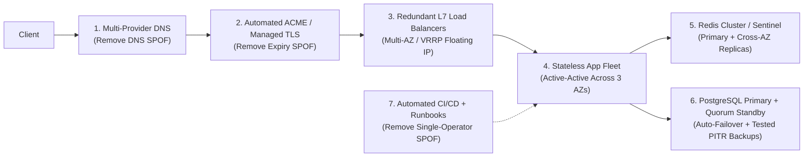
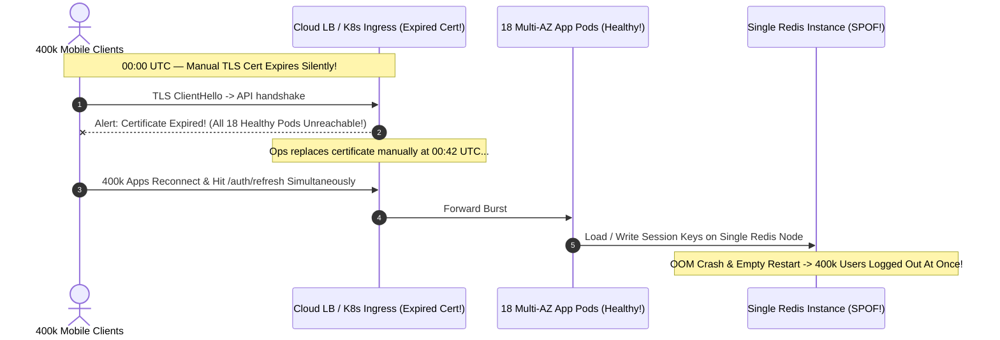

# Lesson 17: Single Point of Failure

> **Prerequisites:** [Lesson 16: Fault Tolerance](../16-fault-tolerance/README.md).  
> **Estimated Reading Time:** 28 minutes  
> **Target Audience:** Backend engineers, reliability engineers (SREs), and cloud architects hunting hidden SPOFs across infrastructure, data stores, certificates, and deployment workflows.  
> **Free PDF Notes:** [Download SD-A-017.pdf](https://backendroadmap.com/notes/system-design/SD-A-017.pdf) · [SD-D-014: Identifying SPOFs](https://backendroadmap.com/notes/system-design/SD-D-014.pdf) · [Phase 1, Core Fundamentals (PDF)](https://backendroadmap.com/notes/system-design/Phase1_Core_Fundamentals_Notes.pdf) · [Phase 2, Estimation (PDF)](https://backendroadmap.com/notes/system-design/Phase2_Estimation_Notes.pdf)

> [!TIP]
> **The Golden Rule of Eliminating SPOFs:** A chain of nine replicated tiers still collapses completely if one un-replicated link sits in its path. Audit every system by **walking the full request path end to end**—including non-server dependencies like TLS certificates, DNS providers, CI/CD pipelines, and human on-call knowledge—and eliminate each **Single Point of Failure (SPOF)** using either **Active-Passive automatic failover** (with quorum + fencing against split brain) or **Active-Active multi-node serving**.

---

## Visual Mental Models & Architecture

### How One Un-Replicated Component Breaks a Redundant Fleet

Even with dozens of stateless app containers behind load balancers, storing all active sessions inside a single Redis instance creates an immediate global SPOF.


*Figure 1. The app tier is redundant, but sessions live on one Redis node. When it dies, every user is logged out at once.*

> [!NOTE]
> **Fixing the Redis Session SPOF:** Replicate Redis into a separate Availability Zone governed by **Redis Sentinel** (automatic failure detection and primary promotion within seconds, using Sentinel-aware clients) or deploy **Redis Cluster** with per-shard replicas. Alternatively, carry short-lived session state inside cryptographically signed **JWT tokens** so a transient Redis restart does not kick authenticated users out instantaneously.

### Active-Passive vs. Active-Active Redundancy Topologies


*Figure 2. Active-passive is simpler; active-active uses capacity better but needs state kept in sync across nodes.*

### End-to-End Request-Path SPOF Audit Checklist Diagram



---

## Systematic Taxonomic Reference Grids

### Active-Passive vs. Active-Active Comparison

| Architectural Axis | Active-Passive (Primary + Hot Standby) | Active-Active (All Replicas Serving) |
| :--- | :--- | :--- |
| **Live Traffic Distribution** | Only the Primary node handles live mutations/requests while the Standby trails via WAL replication. | All healthy nodes accept requests simultaneously behind load balancing / DNS routing. |
| **Failover Latency** | Seconds to minutes (heartbeat timeout $\to$ quorum election $\to$ standby promotion $\to$ DNS/client reconnect). | Near-instantaneous: load balancers drop the failed peer and surviving active nodes continue uninterrupted. |
| **Resource Utilization** | Idle standby consumes hardware cost while performing minimal active user work (unless handling async read traffic). | Higher compute utilization—every active node serves production load continuously. |
| **Hardest Engineering Risk** | **Preventing split brain:** ensuring the fenced old primary cannot keep accepting stale writes after promotion. | **State synchronization & conflicts:** coordinating concurrent writes (e.g., CRDTs, consensus, or partitioning). |
| **Best Fit Systems** | Stateful transactional SQL databases (`PostgreSQL`, `MySQL` primary-standby), active-standby VPN concentrators. | Stateless API fleets, multi-AZ load balancers, multi-master caches, multi-region read gateways. |

### Hidden Non-Server SPOF Audit Catalog

| Layer / Domain | Obvious / Hidden SPOF Example | Outage Symptom When Triggered | How to Remove the SPOF |
| :--- | :--- | :--- | :--- |
| **Edge DNS** | Relying on one DNS registrar/authoritative nameserver. | DDoS or registrar outage renders domain unresolvable worldwide even though origin servers are 100% healthy. | Dual authoritative DNS providers (e.g., Route 53 + Cloudflare NS) with low-TTL NS records. |
| **TLS Certificates** | Manually renewed 1-year cert stored only in one secret manager vault. | On expiration day, browsers/mobile SDKs refuse 100% of API handshakes instantly. | Automated ACME (`cert-manager`) / Cloud ACM renewal + 30-day & 7-day expiry alerts. |
| **Load Balancer** | One self-managed HAProxy VM routing traffic to 20 backend pods. | Single VM kernel panic severs all ingress across 20 healthy containers. | Managed multi-AZ Cloud Load Balancers or active-passive HAProxy pair with `keepalived` VRRP floating IP. |
| **Cache / Session Store** | Single standalone Redis container holding login sessions (`Figure 1`). | One OS patch reboot logs out 100% of active users simultaneously. | Redis Sentinel / Cluster across AZs, plus stateless signed JWT short-lived access tokens. |
| **Database Tier** | Single PostgreSQL instance without standby or restore-tested backups. | EBS/host corruption triggers hours-long or permanent outage. | Multi-AZ standby with automated quorum failover (`Patroni`/managed RDS) + cross-region tested PITR backups. |
| **Human & Pipeline** | Only Alice has production SSH keys / knows deploy scripts (`Bus Factor = 1`). | Incident strikes while Alice is unreachable on a flight; nobody can deploy hotfixes or rollbacks. | Automated GitOps CI/CD pipelines, team RBAC secrets, written runbooks, and rotated on-call drills. |

### Key Terms Reference

| Term | Operational Meaning |
| :--- | :--- |
| **SPOF (Single Point of Failure)** | Any individual server, dependency, cert, network link, or process whose failure takes down the entire system. |
| **Active-Passive** | Redundancy mode where one node serves while a synchronized standby awaits promotion upon failure. |
| **Active-Active** | Redundancy mode where all peer instances serve live production traffic simultaneously. |
| **Failover** | Automated or manual transition shifting traffic and leadership from a broken primary to a healthy backup. |
| **Redis Sentinel** | Distributed monitoring & coordination daemon detecting Redis primary crashes and orchestrating replica failover. |
| **Split Brain** | Hazardous failure state where a network partition causes two primaries to run concurrently and diverge writes. |

---

## Production War Stories: Incident Post-Mortem

### SEV-1 Post-Mortem: The "Five-Nines" Multi-AZ Stack Killed by One Expiring Cert & One Redis Node

#### Incident Overview
* **Severity:** SEV-1 (58-Minute Total Platform Lockout Despite Multi-AZ Kubernetes Fleet)
* **Detection Time:** 00:01 UTC (midnight expiration boundary)
* **Resolution Time:** 58 minutes
* **Impact:** `100%` of mobile iOS/Android clients failed TLS verification immediately at 00:00 UTC (`ERR_CERT_DATE_INVALID`), and once emergency cert replacement finished, `400,000` users got logged out simultaneously because an unrelated single-node Redis cache OOM-restarted during the morning reconnect spike.

#### What Happened
An engineering org proudly passed architecture reviews showcasing 18 stateless API pods spread across 3 Availability Zones and a Multi-AZ managed PostgreSQL instance. Yet two hidden SPOFs lingered unnoticed:
1. Ingress terminated TLS using a manually purchased wildcard certificate pinned inside a static Kubernetes `Secret` renewed once a year via a calendar reminder belonging to an engineer who had left the company 8 months earlier.
2. When the calendar reminder fired into a deactivated email inbox, the cert silently expired at `00:00:00 UTC`, dropping every mobile API call cleanly—even though pods, databases, and cloud load balancers stayed 100% green.
3. At `00:42 UTC`, Ops rotated the cert manually; 400k mobile apps hammered `/auth/refresh`, overwhelming the single un-replicated Redis session node (`maxmemory` hit), restarting Redis and wiping every session!



#### Root Cause Analysis
1. **Un-Audited Non-Server SPOF (Manual TLS Renewal):** Operational ownership relied on one departed employee's email reminder rather than automated renewal and synthetic expiry monitors.
2. **Stateful Cache SPOF:** Keeping sessions strictly inside an un-replicated standalone Redis process bypassed HA redundancy completely.

#### The Fix & Architectural Hardening
1. **Automated TLS Lifecycle:** Deployed `cert-manager` (`Let's Encrypt`/ACME + Cloud ACM) alongside Prometheus blackbox expiry alerting firing `> 21 days` prior to expiration.
2. **Sentinel-Backed Redis Cluster + Signed Refresh Fallback:** Upgraded session storage to Multi-AZ **Redis Sentinel** (automatic failover across 3 nodes) and moved stateless short-lived user auth claims into ECDSA-signed JWTs (`10-min TTL`).
3. **Quarterly Game-Day Failover Tests:** Verified automated standby failover (`Patroni` & Sentinel) deliberately during business hours—never trusting an un-tested standby!

---

## Multi-Language Production Implementation: Resilient Cache Client (Sentinel / Primary-Fallback Session Shield)

To survive single-node cache crashes without logging out every user or freezing logins, production clients combine **failover discovery** (Sentinel / multi-endpoint pool) with **stateless cryptographic verification fallback** when cache nodes transition leadership.

````carousel
```go
package spof

import (
	"crypto/hmac"
	"crypto/sha256"
	"encoding/hex"
	"errors"
	"strings"
	"sync"
)

type SentinelSessionStore struct {
	mu          sync.RWMutex
	endpoints   []string // [0]=active primary, [1..n]=standby candidates
	healthy     map[string]bool
	dataByNode  map[string]map[string]string
	jwtSecret   []byte
}

func NewSentinelSessionStore(secret []byte) *SentinelSessionStore {
	return &SentinelSessionStore{
		endpoints: []string{"redis-primary-az1:6379", "redis-replica-az2:6379"},
		healthy:   map[string]bool{"redis-primary-az1:6379": true, "redis-replica-az2:6379": true},
		dataByNode: map[string]map[string]string{
			"redis-primary-az1:6379": {},
			"redis-replica-az2:6379": {},
		},
		jwtSecret: secret,
	}
}

// PromoteReplica simulates Redis Sentinel automatic failover removing single-node SPOF.
func (s *SentinelSessionStore) KillPrimaryAndFailover() {
	s.mu.Lock()
	defer s.mu.Unlock()
	s.healthy[s.endpoints[0]] = false
	for i := 1; i < len(s.endpoints); i++ {
		if s.healthy[s.endpoints[i]] {
			s.endpoints[0], s.endpoints[i] = s.endpoints[i], s.endpoints[0]
			break
		}
	}
}

func (s *SentinelSessionStore) SignStatelessToken(userID string) string {
	mac := hmac.New(sha256.New, s.jwtSecret)
	mac.Write([]byte(userID))
	return userID + "." + hex.EncodeToString(mac.Sum(nil))
}

func (s *SentinelSessionStore) Authenticate(token string) (string, string, error) {
	s.mu.RLock()
	active := s.endpoints[0]
	isUp := s.healthy[active]
	if isUp {
		if uid, ok := s.dataByNode[active][token]; ok {
			s.mu.RUnlock()
			return uid, "redis_active:" + active, nil
		}
	}
	s.mu.RUnlock()

	// Stateless signed fallback prevents mass logouts even during Sentinel election window
	parts := strings.Split(token, ".")
	if len(parts) != 2 {
		return "", "", errors.New("invalid token")
	}
	expected := s.SignStatelessToken(parts[0])
	if hmac.Equal([]byte(token), []byte(expected)) {
		return parts[0], "stateless_hmac_fallback", nil
	}
	return "", "", errors.New("session verification failed")
}
```
<!-- slide -->
```typescript
import crypto from "node:crypto";

export class FailoverSafeSessionManager {
  private endpoints = ["redis-az1", "redis-az2"];
  private nodeHealthy = new Map<string, boolean>([
    ["redis-az1", true],
    ["redis-az2", true],
  ]);
  private stores = new Map<string, Map<string, string>>([
    ["redis-az1", new Map()],
    ["redis-az2", new Map()],
  ]);

  constructor(private readonly signingSecret: string) {}

  saveSession(token: string, userId: string): void {
    const primary = this.endpoints[0];
    this.stores.get(primary)?.set(token, userId);
    // Replicate asynchronously to standby AZ node
    const standby = this.endpoints[1];
    if (this.nodeHealthy.get(standby)) {
      this.stores.get(standby)?.set(token, userId);
    }
  }

  simulateSentinelFailover(): string {
    this.nodeHealthy.set(this.endpoints[0], false);
    this.endpoints.reverse();
    return this.endpoints[0];
  }

  signToken(userId: string): string {
    const sig = crypto.createHmac("sha256", this.signingSecret).update(userId).digest("hex");
    return `${userId}.${sig}`;
  }

  resolveUser(token: string): { userId: string; source: string } {
    for (const node of this.endpoints) {
      if (this.nodeHealthy.get(node)) {
        const hit = this.stores.get(node)?.get(token);
        if (hit) return { userId: hit, source: `cache:${node}` };
      }
    }
    const [uid, sig] = token.split(".");
    const expected = crypto.createHmac("sha256", this.signingSecret).update(uid ?? "").digest("hex");
    if (uid && sig === expected) {
      return { userId: uid, source: "stateless-jwt-fallback" };
    }
    throw new Error("Unauthorized session");
  }
}
```
<!-- slide -->
```python
import hmac
import hashlib
from dataclasses import dataclass, field


@dataclass
class MultiZoneSessionStore:
    signing_secret: bytes
    active_node: str = "redis-az1"
    standby_node: str = "redis-az2"
    up: dict[str, bool] = field(default_factory=lambda: {"redis-az1": True, "redis-az2": True})
    data: dict[str, dict[str, str]] = field(default_factory=lambda: {"redis-az1": {}, "redis-az2": {}})

    def create_session(self, user_id: str) -> str:
        sig = hmac.new(self.signing_secret, user_id.encode(), hashlib.sha256).hexdigest()
        token = f"{user_id}.{sig}"
        if self.up[self.active_node]:
            self.data[self.active_node][token] = user_id
        if self.up[self.standby_node]:
            self.data[self.standby_node][token] = user_id
        return token

    def failover_primary(self) -> str:
        self.up[self.active_node] = False
        self.active_node, self.standby_node = self.standby_node, self.active_node
        return self.active_node

    def validate_session(self, token: str) -> tuple[str, str]:
        # Try surviving promoted Redis node first
        if self.up.get(self.active_node) and token in self.data[self.active_node]:
            return self.data[self.active_node][token], f"sentinel_promoted:{self.active_node}"

        # Stateless cryptographic fallback protects auth continuity if all cache nodes blip
        uid, _, sig = token.partition(".")
        expected = hmac.new(self.signing_secret, uid.encode(), hashlib.sha256).hexdigest()
        if uid and hmac.compare_digest(sig, expected):
            return uid, "stateless_token_fallback"
        raise PermissionError("Invalid session")
```
<!-- slide -->
```csharp
using System.Security.Cryptography;
using System.Text;

public sealed class HighAvailabilitySessionStore(byte[] secret)
{
    private string _primary = "redis-az1";
    private string _standby = "redis-az2";
    private readonly Dictionary<string, bool> _healthy = new() { ["redis-az1"] = true, ["redis-az2"] = true };
    private readonly Dictionary<string, Dictionary<string, string>> _store = new()
    {
        ["redis-az1"] = new(),
        ["redis-az2"] = new()
    };

    public string IssueToken(string userId)
    {
        var sig = Convert.ToHexString(HMACSHA256.HashData(secret, Encoding.UTF8.GetBytes(userId)));
        var token = $"{userId}.{sig}";
        if (_healthy[_primary]) _store[_primary][token] = userId;
        if (_healthy[_standby]) _store[_standby][token] = userId;
        return token;
    }

    public string TriggerSentinelFailover()
    {
        _healthy[_primary] = false;
        (_primary, _standby) = (_standby, _primary);
        return _primary;
    }

    public (string UserId, string Source) Validate(string token)
    {
        if (_healthy[_primary] && _store[_primary].TryGetValue(token, out var uid))
            return (uid, $"cache:{_primary}");

        var parts = token.Split('.', 2);
        if (parts.Length == 2)
        {
            var expected = Convert.ToHexString(HMACSHA256.HashData(secret, Encoding.UTF8.GetBytes(parts[0])));
            if (CryptographicOperations.FixedTimeEquals(
                Encoding.UTF8.GetBytes(parts[1]), Encoding.UTF8.GetBytes(expected)))
                return (parts[0], "stateless-hmac-fallback");
        }
        throw new UnauthorizedAccessException("Session verification failed.");
    }
}
```
````

---

## Practical Hands-On Verification CLI Workflows

Run an automated **SPOF & Certificate-Expiry Walk** on your endpoints and verify failover continuity on a multi-AZ session store.

### Step 1: Audit Remote TLS Certificate Expiry & DNS Redundancy From CLI

```bash
# Check TLS certificate expiration date on any HTTPS domain (spots expiring cert SPOFs!)
echo | openssl s_client -servername backendroadmap.com -connect backendroadmap.com:443 2>/dev/null \
  | openssl x509 -noout -dates

# Verify authoritative DNS nameserver redundancy (should always list >= 2 geographically diverse NS records)
dig +short NS backendroadmap.com
```

### Step 2: Simulate Total Redis Node Loss With Failover + Signed Fallback Continuity

```bash
python3 - <<'EOF'
import hmac, hashlib

secret = b"prod-rotate-key-2026"
active, standby = "redis-az1", "redis-az2"
nodes = {"redis-az1": {}, "redis-az2": {}}

uid = "user-774"
sig = hmac.new(secret, uid.encode(), hashlib.sha256).hexdigest()
tok = f"{uid}.{sig}"
nodes[active][tok] = uid
nodes[standby][tok] = uid

print("1. Normal read:", active, "-> hit =", nodes[active].get(tok))
nodes.pop(active) # Simulate total AZ1 Redis destruction!
print("2. After AZ1 crash -> Sentinel fails over to", standby, "-> hit =", nodes[standby].get(tok))
nodes.pop(standby) # Simulate BOTH Redis nodes lost during maintenance blip!
u, _, s = tok.partition(".")
fallback_ok = hmac.compare_digest(s, hmac.new(secret, u.encode(), hashlib.sha256).hexdigest())
print("3. Even during 100% cache blackout -> Stateless signed fallback authenticated user =", fallback_ok)
EOF
```

**Expected Output:**
```text
1. Normal read: redis-az1 -> hit = user-774
2. After AZ1 crash -> Sentinel fails over to redis-az2 -> hit = user-774
3. Even during 100% cache blackout -> Stateless signed fallback authenticated user = True
```

---

## Operational Validation Checkpoints (Scenario Quizzes)

<details>
<summary><strong>Checkpoint 1: Walking the Full Path Uncovers the Missing SPOF</strong></summary>

**Scenario:** An architect designs a payment API with 6 stateless app containers across 3 Availability Zones, a Multi-AZ managed PostgreSQL primary + standby database, and an AWS Multi-AZ Application Load Balancer. However, to save money on NAT Gateways, all outbound requests to Stripe route through a single self-managed Squid outbound proxy EC2 instance running in `us-east-1a`. Is the payment system free of SPOFs?

<strong>Answer:</strong>
**No!** Walking the full network path (not just ingress!) reveals the single outbound Squid EC2 proxy in `us-east-1a` is an absolute **SPOF** for all outbound card settlements. If that EC2 instance reboots or `us-east-1a` degrades, `100%` of payments fail across all 6 healthy app containers. Fix it by deploying redundant NAT Gateways / proxy pairs inside every AZ independently.
</details>

<details>
<summary><strong>Checkpoint 2: Why Active-Active SQL Writes Are Harder Than Active-Passive</strong></summary>

**Scenario:** A startup complains that their Active-Passive PostgreSQL failover takes `22 seconds` when the primary crashes and suggests running **Active-Active multi-master PostgreSQL** across US-East and EU-West so every region writes locally with `0ms` failover. What hidden operational cost are they overlooking?

<strong>Answer:</strong>
Active-Active write masters immediately introduce **concurrent write conflicts and synchronization latency**: if two users reserve the last SKU or update the same email from New York and Dublin concurrently, either writes block synchronously across continents (paying `~100ms` cross-ocean RTT per transaction) or accept divergent conflicts requiring complex resolution/rollback. Stick with single-primary Active-Passive multi-AZ (fast `< 30s` Quorum failover with Read Replicas globally) unless regional write sovereignty strictly forces multi-leader design.
</details>

<details>
<summary><strong>Checkpoint 3: Un-Tested Standby Failover Discovery</strong></summary>

**Scenario:** A production PostgreSQL primary database fails hardware disk checks cleanly at 03:15 AM. Failover triggers to the standby replica—which immediately crashes because an OS upgrade 4 months ago left incompatible kernel `shared_memory` limits and missing firewall rules on the standby! Why wasn't this caught?

<strong>Answer:</strong>
An **untested standby is not redundancy—it is wishful thinking**. Standby security groups, sysctl settings, schema replication lag, and connection string transitions drift silently over months. Schedule regular controlled failover drills into the standby during planned maintenance windows to validate true end-to-end recoverability.
</details>

---

## Interview Practice Questions

Each question is tagged by kind: **Basic** (definitions), **Scenario** (apply it to a system), and **Tricky** (deep follow-ups). Answer out loud before opening the solution.

<details>
<summary><strong>1. How do you find SPOFs? (Basic)</strong></summary>

<strong>What a strong answer covers:</strong>
Trace the **complete end-to-end request and operations path** (DNS $\to$ TLS certs $\to$ CDN $\to$ Load Balancers $\to$ App Compute $\to$ Caches/Queues $\to$ Databases $\to$ Outbound NAT $\to$ CI/CD pipelines $\to$ human deploy ownership) and ask at every link: *"If this exact single component breaks right now, does the platform go down?"*
</details>

<details>
<summary><strong>2. How do you remove a SPOF in the database tier? (Basic)</strong></summary>

<strong>What a strong answer covers:</strong>
Deploy standby replicas in separate Availability Zones wired to quorum-based **automatic failover** (e.g., managed Multi-AZ RDS or Patroni/etcd), keep isolated PITR backups with regular restore tests, and consider multi-region or consensus-replicated distributed stores when requirements justify cross-region resilience.
</details>

<details>
<summary><strong>3. Active-passive vs active-active? (Basic)</strong></summary>

<strong>What a strong answer covers:</strong>
**Active-passive** routes live traffic to one primary while maintaining a standby (simpler reasoning, seconds-to-minutes failover, standby mostly idle). **Active-active** sends live requests to all nodes continuously (instant failover and full capacity utilization, at the cost of distributed conflict handling and replication synchronization).
</details>

<details>
<summary><strong>4. Every user was logged out when one Redis node restarted. Fix it. (Scenario)</strong></summary>

<strong>What a strong answer covers:</strong>
The session cache lived on one standalone Redis SPOF. Add cross-AZ replicas managed by **Redis Sentinel** for automatic failover (or **Redis Cluster** with replicas per shard), and pair with short-lived cryptographically signed session tokens (JWTs) so transient cache failovers never force mass logouts.
</details>

<details>
<summary><strong>5. Is the load balancer itself a SPOF? (Scenario)</strong></summary>

<strong>What a strong answer covers:</strong>
Yes, if deployed as one VM or appliance. Eliminate the LB SPOF by using a cloud provider's inherently redundant Multi-AZ Load Balancer, or run an active-passive LB pair sharing a floating IP (`VRRP` / `keepalived`) across availability zones behind DNS health checks.
</details>

<details>
<summary><strong>6. Only one engineer knows how to deploy. Why is that a SPOF, and what do you do? (Scenario)</strong></summary>

<strong>What a strong answer covers:</strong>
That represents a severe **human operational SPOF (`Bus Factor = 1`)**: if that person is ill, on vacation, or locked out during an incident, zero hotfixes or rollbacks ship. Automate releases via repeatable CI/CD pipelines, codify step-by-step runbooks, store shared credentials in team RBAC vaults, and rotate deploy responsibility across on-call engineers.
</details>

<details>
<summary><strong>7. What's split brain, and how do you prevent it? (Tricky)</strong></summary>

<strong>What a strong answer covers:</strong>
**Split brain** occurs when a network partition convinces both an isolated old primary and a newly promoted standby that they hold exclusive primary write authority, creating conflicting divergent states. Prevent it strictly with **majority quorum voting** before promotion (Raft/etcd/ZAB) plus **fencing** (`STONITH` / storage epoch tokens / blocking network access from the deposed primary).
</details>

<details>
<summary><strong>8. Can a region be a SPOF? (Tricky)</strong></summary>

<strong>What a strong answer covers:</strong>
Yes—regional power grid failures, backbone fiber cuts, or control-plane outages can knock out an entire cloud region simultaneously. Multi-region active-active or warm-standby eliminates regional SPOFs, at significant cost in cross-region latency (~100ms sync RTT), consistency complexity (CAP/PACELC), and $2\times$+ infrastructure spend—only build it when availability SLAs explicitly demand surviving whole-region loss.
</details>

---

## Common Mistakes & Troubleshooting

- **Running 20 auto-scaled app replicas in front of one database or one Redis node:** Redundancy stops at the weakest stateful link.
- **Overlooking a single load balancer or single DNS provider:** Edge bottlenecks knock out completely redundant origins.
- **Ignoring non-server SPOFs:** Expiring TLS certificates, manual CI scripts, and `Bus Factor = 1` human bottlenecks cause real outages.
- **Leaving failover standbys untested for months:** Test promotion and split-brain fencing regularly in planned drills.

---

## Further Reading & Sources

- [Redis Sentinel High Availability Architecture](https://redis.io/docs/latest/operate/oss_and_stack/management/sentinel/) — Quorum monitoring, primary election, and client discovery mechanics.
- [PostgreSQL Automatic Failover & Split-Brain Prevention (Patroni)](https://patroni.readthedocs.io/) — Consensus-backed leader leases and fencing preventing dual-primary split brain.

---

## Free PDF notes

Download these notes as a printable PDF, with every diagram: [SD-A-017.pdf](https://backendroadmap.com/notes/system-design/SD-A-017.pdf). All Phase 1 notes in one file: [Phase 1, Core Fundamentals (PDF)](https://backendroadmap.com/notes/system-design/Phase1_Core_Fundamentals_Notes.pdf).

The Phase 2 video on this page has its own notes: [SD-D-014: Identifying SPOFs](https://backendroadmap.com/notes/system-design/SD-D-014.pdf). All of them in one file: [Phase 2, Estimation (PDF)](https://backendroadmap.com/notes/system-design/Phase2_Estimation_Notes.pdf).

---

## Next

Continue with [Lesson 18: Simple Beats Clever](../18-simple-beats-clever/README.md) to calculate true Total Cost of Ownership (TCO), set quantitative complexity triggers, and resist premature over-engineering.
