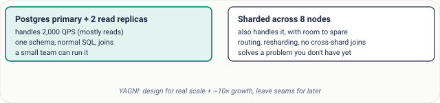
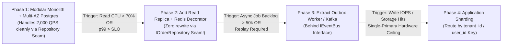
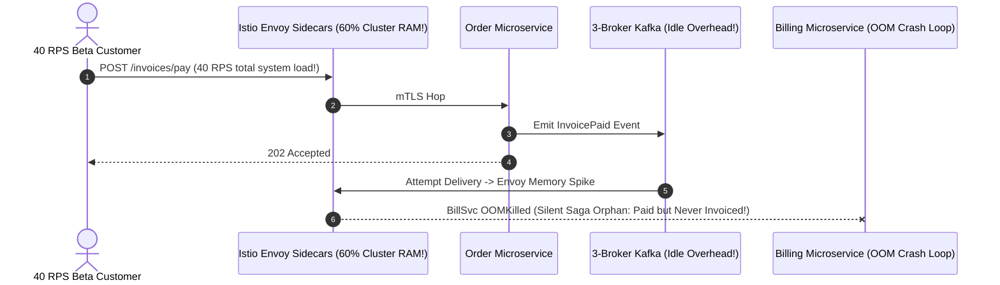

# Lesson 18: Simple Beats Clever

> **Prerequisites:** [Lesson 17: Single Point of Failure](../17-single-point-of-failure/README.md).  
> **Estimated Reading Time:** 25 minutes  
> **Target Audience:** Software engineers, tech leads, and architects evaluating Total Cost of Ownership (TCO), establishing concrete scale triggers, and designing extensible clean architectural seams without premature complexity.  
> **Free PDF Notes:** [Download SD-A-018.pdf](https://backendroadmap.com/notes/system-design/SD-A-018.pdf) · [Phase 1, Core Fundamentals (PDF)](https://backendroadmap.com/notes/system-design/Phase1_Core_Fundamentals_Notes.pdf)

> [!TIP]
> **The Golden Rule of Architectural Simplicity:** Every architectural box introduces not only cloud spend, but **engineering build time, operational on-call toil, distributed failure modes, and slower product iteration**. Design for your verified current load plus reasonable growth (`~10×`, not `100×`), compare options using **Total Cost of Ownership (TCO) per million requests**, and keep **clean architectural seams** (interfaces separating storage, cache, and queue evolution) so you unlock sharding, Kafka, or microservices strictly when measurable numeric thresholds demand them.

---

## Visual Mental Models & Architecture

### The True Cost Iceberg Behind Every "Cool" Architecture Box


*Figure 1. The cloud bill is the smallest part of what a component costs.*

Cloud compute invoices represent only the visible tip of **Total Cost of Ownership (TCO)**. Two extra engineers spent maintaining distributed event schemas, Kafka broker upgrades, cross-service distributed traces, and multi-shard migrations easily cost `$400,000+/year`—dwarfed only if scale genuinely justifies the leap.

### Meeting the Exact Same Load With Minimum Moving Parts



*Figure 2. Both designs meet the load; the simple one does it with far less to build and run.*

### Seam-Driven Growth Path: Quantitative Complexity Triggers



---

## Systematic Taxonomic Reference Grids

### Simple Modular Design vs. Premature Over-Engineering

| Engineering Dimension | Focused Simple Design (`1×`–`10×` Headroom) | Over-Engineered Day-1 Stack (`100×` Speculative) | Real Impact on Business & SRE Teams |
| :--- | :--- | :--- | :--- |
| **Core Topology** | Modular Monolith + Load Balancer + Multi-AZ PostgreSQL (+ Redis if reads miss SLO). | 14 Microservices + Service Mesh + Kafka + Cassandra + ElasticSearch for 50 RPS. | Debugging shifts from 1 local breakpoint to tracing network hops across 14 pods. |
| **Total Cost of Ownership (TCO)** | Low infra + small agile team shipping features weekly. | High cloud floor + dedicated DevOps/Platform headcount just to keep CI/CD healthy. | An architecture saving `$500/mo` in DB licensing that requires `2` extra FTEs loses `$30,000+/mo` net. |
| **Latency Engineering ROI** | Fix missing B-Tree index (`500ms -> 8ms`) in 15 minutes. | Build custom kernel bypass & cross-region read caches to drop `10ms -> 2ms`. | Spend engineering capital only where users actually perceive improvement or SLO requires it. |
| **Failure Surface Area** | Minimal moving network dependencies; transactions remain ACID locally. | Distributed transactions (Sagas), split-brain queues, schema mismatch rollouts. | Every new network arrow adds tail latency and another pager alert at 3 AM. |
| **Scalability Headroom** | Clean interface **seams** (`OrderRepository`) allow transparent cache/shard swaps later. | Hard-coded assumptions for predicted bottlenecks that never materialize in practice. | Actual 100× growth rarely matches day-1 guesswork—seams preserve adaptability. |

### Worked Financial Benchmark: Cost Per Million Requests

Numbers resolve architecture debates faster than opinions:
* **Observed Peak & Monthly Volume:** `2,000 queries/s` average $\times$ `~2.6M seconds/month` $\approx$ **`5.2 billion requests/month`**.
* **Full Monthly TCO:** Add server instances + managed RDS storage + cross-AZ egress + allocated engineering ops cost $\approx$ **`$6,000/month`**.
* **Unit Cost Formula:**
  $$\text{Cost per 1M Requests} = \frac{\$6,000}{5,200\text{ million}} \approx \mathbf{\$1.15\text{ per million requests}}$$

Comparing **$1.15/M** (Simple PostgreSQL + Read Replica) against **$8.40/M** (Sharded Distributed Cluster + Service Mesh + 1 FTE operations cost) reveals immediately which option meets requirements sensibly.

### Quantitative Triggers for Adding Complexity (Numbers Over Vibes)

| Proposed Complexity | Do **NOT** Add Because... | Exact Quantitative Trigger to Adopt | Clean Seam Preparing for It |
| :--- | :--- | :--- | :--- |
| **Caching Layer (Redis)** | *"Best practice says every API needs Redis."* | Primary read CPU `> 65%` sustained or catalog read `p99` exceeds SLO even after indexing. | `CachedCatalogDecorator` wrapping `ICatalogRepository`. |
| **Message Broker (Kafka)** | *"Maybe we'll do event streaming someday."* | Sustained `> 5,000–10,000 events/sec`, multi-day durable replay, or multiple decoupled consumer teams. | `IEventPublisher` interface backed first by SQL Transactional Outbox table. |
| **Horizontal DB Sharding** | *"What if we hit 100M users next quarter?"* | Single vertically scaled primary approaches write IOPS / storage limit (`> 8–10 TB` or `> 10k write TPS`). | Enforce `tenant_id` / `user_id` partition key in every domain query early (`WHERE user_id = ?`). |
| **Microservice Split** | *"Monoliths are uncool."* | Distinct scaling elasticity (e.g., GPU inference vs CRUD) OR `> 20+` engineers stepping on deploy queues. | Keep strict module packages interacting solely via explicit service interfaces inside monolith. |

### Key Terms Reference

| Term | Operational Meaning |
| :--- | :--- |
| **TCO (Total Cost of Ownership)** | Full economic burden combining cloud bills, engineering build cost, operational maintenance, and downtime risk. |
| **YAGNI (You Aren't Gonna Need It)** | Engineering discipline rejecting speculative infrastructure beyond measured demand plus `~10×` headroom. |
| **Seam** | Explicit abstraction boundary (`interface` / repository / bus) allowing storage or queue swaps with zero domain rewrite. |
| **Cost Per Request** | Monthly infrastructure + allocated engineering cost divided by total monthly traffic served. |
| **Operational Load** | Ongoing human work needed to deploy, monitor, patch, debug, and upgrade a running system. |
| **Over-Engineering** | Paying complexity, latency, or staffing costs not justified by any stated functional or non-functional requirement. |

---

## Production War Stories: Incident Post-Mortem

### SEV-1 Post-Mortem: The Seed-Stage 12-Microservice Kafka Mesh Collapse

#### Incident Overview
* **Severity:** SEV-1 (7-Hour Launch Outage & 5-Month Engineering Freeze at `40 RPS`)
* **Detection Time:** 12 minutes after launching first `350` beta signups
* **Resolution Time:** 7 hours 15 minutes (emergency hotfix), followed by a 6-week consolidation rewrite
* **Impact:** `40 requests/sec` peak crashed an over-engineered Kubernetes cluster running 12 microservices, Kafka, Cassandra, and Istio—requiring 4 engineers full-time merely to keep local CI environments and production deploys alive while losing customer orders across broken async sagas.

#### What Happened
Two senior engineers left a hyperscaler to build a B2B invoicing SaaS targeting 5,000 small businesses (`~40 RPS` average). Expecting future viral growth, they avoided a boring modular monolith + PostgreSQL and shipped **12 Go/Node microservices** communicating over a 3-broker Kafka cluster plus Istio mTLS sidecars.
1. During launch day (`40 RPS`), a minor network hiccup between two Kafka brokers caused consumer lag on the `InvoiceIssued` topic.
2. Without a monolithic ACID transaction, `OrderService` committed a payment while `BillingService` timed out consuming the event—leaving half the invoices un-issued!
3. Worse, Envoy sidecars consumed `60%` of cluster RAM across small nodes, triggering OOM evictions across `AuthService` and `PdfService` while engineers struggled through 12 separate repositories to patch one bug!



#### Root Cause Analysis
1. **Speculative `1000×` Architecture for `40 RPS` Load:** Paying the operational tax of microservices, Istio service mesh, and distributed Sagas when one multi-AZ PostgreSQL database (`10,000+ TPS` headroom) could run the entire company effortlessly on a `$300/mo` managed database.
2. **Ignoring Human & Velocity TCO:** Splitting a 4-person team across 12 deployments crippled debugging speed and introduced multi-service consistency gaps.

#### The Fix & Architectural Hardening
1. **Consolidated to Modular Monolith + Multi-AZ PostgreSQL:** Collapsed 11 non-CPU-heavy services back into strictly modular Go packages sharing ACID transactions inside one PostgreSQL primary + standby replica.
2. **Preserved Seams for Real Triggers:** Kept `IPdfRenderer` and `IEventPublisher` interfaces clean inside the monolith—allowing solely heavy headless-Chromium PDF generation to run in an isolated worker queue without infecting billing consistency!

---

## Multi-Language Production Implementation: Clean Architectural Seams (Monolith Simplicity Today, Redis/Shard Evolution Tomorrow)

Notice how **YAGNI does not mean sloppy spaghetti code**: defining clean interface seams lets you run pure boring PostgreSQL on Day 1 and snap on Redis caching (`Phase 2`) or partition routing (`Phase 4`) in 10 lines without touching a single line of business logic!

````carousel
```go
package simplebeatsclever

import "context"

type Order struct {
	ID         string
	TenantID   string
	TotalCents int64
}

// 1. Clean Architectural Seam: domain logic depends strictly on this contract.
type OrderRepository interface {
	GetByID(ctx context.Context, tenantID, id string) (*Order, error)
}

// 2. Day-1 Simple Implementation: direct Multi-AZ PostgreSQL (handles thousands of QPS cleanly).
type PostgresOrderRepo struct{}

func (r *PostgresOrderRepo) GetByID(ctx context.Context, tenantID, id string) (*Order, error) {
	// SELECT id, tenant_id, total_cents FROM orders WHERE tenant_id = $1 AND id = $2
	return &Order{ID: id, TenantID: tenantID, TotalCents: 4900}, nil
}

// 3. Day-100 Upgrade Triggered ONLY When Read SLO Demands It: Decorator wraps Postgres seamlessly!
type CachedOrderRepoDecorator struct {
	inner OrderRepository
	cache map[string]*Order // Replace with Redis when fleet > 1 pod
}

func NewCachedOrderRepo(inner OrderRepository) OrderRepository {
	return &CachedOrderRepoDecorator{inner: inner, cache: make(map[string]*Order)}
}

func (c *CachedOrderRepoDecorator) GetByID(ctx context.Context, tenantID, id string) (*Order, error) {
	key := tenantID + ":" + id
	if hit, ok := c.cache[key]; ok {
		return hit, nil
	}
	fresh, err := c.inner.GetByID(ctx, tenantID, id)
	if err == nil {
		c.cache[key] = fresh
	}
	return fresh, nil
}
```
<!-- slide -->
```typescript
export interface Order {
  id: string;
  tenantId: string;
  totalCents: number;
}

// 1. Clean Seam: Domain layer never imports Postgres or Redis directly
export interface OrderStore {
  findOrder(tenantId: string, orderId: string): Promise<Order | null>;
}

// 2. Day-1 Boring Postgres Implementation (no Redis needed until metrics trigger it)
export class PostgresOrderStore implements OrderStore {
  async findOrder(tenantId: string, orderId: string): Promise<Order | null> {
    return { id: orderId, tenantId, totalCents: 4900 };
  }
}

// 3. Day-100 Decorator Swap: Zero edits to OrderService callers!
export class RedisCachedOrderStore implements OrderStore {
  private readonly cache = new Map<string, Order>();

  constructor(private readonly primaryStore: OrderStore) {}

  async findOrder(tenantId: string, orderId: string): Promise<Order | null> {
    const key = `${tenantId}:${orderId}`;
    const cached = this.cache.get(key);
    if (cached) return cached;

    const order = await this.primaryStore.findOrder(tenantId, orderId);
    if (order) this.cache.set(key, order);
    return order;
  }
}

export class CheckoutService {
  constructor(private readonly store: OrderStore) {}
  async total(tenantId: string, orderId: string): Promise<number> {
    const ord = await this.store.findOrder(tenantId, orderId);
    return ord?.totalCents ?? 0;
  }
}
```
<!-- slide -->
```python
from typing import Protocol


class OrderStore(Protocol):
    """Clean architectural seam keeping domain code oblivious to Redis/sharding."""

    def get_order(self, tenant_id: str, order_id: str) -> dict | None: ...


class SimplePostgresOrderStore:
    """Day-1 setup: single multi-AZ SQL store + proper B-Tree index handles 2,000+ QPS easily."""

    def get_order(self, tenant_id: str, order_id: str) -> dict | None:
        return {"tenant_id": tenant_id, "order_id": order_id, "total_cents": 4900}


class CachedOrderStoreDecorator:
    """Snapped on ONLY after metrics trigger read latency/CPU thresholds."""

    def __init__(self, inner: OrderStore) -> None:
        self._inner = inner
        self._cache: dict[str, dict] = {}

    def get_order(self, tenant_id: str, order_id: str) -> dict | None:
        key = f"{tenant_id}:{order_id}"
        if key in self._cache:
            return self._cache[key]
        row = self._inner.get_order(tenant_id, order_id)
        if row is not None:
            self._cache[key] = row
        return row
```
<!-- slide -->
```csharp
public sealed record OrderDto(string Id, string TenantId, long TotalCents);

// Clean Seam: Checkout controllers depend strictly on IOrderStore
public interface IOrderStore
{
    Task<OrderDto?> GetAsync(string tenantId, string orderId);
}

// Day-1 Implementation: Plain multi-AZ PostgreSQL query partitioned logically by TenantId
public sealed class PostgresOrderStore : IOrderStore
{
    public Task<OrderDto?> GetAsync(string tenantId, string orderId) =>
        Task.FromResult<OrderDto?>(new OrderDto(orderId, tenantId, 4900));
}

// Day-100 Evolution: Add Redis Decorator via 1 line in DI container (zero service code edits!)
public sealed class CachedOrderDecorator(IOrderStore inner) : IOrderStore
{
    private readonly Dictionary<string, OrderDto> _cache = new();

    public async Task<OrderDto?> GetAsync(string tenantId, string orderId)
    {
        var key = $"{tenantId}:{orderId}";
        if (_cache.TryGetValue(key, out var hit)) return hit;

        var fresh = await inner.GetAsync(tenantId, orderId);
        if (fresh is not null) _cache[key] = fresh;
        return fresh;
    }
}
```
````

---

## Practical Hands-On Verification CLI Workflows

Compare two candidate system designs using full **Total Cost of Ownership (cloud spend + engineering ops FTE cost)** normalized cleanly to **Cost Per Million Requests**.

### Step 1: Run the Quantitative TCO & Complexity Trigger Evaluator

```bash
python3 - <<'EOF'
SECONDS_PER_MONTH = 2_600_000 # ~30.1 days

def analyze_tco(name: str, qps: int, infra_monthly: float, eng_ops_ftes: float, fte_monthly_cost: float = 15_000):
    monthly_reqs = qps * SECONDS_PER_MONTH
    people_cost = eng_ops_ftes * fte_monthly_cost
    total_cost = infra_monthly + people_cost
    cost_per_million = total_cost / (monthly_reqs / 1_000_000)
    print(f"{name:38} | Monthly Reqs: {monthly_reqs/1e9:4.2f}B | Infra: ${infra_monthly:6,.0f} | Ops: ${people_cost:6,.0f} | Total: ${total_cost:7,.0f}/mo -> ${cost_per_million:.2f} / 1M req")

analyze_tco("Design A: Simple Postgres + Replica", 2_000, infra_monthly=2_250, eng_ops_ftes=0.25)
analyze_tco("Design B: Premature 12-Service + Kafka", 2_000, infra_monthly=1_900, eng_ops_ftes=2.00)
EOF
```

**Expected Output:**
```text
Design A: Simple Postgres + Replica    | Monthly Reqs: 5.20B | Infra: $ 2,250 | Ops: $ 3,750 | Total: $  6,000/mo -> $1.15 / 1M req
Design B: Premature 12-Service + Kafka | Monthly Reqs: 5.20B | Infra: $ 1,900 | Ops: $30,000 | Total: $ 31,900/mo -> $6.13 / 1M req
```

Even when a complex distributed setup trims `$350/month` off raw cloud instances, the hidden operational staffing burden makes it **$5.3×` more expensive overall (`$6.13` vs `$1.15` per million requests)**!

---

## Operational Validation Checkpoints (Scenario Quizzes)

<details>
<summary><strong>Checkpoint 1: Evaluating Latency Diminishing Returns</strong></summary>

**Scenario:** An API endpoint `GET /account/settings` currently runs at `p99 = 38ms` served cleanly by Multi-AZ PostgreSQL with proper composite indexes. A developer proposes building a two-tier L1 local in-memory cache + L2 Redis Cluster invalidation bus over Kafka CDC so `p99` falls from `38ms` to `4ms`. Should you approve this complexity?

<strong>Answer:</strong>
**No—reject it unless an explicit contract requires `< 10ms`!** Users cannot perceive the difference between `38ms` and `4ms` in a settings form, yet building L1+L2 cache invalidation over Kafka CDC introduces split-brain cache staleness bugs, serialization drift, and multiple new paging subsystems. Save engineering effort for genuine SLO deficits (`500ms -> 50ms`).
</details>

<details>
<summary><strong>Checkpoint 2: Leaving Database Sharding Seams Without Pre-Sharding</strong></summary>

**Scenario:** A multi-tenant SaaS currently handles only `150 GB` total data (`400 writes/sec`) on a single Multi-AZ PostgreSQL instance, well below vertical hardware limits (`10 TB+`, `10k writes/sec`). How do you stay simple today (`YAGNI`) while ensuring migrating to physical horizontal shards 3 years from now does not require rewriting 500 SQL queries?

<strong>Answer:</strong>
Enforce the **clean sharding seam on Day 1 inside your schema & repository interfaces**: include `tenant_id` in every primary key, unique index, and repository method (`GetOrder(tenantID, orderID)`), and prohibit cross-tenant SQL `JOIN`s! You pay **$0 extra operational infrastructure** today while guaranteeing that moving tenants into separate database shards later is merely a routing change behind your repository interface.
</details>

<details>
<summary><strong>Checkpoint 3: Simple Doesn't Mean Unsafe Single Points of Failure</strong></summary>

**Scenario:** Following "Simple Beats Clever," a developer deletes the Multi-AZ PostgreSQL standby replica and disabled automated backups, deploying a single solitary PostgreSQL container because *"a second server adds distributed complexity!"* Why is this a fatal misunderstanding of simplicity?

<strong>Answer:</strong>
**"Simple" is not synonymous with "fragile / SPOF-ridden."** Minimalism eliminates *speculative complexity* (Kafka at 50 events/sec, 12 microservices for 4 engineers, pre-sharded Cassandra at 50 GB), **never** basic fault tolerance! Multi-AZ standby replication and restore-tested automated backups are baseline hygiene required for almost every production store; keep them in place while stripping away un-needed distributed middleware.
</details>

---

## Interview Practice Questions

Each question is tagged by kind: **Basic** (definitions), **Scenario** (apply it to a system), and **Tricky** (deep follow-ups). Answer out loud before opening the solution.

<details>
<summary><strong>1. When is a simpler design better, even if it scales less? (Basic)</strong></summary>

<strong>What a strong answer covers:</strong>
Whenever it comfortably satisfies verified peak traffic plus `~10×` headroom: simpler topologies carry lower infrastructure + people TCO, ship product changes much faster, and expose dramatically fewer distributed network failure modes.
</details>

<details>
<summary><strong>2. How do you estimate the cost of a design? (Basic)</strong></summary>

<strong>What a strong answer covers:</strong>
Compute **monthly request volume** (`RPS × ~2.6M sec/month`), sum monthly **infrastructure spend** (compute, DB, network egress) plus **engineering/operations time TCO**, and divide to calculate **cost per million requests** so candidate options compare apples-to-apples quantitatively.
</details>

<details>
<summary><strong>3. What is YAGNI in system design? (Basic)</strong></summary>

<strong>What a strong answer covers:</strong>
**You Aren't Gonna Need It:** avoid deploying sharding, custom event buses, or microservice meshes until concrete scale numbers force you to—design for `~10×` realistic growth today and preserve clean **interface seams** so future extensions plug in cleanly without big rewrites.
</details>

<details>
<summary><strong>4. 2,000 QPS, mostly reads. Shard or not? (Scenario)</strong></summary>

<strong>What a strong answer covers:</strong>
**Do not shard yet.** `2,000` read-heavy QPS sits easily inside a single Multi-AZ PostgreSQL primary paired with 1–2 async read replicas (or a Redis cache decorator if hotspots appear). Trigger sharding strictly when primary write IOPS or working-set data size approaches single-primary hardware limits.
</details>

<details>
<summary><strong>5. Your team proposes Kafka for 50 events a second. Your view? (Scenario)</strong></summary>

<strong>What a strong answer covers:</strong>
Push back politely: `50 events/sec` is tiny—a PostgreSQL **transactional outbox** table or a serverless managed queue (SQS/Service Bus) handles it reliably with negligible operational maintenance. Introduce Kafka when sustained throughput, strict partition ordering, multi-consumer fan-out, or log replay genuinely justify operating brokers.
</details>

<details>
<summary><strong>6. Product wants p99 from 40 ms to 10 ms. How do you decide? (Scenario)</strong></summary>

<strong>What a strong answer covers:</strong>
Quantify business ROI first (`"Do checkout conversions or SLA penalties measurably improve if we move 40ms -> 10ms?"`), estimate the architectural price (multi-region active-active caches, edge replication, invalidation bugs), and compare. Because `40ms` already feels instantaneous to human eyes, invest only if real business metrics justify the cost curve.
</details>

<details>
<summary><strong>7. Isn't designing for 100× scale the safe choice? (Tricky)</strong></summary>

<strong>What a strong answer covers:</strong>
No—guessing bottlenecks at `100×` today consumes massive budget and slows shipping velocity while **usually optimizing the wrong layer** (real hypergrowth breaks unpredictable hotspots!). Clean seams + explicitly defined numeric scale triggers are vastly safer and faster.
</details>

<details>
<summary><strong>8. Can a simpler design be less reliable? (Tricky)</strong></summary>

<strong>What a strong answer covers:</strong>
Only if "simpler" strips out mandatory redundancy (dropping a single database without standbys or backups creates a fatal SPOF). True architectural simplicity preserves Multi-AZ replication and automatic failover while eliminating unnecessary microservices, brokers, and premature sharding.
</details>

---

## Common Mistakes & Troubleshooting

- **Shipping big-tech stack patterns for 1,000 users:** Microservices, Istio, Kafka, and sharded NoSQL crush small teams' productivity.
- **Evaluating architecture solely via cloud EC2 bills:** Always price engineering build, debugging, and 3 AM on-call time inside TCO.
- **Over-optimizing latency far below human/SLA thresholds:** Moving `40ms -> 5ms` rarely pays back its massive complexity tax.
- **Skipping interface seams in the name of speed:** Clean repository boundaries (`IOrderStore`) cost nothing today and prevent future rewrites.

---

## Further Reading & Sources

- [Martin Fowler: MonolithFirst](https://martinfowler.com/bliki/MonolithFirst.html) — Why cleanly modularized monoliths beat premature microservices at startup and growth stages.
- [Choose Boring Technology (Dan McKinley)](https://boringtechnology.club/) — Innovation tokens and minimizing operational risk across infrastructure choices.

---

## Free PDF notes

Download these notes as a printable PDF, with every diagram: [SD-A-018.pdf](https://backendroadmap.com/notes/system-design/SD-A-018.pdf). All Phase 1 notes in one file: [Phase 1, Core Fundamentals (PDF)](https://backendroadmap.com/notes/system-design/Phase1_Core_Fundamentals_Notes.pdf).

---

## Next

Continue with [Lesson 19: Stateless vs Stateful](../19-stateless-vs-stateful/README.md) to master externalizing web sessions, avoiding sticky-session traps, and scaling stateful WebSocket chat fleets using Pub/Sub registries.
