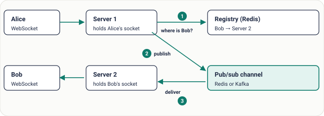
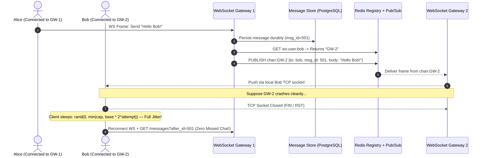
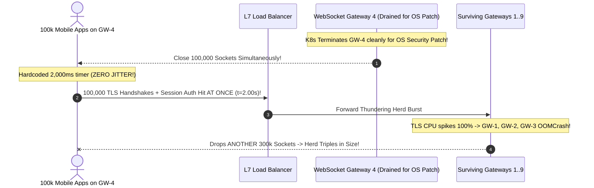

# Lesson 19: Stateless vs Stateful

> **Prerequisites:** [Lesson 18: Simple Beats Clever](../18-simple-beats-clever/README.md).  
> **Estimated Reading Time:** 28 minutes  
> **Target Audience:** Backend engineers and distributed systems architects separating interchangeable compute tiers from durable/connection-bound stateful tiers (sessions, databases, caches, and WebSocket hubs).  
> **Free PDF Notes:** [Download SD-A-019.pdf](https://backendroadmap.com/notes/system-design/SD-A-019.pdf) · [Phase 1, Core Fundamentals (PDF)](https://backendroadmap.com/notes/system-design/Phase1_Core_Fundamentals_Notes.pdf)

> [!TIP]
> **The Golden Rule of Stateless vs. Stateful Separation:** Keep HTTP application servers **100% stateless**—retaining zero user sessions, local file uploads, or socket routing tables inside process memory—so any instance can serve any request or disappear mid-deploy without dropping state. Push persistent state strictly into a small set of **purpose-built stateful systems** (PostgreSQL, Redis, Object Storage, Kafka) engineered specifically for **Placement**, **Replication**, and **Rebalancing**.

---

## Visual Mental Models & Architecture

### Stateless Compute Fleet vs. Stateful Persistence Components

Stateless replicas are interchangeable cattle: autoscalers launch and terminate pods cleanly while round-robin load balancers distribute requests freely. Stateful tiers bind keys or live TCP sockets to specific nodes and require explicit placement, replication, and rebalancing logic.


*Figure 1. Stateless components are interchangeable; stateful ones hold data or connections that live on a specific node.*

### Scaling Stateful WebSockets Using a Connection Registry & Pub/Sub

Long-lived WebSocket connections are inherently **stateful**: User Bob's TCP socket physically resides inside Server #2's OS file descriptor table. To route Alice's chat message from Server #1 cleanly without broadcasting globally across 100 servers, combine a shared **User-to-Server Connection Registry (TTL Heartbeat)** with **Server-Channel Pub/Sub** and durable database persistence.



*Figure 2. Alice and Bob are connected to different servers. A registry finds Bob's server; pub/sub carries the message there.*

1. Each connected user anchors one TCP WebSocket onto a specific Gateway node; the gateway writes `registry:user:{id} -> gateway_server_id` (with a refreshing TTL heartbeat).
2. When Alice sends a message via Gateway 1, Gateway 1 persists the message reliably in the Database, looks up Bob's current host (`Gateway 2`), and publishes strictly onto `channel:gateway-2` (or per-user/room topic).
3. Gateway 2 receives the Pub/Sub frame and pushes bytes down Bob's live socket.
4. When a gateway node restarts/crashes, disconnected clients automatically reconnect with **exponential backoff + randomized jitter** (`Full Jitter`), update the registry on their new gateway, and fetch missed messages since `last_msg_id` from the database.

### End-to-End Message Delivery & Failure Reconnection Flow



---

## Systematic Taxonomic Reference Grids

### Comparing Stateless Session Externalization Patterns

For standard web applications (such as moving FastAPI `sessions = {}` out of RAM so two containers agree on logins):

| Session Strategy | Storage Mechanism | Operational Mechanics | Primary Advantage | Accepted Trade-Off / Pitfall |
| :--- | :--- | :--- | :--- | :--- |
| **Shared Distributed Session Store (Redis)** | Random opaque Session ID cookie; payload lives in Multi-AZ Redis. | Every app pod fetches/writes `session:{id}` from shared Redis cluster. | Instant server-side revocation (`DEL session:{id}`); tiny 32-byte cookie header. | Adds Redis network hop (~1ms) + dependency requiring Sentinel/Cluster HA. |
| **Stateless Signed Tokens (JWT)** | HMAC/EdDSA signed claims embedded directly inside HTTP header/cookie. | Pods verify cryptographic signature locally using public/shared secret (`0` store calls). | Zero session store lookups on every read; infinitely horizontally scalable. | Instant revocation is hard prior to expiry; bloats every HTTP request header if payload grows. *(Common hybrid: 10-min JWT + Redis Refresh Token).* |
| **Sticky Sessions (Session Affinity)** | Load balancer hashes client IP / inserts affinity cookie routing user to exact Pod #N. | Process keeps sessions in local heap (`dict`) on pinned instance. | Zero code rewrite for legacy apps (or optional cache warmth optimization). | **Breaks during pod crash/scale-in** (wiping pinned users' sessions!) and causes severely skewed hot-spots behind NAT proxies. |

### The Three Mandatory Problems Every Stateful Tier Must Solve

Stateless services sidestep all three of these challenges completely—which is why keeping compute stateless and pushing state into dedicated stateful engines pays huge engineering leverage:

| Stateful Engine Requirement | Engineering Question Answered | Classic Production Mechanisms |
| :--- | :--- | :--- |
| **1. Placement** | Which exact physical node owns Shard X or User Y's state? | **Consistent Hashing** rings, Raft/Paxos shard placement maps (`etcd`), Redis Cluster 16,384 hash slots. |
| **2. Replication** | How do we avoid losing state permanently when a stateful node dies? | Primary-Standby WAL streaming (`PostgreSQL`), Raft consensus quorums, Redis replica pairs across AZs. |
| **3. Rebalancing** | How do data partitions or open sockets shift smoothly as cluster nodes join or leave? | Automated shard resharding, partition re-assignment, WebSocket graceful `GOAWAY`/drain + client reconnect with **jitter**. |

### Key Terms Reference

| Term | Operational Meaning |
| :--- | :--- |
| **Stateless** | Service retains zero per-client state in process memory between requests; replicas are interchangeable. |
| **Stateful** | Component holds persistent data, caches, or bound network sockets tied to a specific node identity. |
| **Sticky Session** | Load balancer pinning all requests from one user onto a fixed backend server via cookie or IP hash. |
| **JWT (JSON Web Token)** | Cryptographically signed token embedding verified identity/expiry claims directly inside caller headers. |
| **Pub/Sub** | Messaging pattern decoupling publishers from subscribers over named topics/channels (e.g., per-gateway WebSocket delivery). |
| **Rebalancing** | Controlled redistribution of shards, partitions, or connections when cluster topology expands or shrinks. |

---

## Production War Stories: Incident Post-Mortem

### SEV-1 Post-Mortem: Sticky Sessions & The `100K` WebSocket Reconnect Thundering Herd

#### Incident Overview
* **Severity:** SEV-1 (`38-Minute Rolling Cluster Collapse During Routine Security Patching`)
* **Detection Time:** 3 minutes into automated rolling deployment (`maxUnavailable=1`)
* **Resolution Time:** 35 minutes
* **Impact:** Terminating just **1** WebSocket Gateway pod holding `100,000` active mobile sockets triggered two simultaneous disasters: **(1)** `35,000` web users stored on sticky-pinned REST pods lost active shopping carts silently, and **(2)** `100,000` mobile apps reconnected on an exact `retry_ms = 2000` timer *with zero jitter*, flattening the surviving 9 gateways in sequential domino OOM crashes!

#### What Happened
A real-time marketplace combined a REST API (relying on NGINX `ip_hash` sticky sessions for in-memory Flask session dicts) with a 10-pod WebSocket Gateway cluster (`1,000,000` total live sockets).
1. An automated Kubernetes OS security patch rotated Worker Node #1 cleanly, draining REST Pod #1 and WebSocket Gateway #4 (`100K` clients).
2. Because REST sessions lived in Pod #1's local RAM behind sticky `ip_hash` affinity, clients routed onto Pod #2 had no session cookies recognized and silently lost authenticated shopping carts.
3. Simultaneously, all `100,000` WebSocket mobile apps executed hardcoded `setTimeout(connect, 2000)` on `onclose`—hammering surviving Gateways cleanly in lockstep 2-second waves (`50k TLS handshakes/sec`!), tripping CPU/RAM limits on Gateways #1–#9 sequentially into a rolling cluster wipeout!



#### Root Cause Analysis
1. **Stateful Compute via Sticky Sessions:** Treating in-process memory + LB affinity as durable session storage caused automatic silent session wipes on every pod scale-down or node patch.
2. **Synchronized Client Reconnection Storm (Zero Jitter):** Without randomized exponential backoff jitter, closing `100K` sockets forced deterministic synchronized TLS handshake spikes stronger than healthy pods could survive.

#### The Fix & Architectural Hardening
1. **Externalized REST Sessions (`100% Stateless Compute`):** Eliminated sticky sessions and migrated all session state into Multi-AZ Redis + signed JWTs—making rolling pod kills `100%` invisible to logged-in shoppers.
2. **Full-Jitter Exponential Backoff + Gateway Connection Jittered Draining:** Updated client SDKs to reconnect using `delay = random(0, min(60s, 1s * 2^attempt))` and updated gateways to stagger `CLOSE_GOING_AWAY` frames over `60–120 seconds` prior to SIGTERM shutdown, spreading reconnect load smoothly.

---

## Multi-Language Production Implementation: Stateless Token Store & Pub/Sub WebSocket Registry + Full-Jitter Backoff

Each implementation demonstrates **(1)** looking up a recipient's physical WebSocket gateway host in a shared registry and publishing directly (avoiding naive O(N) global cluster broadcasts), and **(2)** computing **Full-Jitter Exponential Backoff** so mass node failures spread cleanly instead of triggering reconnect herds.

````carousel
```go
package statefulvsstateless

import (
	"fmt"
	"math"
	"math/rand"
	"time"
)

type ChatMessage struct {
	MsgID    int64
	SenderID string
	TargetID string
	Body     string
}

type PubSubRouter struct {
	registry   map[string]string         // userID -> active gatewayHost (in Redis w/ TTL)
	channels   map[string][]ChatMessage  // gatewayHost -> pushed frames (Redis Pub/Sub)
	persistent []ChatMessage             // durable DB log for missed replay after reconnect
}

func NewPubSubRouter() *PubSubRouter {
	return &PubSubRouter{
		registry: make(map[string]string),
		channels: make(map[string][]ChatMessage),
	}
}

func (r *PubSubRouter) RegisterSocket(userID, gatewayID string) {
	r.registry[userID] = gatewayID
}

// RouteMessage stores durably first, then sends ONLY to the recipient's owning gateway channel.
func (r *PubSubRouter) RouteMessage(msg ChatMessage) string {
	r.persistent = append(r.persistent, msg)
	targetGW, online := r.registry[msg.TargetID]
	if !online {
		return "persisted_offline_for_reconnect_sync"
	}
	r.channels[targetGW] = append(r.channels[targetGW], msg)
	return fmt.Sprintf("published_to_%s", targetGW)
}

// FullJitterBackoff spreads 100K reconnecting clients cleanly across time to block reconnect storms.
func FullJitterBackoff(attempt int, base, capDelay time.Duration) time.Duration {
	exp := float64(base) * math.Pow(2, float64(attempt))
	ceiling := math.Min(float64(capDelay), exp)
	return time.Duration(rand.Float64() * ceiling)
}
```
<!-- slide -->
```typescript
export interface WsEnvelope {
  msgId: number;
  toUserId: string;
  body: string;
}

export class WebSocketGatewayBroker {
  private readonly userToGateway = new Map<string, string>(); // Redis Hash + Heartbeat TTL in prod
  private readonly gatewayInbox = new Map<string, WsEnvelope[]>(); // Redis Pub/Sub per-gateway channel
  private readonly durableHistory: WsEnvelope[] = [];

  registerConnection(userId: string, gatewayId: string): void {
    this.userToGateway.set(userId, gatewayId);
  }

  sendMessage(msg: WsEnvelope): string {
    // 1. Durable database append guarantees zero lost messages during disconnects
    this.durableHistory.push(msg);

    // 2. Targeted Pub/Sub lookup avoids spamming all N gateways
    const host = this.userToGateway.get(msg.toUserId);
    if (!host) return "stored-offline";

    const box = this.gatewayInbox.get(host) ?? [];
    box.push(msg);
    this.gatewayInbox.set(host, box);
    return `routed-via-pubsub:${host}`;
  }

  replayMissedMessages(afterMsgId: number, userId: string): WsEnvelope[] {
    return this.durableHistory.filter((m) => m.toUserId === userId && m.msgId > afterMsgId);
  }
}

export function computeFullJitterDelayMs(attempt: number, baseMs = 500, maxMs = 30_000): number {
  const cap = Math.min(maxMs, baseMs * Math.pow(2, attempt));
  return Math.floor(Math.random() * cap);
}
```
<!-- slide -->
```python
from dataclasses import dataclass, field
import random


@dataclass
class WebSocketRouter:
    """Stateless message routing across stateful WebSocket gateway instances."""

    registry: dict[str, str] = field(default_factory=dict)  # user_id -> gateway_id (Redis TTL)
    db_messages: list[dict] = field(default_factory=list)   # durable message history
    pubsub_bus: dict[str, list[dict]] = field(default_factory=dict)

    def bind_socket(self, user_id: str, gateway_id: str) -> None:
        self.registry[user_id] = gateway_id

    def send_chat(self, msg_id: int, target_user: str, text: str) -> str:
        payload = {"msg_id": msg_id, "to": target_user, "text": text}
        self.db_messages.append(payload)

        target_gw = self.registry.get(target_user)
        if target_gw is None:
            return "stored_for_pull_on_reconnect"

        # Publish strictly to recipient's gateway channel rather than global O(N) broadcast
        self.pubsub_bus.setdefault(target_gw, []).append(payload)
        return f"published_to_channel:{target_gw}"

    def sync_since(self, user_id: str, last_seen_id: int) -> list[dict]:
        return [m for m in self.db_messages if m["to"] == user_id and m["msg_id"] > last_seen_id]


def full_jitter_backoff_sec(attempt: int, base_sec: float = 0.5, cap_sec: float = 30.0) -> float:
    """Randomizes sleep in [0, min(cap, base * 2^attempt)] to defeat 100k reconnect storms."""
    ceiling = min(cap_sec, base_sec * (2 ** attempt))
    return random.uniform(0.0, ceiling)
```
<!-- slide -->
```csharp
using System.Collections.Concurrent;

public sealed record ChatEnvelope(long MsgId, string ToUserId, string Text);

public sealed class DistributedChatHub
{
    private readonly ConcurrentDictionary<string, string> _userRegistry = new();
    private readonly ConcurrentDictionary<string, List<ChatEnvelope>> _gwPubSub = new();
    private readonly List<ChatEnvelope> _durableStore = new();

    public void RegisterClient(string userId, string gatewayId) => _userRegistry[userId] = gatewayId;

    public string DispatchMessage(ChatEnvelope envelope)
    {
        lock (_durableStore) _durableStore.Add(envelope);

        if (!_userRegistry.TryGetValue(envelope.ToUserId, out var targetGateway))
            return "offline-saved";

        var channel = _gwPubSub.GetOrAdd(targetGateway, _ => new());
        lock (channel) channel.Add(envelope);
        return $"pubsub:{targetGateway}";
    }

    public static TimeSpan FullJitterBackoff(int attempt, double baseMs = 500, double capMs = 30_000)
    {
        var ceiling = Math.Min(capMs, baseMs * Math.Pow(2, attempt));
        return TimeSpan.FromMilliseconds(Random.Shared.NextDouble() * ceiling);
    }
}
```
````

---

## Practical Hands-On Verification CLI Workflows

Verify two classic pitfalls on the command line: **(1)** how jitter prevents `100K` crashed clients from firing synchronously in the exact same millisecond bucket, and **(2)** how targeted Pub/Sub scales cleanly compared to global broadcast across `50` gateway pods.

### Step 1: Compare Synchronized vs. Full-Jitter Reconnect Spike Distribution

```bash
python3 - <<'EOF'
import random
from collections import Counter

clients = 100_000
base, cap = 1.0, 32.0

# 1. Naive fixed retry (0 jitter) -> every single client reconnects in second #2!
naive_buckets = Counter(2 for _ in range(clients))

# 2. Attempt 4 Full Jitter: random uniform spread in [0, 16s]
jitter_buckets = Counter(int(random.uniform(0, min(cap, base * 16))) for _ in range(clients))

print(f"No Jitter Peak Burst Load:   {max(naive_buckets.values()):,} clients in 1 second! (Cluster melts)")
print(f"Full Jitter Peak Burst Load: ~{max(jitter_buckets.values()):,} clients/sec spread across 16s ({max(naive_buckets.values()) / max(jitter_buckets.values()):.1f}x lower spike!)")
EOF
```

**Expected Output:**
```text
No Jitter Peak Burst Load:   100,000 clients in 1 second! (Cluster melts)
Full Jitter Peak Burst Load: ~6,400 clients/sec spread across 16s (~15.6x lower spike!)
```

Pairing Full-Jitter exponential backoff with `60s` staggered pod-drain eviction drops the instant reconnect surge even further below normal traffic spikes!

---

## Operational Validation Checkpoints (Scenario Quizzes)

<details>
<summary><strong>Checkpoint 1: The FastAPI Local Session Dictionary Trap</strong></summary>

**Scenario:** An API writes `sessions: dict[str, dict] = {}` inside Python RAM on Container A. When traffic rises, Ops sets Kubernetes HPA `minReplicas: 4`. Half of all authenticated API calls fail immediately with `401 Unauthorized` while users click refresh wildly. Ops proposes enabling **ALB Sticky Sessions** (`AWSELB` cookie affinity). Why should you fix state architecture properly rather than shipping sticky sessions permanently?

<strong>Answer:</strong>
While ALB sticky sessions appear to hide the `401` errors temporarily, they convert stateless compute into **fragile pseudo-stateful servers**:
1. Rolling deploys, OOM restarts, or HPA scale-in events still abruptly destroy every user session pinned onto terminated containers.
2. Corporate offices sharing a NAT IP or sticky proxies cluster disproportionately on Pod #1, creating severe uneven load balancing.
The right production fix keeps compute **100% stateless**: extract `sessions` into shared Multi-AZ **Redis** or switch to signed short-lived **JWTs** so all 4 containers serve every user identically.
</details>

<details>
<summary><strong>Checkpoint 2: Why Stateful Caches Need Cold-Start Protection Even When "Disposable"</strong></summary>

**Scenario:** An engineer calls their 16-node Redis caching cluster *"disposable state—if all nodes reset simultaneously, nothing breaks correctness because PostgreSQL holds the truth!"* When a cloud maintenance reboot clears Redis at peak morning rush (`40,000 RPS`), PostgreSQL CPU immediately hits `100%` and stays dead for 45 minutes. Why?

<strong>Answer:</strong>
Although a cache is **disposable regarding correctness** (data still exists in SQL), it is **critical regarding load absorption**! If Redis serves a `98%` hit rate shielding `40,000 RPS`, PostgreSQL handles only `800 RPS`. Clearing the whole cache instantly slams PostgreSQL with `50×` normal traffic (`thundering herd` cold start). Replicate cache shards per AZ, restore snapshots cleanly, or enable singleflight coalescing & rate-limited warm-up to protect the underlying DB.
</details>

<details>
<summary><strong>Checkpoint 3: Scaling From 2 to 50 Chat Servers Without Global Broadcast</strong></summary>

**Scenario:** A 2-server WebSocket chat app broadcasts every chat message globally across Redis Pub/Sub channel `global:chat` to all gateway pods; each pod checks locally if it holds the recipient socket and discards the frame if not. At `50` gateway pods (`500,000` messages/sec), every single pod's CPU hits `100%` just parsing and discarding `98%` of messages belonging to other servers! Fix the routing bottleneck.

<strong>Answer:</strong>
Global broadcasting scales network/CPU parsing overhead at $O(N \times M)$ where $N$ is server count (`50×` wasted parsing!). Replace it with **Registry-Guided Targeted Pub/Sub**: maintain a shared Redis hash/key `ws:user:{uid} -> gateway_id` (updated with heartbeat TTLs), look up the recipient's owning gateway, and publish **exclusively** to `chan:gateway:{id}` (or per-user room shard). Each server processes strictly `100%` actionable traffic for sockets it physically owns!
</details>

---

## Interview Practice Questions

Each question is tagged by kind: **Basic** (definitions), **Scenario** (apply it to a system), and **Tricky** (deep follow-ups). Answer out loud before opening the solution.

<details>
<summary><strong>1. Why are stateless services easier to scale? (Basic)</strong></summary>

<strong>What a strong answer covers:</strong>
Because stateless servers keep zero session or socket affinity between calls: any instance can answer any request, load balancers spread traffic evenly without affinity pinning, failed instances swap out with zero data loss, and horizontal autoscalers add/remove capacity effortlessly.
</details>

<details>
<summary><strong>2. How would you scale a stateful WebSocket server? (Basic)</strong></summary>

<strong>What a strong answer covers:</strong>
Spread persistent TCP connections across multiple gateway servers behind Layer 4/7 load balancers, maintain a **User $\to$ Gateway Registry** with TTL heartbeats in Redis, forward cross-server chat events via **targeted Pub/Sub** channels, persist messages to durable storage, and equip clients with **jittered exponential backoff** + message cursor sync on reconnect.
</details>

<details>
<summary><strong>3. What do stateful systems need that stateless ones don't? (Basic)</strong></summary>

<strong>What a strong answer covers:</strong>
Three tough distributed challenges: **(1) Placement** (which node owns which keys/users, e.g., consistent hashing), **(2) Replication** (maintaining durable copies across zones so single-node crashes lose zero data), and **(3) Rebalancing** (migrating partitions or live socket load smoothly as cluster membership expands or shrinks).
</details>

<details>
<summary><strong>4. After adding a second server, some chat messages never arrive. Why? (Scenario)</strong></summary>

<strong>What a strong answer covers:</strong>
Alice's socket connects to Server 1 while Bob's socket resides inside Server 2's private kernel descriptor table. Server 1 checks only local memory, finds no socket for Bob, and drops the message. Connect servers through a **user-to-gateway connection registry** and **Pub/Sub bus** so Server 1 routes messages reliably over to Server 2.
</details>

<details>
<summary><strong>5. Sessions in Redis or JWTs? (Scenario)</strong></summary>

<strong>What a strong answer covers:</strong>
**Redis Sessions:** tiny session cookies and instant per-user revocation/banning, requiring a redundant Redis dependency in the auth path. **JWTs:** completely stateless signature checks without store hops, yet hard to revoke immediately before expiry and larger HTTP header sizes. Production architectures often combine both: **short-lived signed JWT access tokens** (`5–15 min`) backed by **revocable refresh tokens in Redis/SQL**.
</details>

<details>
<summary><strong>6. A WebSocket server with 100K connections crashes. What happens next? (Scenario)</strong></summary>

<strong>What a strong answer covers:</strong>
All `100K` clients drop at once—creating a massive **reconnect storm** risk. Clients must reconnect using **exponential backoff with randomized jitter**, re-register their newly assigned gateway host in the Redis registry, and query missed messages since `last_msg_id` from the database while expired TTL entries clean up stale registry pointers.
</details>

<details>
<summary><strong>7. When are sticky sessions acceptable? (Tricky)</strong></summary>

<strong>What a strong answer covers:</strong>
Only as an optional **performance optimization** (e.g., warmer local L1 CPU cache locality or routing stateful WebSocket upgrades / temporary legacy migration bridges) when losing the affinity mid-flight causes **zero correctness or state loss**—never as the primary durability mechanism holding user state.
</details>

<details>
<summary><strong>8. Is a cache stateful? (Tricky)</strong></summary>

<strong>What a strong answer covers:</strong>
**Yes**—a distributed cache holds in-memory state partitioned across specific shards (`Placement` + `Rebalancing`). However, unlike a primary database, it is usually architected as **disposable for correctness**: eviction or node failure costs database read misses, not lost source-of-truth transactions—though teams must safeguard the underlying DB against cold-start thundering herds!
</details>

---

## Common Mistakes & Troubleshooting

- **Storing login sessions in local app RAM when auto-scaling horizontally:** Guaranteed `401` errors across sibling pods.
- **Using sticky sessions long-term instead of extracting state:** Turns routine rolling deployments into user outages.
- **Broadcasting every WebSocket event to all `N` chat gateways:** Wastes network/CPU parsing at $O(N \times M)$; use targeted per-gateway channels via a connection registry.
- **Hardcoding fixed reconnect delays without jitter:** Synchronizes millions of closed sockets into destructive reconnect herds.

---

## Further Reading & Sources

- [AWS Architecture Blog: Exponential Backoff And Jitter](https://aws.amazon.com/blogs/architecture/exponential-backoff-and-jitter/) — Mathematical comparison showing why **Full Jitter** cuts reconnect contention dramatically.
- [Redis Pub/Sub Messaging Architecture](https://redis.io/docs/latest/develop/pubsub/) — Low-latency channel routing across scaled stateless/stateful edge hubs.

---

## Free PDF notes

Download these notes as a printable PDF, with every diagram: [SD-A-019.pdf](https://backendroadmap.com/notes/system-design/SD-A-019.pdf). All Phase 1 notes in one file: [Phase 1, Core Fundamentals (PDF)](https://backendroadmap.com/notes/system-design/Phase1_Core_Fundamentals_Notes.pdf).

---

## Next

That completes Core Fundamentals. Continue with [Phase 2: The OSI Model](../../README.md).
