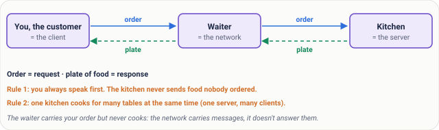
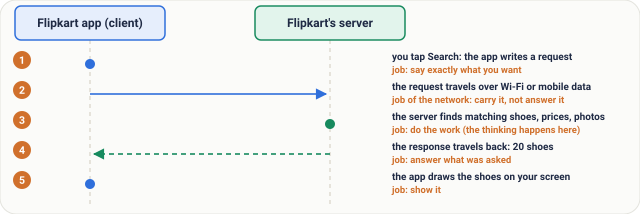
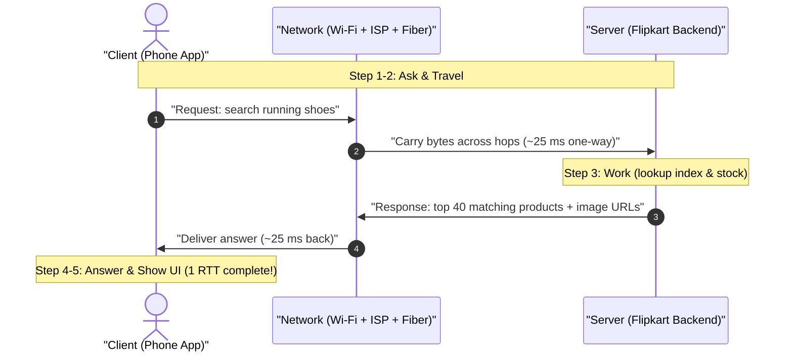
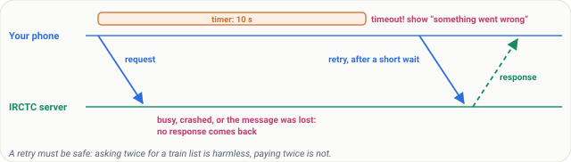
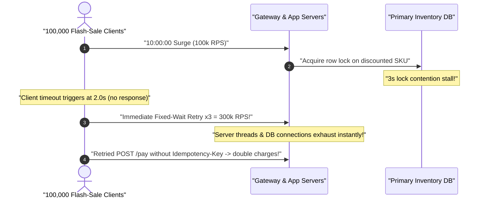

# Lesson 01: What Is a Network? Clients, Servers and the Conversation Between Them

> **Prerequisites:** None — Track 02 entry point ([Networking From Zero Overview](../README.md)).  
> **Estimated Reading Time:** 20 minutes  
> **Target Audience:** Developers starting networking from scratch and backend engineers connecting high-level system design trade-offs to physical request/response mechanics, round-trip math, timeouts, and safe retries.  
> **Free PDF Notes:** [Download SD-N-001.pdf](https://backendroadmap.com/notes/system-design/SD-N-001.pdf)

> [!TIP]
> **The Golden Rule of Networks:** Every network interaction is an asynchronous conversation between a **client** that initiates a **request** and a **server** that does the work and returns a **response** across an unreliable wire. Because responses can be delayed or lost, reliable systems bound every call with explicit **timeouts**, cap concurrent round trips, and use **idempotent retries with backoff and jitter**.

---

## Words You'll Meet Today

Before diving into sockets, routers, and protocols, anchor these ten foundational terms in plain English:

| Word | Everyday Meaning | Role in a Live Backend System |
| :--- | :--- | :--- |
| **Network** | Connected computers wired or wirelessly linked so they can trade messages. | L2/L3 fabric connecting phones, laptops, edge proxies, and data centers. |
| **Internet** | The global network stitching millions of private, office, and cloud networks together. | Autonomous Systems peering worldwide to carry traffic from users to origins. |
| **Client** | The device or app that asks for something first. | Browser tab, mobile app, CLI tool, or Service A calling Service B. |
| **Server** | The always-listening computer or program that receives questions and sends back answers. | HTTP API process, database engine, cache node, or chat relay waiting on a port. |
| **Request** | The question or command sent by the client to the server. | An HTTP `GET /search?q=shoes` or `POST /orders` payload sent across the wire. |
| **Response** | The result, data payload, or error code the server returns. | `200 OK` JSON/HTML product list, `404 Not Found`, or `503 Service Unavailable`. |
| **Round Trip (RTT)** | One full back-and-forth trip: request arrives at server, response returns to client. | Determines handshake cost and waterfall latency; `~50 ms` on healthy mobile LTE. |
| **Millisecond (`ms`)** | One thousandth of a second (`1,000 ms = 1 s`). | Standard SLO budget unit for backend endpoints (`p95 < 120 ms`). |
| **Timeout** | The maximum duration a client waits for an answer before declaring the attempt failed. | Prevents worker threads, pools, and UI spinners from hanging forever. |
| **Retry** | Sending the same request again after a timeout or transient failure. | Recovers dropped packets/glitches—must be spaced with backoff and safe against double-writes. |

---

## Visual Mental Models & Architecture

### Client, Network, Server: Roles Are Per Conversation

A **network** simply lets devices trade messages. When two machines speak over a network, one side takes the **client** role (speaking first with a **request**) and the other takes the **server** role (answering with a **response**).


*Figure 1. A network lets devices send messages. The client asks with a request; the server answers with a response.*

Importantly, "client" and "server" describe **the role in one conversation**, not permanent labels etched onto hardware. Your backend payment microservice is a **server** when the mobile checkout app calls it, and immediately becomes a **client** milliseconds later when it calls PostgreSQL or an external bank API.

### The Restaurant Analogy

Picture a busy restaurant:
* You sit at a table, browse the menu, and decide what you want -> you are the **client**.
* The waiter walks your order slip to the kitchen and later brings back the plated dish -> the waiter is the **network**.
* The kitchen cooks only when an order arrives and hands dishes back to the waiter -> the kitchen is the **server**.

You never walk behind the stove to grab ingredients yourself; you send a structured request and wait for the waiter to bring the response.



*Figure 2. The everyday picture: customer, waiter and kitchen are client, network and server.*

### Step-by-Step Trace: Searching "Running Shoes" on Flipkart

Suppose you open Flipkart on your phone, type `"running shoes"`, and tap Search:



*Figure 3. One request, step by step. Each step has a job: ask, carry, work, answer, show.*



1. **Ask:** The phone builds a tiny message requesting products matching `"running shoes"`.
2. **Travel:** The message crosses Wi-Fi/cellular towers, ISP links, and undersea/terrestrial fiber to Flipkart's servers.
3. **Work:** The server queries its search index, pricing engine, and warehouse inventory.
4. **Answer:** The server returns the product list and thumbnails over the network.
5. **Show:** Your phone parses the response and draws the catalog grid on screen.

Notice the asymmetry: **your phone stores zero inventory**. Millions of phones act as thin clients while one coordinated server fleet maintains the catalog for everyone.

---

## Real Numbers & Systematic Reference Grids

Latency is governed primarily by **round trips (RTT)** rather than raw bandwidth alone. Look closely at what happens when loading one typical `3 MB` web page composed of **`~40` separate files** (HTML, CSS stylesheets, JavaScript bundles, and product thumbnails) over a **`50 ms` mobile RTT** and a **`20 Mbps`** connection:


*Figure 4. Real numbers: a 3 MB page of about 40 files, at 50 ms per round trip.*

### Latency vs. Bandwidth Math Comparison

| Metric / Calculation | Sequential (1 Request at a Time) | HTTP/1.1 Parallel (`6` Concurrent Connections) | Operational Takeaway |
| :--- | :--- | :--- | :--- |
| **Files Required** | `~40 files` (`3 MB` total) | `~40 files` (`3 MB` total) | Page load requires fetching every dependent asset. |
| **Round Trips Needed** | `40` round trips | `40 ÷ 6 ≈ 7` round trips | Concurrency slashes RTT waiting by `~6x`. |
| **RTT Waiting Time (`50 ms` RTT)** | `40 × 50 ms = 2,000 ms (2.0 s)` | `7 × 50 ms = 350 ms (0.35 s)` | Pure back-and-forth waiting dominates slow networks! |
| **Raw Wire Transfer Time (`20 Mbps`)** | `24 Mb ÷ 20 Mbps = 1.2 s` | `24 Mb ÷ 20 Mbps = 1.2 s` | `3 MB = 24 megabits`; bandwidth is shared across the pipe. |
| **Dominant Bottleneck** | Round-trip serialization | Bandwidth + RTT balance | Buying faster Mbps barely helps if RTT count stays high! |

> [!NOTE]
> **Why Parallelism Changes Everything:** Browsers historically opened up to `6` parallel connections under HTTP/1.1 so `40` assets finish in `7` rounds (`~350 ms`) instead of `40` serialized rounds (`2,000 ms`). Modern **HTTP/2** (covered in Lesson 23) multiplexes dozens of requests concurrently over a **single** network connection, avoiding per-connection setup overhead altogether.

### Client-vs-Server Architectural Matrix

| Dimension | Client | Server | System Design Consequence |
| :--- | :--- | :--- | :--- |
| **Lifecycle** | Ephemeral (phone sleeps, browser tab closes, user loses tunnel signal). | Continuous (always running behind stable endpoints/health checks). | Never rely on clients to hold authoritative global state. |
| **Who Speaks First** | Always opens the conversation with a request. | Waits passively (`listen`) for incoming connections and replies. | Clients drive load bursts; servers enforce rate limits and backpressure. |
| **Trust Boundary** | Untrusted device running in the wild (user can inspect/tamper requests). | Trusted compute running inside your private cloud VPC. | Re-validate auth, prices, and permissions strictly on the server. |
| **Failure Mode** | Drop Wi-Fi, close tab, retry wildly when impatient. | Slow queries, GC pauses, CPU saturation under stampedes. | Servers need load shedding and idempotency; clients need bounded timeouts + jitter. |

---

## What Goes Wrong & Production War Story Post-Mortem

In an ideal trace, every request returns cleanly in `50 ms`. On live networks, messages drop silently in congested routers, or overloaded servers stall behind full queues:



*Figure 5. What goes wrong: no response comes. The client's timer runs out (a timeout), and it retries safely after a short wait.*

Think of **IRCTC Tatkal ticket booking at 10:00 AM**: millions of clients fire requests at the exact same second. Some connections time out completely (`10 s` waits with no answer), while panicked users click refresh repeatedly—multiplying load on an already sinking origin.

### SEV-1 Post-Mortem: The Retry Storm That Multiplied a 3-Second Brownout Into a 45-Minute Outage

#### Incident Overview
* **Severity:** SEV-1 (`99.4%` API Failure Across Checkout & Search During Flash Sale)
* **Detection Time:** `90 seconds` after flash-sale launch at 10:00 IST
* **Resolution Time:** `45 minutes`
* **Impact:** A `3`-second database lock blip turned into a `45`-minute site-wide outage; duplicate payment intents hit `4.2%` of retries because clients neither added backoff jitter nor sent idempotency keys.

#### What Happened


1. A brief lock contention delayed database queries to `3.2 seconds`, just above the client SDK's hardcoded `2.0 s` timeout.
2. Every affected mobile client immediately fired **3 zero-backoff retries** in lockstep (`100k` failed requests instantly became `300k` synchronized requests).
3. Server worker pools starved while waiting on dead connections, keeping CPU at `100%` long after the underlying DB lock cleared!
4. Retrying non-idempotent `POST /orders` calls caused customers whose first payment actually succeeded (right at `2.4 s`) to be charged a second time.

#### Root Cause Analysis
1. **Unjittered Synchronous Retries:** Fixed/immediate retries amplified a transient slow response (`3s`) by `4x` load precisely when the server needed breathing room.
2. **Missing Idempotency Keys on Write Requests:** The server could not distinguish a network timeout retry from a brand-new purchase command.
3. **Zero Load Shedding or Backoff Signals:** Clients kept hammering overloaded origins instead of backing off exponentially.

#### The Fix & Architectural Hardening
1. **Bounded Timeouts + Exponential Backoff + Full Jitter:** Enforced a `2 s` client deadline with exponential delays (`200 ms`, `400 ms`, `800 ms`) smeared by random jitter so retries spread across time rather than spiking together.
2. **Idempotency Keys on Every Mutating Request:** Attached a client-generated UUID `Idempotency-Key` header to `POST` operations so safe retries return the original outcome instead of duplicating side effects.
3. **Horizontal Fleet Scaling Behind Load Balancers:** Provisioned stateless API replicas across multiple servers so no single machine acts as a bottleneck when traffic jumps `10x`.

---

## Multi-Language Production Implementation: Resilient Request Client (Timeout + Idempotency + Jittered Backoff)

Every implementation below demonstrates how a production **client** talks to a **server**: attaching an explicit **per-attempt timeout**, sending an **idempotency key** so retries never duplicate work, and spacing failed attempts with **exponential backoff + jitter**.

````carousel
```go
package netclient

import (
	"context"
	"crypto/rand"
	"encoding/binary"
	"errors"
	"net/http"
	"time"
)

func jitteredDelay(attempt int, base time.Duration) time.Duration {
	maxWait := base << attempt // 200ms, 400ms, 800ms
	var b [8]byte
	_, _ = rand.Read(b[:])
	n := binary.LittleEndian.Uint64(b[:])
	return time.Duration(n % uint64(maxWait))
}

// FetchWithSafeRetry bounds every network round trip with a timeout and retries transient failures safely.
func FetchWithSafeRetry(ctx context.Context, client *http.Client, url, idempotencyKey string, maxAttempts int) (*http.Response, error) {
	var lastErr error
	for attempt := 0; attempt < maxAttempts; attempt++ {
		reqCtx, cancel := context.WithTimeout(ctx, 2*time.Second)
		req, err := http.NewRequestWithContext(reqCtx, http.MethodPost, url, nil)
		if err != nil {
			cancel()
			return nil, err
		}
		req.Header.Set("Idempotency-Key", idempotencyKey)

		resp, err := client.Do(req)
		cancel()
		if err == nil && resp.StatusCode < 500 {
			return resp, nil // Do not retry 4xx client errors
		}
		if resp != nil {
			resp.Body.Close()
		}
		lastErr = err
		if attempt+1 < maxAttempts {
			time.Sleep(jitteredDelay(attempt, 200*time.Millisecond))
		}
	}
	if lastErr == nil {
		lastErr = errors.New("server returned 5xx after all retry attempts")
	}
	return nil, lastErr
}
```
<!-- slide -->
```typescript
export async function requestWithSafeRetry(
  url: string,
  idempotencyKey: string,
  maxAttempts = 3,
  timeoutMs = 2000,
  baseBackoffMs = 200
): Promise<Response> {
  let lastError: unknown;

  for (let attempt = 0; attempt < maxAttempts; attempt++) {
    const controller = new AbortController();
    const timer = setTimeout(() => controller.abort(), timeoutMs);

    try {
      const response = await fetch(url, {
        method: "POST",
        headers: { "Idempotency-Key": idempotencyKey },
        signal: controller.signal,
      });

      // Only retry transient 5xx server overload errors or timeouts
      if (response.status < 500) {
        return response;
      }
      lastError = new Error(`HTTP ${response.status} from server`);
    } catch (err) {
      lastError = err; // Covers network drop or timeout abort
    } finally {
      clearTimeout(timer);
    }

    if (attempt + 1 < maxAttempts) {
      const cap = baseBackoffMs * 2 ** attempt;
      const sleepMs = Math.floor(Math.random() * cap); // Full jitter
      await new Promise((r) => setTimeout(r, sleepMs));
    }
  }

  throw lastError;
}
```
<!-- slide -->
```python
import random
import time
import urllib.error
import urllib.request


def request_with_safe_retry(
    url: str,
    idempotency_key: str,
    max_attempts: int = 3,
    timeout_sec: float = 2.0,
    base_backoff_sec: float = 0.2,
) -> tuple[int, bytes]:
    last_exc: Exception | None = None

    for attempt in range(max_attempts):
        req = urllib.request.Request(
            url,
            method="POST",
            headers={"Idempotency-Key": idempotency_key},
            data=b"",
        )
        try:
            with urllib.request.urlopen(req, timeout=timeout_sec) as resp:
                return resp.status, resp.read()
        except urllib.error.HTTPError as err:
            if err.code < 500:
                return err.code, err.read()  # 4xx errors are deterministic; do not retry
            last_exc = err
        except (urllib.error.URLError, TimeoutError) as err:
            last_exc = err

        if attempt + 1 < max_attempts:
            max_wait = base_backoff_sec * (2**attempt)
            time.sleep(random.uniform(0, max_wait))  # Backoff + jitter avoids retry storms

    raise RuntimeError(f"Request failed after {max_attempts} attempts") from last_exc
```
<!-- slide -->
```csharp
using System;
using System.Net.Http;
using System.Threading;
using System.Threading.Tasks;

public sealed class ResilientRequestClient(HttpClient http)
{
    public async Task<HttpResponseMessage> PostIdempotentAsync(
        string url,
        string idempotencyKey,
        int maxAttempts = 3,
        int timeoutMs = 2000,
        CancellationToken outerToken = default)
    {
        Exception? lastException = null;

        for (int attempt = 0; attempt < maxAttempts; attempt++)
        {
            using var attemptCts = CancellationTokenSource.CreateLinkedTokenSource(outerToken);
            attemptCts.CancelAfter(timeoutMs);

            using var req = new HttpRequestMessage(HttpMethod.Post, url);
            req.Headers.TryAddWithoutValidation("Idempotency-Key", idempotencyKey);

            try
            {
                var response = await http.SendAsync(req, attemptCts.Token);
                if ((int)response.StatusCode < 500)
                {
                    return response;
                }
                response.Dispose();
                lastException = new HttpRequestException($"Transient server error {(int)response.StatusCode}");
            }
            catch (Exception ex) when (ex is TaskCanceledException or HttpRequestException)
            {
                lastException = ex;
            }

            if (attempt + 1 < maxAttempts)
            {
                int capMs = 200 * (1 << attempt);
                await Task.Delay(Random.Shared.Next(capMs), outerToken);
            }
        }

        throw lastException ?? new TimeoutException("All retry attempts exhausted.");
    }
}
```
````

---

## Practical Hands-On Verification CLI Workflows

Verify the exact difference between sequential round trips (`40 × RTT`) vs. `6` parallel connections (`~7 × RTT`) AND watch how timeouts + retries behave against a live local test server in your terminal.

### Step 1: Measure Round-Trip Concurrency & Timeout Behavior Locally

```bash
python3 - <<'EOF'
import http.server, socketserver, threading, time, urllib.request

RTT_SEC = 0.05  # Simulate 50 ms network round-trip latency

class SlowServer(http.server.BaseHTTPRequestHandler):
    def do_GET(self):
        time.sleep(RTT_SEC)
        if self.path == "/hang":
            time.sleep(1.0)  # Simulate stalled server triggering timeout
        self.send_response(200)
        self.end_headers()
        self.wfile.write(b"ok")
    def log_message(self, *args): pass

class ThreadedHTTPServer(socketserver.ThreadingMixIn, http.server.HTTPServer):
    daemon_threads = True

srv = ThreadedHTTPServer(("127.0.0.1", 0), SlowServer)
port = srv.server_address[1]
threading.Thread(target=srv.serve_forever, daemon=True).start()

# 1. Sequential fetch of 18 assets @ 50ms RTT
t0 = time.perf_counter()
for _ in range(18):
    urllib.request.urlopen(f"http://127.0.0.1:{port}/asset").read()
seq_ms = (time.perf_counter() - t0) * 1000

# 2. Parallel 6-connection fetch of the same 18 assets (3 rounds)
from concurrent.futures import ThreadPoolExecutor
t1 = time.perf_counter()
with ThreadPoolExecutor(max_workers=6) as pool:
    list(pool.map(lambda _: urllib.request.urlopen(f"http://127.0.0.1:{port}/asset").read(), range(18)))
par_ms = (time.perf_counter() - t1) * 1000

# 3. Verify explicit timeout rescues client from stalled server
t2 = time.perf_counter()
try:
    urllib.request.urlopen(f"http://127.0.0.1:{port}/hang", timeout=0.25).read()
except Exception as exc:
    hang_ms = (time.perf_counter() - t2) * 1000
    print(f"Sequential 18 files @ 50ms RTT : {seq_ms:.0f} ms")
    print(f"Parallel (6 conns) 18 files     : {par_ms:.0f} ms (~{seq_ms/par_ms:.1f}x faster!)")
    print(f"Stalled /hang aborted safely at : {hang_ms:.0f} ms ({type(exc).__name__})")
EOF
```

**Expected Output:**
```text
Sequential 18 files @ 50ms RTT : ~930 ms
Parallel (6 conns) 18 files     : ~165 ms (~5.6x faster!)
Stalled /hang aborted safely at : ~255 ms (TimeoutError)
```

---

## Pause and Think & Validation Checkpoints

### Pause and Think

You tap **Send** on a WhatsApp `"hi"` to a friend sitting across the room. Which device is the **client** and which is the **server**?

<details>
<summary><strong>Click to see the answer</strong></summary>

**Both phones are clients; a WhatsApp server in the middle handles the relay.** Your phone sends a request (*"deliver `"hi"` to my friend"*). Neither phone continuously runs a globally reachable always-on server—your battery, cellular IP changes, and sleep mode would break direct calls. Instead, WhatsApp's server accepts your message, looks up your friend's session, and delivers it onward when their phone checks in or holds an open connection.


*Figure 6. Both phones are clients; the WhatsApp server sits in the middle.*

</details>

### Operational Validation Checkpoints (Scenario Quizzes)

<details>
<summary><strong>Checkpoint 1: Bandwidth Upgrade vs. High-RTT Asset Waterfalls</strong></summary>

**Scenario:** A company upgrades office Wi-Fi from `20 Mbps` to `500 Mbps`, yet an internal dashboard loading `60` unbundled sequential JSON/CSS requests over a `50 ms` cross-region link only speeds up slightly. Why?

<strong>Answer:</strong>
Because `60 × 50 ms = 3,000 ms (3.0 s)` is spent strictly waiting on **round trips**, completely independent of pipe width (`Mbps`). Upgrading bandwidth from `20 Mbps` to `500 Mbps` shrinks only the byte-transfer portion while leaving the `3.0 s` round-trip waterfall untouched. Reducing the number of sequential round trips (bundling, batching, parallel requests, or moving servers closer to drop RTT) fixes latency directly.
</details>

<details>
<summary><strong>Checkpoint 2: Why Clients Retry Badly Without Jitter</strong></summary>

**Scenario:** An API restarts cleanly for `4 seconds` during an automated rollout. Mobile apps have a `2 s` timeout and immediately sleep exactly `1,000 ms` before retrying—crashing the newly booted pods right as they finish startup. What is missing?

<strong>Answer:</strong>
Without **random jitter** (plus exponential backoff), thousands of clients whose timers started within the same window wake up together at exact multiples (`1.0 s`, `2.0 s`), creating synchronized thundering-herd spikes. Smearing retry delays randomly across growing intervals (`[0, 2^attempt * base]`) flattens traffic peaks while origins recover.
</details>

<details>
<summary><strong>Checkpoint 3: Role Reversal Inside a Payment Flow</strong></summary>

**Scenario:** A browser submits checkout to `OrderService`, which checks stock in `InventoryDB` and charges a card via `StripeAPI`. Identify the client and server in each link.

<strong>Answer:</strong>
1. `Browser` (**client**) -> `OrderService` (**server**).
2. `OrderService` (**client**) -> `InventoryDB` (**server**).
3. `OrderService` (**client**) -> `StripeAPI` (**server**).
Each hop has its own independent request, response, RTT budget, and timeout contract.
</details>

---

## Interview Practice Questions

Each question is tagged by kind: **Basic** (definitions), **Scenario** (apply it to a system), and **Tricky** (deep follow-ups). Answer out loud before opening the solution.

<details>
<summary><strong>1. What makes a device a client and another a server? (Basic)</strong></summary>

<strong>What a strong answer covers:</strong>
A **client** starts a conversation by sending a **request**; a **server** waits for requests, processes them, and returns a **response**. It is a role in that specific exchange, not fixed hardware—one backend process often serves incoming requests while simultaneously acting as a client to databases, caches, and third-party APIs.

</details>

<details>
<summary><strong>2. What is a round trip, and why do we care about it? (Basic)</strong></summary>

<strong>What a strong answer covers:</strong>
A **round trip (RTT)** is one complete message out to the server and one answer back (`~50 ms` on healthy mobile links). Even when payloads are tiny, each sequential round trip adds a full `RTT` floor of delay (`40` sequential requests = `2,000 ms`). Keeping round trips low often improves user-perceived speed far more than adding raw Mbps bandwidth.

</details>

<details>
<summary><strong>3. You load a page over a 20 Mbps line and a 100 Mbps line, and both take about 2 seconds. Why? (Scenario)</strong></summary>

<strong>What a strong answer covers:</strong>
The page is **latency-bound (round-trip bound)** rather than **bandwidth-bound**. Suppose the page fetches `40` small resources one after another at `50 ms` per round trip: `40 × 50 ms = 2 seconds` of pure RTT waiting regardless of whether pipe capacity is `20 Mbps` or `100 Mbps`. To cut load time, reduce round-trip depth (concurrency, bundling, HTTP/2 multiplexing, edge caching closer to users).

</details>

<details>
<summary><strong>4. Your app waits on a checkout request and gets no reply. What should happen next, and how do you avoid charging the customer twice? (Scenario)</strong></summary>

<strong>What a strong answer covers:</strong>
Enforce an explicit **timeout** (`2–10 s`) so workers and UI spinners don't stall forever. Retry transient timeouts with **exponential backoff and jitter** so recoveries don't spike traffic—and attach a unique **`Idempotency-Key`** per checkout attempt so if the first call actually succeeded before the reply was lost, the server returns the stored result without double-charging.

</details>

<details>
<summary><strong>5. Can one machine be both a client and a server at the same time? Give an example. (Tricky)</strong></summary>

<strong>What a strong answer covers:</strong>
Yes—nearly every production backend microservice is both simultaneously. An API server acts as a **server** to mobile browsers hitting `POST /checkout` while simultaneously acting as a **client** opening outbound connections to PostgreSQL, Redis, and payment gateways.

</details>

<details>
<summary><strong>6. Your peer-to-peer game claims there is no server — both phones talk directly. Does the client/server idea still apply? (Tricky)</strong></summary>

<strong>What a strong answer covers:</strong>
Yes. First, a central signaling/matchmaking **server** typically introduces the phones so they can discover and reach each other. Second, once direct exchange starts, every individual message still has one peer **initiating a request** (client role for that turn) and the other **replying** (server role), or one phone designated as authoritative match host (**listen server**).

</details>

---

## Common Mistakes & Troubleshooting

- **Confusing "client vs. server" with hardware labels:** Treating a laptop as always a client and a cloud VM as always a server misses that backend processes reverse roles on every downstream call.
- **Assuming every slow page needs higher Mbps bandwidth:** High round-trip counts (`40 × 50 ms`) bottleneck load times even on gigabit links.
- **Omitting timeouts or blindly hammering retries on timeouts:** Infinite waits hang threads until pods crash; zero-backoff retries double payments and trigger self-inflicted DoS storms.

---

## Recap in Three Lines

1. Devices talk over a network by exchanging **requests** (**client**) and **responses** (**server**) across one or more **round trips**.
2. Time is governed largely by **round-trip count** (and parallel requests cut `40` turns from `2,000 ms` to `~350 ms` at `50 ms` RTT), not just pipe width in Mbps.
3. Because networks drop messages and servers stall, reliable systems rely on explicit **timeouts**, **jittered backoff retries**, and **idempotency keys**.

---

## Sources

- [RFC 1122: Requirements for Internet Hosts](https://www.rfc-editor.org/rfc/rfc1122) — defines internet host roles, communication model, and baseline reliability requirements.
- [MDN: How the web works](https://developer.mozilla.org/en-US/docs/Learn_web_development/Getting_started/Web_standards/How_the_web_works) — accessible walkthrough of client-server web requests and responses.

---

## Free PDF notes

Download these notes as a printable PDF, with every diagram: [SD-N-001.pdf](https://backendroadmap.com/notes/system-design/SD-N-001.pdf).

---

## Next

Continue with [Lesson 02: Packets: Why Data Travels in Small Pieces](../02-packets/README.md) to see how messages are sliced into MTU-sized packets, labelled with headers, and reassembled safely even when routers reorder or drop pieces.
