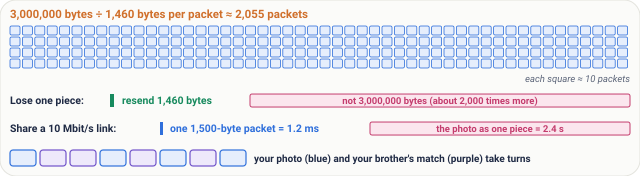
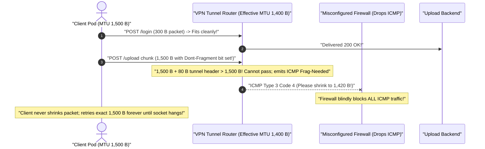

# Lesson 02: Packets: Why Data Travels in Small Pieces

> **Prerequisites:** [Lesson 01: What Is a Network?](../01-what-is-a-network/README.md) ([Track Overview](../README.md)).  
> **Estimated Reading Time:** 20 minutes  
> **Target Audience:** Developers learning how bytes actually cross wires and engineers troubleshooting MTU black holes, packet loss, fragmentation bottlenecks, and out-of-order reassembly.  
> **Free PDF Notes:** [Download SD-N-002.pdf](https://backendroadmap.com/notes/system-design/SD-N-002.pdf)

> [!TIP]
> **The Golden Rule of Packets:** Networks never fire an entire file across the internet as one uninterrupted `3 MB` stream—they slice payloads into small, self-contained **packets** capped by the Ethernet **MTU (`1,500 bytes`)**, leaving **`1,460 bytes` of user payload** after a **`40-byte` IP + TCP header**. Small packets keep recovery cheap (`1` dropped piece costs `1,460 B` instead of `3,000,000 B`) and let millions of devices share links fairly without a single upload blocking everyone else.

---

## Words You'll Meet Today

| Word | Everyday Meaning | Role in a Live Network |
| :--- | :--- | :--- |
| **Packet** | A single small chunk of data with an address-and-order label attached. | Fundamental unit of Layer-3 forwarding across routers worldwide. |
| **Header** | The shipping label at the front of a packet carrying routing and sequence fields. | IPv4 (`20 B`) + TCP (`20 B`) minimum = `40 bytes` before payload begins. |
| **Payload** | The actual message bytes tucked inside the packet after headers are stripped. | Up to `1,460 bytes` of your photo, HTML, or JSON inside a standard Ethernet packet. |
| **MTU** | *Maximum Transmission Unit* — the largest packet size a physical link can carry at once. | Standard Ethernet/Wi-Fi MTU is **`1,500 bytes`**. |
| **Reassemble** | Putting arriving numbered packets back in exact sequence to rebuild the original bytes. | Handled by the receiving TCP stack using sequence numbers before waking the app. |
| **Byte** | Standard unit of digital data (`8 bits`, e.g., roughly one ASCII letter). | Building block of bandwidth, buffer sizing, and packet length math. |
| **Router** | Traffic junction that reads a packet's destination header and forwards it toward the next hop. | Inspects destination IP per packet; may drop packets cleanly when queues overflow. |
| **Megabyte (`MB`)** | Roughly `1,000,000 bytes` (about one compressed mobile photo or short audio clip). | Helps estimate how many MTU-sized chunks an API upload produces (`~685` chunks per MB). |

---

## Visual Mental Models & Architecture

### Cutting, Labelling, and Reassembling Data

In [Lesson 01](../01-what-is-a-network/README.md), we saw a client request travel across the network. On real copper wires, Wi-Fi radios, and fiber backbones, that transfer does not flow as one giant continuous blob—every message is sliced into **packets**.


*Figure 1. A photo travels as packets: cut into pieces, each labelled with a header, sent on its own, and reassembled by number at the other end.*

Think of **moving a sofa from Bengaluru to Pune**. It is too wide to fit through doorways or fit in a single parcel van intact. So you disassemble it into **20 numbered boxes**, slap `"box 3 of 20 — to flat 5, Pune"` onto every carton, send them in vans that might even take slightly different highways, and bolt all 20 parts back together inside the Pune flat by reading the numbers.


*Figure 2. The everyday picture: moving a sofa as 20 numbered boxes.*

### Step-by-Step Anatomy of a `3 MB` Photo Transfer


*Figure 3. Inside one packet: a 40-byte header (20 bytes IP, 20 bytes TCP) and up to 1,460 bytes of payload.*

1. **Cut:** Your WhatsApp client splits a **`3 MB` (`3,000,000 B`)** photo into **`~2,055` small chunks** of up to **`1,460 bytes`** each.
2. **Label:** The OS kernel prepends a **`40-byte` header** (`20 B` IP + `20 B` TCP) carrying sender address, destination address, and byte sequence offset.
3. **Send:** Routers inspect each packet independently, forwarding packets along healthy paths while other laptops on the same Wi-Fi interleave their own packets in between.
4. **Reassemble:** The receiving OS sorts incoming pieces by sequence number (covered deeply in [Lesson 08](../08-tcp-sequence-numbers-and-acks/README.md)), detects any missing gap, and delivers a clean, intact `3 MB` file to WhatsApp.


---

## Real Numbers & Systematic Reference Grids

Inside almost every wired Ethernet and Wi-Fi hop, the physical link enforces a **`1,500-byte` MTU**:

$$\text{Max Payload (MSS)} = 1{,}500\text{ B MTU} - 20\text{ B IPv4 Header} - 20\text{ B TCP Header} = 1{,}460\text{ bytes}$$

*(Note: IPv6 expands the IP header to `40 bytes`, leaving `1,440 bytes` of payload per `1,500-byte` Ethernet frame—still under `4%` header overhead.)*



*Figure 4. Real numbers: a 3 MB photo is about 2,055 packets; a loss costs one packet; small packets let everyone take turns.*

### Why Small (`1,500 B`) Packets Beat Sending Whole Files Unsplit

| Property | Whole `3 MB` Stream Unsplit | `1,460 B` Payload Packets (`1,500 B` MTU) | Engineering Advantage |
| :--- | :--- | :--- | :--- |
| **Header Overhead** | Tiny (`~40 B` once) | `40 ÷ 1,500 ≈ 2.7%` (IPv4) | Negligible tax (`< 3%`) to gain routing & order tracking on every chunk. |
| **Count for `3 MB` File** | `1` giant unbroken transmission | `3,000,000 ÷ 1,460 ≈ 2,055` packets | Independent per-packet path selection and error recovery. |
| **Cost of `1` Bit Error / Drop** | Resend all **`3,000,000 bytes`**! | Resend only **`1,460 bytes`** (`0.05%`)! | Cuts recovery waste by `2,055x` on lossy Wi-Fi and mobile links. |
| **Fairness on `10 Mbit/s` Link** | Blocks shared link for **`2.4 seconds`**! | One packet occupies link for **`1.2 ms`**! | Interactive pings, Zoom audio, and chats share Wi-Fi smoothly without freezing. |

> [!NOTE]
> **Why `10 Mbit/s` Shows Link Monopolization So Clearly:** Calculating serialization time ($\text{bits} \div \text{bit/s}$): one `1,500-byte` (`12,000-bit`) packet finishes in `12,000 ÷ 10,000,000 = 1.2 ms`, whereas one unchunked `3,000,000-byte` (`24,000,000-bit`) stream traps every other user's packets behind it for `2.4 full seconds`—and any glitch at second `2.3` destroys the entire transfer.

---

## What Goes Wrong & Production War Story Post-Mortem

Real routers drop packets during queue congestion, and packets taking alternative paths frequently arrive out of order:


*Figure 5. What goes wrong: packet 7 is dropped and 8 and 9 arrive the wrong way round. The receiver sorts by number, sees the gap and asks for 7 again.*

Because packets carry numbers, the receiver **holds packets `8` and `9` in its receive buffer**, spots the gap right after packet `6`, asks the sender cleanly to retransmit **only packet `7`**, and passes `[6, 7, 8, 9]` upward once `7` lands—saving all earlier and later chunks from re-transfer.

### SEV-2 Post-Mortem: The Cloud VPN "Path MTU Black Hole" That Hung Every Large Upload Silently

#### Incident Overview
* **Severity:** SEV-2 (`100%` Failure on File Uploads `> 1.4 KB` Over Corporate VPN Tunnel; Health Checks Stayed Green!)
* **Detection Time:** `42 minutes` (small `200 B` JSON health checks and login tokens worked fine, hiding the break!)
* **Resolution Time:** `18 minutes` once caught via `tcpdump` & `ping -M do -s`
* **Impact:** Every photo upload and large API POST payload froze forever (`Connection reset by peer` after timeout) between Kubernetes nodes inside a `1,400-byte` WireGuard/IPsec VPN overlay.

#### What Happened


1. Engineers added an encrypted tunnel wrapping outgoing `1,500-byte` packets with an extra `80-byte` tunnel header, pushing total size to `1,580 B` and shrinking inner **Path MTU** to `1,420 B`.
2. Small requests (`GET /healthz`, small JSON logins under `1,400 B`) fit completely untouched—leaving synthetic monitors green!
3. Any payload exceeding `1,420 B` filled up to `1,500 B` with the `DF` (*Don't Fragment*) flag set. The tunnel router dropped those large packets and sent back an **ICMP "Fragmentation Needed"** signal asking the client to downsize packets.
4. A tight security firewall blocked **all ICMP** unconditionally—starving **Path MTU Discovery (PMTUD)**! The sender kept endlessly retrying identical `1,500 B` chunks into a black hole.

#### Root Cause Analysis
1. **MTU Overrun on Encapsulated Links:** Tunnel encapsulation overhead shrunk effective link MTU below the assumed `1,500 bytes`.
2. **ICMP Blackholing:** Blocking essential ICMP `Fragmentation Needed` errors broke automatic Path MTU Discovery.
3. **Too-Small Health Probes:** Tiny `200-byte` health checks failed to catch payload-size failures near the `1,500 B` MTU boundary.

#### The Fix & Architectural Hardening
1. **Allow ICMP Type 3 Code 4 (and IPv6 Packet Too Big):** Permitted essential Path MTU feedback packets across security groups so senders clamp packet size cleanly.
2. **TCP MSS Clamping (`1,380 bytes`) on Tunnel Interfaces:** Adjusted tunnel edge routers so negotiated MSS never exceeds encapsulated capacity.
3. **MTU-Sized Synthetic Probes:** Added a `4 KB` multi-packet probe (`> 1,500 B`) to uptime monitoring so black holes alert immediately.

---

## Multi-Language Production Implementation: Packet Chunker & Out-of-Order Reassembly Buffer

Each implementation models the core packet engine inside a networking stack: **(1)** slicing arbitrary payloads into fixed `1,460-byte` MSS chunks tagged with sequence IDs, and **(2)** reassembling reordered arrivals while pinpointing missing packet gaps for selective resend (like packet `7` arriving late behind `8` and `9`).

````carousel
```go
package packetengine

import "fmt"

const MaxPayloadBytes = 1460 // 1500 MTU - 20 IP - 20 TCP

type Packet struct {
	Seq     int
	Total   int
	Payload []byte
}

func SliceToPackets(data []byte) []Packet {
	if len(data) == 0 {
		return nil
	}
	total := (len(data) + MaxPayloadBytes - 1) / MaxPayloadBytes
	out := make([]Packet, 0, total)
	for seq := 0; seq < total; seq++ {
		start := seq * MaxPayloadBytes
		end := start + MaxPayloadBytes
		if end > len(data) {
			end = len(data)
		}
		out = append(out, Packet{Seq: seq + 1, Total: total, Payload: data[start:end]})
	}
	return out
}

type Reassembler struct {
	total    int
	received map[int][]byte
}

func NewReassembler(total int) *Reassembler {
	return &Reassembler{total: total, received: make(map[int][]byte, total)}
}

func (r *Reassembler) Ingest(pkt Packet) {
	r.received[pkt.Seq] = pkt.Payload
}

// MissingSeqs reports exact sequence numbers to request for retransmission (e.g., Packet #7 only).
func (r *Reassembler) MissingSeqs() []int {
	var gaps []int
	for seq := 1; seq <= r.total; seq++ {
		if _, ok := r.received[seq]; !ok {
			gaps = append(gaps, seq)
		}
	}
	return gaps
}

func (r *Reassembler) Assemble() ([]byte, error) {
	if missing := r.MissingSeqs(); len(missing) > 0 {
		return nil, fmt.Errorf("cannot reassemble; missing packets: %v", missing)
	}
	var result []byte
	for seq := 1; seq <= r.total; seq++ {
		result = append(result, r.received[seq]...)
	}
	return result, nil
}
```
<!-- slide -->
```typescript
export const MAX_PAYLOAD_BYTES = 1460; // 1500 MTU - 40B IP/TCP header

export interface Packet {
  seq: number;
  total: number;
  payload: Uint8Array;
}

export function sliceIntoPackets(data: Uint8Array): Packet[] {
  const total = Math.ceil(data.length / MAX_PAYLOAD_BYTES);
  const packets: Packet[] = [];
  for (let i = 0; i < total; i++) {
    const start = i * MAX_PAYLOAD_BYTES;
    const end = Math.min(start + MAX_PAYLOAD_BYTES, data.length);
    packets.push({ seq: i + 1, total, payload: data.slice(start, end) });
  }
  return packets;
}

export class ReassemblyBuffer {
  private readonly chunks = new Map<number, Uint8Array>();

  constructor(private readonly totalPackets: number) {}

  ingest(pkt: Packet): void {
    this.chunks.set(pkt.seq, pkt.payload);
  }

  missingSequences(): number[] {
    const missing: number[] = [];
    for (let seq = 1; seq <= this.totalPackets; seq++) {
      if (!this.chunks.has(seq)) missing.push(seq);
    }
    return missing;
  }

  assemble(): Uint8Array {
    const gaps = this.missingSequences();
    if (gaps.length > 0) {
      throw new Error(`Incomplete stream; request retransmit for packets: ${gaps.join(", ")}`);
    }
    const totalLen = Array.from(this.chunks.values()).reduce((sum, c) => sum + c.length, 0);
    const out = new Uint8Array(totalLen);
    let offset = 0;
    for (let seq = 1; seq <= this.totalPackets; seq++) {
      const part = this.chunks.get(seq)!;
      out.set(part, offset);
      offset += part.length;
    }
    return out;
  }
}
```
<!-- slide -->
```python
from dataclasses import dataclass

MAX_PAYLOAD_BYTES = 1460  # 1500 B Ethernet MTU - 20 B IPv4 - 20 B TCP


@dataclass(frozen=True)
class Packet:
    seq: int
    total: int
    payload: bytes


def slice_to_packets(data: bytes) -> list[Packet]:
    total = max(1, (len(data) + MAX_PAYLOAD_BYTES - 1) // MAX_PAYLOAD_BYTES)
    return [
        Packet(seq=i + 1, total=total, payload=data[i * MAX_PAYLOAD_BYTES : (i + 1) * MAX_PAYLOAD_BYTES])
        for i in range(total)
    ]


class ReassemblyBuffer:
    def __init__(self, total_packets: int) -> None:
        self.total_packets = total_packets
        self._buffer: dict[int, bytes] = {}

    def ingest(self, pkt: Packet) -> None:
        self._buffer[pkt.seq] = pkt.payload

    def missing_seqs(self) -> list[int]:
        return [seq for seq in range(1, self.total_packets + 1) if seq not in self._buffer]

    def assemble(self) -> bytes:
        gaps = self.missing_seqs()
        if gaps:
            raise ValueError(f"Waiting for selective retransmission of packets: {gaps}")
        return b"".join(self._buffer[seq] for seq in range(1, self.total_packets + 1))
```
<!-- slide -->
```csharp
using System;
using System.Collections.Generic;
using System.IO;

public sealed record Packet(int Seq, int Total, byte[] Payload);

public sealed class PacketSlicer
{
    public const int MaxPayloadBytes = 1460;

    public static List<Packet> Slice(byte[] data)
    {
        int total = (data.Length + MaxPayloadBytes - 1) / MaxPayloadBytes;
        var packets = new List<Packet>(total);
        for (int i = 0; i < total; i++)
        {
            int offset = i * MaxPayloadBytes;
            int count = Math.Min(MaxPayloadBytes, data.Length - offset);
            var chunk = new byte[count];
            Buffer.BlockCopy(data, offset, chunk, 0, count);
            packets.Add(new Packet(i + 1, total, chunk));
        }
        return packets;
    }
}

public sealed class ReassemblyBuffer(int totalPackets)
{
    private readonly Dictionary<int, byte[]> _chunks = new();

    public void Ingest(Packet pkt) => _chunks[pkt.Seq] = pkt.Payload;

    public List<int> GetMissingSeqs()
    {
        var missing = new List<int>();
        for (int s = 1; s <= totalPackets; s++)
            if (!_chunks.ContainsKey(s)) missing.Add(s);
        return missing;
    }

    public byte[] Assemble()
    {
        var gaps = GetMissingSeqs();
        if (gaps.Count > 0)
            throw new InvalidOperationException($"Missing packet(s): {string.Join(", ", gaps)}");

        using var ms = new MemoryStream();
        for (int s = 1; s <= totalPackets; s++)
            ms.Write(_chunks[s], 0, _chunks[s].Length);
        return ms.ToArray();
    }
}
```
````

---

## Practical Hands-On Verification CLI Workflows

Verify packet slicing math (`3 MB -> 2,055 packets`), header efficiency (`< 3%`), selective gap detection when packet `7` drops while `8` and `9` reorder, AND check the actual MTU configured on your local OS network interface!

### Step 1: Simulate Out-of-Order Delivery + Inspect Real Interface MTU

```bash
python3 - <<'EOF'
mtu = 1500
header_bytes = 20 + 20  # 20B IPv4 + 20B TCP
mss = mtu - header_bytes
photo_bytes = 3_000_000
total_packets = (photo_bytes + mss - 1) // mss

print(f"MTU={mtu} B | Header={header_bytes} B ({header_bytes/mtu*100:.2f}% overhead) | Payload={mss} B")
print(f"3 MB photo ({photo_bytes:,} B) splits into {total_packets:,} packets.")
print(f"Single dropped packet resend cost: {mss:,} B ({mss/photo_bytes*100:.3f}% of total)\n")

# Simulate packets 1..10 arriving with #7 dropped and #8,#9 swapped
arriving = [1, 2, 3, 4, 5, 6, 9, 8, 10]
buf = set()
for seq in arriving:
    buf.add(seq)
missing = [s for s in range(1, 11) if s not in buf]
print(f"Arrived out of order: {arriving}")
print(f"Buffered safely; receiver asks sender ONLY for missing seq(s): {missing}")
EOF
```

**Expected Output:**
```text
MTU=1500 B | Header=40 B (2.67% overhead) | Payload=1460 B
3 MB photo (3,000,000 B) splits into 2,055 packets.
Single dropped packet resend cost: 1,460 B (0.049% of total)

Arrived out of order: [1, 2, 3, 4, 5, 6, 9, 8, 10]
Buffered safely; receiver asks sender ONLY for missing seq(s): [7]
```

> [!TIP]
> **Check Your Own Machine's MTU:** On Linux run `ip link show` (look for `mtu 1500` or loopback `mtu 65536`); on macOS run `ifconfig en0 | grep mtu`; on Windows PowerShell run `netsh interface ipv4 show subinterfaces`.

---

## Pause and Think & Validation Checkpoints

### Pause and Think

You send a `1.46 MB` voice note (`1,460,000 bytes`) over a `1,500`-byte MTU network (`1,460 bytes` of payload per packet). Packet `500` gets dropped on the way. Roughly how many bytes need to be resent?

<details>
<summary><strong>Click to see the answer</strong></summary>

**`1,460 bytes` — just packet `500`.** The `1,460,000`-byte voice note splits into `1,460,000 ÷ 1,460 = 1,000` packets. Only packet `500` failed to arrive; packets `1` to `499` and `501` to `1,000` arrived cleanly and stay buffered at the receiver waiting to be bolted together once packet `500` lands.


*Figure 6. 1,000 packets, and only packet 500 is sent again.*

</details>

### Operational Validation Checkpoints (Scenario Quizzes)

<details>
<summary><strong>Checkpoint 1: Tiny-Packet Throughput Tax</strong></summary>

**Scenario:** A developer serializes telemetry in chunks of `10 bytes` of JSON per TCP write with Nagle's algorithm disabled—producing packets holding `40 B` of IP/TCP headers and only `10 B` of user data. What happens to network efficiency?

<strong>Answer:</strong>
Header overhead shoots from **`2.7%`** (`40 ÷ 1,500`) to **`80%`** (`40 ÷ 50`)! On a `10 Mbit/s` pipe, `8 Mbit/s` gets burned carrying address envelopes rather than telemetry payload. Batching small telemetry writes up toward the `1,460 B` MSS ceiling slashes packet rate and header waste dramatically.
</details>

<details>
<summary><strong>Checkpoint 2: Why Health Checks Pass During an MTU Black Hole</strong></summary>

**Scenario:** After enabling a VPN gateway between microservices, `GET /health` (`95 bytes`) passes `100%`, yet `POST /invoice` (`12 KB`) hangs indefinitely on `99%` of requests. Explain why size differentiates success from failure.

<strong>Answer:</strong>
The `95-byte` health check fits cleanly inside one tunnel packet (`95 + headers < 1,420 B`), whereas the `12 KB` invoice generates `1,500-byte` MTU packets with `DF` set that overshoot the encrypted tunnel ceiling and trigger black-holed ICMP `Fragmentation Needed` errors.
</details>

<details>
<summary><strong>Checkpoint 3: Out-of-Order Buffering vs. App-Layer Ordering</strong></summary>

**Scenario:** Router A fails mid-upload, rerouting packets `#50–#100` across a slightly shorter path so packet `#52` reaches the destination server `8 ms` ahead of packet `#51`. Does your Python/Go HTTP handler receive corrupted out-of-order bytes?

<strong>Answer:</strong>
**No (when using TCP).** The operating system kernel buffers `#52` quietly in its receive queue, waits for `#51` to arrive (or triggers retransmission if lost), orders the stream monotonically, and only hands ordered bytes `[#50, #51, #52]` up to the HTTP handler.
</details>

---

## Interview Practice Questions

Each question is tagged by kind: **Basic** (definitions), **Scenario** (apply it to a system), and **Tricky** (deep follow-ups). Answer out loud before opening the solution.

<details>
<summary><strong>1. Why do networks send data in small packets instead of one whole file? (Basic)</strong></summary>

<strong>What a strong answer covers:</strong>
Two core reasons: **(1) Cheap loss recovery:** losing a piece costs only `1` packet (`1,460 B`) rather than restarting a `3 MB` transfer; **(2) Fair link sharing:** small chunks (`~1.2 ms` on a `10 Mbit/s` link) let multiple devices and real-time audio/video traffic interleave cleanly instead of letting one big upload freeze everyone else for seconds.

</details>

<details>
<summary><strong>2. What is the difference between a header and a payload? What is MTU? (Basic)</strong></summary>

<strong>What a strong answer covers:</strong>
The **header** (`~40 B` for IPv4 + TCP) carries delivery metadata (addresses, ports, sequence numbers). The **payload** (`up to 1,460 B`) is your actual application data. **MTU** (*Maximum Transmission Unit*, typically `1,500 bytes` on Ethernet/Wi-Fi) is the largest total packet size a link accepts in one unit.

</details>

<details>
<summary><strong>3. Packets 5 and 6 arrive before packet 4. Does the receiver drop them? (Scenario)</strong></summary>

<strong>What a strong answer covers:</strong>
No. Because headers carry sequence order, the receiver stores out-of-order packets `5` and `6` inside its receive buffer, spots the gap after packet `3`, asks the sender to retransmit **only packet `4`**, and then releases `[4, 5, 6]` cleanly upward to the application.

</details>

<details>
<summary><strong>4. You upload a 3 MB photo and packet 700 gets lost. How does the receiver spot it, and how much gets sent again? (Scenario)</strong></summary>

<strong>What a strong answer covers:</strong>
When packet `701` arrives immediately after `699`, the missing sequence range exposes the gap for packet `700`. Only packet `700`'s `1,460` payload bytes (+ `40 B` header) are retransmitted—the other `2,054` packets never cross the wire a second time.

</details>

<details>
<summary><strong>5. Why don't we make packets tiny, like 100 bytes each? (Tricky)</strong></summary>

<strong>What a strong answer covers:</strong>
Every packet pays an unavoidable `40`-byte (or `60`-byte IPv6) header tax regardless of payload size. At `100 B` total (`40 B` header + `60 B` payload), `40%` of every megabit transferred is envelope metadata, and routers burn far more CPU inspecting headers per byte carried. `1,500 B` balances `< 3%` header overhead against millisecond-scale link fairness.

</details>

<details>
<summary><strong>6. Your packets arrive out of order, and your video call stutters. Why can't the network just force every packet onto the same wire in order? (Tricky)</strong></summary>

<strong>What a strong answer covers:</strong>
Shared internet routers constantly rebalance links as traffic surges, fibers cut, or buffers fill—no single router owns an end-to-end lane. Keeping packets self-contained allows instant failover around congested hops, while endpoints trade a small jitter buffer (`tens of ms` for live calls) or full ordered reassembly (`TCP`) depending on whether timeliness or byte-perfection matters more.

</details>

---

## Common Mistakes & Troubleshooting

- **Confusing `MTU` (`1,500 B`) with `MSS` (`1,460 B`):** Treating `1,500 B` as user payload ignores the `40 B` IPv4 + TCP headers (or `60 B` over IPv6).
- **Assuming routers keep packets locked in send order:** Multi-path routing means receivers frequently observe reordered packets; sequence numbers exist specifically to rebuild order.
- **Ignoring VPN / overlay MTU reductions:** Blindly dropping ICMP `Fragmentation Needed` breaks Path MTU Discovery (`PMTUD`) and stalls large transfers while tiny health checks pass.

---

## Recap in Three Lines

1. Networks slice every transfer into small **packets**, each pairing a **`40`-byte delivery header** with up to **`1,460` bytes of payload** inside a **`1,500`-byte MTU**.
2. Small packets keep lost-packet retries negligible (`0.05%` of a `3 MB` photo) and stop large transfers from monopolizing shared Wi-Fi and cables.
3. Because packet headers carry sequence order, receivers buffer out-of-order arrivals and ask for only missing pieces back.

---

## Sources

- [RFC 791: Internet Protocol](https://www.rfc-editor.org/rfc/rfc791) — packet format, IP header structure (`20-byte` minimum), and fragmentation rules.
- [RFC 9293: Transmission Control Protocol](https://www.rfc-editor.org/rfc/rfc9293) — TCP `20-byte` header, sequence ordering, and reliable retransmission.
- [RFC 894: Transmission of IP Datagrams over Ethernet Networks](https://www.rfc-editor.org/rfc/rfc894) — standard **`1,500-byte` Ethernet MTU**.

---

## Free PDF notes

Download these notes as a printable PDF, with every diagram: [SD-N-002.pdf](https://backendroadmap.com/notes/system-design/SD-N-002.pdf).

---

## Next

Continue with [Lesson 03: IP Addresses: The Street Address of Every Device](../03-ip-addresses/README.md) to see how every packet finds the exact home router and device inside billions of endpoints on Earth.
