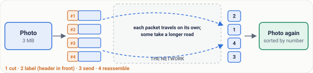
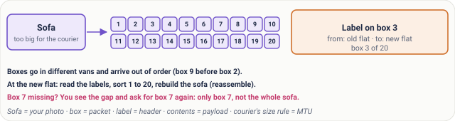
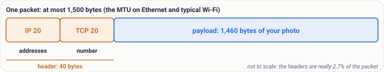
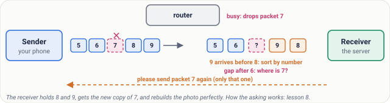
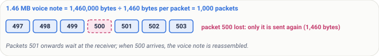

# Lesson 02: Packets: Why Data Travels in Small Pieces

## Roadmap

You are in **System Design Interview Prep**, Track 02, **Networking from Zero**: lesson 2 of 30. It builds on [lesson 1](../01-what-is-a-network/README.md), where a client and a server exchange messages. The next lesson is [IP addresses](../03-ip-addresses/README.md). See [the track overview](../README.md) for the whole plan.

These are the written notes for the lesson's video. Prefer paper? The same notes are a free, printable PDF: [download SD-N-002.pdf](https://backendroadmap.com/notes/system-design/SD-N-002.pdf).

## Concept

> [!key] Data crosses the network in small pieces called packets. Each packet is a header (where it's from, where it's going, its number) plus a payload (the data). The MTU, usually 1,500 bytes, sets the largest size, and the numbers let the receiver reassemble everything in order and ask again for just the missing piece.

## Words you'll meet today

| Word | In plain words |
|---|---|
| **Packet** | one small piece of data that travels on its own |
| **Header** | the label on a packet: where from, where to, its number |
| **Payload** | the data inside the packet |
| **MTU** (maximum transmission unit) | the largest packet size; 1,500 bytes on most networks |
| **Reassemble** | put the pieces back together, in order |
| **Byte** | a tiny unit of data, about one letter of text |
| **Router** | a machine that passes packets along toward their destination |
| **Megabyte (MB)** | about a million bytes; a phone photo is about 3 MB |

## The question: why pieces?

You're on a train, and a friend sends you a photo on WhatsApp. The download circle creeps round, bit by bit. The photo isn't arriving all at once. It's arriving in pieces. On the way, one piece is lost and two arrive in the wrong order. And yet the photo that opens is perfect: not one dot is missing.

Why cut a photo into pieces at all? And how does your phone put them back together?

One unit first. A **byte** is a tiny unit of data, about one letter of text. A phone photo is around **3 megabytes**: about three million bytes.

*Figure 1. A photo travels as packets: cut into pieces, each labelled with a header, sent on its own, and reassembled by number at the other end.*

## An everyday picture first: moving house

You're moving house, from Bengaluru to Pune. Your sofa is too big for the courier. Their rule: nothing bigger than one box.

So you take the sofa apart and pack it into 20 boxes. On each box you stick a label: from your old flat, to your new flat, and *box 3 of 20*. The courier sends the boxes in different vans, on different roads. They arrive at different times, and not in order: box 9 may come before box 2.

At the new flat, you read the labels and sort the boxes, 1 to 20. Then you put the sofa back together. That's **reassembling**.

And if box 7 never arrives? You see the gap: 6 is here, 8 is here, 7 is not. So you call the sender: please send box 7 again. Only box 7, not the whole sofa.

*Figure 2. The everyday picture: moving a sofa as 20 numbered boxes.*

## Now the real thing

| Moving house | In a network |
|---|---|
| The sofa | your photo (any data: a message, a web page) |
| One box | a **packet**: one small piece of the photo |
| The courier's size rule | the **MTU**: the largest packet size |
| The label on the box | the **header**: where the packet comes from, where it's going, and its number |
| What's inside the box | the **payload**: a piece of the photo |
| Vans and roads | the network |
| You, sorting boxes at the new flat | the receiver, which **reassembles** the photo |

## Step by step: one photo

Let's follow it slowly. Each step has a job.

1. **Cut.** The sender's phone cuts the photo into pieces, each small enough to fit the size limit. The job: make every piece fit.
2. **Label.** Each piece gets a header in front: from this phone, to the WhatsApp server, and a number. The job: let each piece travel on its own and still find its place.
3. **Send.** The packets leave one after another, and each one makes its own way across the networks. Some take a longer road. The network's job is to carry each packet, nothing more.
4. **Reassemble.** At the other end, the packets are sorted by number and joined back into the photo. The job: rebuild the exact original, byte for byte.

*Figure 3. Inside one packet: a 40-byte header (20 bytes IP, 20 bytes TCP) and up to 1,460 bytes of payload.*

## Real numbers

On most networks, including Ethernet and typical Wi-Fi, the largest packet size, the **MTU**, is **1,500 bytes**. But not all of it is photo. The header takes room: 20 bytes for the address part, the **IP header** (lesson 3), and 20 bytes for the numbering part, the **TCP header** (lesson 8). That leaves **1,460 bytes** of payload.

| Question | Arithmetic | Answer |
|---|---|---|
| payload per packet | 1,500 − 20 − 20 | **1,460 bytes** |
| packets for a 3 MB photo | 3,000,000 ÷ 1,460 | **≈ 2,055 packets** |
| cost of the headers | 40 ÷ 1,500 | **≈ 2.7%** (under 3%) |
| resend after one loss | one packet's payload | **1,460 bytes**, not 3,000,000 |
| one packet on a 10 Mbit/s link | 1,500 × 8 bits ÷ 10,000,000 bits/s | **1.2 ms** |
| the photo as one piece on 10 Mbit/s | 3,000,000 × 8 ÷ 10,000,000 | **2.4 s** |

So why pay for the labels?

- **Reason one: loss.** If one piece is lost, the phone sends just that piece again: 1,460 bytes, not the whole 3 megabytes. About two thousand times less.
- **Reason two: sharing.** Your family shares one Wi-Fi. Your brother streams a cricket match while you send the photo. Because everything is cut small, the packets take turns on the wire, and nobody waits long. On a 10 megabit per second link, one 1,500-byte packet takes 1.2 milliseconds to send; sent as one giant piece, the photo would hold the wire for 2.4 seconds, and everyone else would wait.

*Figure 4. Real numbers: a 3 MB photo is about 2,055 packets; a loss costs one packet; small packets let everyone take turns.*

> [!note] **For the curious.** 1,500 bytes is the Ethernet limit for the packet itself; the Ethernet frame around it adds a few more bytes that are not counted. Headers can be longer than 20 bytes when options are used, and IPv6 headers are 40 bytes, so real payloads are often a little under 1,460. Strictly, the number in the TCP header counts bytes, not packets; [lesson 8](../08-tcp-sequence-numbers-and-acks/README.md) shows how.

## What goes wrong: lost and out of order

Packet 7 is lost. A busy **router**, the machine that passes packets along, had no room and dropped it. And packets 8 and 9 arrive the wrong way round.

- **Out of order is easy.** The receiver sorts by number, and 8 goes before 9. No harm done.
- **The loss is the real problem.** The receiver sees a gap: 6, then 8. Where is 7? It holds on to 8 and 9, and the sender is asked to send packet 7 again. Just that one.
- Packet 7 arrives, the gap is filled, and the photo is rebuilt, perfectly. That's why your photo is fine even when the network isn't. Exactly how that asking works is [lesson 8](../08-tcp-sequence-numbers-and-acks/README.md).

*Figure 5. What goes wrong: packet 7 is dropped and 8 and 9 arrive the wrong way round. The receiver sorts by number, sees the gap and asks for 7 again.*

## Pause and think

> [!exercise] A friend sends you a voice note of 1.46 megabytes. Each packet carries 1,460 bytes of payload. How many packets is that? And if packet 500 is lost, what is sent again? Decide before you open the answer.

Answer

1,460,000 ÷ 1,460 = **1,000 packets**. If packet 500 is lost, only packet 500 is sent again: 1,460 bytes. Your phone keeps packets 501 onwards, waits for 500, and then reassembles the voice note.

*Figure 6. 1,000 packets, and only packet 500 is sent again.*

## Common mistakes

- **"A packet is the whole message."** No. A photo or a web page is usually many packets. A packet is one piece, at most 1,500 bytes on most networks.
- **"One lost packet means the whole download starts again."** No. Only the missing piece is sent again. The other pieces wait until the gap is filled.

## Recap in three lines

1. Data travels in small packets, each a header plus a payload.
2. The MTU, usually 1,500 bytes, makes a 3 megabyte photo about two thousand packets.
3. Numbers in the headers let the receiver reassemble them, and ask again for just the missing piece.

## Interview questions

Each question is tagged by kind: **Basic** (definitions), **Scenario** (apply it) and **Tricky** (the follow-ups interviewers use to go deeper). Each answer is what to say in about 30 seconds. Answer out loud before you open it.

> [!interview] What is a packet, and what is inside one? (Basic)

What to say in 30 seconds

Data is split into packets, each with a header, holding the addresses and a number, and a payload. Packets are limited by the MTU, typically 1,500 bytes on Ethernet, so after 40 bytes of IP and TCP headers each carries about 1,460 bytes of data. Small packets let many users share a link, and a lost packet is resent alone. The receiver uses the numbers to reassemble everything in order.

> [!interview] What is the MTU, and what is it on most networks? (Basic)

What to say in 30 seconds

The maximum transmission unit: the largest packet a network link will carry. On Ethernet, and on typical home Wi-Fi, it is 1,500 bytes. After a 20-byte IP header and a 20-byte TCP header, that leaves 1,460 bytes of data per packet.

> [!interview] How many packets does a 3 MB photo need? (Scenario)

What to say in 30 seconds

3,000,000 bytes ÷ 1,460 bytes per packet ≈ 2,055 packets, about two thousand. The headers cost 40 bytes in every 1,500, under 3%.

> [!interview] Why not send the whole file as one big piece? (Scenario)

What to say in 30 seconds

Two reasons. Loss: if one piece is lost, only 1,460 bytes are resent instead of the whole file. Sharing: small packets take turns on a link, so one big transfer does not block everyone else. On a 10 Mbit/s link a 1,500-byte packet takes 1.2 ms, while a 3 MB file as one piece would hold the link for 2.4 s.

> [!interview] Packets arrive out of order and one is missing. Is the file broken? (Tricky)

What to say in 30 seconds

No. The receiver sorts the packets by the number in their headers, holds the ones after the gap, and the missing one is sent again. Only when the gap is filled is the data handed over, complete and in order.

> [!interview] Does one lost packet mean the download restarts? (Tricky)

What to say in 30 seconds

No. Only the missing packet is resent; everything that arrived is kept. With TCP the number actually counts bytes, not packets, and the receiver's replies tell the sender what to resend; that is lesson 8.

## Free PDF notes

Download these notes as a printable PDF, with every picture, the real-numbers table and the interview answers: [SD-N-002.pdf](https://backendroadmap.com/notes/system-design/SD-N-002.pdf).

## Sources

- [RFC 791: Internet Protocol](https://www.rfc-editor.org/rfc/rfc791), the IP header and its 20-byte minimum size.
- [RFC 9293: Transmission Control Protocol](https://www.rfc-editor.org/rfc/rfc9293), the TCP header, sequence numbers and the maximum segment size.
- [RFC 894: Transmission of IP Datagrams over Ethernet Networks](https://www.rfc-editor.org/rfc/rfc894), the 1,500-byte limit on Ethernet.

## Next

Next comes [lesson 3, IP addresses](../03-ip-addresses/README.md): the header said "to the WhatsApp server", but how do you write a computer's address? The [track overview](../README.md) lists the whole series.
