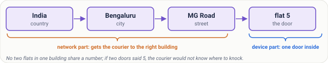
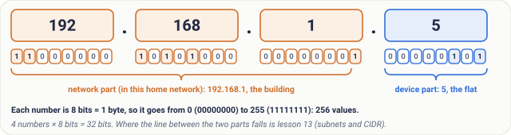
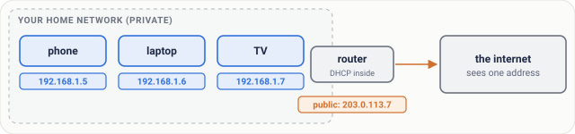
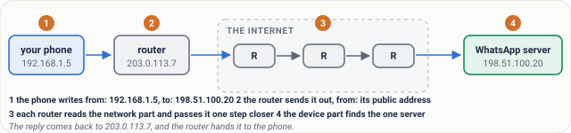
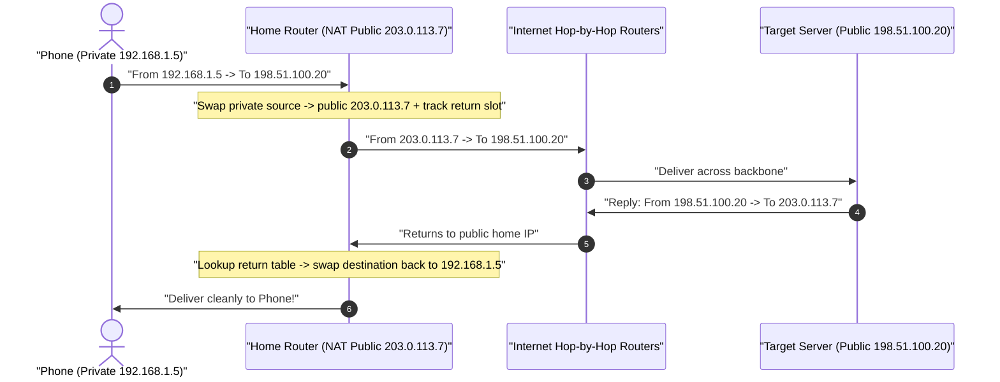
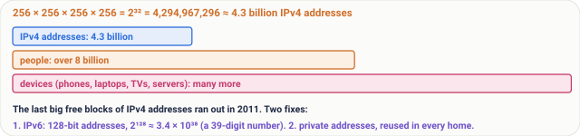
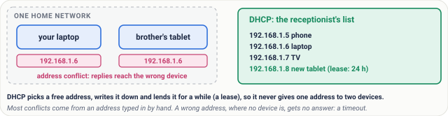
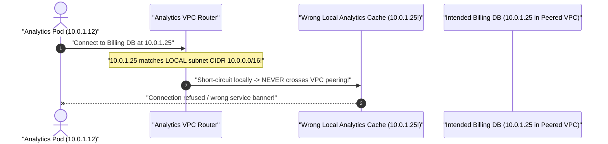
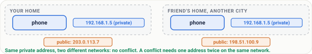

# Lesson 03: IP Addresses: The Street Address of Every Device

> **Prerequisites:** [Lesson 02: Packets](../02-packets/README.md) ([Track Overview](../README.md)).  
> **Estimated Reading Time:** 22 minutes  
> **Target Audience:** Developers learning addressing from first principles and backend engineers configuring VPC subnets, NAT gateways, localhost bindings, and avoiding IP conflicts or overlap bugs.  
> **Free PDF Notes:** [Download SD-N-003.pdf](https://backendroadmap.com/notes/system-design/SD-N-003.pdf)

> [!TIP]
> **The Golden Rule of IP Addressing:** An **IP address** splits hierarchically into a **network prefix** (which building/VPC to route toward) and a **host identifier** (which device inside that building receives the packet). Because **IPv4 (`32 bits` ≈ `4.3 billion` addresses)** ran out globally, homes and cloud VPCs reuse **RFC 1918 private addresses** behind routers/NAT (`192.168.x.x`, `10.x.x.x`), while **IPv6 (`128 bits` ≈ $3.4 \times 10^{38}$ addresses)** eliminates exhaustion permanently.

---

## Words You'll Meet Today

| Word | Everyday Meaning | Role in a Live Network |
| :--- | :--- | :--- |
| **IP Address** | The numerical address written onto every packet so routers know where to deliver it and where replies return. | Core Layer-3 routing target (`192.168.1.5` or `2001:db8::1`). |
| **IPv4** | Classic four-number address (`0–255` per octet, **`32 bits`** total). | Supports `~4.3 billion` unique addresses (`exhausted` regionally since 2011). |
| **IPv6** | Modern eight-group hexadecimal address (**`128 bits`** total). | Supplies ~$3.4 \times 10^{38}$ addresses so every device can hold a globally unique IP. |
| **Public vs. Private Address** | Globally unique internet street address vs. reusable indoor flat address. | Routers translate private LAN/VPC IPs onto public IPs via **NAT**. |
| **Router** | Device bridging two networks (e.g., your home LAN and your ISP fiber). | Rewrites source IP at the edge (NAT) and inspects routing tables per hop. |
| **DHCP** | Automatic address-lending server inside a home router or cloud subnet. | Leases free private IPs dynamically with finite lease timers to prevent conflicts. |
| **Bit & Byte** | Single `0`/`1` switch (**bit**) and `8` switches grouped together (**byte**). | One IPv4 octet (`0–255`) is `1 byte`; four octets equal `32 bits` (`4 bytes`). |
| **Localhost (`127.0.0.1`)** | Special loopback address pointing strictly back to *"this very machine"*. | Traffic skips physical NICs/Wi-Fi completely; stays strictly inside the OS kernel. |

---

## Visual Mental Models & Architecture

### The Courier Analogy: Network Part + Device Part

In [Lesson 02](../02-packets/README.md), we saw data travel as addressed packets. How does the postal system make sense of billions of destinations? **Hierarchy.**

Imagine a courier delivering a parcel to **`flat 5, 42 MG Road, Bengaluru, India`**:
* The outer part (`India -> Bengaluru -> 42 MG Road`) gets the van to the exact right **building** (**the network part**).
* Only once inside that lobby does anyone care about **`flat 5`** (**the device part**).



*Figure 1. The courier's address: country, city and street get him to the right building; the flat number finds one door inside it.*

An IPv4 address works identically: **`192.168.1`** identifies the home/office network (the building), while **`.5`** identifies the specific phone or laptop inside it (flat 5).



*Figure 2. Anatomy of an IPv4 address: four numbers, each one byte (0 to 255), 32 bits in all; here 192.168.1 is the network part and 5 the device part.*

### Public IPs vs. Private IPs (NAT at Your Home Router)

Because IPv4 (`32 bits`) caps out near **`4.3 billion`** combinations—far fewer than the phones, watches, laptops, servers, and smart TVs online today—every home and cloud cluster relies on **private addressing + NAT**:



*Figure 4. At home, the router gives each device a private address and shows the internet one public address.*

Your router lends your phone `192.168.1.5` and your laptop `192.168.1.6` internally, while owning **one public IPv4 address** facing the ISP (say `203.0.113.7` from RFC 5737 documentation space).

### Step-by-Step Trace: From Private Phone to Public Server and Back



*Figure 5. One message, step by step: address it, leave home, hop by hop, deliver; the reply comes back the same way.*



1. **Address It:** Your laptop stamps `"from 192.168.1.5 -> to 198.51.100.20"` on the packet header.
2. **Leave Home:** Your home router swaps the private sender `192.168.1.5` for your router's public IP `203.0.113.7` and records a mapping entry so the reply knows where inside the house to go.
3. **Hop by Hop:** Internet core routers inspect `198.51.100.20`, check routing tables at each junction, and forward the packet toward the origin data center.
4. **Deliver & Reply:** The server writes `"to 203.0.113.7"` on its response; routers bring it home, and your router forwards it onto `192.168.1.5`.

---

## Real Numbers & Systematic Reference Grids

Inside `192.168.1.5`, each number sits inside **`8 bits` (`1 byte`)**, written in binary as `11000000 . 10101000 . 00000001 . 00000101`, giving `2^8 = 256` choices (`0` to `255`) per octet and **`32 bits`** overall.



*Figure 3. Real numbers: 32 bits give about 4.3 billion addresses, fewer than the people on Earth, let alone their devices.*

### IPv4 vs. IPv6 Address Capacity Comparison

| Protocol Version | Bit Width | Total Combinations | Standard Format Example | Status in Modern Networks |
| :--- | :--- | :--- | :--- | :--- |
| **IPv4** | **`32 bits`** (`4 bytes`) | $2^{32} = \mathbf{4{,}294{,}967{,}296}$ (`~4.3B`) | `192.168.1.5` | Central free pools **exhausted (~2011)**; kept running via Private IPs + NAT. |
| **IPv6** | **`128 bits`** (`16 bytes`) | $2^{128} \approx \mathbf{3.4 \times 10^{38}}$ | `2001:0db8:85a3:0000:0000:8a2e:0370:7334` | Practically inexhaustible (~$5 \times 10^{28}$ addresses per human alive). |

### Reserved Special-Purpose IPv4 Ranges (`RFC 1918`, Loopback, Documentation)

| Address Block (CIDR) | Range Start -> End | Total Addresses | Purpose & Where You Meet It |
| :--- | :--- | :--- | :--- |
| **`10.0.0.0/8`** | `10.0.0.0` -> `10.255.255.255` | `16,777,216` | Large cloud VPCs (AWS/GCP), corporate networks, Kubernetes clusters. |
| **`172.16.0.0/12`** | `172.16.0.0` -> `172.31.255.255` | `1,048,576` | Default Docker bridge networks (`172.17.0.0/16`) and medium corporate subnets. |
| **`192.168.0.0/16`** | `192.168.0.0` -> `192.168.255.255` | `65,536` | Home Wi-Fi routers, small offices (`192.168.0.x`, `192.168.1.x`). |
| **`127.0.0.0/8` (`127.0.0.1`)** | `127.0.0.0` -> `127.255.255.255` | `16,777,216` | **Localhost / loopback** — talks strictly inside the same OS kernel. |
| **`192.0.2.0/24`, `198.51.100.0/24`, `203.0.113.0/24`** | Documentation Blocks (`RFC 5737`) | `256` each | Safe example public IPs for tutorials, tests, and docs (never routed globally). |

---

## What Goes Wrong & Production War Story Post-Mortem

Because devices must hold unique addresses inside one shared local network, duplicate configurations or stale manual entries break traffic silently:



*Figure 6. What goes wrong: two devices with one address on one network. The fix is DHCP, which lends each device a free address and keeps a list.*

Manually assigning **`192.168.1.6`** to a printer while a laptop already holds `192.168.1.6` creates an **IP address conflict**: ARP tables bounce back and forth so packets land at the wrong machine or drop completely. **DHCP** solves this cleanly by leasing unused addresses automatically from an authoritative pool and tracking expiration times. Meanwhile, mistyping an unreachable address (`198.51.100.9` down) makes senders hang until their timeout expires.

### SEV-2 Post-Mortem: Overlapping `10.0.0.0/16` VPC Peering & Rogue Static Server IP

#### Incident Overview
* **Severity:** SEV-2 (Zero Cross-Region Service Discovery Between Analytics & Billing Clusters; Intermittent SSH Hijacking)
* **Detection Time:** Immediately upon peering two cloud VPCs + provisioning a manually pinned static database replica
* **Resolution Time:** `3 hours` (required re-IPing an entire environment to non-overlapping CIDRs!)
* **Impact:** Packets intended for the Billing cluster (`10.0.1.25`) looped internally inside the Analytics VPC (`10.0.1.25`), corrupting metrics—and a statically pinned VM collided with a DHCP-leased app node on `.6`.

#### What Happened


1. Team A spun up production in `10.0.0.0/16`, while Team B picked the exact same default tutorial CIDR `10.0.0.0/16` for their isolated analytics VPC.
2. Six months later, management asked both clusters to talk privately over VPC Peering. Peering failed completely because both networks claimed ownership of `10.0.1.25`!
3. Simultaneously, an engineer hardcoded a static IP (`10.0.1.6`) directly on a VM outside the DHCP range exclusion, colliding with an autoscale pod that leased `.6` the following week.

#### Root Cause Analysis
1. **Unplanned Private CIDR Reuse:** Copying `10.0.0.0/16` blindly across multiple VPCs prevents clean private routing/peering forever.
2. **Static IP Inside Active DHCP Pool:** Hardcoding static hosts without reserving them out of the DHCP lease block guarantees collisions.
3. **Binding Local Admin Ports Globally (`0.0.0.0` vs `127.0.0.1`):** Developers also accidentally exposed internal-only services meant strictly for `127.0.0.1` onto LAN IPs.

#### The Fix & Architectural Hardening
1. **Central IPAM (IP Address Management) Allocation Registry:** Assigned disjoint `/16` blocks per region/environment (`Prod: 10.10.0.0/16`, `Analytics: 10.20.0.0/16`, `Staging: 10.30.0.0/16`).
2. **Enforce DHCP Static Reservations by MAC Address:** Replaced hardcoded OS static configs with DHCP-managed permanent reservations so a single source of truth allocates every IP.
3. **Strict Loopback Binding (`127.0.0.1`) for Node-Local Daemons:** Verified local-only metrics exporters listen strictly on loopback rather than outward interfaces.

---

## Multi-Language Production Implementation: IPv4/IPv6 Classifier & Network/Host Splitter

Each implementation cleanly inspects an IP address using standard-library type-safe primitives (`net/netip`, `ipaddress`, `System.Net.IPAddress`), splits the **network prefix** vs. **host part**, and classifies whether it belongs to **Loopback (`127.0.0.1`)**, **RFC 1918 Private (`10.x` / `172.16-31.x` / `192.168.x`)**, or **Public Global** space.

````carousel
```go
package ipinspect

import (
	"fmt"
	"net/netip"
)

type AddressReport struct {
	IP          string
	Family      string
	Scope       string
	NetworkPart string
	BinaryOctet string
}

// AnalyzeIPv4Prefix inspects a CIDR (e.g., "192.168.1.5/24") cleanly using zero-alloc net/netip.
func AnalyzeIPv4Prefix(cidr string) (AddressReport, error) {
	prefix, err := netip.ParsePrefix(cidr)
	if err != nil {
		return AddressReport{}, err
	}
	addr := prefix.Addr()
	scope := "Public (Globally Routable)"
	switch {
	case addr.IsLoopback():
		scope = "Loopback (127.0.0.0/8 localhost - stays inside OS)"
	case addr.IsPrivate():
		scope = "Private RFC 1918 (Behind NAT/Router)"
	}

	b := addr.As4()
	family := "IPv4 (32-bit)"
	if addr.Is6() {
		family = "IPv6 (128-bit)"
	}

	return AddressReport{
		IP:          addr.String(),
		Family:      family,
		Scope:       scope,
		NetworkPart: prefix.Masked().String(),
		BinaryOctet: fmt.Sprintf("%08b.%08b.%08b.%08b", b[0], b[1], b[2], b[3]),
	}, nil
}
```
<!-- slide -->
```typescript
export function analyzeIPv4Cidr(cidr: string): {
  ip: string;
  scope: string;
  networkPrefix: string;
  hostId: number;
  binary: string;
} {
  const [ip, maskStr = "24"] = cidr.split("/");
  const maskBits = Number(maskStr);
  const octets = ip.split(".").map(Number);
  if (octets.length !== 4 || octets.some((o) => Number.isNaN(o) || o < 0 || o > 255)) {
    throw new Error(`Invalid IPv4 address: ${ip}`);
  }

  const ipInt = ((octets[0] << 24) | (octets[1] << 16) | (octets[2] << 8) | octets[3]) >>> 0;
  const netMask = maskBits === 0 ? 0 : (0xffffffff << (32 - maskBits)) >>> 0;
  const netInt = (ipInt & netMask) >>> 0;
  const hostId = (ipInt & ~netMask) >>> 0;

  const toIp = (n: number) => [(n >>> 24) & 255, (n >>> 16) & 255, (n >>> 8) & 255, n & 255].join(".");

  let scope = "Public";
  if (octets[0] === 127) scope = "Loopback (localhost)";
  else if (
    octets[0] === 10 ||
    (octets[0] === 172 && octets[1] >= 16 && octets[1] <= 31) ||
    (octets[0] === 192 && octets[1] === 168)
  ) {
    scope = "Private (RFC 1918)";
  }

  return {
    ip,
    scope,
    networkPrefix: `${toIp(netInt)}/${maskBits}`,
    hostId,
    binary: octets.map((o) => o.toString(2).padStart(8, "0")).join("."),
  };
}
```
<!-- slide -->
```python
import ipaddress


def inspect_ip(cidr_or_ip: str) -> dict[str, str]:
    iface = ipaddress.ip_interface(cidr_or_ip)
    ip = iface.ip

    if ip.is_loopback:
        scope = "Loopback (localhost - stays strictly on this machine)"
    elif ip.is_private:
        scope = "Private (RFC 1918 / ULA - reusable behind router/NAT)"
    else:
        scope = "Public (Globally unique internet street address)"

    result = {
        "ip": str(ip),
        "version": f"IPv{ip.version} ({ip.max_prefixlen}-bit)",
        "scope": scope,
        "network_part": str(iface.network),
    }
    if ip.version == 4:
        octets = str(ip).split(".")
        result["binary"] = ".".join(f"{int(o):08b}" for o in octets)
    return result
```
<!-- slide -->
```csharp
using System;
using System.Linq;
using System.Net;
using System.Net.Sockets;

public static class IpAddressClassifier
{
    public static string Classify(string ipText)
    {
        var ip = IPAddress.Parse(ipText);
        if (IPAddress.IsLoopback(ip))
            return $"{ip} -> Loopback (stays inside OS kernel)";

        if (ip.AddressFamily == AddressFamily.InterNetwork)
        {
            byte[] b = ip.GetAddressBytes();
            bool isPrivate =
                b[0] == 10 ||
                (b[0] == 172 && b[1] >= 16 && b[1] <= 31) ||
                (b[0] == 192 && b[1] == 168);

            string bin = string.Join(".", b.Select(octet => Convert.ToString(octet, 2).PadLeft(8, '0')));
            return $"{ip} -> {(isPrivate ? "Private RFC 1918" : "Public IPv4")} | Binary: {bin}";
        }

        return $"{ip} -> IPv6 (128-bit)";
    }
}
```
````

---

## Practical Hands-On Verification CLI Workflows

Inspect your own private LAN address, binary network-vs-host boundary, and verify `127.0.0.1` loopback speed directly inside your shell.

### Step 1: Inspect Active Interfaces & Classify Addresses

```bash
# View your OS private IP addresses (run the command matching your OS):
# Linux:   ip addr
# macOS:   ifconfig
# Windows: ipconfig

python3 - <<'EOF'
import ipaddress

samples = ["192.168.1.5/24", "10.0.24.9/8", "172.17.0.2/16", "127.0.0.1/8", "203.0.113.7/24", "2001:db8:85a3::7334/64"]
for s in samples:
    iface = ipaddress.ip_interface(s)
    scope = "LOOPBACK" if iface.ip.is_loopback else ("PRIVATE" if iface.ip.is_private else "PUBLIC/DOC")
    binary = ".".join(f"{int(o):08b}" for o in str(iface.ip).split(".")) if iface.version == 4 else "128-bit hex"
    print(f"{str(iface.ip):22s} | v{iface.version} | {scope:10s} | net={str(iface.network):22s} | {binary}")
EOF
```

**Expected Output:**
```text
192.168.1.5            | v4 | PRIVATE    | net=192.168.1.0/24       | 11000000.10101000.00000001.00000101
10.0.24.9              | v4 | PRIVATE    | net=10.0.0.0/8           | 00001010.00000000.00011000.00001001
172.17.0.2             | v4 | PRIVATE    | net=172.17.0.0/16        | 10101100.00010001.00000000.00000010
127.0.0.1              | v4 | LOOPBACK   | net=127.0.0.0/8          | 01111111.00000000.00000000.00000001
203.0.113.7            | v4 | PUBLIC/DOC | net=203.0.113.0/24       | 11001011.00000000.01110001.00000111
2001:db8:85a3::7334    | v6 | PUBLIC/DOC | net=2001:db8:85a3::/64   | 128-bit hex
```

---

## Pause and Think & Validation Checkpoints

### Pause and Think

You inspect your laptop at home and see `192.168.1.5`. A friend in another city runs the exact same check at their home and **also** sees `192.168.1.5`. Why don't packets for the two of you collide on the internet?

<details>
<summary><strong>Click to see the answer</strong></summary>

**`192.168.1.5` is a private address — it never leaves either house untouched.** Your router stamps **your home's public address** (e.g., `203.0.113.7`) onto outgoing packets; your friend's router stamps **their home's public address** onto theirs. Just as thousands of apartments around the world can contain a *"flat 5"* because the outer street, city, and pincode differ, thousands of homes reuse `192.168.1.5` internally without ever colliding globally.



*Figure 7. Two homes can both use 192.168.1.5; each shows the internet its own public address.*

</details>

### Operational Validation Checkpoints (Scenario Quizzes)

<details>
<summary><strong>Checkpoint 1: Container Can't Connect to Host Database on `127.0.0.1`</strong></summary>

**Scenario:** An engineer runs PostgreSQL locally on their laptop listening on `127.0.0.1:5432`. Next they launch their Node.js backend inside a Docker container and tell it to connect to `127.0.0.1:5432`. Connection fails with `ECONNREFUSED`. Why?

<strong>Answer:</strong>
Inside a Docker container's isolated network namespace, `127.0.0.1` loops strictly back to **the container itself**—NOT the host laptop! Because PostgreSQL listens only on the laptop's loopback (`127.0.0.1`), packets never cross out of the container to reach it. Fix via container host DNS (`host.docker.internal`) or binding PostgreSQL onto the Docker bridge gateway (`172.17.0.1`).
</details>

<details>
<summary><strong>Checkpoint 2: Why IPv4 Private Ranges Still Run Out Inside Huge Companies</strong></summary>

**Scenario:** Even though `192.168.0.0/16` contains `65,536` addresses, a global bank with `500,000` Kubernetes pods and VM nodes cannot rely on `192.168.x.x` internally. Which block fixes this, and how many addresses does it offer?

<strong>Answer:</strong>
Switch to RFC 1918 **`10.0.0.0/8`**, which provides **`16,777,216`** (`16.7M`) unique private addresses—or adopt native **IPv6** internally so pod/container churn never exhausts RFC 1918 address blocks.
</details>

<details>
<summary><strong>Checkpoint 3: Public IP Ownership During a Home Router Reboot</strong></summary>

**Scenario:** You run an API test server directly from your bedroom laptop (`192.168.1.5`) and give external webhooks your home router's current public IPv4 (`203.0.113.7`). After an overnight ISP maintenance drop, webhook traffic starts hitting a stranger's router in another neighborhood! Why?

<strong>Answer:</strong>
Most residential ISPs lease **dynamic public IPs via DHCP** rather than pinning permanent static public IPs. When your router reconnected, the ISP's pool handed `203.0.113.7` to another subscriber and gave you a new lease. Production origins require reserved cloud **Elastic/Static IPs** paired with **DNS names**.
</details>

---

## Interview Practice Questions

Each question is tagged by kind: **Basic** (definitions), **Scenario** (apply it to a system), and **Tricky** (deep follow-ups). Answer out loud before opening the solution.

<details>
<summary><strong>1. Why did IPv4 run out, and how many addresses do IPv4 and IPv6 have? (Basic)</strong></summary>

<strong>What a strong answer covers:</strong>
IPv4 uses `32 bits`, giving $2^{32} \approx 4.3\text{ billion}$ addresses (`4,294,967,296`). Phones, tablets, IoT devices, and cloud containers far outnumbered `4.3` billion, exhausting regional free IPv4 pools around `2011`. **IPv6** upgrades width to `128 bits`, unlocking ~$3.4 \times 10^{38}$ addresses—eliminating address exhaustion permanently.

</details>

<details>
<summary><strong>2. What is the difference between a public and a private IP address? (Basic)</strong></summary>

<strong>What a strong answer covers:</strong>
A **public IP** is globally unique across the internet so core routers can forward packets directly to you. A **private IP** (from RFC 1918 ranges like `10.0.0.0/8`, `172.16.0.0/12`, or `192.168.0.0/16`) works only inside a home, office, or VPC LAN and is reused worldwide—requiring a **router doing NAT** to talk outward to the public internet.

</details>

<details>
<summary><strong>3. What is `127.0.0.1` (`localhost`)? (Basic)</strong></summary>

<strong>What a strong answer covers:</strong>
`127.0.0.1` is the **loopback** address referring strictly to *"this exact machine"*. Packets addressed to `127.0.0.1` bounce inside the operating system's networking stack without ever touching Wi-Fi radios or Ethernet cables—ideal for local development servers and strictly node-local admin services.

</details>

<details>
<summary><strong>4. You plug a new device into an office network and suddenly another machine loses connectivity. What happened, and how does DHCP prevent it? (Scenario)</strong></summary>

<strong>What a strong answer covers:</strong>
An **IP address conflict**: two devices manually claimed the exact same private IP on one network, confusing switches/routers over which device owns replies. **DHCP** eliminates collisions by maintaining a central lease table of free addresses and lending one unused IP per device for a set lease duration.

</details>

<details>
<summary><strong>5. Can two devices on the internet share the same public IP address? What about the same private IP? (Tricky)</strong></summary>

<strong>What a strong answer covers:</strong>
* **Same private IP:** Happens constantly—millions of houses use `192.168.1.5` simultaneously behind their own routers.
* **Same public IP:** Two unconnected strangers on opposite routers cannot normally hold the same global unicast IP or core routers wouldn't know where replies belong; *inside* one home or behind one ISP carrier-grade NAT gateway, however, dozens of private devices share the router's single outward public IP while the router distinguishes return flows by port (which we cover next in [Lesson 04](../04-ports-and-sockets/README.md)!). *(Advanced bonus: **Anycast** deliberately shares one public IP across distributed edge data centers so routing sends users to the nearest PoP.)*

</details>

<details>
<summary><strong>6. Your friend sends you `192.168.1.42:3000` to view a website running on their laptop across town. Why can't you open it? (Tricky)</strong></summary>

<strong>What a strong answer covers:</strong>
`192.168.1.42` is a **private RFC 1918 address** valid only inside your friend's local home Wi-Fi. Your own home router checks *your* `192.168.1.x` LAN—not theirs—and internet routers drop private-destination packets automatically. To reach them remotely, traffic needs their public IP + port forwarding (or a tunnel/relay like ngrok/Cloudflare Tunnel).

</details>

---

## Common Mistakes & Troubleshooting

- **Writing octets above `255`:** Each of IPv4's four parts is `1 byte` (`8 bits`), capping cleanly at `0–255` (`192.168.300.1` is invalid).
- **Sharing `192.168.x.x` or `localhost` URLs with remote teammates:** Private LAN IPs (`192.168.x.x`, `10.x.x.x`) and loopback (`127.0.0.1`) never reach outside the local network or local host.
- **Reusing identical `10.0.0.0/16` ranges across cloud VPCs:** Guarantees routing overlap collisions if those environments ever need private peering later.

---

## Recap in Three Lines

1. Every device carries a hierarchical **IP address**: a **network part** (`192.168.1`) locating the LAN/building and a **device part** (`.5`) locating the machine inside it.
2. **IPv4 (`32 bits` / `~4.3B`)** ran short, so homes and clouds reuse **private addresses (`192.168.x.x`, `10.x.x.x`)** behind **NAT routers**, while **IPv6 (`128 bits`)** expands address capacity permanently.
3. **DHCP** automatically lends free local addresses so devices never collide, while **`127.0.0.1` (`localhost`)** keeps traffic safely inside your own machine.

---

## Sources

- [RFC 791: Internet Protocol](https://www.rfc-editor.org/rfc/rfc791) — IPv4 `32-bit` addressing and header specification.
- [RFC 1918: Address Allocation for Private Internets](https://www.rfc-editor.org/rfc/rfc1918) — defines private `10.0.0.0/8`, `172.16.0.0/12`, and `192.168.0.0/16` address blocks.
- [RFC 2131: Dynamic Host Configuration Protocol](https://www.rfc-editor.org/rfc/rfc2131) — dynamic DHCP address leasing specification.
- [RFC 8200: Internet Protocol, Version 6 (IPv6)](https://www.rfc-editor.org/rfc/rfc8200) — `128-bit` next-generation internet addressing specification.
- [RFC 5737: IPv4 Address Blocks Reserved for Documentation](https://www.rfc-editor.org/rfc/rfc5737) — `192.0.2.0/24`, `198.51.100.0/24`, and `203.0.113.0/24` documentation ranges used safely in examples.

---

## Free PDF notes

Download these notes as a printable PDF, with every diagram: [SD-N-003.pdf](https://backendroadmap.com/notes/system-design/SD-N-003.pdf).

---

## Next

Continue with [Lesson 04: Ports and Sockets: Which App Gets the Packet](../04-ports-and-sockets/README.md) to see how one device running a browser, database, SSH shell, and web server hands every arriving packet to the exact waiting process.
