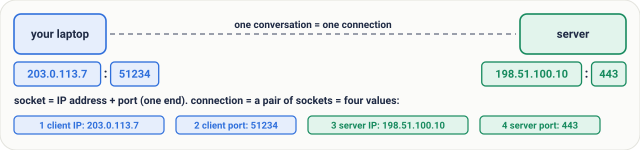
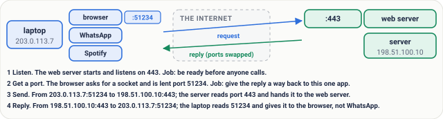
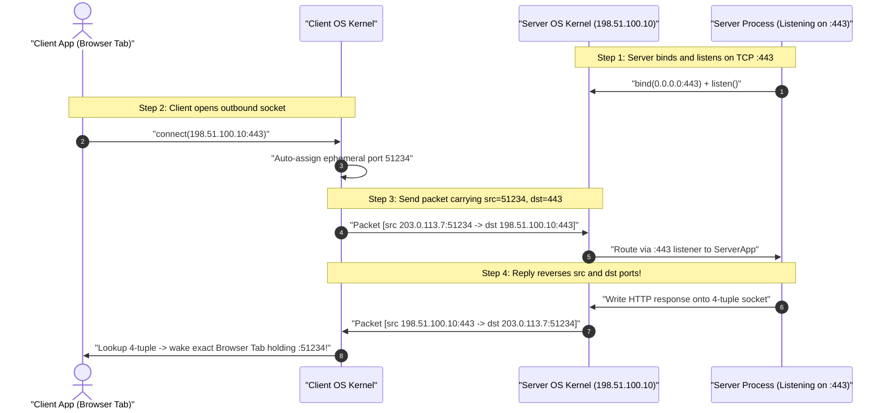
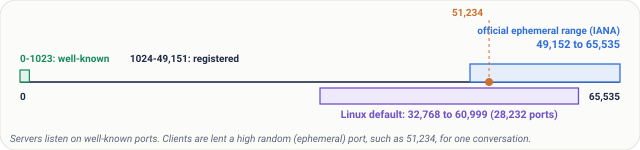
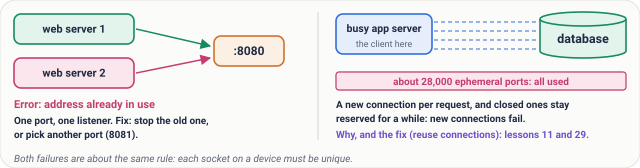
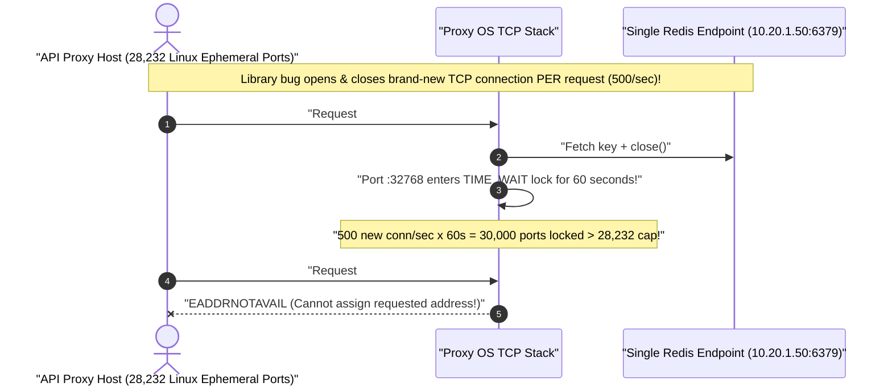

# Lesson 04: Ports and Sockets: Which App Gets the Packet

> **Prerequisites:** [Lesson 03: IP Addresses](../03-ip-addresses/README.md) ([Track Overview](../README.md)).  
> **Estimated Reading Time:** 24 minutes  
> **Target Audience:** Developers understanding how multiple apps share one machine's IP and backend engineers diagnosing `EADDRINUSE`, ephemeral port exhaustion, `TIME_WAIT` storms, and socket/4-tuple limits in high-concurrency proxies.  
> **Free PDF Notes:** [Download SD-N-004.pdf](https://backendroadmap.com/notes/system-design/SD-N-004.pdf)

> [!TIP]
> **The Golden Rule of Ports & Sockets:** An **IP address** delivers packets to the right **device**, while a **16-bit port (`0–65,535`)** delivers them to the exact **application** inside it. Every active TCP connection is uniquely identified by a **4-tuple**—`(source IP, source port, destination IP, destination port)`—which lets one web server listening on port `443` handle millions of simultaneous users without collisions, **as long as outbound proxy hosts don't burn through their finite ephemeral port pool!**

---

## Words You'll Meet Today

| Word | Everyday Meaning | Role in a Live Network |
| :--- | :--- | :--- |
| **Port** | A `16-bit` number (`0–65,535`) identifying a specific application or service on a machine. | Appends after the IP (`192.168.1.5:443`) inside TCP/UDP headers. |
| **Socket** | One endpoint of a live connection: an IP address paired with a port number. | Kernel handle (`file descriptor` on Linux) backing reads/writes to the network. |
| **Listening** | A server app waiting passively on an assigned port for incoming clients. | `listen()` puts a port in `LISTEN` state (`nginx` on `:443`, Postgres on `:5432`). |
| **Protocol** | The agreed conversation language (e.g., `TCP` or `UDP`). | TCP port `53` and UDP port `53` are **distinct independent mailboxes**! |
| **Well-Known Port** | Standardized port (`0–1023`) reserved for core internet services. | `:80` HTTP, `:443` HTTPS, `:22` SSH, `:53` DNS, `:25` SMTP. |
| **Ephemeral Port** | Temporary short-lived client port picked automatically by the OS for one outbound call. | Linux default: `32,768–60,999` (`28,232` ports); IANA standard: `49,152–65,535`. |
| **Connection** | Paired conversation defined by two sockets (the **4-tuple**). | `(src_ip, src_port, dst_ip, dst_port)` keeps tabs/clients separate cleanly. |
| **Address Already in Use** | OS error (`EADDRINUSE`) thrown when two processes attempt to listen on the same IP + port + protocol. | Requires stopping the existing process, choosing another port, or tuning `SO_REUSEADDR`/`SO_REUSEPORT`. |

---

## Visual Mental Models & Architecture

### The Flat With Multiple People Inside

In [Lesson 03](../03-ip-addresses/README.md), we mapped the IP address to **flat `5`** inside an apartment building. Now look inside flat `5`: **Mom, the kid, and Grandpa** all live there! If a parcel reads only `"flat 5"`, nobody knows whose hands to put it in—you write **"Priya — flat 5"** or **"Arjun — flat 5"** on the envelope.

On one computer running a web server, database, SSH daemon, and background worker simultaneously, **the IP address finds flat `5`, and the port number is the person's name on the envelope**:


*Figure 1. The flat (lesson 3's device) has people inside: the apps. The name on each envelope is the port, so the right person gets it.*

When your browser opens [`https://backendroadmap.com`](https://backendroadmap.com), it secretly connects to **`backendroadmap.com:443`**—IP gets the packet onto the host, and `:443` tells the OS kernel *"hand this to the HTTPS web server."*


*Figure 2. Anatomy of 192.168.1.5:443: the IP address finds the device, the port after the colon finds the app. A port is 16 bits, 0 to 65,535.*

### One Server Port, Many Simultaneous Connections (The 4-Tuple!)

A **socket** is one end of a conversation (`IP + port`). An entire live **connection** pairs **both sockets**—creating a **4-tuple**:



*Figure 4. A socket is one end of a conversation, an IP address plus a port. A connection is the pair of sockets: four values.*

How does **one** Nginx instance listening strictly on `:443` serve two tabs from your laptop AND your friend's phone at the exact same millisecond? Because **every 4-tuple row in the kernel table differs in at least one column**:


*Figure 5. One server port serves many connections: a second tab gets another client port, a friend has another address, and every four-value row is still unique.*

| Connection | Client Socket (`src_ip : src_port`) | Server Socket (`dst_ip : dst_port`) | Unique 4-Tuple? |
| :--- | :--- | :--- | :--- |
| **Tab #1 (You)** | `203.0.113.7:51234` | `198.51.100.10:443` | Unique (`51234`) |
| **Tab #2 (You)** | `203.0.113.7:51235` | `198.51.100.10:443` | Unique (`51235`) |
| **Friend's Phone** | `192.0.2.25:50112` | `198.51.100.10:443` | Unique (`192.0.2.25` + `50112`) |

### Step-by-Step Lifecycle of One Request



*Figure 6. One request, step by step: listen, get a port, send, reply. The ports in the header pick the app at each end.*



---

## Real Numbers & Systematic Reference Grids

A port field inside TCP and UDP packet headers is **`16 bits`**, permitting exactly **$2^{16} = 65{,}536$** distinct values (`0` through `65,535`). Those `65,536` ports partition cleanly into three operational zones:



*Figure 3. All 65,536 ports on one line, to scale: well-known 0 to 1023 at the very start, the official ephemeral range 49,152 to 65,535, and the Linux default 32,768 to 60,999.*

### The `65,536`-Port Map & OS Ephemeral Ranges

| Port Range | Category | Count | Real-World Usage & OS Rules |
| :--- | :--- | :--- | :--- |
| **`0–1023`** | **Well-Known / System Ports** | `1,024` | Standard services (`22` SSH, `25` SMTP, `53` DNS, `80` HTTP, `443` HTTPS). Linux requires root or `CAP_NET_BIND_SERVICE` to bind. |
| **`1024–49151`** | **Registered / User Ports** | `48,128` | Application servers & databases (`3000` dev web, `3306` MySQL, `5432` PostgreSQL, `6379` Redis, `8080` HTTP alt). |
| **`49152–65535`** | **IANA Ephemeral / Dynamic** | `16,384` | Official IANA dynamic outbound range (also Windows/macOS modern default). |
| **`32768–60999`** | **Linux Default Ephemeral** | **`28,232`** | Default `ip_local_port_range` on Linux—controls max simultaneous outbound connections to **one** fixed destination IP:port! |

### Essential Well-Known Service Ports Cheat Sheet

| Port | Transport Protocol | Service | Operational Notes |
| :--- | :--- | :--- | :--- |
| **`22`** | TCP | **SSH** | Encrypted remote administration shell. |
| **`25`** | TCP | **SMTP** | Server-to-server email delivery relay. |
| **`53`** | **UDP + TCP** | **DNS** | UDP for fast small lookups; TCP fallback for large responses (`DNSSEC` / zone transfers)—held as separate mailboxes! |
| **`80`** | TCP | **HTTP** | Unencrypted web traffic (typically `301` redirects immediately to `:443`). |
| **`443`** | TCP (HTTP/1.1, H2) / UDP (H3) | **HTTPS (TLS)** | Encrypted web & API traffic (`HTTP/3` QUIC runs over UDP `:443`, covered in Lesson 05/23). |

---

## What Goes Wrong & Production War Story Post-Mortem

Two classic port failures strike engineering teams repeatedly:



*Figure 7. What goes wrong: two apps trying to listen on one port (address already in use), and a busy client using up its ephemeral ports.*

1. **Two listeners on the same port (`EADDRINUSE`):** Launching a second dev server on `:8080` while an older background worker still owns `:8080` fails cleanly at `bind()`.
2. **Ephemeral port exhaustion (`EADDRNOTAVAIL`):** When one busy proxy/client opens thousands of short-lived connections per second to **one fixed server** (e.g., `10.0.1.50:6379`), every closed TCP socket lingers in **`TIME_WAIT`** (typically `60 seconds` on Linux, covered deeply in Lesson 11) before its ephemeral port frees back to the pool—exhausting all **`28,232` ports** at just **`~470` new connections/sec**!

### SEV-1 Post-Mortem: The Reverse Proxy That Exhausted `28,232` Ephemeral Ports Against Redis

#### Incident Overview
* **Severity:** SEV-1 (`100%` Checkout Failure With `connect: cannot assign requested address`)
* **Detection Time:** `4 minutes` after a library upgrade silently disabled Redis connection pooling
* **Resolution Time:** `26 minutes`
* **Impact:** Our API gateway maintained under `500` concurrent requests/sec (`~480` RPS), yet outbound calls to a single internal Redis host (`10.20.1.50:6379`) collapsed with `EADDRNOTAVAIL` despite Redis CPU sitting at `4%`!

#### What Happened


1. An upgraded SDK wrapper opened a **fresh TCP connection per HTTP request** (`conn = connect(); get(); close()`) instead of reusing a persistent connection pool.
2. Each closed TCP connection to `10.20.1.50:6379` held its client ephemeral port in `TIME_WAIT` for `60 seconds`.
3. `500 requests/sec × 60 seconds = 30,000` locked 4-tuples—crossing Linux's `28,232` (`32,768–60,999`) ephemeral ceiling!
4. Every new outbound request crashed immediately inside the proxy OS kernel before even hitting the wire (`Redis` itself stayed `96%` idle!).

#### Root Cause Analysis
1. **Disabled TCP Connection Pooling:** Opening/closing ephemeral 4-tuples per call turned `500 RPS` into `30,000` locked `TIME_WAIT` sockets inside 60 seconds.
2. **All Traffic Funnelled Toward One Single Fixed `(IP, Port)` Target:** Because destination `10.20.1.50:6379` was identical for every call, only **`source_port`** could vary across the 4-tuple—capping concurrency strictly at `ip_local_port_range`!

#### The Fix & Architectural Hardening
1. **Re-Enabled Persistent HTTP/Redis Connection Pools + Keep-Alives:** Replaced per-request sockets with `64` persistent long-lived connections (`500` RPS carried effortlessly across `64` steady 4-tuples instead of `30,000` churning ones!).
2. **Widened Ephemeral Port Range (`ip_local_port_range = 10240 65535`):** Raised headroom on high-egress proxies as defense in depth, paired with Prometheus alerting when `TIME_WAIT` sockets exceed `50%` of local port supply.
3. **Multiple Local Client IPs or Sharded Targets for Massive Gateways:** High-scale load balancers (Lesson 29) assign multiple outbound source IPs when single-IP `~55K` limits are reached.

---

## Multi-Language Production Implementation: Safe Port Binding (`SO_REUSEADDR`) & 4-Tuple Connection Table Tracker

Each implementation demonstrates two fundamental socket/port patterns: **(1)** gracefully catching **`EADDRINUSE`** (`address already in use`) when binding a listener while enabling socket reuse properly, and **(2)** modeling a kernel **4-tuple router + ephemeral port allocator** that isolates concurrent connections to the exact same server port (`:443`) and signals exhaustion cleanly.

````carousel
```go
package socklab

import (
	"errors"
	"fmt"
	"net"
)

type FourTuple struct {
	SrcIP   string
	SrcPort int
	DstIP   string
	DstPort int
}

type ConnectionTable struct {
	active     map[FourTuple]string
	nextPort   int
	maxPort    int
}

func NewConnectionTable(ephemeralStart, ephemeralEnd int) *ConnectionTable {
	return &ConnectionTable{
		active:   make(map[FourTuple]string),
		nextPort: ephemeralStart,
		maxPort:  ephemeralEnd,
	}
}

func (t *ConnectionTable) OpenClientConnection(clientIP, serverIP string, serverPort int, handler string) (FourTuple, error) {
	for port := t.nextPort; port <= t.maxPort; port++ {
		tuple := FourTuple{SrcIP: clientIP, SrcPort: port, DstIP: serverIP, DstPort: serverPort}
		if _, exists := t.active[tuple]; !exists {
			t.active[tuple] = handler
			t.nextPort = port + 1
			return tuple, nil
		}
	}
	return FourTuple{}, errors.New("EADDRNOTAVAIL: ephemeral ports exhausted for target socket")
}

// ListenSafely attempts to bind a port and reports clear diagnostics if already taken.
func ListenSafely(addr string) (net.Listener, error) {
	ln, err := net.Listen("tcp", addr)
	if err != nil {
		return nil, fmt.Errorf("failed binding %s (check for EADDRINUSE): %w", addr, err)
	}
	return ln, nil
}
```
<!-- slide -->
```typescript
import * as net from "node:net";

export interface FourTuple {
  srcIp: string;
  srcPort: number;
  dstIp: string;
  dstPort: number;
}

export class KernelConnectionTable {
  private readonly table = new Map<string, string>();
  private cursor: number;

  constructor(private readonly startPort = 32768, private readonly endPort = 60999) {
    this.cursor = startPort;
  }

  private key(t: FourTuple): string {
    return `${t.srcIp}:${t.srcPort}->${t.dstIp}:${t.dstPort}`;
  }

  openOutbound(clientIp: string, serverIp: string, serverPort: number, tabName: string): FourTuple {
    const capacity = this.endPort - this.startPort + 1;
    for (let i = 0; i < capacity; i++) {
      const port = this.startPort + ((this.cursor - this.startPort + i) % capacity);
      const tuple: FourTuple = { srcIp: clientIp, srcPort: port, dstIp: serverIp, dstPort: serverPort };
      const k = this.key(tuple);
      if (!this.table.has(k)) {
        this.table.set(k, tabName);
        this.cursor = port + 1;
        return tuple;
      }
    }
    throw new Error(`EADDRNOTAVAIL: all ${capacity} ephemeral ports busy against ${serverIp}:${serverPort}`);
  }
}

export function tryBindPort(port: number): Promise<net.Server> {
  return new Promise((resolve, reject) => {
    const srv = net.createServer();
    srv.once("error", (err: NodeJS.ErrnoException) => {
      if (err.code === "EADDRINUSE") {
        reject(new Error(`Port ${port} is already bound by another process!`));
      } else {
        reject(err);
      }
    });
    srv.listen(port, "127.0.0.1", () => resolve(srv));
  });
}
```
<!-- slide -->
```python
import socket
from dataclasses import dataclass


@dataclass(frozen=True)
class FourTuple:
    src_ip: str
    src_port: int
    dst_ip: str
    dst_port: int


class SocketDemuxTable:
    def __init__(self, start_port: int = 32768, end_port: int = 60999) -> None:
        self.start = start_port
        self.end = end_port
        self._table: dict[FourTuple, str] = {}

    def open_connection(self, client_ip: str, server_ip: str, server_port: int, app_label: str) -> FourTuple:
        for port in range(self.start, self.end + 1):
            t = FourTuple(client_ip, port, server_ip, server_port)
            if t not in self._table:
                self._table[t] = app_label
                return t
        raise OSError("EADDRNOTAVAIL: Ephemeral port pool exhausted for destination")


def bind_port_safely(port: int) -> socket.socket:
    sock = socket.socket(socket.AF_INET, socket.SOCK_STREAM)
    sock.setsockopt(socket.SOL_SOCKET, socket.SO_REUSEADDR, 1)
    try:
        sock.bind(("127.0.0.1", port))
        sock.listen(16)
        return sock
    except OSError as exc:
        sock.close()
        raise RuntimeError(f"Cannot bind 127.0.0.1:{port} (already in use or restricted): {exc}") from exc
```
<!-- slide -->
```csharp
using System;
using System.Collections.Generic;
using System.Net;
using System.Net.Sockets;

public readonly record struct FourTuple(string SrcIp, int SrcPort, string DstIp, int DstPort);

public sealed class EphemeralPortAllocator(int minPort = 32768, int maxPort = 60999)
{
    private readonly Dictionary<FourTuple, string> _connections = new();

    public FourTuple Allocate(string clientIp, string serverIp, int serverPort, string sessionName)
    {
        for (int p = minPort; p <= maxPort; p++)
        {
            var tuple = new FourTuple(clientIp, p, serverIp, serverPort);
            if (!_connections.ContainsKey(tuple))
            {
                _connections[tuple] = sessionName;
                return tuple;
            }
        }
        throw new SocketException((int)SocketError.AddressNotAvailable);
    }

    public static TcpListener BindSafely(int port)
    {
        var listener = new TcpListener(IPAddress.Loopback, port);
        try
        {
            listener.Start();
            return listener;
        }
        catch (SocketException ex) when (ex.SocketErrorCode == SocketError.AddressAlreadyInUse)
        {
            throw new InvalidOperationException($"Port {port} is already bound (AddressAlreadyInUse).", ex);
        }
    }
}
```
````

---

## Practical Hands-On Verification CLI Workflows

Watch **live OS ephemeral ports, 4-tuples, and `EADDRINUSE`** locally with Python's built-in socket module—and inspect real open sockets on your machine via `ss` / `netstat`.

### Step 1: Observe Live 4-Tuple Sockets & Trigger Real `EADDRINUSE` Safely

```bash
# Inspect currently open listening & active sockets on your OS:
# Linux:          ss -tan
# macOS/Windows:  netstat -an

python3 - <<'EOF'
import socket

# 1. Start a listening server on an OS-assigned free loopback port
srv = socket.socket(socket.AF_INET, socket.SOCK_STREAM)
srv.bind(("127.0.0.1", 0))
srv.listen(4)
srv_ip, srv_port = srv.getsockname()
print(f"Server listening on socket: {srv_ip}:{srv_port}")

# 2. Open two parallel client tabs against the SAME server port
c1 = socket.create_connection((srv_ip, srv_port))
c2 = socket.create_connection((srv_ip, srv_port))
print(f"Tab #1 4-tuple: {c1.getsockname()[0]}:{c1.getsockname()[1]} -> {srv_ip}:{srv_port}")
print(f"Tab #2 4-tuple: {c2.getsockname()[0]}:{c2.getsockname()[1]} -> {srv_ip}:{srv_port}")

# 3. Attempt a duplicate listener on the exact same port (triggers Address Already In Use!)
dup = socket.socket(socket.AF_INET, socket.SOCK_STREAM)
try:
    dup.bind((srv_ip, srv_port))
except OSError as err:
    print(f"Duplicate bind rejected safely: errno={err.errno} ({err.strerror})")
finally:
    for s in (dup, c1, c2, srv): s.close()
EOF
```

**Expected Output:**
```text
Server listening on socket: 127.0.0.1:41932
Tab #1 4-tuple: 127.0.0.1:54810 -> 127.0.0.1:41932
Tab #2 4-tuple: 127.0.0.1:54812 -> 127.0.0.1:41932
Duplicate bind rejected safely: errno=98 (Address already in use)
```

---

## Pause and Think & Validation Checkpoints

### Pause and Think

An active web server handles `100,000` mobile phone connections simultaneously on a single server listening port (`443`). How can **one port** serve `100,000` different phones without mixing up messages?

<details>
<summary><strong>Click to see the answer</strong></summary>

**A connection is identified by the full four-value tuple (`client IP, client port, server IP, server port`) — not by server port alone.** All `100,000` connections share the same right half (`server_ip : 443`), yet every phone carries a different client IP (and/or a different client ephemeral port when behind shared carrier NAT). Because every 4-tuple row in the server kernel's socket table is unique, the OS demultiplexes all `100,000` streams to their exact handles cleanly.


*Figure 8. 100,000 phones can all connect to port 443; each four-value pair is different, so one server port is enough.*

</details>

### Operational Validation Checkpoints (Scenario Quizzes)

<details>
<summary><strong>Checkpoint 1: Same Port `53` Running on Both UDP and TCP</strong></summary>

**Scenario:** You run `ss -tulnp` on a DNS resolver container and notice `coredns` bound to `0.0.0.0:53` on **UDP** AND `0.0.0.0:53` on **TCP** simultaneously without throwing `Address already in use`. Is the OS broken?

<strong>Answer:</strong>
No! Socket bindings are scoped by **`(protocol, local_ip, local_port)`**. TCP port `53` and UDP port `53` live in completely separate transport port spaces inside the kernel—so one daemon can bind both cleanly to serve tiny fast UDP queries alongside larger TCP DNS responses.
</details>

<details>
<summary><strong>Checkpoint 2: Why Dev Server Fails With `EADDRINUSE` After a Crash-Restart</strong></summary>

**Scenario:** You stop a Node/Go HTTP server (`:3000`) mid-request and immediately rerun it 1 second later, only to see `listen tcp :3000: bind: address already in use`. Or a zombie previous instance was still running. What two root causes explain this?

<strong>Answer:</strong>
Either **(1)** another orphaned process is still running and bound to `:3000` (`lsof -i :3000` / `ss -tlp` reveals it), OR **(2)** old client sockets from the crashed process linger briefly in **`TIME_WAIT`** without `SO_REUSEADDR` enabled on the listening socket.
</details>

<details>
<summary><strong>Checkpoint 3: Calculating Ephemeral Ceiling Against One Upstream Endpoint</strong></summary>

**Scenario:** A proxy runs on default Linux (`ip_local_port_range = 32768 60999`) with **1 outbound public IP** and talks without connection pooling to **1 Redis node** (`10.0.1.5:6379`). Closed sockets stay in `TIME_WAIT` for `60 s`. What is the hard maximum sustainable new-connection rate before `EADDRNOTAVAIL` strikes?

<strong>Answer:</strong>
Available ephemeral ports = `60,999 - 32,768 + 1 = 28,232`. Spread across a `60`-second `TIME_WAIT` window: `28,232 ÷ 60 ≈ 470.5` new connections/sec! Exceeding ~`470` new unpooled connections per second against that single `(dst_ip, dst_port)` saturates every 4-tuple. Connection pooling fixes it permanently!
</details>

---

## Interview Practice Questions

Each question is tagged by kind: **Basic** (definitions), **Scenario** (apply it to a system), and **Tricky** (deep follow-ups). Answer out loud before opening the solution.

<details>
<summary><strong>1. What is the difference between an IP address and a port? (Basic)</strong></summary>

<strong>What a strong answer covers:</strong>
An **IP address** identifies the **device (host)** on the network; a **port** (`0–65,535`) identifies the **specific application/mailbox** inside that device (`192.168.1.5:443`). Both are required for a packet to reach the right program on the right machine.

</details>

<details>
<summary><strong>2. What is a socket, and how is a connection identified? (Basic)</strong></summary>

<strong>What a strong answer covers:</strong>
A **socket** is one endpoint of communication (`IP + port`, e.g., `203.0.113.7:51234`). An active connection is uniquely identified by **the pair of sockets — the 4-tuple**: `(client IP, client port, server IP, server port)`.

</details>

<details>
<summary><strong>3. Name three well-known ports and what uses them. (Basic)</strong></summary>

<strong>What a strong answer covers:</strong>
Port **`80`** for plain **HTTP**, port **`443`** for encrypted **HTTPS**, and port **`22`** for **SSH** remote shells (plus **`53`** for DNS and **`25`** for SMTP email transfer). Well-known ports sit in `0–1,023`.

</details>

<details>
<summary><strong>4. You try to start two copies of your server on port `8080`, and the second fails with "address already in use". Why, and how do you fix it? (Scenario)</strong></summary>

<strong>What a strong answer covers:</strong>
The operating system routes arriving packets per `(protocol, IP, port)`. If two unrelated servers simultaneously listened on `0.0.0.0:8080`, the kernel wouldn't know which app owns incoming requests—so it throws **`EADDRINUSE`**. Fix by stopping the existing listener (`ss`/`lsof`), running the second server on another port (e.g., `:8081`), or placing a reverse proxy (`Nginx`) in front. *(Note: worker pre-fork architectures can also intentionally share one bound port using `SO_REUSEPORT`.)*

</details>

<details>
<summary><strong>5. A port is 16 bits, so there are only 65,536 ports. How can a server handle a million concurrent connections on port 443? (Tricky)</strong></summary>

<strong>What a strong answer covers:</strong>
The `65,536` limit applies to **distinct local port numbers**, NOT to incoming connections on a server listener! Every TCP connection is keyed by its full **4-tuple** (`client IP, client port, server IP, server port`). One listener on `:443` accepts millions of connections because each client contributes a distinct `client IP + client port` combination (`~4.3B IPs × ~28K–65K ports`). The real server limits become **RAM, CPU, and file descriptors (`ulimit -n`)**, not port count. *(See Lessons 11 and 29 for `TIME_WAIT` & Linux limits!)*

</details>

<details>
<summary><strong>6. Your API gateway acts as a client calling one internal database server on port `5432`, opening a brand-new connection per request. Why might it run out of ports at 500 req/s? (Tricky)</strong></summary>

<strong>What a strong answer covers:</strong>
In that outbound direction, `server_ip`, `server_port (:5432)`, and `client_ip` are **fixed**—leaving ONLY **`client ephemeral port`** to vary (`28,232` default ports on Linux `32,768–60,999`). Worse, closed connections remain locked in **`TIME_WAIT`** for `60 seconds` before recycling (building directly on TCP mechanics from [Lesson 08](../08-tcp-sequence-numbers-and-acks/README.md) and Lesson 11). `500 req/s × 60 s = 30,000` locked ports > `28,232` available—so new calls crash with `EADDRNOTAVAIL`. **Fix:** maintain persistent connection pools (keep-alives) instead of churning TCP sockets per request.

</details>

---

## Common Mistakes & Troubleshooting

- **Assuming each user connection consumes a separate server port:** A listening server holds only **one port** (`:443`) regardless of whether `10` or `1,000,000` clients connect; only the 4-tuple table grows.
- **Forgetting TCP and UDP port spaces are separate:** Binding TCP `:53` never blocks UDP `:53` (and vice versa).
- **Opening/closing raw TCP connections per request inside a proxy or backend client:** Guarantees `TIME_WAIT` ephemeral port exhaustion under load—always use persistent HTTP/DB connection pools.

---

## Recap in Three Lines

1. An **IP address** reaches the **device**; a **16-bit port (`0–65,535`)** delivers the packet to the right **application** inside it.
2. One socket is `IP + port`, and every connection is uniquely keyed by the **4-tuple** (`client IP, client port, server IP, server port`)—letting one `:443` server serve millions concurrently.
3. Servers wait on **well-known/registered ports**, while clients use **ephemeral ports** (`32,768–60,999` on Linux)—so high-throughput clients must pool connections to avoid ephemeral port exhaustion.

---

## Sources

- [RFC 9293: Transmission Control Protocol (TCP)](https://www.rfc-editor.org/rfc/rfc9293) — `16-bit` TCP ports, socket pairs, and TCP connection 4-tuple identification.
- [RFC 768: User Datagram Protocol](https://www.rfc-editor.org/rfc/rfc768) — `16-bit` UDP source/destination port header format.
- [RFC 6335: IANA Procedures for the Management of the Service Name and Transport Protocol Port Number Registry](https://www.rfc-editor.org/rfc/rfc6335) — defines System (`0–1023`), User (`1024–49151`), and Dynamic/Private (`49152–65535`) ranges.
- [IANA Service Name and Transport Protocol Port Number Registry](https://www.iana.org/assignments/service-names-port-numbers/service-names-port-numbers.xhtml) — official live directory of well-known and registered ports.
- [RFC 6056: Recommendations for Transport-Protocol Port Randomization](https://www.rfc-editor.org/rfc/rfc6056) — ephemeral port allocation guidance (`32768–60999` Linux convention noted alongside IANA range).
- [RFC 5737: IPv4 Address Blocks Reserved for Documentation](https://www.rfc-editor.org/rfc/rfc5737) — `192.0.2.0/24`, `198.51.100.0/24`, and `203.0.113.0/24` documentation ranges used in examples.

---

## Free PDF notes

Download these notes as a printable PDF, with every diagram: [SD-N-004.pdf](https://backendroadmap.com/notes/system-design/SD-N-004.pdf).

---

## Next

Continue with [Lesson 05: Protocols and Layers: Agreed Languages, and Why We Stack Them](../05-protocols-and-layers/README.md) to see how HTTP messages, TCP segments, IP packets, and Ethernet/Wi-Fi frames stack seamlessly via encapsulation so you can swap wires without rewriting apps.
