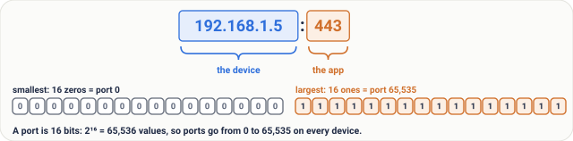
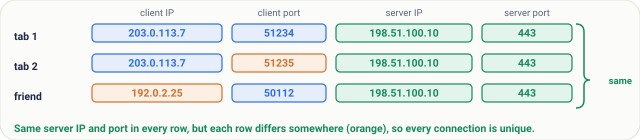
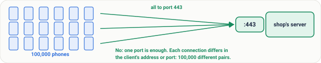

# Lesson 04: Ports and Sockets: Which App Gets the Packet

## Roadmap

You are in **System Design Interview Prep**, Track 02, **Networking from Zero**: lesson 4 of 30. It builds on [lesson 3](../03-ip-addresses/README.md), where the IP address gets a packet to the right device, like the address that gets a courier to the right flat. The next lesson is [protocols and layers](../05-protocols-and-layers/README.md). See [the track overview](../README.md) for the whole plan.

These are the written notes for the lesson's video. Prefer paper? The same notes are a free, printable PDF: [download SD-N-004.pdf](https://backendroadmap.com/notes/system-design/SD-N-004.pdf).

## Concept

> [!key] The IP address gets a packet to the device; the port, a 16-bit number from 0 to 65,535, gets it to one app on that device. Servers listen on well-known ports such as 443, clients are lent a random high (ephemeral) port, and a connection is a pair of sockets: four values (client IP, client port, server IP, server port) that make it unique.

## Words you'll meet today

| Word | In plain words |
|---|---|
| **Port** | a number (0 to 65,535) that names one app on a device |
| **Socket** | one end of a conversation: an IP address plus a port |
| **Listening** | an app waiting for packets on its port |
| **Protocol** | agreed rules for talking; TCP and UDP are the two main ones |
| **Well-known port** | a fixed number for a common service, 0 to 1023 (443 is HTTPS) |
| **Ephemeral port** | a high random port lent to a client for one conversation |
| **Connection** | a pair of sockets: client IP and port, server IP and port |
| **Address already in use** | the error you get when a second app tries to listen on a taken port |

## The question: which app gets the packet?

Your phone is running WhatsApp, Chrome and Spotify, all at the same time. A message arrives, a web page arrives, a song arrives.

But in lesson 3, we saw that your phone has one IP address. All three apps share it. So when a packet arrives, how does the phone know which app it's for?

## An everyday picture first: the people inside the flat

In lesson 3, the address got the courier to one flat. But a flat has people in it: Mom, the kid, and Grandpa.

The courier brings a bank letter and a parcel. The flat number gets both to the door. The **name** on each one says who inside wants it. The letter is for Mom. The parcel is for the kid.

And someone must be home, waiting for it. If nobody with that name lives here, the letter can't be delivered.

*Figure 1. The flat (lesson 3's device) has people inside: the apps. The name on each envelope is the port, so the right person gets it.*

## Now the real thing

| The flat | In a network |
|---|---|
| The flat | your device, found by its **IP address** ([lesson 3](../03-ip-addresses/README.md)) |
| The people inside | the **apps** running on it |
| The name on the envelope | the **port number**, written in each packet's header |
| Someone at home, waiting | an app **listening** on its port |

So every packet carries two things. The IP address, to reach the device. And the port, to reach one app on it. Together they say: this device, this app.

## What a port looks like

A port is just a number, written after the address with a colon. So `192.168.1.5:443` means: that device, port 443.

A port is stored in 16 bits. 2 to the power 16 is 65,536. So ports go from **0 to 65,535**: over 65,000 possible ports on every device.

*Figure 2. Anatomy of 192.168.1.5:443: the IP address finds the device, the port after the colon finds the app. A port is 16 bits, 0 to 65,535.*

The low ones, **0 to 1023**, are **well-known ports**, fixed for common services:

| Port | Service | What it's for |
|---|---|---|
| **80** | HTTP | the web |
| **443** | HTTPS | the secure web |
| **22** | SSH | logging in to a server |
| **53** | DNS | looking up names (lessons 15 to 17) |
| **25** | SMTP | sending email between mail servers |

That's why you never type a port. Open a web address, and the browser uses 443 by itself: `https://backendroadmap.com` means `backendroadmap.com:443`.

## Listening, and the protocol

On a server, an app opens a port and waits. That's called **listening**, like Mom at home, waiting for her letter. A web server listens on 443, and a packet for port 443 goes to it, and only to it.

One more detail. Each port belongs to a **protocol**: TCP or UDP, two sets of rules for sending data. Port 53 over TCP and port 53 over UDP are separate. You'll meet TCP in lessons 8 to 11 ([lesson 8](../08-tcp-sequence-numbers-and-acks/README.md) is already out) and UDP in lesson 12.

## Your side: an ephemeral port

Your browser isn't a well-known service. So when it connects, your laptop lends it a port: a high random number, for example **51,234**. It's called an **ephemeral port**, because it lasts only as long as the conversation.

They come from a high range. The official one is **49,152 to 65,535**. Linux uses **32,768 to 60,999** by default, which is 28,232 ports.

*Figure 3. All 65,536 ports on one line, to scale: well-known 0 to 1023 at the very start, the official ephemeral range 49,152 to 65,535, and the Linux default 32,768 to 60,999.*

> [!tip] **See them yourself.** On Windows, Mac or Linux, type `netstat -an` (on Linux, `ss -tan` works too). Each line is one socket: an address, a colon and a port. Lines that say `LISTEN` are apps waiting on their port; the others are live connections, with your side's high ephemeral port.

## Sockets and connections

A **socket** is one end of a conversation: an IP address plus a port. Your laptop's end is `203.0.113.7:51234`. The server's end is `198.51.100.10:443`.

A **connection** is the pair of sockets: four values. Client IP, client port, server IP, server port. No two connections share all four.

*Figure 4. A socket is one end of a conversation, an IP address plus a port. A connection is the pair of sockets: four values.*

So one server port can serve many people. Your second tab gets another port: 51,235. A friend connects from a different address. Same server port, but every connection is unique:

| Connection | Client IP | Client port | Server IP | Server port |
|---|---|---|---|---|
| your tab 1 | 203.0.113.7 | 51234 | 198.51.100.10 | 443 |
| your tab 2 | 203.0.113.7 | **51235** | 198.51.100.10 | 443 |
| a friend | **192.0.2.25** | 50112 | 198.51.100.10 | 443 |

*Figure 5. One server port serves many connections: a second tab gets another client port, a friend has another address, and every four-value row is still unique.*

## Step by step: one request

Let's follow one request. Each step has a job.

1. **Listen.** The web server starts, and listens on 443. The job: be ready before anyone calls.
2. **Get a port.** Your browser asks for a socket, and gets port 51,234. The job: give the reply a way back to this one app.
3. **Send.** The packet goes out, from `203.0.113.7:51234` to `198.51.100.10:443`. The server reads the port, and hands it to the web server. The job: carry both ends, so each side knows where to reply.
4. **Reply.** The reply comes back with the ports swapped: from 443, to 51,234. Your laptop reads the port, and gives it to the browser. Not to WhatsApp, not to Spotify. The job: the right app, every time.

*Figure 6. One request, step by step: listen, get a port, send, reply. The ports in the header pick the app at each end.*

> [!note] **For the curious.** At home, your router also rewrites the port as it shares one public address, so the server may see a different client port. That's NAT, lesson 14. The addresses 203.0.113.7, 198.51.100.10 and 192.0.2.25 come from ranges reserved for examples in documentation (RFC 5737), so they belong to nobody real.

## What goes wrong

- **Port already in use.** You start a web server on port 8080. Then you start a second one, also on 8080. It fails: `address already in use`. One port, one listener; otherwise, the system couldn't know which app gets the packet. The fix: stop the old one, or pick another port.
- **Running out of ports.** Linux has about 28,000 ephemeral ports. A busy server that opens a new connection to its database for every request can use them all, because closed ones stay reserved for a while. New connections fail. Why, and the fix, is lesson 11 (and reusing connections is lesson 29).

*Figure 7. What goes wrong: two apps trying to listen on one port (address already in use), and a busy client using up its ephemeral ports.*

## Pause and think

> [!exercise] A shop's server listens on port 443. 100,000 phones connect at the same time. Does it need 100,000 ports? Decide before you open the answer.

Answer

No. They all use the same server port, 443. Each connection is still unique, because the client's address or port is different. One port, 100,000 different pairs.

*Figure 8. 100,000 phones can all connect to port 443; each four-value pair is different, so one server port is enough.*

## Common mistakes

- **"A server needs a new port for every client."** No. Every client connects to the same listening port; the four values keep the connections apart.
- **"A port and a socket are the same thing."** No. A port is just a number, 0 to 65,535. A socket is an IP address plus a port: one end of a conversation.

## Recap in three lines

1. The IP address finds the device, and the port, a number from 0 to 65,535, finds the app.
2. Servers listen on well-known ports, like 443, and clients get a random high port.
3. A socket is an IP address plus a port, and a connection is a pair of sockets: four values.

## Interview questions

Each question is tagged by kind: **Basic** (definitions), **Scenario** (apply it) and **Tricky** (the follow-ups interviewers use to go deeper). Each answer is what to say in about 30 seconds. Answer out loud before you open it.

> [!interview] What is a port, and why do we need one if we already have an IP address? (Basic)

What to say in 30 seconds

A port is a 16-bit number that identifies an app on a host, so many apps can share one IP address. Servers listen on well-known ports, like 80, 443 and 22, and clients use ephemeral ports. A connection is identified by four values: client IP and port, server IP and port. That's why one server port can serve many clients.

> [!interview] What is a socket, and what identifies a connection? (Basic)

What to say in 30 seconds

A socket is one end of a conversation: an IP address plus a port, such as 203.0.113.7:51234. A connection is a pair of sockets, so it is identified by four values: client IP, client port, server IP and server port, plus the protocol, TCP or UDP. No two live connections share all of them.

> [!interview] What are well-known ports and ephemeral ports? (Basic)

What to say in 30 seconds

Well-known ports, 0 to 1023, are fixed for common services: 80 HTTP, 443 HTTPS, 22 SSH, 53 DNS, 25 SMTP. Servers listen on them so clients know where to connect. A client is lent an ephemeral port, a high random number, for one conversation: the official range is 49,152 to 65,535, and Linux uses 32,768 to 60,999 by default.

> [!interview] You start your app and get "address already in use". What happened, and what do you do? (Scenario)

What to say in 30 seconds

Another process is already listening on that port, maybe an old copy of your app. Only one app can listen on a given IP address and port, otherwise the system could not tell which one gets the packet. Find and stop the old process, or start your app on a different port.

> [!interview] How can one server port, 443, serve 100,000 clients at once? (Tricky)

What to say in 30 seconds

The server does not need a port per client. Each connection is the four values, and while the server IP and port are the same for all of them, the client IP or client port is different in every one, so each connection is still unique. The limits are memory, file handles and CPU, not the port number.

> [!interview] Can a client run out of ports? (Tricky)

What to say in 30 seconds

Yes. A client has only a few tens of thousands of ephemeral ports, about 28,000 on Linux by default, for connections to one server address and port. A busy service that opens a new connection for every request, while closed ones stay reserved for a while (TIME_WAIT), can use them all, and new connections fail. The fixes, such as reusing connections, are in lessons 11 and 29.

## Free PDF notes

Download these notes as a printable PDF, with every picture, the port tables and the interview answers: [SD-N-004.pdf](https://backendroadmap.com/notes/system-design/SD-N-004.pdf).

## Sources

- [RFC 9293: Transmission Control Protocol (TCP)](https://www.rfc-editor.org/rfc/rfc9293), ports and the four values that identify a connection.
- [RFC 768: User Datagram Protocol](https://www.rfc-editor.org/rfc/rfc768), UDP's own source and destination ports.
- [RFC 6335: IANA Procedures for the Management of the Service Name and Transport Protocol Port Number Registry](https://www.rfc-editor.org/rfc/rfc6335), the three port ranges (0 to 1023, 1024 to 49151, 49152 to 65535).
- [IANA Service Name and Transport Protocol Port Number Registry](https://www.iana.org/assignments/service-names-port-numbers/service-names-port-numbers.xhtml), the list of well-known ports.
- [RFC 6056: Recommendations for Transport-Protocol Port Randomization](https://www.rfc-editor.org/rfc/rfc6056), how clients pick ephemeral ports.
- [RFC 5737: IPv4 Address Blocks Reserved for Documentation](https://www.rfc-editor.org/rfc/rfc5737), the example addresses used here.

## Next

Next comes [lesson 5, protocols and layers](../05-protocols-and-layers/README.md): how do the two sides agree on what each packet means? Until then, the [track overview](../README.md) lists the whole series, and [lesson 8](../08-tcp-sequence-numbers-and-acks/README.md) is already out.
